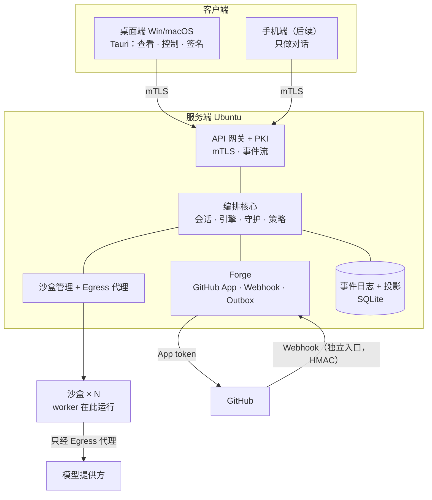
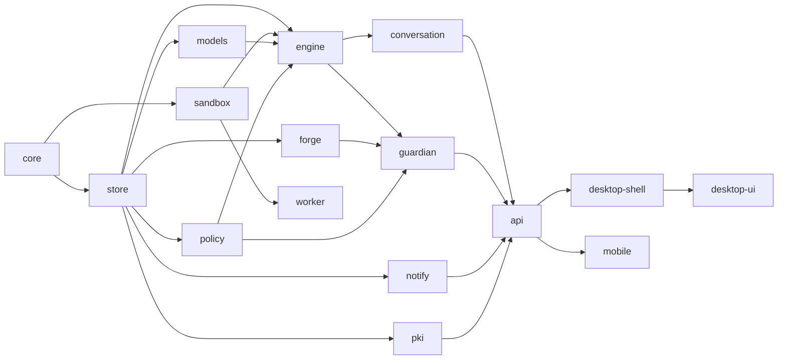
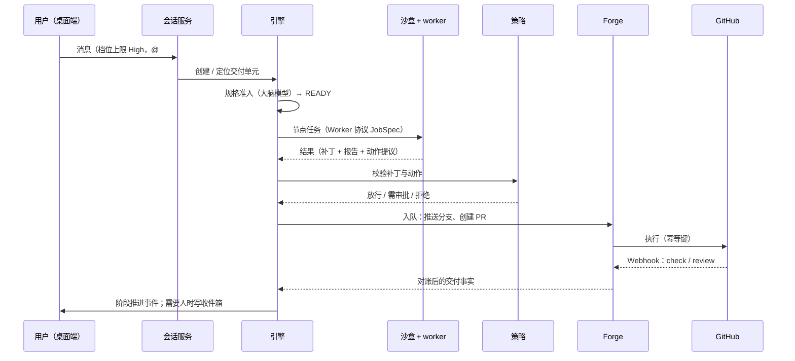

# Gantry 架构设计

> 状态：设计阶段 v0.1（2026-10-24）。决策的确定程度见 [decisions.md](decisions.md)；本文中标注 **[提议]** 的内容尚未经用户确认。讨论过程见 [design.md](design.md)。

本文是所有模块共同遵守的"总图"：目标与边界、模块地图、信任边界与不变式、状态归属、核心流程、档位与模型分层。单个模块怎么做见 [modules/](modules/)，模块之间的 IO 契约见 [interfaces/](interfaces/)，数据结构见 [data-model.md](data-model.md)。

## 1. 目标与非目标

**目标**：一个基于 DAG 编排、与 GitHub 业务强关联、按阶段管理交付的 AI 开发平台。用户在对话里描述任务，Gantry 按档位把任务展开成一张由多个 agent 节点组成的图，在服务端沙盒里执行，以 GitHub 的 Issue / PR / Check / Review 作为交付证据，把工作推进到合并。

Gantry 中的"AI IDE"指**工程编排工作台**：主对话 + 交付关系地图 + 工作树 + 检视器，而不是代码编辑器。

**非目标**（第一版明确不做）：

| 非目标 | 说明 |
| --- | --- |
| 自研代码编辑器 | 人看代码用现有编辑器 `git fetch` agent 推送的分支 [提议] |
| 桌面端本地执行代码 | 执行全部在服务端沙盒 |
| 多租户 SaaS | 第一版单人自托管 [提议] |
| fork PR / 外部贡献者的不可信代码执行 | 第一版不接收，因此不需要 microVM [提议] |
| GitLab / GHES | 第一版只支持 github.com；Forge 层保留接口 |
| 手机端复杂功能 | 手机端只做"给 agent 发消息"的对话 |

## 2. 术语

| 术语 | 含义 |
| --- | --- |
| 档位 Level | None / Low / Medium / High / Max / Ultimate，用户为任务设定的**编排上限** |
| 交付单元 Delivery | 一次"从规格到合并"的工作：绑定 1..n 个 Issue、0..1 个 PR、0..1 个工作树。阶段机作用于交付单元 |
| 阶段 Stage | 交付单元的生命周期：规格 → 计划 → 实现 → 提出 → 评审 → 合并 → 关闭 |
| 图 Workflow | 一个阶段内展开的 DAG；节点是 agent 任务，边表示消费上游产物 |
| 节点 / 尝试 Node / Attempt | 节点是图上的一个任务；每次执行是一个尝试，尝试不可变 |
| Gate / 判定 | 负责判断的节点，输出 verdict：`ACCEPT` / `REVISE` / `REJECT` / `BLOCKED` |
| reasoner / arbiter | reasoner 预演执行路径；arbiter 对一组 review 结果做唯一裁决 |
| Gantry 审批 | 用户用设备私钥对"动作 + 目标 + head SHA"签名，授权 Gantry 执行一个危险动作 |
| GitHub 审批 | GitHub 上的 PR review approve。与 Gantry 审批是**两件事**，见 §6.4 |
| 工作树 Worktree | 服务端上某分支的检出，归属一个交付单元 |
| 沙盒 Sandbox | 一次性的隔离执行环境，worker 在其中运行 |
| 三类模型 | 打杂（Utility）、大脑（Planner）、干活（Worker），见 §8 |
| 后台守护 Guardian | PR 打开后由事件驱动的审核与修复循环 |
| 上报 | 守护或引擎遇到需要人决定的事，写入收件箱并通知 |

## 3. 部署拓扑

服务端第一版是**单个进程 + 外部沙盒运行时**：模块是同一个 Rust workspace 里的 crate，进程内调用；沙盒由 rootless Podman（+ gVisor）拉起，与服务端进程使用不同的系统用户。[提议]

## 4. 模块地图

每个模块有一份规格书 `docs/modules/<id>.md`，按 [模板](modules/_template.md) 写明职责、IO、依赖、状态、错误、验收。

| ID | 模块 | 职责（一句话） | 位置 | 依赖 |
| --- | --- | --- | --- | --- |
| `core` | 领域核心 | 领域类型、ID、状态机、事件定义；无 IO | 共享 crate | — |
| `store` | 事件存储 | 追加式事件日志、投影、游标、Outbox 表 | 服务端 | core |
| `engine` | 编排引擎 | 档位 → 图模板、调度、预算、阶段机推进 | 服务端 | core, store, models, sandbox, policy |
| `conversation` | 会话服务 | 主对话、意图解析、把消息变成交付单元或查询 | 服务端 | core, store, engine, models |
| `guardian` | PR 后台守护 | 消费 PR 事件，分流自愈 / 上报 | 服务端 | engine, forge, policy |
| `forge` | GitHub 接入 | App 鉴权、API、Webhook 接收、对账、Outbox 执行 | 服务端 | core, store |
| `sandbox` | 沙盒管理 | 驱动、工作区准备、资源限制、产物提取 | 服务端 | core |
| `egress` | 出网代理 | 白名单、按目标注入凭据、出网审计 | 服务端（独立进程） | — |
| `worker` | Worker 适配 | 在沙盒内运行 agent CLI，执行 Worker 协议 | 沙盒内 + 服务端 | sandbox |
| `models` | 模型路由 | 三类模型配置、调用、计费记账 | 服务端 | core, store |
| `policy` | 策略与审计 | 危险动作判定、路径规则、审批验签、审计日志 | 服务端 | core, store |
| `notify` | 收件箱与通知 | 上报项、桌面/手机推送 | 服务端 | core, store |
| `api` | API 网关 | HTTP API、事件流、设备鉴权 | 服务端 | 全部服务端模块, pki |
| `pki` | 证书与配对 | 私有 CA、配对、签发、轮换、吊销 | 服务端 | store |
| `desktop-shell` | 桌面外壳 | Tauri 进程：密钥存储、签名、mTLS 客户端、IPC 边界 | 桌面端 | api 契约 |
| `desktop-ui` | 桌面界面 | 工作区（对话/地图/工作树/检视器）、设置 | 桌面端 WebView | desktop-shell |
| `mobile` | 手机端（后续） | 只做对话 | iOS (UIKit) | api 契约 |
| `deploy` | 部署 | 安装脚本、systemd、GitHub App 创建引导、备份 | 服务端主机 | — |

## 5. 信任边界与不变式

所有模块都必须遵守以下不变式；任何设计或实现与之冲突时，以本节为准。

| # | 不变式 |
| --- | --- |
| I1 | **沙盒只计算**：沙盒内没有 GitHub 网络、没有长期凭据；只能经 [Worker 协议](interfaces/worker-protocol.md) 交回产物和"动作提议" |
| I2 | **GitHub 写入唯一路径**：所有 GitHub 写操作只由 `forge` 的 Outbox 执行，每个动作带幂等键；其他模块只能入队 |
| I3 | **放行唯一决策点**：危险动作是否放行只由 `policy` 判定；Gantry 审批绑定 head SHA，之后任何推送都使该审批失效 |
| I4 | **状态各有事实源**：编排状态以本地事件日志为准；交付事实（PR 是否合并、Issue 是否关闭、check 结果）以 GitHub 为准。两者由 `forge` 的对账器同步，冲突时交付事实以 GitHub 为准，并记录差异事件 |
| I5 | **外部文本不可信**：Issue/PR 正文、评论、CI 日志、依赖文档、仓库内容一律是数据；进入 prompt 时加隔离标记，不能据此提升权限或绕过策略 |
| I6 | **客户端不执行、不持凭据**：桌面端和手机端只查看、控制、签名；不执行代码，不持有 GitHub 或模型凭据 |
| I7 | **配置与工作分离**：模型、档位预算、策略等配置只在设置中修改；工作界面只显示运行状态 |
| I8 | **执行产物先验后推**：沙盒交回的改动以补丁形式由服务端在干净检出上应用、校验（路径规则、大小、敏感文件）后再提交推送；服务端不在沙盒产出的 `.git` 上运行 git |

信任边界：

| 区域 | 信任级别 | 能接触的东西 |
| --- | --- | --- |
| 服务端核心进程 | 可信 | 状态库、GitHub App 私钥（经密钥模块）、CA 中间证书私钥 |
| Egress 代理 | 可信，独立进程 | 模型 API key、包仓库只读凭据（只在出站时注入到指定目标） |
| 沙盒 | **不可信** | 一次性工作区副本、Worker 协议端点、经代理的白名单网络 |
| GitHub 内容 | **不可信数据** | — |
| 桌面端 | 可信但会失窃 | 设备私钥（不可导出）、服务端 CA 指纹 |

## 6. 状态归属

| 数据 | 事实源 | 存储 | 备份 |
| --- | --- | --- | --- |
| 图、节点、尝试、预算消耗 | 本地事件日志 | SQLite `events` + 投影 | 需要 |
| 交付单元的阶段 | 本地事件日志（由 GitHub 证据驱动推进） | 同上 | 需要 |
| PR 状态、合并、Issue 关闭、check 结果 | GitHub | 本地只缓存快照 | 不需要（可重建） |
| Outbox 待执行动作 | 本地 | `outbox` 表 | 需要 |
| 会话消息、收件箱 | 本地 | 事件日志 + 投影 | 需要 |
| Gantry 审批记录、审计日志 | 本地，追加式 | 事件日志 | 需要 |
| 设备、证书、吊销表 | 本地 | `pki` 表 | 需要 |
| CA 根私钥 | 离线 | 部署时导出到离线介质，服务端不常驻 | 离线保存 |
| CA 中间私钥、App 私钥、webhook secret、模型 key | 本地密钥文件（加密） | `secrets/`，仅服务端用户可读 | 需要（加密备份） |
| 工作树内容 | GitHub 分支 + 本地检出 | 文件系统 | 不需要（可重建） |

## 7. 核心流程

### 7.1 首次部署与配对

1. 在 Ubuntu 上运行安装脚本：创建系统用户、目录、systemd 服务；生成离线根 CA（导出备份后从服务端删除根私钥）和在线中间 CA；签发服务端证书。
2. 安装脚本输出 GitHub App 创建链接（App Manifest 流程），用户在 GitHub 上确认创建并安装到选定仓库；服务端保存 App 私钥与 webhook secret。
3. 配置 webhook 入口：公网主机直接暴露 `/webhook` 路径；内网主机用只转发 `/webhook` 的隧道（如 cloudflared），**不使用 smee.io**。
4. 服务端执行 `gantry pair`，显示二维码 / 配对串（地址 + CA 指纹 + 一次性 token）。
5. 桌面端扫码，本地生成密钥对，用 CA 指纹固定信任，经**单向 TLS 的配对端点**提交 CSR + token，拿到客户端证书；两端显示 6 位确认码，人工核对。
6. 之后桌面端所有请求走 mTLS。用户在设置页填入模型提供方凭据（只发送到服务端保存）。

细节见 [modules/pki.md](modules/pki.md) 与 [modules/deploy.md](modules/deploy.md)。

### 7.2 从对话到合并

1. 用户在主对话里发消息，可带档位上限和 `@` 引用（Issue / PR / 工作树）。
2. 会话服务用大脑模型解析意图：查询类直接回答；任务类创建或定位交付单元。
3. 引擎按档位选图模板，进入"规格"阶段做准入；不满足时在对话里追问。
4. 实现阶段：引擎为节点分配沙盒，worker 执行，交回补丁。
5. 服务端在干净检出上应用补丁、校验、提交；经 Outbox 推送分支、创建 PR（"提出"阶段）。
6. 评审阶段由档位决定图的形态（见 §8），PR 打开后后台守护接管 CI 与 review 事件。
7. 合并前经策略判定；需要时请求 Gantry 审批（设备签名），并遵守仓库的分支保护（见 §7.4）。
8. GitHub 确认合并、关联 Issue 关闭后，交付单元进入"关闭"。

### 7.3 PR 后台守护

守护订阅交付单元 PR 的 webhook 事件，按 [modules/guardian.md](modules/guardian.md) 的分流规则处理：

- **静默处理**：本 PR 范围内的 CI 失败（非 workflow 文件、非依赖清单）、经验证不成立的非安全类 bot finding（回复理由）、普通 nit（攒到下次推送）。
- **上报**：security 类 finding、改动会触及 `.github/workflows/`、依赖清单或 lockfile、修复会扩大范围、同类问题重复或无进展、预算耗尽、需要任何审批、审批之后还需要推送。
- **兜底**：不在规则表里的事件一律上报。
- 守护忽略由 Gantry 自身动作产生的事件（按 Outbox 记录的动作 ID 识别），防止自触发循环。
- 唤醒以 webhook 为主；另有低频**对账巡检**补齐丢失或乱序的投递。

### 7.4 危险动作与两类审批

- **Gantry 审批**：授权 Gantry 以 App 身份执行一个危险动作（merge、改 workflow 文件、force push、删分支、发 release、改仓库设置）。审批绑定 `(动作, 目标, head SHA)`，由设备私钥签名，服务端验签后放行。
- **GitHub 审批**：仓库分支保护要求的 review。Gantry 用 App 创建的 PR，App 自己不能 approve；所以当仓库要求人工 review 时，**用户必须在 GitHub 上 approve**（第一版在控制台给出跳转链接）。
- merge 时两者都要满足：先满足 GitHub 规则（必需 review、check、merge queue），再凭 Gantry 审批执行 merge。
- 审批后若有新推送，审批失效，重新进入评审。守护在已审批的 PR 上**不得**静默推送。

## 8. 档位、阶段与图

档位是**上限**：引擎可在上限内按风险自动加码（例如改动触及 auth 路径时插入对抗 review 节点），不能超过上限；需要超过时上报，交付单元暂停在当前阶段等待用户。

| 档位 | 是否建交付单元 | 走的阶段 | 实现阶段图 | 评审阶段图 |
| --- | --- | --- | --- | --- |
| None | 否，纯对话 | — | — | — |
| Low | 是 | 规格(免准入) → 实现 → 提出 → 合并 → 关闭 | 单节点 | 无 review 图，只等 CI |
| Medium | 是 | 全部 | plan → build → verify | 单 reviewer |
| High | 是 | 全部，含准入 | plan → build → verify | 多角色并行 review + 汇总节点 |
| Max | 是 | 全部，含准入 | 同上 + reasoner 预演 | 对抗 review + arbiter 裁决，有限轮 |
| Ultimate | 是，按 Milestone 拆成多个 | 每个子交付单元按 Max | 多交付单元并行，带依赖 | 每个 PR 按 Max |

- Low 也走 PR，不直推默认分支（默认分支通常受保护）。
- 每个档位绑定一个**预算模板**（token、节点数、轮次、并发、GitHub 写操作速率）。预算按档位上限记账；自动加码不追加预算。
- 降档不能撤销已经触发的闸门。
- 迭代是有界的图改写：`REVISE` 追加一轮修正 + 复审节点；超过轮次上限或判定"无进展"即上报。

## 9. 三类模型

模型在**设置页**配置（服务端全局，项目可覆盖），工作界面不出现模型配置。

| 类别 | 用途 | 特点 |
| --- | --- | --- |
| 打杂 Utility | 事件摘要、CI 日志分类、提交说明、状态清单、通知文案 | 量大，便宜，低推理 |
| 大脑 Planner | 意图解析、规划拆图、需求准入、reasoner 预演、arbiter 裁决 | 量少，要准，高推理 |
| 干活 Worker | 在沙盒内实现、修复、担任各 review 视角 | 主力产量，推理深度随档位 |

- 打杂和大脑模型由服务端 `models` 模块直接调用（无工具、无代码执行）。
- 干活模型由沙盒内的 agent CLI 调用，请求经 Egress 代理注入 API key。
- 对话气泡的边框颜色标识发言的 agent 类别。

## 10. 技术选型 [提议]

| 部分 | 选型 |
| --- | --- |
| 服务端 | Rust：tokio、axum、rustls、rcgen、sqlx + SQLite |
| 事件流 | Server-Sent Events，带游标续传 |
| 沙盒 | rootless Podman + gVisor（runsc）；驱动接口可扩展到 Firecracker |
| Egress 代理 | 独立进程的 HTTP(S) CONNECT 代理，按目标主机白名单 |
| Worker | Claude Code（headless）为第一实现；Codex 等作为后续适配 |
| 桌面端 | Tauri 2 + TypeScript 前端 |
| 手机端 | iOS UIKit（后续） |
| 契约 | OpenAPI 3.1（客户端 API）、JSON Schema（事件、Worker 协议、配置） |

## 11. 扩展点

| 扩展点 | 接口 | 第一版实现 |
| --- | --- | --- |
| Forge | `Forge` trait（读、写动作、事件归一化） | GitHub.com |
| 沙盒驱动 | `SandboxDriver` trait | rootless Podman + gVisor |
| Worker | `WorkerAdapter` trait + Worker 协议 | Claude Code |
| 通知 | `Notifier` trait | 桌面端系统通知 |
| 模型提供方 | `ModelProvider` trait | Anthropic API |

## 12. 文档地图

| 文档 | 内容 |
| --- | --- |
| [decisions.md](decisions.md) | 决策记录：已确定 / 提议 / 待决 |
| [data-model.md](data-model.md) | 实体、状态机、事件 |
| [interfaces/](interfaces/) | 客户端 API、Worker 协议、Forge 动作、配置 schema |
| [modules/](modules/) | 每个模块的规格书 |
| [prototype.md](prototype.md) | 界面原型说明 |
| [milestones.md](milestones.md) | 可并行开发的里程碑 |
| [design.md](design.md) | 设计讨论记录（历史） |
