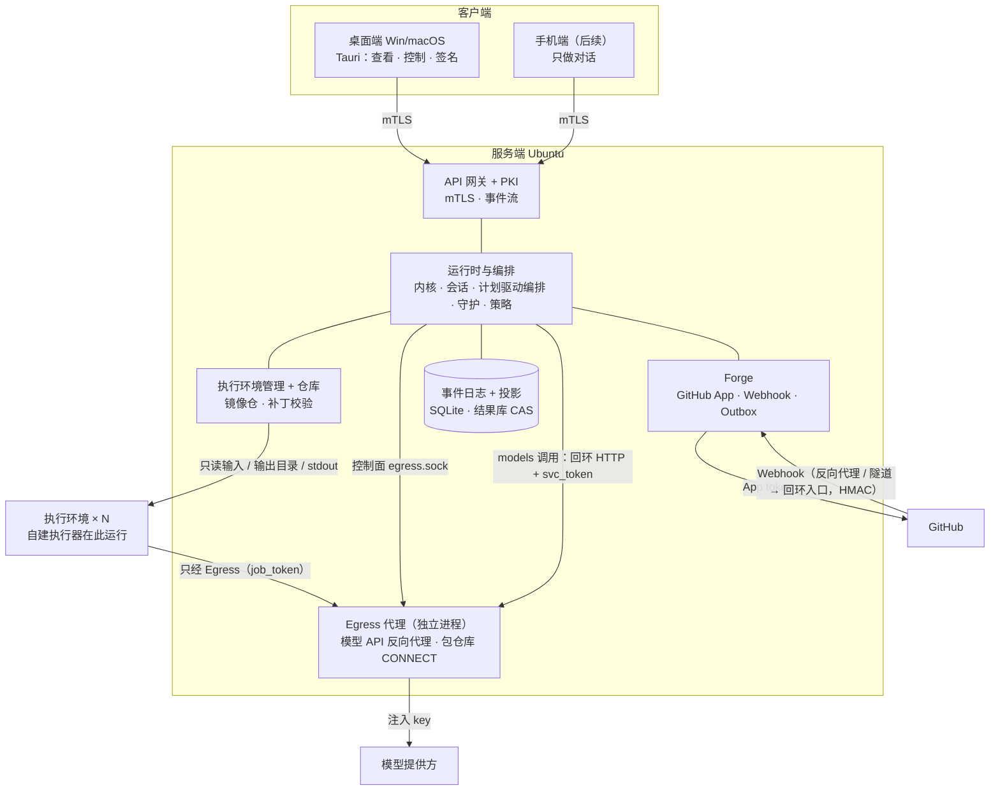
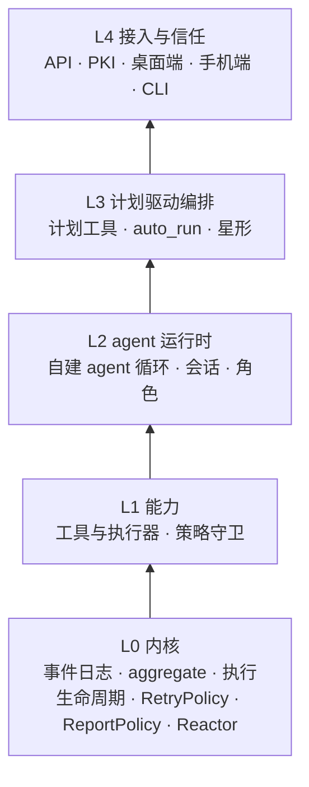
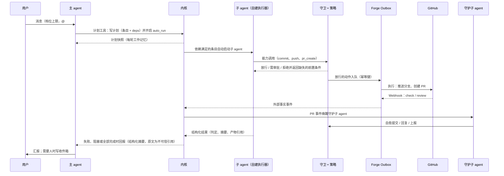

# Gantry 架构设计

> 状态：设计 v0.2（2026-11-07，3.0）。决策的确定程度见 [decisions.md](decisions.md)：D-24 起是用户 2026-11-07 拍板的已确定条目，P-88 起是助手提出的提议，Q-14 是待决；本文中标注 **[提议]** 的内容尚未经用户确认。讨论过程见本地未追踪的 `docs/design.md`。

本文是所有模块共同遵守的"总图"：目标与边界、分层与模块地图、信任边界与不变式、状态归属、核心流程、档位与模型分层。

**范围说明**：本文按 3.0 改写。`docs/interfaces/`、`docs/modules/`、`docs/data-model.md`、`schemas/` 仍按 2.x 编写，随各 3.0 里程碑实施时更新；其中与本文冲突的部分，以本文与 [decisions.md](decisions.md) 为准（见 §12）。

## 1. 目标与非目标

**目标**：一个以 **agent 运行时**（agent runtime）为重心的 AI 开发平台（D-24）。运行时提供事件驱动的内核、能力与授权、agent 循环；**编排**是运行时的二次封装：主 agent 用计划工具写计划，内核按事实推进，子 agent 自动执行。**交付平台**（与 GitHub 业务强关联：Issue / PR / Check / Review 作为交付证据，把工作推进到合并）是必须有的内置功能包，项目是 git 仓库时默认自动开启（D-30）。编排与交付平台不冲突：交付包由运行时的原语组合而成。

Gantry 中的"AI IDE"指**工程编排工作台**：主对话 + 交付关系地图 + 工作树 + 检视器，而不是代码编辑器。

3.0 可以慢慢做（D-32）。现有功能全部保留，改的是组织方式（D-37）；服务端模式、PKI、桌面端、手机端作为装配选项，放在里程碑最后。

**非目标**（第一版明确不做）：

| 非目标 | 说明 |
| --- | --- |
| 自研代码编辑器 | 人看代码用现有编辑器 `git fetch` agent 推送的分支 [提议] |
| 客户端自行执行代码 | 本机模式在本机工作树中由 `gantry` 执行；服务端模式执行在服务端，桌面端与手机端只查看、控制、签名 |
| 多租户 SaaS | 第一版单人自托管 [提议] |
| fork PR / 外部贡献者的不可信代码执行 | 第一版不接收，因此不需要 microVM [提议] |
| GitLab / GHES | 第一版只支持 github.com；Forge 层保留接口 |
| 手机端复杂功能 | 手机端只做"给 agent 发消息"的对话 |
| 接入外部 agent | 3.0 上线只用自建执行器（D-32）；外部 agent 执行器接口保留，不实现 |

## 2. 术语

| 术语 | 含义 |
| --- | --- |
| 内核 Kernel | L0。事件驱动、函数核心、全局无状态：状态是事件日志的投影，内存只是可丢弃的缓存。状态管理、统一执行生命周期、`RetryPolicy`、`ReportPolicy` 都收口在这里（D-26） |
| 聚合 aggregate | 内核里受状态机约束的领域实体（如 Approval、Device、计划）；追加事件时校验其状态迁移 |
| Reactor | 事件 → 命令 / 效果的纯函数。系统 reactor 与用户 reactor（钩子）同一机制，用户不能覆盖系统（P-93） |
| 执行器 Executor | 把一次任务实际跑起来的组件（自建 agent 循环、命令执行等）；只上报 `ErrorClass`，不自行决定重试。是角色属性 `executor`（P-105） |
| 主 agent | 编排引擎的初始化对话对象；拥有用户授权范围内的最大权限，可在既定配置之上选择性把额外能力开放给其他角色（D-27） |
| 角色 Role | 同级的 agent 配置单元（build、heal、review、doc-writer、github-ops 等，D-28）；属性为 `tools` / `policy` / `executor` / `model`（P-105） |
| 能力 Capability | 一个可被调用的动作（读文件、执行命令、`commit`、`push`、`pr_create`、`issue_create`、`merge_pr` 等）。是否暴露、是否放行、是否可授出由配置与授权决定 |
| 授权 Grant | 对某个被授予者开放某项能力的事件（`CapabilityGranted` / `CapabilityRevoked`），绑定 Task 或 Delivery 作用域并随之过期，只能衰减（P-94） |
| 守卫 Guard | 能力入口处的前置条件检查，例如 `pr_create` 要求当前 head 有 verify 通过事件；拒绝时返回缺失的前置条件（P-97） |
| 计划 / 条目 Plan / Item | 主 agent 用计划工具写出的工作清单；条目字段 `title` / `role` / `deps` / `exit` 规则 / `status` / `task` / `evidence`（P-88）。取代 2.x 的"图" |
| `auto_run` | 开启后，依赖满足的条目自动启动子 agent，主 agent 只在失败、阻塞或全部完成时被唤醒（P-89） |
| 弱沙盒 | 类似工作树的执行环境，本身没有状态；底线是独立系统用户、读写不到数据与密钥目录和控制 socket、无长期凭据（D-34、P-100） |
| 内置交付包 | 项目是 git 仓库时默认开启的功能包，由 `forge`、`repo` 与守护子 agent 组成（D-30、P-104） |
| 执行生命周期 | Pending / Running / Waiting / RetryScheduled / Succeeded / Failed / Cancelled / Interrupted / TimedOut；执行类状态统一用它（P-90） |
| RetryPolicy | 纯函数 `(ErrorClass, attempt)` → 重试时间或放弃（P-91） |
| ReportPolicy | Inline / NextBoundary / OnIdle / PullOnly，决定后台结果何时回报给谁（P-92） |
| 档位 Level | None（0 档）/ Low / Medium / High / Max / Ultimate。= 控制流从模型交给内核的比例 = 守卫配置 + 预算预设 + 默认授权（P-99）；仍是用户为任务设定的**上限** |
| 交付单元 Delivery（投影） | 一次"从规格到合并"的工作：绑定 1..n 个 Issue、0..1 个 PR、0..1 个工作树。**是事实的投影**，不独立存储状态（D-31、P-98） |
| 阶段 Stage（投影） | 交付单元的展示阶段：规格 → 计划 → 实现 → 提出 → 评审 → 合并 → 关闭，另有 `abandoned`。由外部事实与本地执行事件推导，只用于展示与查询；字段见 [data-model §4.1](data-model.md#41-交付单元阶段)（2.x） |
| 节点 / 尝试 Node / Attempt | 即 Task 与其尝试：计划条目启动出的一次子 agent 任务，每次执行是一个尝试，尝试不可变；状态用统一执行生命周期 |
| 图（计划 deps） | 2.x 的 Workflow DAG 在 3.0 里就是计划条目之间的 `deps`；不再有模板化图 |
| Gate / 判定 | 负责判断的角色，输出 verdict：`ACCEPT` / `REVISE` / `REJECT` / `BLOCKED`；作为证据进入守卫判断，见 §8 |
| reasoner / arbiter | reasoner 预演执行路径；arbiter 对一组 review 结果做唯一裁决 |
| Gantry 审批 | 用户用设备上的**审批签名密钥**（与 mTLS 客户端密钥分开，每次使用需用户在场，P-47）对"动作 + 目标 + 主体摘要（`subject_digest`）"签名，授权 Gantry 执行一个危险动作或一次敏感的内部操作；PR 类动作的主体摘要是 head SHA，补丁审批（`patch_apply_protected`）是补丁内容的 sha256；各动作的形状见 [data-model](data-model.md#审批动作的-target-与-subject_digest) |
| GitHub 审批 | GitHub 上的 PR review approve。与 Gantry 审批是**两件事**，见 §7.4 |
| 镜像仓 Mirror | 每个项目的裸镜像仓，由 `forge` 拉取更新，由 `repo` 维护；工作区、工作树都从它准备 |
| 工作树 Worktree | 某分支的检出，归属一个交付单元 |
| 能力令牌 job_token / svc_token | 仅服务端模式：Egress 用来识别调用方并计量的令牌（P-49、P-72、P-50、P-74）。见 [interfaces/egress-control.md](interfaces/egress-control.md) |
| 三类模型 | 打杂（Utility）、大脑（Planner）、干活（Worker），是角色的 `model` 属性，见 §9 |
| 守护 Guardian | 由 PR 事件唤醒的长期子 agent，负责审核与修复循环（P-104） |
| 上报 | 守护或内核遇到需要人决定的事，写入收件箱（InboxItem）并通知 |
| 端口 Port | 跨模块调用的 trait，定义在 `core::ports`（P-51），替身实现同一 trait；写操作的调用方上下文统一为 `ActorCtx`（P-78）。服务式端口会逐步改为命令 / 事件，见 §4 |

## 3. 部署

3.0 有两种装配，共用同一内核与协议（P-107）：

| 装配 | 形态 | 接入 |
| --- | --- | --- |
| **本机模式** | 单二进制 `gantry`，in-proc 传输；执行在本机工作树中；无 PKI、无 Egress | CLI / TUI；桌面外壳可启动它 |
| **服务端模式** | `gantryd` + mTLS / PKI + Egress；执行在服务端，rootless Podman + gVisor 为可选执行环境 | 桌面端（Windows / macOS）、手机端（后续）经 mTLS 接入 |

第一个可用成果是本机模式的主 agent（0 档）加 CLI。接入层不改变内核语义（I6）。

### 服务端模式拓扑（装配选项）

以下拓扑沿用 2.x，现作为服务端模式的装配选项；沙盒处的"强隔离"为可选，默认是弱沙盒（P-100）。

服务端模式第一版是**单个进程 + 外部执行环境 + 独立的 Egress 进程**：模块是同一个 Rust workspace 里的 crate，进程内调用；执行环境（可选 rootless Podman + gVisor）与服务端进程使用不同的系统用户。[提议] `gantryd` 与 Egress 之间只有主机本地 Unix socket（控制面）与回环 HTTP（`models` 的模型调用），契约见 [interfaces/egress-control.md](interfaces/egress-control.md)（P-50）。

本机模式没有 Egress 与令牌：模型凭据由本机密钥存储持有，只在内核侧能力接口中使用，执行进程的环境里没有长期凭据（I1）。

## 4. 分层与模块地图

### 4.1 五层

下层不知道上层；上层只能组合下层原语，不新增运行时机制（D-25）。

| 层 | 内容 | 里程碑 |
| --- | --- | --- |
| L0 内核 | 事件日志与投影；aggregate 状态机；统一执行生命周期；`RetryPolicy`；`ReportPolicy`；Reactor；授权事件 | 3.0 K（#484） |
| L1 能力 | 工具（读写文件、命令、git、Forge 动作）与执行器；策略与守卫（纯函数）；出网与模型调用 | 3.0 A / C |
| L2 agent 运行时 | 自建 agent 循环；会话与意图；角色配置；上下文管理 | 3.0 A（#485） |
| L3 计划驱动编排 | 计划工具、`auto_run`、星形拓扑、子 agent 嵌套 | 3.0 P（#488，嵌套 #489） |
| L4 接入与信任 | API 网关、PKI 与配对、桌面外壳与界面、手机端、CLI、部署 | 3.0 S |

### 4.2 现有 crate 归位

现有 crate 按下表归位；归位不等于已迁移，迁移随各 3.0 里程碑进行。每个模块仍有 2.x 的规格书 `docs/modules/<id>.md`，写明职责、IO、依赖、状态、错误、验收，随里程碑更新。

| 层 | ID | 模块 | 在 3.0 中的位置 |
| --- | --- | --- | --- |
| L0 | `core` | 领域核心 | 领域类型、ID、状态机、事件定义、端口 trait；无 IO。`core::ports` 的服务式端口会逐步改为命令 / 事件 |
| L0 | `store` | 事件存储 | 追加式事件日志、投影、游标、Outbox 表；追加事件时校验 aggregate 迁移（#300） |
| L0 | `runtime`（新，`gantry-runtime`） | 运行时内核 | 从 `engine` 的 `decide` / `effects` / actor 抽出（#484）：事件驱动的函数核心、执行生命周期、`RetryPolicy`、`ReportPolicy`、Reactor |
| L1 | `sandbox` | 执行环境管理 | 执行器；默认弱沙盒，rootless Podman + gVisor 为服务端模式可选（P-100） |
| L1 | `repo` | 仓库与工作树 | 执行器：镜像仓、工作树、写权锁、补丁应用与提交（`PatchFacts`，P-69） |
| L1 | `forge` | GitHub 接入 | 执行器：App 鉴权、API、Webhook、Outbox 执行、拉取镜像仓；Outbox 是 GitHub 写入的唯一路径（I2） |
| L1 | `models` + `egress` | 模型路由与出网代理 | 执行器：模型调用与计量；`egress` 为服务端模式独立进程，本机模式无 |
| L1 | `notify` | 收件箱与通知 | 执行器：上报项与推送 |
| L1 | `policy` | 策略与审计 | 纯函数守卫：危险动作判定、路径规则、审批验签、审计 |
| L2 | `conversation` | 会话服务 | 主对话、意图解析、事件行渲染；与自建 agent 循环（#485）共同构成 agent 运行时 |
| L3 | `engine`（待替换部分） | 编排引擎 | 模板、阶段推进、档位矩阵将被计划驱动编排（#488）替换；可复用的决策、预算与控制面经 #484 迁入 `runtime` |
| L3 | 内置交付包（#490） | 交付功能包 | 由 `forge`、`repo` 与守护子 agent 组成；守护的 guardian 决策表成为其 Reactor 规则（P-104） |
| L4 | `api` | API 网关 | HTTP API、事件流、设备鉴权 |
| L4 | `pki` | 证书与配对 | 私有 CA、配对、签发、轮换、吊销（服务端模式） |
| L4 | `secrets` | 密钥存储 | 加密存储、按使用方隔离读取、轮换、加密备份 |
| L4 | `desktop-shell`、`desktop-ui` | 桌面外壳与界面 | Tauri 进程（两把密钥、签名、mTLS 客户端）与工作区、设置 |
| L4 | `mobile` | 手机端（后续） | 只做对话 |
| L4 | `deploy`、CLI | 部署与命令行 | 安装脚本、systemd、App 创建引导、备份；本机 CLI / TUI |
| 退出前提 | `worker` | Claude Code 适配 | 不再是 3.0 前提（D-32）；`WorkerAdapter` 接口保留 |
| 测试 | `gantry-fakes` | 测试替身 | 随 `core::ports` 的服务式端口改为命令 / 事件而收缩 |

跨模块端口 trait 仍定义在 `core::ports`（P-51）。2.x 中的服务式端口（如 `SandboxService`、`DeliveryControl`、`ConversationService`）会随 #484 逐步改为命令 / 事件，对应替身随之收缩；在迁移完成前，现有端口与替身继续有效。

## 5. 信任边界与不变式

所有模块都必须遵守以下不变式；任何设计或实现与之冲突时，以本节为准。

| # | 不变式 |
| --- | --- |
| I1 | **执行环境无长期凭据**：执行进程使用独立系统用户，不能读写数据目录、密钥目录与控制 socket，环境中没有长期凭据，只能经能力接口影响外部。隔离强度（弱沙盒或 Podman + gVisor）不作为安全保证（P-100） |
| I2 | **GitHub 写入唯一路径**：所有 GitHub 写操作只由 `forge` 的 Outbox 执行，每个动作带幂等键；其他模块只能入队 |
| I3 | **放行只由 `policy` 判定，且每次能力调用在执行路径校验授权**：危险动作是否放行只由 `policy` 判定（入队方在入队时调用，执行方在执行时验证审批，P-62）；每次能力调用校验 `(actor, capability, 有效授权)`，"看不到工具"不是安全边界（P-95）；Gantry 审批绑定 `subject_digest`（PR 类动作为 head SHA），之后任何推送都使绑定 head 的审批失效 |
| I4 | **状态只有一个真相源：本地事件日志**。git / GitHub 是只读外部事实；交付状态（含阶段）是二者的投影，不独立存储、不靠对账同步（D-31、P-98）。内存只是可丢弃的缓存 |
| I5 | **外部文本不可信**：Issue/PR 正文、评论、CI 日志、依赖文档、仓库内容、子 agent 回报原文一律是数据；进入 prompt 时加隔离标记；不可信输入不能改变工具集与策略结果；回报进入主 agent 前先结构化，原文只作不可信引用（P-102） |
| I6 | **接入层不改变内核语义**：客户端（桌面端、手机端）不持有 GitHub 或模型凭据；本机模式的 CLI 内嵌运行时是允许的 |
| I7 | **配置与工作分离**：模型、档位预算、策略等配置只在设置中修改；工作界面只显示运行状态 |
| I8 | **执行产物先验后推**：执行环境交回的改动以补丁形式由 `repo` 在干净检出上应用并做机械检查（产出 `PatchFacts`），经 `policy` 规则判定（路径规则、大小、敏感文件）后再由 `repo` 提交，经 `forge` 推送（P-69）；内核不在执行环境产出的 `.git` 上运行 git |
| I9 | **权限只能单调衰减**：系统锁定上限 ⊇ 用户配置上限 ⊇ 主 agent ⊇ 被授予者；锁定动作（`merge_pr`、`force_push`、受保护路径、workflow 改动）任何配置或授权都不能设为 `auto`（P-94、P-96） |
| I10 | **多 agent 只允许星形**：agent 之间没有直接通道；通信、观察、跨树读取都经授权，控制面以主 agent 为中心，数据面以内核为中心（D-33、P-101） |

信任边界：

| 区域 | 信任级别 | 能接触的东西 |
| --- | --- | --- |
| 内核进程（`gantry` / `gantryd`） | 可信 | 事件日志；经 `secrets` 读取模型凭据、GitHub App 私钥、webhook secret、服务端模式的 CA 私钥 |
| Egress 代理（服务端模式） | 可信，独立进程 | 模型 API key（只存在于此）、私有包仓库凭据；只在反向代理出站时注入到指定目标；`job_token` / `svc_token` 登记表（只存哈希）。控制面只对主机本地的 `gantryd` 进程用户开放 |
| 执行进程（弱沙盒；服务端模式可选 Podman + gVisor） | **不可信** | 工作树副本、被授予的能力接口；环境中无长期凭据；读写不到数据目录、密钥目录与控制 socket。服务端模式下另有本尝试的 `job_token`，网络只到 Egress 的沙盒侧监听器 |
| 用户 Reactor（钩子） | 来自可信配置，但以配置者策略为上限 | 事件与受策略限制的命令 / 效果；不继承主 agent 权限（P-93） |
| GitHub 内容、子 agent 回报原文 | **不可信数据** | — |
| 桌面端 | 可信但会失窃 | mTLS 客户端密钥与审批签名密钥（均不可导出；后者每次使用需用户在场，P-47）、离线根 CA 指纹（P-64） |

## 6. 状态归属

事件日志是唯一真相（I4）。投影与缓存可随时丢弃重建。下表"适用"列标明服务端模式专属的行。

| 数据 | 事实源 | 存储 | 备份 | 适用 |
| --- | --- | --- | --- | --- |
| 计划与条目、任务（Node）、尝试、执行生命周期状态、预算消耗 | 本地事件日志 | SQLite `events` + 投影 | 需要 | 两种 |
| 授权与撤销（`CapabilityGranted` / `CapabilityRevoked`） | 本地事件日志 | 同上 | 需要 | 两种 |
| 回报确认（回报投递的确认事件，P-92） | 本地事件日志 | 同上 | 需要 | 两种 |
| 交付单元的阶段 | **投影**：外部事实（git / GitHub）+ 本地执行事件推导，不独立存储（P-98） | 投影，可重建 | 不需要 | 两种 |
| PR 状态、合并、Issue 关闭、check 结果 | GitHub（只读外部事实） | 本地只缓存快照 | 不需要（可重建；计数器除外，见下） | 两种（远端交付） |
| Outbox 待执行动作 | 本地 | `outbox` 表 | 需要 | 两种 |
| 会话消息、收件箱 | 本地 | 事件日志 + 投影 | 需要 | 两种 |
| Gantry 审批记录、审计日志 | 本地，追加式 | 事件日志 | 需要 | 两种 |
| 设备（含 `approval_pubkey`）、证书、吊销表 | 本地 | `pki` 表 | 需要 | 服务端模式 |
| 吊销日志 `revocations.journal` | 本地，只追加，**在事件日志之外** | `pki` 目录下的独立文件；每次写入在吊销提交前 `fsync` 并同步复制到备份目标，事务回滚不删除条目 | 不随备份回滚：从备份恢复时重放时间戳晚于备份时刻的条目（P-67、P-80） | 服务端模式 |
| `log_epoch` | 本地 | 事件日志元数据；每次从备份恢复加一 | 恢复流程维护（P-67） | 两种 |
| PR 的 `head_epoch`、状态清单评论的 `revision` 计数 | 本地事件日志 | `forge.pr_synchronized` 等事件 | 需要（随日志；不得从可重建的快照推出，P-61） | 两种（远端交付） |
| CA 根私钥 | 离线 | 部署时导出到离线介质，服务端不常驻 | 离线保存 | 服务端模式 |
| CA 中间私钥、App 私钥、webhook secret | 本地密钥文件（加密） | `secrets/`，仅内核进程用户可读 | 需要（加密备份） | 两种（CA 私钥仅服务端模式） |
| 模型 key、私有包仓库凭据 | 本地密钥文件（加密） | 服务端模式存于 Egress 的密钥存储，设置写入时 `api` 经控制面只写转交（P-50）；本机模式存于本机密钥存储，仅内核侧能力接口使用 | 需要（加密备份） | 两种 |
| `job_token` / `svc_token` | Egress | Egress 只存哈希；令牌原文不进事件日志 | 不需要 | 服务端模式 |
| 镜像仓 | GitHub / 本地仓库 | 每项目一个裸仓（`repo` 维护） | 不需要（可重建） | 两种 |
| 工作树内容 | git 分支 + 本地检出 | 文件系统 | 不需要（可重建） | 两种 |
| 尝试结果（`result_ref`）、进度记录、被拒产物 | 本地 | 内容寻址结果库（CAS） | 需要（保留期待定） | 两种 |
| 内存中的运行时状态 | — | 仅缓存，可丢弃 | 不需要 | 两种 |

## 7. 核心流程

### 7.1 本机启动与服务端部署配对

**本机启动**（本机模式）[提议]：

1. 运行单二进制 `gantry`（CLI / TUI，桌面外壳也可启动它），进程内传输。
2. 内核从事件日志重建投影；执行器没有活句柄的 `Running` 任务进入 `Interrupted`，只有声明 resumable 的执行器重新挂上（P-90）。
3. 读取项目事实：是 git 仓库则装配本地交付；另有 GitHub remote 且已安装 App 则装配远端交付（P-104）。
4. 打开主 agent 对话（0 档，完整 agent 对话，P-99）。执行发生在本机工作树，执行进程按弱沙盒底线运行（P-100）。

本机模式没有 PKI 与配对。

**服务端部署与配对**（服务端模式，沿用 2.x，精简）：

1. 运行安装脚本：创建系统用户、目录、systemd 服务；生成离线根 CA（导出备份后从服务端删除根私钥）和在线中间 CA；签发服务端证书。
2. 配置 webhook 入口（P-65）：`forge` 的 webhook 监听只在回环地址上以明文 HTTP 提供；对公网暴露一律经终止 TLS 的反向代理或隧道。隧道只转发 `/webhook` 与 App 创建期间的 `/setup/github/callback`，**不使用 smee.io**。
3. 运行 `gantry github setup`：生成一次性的 App Manifest 提交页，用户在 GitHub 上确认创建并安装到选定仓库；服务端换取并保存 App 私钥、webhook secret 与提交身份（`github.commit_identity`）（细节需核实，见 [modules/deploy.md](modules/deploy.md)）。
4. 安装引导期（P-66、D-18）：第一台**桌面**设备配对之前，主机命令（需 root）可写入 `github.*` 等"仅 approver"配置，并写审计事件；之后改为需要审批签名。
5. 服务端执行 `gantry pair`，显示二维码 / 配对串（地址 + **离线根 CA 指纹** + 一次性 token，P-64）。
6. 桌面端扫码，本地生成**两把**密钥（P-47；手机档案可省略审批签名密钥，且永远不能成为 approver，P-76）：mTLS 客户端密钥与审批签名密钥；经**单向 TLS 的配对端点**提交 CSR + `approval_pubkey` + token，拿到证书链 `[叶子, 中间 CA, 根]`，校验根与固定的指纹一致；两端显示 6 位确认码，人工核对。第一台桌面设备成为 approver，之后配对的设备默认 operator。
7. 之后桌面端所有请求走 mTLS；证书剩余 1/3 有效期时自动续期（建议值）。用户在设置页填入模型提供方凭据（凭据写入需要审批签名）。

细节见 [modules/pki.md](modules/pki.md) 与 [modules/deploy.md](modules/deploy.md)（2.x）。

### 7.2 从对话到合并

1. 用户在主对话里发消息，可带档位上限和 `@` 引用（Issue / PR / 工作树）。主 agent 是编排引擎的初始化对话对象（D-27）。
2. 主 agent 用计划工具写计划：条目有 `role`、`deps`、`exit` 规则；完成必须有证据；计划不携带权限（P-88）。随后开启 `auto_run`。
3. 内核按事实推进：依赖满足的条目自动启动子 agent，受并发上限与预算预留约束；失败先按 `RetryPolicy` 重试，仍失败则阻塞下游并唤醒主 agent；取消沿依赖传播（P-89）。运行中的条目推进不经过主 agent 模型（P-108）。
4. 子 agent 在工作树中执行，所有外部动作经能力接口。每次能力调用在执行路径校验授权与守卫：`pr_create` / `push` 要求当前 head 有 verify 通过事件；`commit` 要求补丁过 repo 机械检查与 policy；每次调用扣预算（P-95、P-97）。
5. 通过守卫的 GitHub 写入经 Outbox 执行（I2）；合并前 policy 判定，需要时请求 Gantry 审批，并遵守仓库的分支保护（见 §7.4）。默认分支前移（`forge.base_advanced`）时，已发起合并的交付需重验。
6. PR 打开后，守护子 agent 由 PR 事件唤醒接管 CI 与 review（§7.3）。
7. 子 agent 只返回结构化结果，不回传原始对话（P-103）。GitHub 确认合并、关联 Issue 关闭后，交付阶段的投影变为"关闭"；阶段不是被推进出来的，是事实重算出来的（P-98）。

### 7.3 PR 后台守护（长期子 agent）

守护是由 PR 事件唤醒的**长期子 agent**（P-104）。它订阅交付单元 PR 的 webhook 事件，按 [modules/guardian.md](modules/guardian.md) §7.3 的**有序决策表**处理（P-60）；该决策表是分流规则的**唯一来源**，在 3.0 中作为守护的 Reactor 规则，本节与 [config.md §6](interfaces/config.md#6-guardian) 只是摘要，冲突时以决策表为准。

- **静默处理**（可配置类，默认值见 config §6.1）：本 PR 范围内的 CI 失败（非 workflow 文件、非依赖清单）静默修复；经验证属实的非安全类 bot finding 静默修复；经验证不成立的非安全类 bot finding 回复理由（`reply_review_thread`）；普通 nit 攒到下次推送。
- **无需动作**：决策表里显式列出的 `noop` / `ignore` / `bookkeeping` 行（如 CI 通过、GitHub approve、自身事件回流、陈旧事件），只记账、不打扰（D-04）。
- **上报**（锁定类，不可配置）：security 类 finding、改动会触及受保护路径（`.github/workflows/`、依赖清单、lockfile 等）、修复会扩大范围、同类问题重复或无进展、预算耗尽、需要任何审批、审批之后还需要推送、人类评审意见、出队等。
- **兜底**：决策表之外的事件一律上报。
- 守护忽略由 Gantry 自身动作产生的事件（按 Outbox 记录的动作 ID 识别），防止自触发循环。
- 唤醒以 webhook 为主；另有低频**对账巡检**补齐丢失或乱序的投递（只补事件，不作为状态来源，I4）。
- 每个分流处置写审计事件 `guardian.triaged`、`guardian.heal_requested`、`guardian.escalated`（P-60）。
- 守护的静默自愈**不引起阶段变化**（阶段是投影，自愈只是 PR 上的新提交）；只有需要改代码且超出自愈范围时才上报给主 agent，由其决定是否追加计划条目。
- 守护的授权来自主 agent 的授予，同样只能衰减（P-94），不能自行放大。

### 7.4 危险动作与两类审批

- **Gantry 审批**：授权 Gantry 以 App 身份执行一个危险动作：`merge_pr`、force push（`force_push`）、推送到非 `gantry/` 前缀分支（`push_outside_prefix`）、解决含人类评论的 review 线程（`resolve_review_thread_human`）、改动依赖清单 / lockfile 的补丁（`patch_apply_protected`）。删分支、发 release、改仓库设置第一版不实现（forge-actions 预留，策略默认 `deny`）。审批绑定 `(动作, 目标, subject_digest)`，由设备的审批签名密钥签名（P-47），服务端用登记的 `approval_pubkey` 验签后放行。动作标识与形状见 [data-model](data-model.md#审批动作的-target-与-subject_digest)（P-54）；**审批在执行开始前消费**，执行终态失败不退回。
- **锁定动作**：`merge_pr`、`force_push`、受保护路径、workflow 改动由系统锁定，任何角色、配置或授权都不能设为 `auto`（I9、P-42、P-96）。
- **Gantry 不修改 `.github/workflows/`**（P-48）：App 不申请 `workflows` 权限；补丁触及 workflow 文件时 `policy` 一律拒绝（`policy.path_protected:workflows`），上报 `decision_needed`（`payload.kind = manual_action`）并附补丁，由用户手动应用。没有任何审批能放行它。
- 同一签名原语也用于内部动作：涉及凭据或放宽安全的设置写入（`settings_update`）、改设备角色（`device_role_change`）、吊销设备（`device_revoke`）（服务端模式）。安装引导期的主机命令写入是唯一例外（P-66）。
- **高风险授权需用户确认一次**：GitHub 写入且 `auto` 的授权；由回报内容引发的高风险授权或动作同样需用户确认（P-94、P-102）。
- **GitHub 审批**：仓库分支保护要求的 review。Gantry 用 App 创建的 PR，App 自己不能 approve；所以当仓库要求人工 review 时，**用户必须在 GitHub 上 approve**。
- merge 时两者都要满足：先满足 GitHub 规则（必需 review、check、merge queue），再凭 Gantry 审批执行 merge；守卫另要求 `ACCEPT` 判定（P-97）。
- 审批后若有新推送，审批失效，重新进入评审。守护在已审批的 PR 上**不得**静默推送。

### 7.5 多 agent 协作：星形 + 授权

D-14 与 D-15 记录了用户目标：项目主对话统筹多个工作树并行；同项目 agent 可只读观察、通信和跨树文件阅读。3.0 用星形拓扑与授权模型实现，取代 2.x 提议的服务端中介机制（P-83–P-86）。

- **星形**（D-33、I10）：所有 agent 只与中心打交道，agent 之间没有直接通道。
- **两面**（P-101）：
  - 控制面以主 agent 为中心：授权、通信路由、对用户回报。
  - 数据面以内核为中心：被授权的 agent 直接读内核投影，不经主 agent 上下文。
- **授权的特例**：跨树读取、观察、通信都是授权（`CapabilityGranted`）的特例，绑定 Task 或 Delivery 作用域并随之过期；授权只能衰减，不能授出比用户配置更宽的策略（P-94）。
- **回报**：子 agent 只返回结构化结果（判定、摘要、产物引用）（P-103）；回报进入主 agent 前由打杂模型整理成结构化摘要，原文作为不可信引用（P-102）；回报按 `ReportPolicy` 投递并写确认事件，恰好一次（P-92）。
- **独立并行**：每个任务保留独立的 Delivery、Worktree、任务、尝试、预算和范围；主对话统筹不是共享执行上下文。
- **嵌套**：子 agent 可多层嵌套、有深度即可（D-36）；具体嵌套模型未定，见 Q-14（#489）。

## 8. 档位、计划与守卫

档位是**上限**，同时是**控制流从模型交给内核的比例**（P-99）：档位越高，守卫配置与预算预设越多地替模型做决定，流程越确定。0 档是完整的 agent 对话，可改代码、开 PR，控制流在模型手里，但守卫仍然生效。

下表的"形态"到守卫 / 预算的具体对应标 **[提议]**，待 3.0 C 里程碑（#487）与 3.0 P 里程碑（#488）落定：

| 档位 | 控制流 | 形态 [提议] | 评审形态 [提议] |
| --- | --- | --- | --- |
| 0 档（None） | 全在模型；守卫生效 | 完整 agent 对话，可改代码、开 PR；会话记账（会话台账概念保留，P-58） | 只等 CI |
| Low | 少量交给内核 | 单个交付子 agent 实现 + 自检；也走 PR，不直推默认分支（P-10） | 只等 CI |
| Medium | 计划交给内核推进 | 计划 + 实现子 agent（build → verify） | 单 reviewer |
| High | 更多交给内核 | 同 Medium，加需求准入（`admission`） | "评审组"：多 reviewer + `summarize` |
| Max | 大部分交给内核 | 同 High，加 `reasoner` 预演 | "评审组"：对抗评审 + arbiter 裁决，有限轮 |
| Ultimate | 主 agent 并行统筹 | 主 agent 并行启动多个交付子 agent，各按 Max；带依赖 | 每个 PR 按 Max |

- 档位 = 守卫配置 + 预算预设 + 默认授权。**预算预设**：加权 token、条目数、轮次、墙钟、并发、GitHub 写操作累计数；token 按 `levels.token_weights` 加权（P-44、P-70）；写操作的按小时限速由配置与 Outbox 执行。每次能力调用扣预算（P-97）。
- 档位是上限：`level_effective` 初值按风险评估给出（≤ `level_cap`），之后只升不自动降；已触发的闸门永不撤销；需要超过上限时上报（`escalation`）（P-57）。
- **计划与守卫取代模板与阶段机**：交付阶段是事实投影（P-98）；确定性由能力守卫保证，而不是固定流程（P-97）。
- **判定**：`ACCEPT` / `REVISE` / `REJECT` / `BLOCKED` 作为证据进入守卫与条目 `exit` 规则。`REJECT` 阻塞下游并上报 `decision_needed`（放弃或重新规划）；`BLOCKED` 上报 `escalation` 并附证据（P-24）。迭代有界：超过轮次上限或判定"无进展"即上报。
- **控制**（P-36、P-37、P-56）：暂停 / 继续、重试失败条目、放弃、升档、授权属于"控制"，由主 agent 或直达路由完成（[api.md §4.4](interfaces/api.md#44-deliveries)）；其余推进由 `auto_run` 完成，不经过主 agent 模型（P-108）。

## 9. 角色与模型

模型在**设置页**配置（全局，项目可覆盖），工作界面不出现模型配置。

角色之间是**同级**关系（D-28）。主 agent 是编排引擎的初始化对话对象，不是其他角色的上级；其他角色通过授权获得能力。角色属性为 `tools` / `policy` / `executor` / `model`（P-105）：

| 属性 | 含义 |
| --- | --- |
| `tools` | 暴露哪些工具，由配置决定（理论上由 schema 约束）；产品默认只在主对话开放。编排里的角色若需要 GitHub 操作、发布 Issue 等能力，按角色配置获得（D-29） |
| `policy` | 每项能力的策略：放行 / 需审批 / 拒绝；锁定动作不可设为 `auto`（P-96） |
| `executor` | 用哪个执行器；3.0 只有自建执行器（D-32） |
| `model` | 用哪类模型：打杂 / 大脑 / 干活 |

三类模型（D-08）保留，是角色的 `model` 属性：

| 类别 | 用途 | 特点 |
| --- | --- | --- |
| 打杂 Utility | 事件摘要、CI 日志分类、回报结构化整理、状态问答、提交说明、状态清单与通知文案 | 量大，便宜，低推理 |
| 大脑 Planner | 意图解析、规划、需求准入、reasoner 预演、arbiter 裁决、`summarize` 汇总 | 量少，要准，高推理 |
| 干活 Worker | 实现、修复、担任各 review 视角 | 主力产量，推理深度随档位 |

下表保留 2.x 的角色名；`exec` 列改为**执行位置**：工作树（可写）、只读工作树、无工具会话（只处理结构化文本，无工具、无代码执行）。除此之外，doc-writer、github-ops 等角色由配置定义，不在此表固定。

| `role` | 用途 | `model` | 执行位置 |
| --- | --- | --- | --- |
| `plan` | 把规格拆成步骤 | 大脑 | 只读工作树 |
| `build` | 实现 / 修复 | 干活 | 工作树 |
| `verify` | 在候选 head 上跑检查并判定；其通过事件是 `pr_create` / `push` 的守卫前提 | 干活 | 工作树 |
| `single` | Low 档单个交付子 agent：实现 + 自检 | 干活 | 工作树 |
| `review:<视角>` | 某视角的评审 | 干活 | 只读工作树 |
| `reasoner` | 预演执行路径（Max 起；不是判定角色，P-45） | 大脑 | 只读工作树 |
| `arbiter` | 对一组 review 做唯一裁决 | 大脑 | 只读工作树 |
| `summarize` | High 档汇总 review | 大脑 | 无工具会话 |
| `admission` | 需求准入（High 及以上） | 大脑 | 无工具会话 |
| `heal` | 守护的自愈 | 干活 | 工作树 |
| `answer` | 涉及代码的只读问答 | 干活 | 只读工作树 |
| `intent` | 意图解析 | 大脑 | 无工具会话 |
| `classify` | CI 日志分类、事件摘要、回报整理（及提交说明、通知文案等打杂文本） | 打杂 | 无工具会话 |

- 推理深度随档位，由配置决定（[config.md §3](interfaces/config.md)）。
- 所有模型调用都要计量，不信任任何自报。服务端模式下，沙盒内执行器把模型 base URL 指向 Egress 并凭 `job_token` 计量，服务端 `models` 经 Egress 回环反向代理并带 `svc_token` 与 `X-Gantry-Ledger`（P-49、P-50、P-74），模型 key 只存在 Egress；本机模式下模型调用在内核侧能力接口内完成，同一计量口径，执行进程拿不到 key。
- 对话气泡的边框颜色标识发言的 agent 类别（D-12、P-34）。

## 10. 技术选型 [提议]

| 部分 | 选型 |
| --- | --- |
| 内核与服务端 | Rust：tokio、axum、rustls、rcgen、sqlx + SQLite |
| 事件流 | Server-Sent Events，带游标续传 |
| 执行环境 | 默认弱沙盒（独立系统用户、读写不到数据与密钥目录和控制 socket、无长期凭据，P-100）；服务端模式可选 rootless Podman + gVisor（runsc），驱动接口可扩展到 Firecracker |
| Egress 代理（服务端模式） | 独立进程：模型 API 与私有包仓库走反向代理（注入凭据、按 `job_token` / `svc_token` 计量）；公共包仓库走 HTTPS CONNECT 白名单（不注入凭据）；依赖指向 `github.com` 源默认拒绝（Q-08）；`gantryd` 经主机本地 Unix socket 调用控制面 |
| 执行器 | 自建执行器（D-32）；外部 agent 执行器接口保留，不实现 |
| 本机接入 | 单二进制 `gantry`：CLI / TUI，in-proc 传输 |
| 桌面端 | Tauri 2 + TypeScript 前端 |
| 手机端 | iOS UIKit（后续） |
| 契约 | OpenAPI 3.1（客户端 API）、JSON Schema（事件、配置等）；随 3.0 里程碑更新 |

## 11. 扩展点

跨模块端口定义在 `core::ports`（P-51），3.0 中服务式端口逐步改为命令 / 事件（§4）。下表是可替换实现的扩展点。

| 扩展点 | 接口 | 第一版实现 |
| --- | --- | --- |
| 能力（执行器） | 能力声明 + 执行器接口；工具集由 `toolset(能力声明, 暴露配置, 有效授权, 界面)` 计算（P-95） | 自建执行器与内置工具 |
| 角色配置 | 角色属性 `tools` / `policy` / `executor` / `model`（P-105） | 内置角色（§9）+ 用户配置的角色 |
| 用户 Reactor（钩子） | Reactor：事件 → 命令 / 效果的纯函数；以配置者策略为上限，不覆盖系统 reactor（P-93） | 来自可信配置；仓库内容不能成为来源 |
| Forge | `ForgeReader`（读）、`OutboxPort`（写动作入队）+ 事件归一化 | GitHub.com |
| 通知 | `InboxPort`（上报）+ `Notifier` trait（推送） | 桌面端系统通知（客户端收到 `severity ≥ warn` 的 `inbox.raised` 时弹出，P-63） |
| 模型提供方 | `ModelProvider` trait | Anthropic API |
| 外部 agent 执行器 | 接口保留，不实现（D-32、P-105） | 无 |

## 12. 文档地图

| 文档 | 内容 |
| --- | --- |
| [decisions.md](decisions.md) | 决策记录：已确定 / 提议 / 待决；3.0 的条目从 D-24、P-88、Q-14 起 |
| [data-model.md](data-model.md) | 实体、状态机、事件（仍按 2.x，随 3.0 里程碑更新） |
| [interfaces/](interfaces/) | 客户端 API、Worker 协议、Forge 动作、配置 schema、Egress 控制面（仍按 2.x，随 3.0 里程碑更新） |
| [modules/](modules/) | 每个模块的规格书（仍按 2.x，随 3.0 里程碑更新） |
| [prototype.md](prototype.md) | 界面原型说明 |
| [collaboration.md](collaboration.md) | 2.x 多工作树协作提案（P-83–P-86，已被星形 + 授权模型取代，保留作历史） |
| [milestones.md](milestones.md) | 3.0 里程碑与 2.x 历史规划 |
| `docs/design.md`（本地未追踪） | 设计讨论记录（历史） |

**模块规格与接口契约仍按 2.x 编写**：`docs/interfaces/`、`docs/modules/`、`docs/data-model.md`、`schemas/` 在本次 ADR 中不改，随各 3.0 里程碑实施时更新。在更新完成前，其中与本文、[decisions.md](decisions.md) 冲突的部分（例如阶段机、模板化图、`role` / `tier` / `exec` 三字段、Worker 协议作为必经路径）以本文与 decisions.md 为准。
