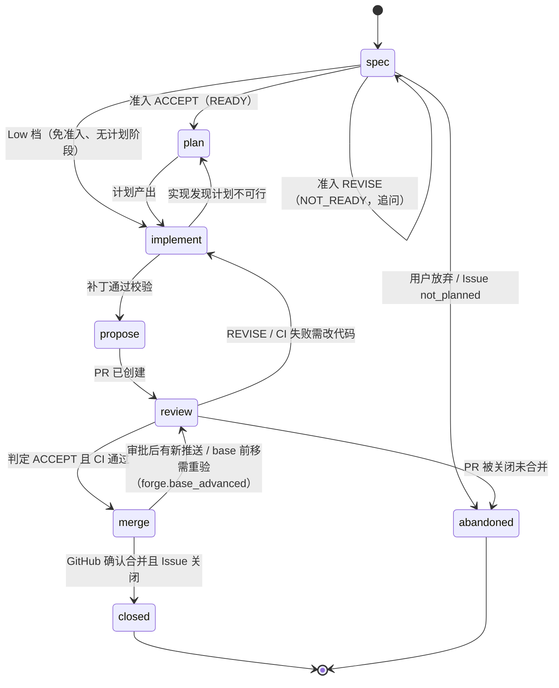

# 数据模型

> 状态：设计阶段 v0.1。本文定义所有模块共用的实体、状态机与事件。类型的权威定义将落在 `core` crate；本文与代码冲突时以本文为准，直到代码评审通过并回写本文。

## 1. 约定

- **ID**：带前缀的 ULID，例如 `dlv_01JB…`。前缀表见 §2。ID 一经分配不变。
- **时间**：UTC，RFC 3339，毫秒精度。
- **GitHub 引用**：保存 `owner/repo` + 编号 + GitHub node_id；展示用 `#N`。
- **不可信文本**：来自 GitHub 或沙盒的文本字段统一类型 `UntrustedText`，进入 prompt 前必须经隔离包装。
- **枚举**：以字符串存储，新增值只追加。`verdict` 用大写（`ACCEPT` 等），其余枚举小写。
- **档位 `Level`**：线上格式为 `"None"` / `"Low"` / `"Medium"` / `"High"` / `"Max"` / `"Ultimate"`（首字母大写）。

### 1.1 共用值类型

| 类型 | 字段 | 说明 |
| --- | --- | --- |
| `UntrustedText` | `text`（string）、`source`（string，如 `github:issue.title`、`sandbox:report`）、`truncated`（bool） | 只当数据渲染（纯文本或消毒后的受限 Markdown） |
| `Ref` | `kind`：`issue` / `pr` / `worktree` / `delivery`；`issue` / `pr` 带 `repo` + `number`，其余带 `id` | 消息与卡片里的引用；客户端只发最小字段，快照由服务端解析 |
| `Card` | `kind` + 按 kind 的字段（下表）；卡片只放资源 ID，不内嵌可签名内容 | 消息的结构化附件；未知 `kind` 客户端降级显示 |
| `CheckSummary` | `passed`、`failed`、`pending`（int）、`required_ok`（bool） | 当前 head 的 check 汇总 |

| `Card.kind` | 字段 |
| --- | --- |
| `plan` | `delivery_id`、`workflow_id`、`summary`（UntrustedText） |
| `approval` | `approval_id` |
| `escalation` | `inbox_id` |
| `choice` | `inbox_id`、`options[]`（`{id, label}`） |
| `summary` | `delivery_id`、`text`（UntrustedText） |

## 2. 实体总览

| 前缀 | 实体 | 说明 |
| --- | --- | --- |
| `prj_` | Project | 一个被管理的 GitHub 仓库 |
| `dlv_` | Delivery | 交付单元：Issue(s) ↔ PR ↔ 工作树 |
| `wfl_` | Workflow | 一个阶段内展开的图，带修订号 |
| `nod_` | Node | 图上的一个 agent 任务 |
| `att_` | Attempt | 节点的一次执行，不可变 |
| `wtr_` | Worktree | 服务端上的分支检出 |
| `sbx_` | Sandbox | 一次性执行环境 |
| `cnv_` | Conversation | 项目的主对话（与 Project 1:1） |
| `msg_` | Message | 对话中的一条消息 |
| `inb_` | InboxItem | 需要人处理的上报项 |
| `apr_` | Approval | Gantry 审批（设备签名） |
| `act_` | OutboxAction | 待执行的 GitHub 写动作 |
| `dev_` | Device | 已配对设备 |
| `evt_` | Event | 事件日志中的一条事件 |
| `bdg_` | BudgetLedger | 预算台账 |


## 3. 实体字段

字段表只列语义上必要的字段；`id`、`created_at`、`updated_at` 省略。

### Project

| 字段 | 类型 | 说明 |
| --- | --- | --- |
| repo | `owner/repo` | GitHub 仓库 |
| installation_id | int | GitHub App 安装 ID |
| bot_user_id | int | App 机器人账号的 GitHub 用户 ID，用于识别自身事件 |
| default_branch | string | 默认分支（仓库设置快照） |
| allowed_merge_methods | (`merge` / `squash` / `rebase`)[] | 仓库允许的合并方法（仓库设置快照） |
| merge_queue_enabled | bool | 默认分支是否启用 merge queue（仓库设置快照） |
| settings_override | object? | 项目级配置覆盖（见 [interfaces/config.md](interfaces/config.md)）；只经 settings 路由读写 |

新任务的默认档位不是 Project 字段，而是配置 `levels.default_level`（项目可覆盖）。

### Delivery（交付单元）

| 字段 | 类型 | 说明 |
| --- | --- | --- |
| project_id | `prj_` | — |
| title | string | 简短标题 |
| level_cap | Level | 用户设定的上限 |
| level_effective | Level | 当前实际档位（≤ 上限） |
| stage | Stage | 见 §4.1 |
| stage_status | `running` / `waiting_human` / `blocked` / `done` | 当前阶段内的状态；gate 判定 `REJECT` 时为 `waiting_human` |
| issues | IssueRef[] | 关联 Issue（可为空，见"无规格"警告） |
| pr | PullRequestRef? | 关联 PR |
| worktree_id | `wtr_`? | — |
| parent_id | `dlv_`? | Ultimate 档拆分出的子交付单元指向父 |
| depends_on | `dlv_`[] | 子交付单元之间的依赖 |
| origin | `conversation` / `github_label` / `github_command` | 发起来源 |

### IssueRef / PullRequestRef（GitHub 快照）

| 字段 | 类型 | 说明 |
| --- | --- | --- |
| repo, number, node_id | — | — |
| title | UntrustedText | — |
| state | `open` / `closed` / `merged`（PR） | 来自对账 |
| state_reason | string? | Issue 关闭原因（completed / not_planned） |
| head_sha | string | PR 当前 head（PR 专用） |
| base_ref, base_sha | string | PR 目标分支及其当前 head（PR 专用） |
| draft | bool | 是否草稿（PR 专用） |
| mergeable_state | string | GitHub 的 `mergeable_state` 原值（`clean` / `dirty` / `blocked` / `behind` / `unstable` / `unknown` 等，PR 专用） |
| in_merge_queue | bool | 是否在 merge queue 中（PR 专用） |
| checks | CheckSummary | 当前 head 的 check 汇总（PR 专用） |
| review_state | `none` / `approved` / `changes_requested` | GitHub 审批状态（PR 专用） |
| synced_at | time | 最近一次对账时间 |

### Workflow / Node / Attempt

| 实体 | 字段 | 说明 |
| --- | --- | --- |
| Workflow | delivery_id, stage, graph_rev, status, template | `graph_rev` 每次图改写 +1；视图只显示当前修订。`status`：`running` / `paused` / `succeeded` / `failed` / `cancelled` |
| Node | workflow_id, role, tier, exec, depends_on[], required, status, verdict?, superseded_by? | `role`：`plan` / `build` / `verify` / `single` / `review:<视角>` / `reasoner` / `arbiter` / `summarize` / `admission` / `heal` / `answer` / `intent` / `classify`；`tier`：`utility` / `planner` / `worker`；`exec`：`sandbox` / `sandbox_ro` / `direct`。三者的固定搭配见 [architecture §9](architecture.md#9-三类模型)。`verdict`：`ACCEPT` / `REVISE` / `REJECT` / `BLOCKED`（gate 节点） |
| Attempt | node_id, n, sandbox_id?, status, started_at, ended_at, result_ref, failure_class?, failure_detail?, usage | `status`：`preparing` / `running` / `succeeded` / `failed` / `cancelled`。结果存为内容寻址对象 `sha256:…`。`failure_class`：`timeout` / `exec_failed` / `verdict_fail` / `policy_denied` / `cancelled` / `budget_exhausted` / `infra_error`；`failure_detail` 是子码（[worker-protocol §9](interfaces/worker-protocol.md#9-失败分类)）。`usage` 以 Egress 计量为准：`{input_tokens, output_tokens, cache_read_tokens, cache_write_tokens, requests}`；worker 自报的用量只存在结果对象里，仅展示 |

### Worktree / Sandbox

| 实体 | 字段 | 说明 |
| --- | --- | --- |
| Worktree | project_id, branch, base_ref, path, lock | `lock`：{holder: `engine`/`guardian`/`human`, delivery_id, acquired_at, lease_until}；租约到期自动释放 |
| Sandbox | driver, trust, image_digest, limits, status, worktree_snapshot, egress_profile | `trust`：trusted / untrusted；`limits`：cpu、mem、disk、pids、wall_time；`status`：`created`（已建、已注入、未启动）/ `running` / `stopped` / `destroyed` / `lost`；`worktree_snapshot`：`{mirror, base_sha, pr_base_sha?}`，即镜像仓引用 + 基线提交 SHA |

### Conversation / Message

每个项目恰好一个主对话（Conversation 与 Project 1:1），在项目绑定时创建；实体保留以便将来扩展。

| 字段 | 类型 | 说明 |
| --- | --- | --- |
| Message.role | `user` / `agent` / `event` | `event` 是折叠显示的后台事件行 |
| Message.agent_kind | `planner` / `worker` / `utility`? | 决定气泡边框颜色 |
| Message.text | string | 用户消息为可信；agent 消息可能引用不可信内容 |
| Message.level_cap | Level? | 用户消息附带的档位上限 |
| Message.refs | Ref[] | 引用的 Issue / PR / 工作树 / 交付单元 |
| Message.cards | Card[] | 结构化附件，见 §1.1 |
| Message.delivery_id | `dlv_`? | 消息触发或关联的交付单元 |

### InboxItem / Approval

| 实体 | 字段 | 说明 |
| --- | --- | --- |
| InboxItem | delivery_id?, kind, severity, summary, payload, status | `kind`：`approval_needed` / `decision_needed` / `spec_needed` / `budget_exhausted` / `escalation` / `security_finding`；`severity`：`info` / `warn` / `blocker`；`status`：`open` / `resolved` / `dismissed`；`payload` 按 kind 见下表 |
| Approval | delivery_id?, action, target, subject_digest, device_id?, signature?, status, expires_at | `action`：`ForgeActionKind`（如 `merge_pr`）或内部动作（`settings_update` / `device_role_change` / `device_revoke`）；`subject_digest`：PR 类动作为 head SHA，补丁审批为补丁内容的 `sha256:…`，内部动作为请求体的 `sha256:…`（[api.md §6](interfaces/api.md#6-审批签名)）；`status` 见 §4.4；绑定的 head 变化即 `invalidated` |

| `InboxItem.kind` | `payload` |
| --- | --- |
| `approval_needed` | `{approval_id}` |
| `decision_needed` | `{reason_code, options[]: {id, label}, node_id?}`；gate `REJECT` 时 `options` 为放弃 / 重新规划 |
| `spec_needed` | `{missing[]: {aspect, question}}`（来自准入 `REVISE`） |
| `budget_exhausted` | `{dimension, limit, used}` |
| `escalation` | `{reason_code, node_id?, attempt_id?, evidence[]: Ref 或 {kind: "result", ref: "sha256:…"}}`（gate `BLOCKED` 时附证据） |
| `security_finding` | `{source: Ref, finding: {severity, category, title: UntrustedText}, attempt_id?}` |

### OutboxAction

| 字段 | 类型 | 说明 |
| --- | --- | --- |
| project_id, delivery_id | ID | — |
| idempotency_key | string | 由（项目、交付单元、动作类型、目标、意图摘要、`epoch`）派生（[forge-actions §2.2](interfaces/forge-actions.md#22-幂等键)） |
| kind | ForgeActionKind | 见 [interfaces/forge-actions.md](interfaces/forge-actions.md) |
| payload | object | — |
| requires_approval | `apr_`? | 需要审批时引用审批 |
| depends_on | `act_`[] | 前置动作；任一前置终态失败则本动作 `cancelled` |
| priority | `high` / `normal` / `low` | 限流紧张时先饿死 `low` |
| not_before | time? | 最早执行时间（限流退避、写速率令牌桶延后） |
| epoch | int | 默认 0；有意重做已终态的动作时 +1 |
| status | `queued` / `executing` / `succeeded` / `failed` / `cancelled` | — |
| attempts | int | 执行次数 |
| lease_until | time? | 执行租约；过期的 `executing` 行在重启后重放 |
| last_error | object? | `{code, message}`，最近一次失败（脱敏） |
| expected_effects | object[] | 执行前写入的预期 GitHub 效果，用于在记录之前识别自身事件 |
| github_ref | object? | 执行成功后 GitHub 返回的对象标识，用于识别自身产生的 webhook |

### Device / BudgetLedger

| 实体 | 字段 | 说明 |
| --- | --- | --- |
| Device | name, platform, cert_serial, pubkey_fpr, role, status, last_seen | `platform`：`windows` / `macos` / `ios`；`role`：`viewer` / `operator` / `approver`，第一台配对设备为 approver，之后默认 operator，改角色与吊销需要 approver 签名；`status`：`active` / `revoked` |
| BudgetLedger | delivery_id, template, limits, used | `limits`：tokens_by_tier、nodes、rounds、wall_time、forge_writes、concurrency；`used`：tokens_by_tier、nodes、attempts、rounds、wall_time、forge_writes；单位见下 |

BudgetLedger 的计数口径：

| 项 | 口径 |
| --- | --- |
| `tokens_by_tier` | 按 tier 累计 token，以 Egress 计量为准 |
| `nodes` / `attempts` | `nodes` 数节点（被图改写替换的节点也计）；`attempts` 另计，不占 `nodes` |
| `wall_time` | 秒；该交付单元所有尝试运行时长之和 |
| `rounds` | 评审迭代轮与守护自愈轮之和 |
| `forge_writes` | Outbox 动作成功次数的累计数。按小时限速是配置项 `levels.*.budget.forge_writes_per_hour`，由 Outbox 令牌桶执行，不进台账，二者不混用 |
| `concurrency` | 同时运行的节点数；Ultimate 父交付单元指同时运行的子交付单元数 |
| Ultimate | 父交付单元的台账汇总所有子交付单元的用量 |

## 4. 状态机

### 4.1 交付单元阶段



- Low 档从 `spec` 直接进入 `implement`（免准入，跳过 `plan`）；`review` 阶段没有评审图，但状态仍经过 `review`（等待 CI）。
- 任何阶段内 gate 判定 `REJECT`：阶段不变，`stage_status = waiting_human`，上报 `decision_needed`（放弃或重新规划）；`BLOCKED`：上报 `escalation` 并附证据。
- 每个阶段的**退出证据**：

| 阶段 | 退出证据 |
| --- | --- |
| spec | 准入 verdict `ACCEPT`（Low 档免），规格写回 Issue |
| plan | 计划节点产出且通过 schema 校验 |
| implement | 补丁在干净检出上应用成功，策略校验通过 |
| propose | Outbox `create_pr` 成功，PR 编号写入快照 |
| review | 当前 head 上：评审判定 `ACCEPT`、required checks 通过 |
| merge | GitHub 返回 merged，head 与审批绑定的 `subject_digest` 一致 |
| closed | 关联 Issue 全部关闭（非默认分支合并时由 Forge 主动关闭） |

### 4.2 节点

`pending → queued → running → (succeeded | failed | skipped | cancelled)`；`superseded` 表示被图改写替换。失败节点可由引擎在同一图内新建尝试（新 Attempt），不修改旧尝试。

### 4.3 Outbox 动作

`queued → executing → succeeded`；`executing → failed`（可重试）`→ queued`；限流时 `executing → queued`（设 `not_before`）；非终态 `→ cancelled`。执行前先按幂等键查询 GitHub 是否已存在目标对象，存在则直接 `succeeded`。

### 4.4 审批

`pending → granted → (consumed | invalidated | expired)`；`pending → (denied | invalidated | expired)`。`granted` 只在 `subject_digest` 仍与当前主体一致时可被消费（PR 类动作即 head 未变），消费即 `consumed`，只能消费一次。

## 5. 事件

### 5.1 信封

```json
{
  "id": "evt_01JB...",
  "seq": 18234,
  "ts": "2026-10-24T12:41:03.120Z",
  "type": "delivery.stage_changed",
  "subject": "dlv_01JB...",
  "project_id": "prj_01JB...",
  "actor": { "kind": "engine | guardian | user | device | forge | system", "id": "..." },
  "causation_id": "evt_...",
  "correlation_id": "dlv_...",
  "data": {}
}
```

- `seq` 全局单调递增，作为客户端事件流游标。
- 全局事件（设备、全局设置等）的 `project_id` 为 `null`。
- 事件只追加；投影由 `store` 在同一事务中更新。

### 5.2 事件类型目录

| 类型 | 触发 |
| --- | --- |
| `project.added` / `project.updated` | 项目绑定、仓库设置快照变化（设置覆盖变更不用它，见 `settings.updated`） |
| `settings.updated` | 某 `(scope, resource)` 设置写入；全局写入时 `subject` 为字面量 `settings`、`project_id` 为 `null`（[config.md §2.3](interfaces/config.md)） |
| `conversation.created` | 项目主对话创建 |
| `delivery.created` / `delivery.stage_changed` / `delivery.level_changed` / `delivery.abandoned` | 交付单元生命周期 |
| `workflow.created` / `workflow.revised` / `workflow.finished` | 图创建、改写、结束 |
| `node.queued` / `node.started` / `node.finished` / `node.superseded` | 节点 |
| `attempt.started` / `attempt.finished` | 尝试 |
| `attempt.progress` | 尝试进度（worker 自报经采样节流），仅展示，不驱动状态机 |
| `patch.validated` / `patch.rejected` | `repo` 在干净检出上应用并经 `policy` 校验补丁的结论（含 `result_tree` 或拒绝原因） |
| `sandbox.created` / `sandbox.destroyed` | 沙盒 |
| `worktree.created` / `worktree.locked` / `worktree.unlocked` / `worktree.removed` | 工作树 |
| `message.posted` | 对话消息（用户、agent、事件行） |
| `inbox.raised` / `inbox.resolved` / `inbox.dismissed` | 上报 |
| `approval.requested` / `approval.granted` / `approval.consumed` / `approval.invalidated` / `approval.expired` / `approval.denied` | 审批 |
| `outbox.enqueued` / `outbox.executing` / `outbox.succeeded` / `outbox.failed` / `outbox.cancelled` | GitHub 写动作 |
| `forge.<kind>` | 归一化后的 Forge 事件，`<kind>` 见 [forge-actions §6.3](interfaces/forge-actions.md#63-目录)（如 `forge.pr_synchronized`、`forge.base_advanced`） |
| `forge.synced` | 对账得到的 GitHub 交付事实变化 |
| `forge.drift_detected` | 本地预期与 GitHub 不一致 |
| `budget.charged` / `budget.exhausted` | 预算 |
| `policy.denied` | 策略拒绝 |
| `device.paired` / `device.updated` / `device.revoked` | 设备（`device.updated`：改名、改角色） |

每个事件 `data` 的 JSON Schema 放在 `schemas/events/<type>.json`（M0 产出）。
