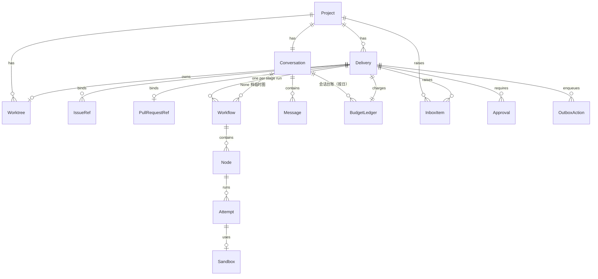
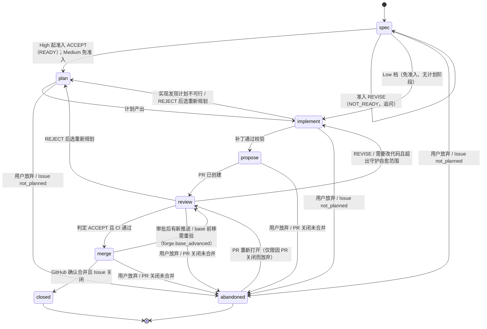

# 数据模型

> 状态：设计阶段 v0.1。本文定义所有模块共用的实体、状态机与事件。类型的权威定义将落在 `core` crate；本文与代码冲突时以本文为准，直到代码评审通过并回写本文。

## 1. 约定

- **ID**：带前缀的 ULID，例如 `dlv_01JB…`。前缀表见 §2。ID 一经分配不变。
- **时间**：UTC，RFC 3339，毫秒精度。
- **GitHub 引用**：保存 `owner/repo` + 编号 + GitHub node_id；展示用 `#N`。
- **不可信文本**：来自 GitHub 或沙盒的文本字段统一类型 `UntrustedText`，进入 prompt 前必须经隔离包装。
- **枚举**：以字符串存储，新增值只追加。`verdict` 用大写（`ACCEPT` 等），其余枚举小写。
- **档位 `Level`**：线上格式为 `"None"` / `"Low"` / `"Medium"` / `"High"` / `"Max"` / `"Ultimate"`（首字母大写）。配置里以档位为**对象键**时一律小写（`levels.none`、`levels.low`…`levels.ultimate`，`effort_by_level.low`…），由 `Level` 值找配置条目时转小写（P-71）。

### 1.1 共用值类型

| 类型 | 字段 | 说明 |
| --- | --- | --- |
| `UntrustedText` | `text`（string）、`source`（string，如 `github:issue.title`、`sandbox:report`）、`truncated`（bool） | 只当数据渲染（纯文本或消毒后的受限 Markdown） |
| `Ref` | `kind`：`issue` / `pr` / `worktree` / `delivery`；`issue` / `pr` 带 `repo` + `number`，其余带 `id` | 消息与卡片里的引用；客户端只发最小字段，快照由服务端解析 |
| `Card` | `kind` + 按 kind 的字段（下表）；卡片只放资源 ID，不内嵌可签名内容 | 消息的结构化附件；未知 `kind` 客户端降级显示 |
| `CheckSummary` | `passed`、`failed`、`pending`（int）、`required_ok`（bool） | 当前 head 的 check 汇总 |

| `Card.kind` | 字段 |
| --- | --- |
| `plan` | `delivery_id`、`workflow_id`、`summary`（UntrustedText） |
| `approval` | `approval_id` |
| `escalation` | `inbox_id` |
| `choice` | `inbox_id`、`options[]`（`{id, label, primary?}`，同 InboxItem `payload.options[]`） |
| `summary` | `delivery_id`?、`items[]`：每项 `{text: UntrustedText, ref: Ref?}`（如"离开期间摘要"，每项可点开对应引用） |

## 2. 实体总览

| 前缀 | 实体 | 说明 |
| --- | --- | --- |
| `prj_` | Project | 一个被管理的 GitHub 仓库 |
| `dlv_` | Delivery | 交付单元：Issue(s) ↔ PR ↔ 工作树 |
| `wfl_` | Workflow | 一个阶段内展开的图，带修订号 |
| `nod_` | Node | 图上的一个 agent 任务 |
| `att_` | Attempt | 节点的一次执行，不可变 |
| `wtr_` | Worktree | 服务端上的分支检出 |
| `sbx_` | Sandbox | 一次性执行环境 |
| `cnv_` | Conversation | 项目的主对话（与 Project 1:1） |
| `msg_` | Message | 对话中的一条消息 |
| `inb_` | InboxItem | 需要人处理的上报项 |
| `apr_` | Approval | Gantry 审批（设备签名） |
| `act_` | OutboxAction | 待执行的 GitHub 写动作 |
| `dev_` | Device | 已配对设备 |
| `evt_` | Event | 事件日志中的一条事件 |
| `bdg_` | BudgetLedger | 预算台账：交付台账（每个交付单元一个）或会话台账（每个项目会话每天一个，P-58） |



## 3. 实体字段

字段表只列语义上必要的字段；`id`、`created_at`、`updated_at` 省略。

### Project

| 字段 | 类型 | 说明 |
| --- | --- | --- |
| repo | `owner/repo` | GitHub 仓库 |
| installation_id | int | GitHub App 安装 ID |
| bot_user_id | int | App 机器人账号的 GitHub 用户 ID，用于识别自身事件 |
| default_branch | string | 默认分支（仓库设置快照） |
| allowed_merge_methods | (`merge` / `squash` / `rebase`)[] | 仓库允许的合并方法（仓库设置快照） |
| merge_queue_enabled | bool | 默认分支是否启用 merge queue（仓库设置快照） |
| settings_override | object? | 项目级配置覆盖（见 [interfaces/config.md](interfaces/config.md)）；只经 settings 路由读写 |

新任务的默认档位不是 Project 字段，而是配置 `levels.default_level`（项目可覆盖）。

### Delivery（交付单元）

| 字段 | 类型 | 说明 |
| --- | --- | --- |
| project_id | `prj_` | — |
| title | string | 简短标题 |
| level_cap | Level | 用户设定的上限；预算模板在创建时按它固定（P-57） |
| level_effective | Level | 当前实际档位（≤ 上限）。初值由引擎在规格阶段按风险评估给出，之后只能在上限内升、不自动降；用户把上限调到低于它时随上限下调，但已触发的闸门不撤销（P-57） |
| stage | Stage | 见 §4.1 |
| stage_status | `running` / `waiting_human` / `blocked` / `paused` / `done` | 当前阶段内的状态，转移规则见 §4.1（P-55） |
| issues | IssueRef[] | 关联 Issue（可为空，见"无规格"警告） |
| pr | PullRequestRef? | 关联 PR |
| worktree_id | `wtr_`? | — |
| parent_id | `dlv_`? | Ultimate 档拆分出的子交付单元指向父 |
| depends_on | `dlv_`[] | 子交付单元之间的依赖 |
| origin | `conversation` / `github_label` / `github_command` | 发起来源 |

### IssueRef / PullRequestRef（GitHub 快照）

| 字段 | 类型 | 说明 |
| --- | --- | --- |
| repo, number, node_id | — | — |
| title | UntrustedText | — |
| state | `open` / `closed` / `merged`（PR） | 来自对账 |
| state_reason | string? | Issue 关闭原因（completed / not_planned） |
| head_sha | string | PR 当前 head（PR 专用） |
| base_ref, base_sha | string | PR 目标分支及其当前 head（PR 专用） |
| draft | bool | 是否草稿（PR 专用） |
| mergeable_state | string | GitHub 的 `mergeable_state` 原值（`clean` / `dirty` / `blocked` / `behind` / `unstable` / `unknown` 等，PR 专用） |
| in_merge_queue | bool | 是否在 merge queue 中（PR 专用） |
| checks | CheckSummary | 当前 head 的 check 汇总（PR 专用） |
| review_state | `none` / `approved` / `changes_requested` | GitHub 审批状态（PR 专用） |
| synced_at | time | 最近一次对账时间 |

### Workflow / Node / Attempt

| 实体 | 字段 | 说明 |
| --- | --- | --- |
| Workflow | delivery_id?, conversation_id?, stage?, graph_rev, status, template | `delivery_id` 与 `conversation_id` 恰有一个非空：None 档读代码的问答是挂在会话上的临时图（`delivery_id = null`，必须有 `conversation_id`，`stage = null`，用量记会话台账，P-58）。`graph_rev` 每次图改写 +1；视图只显示当前修订。`template` 是阶段图名 `<档位键>.<阶段>`（如 `medium.implement`，按 `level_effective`；临时图为 `none.answer`），预算模板族名（如 `medium.plan_build_verify`）记在 `BudgetLedger.template`（[engine §7.4](modules/engine.md#74-图模板每个档位)）。`status`：`running` / `paused` / `succeeded` / `failed` / `cancelled` |
| Node | workflow_id, role, tier, exec, depends_on[], required, status, verdict?, superseded_by? | `role`：`plan` / `build` / `verify` / `single` / `review:<视角>` / `reasoner` / `arbiter` / `summarize` / `admission` / `heal` / `answer` / `intent` / `classify`（`reasoner` 不是判定节点，`verdict` 恒为空，P-45）；`tier`：`utility` / `planner` / `worker`；`exec`：`sandbox` / `sandbox_ro` / `direct`。三者的固定搭配见 [architecture §9](architecture.md#9-三类模型)。`verdict`：`ACCEPT` / `REVISE` / `REJECT` / `BLOCKED`（gate 节点） |
| Attempt | node_id, n, sandbox_id?, status, started_at, ended_at, result_ref, failure_class?, failure_detail?, usage | `status`：`preparing` / `running` / `succeeded` / `failed` / `cancelled`。结果存为内容寻址对象 `sha256:…`。`failure_class`：`timeout` / `exec_failed` / `verdict_fail` / `policy_denied` / `cancelled` / `budget_exhausted` / `infra_error`；`failure_detail` 是子码（[worker-protocol §9](interfaces/worker-protocol.md#9-失败分类)），受保护路径带规则 id，如 `policy.path_protected:workflows`（P-48）。`usage` 以 Egress 按 `job_token` 的计量为准（P-49）：`{input_tokens, output_tokens, cache_read_tokens, cache_write_tokens, requests}`；worker 自报的用量只存在结果对象里，仅展示 |

### Worktree / Sandbox

| 实体 | 字段 | 说明 |
| --- | --- | --- |
| Worktree | project_id, branch, base_ref, path, lock | `lock`：{holder: `engine`/`guardian`/`human`, delivery_id, acquired_at, lease_until}；租约到期自动释放 |
| Sandbox | driver, trust, image_digest, limits, status, worktree_snapshot, egress_profile | `trust`：trusted / untrusted；`limits`：cpu、mem、disk、pids、wall_time；`status`：`created`（已建、已注入、未启动）/ `running` / `stopped` / `destroyed` / `lost`；`worktree_snapshot`：`{mirror, base_sha, pr_base_sha?}`，即镜像仓引用 + 基线提交 SHA |

### Conversation / Message

每个项目恰好一个主对话（Conversation 与 Project 1:1），在项目绑定时创建；实体保留以便将来扩展。

| 字段 | 类型 | 说明 |
| --- | --- | --- |
| Message.role | `user` / `agent` / `event` | `event` 是折叠显示的后台事件行 |
| Message.agent_kind | `planner` / `worker` / `utility`? | 决定气泡边框颜色 |
| Message.text | string | 用户消息为可信；agent 消息可能引用不可信内容 |
| Message.tone | `info` / `ok` / `run` / `warn`? | 仅 `role = event`：事件行的语气，决定圆点颜色（运行中 / 完成 / 需要注意），文字仍须独立表达含义 |
| Message.level_cap | Level? | 用户消息附带的档位上限。桌面档案的消息带它且 `@` 的是已有交付单元时，视为对该交付单元调整上限（等同 `PATCH /v1/deliveries/{id}`，产生 `delivery.level_changed`，P-82）。手机档案发出的消息由服务端忽略该字段，固定使用项目默认上限（P-35） |
| Message.refs | Ref[] | 引用的 Issue / PR / 工作树 / 交付单元 |
| Message.cards | Card[] | 结构化附件，见 §1.1 |
| Message.delivery_id | `dlv_`? | 消息触发或关联的交付单元 |

### InboxItem / Approval

| 实体 | 字段 | 说明 |
| --- | --- | --- |
| InboxItem | project_id?, delivery_id?, kind, severity, summary, payload, status, dedup_key | `project_id` 为空只用于全局事项（P-63）；`kind`：`approval_needed` / `decision_needed` / `spec_needed` / `budget_exhausted` / `escalation` / `security_finding`；`severity`：`info` / `warn` / `blocker`（`≥ warn` 的 `inbox.raised` 触发桌面系统通知）；`status`：`open` / `resolved` / `dismissed`；`payload` 按 kind 见下表；`dedup_key`：同一键已有 `open` 项时不再新建（`dismissed` / `resolved` 之后可再建） |
| Approval | delivery_id?, action, target, subject_digest, device_id?, signature?, status, expires_at, consumed_by? | `action` 与各动作的 `target` / `subject_digest` 形状见下文"审批动作的 target 与 subject_digest"（P-54）；签名用设备的审批签名密钥，服务端用 `Device.approval_pubkey` 验签（P-47）；`status` 见 §4.4；`expires_at` = 创建时刻 + `policies.approval.ttl_s`（默认 24 小时，建议值）；`consumed_by`：消费方的 Outbox 动作 ID（`act_`）、尝试 ID（`att_`，补丁审批）或请求 ID（内部动作） |

| `InboxItem.kind` | `payload` |
| --- | --- |
| `approval_needed` | `{approval_id}` |
| `decision_needed` | `{kind, reason_code, options[]: {id, label, primary?}, node_id?, patch?}`。`kind`：`gate_reject`（gate `REJECT`）/ `manual_action`（需要用户在 Gantry 之外手动完成，如 workflow 补丁，P-48；`patch = {ref: "sha256:…", paths[]}` 指向结果库里的补丁）/ `review_dispute`（评审争议：是否交回前台改代码，P-79）/ `other`（新增值只追加）。`reason_code` 与 `options[]` 取下文词表 |
| `spec_needed` | `{missing[]: {aspect, question}}`（来自准入 `REVISE` 或计划的 `blocking_questions`）；**无选项**，用户以自由文本答复（发消息，`refs` 指向该交付单元），由会话服务处理后关闭（P-79） |
| `budget_exhausted` | `{dimension, limit, used, options[]}`；`options[]` 固定为 `raise_cap`（仅桌面，追加额度见 decisions D-19）/ `abandon`（P-79） |
| `escalation` | `{reason_code, node_id?, attempt_id?, target_level?, action_id?, evidence[]: Ref 或 {kind: "result", ref: "sha256:…"}, options[]?}`（gate `BLOCKED` 时附证据）。**升档一律用 `escalation`**（`reason_code = level_cap_exceeded`，`target_level` 为规则要求的档位，选项见下文词表），手机档案不可对它 `choose`（P-35、P-63）。`reason_code = outbox_failed:<code>` 时 `action_id` 必填，为终态失败的 Outbox 动作（`act_…`）；其余 `reason_code` 不得带 `action_id`（`core` 校验，#67）。只有 `level_cap_exceeded` 与 `outbox_failed:<code>` 带选项，其余 `reason_code` 无选项 |
| `security_finding` | `{source: Ref, finding: {severity, category, title: UntrustedText}, attempt_id?}` |

### 上报项的 reason_code 与选项词表

固定词表（P-79）：`payload.options[]` 只能取下表的选项 id，`label` 由创建方用模板生成（可信文本），`primary` 标默认项。表中"无"的上报项不带 `options[]`，用户经控制路由（暂停 / 继续 / 重试 / 放弃）、发消息或 `dismiss` 处理。`choose` 之后由订阅 `inbox.resolved` 的 `engine` 执行（[notify §7.4](modules/notify.md)），`notify` 只校验选项属于 `payload.options[]` 与客户端档案。手机档案：`escalation` 的任何选项、标"仅桌面"的选项返回 `403 forbidden_profile`（P-35）。

| `kind` | `payload.kind` / `reason_code` | 选项 id | 创建方 | 选择后的执行（`engine`） |
| --- | --- | --- | --- | --- |
| `escalation` | `level_cap_exceeded`（规则要求的档位超过上限，`target_level`） | `upgrade`（**primary**）/ `narrow` / `abandon` | `engine` | `upgrade`：把上限调到 `target_level`（等同 `PATCH /v1/deliveries/{id}`，P-57 预算不变）；`narrow`：保持上限，`level_effective = level_cap` 继续，缩小范围由用户后续消息表达；`abandon`：放弃 |
| `decision_needed` | `kind = gate_reject`，`reason_code = gate_reject`（gate `REJECT`） | `replan`（**primary**）/ `abandon` | `engine` | `replan`：回到 `plan`（Low 档重新实现）；`abandon`：放弃 |
| `decision_needed` | `kind = manual_action`，`reason_code = policy.path_protected:workflows`（P-48） | `done`（**primary**）/ `abandon` | `engine`（守护的愈合轮经 `ReportHint` 由 `guardian` 写） | `done`：用户已在 Gantry 之外手动完成，解除阻塞并按 GitHub 快照重新求值当前阶段（外部推送按 `forge.pr_synchronized(origin = external)` 处理）；`abandon`：放弃 |
| `decision_needed` | `kind = review_dispute`，`reason_code` ∈ `guardian.human_feedback` / `guardian.scope_expanding_fix` / `guardian.design_or_api_change` | `fix`（**primary**）/ `keep` | `guardian` | `fix`：交回前台改代码（`review → implement`，[engine §7.6](modules/engine.md#76-阶段推进条件) T9）；`keep`：保持现状，只关闭该项 |
| `decision_needed` | `kind = other`，`reason_code` ∈ `github_state_changed` / `approval_denied` [提议，裁决未覆盖] | `continue` / `abandon` | `engine` | `continue`：解除阻塞并重新求值；`abandon`：放弃 |
| `spec_needed` | — | 无（自由文本答复，走发消息） | `engine` | `conversation` 调 `supply_spec` 后关闭该项 |
| `budget_exhausted` | — | `raise_cap`（仅桌面，D-19）/ `abandon` | `engine`、`guardian`（T-07 补写） | `raise_cap`：按 D-19 追加额度后继续；`abandon`：放弃 |
| `approval_needed` | — | 无（只能经审批路由处理，`choose` 返回 `409`） | `engine` / `guardian` | — |
| `security_finding` | — | 无 | `guardian` | — |
| `escalation` | `outbox_failed:<code>`（Outbox 动作终态失败，`payload.action_id` 为该动作；`<code>` 取 forge-actions 的失败码，映射见 [engine §9](modules/engine.md#9-错误与恢复)） | `retry`（**primary**）/ `abandon`（#67） | `engine` | `retry`：对 `action_id` 那个动作的期望意图以 `epoch + 1` 重新判定并入队（新幂等键）；需要审批的动作同时需要新审批（P-54），已消费的旧审批不复用；意图已不在当前阶段的期望动作集合里时不入队，只关闭该项；`abandon`：放弃 |
| `escalation` | `gate_blocked`、`arbiter_escalate`、`attempt_failed`、`no_progress`、`no_change`、`merge_denied_by_policy`、`approval_shape_undefined`、`app_permission_missing`、`models_not_configured`、`policy.path_protected:<规则 id>`（M1 依赖清单 / lockfile）；`guardian.*`（[guardian §7.9](modules/guardian.md#79-上报) 的词表，评审争议三码除外） | 无 | `engine`、`guardian`、`forge`（`app_permission_missing`） | — |

新增 `reason_code` 或选项 id 须经契约 PR 回写本表；未列出的 `option_id` 由 `notify` 拒绝（`422`）。

### 审批动作的 target 与 subject_digest

`Approval.action` ∈ `ForgeActionKind` ∪ {`settings_update`、`device_role_change`、`device_revoke`、`force_push`、`push_outside_prefix`、`resolve_review_thread_human`、`patch_apply_protected`}（P-54）。下表是**全部**已定义形状；`action` 合法但不在下表中（例如某个 `ForgeActionKind` 被配置为 `approve`，而它的形状尚未定义）时一律 **fail-closed**：不创建审批，按拒绝处理并上报（`escalation`，`reason_code = approval_shape_undefined`）。`target` 中的数组在规范化时保持原序（[api.md §6.3](interfaces/api.md#63-规范化与签名)）。

| `action` | 类别 | `target` | `subject_digest` | 谁创建 / 谁消费 |
| --- | --- | --- | --- | --- |
| `merge_pr` | Forge 动作 | `{kind:"pr", repo, number}` | PR 的 head SHA（40 位十六进制，= Outbox `payload.expected_head_sha`） | 引擎创建；`forge` 执行开始前消费 |
| `force_push` | 条件伪动作（`push_branch` 且 `force=true`） | `{kind:"branch", repo, branch, expected_remote_oid}` | 将要推送的提交 SHA（`local_head_oid`） | 引擎 / 守护创建；`forge` 执行开始前消费 |
| `push_outside_prefix` | 条件伪动作（`push_branch` 到非 `gantry/` 前缀分支） | `{kind:"branch", repo, branch, expected_remote_oid}` | 将要推送的提交 SHA（`local_head_oid`） | 同上 |
| `resolve_review_thread_human` | 条件伪动作（`resolve_review_thread` 且线程含人类评论） | `{kind:"review_thread", repo, number, thread_node_id}` | `"sha256:"` + 线程当前评论 ID 列表（升序）的 JCS 摘要；有新回复即不再一致 | 守护 / 引擎创建；`forge` 执行开始前消费 |
| `patch_apply_protected` | 补丁闸门（补丁命中处置为 `approve` 的路径规则，M2 起） | `{kind:"patch", repo, attempt_id, rules:[规则 id…], paths:[路径…]}` | 补丁内容的 `sha256:…`（`ValidatedPatch.sha256`） | 引擎创建；`repo` 在应用补丁、创建提交之前消费 |
| `settings_update` | 内部动作 | `{kind:"settings", scope, project_id?, resource, base_rev}` | 请求体的 `"sha256:"` + JCS 摘要（[api.md §6.6](interfaces/api.md#66-内部动作的签名写入settings改角色吊销)） | 客户端发起；`api` 在执行写入的同一事务里消费 |
| `device_role_change` / `device_revoke` | 内部动作 | `{kind:"device", id}` | 请求体的 `"sha256:"` + JCS 摘要 | 同上 |
| 其他 `ForgeActionKind`（`push_branch`、`create_pr` 等） | — | 未定义 | 未定义 | fail-closed（见上） |

Workflow 文件改动不在表中：它不能经任何审批放行（P-48）。

### OutboxAction

| 字段 | 类型 | 说明 |
| --- | --- | --- |
| project_id, delivery_id | ID | — |
| idempotency_key | string | 由（项目、交付单元、动作类型、目标、意图摘要、`epoch`）派生（[forge-actions §2.2](interfaces/forge-actions.md#22-幂等键)） |
| kind | ForgeActionKind | 见 [interfaces/forge-actions.md](interfaces/forge-actions.md) |
| payload | object | — |
| requires_approval | `apr_`? | 需要审批时引用审批。是否需要由**入队方**在入队时调用 `policy` 决定并写入；`forge` 不读策略配置，只在执行时调用 `policy` 验证并消费该审批（P-62） |
| depends_on | `act_`[] | 前置动作；任一前置终态失败则本动作 `cancelled` |
| priority | `high` / `normal` / `low` | 限流紧张时先饿死 `low` |
| not_before | time? | 最早执行时间（限流退避、写速率令牌桶延后） |
| epoch | int | 默认 0；有意重做已终态的动作（含人工重试）时创建新动作，`epoch` +1 |
| status | `queued` / `executing` / `succeeded` / `failed` / `cancelled` | `failed` 只表示**终态**失败（重试用尽或不可重试）；临时错误留在 `queued` 退避重试（P-53），见 §4.3 |
| attempts | int | 执行次数（限流等待不计） |
| lease_until | time? | 执行租约；过期的 `executing` 行在重启后重放 |
| last_error | object? | `{code, message}`，最近一次失败（脱敏） |
| expected_effects | object[] | 执行前写入的预期 GitHub 效果，用于在记录之前识别自身事件 |
| github_ref | object? | 执行成功后 GitHub 返回的对象标识，用于识别自身产生的 webhook |

### Device / BudgetLedger

| 实体 | 字段 | 说明 |
| --- | --- | --- |
| Device | name, platform, cert_serial, pubkey_fpr, approval_pubkey, approval_pubkey_fpr, role, status, last_seen | `pubkey_fpr` 是 mTLS 客户端密钥的指纹；`approval_pubkey` 是配对时登记的审批签名公钥（P-47，P-256 未压缩点，base64url），`approval_pubkey_fpr` 是其 `sha256:` 指纹；手机档案（`ios`）配对时可省略，此时两者为空（P-76）；`platform`：`windows` / `macos` / `ios`；`role`：`viewer` / `operator` / `approver`，第一台配对设备为 approver，之后默认 operator，改角色与吊销需要 approver 签名；`ios` 设备永远不能是 approver（P-76，第一台设备是手机时见 decisions D-18）；`status`：`active` / `revoked` |
| BudgetLedger | subject, delivery_id?, conversation_id?, project_id, day?, template?, limits, used | `subject`：`delivery`（交付台账，每个交付单元一个，`template` 与 `limits` 在创建时按 `level_cap` 固定，P-57）/ `conversation`（会话台账，P-58：每个项目会话每个 UTC 日一个，`day` 为日期，`limits` 只有 `tokens` = `levels.none.daily_tokens`，`template` 为空）。**台账 ID**（Egress 计量归属用，P-74）：交付台账为其交付单元 ID `dlv_…`，会话台账为 `cnv_…:YYYY-MM-DD`（UTC 日）；它是台账的业务键，不是行 ID `bdg_…`（会话台账在当日首笔记账时才建行）。交付台账 `limits`：tokens_by_tier、nodes、rounds、wall_time、forge_writes、concurrency；`used`：tokens_by_tier、nodes、attempts、rounds、wall_time、forge_writes。会话台账 `used`：tokens_by_tier。单位见下 |

BudgetLedger 的计数口径：

| 项 | 口径 |
| --- | --- |
| `tokens_by_tier` | 按 tier 累计的**加权** token，以 Egress 计量为准（`job_token` / `svc_token` 同一口径，P-49、P-50）；加权 = `Σ levels.token_weights.<类别> × 该类别 token 数`（P-44、P-70） |
| `nodes` / `attempts` | `nodes` 数节点（被图改写替换的节点也计）；`attempts` 另计，不占 `nodes` |
| `wall_time` | 秒；该交付单元所有尝试运行时长之和 |
| `rounds` | 评审迭代轮与守护自愈轮之和 |
| `forge_writes` | Outbox 动作成功次数的累计数。按小时限速是配置项 `levels.*.budget.forge_writes_per_hour`，由 Outbox 令牌桶执行，不进台账，二者不混用 |
| `concurrency` | 同时运行的节点数；Ultimate 父交付单元指同时运行的子交付单元数 |
| Ultimate | 父交付单元的台账汇总所有子交付单元的用量 |
| 会话台账 | 只计 `tokens_by_tier`；`answer` 临时图与不属于任何交付单元的直接调用（如 `intent`）都记入；达到 `levels.none.daily_tokens` 后当天不再派发新的 None 档问答，回复中提示（P-58、P-71） |

## 4. 状态机

### 4.1 交付单元阶段



- **任何非终态阶段 → `abandoned`**（P-55）：用户放弃（`POST /v1/deliveries/{id}/abandon`）、PR 被关闭且未合并、绑定的 Issue 以 `not_planned` 关闭。
- `abandoned` 是终态，唯一例外：因 PR 被关闭而进入 `abandoned` 的交付单元，在该 PR 重新打开（`forge.pr_reopened`）时回到 `review`；用户放弃或 Issue `not_planned` 的不会恢复（P-75）。
- 准入只在 High 及以上：Medium `spec → plan` 免准入；Low 从 `spec` 直接进入 `implement`（免准入，跳过 `plan`）；Low 的 `review` 阶段没有评审图，但状态仍经过 `review`（等待 CI）。
- 计划是独立阶段：计划阶段图 = `plan`（Max 起加 `reasoner`）；实现阶段图 = `build → verify`（Low 为 `single`）。
- 任何阶段内 gate 判定 `REJECT`：阶段不变，`stage_status = waiting_human`，上报 `decision_needed`（`kind = gate_reject`，放弃或重新规划）；选"重新规划"回到 `plan`（Low 档没有计划阶段，回到 `implement`），选"放弃"进入 `abandoned`。`BLOCKED`：上报 `escalation` 并附证据，`stage_status = blocked`。
- 守护的静默自愈不改变阶段（`heal` 节点挂在 `review` 阶段）；只有需要改代码且超出自愈范围时才走 `review → implement`（P-60）。

**阶段内状态 `stage_status`**（P-55）：

| 值 | 含义 |
| --- | --- |
| `running` | 正在推进，或在等 CI / GitHub 的结果 |
| `waiting_human` | 存在引擎创建的、需要人处理的未决上报项（`spec_needed`、`decision_needed`、`approval_needed`、`budget_exhausted`、需要选择的 `escalation`，含"需要超过上限"） |
| `blocked` | gate 判定 `BLOCKED`；或子交付单元在等 `depends_on`（Ultimate）；外部条件变化才能继续 |
| `paused` | 用户暂停（`POST /v1/deliveries/{id}/pause`，P-56）：不派发新节点，运行中的尝试跑到安全点 |
| `done` | 交付单元进入终态（`closed` / `abandoned`） |

| 转移 | 触发 |
| --- | --- |
| （进入新阶段）→ `running` | `delivery.stage_changed` |
| `running` → `waiting_human` | 引擎创建需人处理的上报项 |
| `running` → `blocked` | `BLOCKED` 判定；等待依赖 |
| `waiting_human` / `blocked` → `running` | 对应上报项被 `resolve` / `choose`（`dismiss` 不改变状态），或阻塞条件消失 |
| `running` / `waiting_human` / `blocked` → `paused` | `delivery.paused`；记下暂停前的值 |
| `paused` → 暂停前的值 | `delivery.resumed`；若期间上报项已处理则为 `running` |
| 任意 → `done` | 进入 `closed` 或 `abandoned`（`abandoned → review` 的恢复把它重新置为 `running`） |

- 每个阶段的**退出证据**：

| 阶段 | 退出证据 |
| --- | --- |
| spec | High 及以上：准入 verdict `ACCEPT`；规格写回 Issue。Medium / Low 免准入 |
| plan | 计划节点产出且通过 schema 校验（Max 起含 `reasoner` 预演报告） |
| implement | 补丁在干净检出上应用成功（`repo` 机械检查），策略判定通过（`policy`），`repo` 已创建提交 |
| propose | Outbox `create_pr` 成功，PR 编号写入快照 |
| review | 当前 head 上：评审判定 `ACCEPT`（Low 档无评审图）、required checks 通过 |
| merge | GitHub 返回 merged，head 与审批绑定的 `subject_digest` 一致 |
| closed | 关联 Issue 全部关闭（非默认分支合并时由 Forge 主动关闭） |

### 4.2 节点

`pending → queued → running → (succeeded | failed | skipped | cancelled)`；`superseded` 表示被图改写替换。失败节点可由引擎在同一图内新建尝试（新 Attempt），不修改旧尝试。用户经 `POST /v1/nodes/{node_id}/retry` 重试失败节点时，引擎追加 `node.retry_requested` 并新建尝试（P-56）。

### 4.3 Outbox 动作

`queued → executing → succeeded`；临时错误（网络、5xx、限流、令牌过期）与限流时 `executing → queued`（设 `not_before` 退避，P-53）；重试用尽或不可重试错误 `executing → failed`（**终态**，只此时发 `outbox.failed`）；非终态 `→ cancelled`。**没有** `failed → queued`：人工重试创建新动作（新 `epoch`）。执行前先按幂等键查询 GitHub 是否已存在目标对象，存在则直接 `succeeded`。

### 4.4 审批

`pending → granted → (consumed | invalidated | expired)`；`pending → (denied | invalidated | expired)`。`pending → expired` 的期限是 `policies.approval.ttl_s`（默认 24 小时，建议值）。`granted` 只在 `subject_digest` 仍与当前主体一致时可被消费（PR 类动作即 head 未变），消费即 `consumed`，只能消费一次。**审批在执行开始前消费**（P-54）：`forge` 在把 Outbox 动作置为 `executing` 的同一事务里消费并记下 `consumed_by = act_…`；之后该动作的临时错误重试沿用这次消费，但动作终态失败**不退回**审批，重做需要新审批。

## 5. 事件

### 5.1 信封

```json
{
  "id": "evt_01JB...",
  "seq": 18234,
  "ts": "2026-10-24T12:41:03.120Z",
  "type": "delivery.stage_changed",
  "subject": "dlv_01JB...",
  "project_id": "prj_01JB...",
  "actor": { "kind": "engine | guardian | user | device | forge | system", "id": "..." },
  "causation_id": "evt_...",
  "correlation_id": "dlv_...",
  "data": {}
}
```

- `seq` 全局单调递增，作为客户端事件流游标。
- `log_epoch`（P-67）：事件日志的纪元号，存于日志元数据，**不在信封里**；每次从备份恢复加一。事件流（`heartbeat`）与所有快照响应（头 `X-Log-Epoch`）携带它，客户端发现变化就丢弃缓存、全量重同步（[api.md §5.3](interfaces/api.md#53-快照--事件流客户端的标准衔接)）。设备吊销另追加到日志之外的 `revocations.journal`（只追加；每次写入在吊销提交前 `fsync` 并同步复制到备份目标；事务回滚不删除条目），恢复时重放时间戳晚于备份时刻的条目（P-67、P-80）。
- 全局事件（设备、全局设置等）的 `project_id` 为 `null`。
- 事件只追加；投影由 `store` 在同一事务中更新。

### 5.2 事件类型目录

| 类型 | 触发 |
| --- | --- |
| `project.added` / `project.updated` | 项目绑定、仓库设置快照变化（设置覆盖变更不用它，见 `settings.updated`） |
| `settings.updated` | 某 `(scope, resource)` 设置写入；全局写入时 `subject` 为字面量 `settings`、`project_id` 为 `null`（[config.md §2.3](interfaces/config.md)） |
| `conversation.created` | 项目主对话创建 |
| `delivery.created` / `delivery.stage_changed` / `delivery.level_changed` / `delivery.abandoned` | 交付单元生命周期（`stage_changed` 的 `data` 含新 `stage_status`；`level_changed` 来自 `PATCH`、桌面消息带 `level_cap` 指向已有交付单元（P-82）、`upgrade` 选项或自动加码；`kind = cap` 的应用同时派生 `level_effective = min(原值, 新上限)`，不另写 `effective` 下降事件，见 engine.md §11） |
| `delivery.paused` / `delivery.resumed` | 用户暂停 / 继续交付单元（P-56） |
| `workflow.created` / `workflow.revised` / `workflow.finished` | 图创建、改写、结束（含挂在会话上的临时图，此时 `subject` 为 `wfl_…`、`data.conversation_id` 非空）；结束时 `data.status` 取 `Workflow.status` 的终态值 |
| `node.queued` / `node.started` / `node.finished` / `node.superseded` | 节点 |
| `node.retry_requested` | 用户请求重试失败节点（P-56）；引擎随后新建尝试 |
| `attempt.started` / `attempt.finished` | 尝试；`attempt.finished` 有补丁时带 `result_tree` 与本地提交 `result_commit`，两者同时出现，`status = succeeded` 且有 `result_tree` 时 `result_commit` 必填（engine.md §7.14.6 E1）；有被 `policy` 接受的 `open_pr` 提议时带 `accepted_open_pr`（`proposal_id`，原文在 `result_ref` 指向的 CAS 对象里，engine.md §7.14.6 E5） |
| `attempt.progress` | 尝试进度（worker 自报经采样节流），仅展示，不驱动状态机 |
| `patch.validated` / `patch.rejected` | 由 `repo` 写：`patch.validated` 含 `result_tree` 与判定（`allow` / `needs_approval`）；`patch.rejected` 含 `reason`，覆盖机械拒绝（不可应用、路径非法、`.git`、二进制、符号链接、子模块）与策略拒绝两种（P-69） |
| `sandbox.created` / `sandbox.destroyed` | 沙盒 |
| `worktree.created` / `worktree.locked` / `worktree.unlocked` / `worktree.removed` | 工作树 |
| `message.posted` | 对话消息（用户、agent、事件行） |
| `inbox.raised` / `inbox.resolved` / `inbox.dismissed` | 上报（`inbox.raised` 且 `severity ≥ warn` 时桌面端弹系统通知，不另设事件，P-63） |
| `guardian.triaged` | 守护对一个事件的分流处置：`event_ref`（触发事件的 `seq` 或 `dedup_key`）、`class`（config §6.1 的类 id）、`action`（`silent_fix` / `silent_reply` / `batch` / `escalate` / `noop` / `defer` / `finalize` 等）（P-60） |
| `guardian.heal_requested` | 守护请求引擎开一轮自愈（`heal` 节点） |
| `guardian.escalated` | 守护上报（附 `class`、`reason_code`、`inbox_id`） |
| `approval.requested` / `approval.granted` / `approval.consumed` / `approval.invalidated` / `approval.expired` / `approval.denied` | 审批 |
| `outbox.enqueued` / `outbox.executing` / `outbox.succeeded` / `outbox.failed` / `outbox.cancelled` | GitHub 写动作 |
| `forge.<kind>` | 归一化后的 Forge 事件，`<kind>` 见 [forge-actions §6.3](interfaces/forge-actions.md#63-目录)（如 `forge.pr_synchronized`、`forge.base_advanced`） |
| `forge.synced` | 对账得到的 GitHub 交付事实变化 |
| `forge.drift_detected` | 本地预期与 GitHub 不一致 |
| `budget.charged` / `budget.exhausted` | 预算（交付台账或会话台账；`data.subject` 区分） |
| `policy.denied` | `policy` 的规则判定为拒绝（路径规则、大小上限、敏感文件、动作处置）；机械拒绝不发此事件，只发 `patch.rejected`（P-69） |
| `device.paired` / `device.updated` / `device.revoked` | 设备（`device.updated`：改名、改角色、续期换证）。注册推送令牌（`PUT /v1/devices/self/push-token`，P-77）不产生事件，令牌不进事件日志 |

每个事件 `data` 的 JSON Schema 放在 `schemas/events/<type>.json`（M0 产出）。

其中 `attempt.progress`、`guardian.*` 三事件、`approval.*` 三事件、`outbox.*` 三事件、`forge.synced`、`budget.charged`、`policy.denied` 共 13 个事件的 `data` 字段见 [event-data.md](interfaces/event-data.md)（已批准（2026-10-27，用户统一批准））；`forge.drift_detected` 由独立 drift 契约定义。运行时按 `core` 事件目录的实际落地情况校验：已落地 data 校验的事件按本契约校验，尚未落地的仍按 fail-closed 拒绝；本节其余语义不变。
