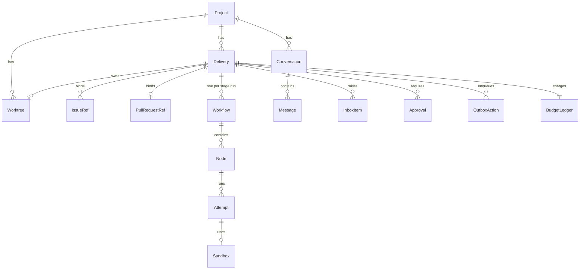
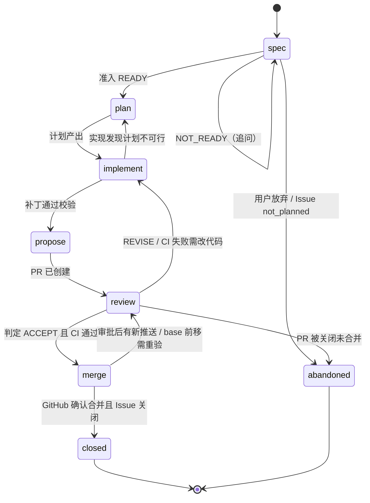

# 数据模型

> 状态：设计阶段 v0.1。本文定义所有模块共用的实体、状态机与事件。类型的权威定义将落在 `core` crate；本文与代码冲突时以本文为准，直到代码评审通过并回写本文。

## 1. 约定

- **ID**：带前缀的 ULID，例如 `dlv_01JB…`。前缀表见 §2。ID 一经分配不变。
- **时间**：UTC，RFC 3339，毫秒精度。
- **GitHub 引用**：保存 `owner/repo` + 编号 + GitHub node_id；展示用 `#N`。
- **不可信文本**：来自 GitHub 或沙盒的文本字段统一类型 `UntrustedText`（含来源与截断标记），进入 prompt 前必须经隔离包装。
- **枚举**：以字符串存储，新增值只追加。

## 2. 实体总览

| 前缀 | 实体 | 说明 |
| --- | --- | --- |
| `prj_` | Project | 一个被管理的 GitHub 仓库 |
| `dlv_` | Delivery | 交付单元：Issue(s) ↔ PR ↔ 工作树 |
| `wfl_` | Workflow | 一个阶段内展开的图，带修订号 |
| `nod_` | Node | 图上的一个 agent 任务 |
| `att_` | Attempt | 节点的一次执行，不可变 |
| `wtr_` | Worktree | 服务端上的分支检出 |
| `sbx_` | Sandbox | 一次性执行环境 |
| `cnv_` | Conversation | 项目内的主对话 |
| `msg_` | Message | 对话中的一条消息 |
| `inb_` | InboxItem | 需要人处理的上报项 |
| `apr_` | Approval | Gantry 审批（设备签名） |
| `act_` | OutboxAction | 待执行的 GitHub 写动作 |
| `dev_` | Device | 已配对设备 |
| `evt_` | Event | 事件日志中的一条事件 |
| `bdg_` | BudgetLedger | 预算台账 |



## 3. 实体字段

字段表只列语义上必要的字段；`id`、`created_at`、`updated_at` 省略。

### Project

| 字段 | 类型 | 说明 |
| --- | --- | --- |
| repo | `owner/repo` | GitHub 仓库 |
| installation_id | int | GitHub App 安装 ID |
| default_branch | string | 默认分支 |
| default_level | Level | 新任务的默认档位上限 |
| settings_override | object? | 项目级配置覆盖（见 [interfaces/config.md](interfaces/config.md)） |

### Delivery（交付单元）

| 字段 | 类型 | 说明 |
| --- | --- | --- |
| project_id | `prj_` | — |
| title | string | 简短标题 |
| level_cap | Level | 用户设定的上限 |
| level_effective | Level | 当前实际档位（≤ 上限） |
| stage | Stage | 见 §4.1 |
| stage_status | `running` / `waiting_human` / `blocked` / `done` | 当前阶段内的状态 |
| issues | IssueRef[] | 关联 Issue（可为空，见"无规格"警告） |
| pr | PullRequestRef? | 关联 PR |
| worktree_id | `wtr_`? | — |
| parent_id | `dlv_`? | Ultimate 档拆分出的子交付单元指向父 |
| depends_on | `dlv_`[] | 子交付单元之间的依赖 |
| origin | `conversation` / `github_label` / `github_command` | 发起来源 |

### IssueRef / PullRequestRef（GitHub 快照）

| 字段 | 类型 | 说明 |
| --- | --- | --- |
| number, node_id | — | — |
| title | UntrustedText | — |
| state | `open` / `closed` / `merged`（PR） | 来自对账 |
| state_reason | string? | Issue 关闭原因（completed / not_planned） |
| head_sha | string | PR 当前 head（PR 专用） |
| base_ref | string | PR 目标分支（PR 专用） |
| checks | CheckSummary | 当前 head 的 check 汇总（PR 专用） |
| review_state | `none` / `approved` / `changes_requested` | GitHub 审批状态（PR 专用） |
| synced_at | time | 最近一次对账时间 |

### Workflow / Node / Attempt

| 实体 | 字段 | 说明 |
| --- | --- | --- |
| Workflow | delivery_id, stage, graph_rev, status, template | `graph_rev` 每次图改写 +1；视图只显示当前修订 |
| Node | workflow_id, role, tier, depends_on[], required, status, verdict?, superseded_by? | `role`：plan / build / verify / review:<视角> / reasoner / arbiter / summarize / admission；`tier`：utility / planner / worker |
| Attempt | node_id, n, sandbox_id?, status, started_at, ended_at, result_ref, failure_class?, usage | 结果存为内容寻址对象 `sha256:…`；`failure_class`：timeout / exec_failed / verdict_fail / policy_denied |

### Worktree / Sandbox

| 实体 | 字段 | 说明 |
| --- | --- | --- |
| Worktree | project_id, branch, base_ref, path, lock | `lock`：{holder: `engine`/`guardian`/`human`, delivery_id, acquired_at, lease_until}；租约到期自动释放 |
| Sandbox | driver, trust, image_digest, limits, status, worktree_snapshot, egress_profile | `trust`：trusted / untrusted；`limits`：cpu、mem、disk、pids、wall_time |

### Conversation / Message

| 字段 | 类型 | 说明 |
| --- | --- | --- |
| Message.role | `user` / `agent` / `event` | `event` 是折叠显示的后台事件行 |
| Message.agent_kind | `planner` / `worker` / `utility`? | 决定气泡边框颜色 |
| Message.text | string | 用户消息为可信；agent 消息可能引用不可信内容 |
| Message.level_cap | Level? | 用户消息附带的档位上限 |
| Message.refs | Ref[] | 引用的 Issue / PR / 工作树 / 交付单元 |
| Message.cards | Card[] | 结构化附件：执行计划、审批请求等 |
| Message.delivery_id | `dlv_`? | 消息触发或关联的交付单元 |

### InboxItem / Approval

| 实体 | 字段 | 说明 |
| --- | --- | --- |
| InboxItem | delivery_id, kind, severity, summary, payload, status | `kind`：approval_needed / decision_needed / spec_needed / budget_exhausted / escalation / security_finding；`status`：open / resolved / dismissed |
| Approval | delivery_id, action, target, head_sha, device_id, signature, status, expires_at | `status`：pending / granted / invalidated / expired / denied；head 变化即 `invalidated` |

### OutboxAction

| 字段 | 类型 | 说明 |
| --- | --- | --- |
| idempotency_key | string | 由（交付单元、动作类型、目标、内容哈希）派生 |
| kind | ForgeActionKind | 见 [interfaces/forge-actions.md](interfaces/forge-actions.md) |
| payload | object | — |
| requires_approval | `apr_`? | 需要审批时引用审批 |
| status | `queued` / `executing` / `succeeded` / `failed` / `cancelled` | — |
| attempts | int | 执行次数 |
| github_ref | object? | 执行成功后 GitHub 返回的对象标识，用于识别自身产生的 webhook |

### Device / BudgetLedger

| 实体 | 字段 | 说明 |
| --- | --- | --- |
| Device | name, platform, cert_serial, pubkey_fpr, role, status, last_seen | `role`：viewer / operator / approver；`status`：active / revoked |
| BudgetLedger | delivery_id, template, limits, used | `limits`/`used`：tokens_by_tier、nodes、rounds、wall_time、forge_writes |

## 4. 状态机

### 4.1 交付单元阶段



- Low 档跳过 `plan` 和 `review` 的图，但状态仍经过 `review`（等待 CI）。
- 每个阶段的**退出证据**：

| 阶段 | 退出证据 |
| --- | --- |
| spec | 准入 verdict `READY`（Low 档免），规格写回 Issue |
| plan | 计划节点产出且通过 schema 校验 |
| implement | 补丁在干净检出上应用成功，策略校验通过 |
| propose | Outbox `create_pr` 成功，PR 编号写入快照 |
| review | 当前 head 上：评审判定 `ACCEPT`、required checks 通过 |
| merge | GitHub 返回 merged，head 与审批绑定的 SHA 一致 |
| closed | 关联 Issue 全部关闭（非默认分支合并时由 Forge 主动关闭） |

### 4.2 节点

`pending → queued → running → (succeeded | failed | skipped | cancelled)`；`superseded` 表示被图改写替换。失败节点可由引擎在同一图内新建尝试（新 Attempt），不修改旧尝试。

### 4.3 Outbox 动作

`queued → executing → succeeded`；`executing → failed`（可重试）`→ queued`；任何状态 `→ cancelled`。执行前先按幂等键查询 GitHub 是否已存在目标对象，存在则直接 `succeeded`。

### 4.4 审批

`pending → granted → (consumed | invalidated | expired)`；`pending → denied`。`granted` 只在 `head_sha` 不变时可被消费。

## 5. 事件

### 5.1 信封

```json
{
  "id": "evt_01JB...",
  "seq": 18234,
  "ts": "2026-10-24T12:41:03.120Z",
  "type": "delivery.stage_changed",
  "subject": "dlv_01JB...",
  "project_id": "prj_01JB...",
  "actor": { "kind": "engine | guardian | user | device | forge", "id": "..." },
  "causation_id": "evt_...",
  "correlation_id": "dlv_...",
  "data": {}
}
```

- `seq` 全局单调递增，作为客户端事件流游标。
- 事件只追加；投影由 `store` 在同一事务中更新。

### 5.2 事件类型目录

| 类型 | 触发 |
| --- | --- |
| `project.added` / `project.updated` | 项目绑定、设置变更 |
| `delivery.created` / `delivery.stage_changed` / `delivery.level_changed` / `delivery.abandoned` | 交付单元生命周期 |
| `workflow.created` / `workflow.revised` / `workflow.finished` | 图创建、改写、结束 |
| `node.queued` / `node.started` / `node.finished` / `node.superseded` | 节点 |
| `attempt.started` / `attempt.finished` | 尝试 |
| `sandbox.created` / `sandbox.destroyed` | 沙盒 |
| `worktree.created` / `worktree.locked` / `worktree.unlocked` / `worktree.removed` | 工作树 |
| `message.posted` | 对话消息（用户、agent、事件行） |
| `inbox.raised` / `inbox.resolved` | 上报 |
| `approval.requested` / `approval.granted` / `approval.invalidated` / `approval.denied` | 审批 |
| `outbox.enqueued` / `outbox.succeeded` / `outbox.failed` | GitHub 写动作 |
| `forge.synced` | 对账得到的 GitHub 交付事实变化 |
| `forge.drift_detected` | 本地预期与 GitHub 不一致 |
| `budget.charged` / `budget.exhausted` | 预算 |
| `policy.denied` | 策略拒绝 |
| `device.paired` / `device.revoked` | 设备 |

每个事件 `data` 的 JSON Schema 放在 `schemas/events/<type>.json`（M0 产出）。
