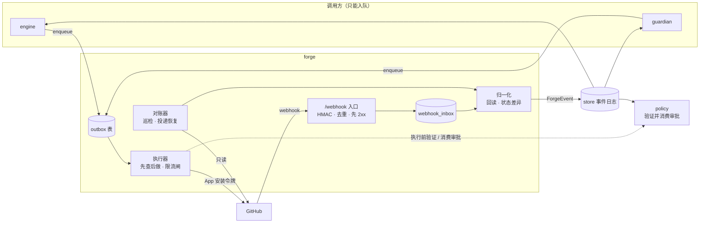

# Forge 契约：Outbox 动作 · ForgeEvent · GitHub App 权限

> 状态：设计 v0.1（2026-10-24）· 所属模块：`forge` · 使用方：`engine`、`guardian`、`policy`、`store` · 里程碑：M1 起，逐动作标注 · 机器可读版：`schemas/forge/*.json`（M0 产出；在此之前以本文为准）

本文规定 `forge` 对内的三份契约：

- **A. Outbox 动作**：其他模块怎样让 GitHub 发生变化（§2–§3）。
- **B. ForgeEvent**：GitHub 上发生的事怎样进入 Gantry（§4–§7）。
- **C. App 权限与限流**：向 GitHub 要什么、怎么省着用（§8–§10）。

守护的不变式（见 [architecture.md §5](../architecture.md#5-信任边界与不变式)）：

| # | 在本文的落点 |
| --- | --- |
| I1 | 沙盒拿不到 token；git 推送与 API 调用都发生在 `forge` 进程内（§8、§9.4） |
| I2 | 所有 GitHub 写只有 Outbox 一条路；动作带幂等键；先查后做（§2） |
| I3 | 是否需要审批由入队方在入队时调用 `policy` 决定；`forge` 不读策略配置，只在**执行开始前**经 `policy` 验证并消费审批，复核 head SHA（§2.5，P-54、P-62） |
| I4 | webhook 只是提示，事件由"回读 GitHub 后的状态差异"产生；对账器补漏并记录 drift（§5–§7） |
| I5 | 所有来自 GitHub 的文本字段都是 `UntrustedText`；写出去的文本先中和 `@mention`（§2.4、§6.2） |
| I8 | 推送的提交必须与 `repo` 校验、`policy` 判定过的是同一个对象（§3.3、§8）；`.github/workflows/` 的改动永不推送（P-48） |

**标注约定**

- **（官方）**：数值或行为已对照 2026-10-24 的 GitHub 官方文档核对，页面清单见 §14。
- **需核实**：作者没有在官方文档中确认；实现前必须核实，汇总在 §13。**不要把它当作已知事实。**
- **[自选]**：Gantry 自己选的默认值，不是 GitHub 的数字，可在配置里改（§11）。

**相邻契约**（同为设计草稿；冲突时按 [AGENTS.md](../../AGENTS.md) 的优先级处理，并登记在 §14）：[config.md](config.md)（`policies.actions` 动作 id、`guardian.patrol_interval_s`、`levels.*.budget.forge_writes_per_hour`、`github.*`）、[api.md](api.md)（审批资源）、[data-model.md](../data-model.md#审批动作的-target-与-subject_digest)（审批动作的 `target` / `subject_digest` 形状）、[worker-protocol.md](worker-protocol.md)（proposals 词表、补丁校验、文本净化入口）。

---

## 0. 先读这 10 条

1. `engine` / `guardian` 只能 `outbox.enqueue(kind, payload, requires_approval?)`，不得调用任何 GitHub 写接口，不得持有 App token。是否需要审批由入队方在入队前调用 `policy` 决定并写入 `requires_approval`；`forge` 不读 `policies.*`（P-62）。
2. `idempotency_key` 由 `(project, delivery, kind, target, intent, epoch)` 派生；重复入队返回同一行（§2.2）。
3. 执行 = **先查后做**：`executing` 的行在崩溃重启后重放，靠"存在性检查 + 标记"避免重复创建（§2.3、§2.4）。
4. `merge_pr` 恒需 Gantry 审批；`forge` 在**执行开始前**核对"审批已授予、head 三方一致（审批的 `subject_digest` / payload / GitHub 实时）"，并经 `policy` 消费审批（`consumed_by = act_…`）；执行终态失败不退回审批（§2.5，P-54）。
5. `push_branch` 只推 `gantry/` 前缀分支、不 force；越界必须带审批（`push_outside_prefix` / `force_push`，§3.1）；触及 `.github/workflows/` 的提交永不推送（P-48）。
6. webhook 先验 HMAC、落盘、再回 2xx，之后异步处理；GitHub **不会**自动重投失败的投递（官方），丢失由对账器补（§5、§7）。
7. 事件来自"回读后的状态差异"，所以进入引擎的 ForgeEvent 已对账、已去重（§6.1）。临时错误让动作留在 `queued` 退避重试，`outbox.failed` 只在终态发出（§2.6，P-53）。
8. 自身动作产生的事件带 `origin=self`：`guardian` 不据此唤醒，但 `engine` 仍更新快照，`policy` 仍因 head 变化使审批失效（§4.5）。
9. App **不申请** `Workflows`、`Administration` 等高危权限，Gantry 不修改 `.github/workflows/`（P-48）；启动自检发现多余高危权限即拒绝启动（§9）。
10. 限流：写请求按安装串行，遵守 `retry-after` / `x-ratelimit-reset`，无头时至少等 60 秒再指数退避（官方，§10）。

---

## 1. 总览



| 角色 | 可以 | 不可以 |
| --- | --- | --- |
| `engine` / `guardian` | 入队动作；订阅 ForgeEvent | 直接写 GitHub；持有 token；自行放行危险动作 |
| `policy` | 判定是否需要审批（入队方在入队时调用）；验签；验证并消费审批（`forge` 在执行时调用）；维护 Approval 状态 | 执行 GitHub 写 |
| `forge` | 执行 Outbox；执行开始前经 `policy` 验证并消费审批；归一化事件；对账 | 读策略配置、判断"该不该做"（只做机械校验，P-62）；自动补做被人删除的对象（只上报 drift） |
| `sandbox` | —— | 触达 token、GitHub 网络（I1） |

---

## 2. Outbox 通用规则

### 2.1 入队信封

[data-model §3 OutboxAction](../data-model.md#outboxaction) 定义了全部字段（含下表的执行字段，decisions P-22）。本契约对执行字段的语义：

| 字段 | 说明 |
| --- | --- |
| `depends_on` | 前置动作 ID 列表；任一前置终态失败 → 本动作 `cancelled` |
| `priority` | `high` / `normal` / `low`；限流紧张时先饿死 `low`（§10.2） |
| `not_before` | 最早执行时间；限流退避、定时动作用 |
| `epoch` | 默认 0；引擎**有意**重做一个已终态失败 / 已取消的动作（含用户的人工重试）时创建新动作并 +1，使键不同（P-53） |
| `lease_until` / `last_error` | 执行租约与最近一次失败（`code` + 脱敏消息） |
| `expected_effects` / `github_ref` | 执行前写 `expected_effects`，成功后在 `github_ref` 补真实对象 ID（§4.2） |

```json
{
  "id": "act_01JBA1F3Q9TX2N7B5D8H0M4RVC",
  "idempotency_key": "gk1_anbfwcip7r36is6wsqcuxxfd34",
  "project_id": "prj_01JBA1C4M8XQ0Z5R7T2V9E3HNK",
  "delivery_id": "dlv_01JBA1D7P2KS6W8Y0A4C1F5GJM",
  "kind": "create_pr",
  "payload": {
    "repo": "acme/shop-api",
    "head": "gantry/42-fix-pagination",
    "base": "main",
    "title": "Fix pagination off-by-one in /orders",
    "body": "Fixes the off-by-one when page size divides total count.",
    "draft": false,
    "closes": [42],
    "expected_head_oid": "d7d018f867d6c5b78e82906386420d45a4d84486",
    "maintainer_can_modify": false
  },
  "requires_approval": null,
  "depends_on": ["act_01JBA1F2N8SW1M6A4C7G9K3QTB"],
  "priority": "high",
  "not_before": null,
  "epoch": 0,
  "enqueued_by": { "module": "engine", "causation_id": "evt_01JBA1G8S2WY4Z6B9D1F3H5KNP" }
}
```

### 2.2 幂等键

```
intent_digest   = hex(sha256(JCS(intent 字段)))                        # 每个 kind 的 intent 字段见 §3.2
idempotency_key = "gk1_" + lower(base32_rfc4648_nopad(first16(sha256(
                    JCS(["gantry/outbox/v1", project_id, delivery_id, kind, target, intent_digest, epoch])))))
```

- JCS = RFC 8785 JSON 规范化（键排序、无空白）。示例中的键由该算法对 §2.1 的 `create_pr` 计算得到：`target = "pr:gantry/42-fix-pagination->main"`，intent = `{base, head, title, body, draft, closes}`。
- **intent 只含"想要的最终结果"**，不含时间戳、重试计数、传输方式等易变字段；`target` 只含稳定标识。
- 与 data-model 的"（交付单元、动作类型、目标、内容哈希）"一致，另加 `project_id`（防跨项目撞键）、版本前缀 `gantry/outbox/v1`、`epoch`。
- `enqueue` 是幂等的：键已存在则返回已有行，**不新建**。已存在的行若为 `failed`（终态）/`cancelled`，调用方要重做必须 `epoch + 1`。
- GitHub REST 没有客户端幂等键机制（需核实，OQ-14），所以"同一个键不会在 GitHub 上产生两个对象"完全靠 §2.3 的先查后做。

### 2.3 执行协议（先查后做）

```
claim(queued -> executing, lease)
  -> 前置检查：depends_on 已 succeeded；限流闸放行（§10）；审批复核（§2.5）
  -> 消费审批：经 policy 置 consumed，consumed_by = 本动作（P-54；已被本动作消费则跳过）
  -> 存在性检查（probe）——命中：补记 github_ref，succeeded，结束
  -> 写 expected_effects（write-ahead，见 §4.2）
  -> 变更调用（可能是多步，每步各有 probe）
  -> 同一事务：写 github_ref + status=succeeded + 追加 outbox.succeeded 事件
```

**崩溃点矩阵**（M1 退出标准"创建 PR 成功、写库之前崩溃，不重复创建"）：

| 崩溃点 | 落盘状态 | 重启后 |
| --- | --- | --- |
| claim 之前 | `queued` | 正常执行 |
| claim 后、变更调用前 | `executing`，租约过期 | probe 未命中 → 执行变更 |
| **变更调用成功、记录之前** | `executing`，租约过期 | probe 命中（按 §2.4 标记 / 分支 / ref 找到）→ 补记 `github_ref` → `succeeded`；**不再创建** |
| 记录之后 | `succeeded` | 无事 |
| 多步动作的中间步骤 | `executing` | 每步各自 probe，从第一个未完成步骤继续 |

启动时 `forge` 扫描 `lease_until` 已过期的 `executing` 行并重放。第一版 `forge` 单进程；若将来多进程，claim 必须是 `UPDATE ... WHERE status='queued'` 的原子抢占。

### 2.4 标记（marker）与出站文本净化

没有标记，就没法在"创建成功但没记下 ID"之后找到自己创建的对象。`forge` 在**自己创建的**对象里写入标记，`enqueuer` 提供的文本不得含标记（`forge` 会剥离并重写）。

| 对象 | 标记 |
| --- | --- |
| PR 正文、Issue 正文、评论、线程回复 | 正文最后一行：`<!-- gantry:v1 act=act_… dlv=dlv_… kind=… [slot=…] -->` |
| 提交（`git` 传输） | 不需要：提交由 `repo` 在补丁校验后创建（提交身份取 `github.commit_identity`，已带 `Gantry-Attempt` trailer，[worker-protocol §8](worker-protocol.md)，P-69），其 OID 就是标识 |
| 提交（`api` 传输） | `forge` 重建提交时追加 trailer：`Gantry-Action: act_…`、`Gantry-Delivery: dlv_…`（保留原有 `Gantry-Attempt`） |
| 分支 | 分支名本身（`gantry/` 前缀 + 稳定后缀，由 `engine` 生成） |

**标记只是"索引"，不是"凭证"**（I5：评论区谁都能写 HTML 注释）。认定"这是我们自己的对象"必须同时满足：作者 `id == bot_user_id` **且** 标记里的 `act` 能在 Outbox 找到且 `dlv` 一致。

**出站文本净化**：[worker-protocol §8](worker-protocol.md) 的 proposals 校验是第一道（入队前）；`forge` 在写出前对 payload 里**所有会变成 GitHub 文本的字段**（标题、正文、评论、提交说明）再做一次，作为第二道。该文档把"净化细则"交给本文：

| 规则 | 处理 |
| --- | --- |
| HTML 与伪造标记 | 去除 HTML 标签与 HTML 注释（含伪造的 `<!-- gantry:… -->`）；之后才追加 `forge` 自己的标记 |
| `@user`、`@org/team` 提及 | 用反引号包起来，不触发通知 |
| 跨仓库引用（`owner/repo#N`、`owner/repo@sha`、指向其他仓库 Issue / PR 的 URL） | 中和（反引号包裹），避免在别处产生回链与通知。同仓库的 `#N` 保持原样 |
| 命令串（行首的 `/gantry` 及其他 `/word` 斜杠命令） | 行首加零宽字符转义，防止将来 Q-04 的命令入口把 Gantry 自己的评论当命令（自触发） |
| 关闭关键字（`close(s/d)`、`fix(es/ed)`、`resolve(s/d)` 后跟 `#N`） | 只允许引用本交付单元已绑定的 Issue，且只出现在 `forge` 自己生成的位置（`create_pr.closes`、`merge_pr` 的提交说明）；`enqueuer` 文本里的其他关键字被中和，防止外部文本诱发关闭无关 Issue |
| 密钥扫描 | 与 worker-protocol P9 同一扫描器；命中 → `validation_failed(secret_detected)`，不重试、不写出 |
| 长度 | 按对象类型截断并注明（评论长度上限需核实 OQ-8） |

### 2.5 审批复核（I3）

`requires_approval` 由入队方在入队时调用 `policy` 后写入（P-62）；`forge` 不读 `policies.*`，不判断"该不该审批"。`requires_approval` 非空时，执行器在**执行开始前**复核并消费（P-54）。`forge` 不验签（验签是 `policy` 的事），只经 `policy` 读 Approval 状态并对照 GitHub 实时值：

| # | 复核项 | 不通过 |
| --- | --- | --- |
| 1 | Approval 存在且 `status = granted`、未过期；或已被**本动作**消费（`consumed_by = 本动作 id`，即本动作的临时错误重试） | `approval_invalid`，动作 `cancelled` |
| 2 | `approval.action` 与本动作匹配（`kind`，或由载荷推出的条件伪动作），`approval.target` 与 payload 目标一致；该 `action` 在 data-model 中有定义的形状，否则 fail-closed | 同上 |
| 3 | `merge_pr`：`approval.subject_digest == payload.expected_head_sha == GitHub 实时 head`（执行前 `GET` PR） | `precondition_failed(head_changed)` |
| 4 | `push_branch` 带 `force=true`（`force_push`）或推到非 `gantry/` 前缀分支（`push_outside_prefix`）：`approval.target.branch == payload.branch`、`approval.target.expected_remote_oid == payload.expected_remote_oid`、`approval.subject_digest == payload.local_head_oid` | `approval_invalid` |
| 5 | `resolve_review_thread` 且线程含人类评论（`resolve_review_thread_human`）：`approval.target.thread_node_id == payload.thread_node_id`，`approval.subject_digest` 等于线程当前评论 ID 列表的摘要（有新回复即不一致） | `precondition_failed(thread_has_new_replies)` |

全部通过后，`forge` 经 `policy` 把审批置为 `consumed`（`approval.consumed`，`consumed_by = act_…`），**然后**才发出第一个变更请求。之后动作若终态失败，审批**不退回**；要重做必须新审批 + 新动作（`epoch + 1`）。临时错误重试沿用同一次消费（复核项 1）。**绝不**传 `bypass_rules=true`（merge-async 的参数，官方）。

**`Approval.action` 与 Outbox 动作的对应**（全部形状以 [data-model](../data-model.md#审批动作的-target-与-subject_digest) 为准，P-54）：

| `Approval.action` | 授权的 Outbox 动作 | 谁消费 |
| --- | --- | --- |
| `merge_pr` | `merge_pr` | `forge`，执行开始前 |
| `force_push` | `push_branch`（`force=true`） | `forge`，执行开始前 |
| `push_outside_prefix` | `push_branch`（非 `gantry/` 前缀） | `forge`，执行开始前 |
| `resolve_review_thread_human` | `resolve_review_thread`（线程含人类评论；默认处置 `deny`） | `forge`，执行开始前 |
| `patch_apply_protected` | 无 Outbox 动作：补丁命中处置为 `approve` 的路径规则（依赖清单、lockfile 等，M2 起）时，由 `repo` 在应用补丁、创建提交**之前**消费；之后的 `push_branch` 不再需要审批 | `repo` |
| 其他 `ForgeActionKind`（被配置为 `approve`） | 形状未定义 → fail-closed：入队方不得入队，按拒绝上报 | — |
| `delete_branch` `publish_release` `change_repo_settings` | 第一版不实现（§3.4，decisions P-27） | — |

命中 `deny` 路径的补丁不会走到 Outbox；`.github/workflows/` 的改动在任何里程碑都是 `deny`（P-48）。

### 2.6 失败分类与重试

`outbox.failed` 事件的 `data.code` 取下表。**临时错误不进入 `failed`**（P-53）：动作回到 `queued`，设 `not_before` 退避，`attempts + 1`；只有重试用尽（默认 `max_attempts = 5`）或不可重试的错误才进入终态 `failed` 并发 `outbox.failed`。退避 `delay = min(300s, 2s × 2^(n-1))` 加全抖动 **[自选]**；限流等待以 GitHub 给的值为准（取较大者），且**限流等待不消耗尝试次数**（但有 `rate_limit_max_waits` 上限，§10.3）。

| `code` | 触发 | 重试 | 说明 |
| --- | --- | --- | --- |
| `rate_limited` | 403/429 且带 `retry-after`，或 `x-ratelimit-remaining: 0`，或无头但消息表明二级限流 | 是 | §10.3 |
| `transient` | 网络错误、超时、5xx、连接重置 | 是 | **先 probe 再重试**：超时意味着"结果未知" |
| `token_expired` | 401 | 是，换 token 后立即一次 | §9.4 |
| `precondition_failed` | 409（sha 不符）、期望的远端 oid / 正文哈希 / 评论数不符、对象已被他人改动 | 否 | 子码：`head_changed` `remote_diverged` `spec_edited_by_human` `existing_pr` `thread_has_new_replies` `run_not_failed` `stale_head` |
| `not_mergeable` | 405 | 否（`mergeable` 仍在计算时短重试，最多 3 次 × 2s [自选]） | 携带 GitHub 返回的原因（`UntrustedText`） |
| `validation_failed` | 422（且 probe 证明对象并不存在） | 否 | 如 reviewer 不是协作者、merge 方法被仓库禁用 |
| `permission_denied` | 403 且无限流特征（`Resource not accessible by integration` 一类，需核实原文） | 否 | `engine` 应上报"App 缺权限"，勿盲目重试 |
| `target_missing` | 404（排除 token/可见性问题后） | 否；刚推送的分支可能有传播延迟，`create_pr` 遇 422 head 不存在短重试 3 次 × 2s [自选] | |
| `approval_invalid` | §2.5 | 否 | 动作 `cancelled` |
| `signature_required` | 推送被"要求签名提交"规则拒绝 | 切换传输重试 **一次** | §8 |

"重试"列为"是"的码在重试用尽之前都只出现在 `last_error` 里（动作仍为 `queued`），不发事件；终态失败后：`forge` 追加 `outbox.failed`，**不自行补救**；是否上报、是否重做（新动作，`epoch + 1`）由 `engine` / `guardian` 决定。人工重试同样创建新动作，不把 `failed` 改回 `queued`。

### 2.7 排序、优先级、合并

- 同一安装下写请求**串行**（§10.2），出队顺序 = `(priority, enqueued_at)`，`depends_on` 是硬约束。
- **合并（coalesce）**：同一 `(delivery, target, slot)` 的 `upsert_status_comment` 排队时，新动作入队会把旧的 `queued` 动作置 `cancelled(superseded)`——状态清单只发最新版，省限流也不吵人。
- **速率限制**：`levels.*.budget.forge_writes_per_hour`（[config.md §4.1](config.md)）是配置项，由 Outbox 按交付单元的令牌桶执行（容量与每小时补充量都等于该值），按 **Outbox 动作数**计（不按 API 调用数）。桶空时动作保持 `queued` 并设 `not_before`，**延迟而不是失败**。它与安装级闸门（§10.2）是两层，取更严者。不进台账（decisions P-22）。
- **累计预算**：每次执行成功向 `BudgetLedger.used.forge_writes` 记一笔；达到 `limits.forge_writes`（配置 `levels.*.budget.forge_writes`）时由 `engine` 发 `budget.exhausted`，`forge` 不再取该交付单元 `queued` 的写动作。两者不混用。

---

## 3. 动作目录

共 14 个动作（任务要求的 13 个，加 `create_comment`：`engine` / `guardian` 需要一个非状态清单的普通评论动作，例如关闭 Issue 前的说明）。里程碑列按 [milestones.md](../milestones.md) 推断，标 † 的表示 milestones 未逐项点名。

### 3.1 总表

| # | `kind` | 作用 | 里程碑 | App 权限 | Gantry 审批 | 限流类 |
| --- | --- | --- | --- | --- | --- | --- |
| 1 | `push_branch` | 推送 `repo` 生成的已校验提交到 `gantry/` 前缀分支 | M1 | Contents: write | 否。**是**：`force=true`（`force_push`）；非 `gantry/` 前缀分支（`push_outside_prefix`）。补丁命中处置为 `approve` 的路径（`dependency_manifests`、`lockfiles`、`repo_meta`）时，审批是 `patch_apply_protected`，在 `repo` 提交前已消费，推送本身不再需要审批（M2 起；M1 这类补丁直接被拒绝、不入队，P-19）。`.github/workflows/` 改动与命中 `deny` 的路径根本不入队（P-48） | G（api 传输按 C） |
| 2 | `create_pr` | 创建 PR；base 为默认分支时写 `Closes #N` | M1 | Pull requests: write | 否 | C |
| 3 | `update_pr` | 改标题 / 正文 / base / open-closed | M1 † | Pull requests: write | 否（已有 `granted` 审批时改 base，由 `policy` 要求，`forge` 只校验） | C |
| 4 | `upsert_status_comment` | 每个目标一条可编辑的状态清单评论 | M2 | PR：Pull requests: write；Issue：Issues: write（官方：issue 评论接口接受 Issues 或 Pull requests 写权限） | 否 | C |
| 5 | `create_comment` | 在 Issue / PR 对话区发一条普通评论（非状态清单） | M2 † | 同上 | 否 | C；会通知订阅者，应优先用 #4，`policy` 可限频 |
| 6 | `reply_review_thread` | 回复 review 线程 | M2（提前，P-60：守护对不成立的 bot finding 回复理由） | Pull requests: write | 否 | C |
| 7 | `resolve_review_thread` | 标记线程已解决 | M3 | Pull requests: write（GraphQL，需核实 OQ-9） | 否；线程含人类评论时为条件伪动作 `resolve_review_thread_human`，默认 `deny`，配置为 `approve` 时审批形状见 data-model | M |
| 8 | `create_issue` | 新建 Issue（子任务、后续跟进） | M2 † | Issues: write | 否 | C |
| 9 | `update_issue` | 只更新 Issue 正文里的 Gantry 规格块 / 标题 / 标签集 | M2 † | Issues: write | 否 | C |
| 10 | `close_issue` | 关闭 Issue（PR 合入非默认分支时主动关闭，data-model §4.1 `closed`） | M1 | Issues: write | 否 | M |
| 11 | `add_labels` | 追加标签 | M2 † | Issues: write 或 Pull requests: write（官方） | 否 | M |
| 12 | `request_reviewers` | 请求人 / 团队评审（P-12：仓库要求人工 review 时用来提醒用户） | M2 † | Pull requests: write | 否 | M（会通知对方，克制使用） |
| 13 | `merge_pr` | 合并 PR；仓库启用 merge queue 时改为入队 | M1 | Contents: write（官方权限表）；merge-async 的权限需核实 OQ-1 | **恒需**，带 `expected_head_sha` | M |
| 14 | `rerun_failed_jobs` | 重跑失败的 Actions 作业 | M2 † | Actions: write | 否（`policy` 限次，`forge.rerun.max_per_run`） | M |

**限流类**：`C` = 内容创建类，受更严的二级限流（官方：每分钟 80、每小时 500 个内容创建请求，且"部分端点更低"）；`M` = 其他变更请求（官方：每个计 5 点）；`G` = git 协议传输，不走 REST 点数，限制另有（需核实 OQ-6）。GitHub 没有公布"哪些端点算内容创建"的清单，此处**保守**把所有创建或编辑用户可见文本的调用归为 `C`。

### 3.2 幂等键 · 存在性检查 · 重试

`target` 与 `intent` 决定 §2.2 的键。表中"重试"只写该动作的特例，通用规则见 §2.6。

| `kind` | `target` | `intent` 字段 | 执行前存在性检查（崩溃重放时避免重复） | 重试特例 |
| --- | --- | --- | --- | --- |
| `push_branch` | `branch:{branch}` | `local_head_oid` `expected_remote_oid` `force` | 读远端 ref（`GET /git/ref/heads/{branch}` 或 `git ls-remote`）。等于 `local_head_oid` → 视为已完成。等于 `expected_remote_oid`（或不存在且期望为 `null`）→ 推送。否则 `remote_diverged`。api 传输：远端 head 提交含本动作 `Gantry-Action`、作者为 bot、tree 等于 `expected_tree_oid` → 已完成 | 超时先重读 ref；非 fast-forward、lease 失败不重试；被签名规则拒绝 → §8 |
| `create_pr` | `pr:{head}->{base}` | `base` `head` `title` `body` `draft` `closes` | `GET /pulls?head={owner}:{branch}&base={base}&state=all`。命中且作者为 bot、正文含本动作标记 → 已完成。命中 open 但无本动作标记（人手开的）→ `existing_pr`；命中已 closed / merged 且无本动作标记（旧周期遗留）→ 忽略，继续创建。422 "已存在" 视为触发再探测 | 刚推送的分支可能有传播延迟，短重试（§2.6 `target_missing`） |
| `update_pr` | `pr:{number}` | 仅包含要改的字段 | `GET` PR，逐字段比较（正文比较时忽略标记）；全部相等 → 已完成 | PATCH 天然幂等，`transient` 直接重试 |
| `upsert_status_comment` | `comment:{pr\|issue}:{n}:slot:{slot}` | `revision`（该 slot 单调递增的修订号）、`render_digest`（渲染后正文哈希）（P-61） | ① 取投影里记的 `comment_id`，`GET` 校验作者 + 标记 `slot`；② 没有则分页列评论找（作者 = bot 且标记 `slot` 相同）；③ 都没有才创建。找到且正文哈希相同 → 空操作（**不编辑**，不产生事件）；不同 → PATCH | `revision` 由入队方在本地事件日志里维护（随日志备份，不从可重建的快照推出，P-61），所以 A→B→A 的状态序列得到三个不同的键；创建路径 `transient` 后必须重走 ②，防重复评论；评论 404（被人删）→ 重新创建并记 drift `effect_missing`；"编辑不产生通知"是假设（OQ-7）；超长则截断并指向控制台（OQ-8） |
| `create_comment` | `comment:{pr\|issue}:{n}:{client_ref}`（`client_ref` 由调用方给，如 proposal 的稳定标识） | `body` | 分页列该目标的评论（`since` = 入队时间 − 5 分钟），找作者为 bot 且标记 `act` 相同者 → 已完成 | `transient` 后必须先探测再重试，防重复评论 |
| `reply_review_thread` | `thread:{thread_node_id}` | `body` `in_reply_to_comment_id` | 取线程评论列表（GraphQL `reviewThread.comments`），存在作者为 bot 且标记 `act` 相同的 → 已完成 | 线程已删除 → `target_missing` |
| `resolve_review_thread` | `thread:{thread_node_id}:resolve` | 空（`reason` 不入键） | 线程 `isResolved == true` → 已完成。线程评论数 ≠ `expected_comment_count` → `thread_has_new_replies`（不替人吞掉没看过的回复） | 幂等，`transient` 直接重试 |
| `create_issue` | `issue:new:{client_ref}`（`client_ref` = 调用方给的稳定本地标识，如子交付单元 ID） | `title` `body` `labels` `assignees` `milestone` | `GET /issues?creator={bot_login}&state=all&since={enqueued_at - 5min}`，滤掉带 `pull_request` 键的项，找正文含本动作标记的。不用 Search API（限流另算，需核实 OQ-6） | `transient` 后必须先探测再重试，防重复 Issue |
| `update_issue` | `issue:{n}:spec` | `spec_block_digest` `title`（可选）`labels`（可选） | 只替换正文中 `<!-- gantry:spec:begin -->` 与 `<!-- gantry:spec:end -->` 之间的块；不得改块外用户文本。当前块哈希 ≠ `expected_block_hash` → `spec_edited_by_human`；块已等于期望 → 已完成 | PATCH 前重读（乐观并发）；`transient` 后重读再决定 |
| `close_issue` | `issue:{n}:close` | `state_reason` `require_merged_pr` | `GET` Issue：已 `closed` → 已完成（被别人关的也算，`github_ref` 记 `closed_by_other`）。`require_merged_pr` 指定的 PR 不是 merged → `precondition_failed` | 关闭本身幂等。需要说明时，调用方另入队 `create_comment`，并让 `close_issue` `depends_on` 它 |
| `add_labels` | `labels:{n}` | `labels`（排序去重） | `GET` 当前标签，只补缺的；全在 → 已完成。标签须匹配 `forge.labels.allowed_prefix`，否则 `validation_failed` | 幂等；标签不存在时是否自动创建需核实 OQ-12 |
| `request_reviewers` | `reviewers:{pr}` | `reviewers` `team_reviewers`（排序） | `GET` PR 的 `requested_reviewers` / `requested_teams`，已在列表 → 跳过 | 422（非协作者、是 PR 作者）→ `validation_failed` |
| `merge_pr` | `pr:{n}:merge` | `expected_head_sha` `merge_method` `mode` `commit_title` `commit_message` | `GET` PR：`merged == true` 且合并前 head 等于 `expected_head_sha` → 已完成（记 `merge_commit_sha`）；merged 但 head 不符 → `precondition_failed`；已在 merge queue → 已完成（`github_ref.enqueued=true`，**不等于已合并**，等 `pr_merged`） | 409 → `head_changed`；405 → `not_mergeable`；**超时是未知结局，必须先重读 PR 再决定**，绝不盲重试 |
| `rerun_failed_jobs` | `run:{run_id}` | `expected_run_attempt` `head_sha` | `GET` run：`run_attempt > expected_run_attempt` → 已完成；`run.head_sha ≠ head_sha` → `stale_head`；run 不是失败终态 → `run_not_failed` | 重复触发由 `expected_run_attempt` 区分：同一尝试只重跑一次 |

### 3.3 payload 示例

下面各块只写 `payload`；信封见 §2.1。统一场景：仓库 `acme/shop-api`，Issue #42，分支 `gantry/42-fix-pagination`，PR #57。

**1. `push_branch`** —— `local_head_oid` 是 `repo` 在补丁校验后于项目镜像仓创建的提交（I8）；`validation_ref` 是 `ValidatedPatch.sha256`，`expected_tree_oid` 是 `ValidatedPatch.result_tree`（[worker-protocol §8](worker-protocol.md)），`api` 传输靠它核对。分支名 = `gantry/` + 稳定后缀，由 `engine` 生成。

```json
{
  "repo": "acme/shop-api",
  "branch": "gantry/42-fix-pagination",
  "base_ref": "main",
  "worktree_id": "wtr_01JBA1D9Q4MT7X2C6E8H0K3PRV",
  "local_head_oid": "d7d018f867d6c5b78e82906386420d45a4d84486",
  "expected_tree_oid": "3b9d5e0c2f7a41868d0e5c1a9b7f2d4e6a8c0b13",
  "expected_remote_oid": null,
  "validation_ref": "sha256:5b1f0c2a9e7d4f3b8a6c1d0e2f4a5b7c9d1e3f50a2b4c6d8e0f1a3b5c7d9e1f3",
  "transport": "git",
  "force": false
}
```

**2. `create_pr`** —— 见 §2.1 信封中的 `payload`。`closes` 仅当 `base` 等于项目默认分支时才会变成 `Closes #N`（GitHub 只在 PR 合入默认分支时自动关闭 Issue，需核实 OQ-14）；否则由 `engine` 在 `pr_merged` 后入队 `close_issue`。`expected_head_oid` 防止在过期 head 上开 PR。

**3. `update_pr`**

```json
{
  "repo": "acme/shop-api",
  "pull_number": 57,
  "title": "Fix pagination off-by-one in /orders (#42)",
  "body": null,
  "base": null,
  "state": null
}
```

**4. `upsert_status_comment`** —— 结构化数据，`forge` 负责渲染成勾选清单并追加标记，调用方不拼 Markdown。

```json
{
  "repo": "acme/shop-api",
  "target": { "type": "pr", "number": 57 },
  "slot": "delivery_status",
  "revision": 7,
  "head_sha": "d7d018f867d6c5b78e82906386420d45a4d84486",
  "title": "Gantry 状态",
  "items": [
    { "id": "build", "state": "passed", "label": "实现与本地校验" },
    { "id": "ci", "state": "running", "label": "CI", "detail": "2/5 个 check 已完成" },
    { "id": "review", "state": "pending", "label": "评审" },
    { "id": "merge", "state": "blocked", "label": "合并", "detail": "等待用户在 GitHub 上 approve" }
  ]
}
```

`state` 取 `pending` / `running` / `passed` / `failed` / `skipped` / `blocked`。`revision` 每次入队新版本 +1，计数保存在本地事件日志（`outbox.enqueued` 的载荷即记录），从备份恢复后从日志里的最大值继续（P-61）。是否维护该评论由 `guardian.status_checklist.enabled`（config.md §6）决定，那是入队方的责任，`forge` 不看。

**5. `create_comment`** —— 由 `engine` / `guardian` 发起（不在 worker proposals 词表里）；`body` 经 §2.4 净化。

```json
{
  "repo": "acme/shop-api",
  "target": { "type": "issue", "number": 42 },
  "client_ref": "p2",
  "body": "A fix is ready and will be linked here once the PR is opened."
}
```

**6. `reply_review_thread`**

```json
{
  "repo": "acme/shop-api",
  "pull_number": 57,
  "thread_node_id": "PRRT_kwDOabc123_example",
  "in_reply_to_comment_id": 1893456721,
  "body": "已在 f2c03d8 中修正：分页上界改为 ceil(total / size)。"
}
```

**7. `resolve_review_thread`** —— `reason` 仅用于审计，不入键。worker 的 `resolve_review_thread` 提议通常与同一线程的 `reply_review_thread` 成对出现，入队时让 `resolve_review_thread` `depends_on` 该回复动作。

```json
{
  "repo": "acme/shop-api",
  "pull_number": 57,
  "thread_node_id": "PRRT_kwDOabc123_example",
  "expected_comment_count": 2,
  "reason": "fixed_in_commit",
  "fixed_in_oid": "f2c03d84a858156b0121130fd1ec2f391aa90865"
}
```

**8. `create_issue`**

```json
{
  "repo": "acme/shop-api",
  "client_ref": "dlv_01JBA1D7P2KS6W8Y0A4C1F5GJM:followup:1",
  "title": "Follow-up: add regression test for empty result pages",
  "body": "由 Gantry 在处理 #42 时发现，范围超出 #42，另开跟进。",
  "labels": ["gantry/follow-up"],
  "assignees": [],
  "milestone": null
}
```

**9. `update_issue`** —— 规格写回只改 Gantry 的标记块。

```json
{
  "repo": "acme/shop-api",
  "number": 42,
  "spec_block_markdown": "### 验收标准\n- [ ] 当总数恰为页大小整数倍时，最后一页不再多出一页\n- [ ] 新增回归测试覆盖 size=10,total=20",
  "expected_block_hash": null,
  "title": null,
  "labels": null
}
```

`expected_block_hash = null` 表示"首次写入，正文里还没有 Gantry 块"。

**10. `close_issue`** —— PR 合入非默认分支时由 `engine` 入队；`require_merged_pr` 让 `forge` 在关闭前确认该 PR 确已合并。

```json
{
  "repo": "acme/shop-api",
  "number": 42,
  "state_reason": "completed",
  "require_merged_pr": 57
}
```

**11. `add_labels`**

```json
{
  "repo": "acme/shop-api",
  "number": 57,
  "labels": ["gantry/auto"]
}
```

**12. `request_reviewers`**

```json
{
  "repo": "acme/shop-api",
  "pull_number": 57,
  "reviewers": ["alice"],
  "team_reviewers": []
}
```

**13. `merge_pr`** —— 信封里 `requires_approval` 必填，例如 `"apr_01JBA1E6R0VZ3P8K2M5T9X4BNH"`。`mode=auto`：`forge` 探测到目标分支启用 merge queue 就入队，否则直接合并；`merge_method` 必须被仓库允许（`forge` 读仓库设置校验，不允许 → `validation_failed`）。

```json
{
  "repo": "acme/shop-api",
  "pull_number": 57,
  "expected_head_sha": "f2c03d84a858156b0121130fd1ec2f391aa90865",
  "merge_method": "squash",
  "mode": "auto",
  "commit_title": "Fix pagination off-by-one in /orders (#57)",
  "commit_message": "Closes #42"
}
```

**14. `rerun_failed_jobs`**

```json
{
  "repo": "acme/shop-api",
  "run_id": 9876543210,
  "expected_run_attempt": 1,
  "head_sha": "f2c03d84a858156b0121130fd1ec2f391aa90865"
}
```

### 3.4 预留与明确不提供

| 名称 | 状态 | 说明 |
| --- | --- | --- |
| `approve_pr` / 提交 `APPROVE` 的 review | **永不提供** | P-12：GitHub 审批必须由人完成。`Pull requests: write` 技术上也许能对**别人**的 PR 提交 approve，所以 `forge` 的 GitHub 客户端层不得暴露该调用（机械防线，OQ-11） |
| `delete_branch`、`publish_release`、`change_repo_settings` | 预留，第一版不实现（decisions P-27） | 第一版没有对应 Outbox 动作；config.md §5.1 保留同名动作 id，默认 `deny`；要加时需同时新增权限（如 Administration）、审批类别和本文条目 |
| `remove_labels`、`dismiss_review`、`enable_auto_merge` | 预留 | 第一版不需要；`remove_labels` 可能在状态标签场景出现（OQ-11） |
| 提交含行内评论的 PR review | 待决 | M3 的"arbiter 汇总"先通过 `upsert_status_comment` 的一个小节呈现；是否需要 `submit_review(COMMENT)` 见 OQ-11 |

### 3.5 与相邻契约的词表对应

`ForgeActionKind` 是 Outbox 的分类；`policies.actions` 的 id（config.md §5.1）与之**同名**，且出厂默认值覆盖全部 14 个（decisions P-28）；另有三个条件伪动作 id（`force_push`、`push_outside_prefix`、`resolve_review_thread_human`）由 `policy` 从载荷推出，它们也是合法的 `Approval.action`（P-54）。补丁闸门的审批 `patch_apply_protected` 不对应任何 Outbox 动作。worker 的 proposal `kind`（worker-protocol §5.4）是第三套词表，对应如下：

| `ForgeActionKind`（本文） | `policies.actions` id（config §5.1） | worker proposal `kind`（worker-protocol §5.4） |
| --- | --- | --- |
| `push_branch` | `push_branch`；`force=true` 时 `force_push`；非 `gantry/` 前缀时 `push_outside_prefix` | —（由 `engine` 在补丁校验后入队） |
| `create_pr` | `create_pr` | `open_pr` |
| `update_pr` | `update_pr` | — |
| `upsert_status_comment` | `upsert_status_comment` | —（由 `guardian` / `engine` 发） |
| `create_comment` | `create_comment` | —（由 `guardian` / `engine` 发） |
| `reply_review_thread` | `reply_review_thread` | `reply_review_thread` |
| `resolve_review_thread` | `resolve_review_thread`；线程含人类评论时 `resolve_review_thread_human` | `resolve_review_thread` |
| `create_issue` | `create_issue` | — |
| `update_issue` | `update_issue` | — |
| `close_issue` | `close_issue` | — |
| `add_labels` | `add_labels` | — |
| `request_reviewers` | `request_reviewers` | — |
| `merge_pr` | `merge_pr` | —（危险动作不进 worker 词表） |
| `rerun_failed_jobs` | `rerun_failed_jobs` | — |
| 预留 `delete_branch` `publish_release` `change_repo_settings`（不实现） | 同名，默认 `deny` | — |

worker 的 `escalate` 提议不是 GitHub 写动作，不经 Outbox。

---

## 4. 自身事件识别

目标：Gantry 自己的写操作回流成 webhook 后，`guardian` 不把它当"外部新情况"处理，避免 评论→事件→评论 的自触发循环；同时**不能**因此漏掉 head 变化等必须处理的事实。

### 4.1 三个机制

| 机制 | 作用 | 弱点 |
| --- | --- | --- |
| `github_ref`（成功后写入真实对象 ID） | 精确匹配 | 对象 ID 在响应返回后才有；webhook 可能先到；崩溃时可能没记下 |
| `expected_effects`（**执行前**写入的预期效果） | 覆盖"webhook 先于记录到达"和"崩溃窗口" | 只能按确定性元组匹配（分支名、PR 号、标记） |
| 标记（§2.4）+ 作者校验 | 兜底：崩溃后仍能认出自己的对象 | 单独不可信，必须叠加 `author.id == bot_user_id` |

### 4.2 `github_ref` 的形状

执行前写 `expected_effects`（OutboxAction 的独立字段，data-model），成功后写 `github_ref` 补充对象 ID。下例把 `create_pr` 成功后的两者放在一起展示：

```json
{
  "bot": { "github_id": 9988776, "login": "gantry-acme[bot]" },
  "pr": { "number": 57, "node_id": "PR_kwDOabc123_example", "head_sha": "d7d018f867d6c5b78e82906386420d45a4d84486" },
  "marker": "gantry:v1 act=act_01JBA1F3Q9TX2N7B5D8H0M4RVC",
  "expected_effects": [
    {
      "event": "pull_request.opened",
      "match": { "head_ref": "gantry/42-fix-pagination", "base_ref": "main" },
      "matched_webhook_deliveries": ["72d3162e-cc78-11e3-81ab-4c9367dc0958"]
    }
  ],
  "recorded_at": "2026-10-24T12:40:58.221Z"
}
```

`matched_webhook_deliveries` 是已匹配到该预期效果的 webhook 投递 GUID（`X-GitHub-Delivery`），不是交付单元 ID。`bot.github_id` 是 App 机器人账号的用户 ID（`sender.id`），在 App 创建后由 `deploy` / `forge` 初始化时取得并存入 `Project.bot_user_id`（data-model；如何取得见 OQ-10）。

### 4.3 动作 → 预期 GitHub 事件 → 匹配键

| 动作 | 预期产生的事件 | 匹配键 |
| --- | --- | --- |
| `push_branch` | 已有 PR 时 `pull_request.synchronize`；对 `gantry/` 分支的 `push` 事件在落盘前丢弃（§9.3），不产生 ForgeEvent | `(pr, head == local_head_oid)`；api 传输用提交 trailer |
| `create_pr` | `pull_request.opened` | `(head_ref, base_ref)` + 标记 |
| `update_pr` | `pull_request.edited` / `closed` / `reopened` | `(pr, sender = bot)` |
| `upsert_status_comment`、`create_comment` | `issue_comment.created` / `edited` | `comment_id`，或 标记（`slot` / `act`）+ 作者 bot |
| `reply_review_thread` | `pull_request_review_comment.created` | `in_reply_to` + 作者 bot + 标记 |
| `resolve_review_thread` | `pull_request_review_thread.resolved` | `(thread_node_id, sender = bot)` |
| `create_issue` | `issues.opened` | 标记 + 作者 bot |
| `update_issue` / `close_issue` | `issues.edited` / `issues.closed` | `(issue, sender = bot)` |
| `add_labels` / `request_reviewers` | `…labeled` / `pull_request.review_requested` | `(number, 标签 / reviewer, sender = bot)` |
| `merge_pr` | `pull_request.closed(merged)`；`push` 到 base；队列模式另有 `pull_request.enqueued`、`merge_group.*` | `(pr, 合并时 head == expected_head_sha)`。队列合并的 `sender` 未必是 bot（需核实 OQ-1），**不依赖 sender** |
| `rerun_failed_jobs` | 新一轮 `check_run` / `check_suite` | **不算自身事件**：它们是 CI 结果，必须被 `guardian` 处理（§4.6） |

### 4.4 归因算法

```
输入：一个归一化前的候选事件 (类型, 目标, sender, 对象 ID, 载荷里的标记)
1. 命中某 Outbox 行的 github_ref 里的对象 ID            -> origin=self, caused_by_action=该行
2. 命中某 expected_effects 的确定性元组                  -> origin=self
3. 若 sender.id == bot_user_id 且 同一目标上有 executing 或刚完成的动作
     -> 停放（park）至多 self_event_grace，等该动作写完记录后回到 1–2
4. sender.id == bot_user_id 但仍无任何 Outbox 记录     -> origin=self_unattributed，
     并追加 forge.drift_detected(kind=orphan_effect)
5. 其余                                                   -> origin=external
```

- 规则 1–2 **不看** `sender`（队列合并等场景 sender 不可靠）；规则 3–4 才用 `sender.id`。
- 规则 4 仍按"自身"处理（防循环），因为人类不可能以 bot 身份发事件；但同时报 drift，提示 Outbox 可能丢失（例如从旧备份恢复）。
- 绝不仅凭正文标记判定 self（§2.4）。
- `self_event_grace` 默认 30 秒 **[自选]**；到期仍无记录按规则 4/5 处理。

### 4.5 `origin` 对各消费者的含义

| 消费者 | `self` / `self_unattributed` | `external` |
| --- | --- | --- |
| `guardian` | **不作为分流唤醒**；只记账。这是 [架构 §7.3](../architecture.md#73-pr-后台守护) 的"忽略自身事件" | 按 [guardian 规则](../modules/guardian.md) 分流 |
| `engine` | 照常更新快照、推进阶段（例如自己发起的合并 `pr_merged` 仍要推进到 `closed`） | 同左 |
| `policy` | `pr_synchronized` **无论 origin** 都使 `subject_digest` 绑定旧 head 的审批失效（架构 §7.4） | 同左 |
| `notify` | 不为 self 事件发通知 | 按规则 |

### 4.6 不属于"自身事件"的

- CI 结果（`check_*`）：由 Actions 等产生，是推送的**后果**不是 Gantry 的动作，必须处理。自触发的 "推送 → CI 失败 → 修复 → 推送" 循环由 `guardian` 的预算与无进展检测约束（M2），不由本契约防。App 令牌的推送能否正常触发 workflow、App 创建的 PR 上的 workflow 是否需要手动批准，需核实（OQ-4）。
- 其他 bot（Copilot 评审、依赖更新器、`github-actions[bot]`）：`origin = external`，`actor.type = bot`，`guardian` 视作 bot finding。
- 人对 Gantry 对象的编辑（如改了状态评论）：`sender` 是人 → `external`。

---

## 5. Webhook 接收

### 5.1 入口

独立监听（与 mTLS API 不共享端口、中间件与认证，[架构 §3](../architecture.md#3-部署拓扑)），**只在回环地址上以明文 HTTP 提供**（默认 `127.0.0.1:8787`），服务 `POST /webhook`，以及 App 创建期间由 `gantry github setup` 临时开放的 `GET /setup/github/callback`（接收 Manifest 流程回传的 `code`，细节需核实，P-65）。对公网暴露一律经终止 TLS 的反向代理或隧道（公网证书），它们只转发这两个路径；不使用 smee.io。首次部署先配置好该入口，再创建 App。

| 步 | 动作 | 失败时响应 |
| --- | --- | --- |
| 1 | 限制 body 大小（`max_body_bytes`，默认 26,214,400 [自选]；官方载荷上限 25 MB，更大的 GitHub 根本不投递） | 413 |
| 2 | 要求头 `X-GitHub-Event`、`X-GitHub-Delivery`、`X-Hub-Signature-256` | 400 |
| 3 | 对**原始字节**做 HMAC-SHA256（§5.2） | 401，空 body；不落盘，只计数 + 限频日志 |
| 4 | `ping` 事件 | 200，不落盘 |
| 5 | 不在订阅清单（§9.3）的事件类型或 action | 200，不落盘，只计数 |
| 6 | 单事务写 `webhook_inbox`：`delivery_id`（= `X-GitHub-Delivery`）UNIQUE、`event`、`received_at`、原始 body、`status=received` | 落盘失败 → 503（GitHub 不重试，靠 §5.5 恢复） |
| 7 | 新投递 → 202；`delivery_id` 已存在 → 200（重复，丢弃） | —— |
| 8 | **回 2xx 之后**由异步 worker 处理（§5.4） | —— |

GitHub 等待响应的上限是 10 秒，超时即视为失败（官方）。目标 p99 < 1 秒；步骤 1–7 只做校验与一次写盘。

### 5.2 HMAC 校验细则

- 头为 `X-Hub-Signature-256`，值形如 `sha256=<hex>`（官方）；**不要**使用旧的 SHA-1 头 `X-Hub-Signature`（官方：仅为兼容保留）。
- 用 webhook secret 对**未经任何解析或改写的原始 body 字节**计算 HMAC-SHA256；官方要求常量时间比较，禁止用 `==`。
- 支持 secret 轮换（decisions P-29）：同时接受当前（`github.app.webhook_secret`）与上一个（`github.app.webhook_secret_previous`，config.md §10）secret，先试当前再试上一个。webhook secret 与 App 私钥分开保存。
- 额外校验（防串线）：`X-GitHub-Hook-Installation-Target-ID` 等于本 App 的 ID，且载荷 `installation.id` 属于某个 Project；否则丢弃并计数。
- 可选的来源 IP 白名单：`GET /meta` 返回 webhook 出口 IP（官方，GitHub 会不定期变更，需周期刷新）。隧道场景源 IP 不可见，默认关闭。

### 5.3 去重

- 第一层：`webhook_inbox.delivery_id` UNIQUE。官方：手动或程序重投的 `X-GitHub-Delivery` 与原投递**相同**，所以重投自然被挡。
- 第二层：语义去重（§6.1）。同一件事可能以不同 GUID 到达两次（`push` 与 `pull_request.synchronize`；`check_run` 与 `check_suite`）。
- 去重表保留期 `dedupe_retention` 默认 30 天，载荷保留期 `payload_retention` 默认 7 天 **[自选]**；到期只删载荷，保留 `delivery_id`。

### 5.4 异步处理与乱序 / 重复

处理单位是"同一 `(repo, PR 或 Issue)` 的邮箱"，邮箱内串行，邮箱之间并行。载荷是**提示**：先合并 `coalesce_ms`（默认 1000 [自选]）窗口内的同目标事件，再**回读** GitHub 当前状态（GraphQL 一次取 PR + 评审 + 线程 + 当前 head 的 checks，带 ETag，304 不计主限流（官方，需带 Authorization）），与本地快照比较，**由差异产生 ForgeEvent**。

| 情形 | 现象 | 处理 |
| --- | --- | --- |
| 同 GUID 重复 | 手动重投、我方重试 | 步骤 6 的 UNIQUE 命中，丢弃 |
| 不同 GUID、同一事实 | `push` + `synchronize`；`check_run` + `check_suite` | 事件由状态差异产生；快照已更新则无差异、不再发；`dedup_key` 唯一索引兜底 |
| 乱序 | `closed` 先于 `opened`；`review` 先于 `synchronize`；旧 head 的 check 晚到 | 不信载荷里的"当前状态"，只信回读值；旧 head 上的 check / review 事件带 `stale=true` |
| 事件指向尚未绑定的对象 | `create_pr` 的响应还没落库，`opened` 已到 | 停放至多 `self_event_grace`，重试绑定；仍未绑定则丢弃并计数（`pass_unbound` 关闭时，Q-04 预留） |
| 严重延迟 | 积压或很久以后的重投 | 回读后与快照无差异 → 不发事件 |
| 处理失败 | 回读失败、限流、内部错误 | `webhook_inbox.status=failed`，按退避重试；超过上限转由对账器兜底（§7）并记 `forge.drift_detected` |

### 5.5 投递丢失的补齐

**GitHub 不会自动重投失败的投递**（官方）。三层兜底：

| 层 | 机制 | 说明 |
| --- | --- | --- |
| L1 | 对账巡检（§7） | 主保障。周期由 `guardian.patrol_interval_s` 决定（默认 1800 秒），对非终态交付单元回读，**不依赖**是否收到 webhook |
| L2 | 投递记录恢复 | 用 App JWT 调 `GET /app/hook/deliveries`（官方：`per_page` ≤ 100、`cursor`、`status` 过滤），找出 `status` 不是 `OK` 的投递（官方定义失败投递），对每个调 `POST /app/hook/deliveries/{id}/attempts`（官方：返回 202）。启动时与周期执行；按 `redeliver_rate`（默认每分钟 10 个 [自选]）限速。官方页面**没有说明**投递记录能保留多久，保留期需核实（OQ-5），因此 L2 只是加速，不能当保证 |
| L3 | 停机后全量对账 | 启动或入口恢复后，执行一次 `startup_sweep`（§7.1） |

注意：投递记录里的整数 `id`（用于重投）不同于 `guid`（= `X-GitHub-Delivery`）。

---

## 6. ForgeEvent 目录

### 6.1 保证

| # | 保证 |
| --- | --- |
| G1 已去重 | 同一 `dedup_key` 在事件日志里至多一条（`store` 唯一索引兜底）。**同一事实经 webhook 或经对账得到，`dedup_key` 必须相同**，所以模板只用 GitHub 侧时间戳 / ID，不用接收时间 |
| G2 已对账 | 发出前 `forge` 已回读并更新快照（`forge.synced`）；`data` 里的状态字段取回读值，内容字段（评论正文、check 输出）取载荷 |
| G3 单目标有序 | 同一 PR / Issue 的事件按处理顺序入日志；跨目标不保证顺序 |
| G4 陈旧标记 | 针对非当前 head 的 check / review 事件 `stale=true`；做放行判断时必须忽略 `stale` 事件 |
| G5 消费方幂等 | 投递给消费者是至少一次；消费者以 `dedup_key` 幂等 |

### 6.2 信封

| 字段 | 类型 | 说明 |
| --- | --- | --- |
| `schema` | string | 固定 `forge.event.v1` |
| `kind` | enum | §6.3 |
| `dedup_key` | string | §6.3 模板 |
| `source` | `webhook` / `reconcile` | 对账合成的事件为 `reconcile` |
| `delivery_ids` | string[] | 构成该事件的 `X-GitHub-Delivery`；对账合成时为空 |
| `project_id` `repo` `installation_id` | —— | —— |
| `delivery_id` | `dlv_`? | 通过 PR / Issue 绑定解析；未绑定为 `null`（默认被丢弃，§5.4） |
| `target` | `{type: pr/issue/branch/installation, number?, node_id?}` | —— |
| `actor` | `{login, github_id, type: user/bot/app/unknown, association?}` | `association` 取 `author_association`（评论 / 评审类）；全部视为外部数据 |
| `origin` | `self` / `self_unattributed` / `external` | §4 |
| `caused_by_action` | `act_`? | `origin=self` 时必填 |
| `occurred_at` / `observed_at` | time | GitHub 侧时间 / `forge` 观测时间；两者都按 data-model §1 的线上格式输出（UTC、**三位毫秒**、`Z` 结尾）。GitHub 给的秒级时间补 `.000`；`dedup_key` 模板里的 GitHub 时间戳按 GitHub 原样，不补毫秒 |
| `stale` | bool | G4 |
| `data` | object | §6.3；其中来自 GitHub 的文本字段类型为 `UntrustedText`（标 (U)） |

事件日志映射：每个 ForgeEvent 作为一条 `forge.<kind>` 事件追加（例如 `forge.pr_synchronized`、`forge.base_advanced`），`data` 即上表信封（data-model §5.2）。

### 6.3 目录

**PR 生命周期**

| `kind` | 来源（webhook 事件.action） | `data` 字段 | `dedup_key` 模板 |
| --- | --- | --- | --- |
| `pr_opened` | `pull_request.opened` | `number` `node_id` `title`(U) `body`(U) `head{ref,sha,repo}` `base{ref}` `draft` `labels[]` `author` `closing_issues[]` `created_by_gantry` | `pr_opened:{repo}:{n}:{created_at}` |
| `pr_reopened` | `pull_request.reopened` | `number` `head_sha` `base_ref` | `pr_reopened:{repo}:{n}:{updated_at}` |
| `pr_synchronized` | `pull_request.synchronize`（head 变化） | `head_sha` `previous_head_sha` `head_epoch` `forced`(bool 或 null) `base_ref` `commits_added`(int 或 null) | `pr_sync:{repo}:{n}:{head_epoch}` |
| `pr_updated` | `pull_request.edited / ready_for_review / converted_to_draft / labeled / unlabeled / review_requested / review_request_removed` | `changed[]`(`title` `body` `base` `draft` `labels` `reviewers`) 及对应新值 | `pr_upd:{repo}:{n}:{updated_at}` |
| `pr_closed` | `pull_request.closed` 且 `merged=false`（官方） | `head_sha` `closed_by` | `pr_closed:{repo}:{n}:{closed_at}` |
| `pr_merged` | `pull_request.closed` 且 `merged=true` | `merge_commit_sha` `head_sha`(合并时) `base_ref` `merged_by` `via_merge_queue` `merge_method`(可空) | `pr_merged:{repo}:{n}:{merge_commit_sha}` |
| `base_advanced` | `push` 到默认分支（及其他活跃 PR 的 base 分支） | `base_ref` `before` `after` `affected_prs[]` | `base:{repo}:{ref}:{after}` |

`head_epoch` 由 `forge` 为每个 PR 维护，每次观测到 head 变化 +1；计数的事实源是本地事件日志（即已追加的 `forge.pr_synchronized` 的最大值，随日志备份），**不是**可重建的 PR 快照——快照重建后从日志最大值继续，否则新事件会与历史 `dedup_key` 相撞而被吞掉（P-61）；即使 head 回到旧 SHA（A→B→A）每次变化也是不同事件。`base_advanced` 存在的原因：GitHub 不会在 base 前移时给 PR 发事件，而状态机有"base 前移需重验"（data-model §4.1 `merge --> review`）；引擎据 `forge.base_advanced` 让 `merge` 阶段的交付单元重验（decisions P-26）。

**合并队列**

| `kind` | 来源 | `data` 字段 | `dedup_key` 模板 |
| --- | --- | --- | --- |
| `pr_enqueued` | `pull_request.enqueued`（官方 action 列表中有） | `number` `head_sha` | `pr_enq:{repo}:{n}:{updated_at}` |
| `pr_dequeued` | `pull_request.dequeued` | `number` `head_sha` `reason`(可空，需核实) | `pr_deq:{repo}:{n}:{updated_at}` |
| `merge_group_checks_requested` | `merge_group.checks_requested`（官方） | `head_sha` `head_ref` `base_ref` `base_sha` `pr_numbers[]`(从 `head_ref` 推出，需核实 OQ-1) | `mg:{repo}:{head_sha}:checks_requested` |
| `merge_group_destroyed` | `merge_group.destroyed` | `head_sha` `reason`(官方：merged / dequeued / invalidated 三类，确切字符串需核实) | `mg:{repo}:{head_sha}:destroyed` |

**检查**

| `kind` | 来源 | `data` 字段 | `dedup_key` 模板 |
| --- | --- | --- | --- |
| `check_suite_completed` | `check_suite.completed` | `check_suite_id` `head_sha` `conclusion`(官方取值：success failure neutral cancelled timed_out action_required stale skipped startup_failure) `app{id,slug}` `pr_numbers[]` `is_current_head` `workflow_runs[]`(`run_id` `run_attempt` `name` `path` `conclusion`，`forge` 回读补充) `failed_check_runs[]` | `check_suite:{repo}:{id}:{updated_at}` |
| `check_run_completed` | `check_run.completed` | `check_run_id` `check_suite_id` `name` `head_sha` `conclusion` `app` `details_url` `output{title,summary}`(U，截断) `annotations_count` `required`(bool 或 null，需核实 OQ-9) `is_current_head` | `check_run:{repo}:{id}:{completed_at}` |

`pr_numbers` 为空的情形（例如来自 fork 的推送，官方说明此时 `pull_requests` 为空数组、`head_branch` 为 null）：`forge` 用 `head_sha` 反查活跃 PR 补齐。

**评审**

| `kind` | 来源 | `data` 字段 | `dedup_key` 模板 |
| --- | --- | --- | --- |
| `review_submitted` | `pull_request_review.submitted` | `review_id` `state`(`approved` / `changes_requested` / `commented`，大小写归一) `commit_id` `reviewer` `body`(U) `is_current_head` `is_bot` | `review:{repo}:{review_id}` |
| `review_dismissed` | `pull_request_review.dismissed` | `review_id` `dismissed_by` | `review_dismissed:{repo}:{review_id}` |
| `review_comment` | `pull_request_review_comment.created` | `comment_id` `review_id` `thread_node_id` `in_reply_to_id` `path` `line` `side` `commit_id` `body`(U) `diff_hunk`(U) `outdated` | `rcomment:{repo}:{comment_id}` |
| `review_thread_changed` | `pull_request_review_thread.resolved / unresolved`（官方） | `thread_node_id` `state` `thread_epoch` | `rthread:{repo}:{thread_node_id}:{thread_epoch}` |

**Issue**

| `kind` | 来源 | `data` 字段 | `dedup_key` 模板 |
| --- | --- | --- | --- |
| `issue_comment` | `issue_comment.created / edited` | `comment_id` `on`(`issue` / `pull_request`) `number` `action` `body`(U) `author_association` | `icomment:{repo}:{id}:{action}:{updated_at}` |
| `issue_closed` | `issues.closed` | `number` `state_reason`(`completed` / `not_planned`，另有取值需核实 OQ-12) `closed_by` `closed_via_pr`(可空) | `issue_closed:{repo}:{n}:{closed_at}` |
| `issue_reopened` | `issues.reopened` | `number` | `issue_reopened:{repo}:{n}:{updated_at}` |
| `issue_updated` | `issues.edited / labeled / unlabeled / assigned / …` | `number` `changed[]`(`title` `body` `labels` `assignees`) 新值(U) | `issue_upd:{repo}:{n}:{updated_at}` |

`issue_comment` 同时覆盖 Issue 和 PR 对话区评论（`on` 区分）。`/gantry` 命令式入口属 Q-04（待决），本契约只提供原始事件和 `author_association`，**不解析命令、不做授权**。

**系统**

| `kind` | 来源 | `data` 字段 | `dedup_key` 模板 |
| --- | --- | --- | --- |
| `installation_changed` | `installation.*` / `installation_repositories.*`（官方：所有 App 默认接收，不可手动订阅） | `action`(`suspend` `unsuspend` `deleted` `new_permissions_accepted` `repos_added` `repos_removed`) `repos[]` | `inst:{installation_id}:{action}:{delivery_guid}` |
| `repo_changed` | `repository.*`（`renamed` `archived` `transferred` `edited` 含默认分支变化） | `action` `default_branch`(可空) `renamed_from`(可空) | `repo:{repo}:{action}:{delivery_guid}` |

### 6.4 示例

`pr_synchronized`（`guardian` 自己的修复推送回流，`origin=self`）：

```json
{
  "schema": "forge.event.v1",
  "kind": "pr_synchronized",
  "dedup_key": "pr_sync:acme/shop-api:57:2",
  "source": "webhook",
  "delivery_ids": ["72d3162e-cc78-11e3-81ab-4c9367dc0958"],
  "project_id": "prj_01JBA1C4M8XQ0Z5R7T2V9E3HNK",
  "repo": "acme/shop-api",
  "installation_id": 4837261,
  "delivery_id": "dlv_01JBA1D7P2KS6W8Y0A4C1F5GJM",
  "target": { "type": "pr", "number": 57, "node_id": "PR_kwDOabc123_example" },
  "actor": { "login": "gantry-acme[bot]", "github_id": 9988776, "type": "bot", "association": null },
  "origin": "self",
  "caused_by_action": "act_01JBA1H5T7XA3P9C2E6J8M1QWD",
  "occurred_at": "2026-10-24T12:41:02.000Z",
  "observed_at": "2026-10-24T12:41:03.412Z",
  "stale": false,
  "data": {
    "head_sha": "f2c03d84a858156b0121130fd1ec2f391aa90865",
    "previous_head_sha": "d7d018f867d6c5b78e82906386420d45a4d84486",
    "head_epoch": 2,
    "forced": false,
    "base_ref": "main",
    "commits_added": 1
  }
}
```

`check_suite_completed`（Actions 的结果，`origin=external`，`guardian` 要处理）：

```json
{
  "schema": "forge.event.v1",
  "kind": "check_suite_completed",
  "dedup_key": "check_suite:acme/shop-api:1122334455:2026-10-24T12:44:10Z",
  "source": "webhook",
  "delivery_ids": ["b1c0e4a2-72f5-4c1f-9d3a-0a4f5e6d7c8b"],
  "project_id": "prj_01JBA1C4M8XQ0Z5R7T2V9E3HNK",
  "repo": "acme/shop-api",
  "installation_id": 4837261,
  "delivery_id": "dlv_01JBA1D7P2KS6W8Y0A4C1F5GJM",
  "target": { "type": "pr", "number": 57, "node_id": "PR_kwDOabc123_example" },
  "actor": { "login": "github-actions[bot]", "github_id": 41898282, "type": "bot", "association": null },
  "origin": "external",
  "caused_by_action": null,
  "occurred_at": "2026-10-24T12:44:10.000Z",
  "observed_at": "2026-10-24T12:44:11.087Z",
  "stale": false,
  "data": {
    "check_suite_id": 1122334455,
    "head_sha": "f2c03d84a858156b0121130fd1ec2f391aa90865",
    "conclusion": "failure",
    "app": { "id": 15368, "slug": "github-actions" },
    "pr_numbers": [57],
    "is_current_head": true,
    "workflow_runs": [
      { "run_id": 9876543210, "run_attempt": 1, "name": "ci", "path": ".github/workflows/ci.yml", "conclusion": "failure" }
    ],
    "failed_check_runs": [
      { "check_run_id": 5566778899, "name": "test (ubuntu)", "conclusion": "failure" }
    ]
  }
}
```

---

## 7. 对账器

对账器是 I4 的执行者：交付事实以 GitHub 为准，本地快照靠它同步，并补齐 webhook 的丢失与乱序。

### 7.1 配置位

巡检周期的配置位是 **`guardian.patrol_interval_s`**（[config.md §6](config.md)：整数 ≥ 300 秒，默认 1800 [建议值，待调优]，仅全局，下个巡检周期生效）。对账器属于 `forge`，但该键放在 `guardian` 命名空间，这是 config 契约的安排，`forge` 只读取它。其余参数是 `forge` 内部常量（可被引导配置文件覆盖，不进设置页，I7），默认值均为 **[自选]**。

| 参数 | 默认 | 位置 | 说明 |
| --- | --- | --- | --- |
| 周期巡检 | 1800 秒（±20% 抖动） | settings：`guardian.patrol_interval_s` | 覆盖**全部**非终态交付单元；最小 300 秒由 config 校验（V17） |
| 事件触发回读 | 每处理一个 webhook 回读其目标 | 内部 | §5.4，实际的"近实时"保障，周期巡检只是安全网 |
| 关键点强制回读 | 总是 | 内部 | `merge_pr` 执行前（§2.5）、审批签名前（api.md 的 head 一致性检查要求"必要时先强制对账一次"） |
| 投递恢复 | 每 10 分钟 | 内部 `forge.webhook.recovery_interval` | §5.5 L2 |
| 启动全量 | 开 | 内部 `forge.reconcile.startup_sweep` | 启动或入口恢复后立即对全部非终态交付单元对账一次 |
| 批大小 | 20 个对象 / 次 GraphQL 查询 | 内部 `forge.reconcile.batch_size` | —— |
| 低配额降级 | 主限流剩余 < 10% 时暂停低优先级巡检 | 内部 `forge.reconcile.min_remaining_ratio` | §10.2 |

成本粗算：默认周期下每个非终态 PR 每小时约 2 次 GraphQL 查询，远小于官方安装主限流下限 5,000 次/小时；GraphQL 的点数计算需核实（OQ-9）。

### 7.2 范围

只对**非终态**交付单元（stage 不是 `closed` / `abandoned`）：

| 对象 | 回读内容 | 用途 |
| --- | --- | --- |
| PR | `state` `merged` `head_sha` `base_ref` `draft`、合并状态（GraphQL `mergeStateStatus`、`reviewDecision`，需核实 OQ-9）、请求的 reviewer、标签、merge queue 状态 | 快照；`pr_*` 事件 |
| 评审 | reviews、review threads（`isResolved`）、自上次游标之后的评论（`since`） | `review_*` 事件；漏掉的评论 |
| 检查 | 当前 head 的 check runs / 状态汇总；失败项 | `check_*` 事件；required 判定 |
| Issue | `state` `state_reason` 标签、标题 / 正文更新时间、自游标之后的评论 | `issue_*` 事件；规格被改 |
| 分支 | `gantry/*` 分支是否存在、head 是否等于 Outbox 最近一次推送 | `head_diverged` |
| 状态评论 | 评论是否存在、正文哈希是否等于最近一次 upsert | `effect_missing` |
| base 分支 | head SHA | `base_advanced` |
| 安装 | 能否换到令牌、仓库是否仍可访问 | `installation_changed` |

不在范围：已终态交付单元、未绑定的 PR / Issue、组织级对象、其他仓库。

### 7.3 流程

1. 选出到期的交付单元，按仓库分批，用只读令牌（§9.4）回读。
2. 与本地快照比较。**解释得通的差异**（本该有 webhook 但没收到）→ 合成 `ForgeEvent(source=reconcile)` + 追加 `forge.synced`。
3. **与本地意图矛盾的差异** → 追加 `forge.drift_detected`（§7.4）；GitHub 为准，快照按 GitHub 更新（I4）。
4. `forge` 不自行"补做"被人删除或改变的对象；是否重做由 `engine` / `guardian` 入队新动作（`epoch + 1`）。

### 7.4 drift 目录

| `drift.kind` | 判定 | 同时合成的事件 |
| --- | --- | --- |
| `pr_state_diverged` | 本地期望 PR 为 open，GitHub 已 closed / merged，且没有对应事件被处理 | `pr_closed` / `pr_merged` |
| `head_diverged` | GitHub 的 head ≠ Outbox 最近一次推送，且无 `self` 归因（别人推了） | `pr_synchronized(origin=external)` |
| `effect_missing` | Outbox 记为成功的对象不存在（评论被删、分支被删、PR 被关） | 视情况 |
| `orphan_effect` | GitHub 上有 bot 作者 + Gantry 标记的对象，Outbox 无对应行（§4.4 规则 4） | —— |
| `issue_state_diverged` | 关联 Issue 被关闭 / 重开 / 删除 / 转移，本地未知 | `issue_closed` / `issue_reopened` |
| `review_state_diverged` | 评审结论与本地不一致（含被撤销） | `review_*` |
| `merge_state_diverged` | 本地认为在 merge queue 中，GitHub 已移出 | `pr_dequeued` |
| `default_branch_changed` | 默认分支改名 / 变更（影响 `Closes #N` 语义与 `close_issue` 判断） | `repo_changed` |
| `installation_unreachable` | 无法换令牌或仓库不可访问 | `installation_changed` |

```json
{
  "kind": "head_diverged",
  "delivery_id": "dlv_01JBA1D7P2KS6W8Y0A4C1F5GJM",
  "target": { "type": "pr", "repo": "acme/shop-api", "number": 57 },
  "expected": { "head_sha": "f2c03d84a858156b0121130fd1ec2f391aa90865", "basis_action": "act_01JBA1H5T7XA3P9C2E6J8M1QWD" },
  "actual": {
    "head_sha": "1a1c743f1c1f1e5faebe1f39feb3ffe2244cfd0b",
    "pushed_by": { "login": "alice", "github_id": 1234567, "type": "user", "association": null }
  },
  "resolution": "github_wins",
  "synthesized_events": ["pr_synchronized"],
  "detected_by": "patrol"
}
```

---

## 8. 提交与签名

**问题**：仓库或 ruleset 开了"要求签名提交"（require signed commits）时，两种提交路径的结果不同。

| 维度 | `git` 传输：服务端提交后 `git push` | `api` 传输：git data API（blob → tree → commit → ref） |
| --- | --- | --- |
| 谁签名 | 服务端要自己持有签名密钥。App 的 bot 账号能否登记 GPG / SSH 签名公钥使其"verified"需核实（OQ-3），默认认为**不能**，则提交为未签名 / 不可验证 | 官方：**以 App/bot 身份认证、且请求不带自定义 author / committer / signature** 时，bot 签名可被验证为 verified（官方页面举的例子是 Commits API）。在 installation token 下的实际结果需实测（OQ-3） |
| 遇到要求签名的规则 | 推送被拒或 PR 不满足规则 | 满足（若上条成立） |
| 提交 SHA | 推送前已知，就是 `policy` 校验过的对象（I3/I8 最直接） | 创建后才知道。改为比对 **tree OID**：本地 tree OID 与返回的 `commit.tree.sha` 必须相同，且 `verification.verified == true`，否则报错而不是静默继续 |
| author / committer | 可自定义 | **不能自定义**，否则失去 bot 签名；归属信息放进提交说明 trailer |
| 保真度 | 文件模式、符号链接、二进制、大改动都无损 | 受 API 的 blob / tree 能力与大小限制，需核实 OQ-3 |
| 调用量 | 一次 `git push`，不走 REST 点数 | 每个文件 1 次 blob + 每个提交 1 次 tree + 1 次 commit，最后 1 次 ref 更新；全是 POST，按 `C` 类保守计 |

**默认：`git` 传输（`forge.push.transport = git`）；检测到要求签名时自动降级到 `api`（`forge.push.signed_fallback = api`）。**是否改为"始终 `api`"取决于 OQ-3 的实测，见 OQ-2。

理由：

1. I8 / I3 要求"推送的就是被校验过的那个对象"。`git` 传输下 SHA 在推送前已知，审批绑定的 SHA 与校验对象直接一致；`api` 传输要靠 tree 比对间接保证。
2. 保真度与限流成本：绝大多数提交不需要 API 路径的多次 POST，且 `git push` 不消耗 REST 点数。
3. 不在服务端新增一把签名私钥（少一个要保管、轮换的密钥；bot 也未必能登记）。
4. P-09 单人自托管：多数仓库的要求签名规则只在默认分支上，`gantry/` 功能分支不受影响；合并提交由 GitHub 在合并时生成。**这一点是否成立需实测**（OQ-3）。

**检测与降级**：

- 探测：读目标分支的生效规则（`GET /repos/{o}/{r}/rules/branches/{branch}`，是否需要额外权限需核实 OQ-3）；失败则退到"推送被拒"信号。
- 推送被拒且原因是签名要求 → `signature_required`（拒绝消息原文需核实）→ 把 Project 的 `effective_transport` 置为 `api`，**重试一次**。
- `api` 传输对多提交补丁：按序创建提交链（父提交串联，blob 复用），只在最后做**一次** ref 更新（`force=false`；非 fast-forward 会失败）。中间提交在 ref 更新前不可见，崩溃后留下的是无引用的孤儿对象，无害；重放时按 §3.2 的 `Gantry-Action` trailer 判断是否已完成。
- 提交身份（`git` 传输）：提交由 `repo` 创建，身份取配置 `github.commit_identity`（`gantry github setup` 创建 App 时写入，建议值 `name = {slug}[bot]`，`email = {bot_user_id}+{slug}[bot]@users.noreply.github.com`，格式需核实，P-69）；`forge` 不改写提交。
- 不论哪种传输，`forge` 在推送前**机械检查**：目标分支名前缀、diff 是否触及 `.github/workflows/**`（触及即拒绝，`validation_failed`；正常情况下这类补丁在 `policy` 就已被拒绝，这是第二道防线，P-48；没有 `Workflows` 权限时 GitHub 本身也会拒绝，需核实原文）、`expected_remote_oid`。`git push` 带 `--force-with-lease=<ref>:<expected>`，仅在 `force=true` 且审批通过时才允许非 fast-forward。
- 令牌只经环境变量 / askpass 注入，**不写入 remote URL、`.git/config`、日志或命令行参数**（I1）。

---

## 9. GitHub App 权限与订阅

### 9.1 仓库权限（最小集）

| 权限 | 级别 | 需要它的动作 / 功能 | 里程碑 | 风险 |
| --- | --- | --- | --- | --- |
| Metadata | read | 强制项；仓库基础信息、合并方法设置 | M1 | 低 |
| Contents | **write** | `push_branch`、`merge_pr`（官方权限表）；读文件 | M1 | **高**：能推送到任何**未受保护**的分支，包括默认分支。必须配合"默认分支受保护 / ruleset"；`deploy` 绑定项目时应检查并警告 |
| Pull requests | **write** | PR / 评论 / 线程 / reviewer 类动作 | M1 | 中：技术上可能对他人 PR 提交 approve（见 §3.4），靠不暴露该调用防住 |
| Issues | write | Issue 与评论、标签 | M1 | 中 |
| Checks | read | 读 check runs / suites；订阅 `check_*`（官方：订阅只需 read） | M1 | 低 |
| Actions | read | 读 workflow run 与作业日志（CI 日志分类） | M2 | 低 |
| Actions | **write** | 仅 `rerun_failed_jobs`（官方） | M2 | **中高**：据我所知同一权限还能触发 / 取消 workflow、删除运行与日志（需核实）。可选；不启用该动作就不要申请 |
| Merge queues | read | 订阅 `merge_group`（官方） | M2 | 低；App manifest 里的键名需核实 OQ-1 |
| Commit statuses | read | 仅当仓库用传统 commit status 的外部 CI | M2 可选 | 低 |

### 9.2 不申请（默认拒绝）

| 权限 | 为什么不要 | 若真的需要 |
| --- | --- | --- |
| **Workflows**（write） | 允许修改 `.github/workflows/**`，等于让 Gantry 能改 CI 代码并借 CI 的 secrets 执行 | **不提供**：Gantry 不修改 workflow 文件，这类补丁一律拒绝并以 `manual_action` 上报，由用户手动应用（P-48） |
| **Administration** | 改分支保护、仓库设置、webhook | 同上；也不用它读保护规则（改用 GraphQL `mergeStateStatus` 与 `rules/branches`） |
| Secrets / Variables / Environments / Pages / Deployments / Packages 等 | 与交付闭环无关 | —— |
| 组织与账户级权限 | 单人自托管不需要 | —— |

### 9.3 订阅事件

| 事件 | 所需权限 | 用到的 action | 产出 | 备注 |
| --- | --- | --- | --- | --- |
| `pull_request` | Pull requests: read | opened reopened synchronize closed edited ready_for_review converted_to_draft labeled unlabeled review_requested review_request_removed enqueued dequeued | `pr_*` | 其余 action 落盘前丢弃并计数 |
| `pull_request_review` | 同上 | submitted dismissed | `review_submitted` `review_dismissed` | |
| `pull_request_review_comment` | 同上 | created | `review_comment` | |
| `pull_request_review_thread` | 同上 | resolved unresolved | `review_thread_changed` | |
| `issue_comment` | Issues: read | created edited | `issue_comment` | 含 PR 对话区 |
| `issues` | Issues: read | closed reopened edited labeled unlabeled assigned … | `issue_*` | |
| `check_suite` | Checks: read | completed | `check_suite_completed` | `requested` / `rerequested` 需要 Checks: write 才会收到（官方），本契约不需要 |
| `check_run` | Checks: read | completed | `check_run_completed` | 量大，其余 action 直接丢弃 |
| `merge_group` | Merge queues: read | checks_requested destroyed | `merge_group_*` | 仅启用 merge queue 的仓库 |
| `push` | Contents: read | —— | `base_advanced` | 只保留默认分支与活跃 PR 的 base 分支；其余丢弃 |
| `repository` | Metadata: read | renamed archived transferred edited | `repo_changed` | 低频 |
| `status` | Commit statuses: read | —— | `check_run_completed`（归一为同形） | 可选 |
| `installation`、`installation_repositories` | 无需 | 全部 | `installation_changed` | 官方：默认接收，不可手动订阅 |
| `ping` | 无需 | —— | —— | 只验签 |

**不订阅**：`workflow_run`、`workflow_job`（量大，信息可由 `check_*` 加 Actions: read 的回读得到）、`create`、`delete`、`release`、`deployment*` 等。

### 9.4 令牌与最小化

- 鉴权链：App 私钥签 JWT → 换 installation token（`POST /app/installations/{id}/access_tokens`，可通过 `repositories` 与 `permissions` 参数收窄，需核实 OQ-13）→ 调 API。
- **按用途分令牌**：对账与查询用只读令牌；执行器用写令牌；都限定到 Project 的那一个仓库；任何令牌都**不含** `workflows` / `administration`。
- 令牌过期时间取响应里的 `expires_at`，提前 `token_refresh_margin`（默认 5 分钟 [自选]）刷新，不硬编码时长。JWT 有效期必须小于官方上限（我所知为 10 分钟，需核实），默认取 9 分钟 [自选]。
- 令牌只存在于 `forge` 进程内存；沙盒、桌面端、日志、事件日志里都不得出现（I1、I6）。

### 9.5 启动自检

`forge` 启动与每次 `installation_changed` 后，对比安装实际获批权限与本表：

| 结果 | 处理 |
| --- | --- |
| 出现 9.2 的高危权限且 `forge.permissions.deny_extra_high_risk=true`（默认） | **拒绝启动该 Project 的写路径**，上报 |
| 缺少某动作所需权限 | 关闭对应动作（入队时直接 `validation_failed`），上报"需要用户在 GitHub 上接受新权限"（`installation.new_permissions_accepted` 到来后自动恢复） |

### 9.6 App Manifest 片段（供 `deploy` 使用）

键名沿用 REST 文档的权限命名；`merge_queues` 的键名需核实（OQ-1）。

```json
{
  "default_permissions": {
    "metadata": "read",
    "contents": "write",
    "pull_requests": "write",
    "issues": "write",
    "checks": "read",
    "actions": "write",
    "merge_queues": "read"
  },
  "default_events": [
    "pull_request",
    "pull_request_review",
    "pull_request_review_comment",
    "pull_request_review_thread",
    "issue_comment",
    "issues",
    "check_suite",
    "check_run",
    "merge_group",
    "push",
    "repository"
  ]
}
```

M1 的 manifest 可只带 `metadata / contents / pull_requests / issues / checks`；`actions: write` 在启用 `rerun_failed_jobs` 时再通过"接受新权限"流程升级。

---

## 10. 限流

### 10.1 官方数值（2026-10-24 核对）

| 项 | 官方值 |
| --- | --- |
| 主限流：App 安装令牌 | 起步 5,000 请求/小时；Enterprise Cloud 组织安装 15,000；仓库数或组织用户数每超过 20，各增 50/小时；上限 12,500/小时 |
| 主限流响应头 | `x-ratelimit-limit` `x-ratelimit-remaining` `x-ratelimit-used` `x-ratelimit-reset`（UTC epoch 秒）`x-ratelimit-resource` |
| 二级：并发 | 不超过 100 个并发请求（REST 与 GraphQL 共享） |
| 二级：REST 点数 | 每分钟不超过 900 点；`GET` / `HEAD` / `OPTIONS` 计 1 点，`POST` / `PATCH` / `PUT` / `DELETE` 计 5 点；少数端点点数不公开 |
| 二级：GraphQL 点数 | 查询 1 点，含 mutation 5 点 |
| 二级：CPU | 每 60 秒真实时间不超过 90 秒 CPU 时间，其中 GraphQL 不超过 60 秒 |
| 二级：内容创建 | 每分钟不超过 80 个、每小时不超过 500 个内容创建请求；部分端点更低；网页界面操作同样计入 |
| 条件请求 | 命中 `304` 且请求带授权时，不计入主限流 |
| 触发二级限流后 | 响应 403 或 429：有 `retry-after` 则等够那么多秒；`x-ratelimit-remaining` 为 0 则等到 `x-ratelimit-reset`；两者都没有则至少等 1 分钟；仍失败则指数加长间隔、重试有限次后报错；限流期间继续发请求可能导致集成被封禁 |
| 写请求节奏 | 官方建议串行而非并发；连续多个变更请求之间至少间隔 1 秒 |

GraphQL 的主限流（按点数）与 `rateLimit { cost remaining resetAt }` 字段的具体数值未在本次核对范围内，需核实（OQ-9）。

### 10.2 Gantry 的闸门（按安装维度）

每个 `installation_id` 一组，所有出站 GitHub 调用都过闸：

| 闸 | 规则 | 默认 |
| --- | --- | --- |
| 并发闸 | 写请求并发 = 1（官方建议串行）；读请求并发上限 | 写 1、读 4 **[自选]**（远低于官方 100） |
| 间隔闸 | 相邻两个变更请求至少相隔 | 1 秒（官方建议值） |
| 点数桶 | 令牌桶，容量与每分钟补充量 = 官方 900 点 × `headroom`；扣点：REST 读 1、写 5，GraphQL 查询 1、mutation 5 | `headroom = 0.5` **[自选]** |
| 内容桶 | 令牌桶，每分钟 = 官方 80 × `headroom`，每小时 = 官方 500 × `headroom`；`C` 类调用各扣 1 | 同上 |
| 主限流跟踪 | 每次响应读 `x-ratelimit-*`，按 `x-ratelimit-resource` 分别记录；剩余比例低于 `min_remaining_ratio`（§7.1）时只放行高优先级 | —— |
| 惩罚期 | 任何二级限流响应 → 该安装进入 `penalty_until`，期间**零请求**；结束后 `headroom` 减半，10 分钟内线性恢复 | **[自选]** |

优先级：`high`（`merge_pr`、`push_branch`、`create_pr`）> `normal` > `low`（状态评论、标签、`resolve_review_thread`）。巡检读取属最低优先级，限流紧张时先停。

**给 config 校验用的保守上限**：[config.md V09](config.md) 要求 `levels.*.budget.forge_writes_per_hour` 不超过"`forge` 给出的 GitHub 限流保守上限"（`forge_rate_over_ceiling`，error）。本文给出：**`⌊500 × headroom⌋ = 250` 次 Outbox 动作 / 小时 / 交付单元**（官方内容创建上限 500/小时 × `headroom` 0.5）。这是校验用的上限而不是配额分配：多个交付单元并发时仍由上面的安装级闸门统一限速；`api` 传输的 `push_branch` 一个动作会消耗多个 `C` 令牌，估算是粗略的。config.md 示例中的最大值 150 低于该上限。

### 10.3 响应处理

| 响应 | 处理 |
| --- | --- |
| 403 / 429 + `retry-after` | `penalty_until = now + retry-after`；动作回 `queued` 并设 `not_before`；不消耗尝试次数 |
| 403 / 429 + `x-ratelimit-remaining: 0` | 暂停到 `x-ratelimit-reset`（主限流耗尽） |
| 403 / 429 且两者皆无，但消息表明二级限流 | 至少等 60 秒，之后按 §2.6 指数退避 |
| 连续限流超过 `rate_limit_max_waits`（默认 6 [自选]） | 动作 `failed(rate_limited)`，由 `engine` 决定是否上报 |
| 403 且无任何限流特征 | 视为 `permission_denied`，不重试 |
| `304` | 不扣主限流；仍扣并发闸 |

### 10.4 读侧节省

- GET 一律带 `If-None-Match`（保存 `etag`），命中 304 不计主限流（官方）。
- 巡检用 GraphQL 批量取，而不是每个对象一次 REST。
- 不使用 Search API（独立限流，需核实 OQ-6）；不做事件 API 轮询（官方建议用 webhook 而非轮询）。
- 分页只用响应头 `Link` 给出的 URL，不自己拼（官方）。

---

## 11. 配置总表

按"谁拥有、改动方式"分三层。I7：模型、档位预算、策略等只在设置页改；`forge` 的内部参数不进设置页。除标注"官方"的外，默认值均为 **[自选]**。

**A. 已在 config.md 中的设置键（`forge` 只读取）**

| 键 | 用途 | 本文位置 |
| --- | --- | --- |
| `guardian.patrol_interval_s` | 对账巡检周期（≥ 300，默认 1800） | §7.1 |
| `levels.*.budget.forge_writes_per_hour` | 每个交付单元的 GitHub 写速率（Outbox 令牌桶） | §2.7、§10.2 |
| `github.app.app_id` / `private_key` / `webhook_secret` / `webhook_secret_previous` | App 鉴权与 webhook 验签（含轮换） | §5.2、§9.4 |

`forge` **不读** `policies.*`（P-62）：是否需要审批由入队方在入队时调用 `policy` 决定，结果在 `requires_approval` 里；执行时 `forge` 只经 `policy` 验证并消费审批（§2.5）。`guardian.status_checklist.*` 由入队方（`guardian`）读取，`forge` 也不读。`github.commit_identity` 由 `repo` 读取（§8）。

**B. 引导配置（文件，重启生效，`deploy` 拥有；config.md §1.1 的"引导配置"）**

| 配置项 | 默认 | 说明 |
| --- | --- | --- |
| `forge.webhook.listen` | `127.0.0.1:8787` | 独立监听地址，**只允许回环地址**，明文 HTTP；路径 `/webhook`（与创建 App 期间的 `/setup/github/callback`）；对公网经终止 TLS 的反向代理或隧道（P-65） |
| `forge.webhook.max_body_bytes` | `26214400` | 官方载荷上限 25 MB |
| `forge.webhook.ip_allowlist` | `false` | §5.2 |
| `forge.webhook.dedupe_retention` / `payload_retention` | `30d` / `7d` | §5.3 |

**C. `forge` 内部常量（compiled 默认，可由引导配置覆盖）**

| 配置项 | 默认 | 说明 |
| --- | --- | --- |
| `forge.webhook.coalesce_ms` | `1000` | §5.4 |
| `forge.webhook.recovery_interval` / `redeliver_rate` | `10m` / `10/min` | §5.5 L2 |
| `forge.self_event_grace` | `30s` | §4.4 |
| `forge.reconcile.startup_sweep` / `batch_size` / `min_remaining_ratio` | `true` / `20` / `0.1` | §7.1 |
| `forge.outbox.max_attempts` | `5` | §2.6 |
| `forge.outbox.backoff_base` / `backoff_cap` | `2s` / `300s` | §2.6 |
| `forge.outbox.lease` | `120s` | §2.3 |
| `forge.push.branch_prefix` | `gantry/` | 越界需审批 |
| `forge.push.transport` / `signed_fallback` | `git` / `api` | §8 |
| `forge.merge.method` | 未设置时取 `Project.allowed_merge_methods` 中的方法，优先 `squash` > `merge` > `rebase` **[提议，OQ-14]** | 必须被仓库允许；这是否应成为设置键见 §14.1 |
| `forge.rerun.max_per_run` | `2` | `rerun_failed_jobs` 上限 |
| `forge.labels.allowed_prefix` | `gantry/` | `add_labels` / `create_issue` 的标签前缀 |
| `forge.ratelimit.headroom` | `0.5` | §10.2 |
| `forge.ratelimit.rate_limit_max_waits` | `6` | §10.3 |
| `forge.auth.token_refresh_margin` / `jwt_ttl` | `5m` / `9m` | §9.4 |
| `forge.permissions.deny_extra_high_risk` | `true` | §9.5 |
| `forge.events.pass_unbound` | `false` | 未绑定对象的事件是否放行（Q-04 预留，待决） |

---

## 12. 测试与验收

`FakeForge`（[milestones](../milestones.md#替身让泳道互不阻塞)）必须能注入下列场景；每条对应一个测试：

- [ ] 同一 `X-GitHub-Delivery` 投递两次 → 只产生一组 ForgeEvent，GitHub 侧无重复评论 / PR（M1）。
- [ ] `create_pr` 在"GitHub 已创建、本地未记录"处崩溃，重启后不重复创建（M1）。
- [ ] 任意动作在 §2.3 矩阵的每个崩溃点崩溃，重放结果一致。
- [ ] 两次入队同键动作 → 只有一行；`epoch+1` → 新行。
- [ ] `webhook` 乱序（`closed` 先于 `opened`；旧 head 的 `check_suite` 晚到）→ 事件序列正确，旧 head 的标 `stale`。
- [ ] 丢弃一个 `pull_request.closed` 投递 → 对账补发 `pr_merged(source=reconcile)` 并追加 `forge.synced`。
- [ ] 人在 GitHub 上推了一个提交 → `head_diverged` + `pr_synchronized(origin=external)`。
- [ ] `guardian` 自己的状态评论回流 → `origin=self`，不触发分流；其推送回流的 `pr_synchronized` 仍使旧 head 的审批失效。
- [ ] webhook 先于 `github_ref` 记录到达 → 停放后正确归因，不误判为 `external`。
- [ ] `merge_pr`：审批 `head_sha` 与 GitHub 实时 head 不一致 → `head_changed`，不发请求。
- [ ] 注入二级限流 403 + `retry-after` → 该安装零请求直到到期，动作不消耗尝试次数。
- [ ] 签名错误、缺头、超大 body 的请求 → 分别 401 / 400 / 413，均不落盘。
- [ ] 安装出现 `workflows` 权限 → 启动自检拒绝写路径。
- [ ] 要求签名的仓库：`git` 传输被拒 → 自动降级 `api` 并重试一次，`verified == true` 且 tree 一致。
- [ ] 出站净化：含 `@user`、`owner/repo#N`、行首 `/gantry`、`Fixes #999`（未绑定）、伪造的 `<!-- gantry:… -->` 的正文，写出时全部被中和 / 剥离；含密钥的正文 → `validation_failed(secret_detected)` 且不写出。
- [ ] `forge_writes_per_hour` 超限 → 动作保持 `queued` 并延后，不进入 `failed`。
- [ ] 注入 3 次 `transient` 后成功 → 动作始终在 `queued` / `executing` 之间，没有 `outbox.failed`；注入 `max_attempts` 次 `transient` → 恰一条 `outbox.failed`，动作终态 `failed`（P-53）。
- [ ] 带审批的 `merge_pr`：第一个变更请求发出之前审批已是 `consumed`（`consumed_by` = 该动作）；变更请求得到 `not_mergeable` 终态失败 → 审批仍是 `consumed`，用同一审批重新入队被拒（P-54）。
- [ ] `forge` 的代码路径不读取 `policies.*`（依赖检查 / 测试替身不提供该配置，P-62）。
- [ ] 状态清单 A→B→A：三个不同的幂等键（`revision` 递增）；从备份恢复后 `revision` 与 `head_epoch` 从日志最大值继续，不与历史键相撞（P-61）。
- [ ] 含 `.github/workflows/` 改动的提交在推送前的机械检查中被拒（P-48）。
- [ ] webhook 监听地址配置为非回环地址 → 启动失败（P-65）。
- [ ] 同一 `upsert_status_comment` slot 连续入队 3 次 → 前两次 `cancelled(superseded)`，GitHub 上只有 1 条评论。

---

## 13. 开放问题

以下均为**需核实**或**待决**，实现者遇到时停下来核实或提问，不要猜。

| # | 问题 | 影响 |
| --- | --- | --- |
| OQ-1 | `PUT .../pulls/{n}/merge-async` 是官方文档中的较新端点（`merge_action` = `default` / `direct_merge` / `merge_queue`，`sha`，返回 202，用 `GET .../merge-async/{uuid}` 轮询，结果保留 24 小时）。需核实：所需权限（除 Contents: write 外是否需要 Pull requests: write）、速率、对 App 令牌的可用性；队列合并时 `merged_by` / `sender` 是谁；`merge_group` 载荷字段与关联 PR 号如何得到；manifest 中 "Merge queues" 的权限键名。老的 `PUT .../merge` 官方说明**不支持** merge queue，因此 `merge_pr` 优先走 merge-async，无队列时可回退 `PUT /merge`（带 `sha`），队列入队可回退 GraphQL `enqueuePullRequest`（官方：仅在可立即入队时成功） | `merge_pr` 实现、§4.3 归因 |
| OQ-2 | 当前取舍是"默认 `git`、要求签名时降 `api`"。是否值得改为"始终 `api`"（换取始终 verified）取决于 OQ-3 的实测 | §8 |
| OQ-3 | ① installation token 通过 git data API 创建的提交是否 `verified`；② bot 账号能否登记签名公钥让 `git` 提交 verified；③ API 路径的 blob / tree 大小与文件模式限制；④ "要求签名提交"开在默认分支时，含未签名提交的 PR 用 merge / squash / rebase 分别能否合入；⑤ 读生效规则（`rules/branches`）所需权限；⑥ 被拒时的错误消息原文。建议在 M1 用真实测试仓库做一次实测（spike） | §8 |
| OQ-4 | `GITHUB_TOKEN` 触发的事件不会再触发 workflow，而 App 令牌触发的会；App 创建的 PR 上的 workflow 是否需要手动批准（M1 端到端"CI 通过"依赖于此） | M1 退出标准 |
| OQ-5 | webhook 投递记录的保留期（官方页面未写明）；`GET /app/hook/deliveries` 对超时投递的 `status` 取值 | §5.5 L2 |
| OQ-6 | 内容创建类限流的端点级清单（评论编辑、加标签、请求 reviewer、git data API 的 POST 是否计入）；`git push` 的限流；Search API 限流 | §3.1 限流类 |
| OQ-7 | 编辑评论是否产生通知（本文假设不产生） | `upsert_status_comment` 的"避免通知噪音"前提 |
| OQ-8 | 评论正文长度上限（我所知为 65,536 字符）与 PR / Issue 正文上限 | 截断策略 |
| OQ-9 | GraphQL：`mergeStateStatus`、`reviewDecision`、`isRequired`、`closingIssuesReferences` 字段在 installation token 下是否可用；GraphQL 主限流与点数；`resolveReviewThread` 对 App 的权限与行为；**自动 resolve 人类评审线程**是否允许（建议默认禁止，否则可绕过"需解决全部对话"的分支保护；处置默认 `deny`，配置为 `approve` 时的审批形状已决：见 decisions.md P-54） | §3.2、§6.3、§7.2 |
| OQ-10 | App 机器人账号的 `user.id`、`login`、noreply 邮箱格式，以及其在各类事件 `sender` 里的表示 | §4、§8 |
| OQ-11 | 是否需要新增动作：`submit_review(COMMENT)`（M3 arbiter 汇总是否放进 PR review）、`remove_labels`；`approve` 类调用在客户端层的机械屏蔽如何测试 | §3.4 |
| OQ-12 | `add_labels` 对不存在的标签是否自动创建；Issue `state_reason` 的完整取值（是否含 `duplicate`） | §3.2、§6.3 |
| OQ-13 | `POST /app/installations/{id}/access_tokens` 的 `repositories` / `permissions` 收窄参数是否如预期工作；令牌有效期 | §9.4 |
| OQ-14 | 其他我所知但本次未核对的行为：GitHub 只在 PR 合入**默认分支**时按 `Closes #N` 自动关闭 Issue；REST 无客户端幂等键；评论上限；默认合并方法该用 `squash` 还是跟随仓库（`forge.merge.method` 是 [提议]） | 多处 |

---

## 14. 与其他文档的衔接

### 14.1 需要由单独契约 PR 回写的项（本文不改它们）

按 [AGENTS.md](../../AGENTS.md) 约定，改契约先单独提 PR。本文用到而相邻文档尚未覆盖、或与之不一致的：

| 文档 | 缺口或不一致 |
| --- | --- |
| data-model §3 OutboxAction | 已决：见 decisions.md P-22（`depends_on` `priority` `not_before` `epoch` `lease_until` `last_error` `expected_effects` 已回写）；`failed` 只表示终态已决：见 decisions.md P-53 |
| data-model §3 Approval | 已决：见 decisions.md P-20（`consumed`、`subject_digest`）；动作集合、形状表与执行前消费已决：见 decisions.md P-54 |
| data-model §3 Project | 已决：见 decisions.md P-22（`bot_user_id`、`allowed_merge_methods`、`merge_queue_enabled`）。`app_slug`、`effective_transport`（git / api）留作 `forge` 内部状态 |
| data-model §3 IssueRef / PullRequestRef | 已决：见 decisions.md P-22（`draft`、`mergeable_state`、`in_merge_queue`、`base_sha`）。未解决线程数留在 `forge` 的快照里；`head_epoch` 的事实源是本地事件日志已决：见 decisions.md P-61 |
| data-model §5.2 事件目录 | 已决：见 decisions.md P-21 |
| config.md §5.1 `policies.actions` | 已决：见 decisions.md P-28（动作 id 与 `kind` 同名，全部列出）；`forge` 不读策略已决：见 decisions.md P-62 |
| config.md §10 `github.*` | webhook secret 轮换已决：见 decisions.md P-29；`github.commit_identity` 已决：见 decisions.md P-69。仍待定：`forge.merge.method` 是否应为设置键（OQ-14） |
| config.md OQ-9 与 data-model BudgetLedger | 已决：见 decisions.md P-22（累计数与按小时限速分开，§2.7） |
| api.md §6 与 config.md | 已决：`Approval.action` 统一用 `merge_pr` 等动作 id（decisions P-20） |
| worker-protocol §5.4 | 已对齐：proposals 词表见 §3.5 |
| milestones M1 与 M2 | 已决：见 decisions.md P-18（签名审批最小实现在 M1）、P-19（M1 受保护路径 fail-closed） |
| `modules/forge.md`、`modules/guardian.md` | 已存在；guardian 的分流决策表是唯一来源（decisions.md P-60）。FA §4.2 的 `matched_delivery_ids` 已改名 `matched_webhook_deliveries`（第二轮裁决 C26） |

### 14.2 本次核对的官方页面（2026-10-24）

- REST 速率限制：docs.github.com/en/rest/using-the-rest-api/rate-limits-for-the-rest-api
- REST 最佳实践：docs.github.com/en/rest/using-the-rest-api/best-practices-for-using-the-rest-api
- Webhook 最佳实践 / 验签 / 失败投递 / 事件与载荷：docs.github.com/en/webhooks/…（using-webhooks/best-practices-for-using-webhooks、validating-webhook-deliveries、handling-failed-webhook-deliveries、webhook-events-and-payloads）
- App webhook 投递 API：docs.github.com/en/rest/apps/webhooks
- GitHub App 所需权限：docs.github.com/en/rest/overview/permissions-required-for-github-apps
- PR 端点（含 merge-async）：docs.github.com/en/rest/pulls/pulls
- 提交签名验证 / git commits API：docs.github.com/en/authentication/managing-commit-signature-verification/about-commit-signature-verification、docs.github.com/en/rest/git/commits
- 合并队列：docs.github.com/en/pull-requests/…/merging-a-pull-request-with-a-merge-queue

## 补充范围（送审，尚未批准）

`§7.2`–`§7.4` 的 drift 形状与 `forge.drift_detected.data` 的送审定义见 [forge-drift.md](forge-drift.md)。该文件尚未批准，不是权威契约；当前 `schemas/forge/drift.json` 与 `schemas/events/forge.drift_detected.json` 仍拒绝一切，运行时保持 fail-closed。
