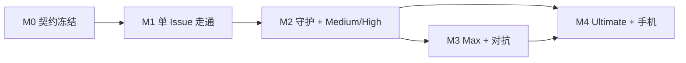

# 里程碑与并行泳道

> 状态：设计 v0.1。每个里程碑拆成若干**泳道**，同一里程碑内的泳道只依赖 M0 的契约和替身（fake / mock），可以由不同的 agent 并行开发。

## 泳道

| 泳道 | 代号 | 覆盖模块 |
| --- | --- | --- |
| 契约 | `contract` | `core`（含 `core::ports` 的全部端口 trait，P-51）、`schemas/` |
| 后端·引擎 | `be-engine` | `store`、`engine`、`conversation`、`models`、`notify`（P-63；APNs 推送归 M4 `ops`） |
| 后端·Forge | `be-forge` | `forge`、`guardian` |
| 执行 | `exec` | `repo`、`sandbox`、`worker`、`egress` |
| 安全 | `sec` | `pki`、`policy`、`secrets`、`api` 的鉴权部分 |
| 前端·桌面 | `fe-desktop` | `desktop-shell`、`desktop-ui` |
| 前端·手机 | `fe-mobile` | `mobile` |
| 部署 | `ops` | `deploy`、CI |

## 替身（让泳道互不阻塞）

M0 必须交付以下替身，之后每条泳道用它们替代尚未完成的邻居。所有替身实现 `core::ports` 里的同一个端口 trait（P-51），并通过与真实实现相同的一致性测试。

| 替身 | 替代（实现的端口） | 使用者 |
| --- | --- | --- |
| Mock API 服务（由 `schemas/openapi.yaml` 生成，事件流回放录制数据） | 整个服务端 | `fe-desktop`、`fe-mobile` |
| `FakeForge`（内存中的仓库、PR、check，可注入 webhook） | `forge`（`ForgeReader`、`OutboxPort`） | `be-engine`、`guardian` 测试 |
| `FakeGitHub`（HTTP 级：模拟 GitHub REST / GraphQL / webhook 投递与限流响应） | GitHub 本身 | `forge` 测试 |
| `FakeSandboxDriver`（不起容器，按脚本回放 Worker 协议结果；对 `engine` 以 `SandboxService` 暴露，P-52） | `sandbox` + `worker` | `be-engine` |
| `FakeRepo`（内存中的镜像仓与工作树，补丁按脚本判定通过 / 拒绝） | `repo`（`RepoService`） | `be-engine`、`be-forge` |
| `FakeModelProvider`（按规则返回固定输出） | `models` 的外部调用（`ModelProvider`） | `be-engine`、`conversation` |
| `FakePolicy`（脚本化动作判定、补丁判定、审批验证与消费） | `policy`（`PolicyPort`） | `be-engine`、`be-forge`、`exec` |
| `FakeInbox`（记录上报，按 `dedup_key` 去重，维护按项目计数） | `notify`（`InboxPort`） | `be-engine`、`be-forge` |
| `Store::open_in_memory`（内存事件日志、投影、Outbox 表、游标） | `store` 的持久化 | 所有服务端泳道 |
| `EgressStub`（实现控制面：签发 / 吊销令牌、脚本化用量与健康；附一个可接收 `job_token` / `svc_token` 的假数据面） | Egress（`EgressControl`，[egress-control.md](interfaces/egress-control.md)） | `exec`（`sandbox`）、`be-engine`（`models`）、`sec`（`api` 的 secret 转交） |
| `TestCA`（测试用证书与设备，含审批签名密钥） | `pki` | `api`、`fe-desktop` 集成测试 |

## M0 契约冻结

**目标**：所有泳道开工前，把模块之间的接口定死。

| 泳道 | 交付物 |
| --- | --- |
| `contract` | Rust workspace 骨架；`core` 的领域类型、ID、状态机、事件枚举、`core::ports` 端口 trait；`schemas/openapi.yaml`；`schemas/events/*.json`；`schemas/worker/*.json`；`schemas/forge/*.json`；`schemas/config/*.json`；`schemas/egress/*.json`（控制面，P-50） |
| `contract` | 上表全部替身 |
| `ops` | CI：Rust fmt / clippy / test、schema 校验、前端 lint / typecheck |

**退出标准**

- [ ] 所有 schema 通过校验，并与 `docs/interfaces/` 一致。
- [ ] Mock API 服务能跑起来，事件流能按游标续传。
- [ ] 每个替身都有至少一个使用示例测试。

## M1 单 Issue 走通（Low 档，端到端）

**目标**：在桌面端对话里发起一个 Low 档任务，Gantry 在沙盒里改代码、开 PR、等 CI 通过，用户审批后合并，Issue 关闭。

| 泳道 | 范围 |
| --- | --- |
| `be-engine` | `store`：事件日志（含 `log_epoch`）、投影、SSE 游标；`engine`：Low 档模板（`single` 节点）、阶段机（含 `abandoned` 出边、`stage_status`、`forge.base_advanced` 触发的 merge 重验）、暂停 / 继续 / 重试失败节点（P-56）、入队前调用 `policy` 决定 `requires_approval`（P-62）、Outbox 入队；`conversation`：`intent` 意图解析（任务 / 查询）、创建交付单元、事件行（含 `tone`）；`models`：打杂与大脑模型的直接调用（经 Egress 回环反向代理，带 `svc_token`）、用量记账（以 Egress 计量为准，加权）；`notify`：上报项（`dedup_key` 去重）、按项目 open 计数（`GET /v1/inbox/summary`）（P-63） |
| `be-forge` | `forge`：App 鉴权与 token 缓存、webhook 接收（回环明文监听；HMAC 且接受当前与上一个 secret、去重、先返回 2xx 再处理）、对账巡检、拉取更新镜像仓、订阅默认分支 push 产生 `forge.base_advanced`、Outbox 执行（幂等；执行开始前经 `policy` 验证并消费审批，临时错误留在 `queued` 退避，P-53、P-54）、推送 `repo` 生成的提交、创建 PR、快照同步 |
| `exec` | `repo`：每项目裸镜像仓、工作树与写权锁、从镜像准备沙盒工作区、在干净检出上应用补丁并产出 `PatchFacts`（机械拒绝发 `patch.rejected`）、交 `policy` 判定、以 `github.commit_identity` 生成提交（P-69）；`sandbox`：`SandboxService` + rootless Podman 驱动（P-52）、挂载工作区、资源限制、补丁提取、经控制面签发 / 吊销 `job_token`；`worker`：在沙盒内运行 Claude Code headless（适配器 `claude-code`），执行 Worker 协议；`egress`：控制面（`/run/gantry/egress.sock`，P-50）、模型 API 反向代理（注入 key、按 `job_token` / `svc_token` 计量，P-49）、包仓库 CONNECT 白名单（不注入凭据）、出网日志 |
| `sec` | `secrets`：加密存储、按使用方隔离读取、加密备份；`pki`：离线根 + 在线中间 CA（配对固定根指纹，下发 `[叶子, 中间 CA, 根]`，P-64）、配对端点（CSR + `approval_pubkey`，P-47）、CSR 签发、确认码、首台设备为 approver（之后默认 operator）、证书续期 `POST /v1/devices/self/renew`、吊销（含 `revocations.journal`，P-67）、主机应急命令 `gantry device recover`；`api`：mTLS、设备鉴权、路由骨架、事件流（心跳内的吊销检查）；设备签名审批最小实现：统一签名原语（challenge、规范化、用登记的 `approval_pubkey` 验签、`Gantry-Approval`），覆盖 `merge_pr`、`settings_update`（凭据与放宽类）、`device_role_change`、`device_revoke`，审批在执行开始前消费（P-54）；`policy` v0：workflow 改动一律拒绝并以 `decision_needed`（`manual_action`）附补丁上报（P-48），依赖清单 / lockfile 改动一律拒绝并上报（fail-closed，P-19）、merge 需审批；安装引导期的主机写入（P-66） |
| `fe-desktop` | `desktop-shell`：两把密钥的生成与存储（mTLS 客户端密钥；审批签名密钥，Secure Enclave / TPM，使用需用户在场，P-47）、mTLS 客户端（校验根 CA 指纹、证书剩余 1/3 有效期时自动续期）、配对流程、按 challenge 签名（Touch ID / Windows Hello）、`log_epoch` 变化时全量重同步；`desktop-ui`：项目 tab（徽标来自 `GET /v1/inbox/summary`）、左侧列表、主对话（发送、接收、事件行、气泡边框）、档位上限选择器、检视器（阶段、DAG 列表、暂停 / 继续 / 重试 / 放弃）、最小审批确认界面（merge、凭据写入）、配对向导、设置页·模型、设置页·设备与证书（列表、改名、吊销）（第二轮裁决 C28） |
| `ops` | 安装脚本、systemd、webhook 入口（回环监听 + 终止 TLS 的反向代理 / 隧道配置，P-65）、`gantry github setup`（App Manifest 创建，经 `/setup/github/callback` 接收 `code`）、备份脚本（含 `log_epoch` 与 `revocations.journal`） |

**退出标准**

- [ ] 端到端：对话发起 Low 任务 → PR 创建 → CI 通过 → 用户在桌面端审批 merge → Issue 关闭。
- [ ] 任务进行中关闭桌面端，任务继续；重新打开后事件流从游标续上，界面状态一致。
- [ ] 沙盒内访问 `github.com` 和 `api.github.com` 失败；沙盒内读不到任何模型 key。
- [ ] 同一个 webhook 投递两次，GitHub 上不会出现重复评论或重复 PR。
- [ ] 服务端在"创建 PR 成功、写库之前"崩溃，重启后不会重复创建 PR。
- [ ] 改动 `.github/workflows/` 的补丁被拒绝（`policy.path_protected:workflows`），以 `decision_needed`（`manual_action`）附补丁上报；改动依赖清单或 lockfile 的补丁被策略拒绝并上报。
- [ ] 写入模型凭据需要 approver 设备用审批签名密钥签名（需用户在场）；没有签名的写入被拒绝。
- [ ] 沙盒内读到的 `job_token` 在尝试结束后失效，且不能从沙盒网段以外使用；用它只能给本尝试记账。
- [ ] 设备证书在剩余 1/3 有效期时自动续期，续期后事件流与审批不受影响。
- [ ] 吊销设备后，其已建立的事件流在心跳间隔内断开（上限 60 秒，建议值）。

## M2 PR 后台守护 + Medium / High

**目标**：PR 打开后无人值守地处理 CI 与 review；引入多节点图与审批签名。

| 泳道 | 范围 |
| --- | --- |
| `be-engine` | Medium / High 图模板（计划阶段 `plan`；实现阶段 `build → verify`；评审阶段多角色 review + `summarize` 汇总）；需求准入（`admission`，仅 High 及以上，P-55）；`REJECT` / `BLOCKED` 的上报与"重新规划"；预算模板与台账（含会话台账，P-58）；上限内自动加码；为守护提供 `request_heal` 与 `classify` 端口（P-60） |
| `be-forge` | `guardian`：按 modules/guardian.md 决策表分流（P-60）、CI 日志获取与分类（`classify`）、自愈循环（`heal`）、无进展检测、自身事件过滤、审计事件 `guardian.triaged` / `heal_requested` / `escalated`；`reply_review_thread`（提前到 M2）；单条可编辑的状态清单评论（幂等键含 `revision`，P-61）；感知 GitHub 限流的 Outbox |
| `exec` | gVisor 默认开启；预热池；`devcontainer.json` 安全子集（忽略 `initializeCommand`、`mounts`、`runArgs`、特权字段）；私有包仓库反向代理（第二轮裁决 C28） |
| `sec` | 审批的完整交互：审批因新推送失效后的重新请求；路径规则审批（依赖清单 / lockfile 由"拒绝"改为"需要审批"，审批动作 `patch_apply_protected`，P-11、P-54；workflow 改动仍一律拒绝，P-48）；审计日志；`policy` 规则可配置 |
| `fe-desktop` | 关系地图、工作树视图、收件箱、完整审批签名界面（补丁审批的差异展示、失效后的重新请求）、系统通知（`severity ≥ warn` 的 `inbox.raised`）；设置页·档位与预算、危险动作策略、后台守护 |
| `ops` | 升级与回滚流程、备份恢复演练（恢复后 `log_epoch` 加一、客户端全量重同步、重放 `revocations.journal`，P-67） |

**退出标准**

- [ ] 本 PR 范围内的 CI 失败被自愈，全程不产生上报。
- [ ] security 类 finding 被上报，不会被静默关闭。
- [ ] 审批后出现新推送，审批自动失效并重新进入评审。
- [ ] 改动 `.github/workflows/` 的补丁被拒绝并附补丁上报（`decision_needed`，`manual_action`，P-48）；改动依赖清单或 lockfile 的补丁进入"需要审批"（`patch_apply_protected`），签名批准后才提交推送。
- [ ] 经验证不成立的 bot finding 被静默回复理由（`reply_review_thread`）；每个分流处置都有 `guardian.triaged` 审计事件。
- [ ] 从备份恢复后，客户端因 `log_epoch` 变化全量重同步；备份之后吊销的设备仍然被拒。
- [ ] 守护不会被自己的评论、推送触发循环。
- [ ] 同类问题重复两次或连续两轮无进展时上报。

## M3 Max 档与对抗评审

| 泳道 | 范围 |
| --- | --- |
| `be-engine` | reasoner 预演（计划阶段）、对抗 review、arbiter 裁决、有界迭代、图修订 |
| `be-forge` | arbiter 统一发出的评审摘要；review thread 关闭（含人类评论时需 `resolve_review_thread_human` 审批） |
| `exec` | 出网审计回放；沙盒逃逸检测告警 |
| `sec` | 密钥轮换（App 私钥、中间 CA、模型 key；中间 CA 轮换不影响已配对设备，P-64）；吊销时进程内即时断开事件流（M1 的心跳检查之外的优化） |
| `fe-desktop` | DAG 详情视图、图修订历史、预算面板；设置页·外观（第二轮裁决 C28） |

**退出标准**

- [ ] Max 档任务的每一轮评审都有 arbiter 的唯一裁决，轮次不超过预算。

## M4 Ultimate 与手机端

| 泳道 | 范围 |
| --- | --- |
| `be-engine` | Milestone 级拆分、子交付单元依赖、受 GitHub / Actions 配额约束的并发调度 |
| `be-forge` | GitHub 原生任务入口（Issue label、`/gantry` 命令，待 Q-04 确认） |
| `fe-mobile` | iOS UIKit：扫码配对、只做对话 |
| `sec` | 手机端客户端档案（只开放对话相关路由，默认不可审批） |
| `ops` | 手机推送通道（`notify` 的 APNs 实现，APNs 密钥经 `secrets`，P-59、P-63） |

**退出标准**

- [ ] 一个 Milestone 被拆成多个交付单元并行推进，依赖顺序正确。
- [ ] 手机端能配对、发消息、收到上报通知。

## 依赖关系

同一里程碑内，泳道之间只通过 M0 的契约耦合；跨泳道的集成测试放在里程碑末尾，用真实模块替换替身。
