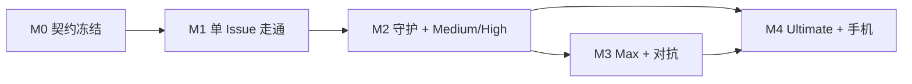

# 里程碑与并行泳道

> 状态：设计 v0.1。每个里程碑拆成若干**泳道**，同一里程碑内的泳道只依赖 M0 的契约和替身（fake / mock），可以由不同的 agent 并行开发。

## 泳道

| 泳道 | 代号 | 覆盖模块 |
| --- | --- | --- |
| 契约 | `contract` | `core`、`schemas/` |
| 后端·引擎 | `be-engine` | `store`、`engine`、`conversation`、`models` |
| 后端·Forge | `be-forge` | `forge`、`guardian` |
| 执行 | `exec` | `sandbox`、`worker`、`egress` |
| 安全 | `sec` | `pki`、`policy`、`api` 的鉴权部分 |
| 前端·桌面 | `fe-desktop` | `desktop-shell`、`desktop-ui` |
| 前端·手机 | `fe-mobile` | `mobile` |
| 部署 | `ops` | `deploy`、CI |

## 替身（让泳道互不阻塞）

M0 必须交付以下替身，之后每条泳道用它们替代尚未完成的邻居：

| 替身 | 替代 | 使用者 |
| --- | --- | --- |
| Mock API 服务（由 `schemas/openapi.yaml` 生成，事件流回放录制数据） | 整个服务端 | `fe-desktop`、`fe-mobile` |
| `FakeForge`（内存中的仓库、PR、check，可注入 webhook） | `forge` | `be-engine`、`guardian` 测试 |
| `FakeSandboxDriver`（不起容器，按脚本返回 Worker 协议结果） | `sandbox` + `worker` | `be-engine` |
| `FakeModelProvider`（按规则返回固定输出） | `models` 的外部调用 | `be-engine`、`conversation` |
| `TestCA`（测试用证书与设备） | `pki` | `api`、`fe-desktop` 集成测试 |

## M0 契约冻结

**目标**：所有泳道开工前，把模块之间的接口定死。

| 泳道 | 交付物 |
| --- | --- |
| `contract` | Rust workspace 骨架；`core` 的领域类型、ID、状态机、事件枚举；`schemas/openapi.yaml`；`schemas/events/*.json`；`schemas/worker/*.json`；`schemas/forge/*.json`；`schemas/config/*.json` |
| `contract` | 上表全部替身 |
| `ops` | CI：Rust fmt / clippy / test、schema 校验、前端 lint / typecheck |

**退出标准**

- [ ] 所有 schema 通过校验，并与 `docs/interfaces/` 一致。
- [ ] Mock API 服务能跑起来，事件流能按游标续传。
- [ ] 每个替身都有至少一个使用示例测试。

## M1 单 Issue 走通（Low 档，端到端）

**目标**：在桌面端对话里发起一个 Low 档任务，Gantry 在沙盒里改代码、开 PR、等 CI 通过，用户审批后合并，Issue 关闭。

| 泳道 | 范围 |
| --- | --- |
| `be-engine` | `store`：事件日志、投影、SSE 游标；`engine`：Low 档模板、阶段机、Outbox 入队；`conversation`：意图解析（任务 / 查询）、创建交付单元、事件行；`models`：打杂与大脑模型调用、用量记账 |
| `be-forge` | `forge`：App 鉴权与 token 缓存、webhook 接收（HMAC、去重、先返回 2xx 再处理）、对账巡检、Outbox 执行（幂等）、服务端 git 推送、创建 PR、快照同步 |
| `exec` | `sandbox`：rootless Podman 驱动、从服务端镜像仓准备工作区、资源限制、补丁提取；`worker`：在沙盒内运行 Claude Code headless，执行 Worker 协议；`egress`：白名单、只对模型 API 注入 key、出网日志 |
| `sec` | `pki`：离线根 + 在线中间 CA、配对端点、CSR 签发、确认码、吊销；`api`：mTLS、设备鉴权、路由骨架、事件流；`policy` v0：路径规则（workflow / 依赖清单 / lockfile 改动直接拒绝）、merge 需审批 |
| `fe-desktop` | `desktop-shell`：密钥生成与存储、mTLS 客户端、配对流程；`desktop-ui`：项目 tab、左侧列表、主对话（发送、接收、事件行、气泡边框）、检视器（阶段、DAG 列表）、设置页·模型 |
| `ops` | 安装脚本、systemd、GitHub App Manifest 创建引导、只转发 `/webhook` 的隧道说明、备份脚本 |

**退出标准**

- [ ] 端到端：对话发起 Low 任务 → PR 创建 → CI 通过 → 用户在桌面端审批 merge → Issue 关闭。
- [ ] 任务进行中关闭桌面端，任务继续；重新打开后事件流从游标续上，界面状态一致。
- [ ] 沙盒内访问 `github.com` 和 `api.github.com` 失败；沙盒内读不到任何模型 key。
- [ ] 同一个 webhook 投递两次，GitHub 上不会出现重复评论或重复 PR。
- [ ] 服务端在"创建 PR 成功、写库之前"崩溃，重启后不会重复创建 PR。
- [ ] 改动 `.github/workflows/` 的补丁被策略拒绝并上报。

## M2 PR 后台守护 + Medium / High

**目标**：PR 打开后无人值守地处理 CI 与 review；引入多节点图与审批签名。

| 泳道 | 范围 |
| --- | --- |
| `be-engine` | Medium / High 图模板（plan → build → verify、多角色 review + 汇总）；需求准入；预算模板与台账；上限内自动加码 |
| `be-forge` | `guardian`：分流规则、CI 日志获取与分类、自愈循环、无进展检测、自身事件过滤；单条可编辑的状态清单评论；感知 GitHub 限流的 Outbox |
| `exec` | gVisor 默认开启；预热池；`devcontainer.json` 安全子集（忽略 `initializeCommand`、`mounts`、`runArgs`、特权字段） |
| `sec` | Gantry 审批：设备签名、验签、head 变化即失效；审计日志；`policy` 规则可配置 |
| `fe-desktop` | 关系地图、工作树视图、收件箱、审批签名界面（Touch ID / Windows Hello）、档位选择器、系统通知；设置页·档位与预算、危险动作策略 |
| `ops` | 升级与回滚流程、备份恢复演练 |

**退出标准**

- [ ] 本 PR 范围内的 CI 失败被自愈，全程不产生上报。
- [ ] security 类 finding 被上报，不会被静默关闭。
- [ ] 审批后出现新推送，审批自动失效并重新进入评审。
- [ ] 守护不会被自己的评论、推送触发循环。
- [ ] 同类问题重复两次或连续两轮无进展时上报。

## M3 Max 档与对抗评审

| 泳道 | 范围 |
| --- | --- |
| `be-engine` | reasoner 预演、对抗 review、arbiter 裁决、有界迭代、图修订 |
| `be-forge` | arbiter 统一发出的评审摘要；review thread 回复与关闭 |
| `exec` | 出网审计回放；沙盒逃逸检测告警 |
| `sec` | 密钥轮换（App 私钥、中间 CA、模型 key）；吊销对已建立事件流连接生效 |
| `fe-desktop` | DAG 详情视图、图修订历史、预算面板 |

**退出标准**

- [ ] Max 档任务的每一轮评审都有 arbiter 的唯一裁决，轮次不超过预算。
- [ ] 吊销设备后，其已建立的事件流在 1 分钟内断开。

## M4 Ultimate 与手机端

| 泳道 | 范围 |
| --- | --- |
| `be-engine` | Milestone 级拆分、子交付单元依赖、受 GitHub / Actions 配额约束的并发调度 |
| `be-forge` | GitHub 原生任务入口（Issue label、`/gantry` 命令，待 Q-04 确认） |
| `fe-mobile` | iOS UIKit：扫码配对、只做对话 |
| `sec` | 手机端设备角色（默认不可审批） |
| `ops` | 手机推送通道（`notify` 的 APNs 实现） |

**退出标准**

- [ ] 一个 Milestone 被拆成多个交付单元并行推进，依赖顺序正确。
- [ ] 手机端能配对、发消息、收到上报通知。

## 依赖关系

同一里程碑内，泳道之间只通过 M0 的契约耦合；跨泳道的集成测试放在里程碑末尾，用真实模块替换替身。
