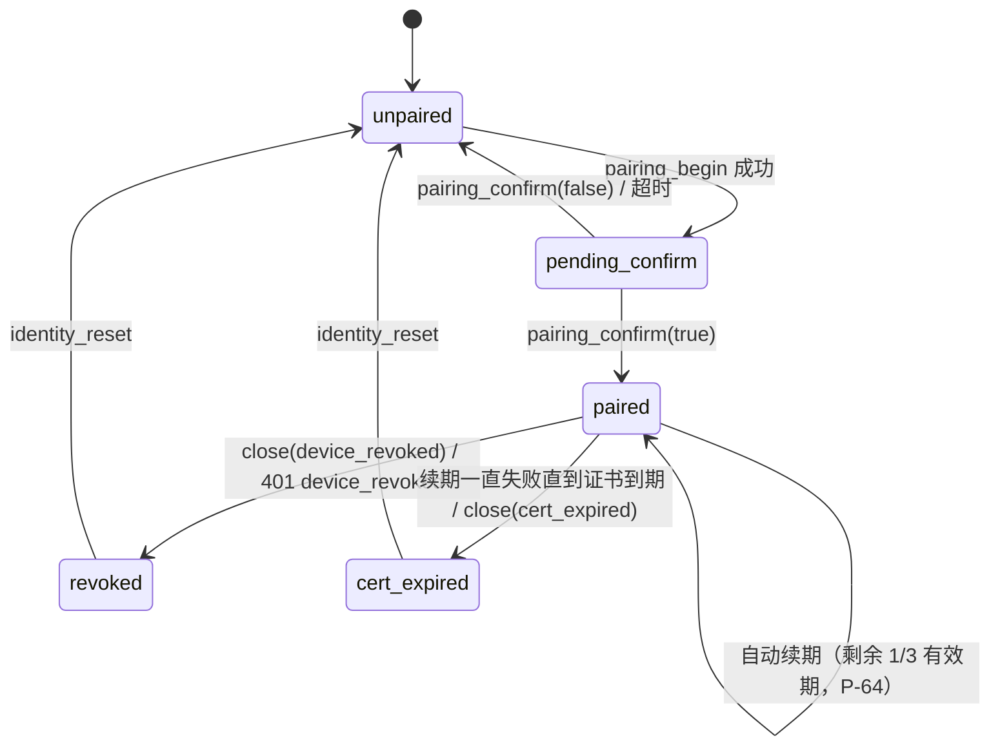

# 桌面外壳（`desktop-shell`）

> 状态：设计 v0.1 · 里程碑：M1 交付主体（含两把设备密钥、Touch ID / Windows Hello 签名、证书自动续期、`log_epoch` 重同步），M2 补系统通知与补丁审批展示，M3 无新增 · 泳道：`fe-desktop`（见 [milestones.md](../milestones.md)） · crate / 目录：`apps/desktop/src-tauri`

Tauri 2 进程里唯一可信的一半：持有两把不可导出的设备私钥（mTLS 客户端密钥、审批签名密钥，P-47）、发出桌面端的全部网络请求、决定"要签什么"；把 WebView（[`desktop-ui`](desktop-ui.md)）当作可能被注入的显示层，只给它一张白名单命令表。

## 1. 职责

1. **设备身份（双密钥，P-47）**：在 macOS 的安全隔区（Secure Enclave）/ 钥匙串（Keychain）或 Windows 的可信平台模块（TPM，经 CNG）里生成**两把** ECDSA P-256 密钥，私钥都不可导出：① **mTLS 客户端密钥**，用于无提示的后台连接；② **审批签名密钥**，单独生成，每次使用都必须用户在场（Touch ID / Windows Hello，密钥级访问控制）。保存设备证书链、服务端地址、已固定的离线根 CA 指纹、`device_id`。
2. **配对客户端流程**：解析配对串 → 生成两把密钥与 CSR → 经单向 TLS 配对端点提交 CSR 与 `approval_pubkey` → 校验证书链 `[叶子, 中间 CA, 根]` 的根指纹 → 展示 6 位确认码供人工核对 → 落盘身份（api.md §1.3，architecture §7.1）。
3. **互相认证 TLS（mTLS）客户端**：桌面端所有 HTTP 请求与事件流只由本进程发出；WebView 不联网（api.md 开头、design-review F36）。rustls 配自定义签名器（调用 Secure Enclave / CNG 中的 mTLS 客户端密钥），服务端证书只信"链到已固定的离线根 CA 指纹"的链（P-64）。**证书自动续期**：证书剩余 1/3 有效期时（建议值）在后台生成新 CSR，经 `POST /v1/devices/self/renew` 续期，校验新链的根指纹后原子替换（P-64）；只涉及 mTLS 客户端密钥，审批签名密钥不变。
4. **事件流客户端**：唯一一条服务端推送事件（Server-Sent Events，SSE）流；帧解析、心跳与 45 s 空闲判定、指数退避、游标、`close` 帧、`409 cursor_ahead` 与 `log_epoch` 变化（响应头 `X-Log-Epoch` / 心跳 `log_epoch`，P-67）时的全量重同步；把帧转发给 `desktop-ui`（api.md §5）。
5. **审批签名**：取挑战（challenge）→ 展示前自检（api.md §6.5）→ 生成展示模型 → 用审批签名密钥签名（系统级用户在场：Touch ID / Windows Hello，提示含 `subject_digest` 前 12 位，P-47、C27）→ `grant`。内部动作（`settings_update`、`device_role_change`、`device_revoke`）的"发起审批 → 签名 → 带 `Gantry-Approval` 重发"全链路（api.md §6、§6.6）。
6. **IPC 边界**：Tauri 能力（capability）只授予本文 §6 的白名单命令；每个命令校验参数；路由白名单把 48 条路由分成"UI 可调""外壳专用""桌面不用"三类（§6.4）；严格内容安全策略（Content Security Policy，CSP）、禁止 WebView 导航与新窗口、外链只经 `open_external` / `open_github`。
7. **响应整形**：向 WebView 返回的 HTTP 结果只含状态码、解析后的体、白名单响应头；`problem+json` 的 `detail` 只写日志、不过 IPC（api.md §1.5、§3.1）。
8. **本机存储**：外观与布局偏好、按项目保存的界面状态（草稿等）、待发送消息队列的持久化块；**不存**任何凭据、配置键、服务端数据快照（OQ-S6）。
9. **连接健康**：把"mTLS 握手 + 事件流心跳 + 证书有效期与续期 + 时钟偏差 + `log_epoch`"合并为一个 `ConnectionState`（prototype.md §2.1 的单一连接指示）。
10. **系统通知（M2）**：由 `inbox.raised` 中 `severity ≥ warn` 的事件触发（P-63，不新增事件），按模板弹本机通知（只含上报类型与项目名，不含任何服务端文本，I5）。
11. **日志**：结构化、脱敏、可导出的诊断快照（§11）。

### 1.1 各里程碑交付

| 里程碑 | 交付 |
| --- | --- |
| M0 | 无交付（契约冻结阶段，`fe-desktop` 泳道尚未开工）。**消费**：`schemas/openapi.yaml`、Mock API 服务、`TestCA`、api.md §6.3 签名测试向量 |
| M1 | 两把密钥（Keychain/Secure Enclave、TPM；审批签名密钥要求用户在场，P-47）；配对全流程（CSR + `approval_pubkey`）；mTLS 客户端与离线根 CA 指纹固定；证书自动续期（P-64）；事件流客户端（游标、退避、`close`、心跳吊销感知、`log_epoch` 重同步）；`api_request` 路由表（含暂停 / 继续 / 重试、`inbox.summary`）；`approval_*` 与 `guarded_write_*`（覆盖 `merge_pr`、`settings_update`、`device_role_change`、`device_revoke`）；**Touch ID / Windows Hello** 作为系统级确认；IPC 白名单、CSP、导航限制；偏好与界面状态存储；日志脱敏 |
| M2 | `patch_apply_protected` 补丁审批与 `force_push` / `push_outside_prefix` 的展示模型（取回补丁内容并校验 `sha256`，依赖契约缺口 OQ-S9）；本机系统通知（`severity ≥ warn` 的 `inbox.raised`）；审批因新推送失效后的重新请求流程（shell 侧只需丢弃 `prepared_id`） |
| M3 | 无新增。密钥轮换沿用 `settings_update` 流程；吊销时服务端即时断流（M1 的心跳检查之外的优化）对本模块透明 |
| M4 | 无（手机端是独立模块 [`mobile`](mobile.md)） |

## 2. 不负责

- 工作区、设置页、审批单的**界面渲染**、状态管理、不可信文本的渲染规则 → [`desktop-ui`](desktop-ui.md)。本模块只提供数据与展示模型。
- 是否需要审批、审批绑定什么 → `policy`（I3）。本模块只对服务端下发的 payload 签名，不自行组装、不修改。
- 挑战的生成、nonce 管理、验签、审批状态机 → `api` / `policy`（api.md §6.4）。
- 证书签发与续期的服务端部分、吊销表、CA、配对令牌 → `pki`（[pki.md](pki.md)）。
- GitHub 凭据、模型 key 的保存 → 不持有（I6）；服务端 `secrets` / `egress`。设置里的 `SecretRef.value` 只在本进程内存中短暂经过（§8 S-2）。
- 上报项的产生与 `severity` → `notify`；本模块只把 `severity ≥ warn` 的 `inbox.raised` 变成本机弹窗，文案由固定模板生成。
- 代码查看、编辑、执行 → 非目标（architecture §1）。用户用外部编辑器 `git fetch` 分支。
- 手机端 → [`mobile`](mobile.md)。

## 3. 依赖

| 依赖 | 用到什么 | 契约 |
| --- | --- | --- |
| `api`（契约，非代码） | 全部 mTLS 路由、事件流、配对端点、审批签名原语（challenge → 规范化 → 签名 → `grant`）、`Gantry-Approval` 头、错误码表 | [api.md](../interfaces/api.md)（尤其 §1.3、§2、§3、§5、§6、§9） |
| `pki`（契约，非代码） | 配对串格式、离线根 CA 指纹（P-64）、证书链形状 `[叶子, 中间 CA, 根]`、密钥算法（ECDSA P-256 / ES256）、`approval_pubkey`（P-47）、证书有效期与续期（`POST /v1/devices/self/renew`） | [pki.md](pki.md)（§7.1 指纹口径、§7.4.2 配对串、§7.7 续期；配对串格式仍是 pki.md 的 [提议]，OQ-K3）；api.md §1.3、§4.10 |
| `core`（共享 crate）[提议] | 事件信封与实体类型、JCS 规范化与摘要函数。**与服务端必须是同一份实现，或用同一组测试向量互验**（§12） | [data-model.md](../data-model.md) §5.1、api.md §6.3 |
| `desktop-ui` | 唯一的 IPC 调用方 | 本文 §6 |
| 操作系统 | macOS：Security.framework（Secure Enclave 密钥、钥匙串）、LocalAuthentication；Windows：CNG（Microsoft Platform Crypto Provider）、Windows Hello；系统通知；系统浏览器 | 平台文档；实现者核实各 API 的能力差异（OQ-S10） |
| Mock API 服务、`TestCA` | M1 开发与测试用替身，替代整个服务端与 `pki` | [milestones.md](../milestones.md) "替身" |

实现参考（非约束）：`rustls` 的自定义 `ServerCertVerifier` / `SigningKey`，`rcgen` 的远程密钥对（`RemoteKeyPair`）用于外部签名器生成 CSR，`zeroize` / `secrecy` 处理秘密值。

## 4. 输入

| 输入 | 来源 | 格式 / 契约 | 信任级别 |
| --- | --- | --- | --- |
| IPC 命令调用 | `desktop-ui`（WebView） | §6 的命令与参数 | **不可信**：WebView 可能被 XSS 控制，参数一律重新校验，命令不得接受"待签内容" |
| 配对串 | 用户粘贴 / 扫码（OQ-S3） | 地址 + 离线根 CA 指纹 + 一次性 token（格式见 [pki.md §7.4.2](pki.md)，契约未定） | 用户给定，格式严格校验；token 视为秘密（不入日志） |
| API 响应、challenge | 服务端（mTLS） | api.md 全部响应；`application/problem+json` | 通道可信（固定 CA + 客户端证书）；**内容中的文本字段不可信**（`UntrustedText`、`Message.text` 等），本模块只透传、不解释 |
| 事件流帧 | 服务端 | api.md §5.1：业务事件（data-model §5.1 信封原样）、`heartbeat`、`close` | 同上 |
| 用户确认结果 | 外壳原生确认框 / 系统生物识别 | 通过 / 取消 / 失败 | 可信（外壳自己渲染与发起） |
| 本机文件 | 应用数据目录：`identity.json`、`prefs.json`、`ui-state/` | §7.5 | 可信但可被本机其他进程篡改；解析失败按"无数据"处理，永不因此放行 |
| 系统时钟 | OS | — | 与 `GET /v1/me` 的 `server.time` 比对，偏差 > 60 s 警告（api.md §3.7） |
| `X-Log-Epoch` 响应头、心跳 `log_epoch` | 服务端 | api.md §3.6、§5.1（P-67） | 可信；与本地保存值不同 → 全量重同步 |

## 5. 输出

| 输出 | 去向 | 格式 / 契约 |
| --- | --- | --- |
| HTTPS 请求（含 `Idempotency-Key`、`If-Match`、`Gantry-Approval`） | 服务端 mTLS API | api.md §4、§6 |
| 配对请求 | 服务端配对监听器（单向 TLS，固定根 CA） | `POST /v1/pair`（CSR + `approval_pubkey`，api.md §1.3） |
| 续期请求 | 服务端 mTLS API | `POST /v1/devices/self/renew`（新 CSR，api.md §4.10） |
| IPC 响应与 `StreamFrame` | `desktop-ui` | §6.1、§6.2 |
| 审批展示模型 `ApprovalSheetModel` | `desktop-ui` | §6.3；由外壳从同一份已解析 payload 生成（api.md §6.5） |
| 生物识别提示（Touch ID / Windows Hello） | 用户 | 文案由 payload 生成，含 `subject_digest` 前 12 位（§7.4，C27） |
| 系统通知（M2） | 操作系统 | 固定模板：项目名 + 上报类型；只对 `severity ≥ warn` 的 `inbox.raised`（P-63） |
| 外链打开 | 系统浏览器 | 仅 `https`；GitHub 跳转链接由 `repo` + 编号拼出 |
| 日志、诊断快照 | 本机文件 / `diagnostics_snapshot` | §11 |
| 服务端事件（间接） | 事件日志 | 本模块的写请求在服务端产生事件，`actor` 为 `{kind: "device", id}`（§11 表） |

## 6. 对外接口

IPC 是本模块唯一的对外接口，调用方只有 `desktop-ui`。命令名为 `snake_case` Tauri 命令；参数与返回均为 JSON。

### 6.1 命令白名单

白名单之外的命令一律不存在（不是"存在但拒绝"）。Tauri 能力文件只授予下表命令，不授予任何核心插件的 JS 侧权限（fs、shell、http、opener、dialog、clipboard、process、updater 全部不授予）。

| 命令 | 参数 | 返回 | 门槛与语义 | 里程碑 |
| --- | --- | --- | --- | --- |
| `identity_status` | — | `IdentityStatus` | `state`：`unpaired` / `pending_confirm` / `paired` / `revoked` / `cert_expired`；另含 `server_host`、`ca_fingerprint`（离线根 CA）、`device`（`id`、`name`、`platform`、`pubkey_fpr`、`approval_pubkey_fpr`）、`cert`（`serial`、`not_after`、`renew_after`）、`key_backend`（`secure_enclave` / `tpm` / `test_software`） | M1 |
| `pairing_begin` | `{ pairing_string, device_name }` | `{ confirmation_code, device }` | 仅在 `unpaired` 状态；`platform` 由外壳填，不接受 UI 传入；步骤见 §7.2 | M1 |
| `pairing_confirm` | `{ matches: bool }` | `IdentityStatus` | 仅在 `pending_confirm`；`false` 或超时 → 删除密钥与待定证书（OQ-S4） | M1 |
| `identity_reset` | — | `IdentityStatus` | 外壳弹原生确认框后，删除本机密钥、证书、身份文件，**并清除 `ui-state/`**（其中的项目 ID 属于旧服务端）；`prefs.json` 保留。用于"设备已被吊销 / 证书过期，重新配对" | M1 |
| `connection_state` | — | `ConnectionState` | 当前合并状态（§7.3）；变化同时以 `state` 帧推送 | M1 |
| `api_request` | `{ route, path?, query?, body?, idempotency_key? }` | `ApiResult` | 仅 §6.4 "UI 可调"的 36 条路由，`route` 是枚举 ID 而不是 URL。校验见 §7.1 | M1 |
| `events_open` | `{ after_seq? }` + `Channel<StreamFrame>` | — | 打开**唯一**事件流；已打开则替换旧流。`after_seq` 是 UI 快照的最小 `X-Event-Seq`（api.md §5.3） | M1 |
| `events_ack` | `{ seq }` | — | UI 已**应用**到 `seq`（事件或心跳）。单调递增；乱序或回退被忽略 | M1 |
| `events_close` | — | — | 关闭事件流（登出 / 重新配对 / 重新快照前） | M1 |
| `approval_prepare` | `{ approval_id }` | `ApprovalSheetModel` | 取 `Approval` 与 challenge，执行 §7.4 展示前自检，生成展示模型并在外壳内存保存 `PreparedSigning`；非 approver 设备只返回 `Approval` 的只读展示（不取 challenge） | M1 |
| `approval_sign` | `{ prepared_id }` | `ApiResult`（`Approval`） | **不接受任何待签内容**。外壳重检（连接、过期、审批仍 `pending`）→ 用户确认 → 签名 → `POST …/grant` | M1 |
| `approval_discard` | `{ prepared_id }` | — | 关闭审批单时丢弃 | M1 |
| `guarded_write_prepare` | `{ kind, … }`，见 §7.4.2 | `GuardedWritePreview` | `kind`：`settings_put` / `settings_delete` / `device_role` / `device_revoke`。外壳持有请求体（含秘密 `value`），先 `dry_run`（设置）或本地组装 `signing`（设备），返回差异预览与是否需要签名 | M1 |
| `guarded_write_submit` | `{ pending_id }` | `ApiResult` | 必要时走 `POST /v1/approvals` → challenge → 确认 → 签名 → `grant` → 带 `Gantry-Approval` 重发；成功后清零秘密 | M1 |
| `guarded_write_discard` | `{ pending_id }` | — | 丢弃并清零 | M1 |
| `prefs_get` / `prefs_set` | — / `{ patch }` | `Prefs` | 外观、布局、本机通知开关；按 schema 严格校验，未知键拒绝，不得含凭据或配置键（config.md §13.2） | M1 |
| `ui_state_get` / `ui_state_set` / `ui_state_list` | `{ project_id }` / `{ project_id, state }` / — | `ProjectUiState` | 按项目保存的界面状态块（草稿、`@` 上下文、视图…）与待发送队列；每项目 ≤ 256 KiB，总计 ≤ 4 MiB；不透明 JSON，外壳只校验大小与 JSON 合法 | M1 |
| `open_external` | `{ url }` | — | 仅 `https`；拒绝带用户信息（`user:pass@`）的 URL；非 `github.com` 主机由外壳再弹原生确认框，框内写明完整主机名（国际化域名同时显示 punycode） | M1 |
| `open_github` | `{ kind: "pr" \| "issue" \| "commit", repo, number?, sha? }` | — | 由外壳拼 `https://github.com/{repo}/pull/{n}` 等；`repo` 严格匹配 `owner/repo` | M1 |
| `diagnostics_snapshot` | — | `Diagnostics` | 非敏感诊断（§11） | M1 |

通用错误（本地产生，与 api.md 的 `code` 分开，前缀 `shell.`）：`shell.not_paired`、`shell.not_connected`、`shell.bad_argument`（附 `field`）、`shell.unknown_route`、`shell.too_large`、`shell.user_cancelled`、`shell.presence_failed`、`shell.signing_busy`、`shell.prepared_expired`、`shell.self_check_failed`（附 `reason`，§7.4）、`shell.key_unavailable`。服务端 `problem` 通过 `ApiResult` 透传。

### 6.2 数据形状

```ts
type ApiResult =
  | { ok: true;  status: number; headers: { etag?: string; x_event_seq?: number;
                                           idempotent_replayed?: boolean; retry_after?: number };
                 body: unknown | null }
  | { ok: false; status: number;            // problem+json，已去掉 detail
                 problem: { code: string; title: string; request_id: string; [ext: string]: unknown } }
  | { ok: false; network: "timeout" | "tls" | "offline" | "aborted" };

type StreamFrame =
  | { t: "event"; envelope: EventEnvelope }             // data-model §5.1 信封，原样
  | { t: "heartbeat"; seq: number }
  | { t: "state"; state: ConnectionState }              // 变化时推送
  | { t: "resync_required"; reason: "cursor_ahead" | "cursor_expired" | "log_epoch_changed" }   // P-67
  | { t: "navigate"; inbox_id: string };                // M2：用户点击系统通知后要求 UI 定位到该上报项

type ConnectionState = {
  phase: "unpaired" | "connecting" | "live" | "reconnecting"
       | "handshake_failed" | "revoked" | "cert_expired";
  epoch: number;                  // 每次（重）连 +1，UI 据此统计"恢复后补齐 n 件事件"
  last_bytes_age_ms: number | null;
  cert_not_after: string | null;  // RFC 3339
  cert_expiring: boolean;         // 自动续期失败且距到期 < 本地配置 cert_warn_days
  log_epoch: number | null;       // 服务端事件日志纪元号（P-67）；变化即全量重同步
  clock_skew_ms: number | null;   // 本地 - 服务端；|值| > 60 000 时 UI 警告
};
```

`EventEnvelope`、`Approval`、`Delivery` 等实体直接用 data-model / api.md 的形状，由 `schemas/openapi.yaml` 生成 TypeScript 类型，本文不重复。

### 6.3 `ApprovalSheetModel`

由外壳从**同一个已解析的 challenge `payload`** 生成（api.md §6.5 规则 1）。UI 只负责显示。

| 字段 | 内容 |
| --- | --- |
| `prepared_id` | 外壳内部句柄，随机，不含语义 |
| `signed` | 已签名区（来自 payload）：`action`（原始值）、`action_label`（本地化名）、`target`（原样）、`target_label`（如 `acme/web · PR #12`）、`subject_digest`（完整值）、`digest_head12`、`expires_at`、`device_id`、`device_name`、`delivery_id`、`tech`（`approval_id`、`nonce`、`v`） |
| `unsigned` | 未签名区：`delivery_title`（`UntrustedText`）、PR 快照（标题、`checks`、`review_state`、`mergeable_state`、`in_merge_queue`、`synced_at`）、改动摘要（OQ-S9）。UI 必须放在与 `signed` 视觉分离的区域并标注"未签名信息，仅供参考" |
| `preview` | 仅内部动作：`settings_update` 的差异（旧值取自外壳刚读的同 resource，秘密字段显示"将写入新值（不显示）"）、设备动作的设备名与新角色 |
| `links` | `{ commit?: true, pr?: true }`：UI 凭此调用 `open_github`，不自己拼 URL |
| `can_sign` | `{ ok: true } \| { ok: false, reason }`，`reason`：`not_connected` / `not_approver` / `not_pending` / `expired` / `self_check_failed` |
| `challenge_expires_at` / `server_time_offset_ms` | 倒计时用，已用 `/v1/me` 校正时钟偏差 |

**`GuardedWritePreview`**（`guarded_write_prepare` 的返回，§7.4.2）：

| 字段 | 内容 |
| --- | --- |
| `pending_id` | 外壳内部句柄，5 分钟 [建议值] 后过期并清零请求体 |
| `valid` / `errors[]` / `warnings[]` | 设置：来自 `dry_run`（`errors[].pointer` 相对 `value`，`code` 含 config.md §11 的语义码）；设备动作：本地校验结果（如 `self_role_change`） |
| `relaxes[]` | 本次放宽的键路径（设置），供界面提示"此改动放宽了安全限制" |
| `required_role` / `requires_signature` | 服务端判定（设置）或固定值（设备动作：approver + 签名） |
| `preview` | 同 `ApprovalSheetModel.preview`：差异（秘密字段不含值）或设备名与新角色 |
| `can_submit` | `{ ok: true } \| { ok: false, reason }`：`not_connected` / `not_approver`（需要签名而本机不是 approver，临时处理见 OQ-S7）/ `invalid` |

### 6.4 路由分类（48 条，恰好分入一类）

编号取自 api.md §4.1 路由总表。契约测试（§12）检查：`openapi.yaml` 的每条路由恰好属于下列一类，且新增路由未分类时构建失败。

| 类 | 路由编号 | 经由 |
| --- | --- | --- |
| **UI 可调**（36） | #2–#25、#29（`approvals/{id}/deny`）、#30 / #32（settings 的 `GET`）、#35 / #36（`catalog`、`status`）、#37 / #38（设备列表、重命名）、#42（`choose`）、#43–#45（暂停、继续、重试节点，P-56）、#46（`inbox/summary`，P-63） | `api_request`，`route` 为枚举 ID，见下 |
| **外壳专用**（11） | #1 `pair` | `pairing_*` |
| | #47 `devices/self/renew` | 外壳后台自动续期（§7.2），不暴露给 UI |
| | #26 `POST /v1/approvals`（发起内部动作审批）、#31 / #33 / #34（settings 的 `PUT` / `DELETE`）、#39 `role`、#40 `revoke` | `guarded_write_*` |
| | #27 `challenge`、#28 `grant` | `approval_*`（`approval_sign` 内部调用） |
| | #41 `events` | `events_*` |
| **桌面不用**（1） | #48 `devices/self/push-token`（APNs 推送令牌，第一版只有手机使用，P-77） | 不暴露给 UI，外壳也不调用；桌面系统通知由客户端据 `inbox.raised` 本地弹出（P-63） |

**`api_request` 的 36 个路由 ID**（`<资源>.<动作>`，与 api.md §4.1 编号一一对应；`desktop-ui` 与本文共用）：

| 编号 | 路由 ID |
| --- | --- |
| #2–#4 | `me.get`、`projects.list`、`projects.get` |
| #5–#9 | `deliveries.list`、`deliveries.get`、`deliveries.patch`、`deliveries.abandon`、`deliveries.budget` |
| #10–#12 | `conversations.list`、`messages.list`、`messages.post` |
| #13–#16 | `worktrees.list`、`worktrees.get`、`worktrees.lock_put`、`worktrees.lock_delete` |
| #17–#20 | `workflows.list`、`workflows.get`、`attempts.list`、`attempts.get` |
| #21–#23 | `inbox.list`、`inbox.get`、`inbox.dismiss` |
| #24、#25、#29 | `approvals.list`、`approvals.get`、`approvals.deny` |
| #30、#32 | `settings.get`、`project_settings.get` |
| #35、#36 | `settings.catalog`、`settings.status` |
| #37、#38 | `devices.list`、`devices.rename` |
| #42 | `inbox.choose` |
| #43–#45 | `deliveries.pause`、`deliveries.resume`、`nodes.retry` |
| #46 | `inbox.summary` |

### 6.5 内部 trait 草案（Rust）

```rust
/// 设备的两把密钥（P-47）。实现：SecureEnclaveKeys（macOS）、TpmKeys（Windows）、TestSoftwareKeys（仅测试，构建期 feature 隔离）。
trait DeviceKeys: Send + Sync {
    /// mTLS 客户端密钥：用于 CSR、pubkey_fpr 与握手；无用户提示（后台重连）。续期时可轮换。
    fn tls_public_key(&self) -> P256PublicKey;                   // 未压缩点
    fn sign_tls(&self, msg: &[u8]) -> Result<Der>;               // 供 rustls SigningKey
    fn rotate_tls_key(&self) -> Result<P256PublicKey>;           // 续期换钥（可选）；新旧钥在换证完成前并存
    /// 审批签名密钥：单独生成，密钥级访问控制要求用户在场（Secure Enclave 的 userPresence / biometry 约束；
    /// Windows Hello 保护的 CNG 键），不可导出；公钥即配对时提交的 approval_pubkey。
    fn approval_public_key(&self) -> P256PublicKey;
    /// 系统弹出 Touch ID / Windows Hello，提示文案由 prompt 生成；用户未通过则失败，不存在无提示路径。
    fn sign_approval(&self, msg: &[u8], prompt: &PresencePrompt) -> Result<P1363Sig>;
}
struct PresencePrompt { title: String, summary: String /* 如 "merge acme/web#12 @ 9f2c4e7a1b3d"（subject_digest 前 12 位，C27） */, detail: Vec<(String, String)> }
```

`sign_approval` 返回**原始 `r ‖ s` 64 字节**（IEEE P1363），平台返回 DER 时由本模块转换，再 base64url 无填充（api.md §6.3）。

## 7. 内部设计

### 7.1 `api_request`：路由表驱动

- 路由表由 `schemas/openapi.yaml` 在构建时生成（路径模板、方法、请求体 schema、所需 `Idempotency-Key` / `If-Match`），再叠加外壳本地的分类（§6.4）。契约未标注时，分类写在本模块的一个 `routes.toml`，并由契约测试与 openapi 对账（OQ-S12）。
- **参数校验**：路径参数匹配对应 ID 前缀 + ULID 形态（如 `^dlv_[0-9A-HJKMNP-TV-Z]{26}$`）；查询参数只接受该路由声明的键（未知键 → `shell.bad_argument`，避免被服务端 `400 invalid_request` 才发现）；请求体按 schema 校验（`additionalProperties: false`），超过 64 KiB（api.md §3.7）拒绝；`Idempotency-Key` 形态 `^[A-Za-z0-9_-]{16,64}$`，必带幂等键的路由缺失则拒绝（UI 可调路由里是 `messages.post`、`approvals.deny`、`inbox.choose`、`deliveries.pause`、`deliveries.resume`、`nodes.retry`，api.md §3.3，C26）。
- **头**：外壳自己设置 `Content-Type`、`Accept`；UI 只能传 `idempotency_key`。UI 可调路由里没有需要 `If-Match` 的（settings 写入全部走 `guarded_write_*`），所以 `api_request` 没有 `if_match` 参数。**UI 不能传 `Gantry-Approval` 或任何其他头**。
- **重试**：网络错误与 5xx 沿用同一 `Idempotency-Key` 退避重试（读路由直接重试，写路由仅当带幂等键）；`429` / `503` 按 `Retry-After` 加抖动；其余 4xx 不重试（api.md §3.1）。
- **响应整形**：只返回 §6.2 的 `ApiResult`；`detail` 写日志后丢弃；响应头只保留 `ETag`、`X-Event-Seq`、`Idempotent-Replayed`、`Retry-After`。每个响应的 `X-Log-Epoch` 由外壳自己比对（§7.3），不转给 UI。
- **并发**：同一时刻对服务端的在途请求 ≤ 8（防 UI 刷新风暴触发 `429`，读限流 600/min，api.md §3.7）；超出排队。
- **TLS**：TLS 1.3 only；`ServerCertVerifier` 只在满足以下全部条件时接受：服务端出示的链 `[叶子, 中间 CA, 根]` 末张（根）的 SHA-256（DER）等于已固定的离线根 CA 指纹（P-64）、链内签名与有效期有效、叶子的 SAN 与 `api_base_url` 主机匹配；**不使用系统信任库**（配对端点相同）。中间 CA 轮换不影响已配对设备。客户端证书由 `DeviceKeys::sign_tls`（mTLS 客户端密钥）响应握手。
- **超时**：连接 10 s，非流式请求 30 s [建议值]；事件流无总超时，由 45 s 空闲判定接管。

### 7.2 身份与配对

`identity.json`（应用数据目录，权限仅当前用户）只存非秘密信息：`api_base_url`、`ca_fingerprint`（离线根 CA）、`device_id`、`cert_chain_pem[]`（`[叶子, 中间 CA, 根]`）、`tls_key_label`、`approval_key_label`、`paired_at`、`renewed_at`、`log_epoch`（最近见到的纪元号，P-67）。两把私钥只存在 Secure Enclave / TPM 中，用各自的 label 引用。



`pairing_begin` 步骤（任一步失败 → 删除已生成的密钥，返回错误）：

1. 解析配对串并校验（`https` 地址、指纹 `sha256:` + 64 位十六进制、token 非空）；格式暂按 [pki.md §7.4.2](pki.md) 建议的 URL 形式 `gantry+pair://<host>:<port>/?v=1&fp=sha256:<64 位十六进制>&t=<token>` 解析（OQ-S3）；`fp` 指**离线根 CA** 证书 DER 的 SHA-256（P-64）。
2. 在硬件中生成两把 P-256 密钥（P-47）：mTLS 客户端密钥（无提示使用）与审批签名密钥（建键时就设访问控制：每次使用都要 Touch ID / Windows Hello）；硬件不可用时 **fail-closed**，不降级为软件密钥（OQ-S2）。
3. 用 mTLS 客户端密钥生成 CSR（subject 任意，服务端重写，api.md §1.3）；审批签名公钥编码为未压缩点的 base64url（`approval_pubkey`）。
4. 以固定根 CA 指纹的单向 TLS 连接配对端点，`POST /v1/pair`，体 `{ token, csr, approval_pubkey, device: { name, platform } }`。`401 pair_token_invalid` 不区分原因，提示"重新生成配对串"；响应丢失时 token 已被消耗，同样提示重新生成。
5. 校验响应：`certificate_chain` 为 `[叶子, 中间 CA, 根]`，叶子的公钥等于本机 mTLS 公钥；根的指纹等于配对串固定的值，链按 §7.1 的规则有效；响应里的 `ca_fingerprint` 等于配对串的；`device.pubkey_fpr` 与本机 mTLS 公钥一致、`device.approval_pubkey_fpr` 与本机审批公钥一致。
6. 暂存为 `PendingIdentity`（**尚不可用于 API**），返回 `confirmation_code` 与 `device` 给 UI，由用户与服务端控制台显示的 6 位码人工核对。
7. `pairing_confirm(true)`：原子写 `identity.json`，用新证书发 `GET /v1/me` 确认可用并记下 `server.log_epoch`，状态转 `paired`；`false`：删除两把密钥与待定证书，提示用户到服务端移除该设备（核对失败时设备在服务端是否已 `active`，OQ-S4）。

**自动续期**（P-64）：外壳在证书剩余 1/3 有效期（以 `/v1/me` 的 `certificate.renew_after` 为准，建议值）时于后台执行：可选地轮换 mTLS 客户端密钥 → 生成新 CSR → 经现有 mTLS 连接 `POST /v1/devices/self/renew` → 校验新链 `[叶子, 中间 CA, 根]` 的根指纹等于固定值、叶子公钥等于本机 → 原子替换 `identity.json` 中的证书链并重建 TLS 配置（在途连接不断，下一次握手用新证书）。失败按退避重试（不打扰用户）；剩余不足 `cert_warn_days` 时 `cert_expiring = true`，UI 顶栏提示"证书将过期"。审批签名密钥与 `approval_pubkey` 不变。

### 7.3 事件流与连接状态

- **单流**：整个客户端一条 `GET /v1/events`，不按项目分流，不带 `types` 过滤（桌面档案 + operator 以上才会收到 `settings.*`，api.md §5.4）。
- **解析**：按 WHATWG SSE 规则（`id`、`event`、`data` 多行拼接、`retry`、注释行、CRLF / LF / CR）。业务事件的 `data` 解析为 data-model §5.1 信封，要求 `id:` 等于 `data.seq`，否则丢弃并记日志（协议违规）；`seq` ≤ 已转发的最大值直接丢弃（至少一次语义下的幂等，api.md §5.2）。
- **转发与游标**：每个帧（事件与心跳）按序经 `Channel` 转发；UI 应用后调用 `events_ack(seq)`。外壳的重连游标 = 已 ack 的最大 `seq`（事件与心跳取较大者）。**先应用、后推进游标**；游标默认只存内存（OQ-S6）。
- **重连**：指数退避 1 s 起、上限 30 s、全抖动；`retry:` 字段取更大者；`429` 按 `Retry-After`；重连请求带 `Last-Event-ID` 为游标。
- **空闲判定**：45 s 没有任何字节 → 主动断开并重连，`phase = reconnecting`。
- **`close` 帧**：`device_revoked` → 转 `revoked`，停止所有请求、丢弃所有 `PreparedSigning` / 待定写入、删除本机密钥与证书；`cert_expired` → 转 `cert_expired`，不再重试；`server_shutdown` → 退避重连；`lagging` → 立即带游标重连。
- **`409 cursor_ahead` / `410 cursor_expired`**：不自动重试，发 `resync_required`，由 UI 清缓存、重新拉快照后再次 `events_open`。
- **`log_epoch` 变化**（P-67）：任一响应头 `X-Log-Epoch` 或心跳 `data.log_epoch` 与 `identity.json` 保存的值不同（服务端从备份恢复，`seq` 可能回退并被复用）→ 立即断开事件流、清空游标、丢弃所有 `PreparedSigning` / 待定写入，保存新值，发 `resync_required { reason: "log_epoch_changed" }`，由 UI 丢弃全部缓存并按 api.md §5.3 全量重同步（不带游标）。
- **握手失败**：连续 3 次 TLS 层告警（而非超时）→ `phase = handshake_failed`，UI 提示"设备可能已被吊销或证书已过期"；**不自动清除密钥**，由用户经 `identity_reset` 决定（api.md §2.1）。
- **`ConnectionState.phase = live`** 当且仅当：事件流已建立且最近 45 s 内收到过字节。网络层请求失败（非 HTTP 错误）立即触发一次重连尝试。
- **时钟**：`GET /v1/me` 的 `server.time` 与本地时间的差作为 `clock_skew_ms`；审批倒计时与 `expires_at` 比较都用校正后的时间。

### 7.4 审批签名

#### 7.4.1 有交付单元的动作（M1：`merge_pr`；M2：`force_push`、`push_outside_prefix`、`resolve_review_thread_human`、`patch_apply_protected`，P-54）

`approval_prepare(approval_id)`：

1. `GET /v1/approvals/{id}`；`status` 非 `pending` → 只返回只读展示，`can_sign.reason = not_pending`。
2. 本机不是 approver（`/v1/me` 的 `role` 或 `profile`）→ 只返回只读展示，`not_approver`，**不取 challenge**。
3. `GET …/challenge`（同一设备有效期内重复请求返回同一个，api.md §6.2）。
4. **展示前自检**（api.md §6.5 规则 3，任一失败 → `shell.self_check_failed`，不弹确认）：

   | `reason` | 检查 |
   | --- | --- |
   | `approval_id_mismatch` | `challenge.approval_id` 等于所请求的 id |
   | `device_id_mismatch` | `payload.device_id` 等于本机 `device_id` |
   | `unknown_version` | `payload.v` 已知 |
   | `unsupported_signing` | `signing.alg` = `ES256`，`canonicalization` = `JCS`，`prefix` = `gantry/approval/v1\n` |
   | `unknown_action` | `payload.action` 属于本文已知集合（P-54：`merge_pr`、`force_push`、`push_outside_prefix`、`resolve_review_thread_human`、`patch_apply_protected`、`settings_update`、`device_role_change`、`device_revoke`），否则拒绝并提示升级客户端 |
   | `challenge_expired` | `payload.expires_at`（用校正后的时间）距现在 ≥ 10 s [建议值，留给用户确认与生物识别] |
   | `approval_data_mismatch` | `payload` 的 `action`、`target`、`subject_digest`、`delivery_id` 与步骤 1 的 `Approval` 一致 |
   | `internal_digest_mismatch` | 仅内部动作，见 §7.4.2 |

5. 由 `payload` 生成待签字节（`"gantry/approval/v1\n" ‖ JCS(payload)`）和 `ApprovalSheetModel`，保存 `PreparedSigning { bytes, payload, model, created_at }`，随机 `prepared_id`。最多同时保留 8 个，`challenge_expires_at` 到期自动清除。

`approval_sign(prepared_id)`：

1. 取 `PreparedSigning`；不存在或已过期 → `shell.prepared_expired`。
2. 全局互斥：同一时刻只允许一个确认框（`shell.signing_busy`）。
3. 重检：`phase = live`；重新 `GET /v1/approvals/{id}` 仍 `pending`，且 `action` / `target` / `subject_digest` 未变。
4. **用户确认**（由外壳发起，WebView 不参与；M1 起，P-47）：审批签名密钥的使用本身触发 Touch ID / Windows Hello，提示文案 `{action 简称} {repo#编号 或 目标简称} @ {subject_digest 前 12 位}`（如 `merge acme/web#12 @ 9f2c4e7a1b3d`，api.md §6.5 规则 4、C27）。审批单（UI）显示完整 40 位 SHA；外壳另弹的原生详情确认框是否保留见 OQ-S8。
5. `DeviceKeys::sign_approval(bytes, prompt)`（审批签名密钥）→ base64url 签名。
6. `POST …/grant`，体 `{ nonce, signature }`（取自 `PreparedSigning`，**不带 payload**），`Idempotency-Key` 由外壳按 `prepared_id` 派生并在重试中沿用。
7. 结果：`200 Approval` 原样返回；`409 stale_head`（附 `current_head_sha`）、`approval_not_pending`、`challenge_invalid`、`403 signature_invalid` 等作为 `ApiResult` 透传。**界面只按响应里的 `Approval.status` 更新，不做乐观显示**（api.md §6.5 规则 5）。
8. 无论结果，清除该 `PreparedSigning`。

`approval_deny` 不是外壳命令：拒绝不授予权限、不需要签名，走 `api_request` 的 `approvals.deny`（api.md §6.1）。

#### 7.4.2 内部动作（受保护写入）

`guarded_write_prepare` 的 `kind` 与参数：

| `kind` | 参数 | 外壳做什么 |
| --- | --- | --- |
| `settings_put` | `{ scope, project_id?, resource, value, if_match }` | 外壳保存请求体 `{ "value": … }`（秘密以 `SecretString` 保存）。`PUT …?dry_run=true` 取 `{valid, errors, warnings, relaxes, required_role, requires_signature, signing?}`；同时 `GET` 当前 resource 生成差异预览（秘密字段不含值）。`requires_signature = false` 时 `submit` 直接 `PUT` |
| `settings_delete` | `{ project_id, resource, if_match }` | `DELETE` 没有 `dry_run`（OQ-S11）。先直接按"无需签名"路径预览；若 `submit` 时得到 `403 signature_required`（附 `signing`），转入签名链 |
| `device_role` | `{ device_id, role }` | 本地组装 `signing`：`action = device_role_change`，`target = {kind:"device", id}`，`subject_digest = "sha256:" + hex(SHA-256(JCS({"role": role})))` |
| `device_revoke` | `{ device_id }` | 同上，`action = device_revoke`，体为 `{}` |

`guarded_write_submit` 的链路（api.md §6.6）：`POST /v1/approvals`（体 = `signing`，`Idempotency-Key` 由外壳按 `pending_id` 派生）→ 轮到本机 approver 时走 §7.4.1 的 prepare / 确认 / 签名 / `grant` → 原样重发原请求并加 `Gantry-Approval: apr_…`（settings 同时带 `If-Match`）。

**内部动作的额外自检**（`internal_digest_mismatch`，对应 api.md §6.5 规则 3 末句）：

- `signing.action` 与 `kind` 对应的动作一致；
- `signing.target` 与外壳本地推出的目标一致（settings：`scope`、`project_id`、`resource`、`base_rev` 等于 `if_match` 的 rev；设备：`id`）；
- `signing.subject_digest` 等于外壳对**本机待发请求体**自己算出的 `sha256:` + JCS 摘要；
- 随后 `Approval` 与 challenge `payload` 都要与 `signing` 一致。

**跨设备的限制（临时处理，OQ-S7）**：operator 设备可发起内部动作审批，另一台 approver 设备签名（api.md §6.6）。approver 设备上没有本机待发请求体：

- `device_revoke`：摘要是 `{}` 的常量，外壳可核对；
- `device_role_change`：外壳对 `viewer` / `operator` / `approver` 三个候选体各算一次摘要，命中其一即得到新角色，可展示；
- `settings_update`：**无法核对内容**，外壳拒绝签名（`shell.self_check_failed`，`reason = internal_digest_mismatch`），UI 提示"请在发起的设备上完成"。

### 7.5 本机存储

| 文件 | 内容 | 备注 |
| --- | --- | --- |
| `identity.json` | §7.2 | 原子写（写临时文件再重命名）；缺失 / 损坏 → `unpaired`；永不因本文件内容放行任何操作 |
| `prefs.json` | 外观（主题、密度、语言）、布局（面板宽度、折叠）、本机通知开关 | config.md §13.2；**由外壳写入，不用 WebView 的 localStorage**；严格 schema |
| `ui-state/{project_id}.json` | 按项目保存的界面状态（desktop-ui §7.3）与待发送消息队列 | 不透明 JSON，大小限制见 §6.1；**不得含凭据**（UI 侧保证，外壳做大小与 JSON 校验） |

不缓存服务端实体快照（OQ-S6）。所有文件在应用数据目录，目录与文件权限仅当前用户。

### 7.6 WebView 安全配置

| 项 | 要求 |
| --- | --- |
| 页面来源 | 只加载打包进应用的静态资源；**无远程页面**，字体随包（不引用 Google Fonts，原型里有，生产禁止） |
| CSP | `default-src 'none'; script-src 'self'; style-src 'self'; img-src 'self' data:; font-src 'self'; connect-src ipc: http://ipc.localhost; object-src 'none'; base-uri 'none'; frame-src 'none'; form-action 'none'`（其中 Tauri IPC 所需的 `connect-src` 项以实际版本为准）；`style-src` 不放 `'unsafe-inline'`，需要时用哈希；再加 `require-trusted-types-for 'script'`（可行时） |
| 能力 | 单窗口 `main`；只授予 §6.1 的应用命令权限；Channel / 事件所需的最小核心权限；**不授予远程 URL 的 IPC 能力** |
| 导航 | `on_navigation` 只放行应用自己的来源；`on_new_window` 一律拒绝；`<a>` 的默认跳转被拦截，外链只经 `open_external` |
| 其他 | 发布版禁用开发者工具；`withGlobalTauri = false`；单实例锁（避免两个实例争用身份文件与事件流）；原型冻结（Tauri 提供时开启 `freezePrototype`） |
| 内存 | `SecretString` / `zeroize` 保存秘密 `value`、配对 token；日志与崩溃报告不含这些值 |

## 8. 不变式与安全要求

对应 [architecture.md §5](../architecture.md#5-信任边界与不变式)。"S-n"编号供测试引用。

| # | 要求 | 保证方式 |
| --- | --- | --- |
| S-1（I6） | 私钥不出设备、不可导出 | 两把密钥都在 Secure Enclave / TPM 内生成；外壳代码里没有导出私钥的路径；硬件不可用时 fail-closed（OQ-S2） |
| S-1a（I3，P-47） | 后台连接用的密钥签不出审批 | mTLS 客户端密钥与审批签名密钥分开；服务端只用 `approval_pubkey` 验签；审批签名密钥的访问控制要求用户在场，外壳没有绕过生物识别的签名路径 |
| S-2（I6） | 桌面端不持有 GitHub / 模型凭据 | 不存在读取这类值的 API（服务端响应里也没有，api.md §8.1）；设置的秘密 `value` 仅在 `guarded_write_*` 的内存中存在，提交后清零，不落盘、不进日志 |
| S-3（I3） | WebView 不能决定签什么 | `approval_sign` 与 `guarded_write_submit` 没有"待签内容"参数；签名字节只来自外壳持有的 `PreparedSigning`；`grant` 请求不带 payload；`prepared_id` 是不含语义的随机句柄 |
| S-4（I3） | 所见即所签 | 展示模型与签名字节由同一个已解析 payload 生成；生物识别文案由 payload 生成（`subject_digest` 前 12 位），不由 UI 提供；展示前自检全部通过才弹确认（§7.4.1） |
| S-5 | 白名单之外无命令 | Tauri 能力文件与命令注册表一致；契约测试对比（§12） |
| S-6 | 无通用网络出口 | 不存在 `fetch` / `http_request(url)` 类命令；`api_request` 的 `route` 是枚举，URL 由外壳按路由表拼；CSP `connect-src` 不含任何网络来源，WebView 自己也联不了网 |
| S-7（I5） | 外部文本是数据 | 外壳不解释任何文本字段；系统通知文案用固定模板（上报类型 + 项目名）；`problem.detail` 不过 IPC；外链先过 `https` 校验与主机确认 |
| S-8（I7） | 配置只在设置路由 | `prefs_set` 只接受本机外观 / 布局 / 通知开关键；设置写入只经 `guarded_write_*` 到 §4.9 的路由 |
| S-9 | 签名防重放与防误用 | nonce 单次有效（服务端）；外壳每个 `prepared_id` 只签一次；`challenge` 不跨 `expires_at` 缓存；不提供批量批准（api.md §6.5 规则 6） |
| S-10 | 吊销即清除 | `close(device_revoked)` / `401 device_revoked` 后立即停止所有请求，删除本机两把密钥与证书（api.md §3.1） |
| S-13 | 服务端恢复后不混用旧数据 | `log_epoch` 变化即断流、清游标、丢弃 `PreparedSigning`，全量重同步（P-67） |
| S-11（I4） | 界面不冒充事实 | 外壳回传服务端快照时保留 `synced_at`；不做乐观状态（审批只信响应） |
| S-12 | 单飞签名 | 同一时刻只有一个确认框；确认框期间 `PreparedSigning` 不可被替换 |

## 9. 错误与恢复

| 失败 | 处理 |
| --- | --- |
| 握手失败（TLS 层） | 视为断网，进入退避重连；连续 3 次 TLS 告警 → `handshake_failed`，提示可能被吊销 / 证书过期，由用户 `identity_reset`（不自动清除） |
| 事件流断开 / 45 s 空闲 | 指数退避重连，带游标；恢复后 UI 按 `epoch` 统计补齐的事件数 |
| `close(device_revoked)` / `401 device_revoked` | S-10：停止一切、清除密钥与证书、`phase = revoked`，UI 引导重新配对 |
| 自动续期失败 | 退避重试；剩余不足 `cert_warn_days` 时 UI 提示"证书将过期"；新链根指纹不符 → 丢弃新证书并告警（疑似中间人），继续用旧证书 |
| `close(cert_expired)` / 证书到期 | `phase = cert_expired`，不重试；续期已无法进行（旧证书握手失败），提示重新配对 |
| `log_epoch` 变化 | 断流、清游标、`resync_required(log_epoch_changed)`（§7.3） |
| `409 cursor_ahead` / `410 cursor_expired` | 不重试，发 `resync_required` |
| `429` / `503` | 按 `Retry-After` 加抖动；事件流重连风暴同理（api.md §3.5） |
| 写请求网络失败 / `5xx` | 沿用同一 `Idempotency-Key` 退避重试；`idempotency_key_reuse`（`422`）视为本模块 bug，记日志 |
| 签名：`403 signature_invalid` | 丢弃 `PreparedSigning`，重新 `prepare`（取新 challenge）并提示重签；反复失败（≥ 3 次）提示联系管理员并写诊断 |
| 签名：`409 stale_head` | 告知"代码在你确认期间已更新，审批已失效"，丢弃 `PreparedSigning` |
| 签名：`409 challenge_invalid` / `approval_not_pending` | 重新 `prepare`；`approval_not_pending` 展示最终状态 |
| 用户在确认框中取消 | `shell.user_cancelled`，保留 `PreparedSigning` 直到过期，可再次 `approval_sign` |
| 生物识别失败 / 不可用 | `shell.presence_failed`；不降级为无提示签名（审批签名密钥本身就要求用户在场，P-47） |
| 密钥不可用（硬件被重置、TPM 清除） | `shell.key_unavailable`；`identity_status` 报告并引导重新配对 |
| `identity.json` / `prefs.json` 损坏 | 按"无数据"处理（`unpaired` / 默认偏好），记日志；不信任文件内容 |
| 系统时钟偏差 > 60 s | `clock_skew_ms` 上报，UI 警告；审批倒计时用校正时间 |
| 配对：token 无效 / 响应丢失 | 统一提示重新生成配对串（api.md §1.3） |
| 配对：证书链校验失败 | 删除密钥，终止，提示"服务端证书与配对串指纹不符，可能遭中间人" |
| 事件帧协议违规（`id` ≠ `seq`、非单调） | 丢弃该帧，记日志；连续违规 ≥ 3 次断开重连 |

## 10. 配置

本模块的配置是**本机配置**，不是服务端 settings（I7 不适用），不经任何 settings 路由。

| 配置项 | 默认 | 说明 |
| --- | --- | --- |
| `sse.idle_ms` | 45 000 | 判定断线；来自 api.md §3.7 |
| `sse.backoff` | 1 s 起、×2、上限 30 s、全抖动 | 来自 api.md §3.7 |
| `http.connect_timeout_ms` / `http.request_timeout_ms` | 10 000 / 30 000 | [建议值] |
| `http.max_inflight` | 8 | [建议值]，防触发读限流 |
| `signing.min_remaining_ms` | 10 000 | challenge 剩余有效期低于此值不弹确认 [建议值] |
| `signing.max_prepared` | 8 | 同时保留的 `PreparedSigning` 数 [建议值] |
| `cert.renew_at_fraction` | 1/3 | 证书剩余有效期占比低于此值时自动续期（P-64，建议值；以服务端 `renew_after` 为准） |
| `cert_warn_days` | 7 | 续期失败且距证书到期多少天起 `cert_expiring = true` [建议值] |
| `clock_skew_warn_ms` | 60 000 | 来自 api.md §3.7 |
| `ui_state.max_bytes_per_project` / `max_total_bytes` | 256 KiB / 4 MiB | [建议值] |
| `log.level` | `info` | 发布版不低于 `info`；`debug` 仍不得含秘密 |
| 本机偏好（`prefs.json`） | 主题跟随系统、紧凑密度、语言 `zh-CN`、系统通知开 | config.md §13.2 |

## 11. 可观测性

- **本模块不直接写事件日志**。它的写请求在服务端产生事件，`actor` 为 `{kind: "device", id: "dev_…"}`：

  | 外壳动作 | 服务端事件（data-model §5.2） |
  | --- | --- |
  | `pairing_begin` 成功后服务端确认 | `device.paired` |
  | `api_request` → `messages.post` | `message.posted` |
  | `deliveries.patch` / `deliveries.abandon` | `delivery.level_changed` / `delivery.abandoned` |
  | `deliveries.pause` / `deliveries.resume` / `nodes.retry` | `delivery.paused` / `delivery.resumed` / `node.retry_requested`（P-56） |
  | 后台自动续期 | `device.updated`（换 mTLS 密钥时） |
  | `inbox.dismiss` / `inbox.choose` | `inbox.dismissed` / `inbox.resolved` |
  | `approval_sign` / `approvals.deny` | `approval.granted` / `approval.denied` |
  | `guarded_write_submit`（设置） | `approval.requested`、`approval.granted`、`approval.consumed`、`settings.updated` |
  | `guarded_write_submit`（设备） | `approval.*`、`device.updated` / `device.revoked` |
  | 人工锁 | `worktree.locked` / `worktree.unlocked` |

- **日志**：`tracing` 结构化 JSON 行，写应用日志目录，轮转（5 × 5 MiB [建议值]）。每条请求日志只含：`route`、状态码、耗时、`request_id`（取自响应头 `X-Request-Id`）、`Idempotent-Replayed`。**禁止记录**：请求 / 响应体、`SecretRef.value`、配对 token、签名值、`Gantry-Approval` 头值、完整 `problem.detail`（可记，但仅文件日志，不过 IPC）。
- **诊断快照** `diagnostics_snapshot`：应用版本、`ConnectionState`、事件流游标与最近心跳龄、已转发 / 已 ack 事件数、重连次数、`key_backend`、证书序列号与到期时间、`clock_skew_ms`、最近 20 条错误码；不含任何服务端业务内容。
- **指标**（进程内计数器，随诊断快照导出）：`ipc_calls{command}`、`ipc_rejected{reason}`、`api_requests{route,status}`、`sse_reconnects`、`signing_attempts{result}`、`self_check_failures{reason}`。

## 12. 测试与验收

"Mock API 服务"指 M0 交付的服务端替身（`schemas/openapi.yaml` 生成，事件流回放录制数据，[milestones.md](../milestones.md)），"TestCA"指测试用证书与设备。除"真机"项外，测试都在 CI 上对着它们跑。milestones.md 里与外壳相关的 M1 退出标准——重新打开后事件流从游标续上、写入模型凭据需要 approver 设备签名、吊销后事件流在心跳间隔内断开——分别对应下面"事件流""受保护写入""端到端（外壳层）"三组。外壳需要的 Mock 能力（缺哪项就向 `contract` 泳道提 Issue，不要在本模块里另写一套）：mTLS 监听器 + 配对监听器；按真实算法验签的 `challenge` / `grant`（JCS + ES256，用登记的 `approval_pubkey`）；可注入事件、可断开连接、可返回指定错误（`403 signature_required`、`409 stale_head`、`429` + `Retry-After`、`409 cursor_ahead`）；可切换设备角色与档案；`approval_pubkey` 登记与验签；`POST /v1/devices/self/renew`；可切换 `X-Log-Epoch`。

**密钥与身份**

- [ ] [M1] 平台实现（真机 / 带 TPM 的 Windows runner / macOS runner）：生成的两把密钥都标记为不可导出；尝试导出失败；重启应用后仍可签名；审批签名密钥不经 Touch ID / Windows Hello 无法使用（密钥级访问控制），mTLS 客户端密钥无提示可用。
- [ ] [M1] 硬件不可用时（模拟）`pairing_begin` 失败并给出明确错误，不会降级为软件密钥。
- [ ] [M1] `identity.json` 损坏或缺失 → `unpaired`；私钥丢失（模拟 TPM 清除）→ `shell.key_unavailable`。
- [ ] [M1] `identity_reset` 经原生确认；确认后密钥、证书、`identity.json` 全部删除；取消则不删。

**配对**

- [ ] [M1] 用 Mock + TestCA 完成全流程：粘贴配对串 → 请求体含 `csr` 与 `approval_pubkey`（两把公钥不同）→ 确认码显示 → `pairing_confirm(true)` → `GET /v1/me` 成功 → `paired`。
- [ ] [M1] 第一台设备 `role = approver`，第二台 `operator`（Mock 按 api.md §1.3）。
- [ ] [M1] 配对串指纹与服务端证书不符 → 失败且已生成的密钥被删除；`pair_token_invalid` 的三种原因（无效 / 已用 / 过期）UI 看到的错误完全相同。
- [ ] [M1] `pairing_confirm(false)` 与超时 → 密钥与待定证书被删除，状态回 `unpaired`。
- [ ] [M1] 响应里叶子公钥不是本机 mTLS 公钥 / `pubkey_fpr` 或 `approval_pubkey_fpr` 不符 / 链末张不是固定的根 → 拒绝。

**mTLS 与固定 CA**

- [ ] [M1] 用 TestCA 的错误 CA、过期证书、主机名不符的服务端证书分别握手 → 全部拒绝；系统信任库里存在的合法公共证书同样被拒绝。
- [ ] [M1] 无客户端证书 / 吊销证书（Mock）→ TLS 层失败，外壳把它当作断网，连续 3 次后 `handshake_failed`，且不自动删除密钥。
- [ ] [M1] 仅协商 TLS 1.3；降级到 1.2 的服务端被拒绝。
- [ ] [M1] 中间 CA 换成同一根签发的新中间 CA（TestCA）→ 已配对的外壳仍能握手（固定的是根，P-64）。
- [ ] [M1] 自动续期：`FakeClock` 推进到剩余 1/3 → 外壳发 `POST /v1/devices/self/renew`，换证后新握手用新证书、在途事件流不断；Mock 返回根指纹不符的链 → 拒绝替换并告警；审批签名密钥不变。

**事件流**

- [ ] [M1] SSE 解析：多行 `data`、CRLF / LF / CR、注释行、`retry:`、`heartbeat`、`close`、空事件；`id` ≠ `data.seq` 的帧被丢弃。
- [ ] [M1] 重连：带 `Last-Event-ID` = 已 ack 的最大 `seq`；退避序列落在 `[0, min(30, 2^n)]` s 内（全抖动）；`429` 遵守 `Retry-After`。
- [ ] [M1] 游标：只有 `events_ack` 之后游标才前进；未 ack 的事件断线后会被重放，UI 按 `seq` 幂等不重复。
- [ ] [M1] 过滤流里只有心跳推进游标时，重连使用心跳 `id`（Mock 过滤场景）。
- [ ] [M1] `409 cursor_ahead` → 发 `resync_required`，**不**带旧游标重试。
- [ ] [M1] Mock 把 `X-Log-Epoch` / 心跳 `log_epoch` 从 1 改为 2 → 外壳断流、清游标、丢弃 `PreparedSigning`，发 `resync_required(log_epoch_changed)`，重连时不带 `Last-Event-ID`（P-67）。
- [ ] [M1] 45 s 无字节 → `reconnecting`；`close(device_revoked)` → `revoked` 且本机密钥被删除；`close(lagging)` → 立即重连无事件丢失。
- [ ] [M1] 同时只存在一条流：连续两次 `events_open`，旧流被关闭。

**IPC 白名单与参数**

- [ ] [M1] 命令注册表与 Tauri 能力文件逐项一致；WebView 里调用任何不在 §6.1 的命令（含 `plugin:*` 核心插件命令）都失败。
- [ ] [M1] 契约测试：`openapi.yaml` 的 48 条路由恰好分入 §6.4 的一类；新增未分类路由时测试失败。
- [ ] [M1] `api_request` 拒绝：未知 `route`、未知查询参数、路径参数形态错误、超过 64 KiB 的体、体里有 schema 外字段、`Idempotency-Key` 形态错误、必带幂等键却缺失；这些请求**不会**到达 Mock。
- [ ] [M1] UI 不能通过 `api_request` 访问外壳专用路由（`challenge`、`grant`、`POST /v1/approvals`、settings 的 `PUT` / `DELETE`、角色、吊销、`pair`、`events`、`devices/self/renew`）。
- [ ] [M1] 响应整形：`problem.detail` 不出现在 `ApiResult`；响应头只剩白名单四项。
- [ ] [M1] CSP 与导航：WebView 内 `fetch("https://example.com")`、`new WebSocket`、`<iframe>`、`<script src>` 外链、`location.href = …`、`window.open` 全部失败（用测试页注入脚本验证）。
- [ ] [M1] `open_external` 拒绝 `http:`、`file:`、`javascript:`、自定义协议、带用户信息的 URL；非 `github.com` 主机弹外壳确认框；`open_github` 拒绝 `repo` 不匹配 `owner/repo`。

**签名**

- [ ] [M1] api.md §6.3 测试向量：`canonical(payload)` 的 SHA-256（`be72c31c…1d7a`）逐字节吻合；向量里的"有效签名"用向量公钥验证通过；外壳自己签出的签名（`r ‖ s` 共 64 字节、base64url 无填充 86 字符）被 Mock 按登记的 `approval_pubkey` 验证通过；用 mTLS 客户端密钥签出的签名被 Mock 拒绝（`403 signature_invalid`，P-47）。
- [ ] [M1] DER → P1363 转换：覆盖 `r` 或 `s` 短于 32 字节需前导零补齐、以及带前导 `0x00` 的 DER 整数。
- [ ] [M1] JCS：RFC 8785 附录的数字 / 字符串转义向量通过；内部动作请求体含浮点（如 `limits.cpu_cores = 0.5`）、非 ASCII 字符、嵌套对象时，外壳算出的 `subject_digest` 与服务端（Mock）一致。
- [ ] [M1] 展示前自检：逐项构造失败（`approval_id` 不符、`device_id` 不符、`v` 未知、`alg` / `canonicalization` / `prefix` 不认识、`action` 未知、challenge 剩余 < 10 s、`payload` 与 `Approval` 不一致），每项都返回 `shell.self_check_failed` 且**不弹确认框、不请求 `grant`**。
- [ ] [M1] `approval_sign` 的参数里加入额外字段（`payload`、`signature`、`nonce`、`subject_digest`）→ `shell.bad_argument`；从 WebView 伪造 `prepared_id` → `shell.prepared_expired`。
- [ ] [M1] 签名后 PR 有新推送（Mock 注入）再 `grant` → `409 stale_head`，外壳丢弃 `PreparedSigning`，不重试。
- [ ] [M1] 连接中断（`phase ≠ live`）时 `approval_sign` 返回 `shell.not_connected`，且不弹确认框。
- [ ] [M1] 本机角色为 `operator` / `viewer`：`approval_prepare` 返回只读展示、`not_approver`，且**没有**请求 challenge（Mock 计数为 0）；`approval_sign` 被拒。
- [ ] [M1] 确认框期间再次 `approval_sign` → `shell.signing_busy`；用户取消 → `shell.user_cancelled`，`PreparedSigning` 仍可再次使用直到过期。
- [ ] [M1] 同一 `prepared_id` 签名成功后不能再次使用。
- [ ] [M1] 生物识别路径：用 `TestSoftwareKeys` 的在场替身验证"未通过则不签名、不降级"，提示文案含 `subject_digest` 前 12 位（C27）；真机手测清单（Touch ID、Windows Hello、取消、锁屏、多次失败）按平台各走一遍。

**受保护写入**

- [ ] [M1] 写模型凭据：未走签名链的 `PUT /v1/settings/models`（带 `value`）被 Mock 返回 `403 signature_required`；外壳经 `guarded_write_submit` 完成"发起审批 → 签名 → 带 `Gantry-Approval` 重发"并成功；秘密 `value` 不出现在日志、`diagnostics_snapshot`、`ApiResult`、`ApprovalSheetModel.preview`。
- [ ] [M1] 请求体在 `prepare` 之后被"换成另一份"的企图无效：UI 只传 `pending_id`；外壳发出的请求体与 `prepare` 时一致（Mock 校验 `digest_mismatch` 不触发）。
- [ ] [M1] `signing.subject_digest` 与外壳自算摘要不一致（Mock 注入）→ `internal_digest_mismatch`，不弹确认框。
- [ ] [M1] `device_revoke` / `device_role` 的摘要在 approver 设备上可由外壳自行核对；`settings_update` 跨设备（本机没有对应 pending）被拒绝。
- [ ] [M1] 提交成功 / 失败 / 丢弃后，`SecretString` 已清零（用内存检查测试 hook 验证）。
- [ ] [M1] 收紧类 / 中性设置写入（`requires_signature = false`）直接 `PUT`，不发起审批。

**本机存储与日志**

- [ ] [M1] `prefs_set` 拒绝未知键与形似凭据的值；`ui_state_set` 拒绝超大块与非 JSON；重启后恢复。
- [ ] [M1] 日志脱敏：把 `value`、配对 token、`Gantry-Approval`、签名作为哨兵字符串走一遍全部流程，日志与诊断快照中检索不到。

**端到端（外壳层）**

- [ ] [M1] 冷启动 → `GET /v1/me` → 快照 → `events_open(after_seq=最小 X-Event-Seq)` → 收到事件；关闭应用（任务在 Mock 里继续产生事件）后重开 → 重新快照并续上，无丢失无重复。
- [ ] [M1] 吊销（Mock 对本机设备注入 `device.revoked` 并关流）→ 心跳间隔内（Mock 里 ≤ 60 s）流断开，`revoked`，两把密钥被删除，下一次握手被拒。
- [ ] [M2] 系统通知：`inbox.raised` 中 `severity = warn` / `error` 弹通知，`info` 不弹（P-63）；文案不含服务端文本。
- [ ] [M1] 全部上述测试在 macOS 与 Windows runner 上通过（平台特定项只在对应平台）。

## 13. 开放问题

骨架没定、本模块规格不得自行拍板的点。"临时处理"只是让本文能实现，不构成决定。

| # | 问题 | 本文的临时处理 | 影响 |
| --- | --- | --- | --- |
| OQ-S1 | **已决：见裁决 C1 / P-47**（双密钥：mTLS 客户端密钥无提示用于后台连接；审批签名密钥单独生成，Secure Enclave / TPM、不可导出、每次使用须 Touch ID / Windows Hello；配对同时提交 CSR 与 `approval_pubkey`；服务端用登记的 `approval_pubkey` 验签）。原问题：mTLS 密钥与审批密钥是否分开 | 已落实到 §1、§6.5、§7.2、§7.4、§8 S-1a | — |
| OQ-S2 | 无 Secure Enclave / TPM 的设备（部分旧 Mac、无 TPM 的 Windows）是否允许降级为"系统存储的不可导出软件密钥" | fail-closed：拒绝配对，提示原因 | 用户可用性、安全基线 |
| OQ-S3 | （固定对象**已决：见裁决 C18 / P-64**——固定离线根 CA 指纹，服务端下发链 `[叶子, 中间 CA, 根]`）仍未决：配对串格式；桌面端是否支持扫码（桌面不一定有摄像头）还是仅粘贴 | 配对入口只做粘贴，格式用 pki.md §7.4.2 的 URL 形式（pki.md OQ-K3） | `pki` |
| OQ-S4 | 确认码核对失败的处置：设备在核对前是否已在服务端 `active`；有无 abort 路由 | 外壳只删本机密钥并提示用户到服务端处理。[pki.md OQ-K4](pki.md) 的临时口径：设备在 `201` 时即 `active`、无 abort 路由，核对不一致由管理员在主机上吊销 | `pki`、api OQ-12 |
| OQ-S5 | **已决：见裁决 C18 / P-64**（`POST /v1/devices/self/renew`，M1；客户端在剩余 1/3 有效期时自动续期）。原问题：证书续期路由未定 | 已落实到 §7.2"自动续期"、§10、§12 | — |
| OQ-S6 | 本机持久化范围：服务端快照与游标是否落盘；待发送消息队列、草稿是否跨重启保留 | 快照与游标只在内存，每次启动重新快照；界面状态块（含草稿、待发送队列）经 `ui_state_*` 持久化 [提议] | 离线可用性、磁盘上的数据敏感度 |
| OQ-S7 | operator 发起、另一台 approver 签名的内部动作：approver 设备看不到 `settings_update` 的内容，只有摘要 | §7.4.2：`settings_update` 跨设备拒签；设备动作可核对 | `policy` / api §6.6、desktop-ui 设置页 |
| OQ-S8 | 是否在生物识别之外**保留**外壳自己渲染的详情确认窗口（独立 WebView 窗口、无远程内容、独立能力集），以进一步隔离被注入的主窗口 | 生物识别从 M1 起必选（P-47，提示含 `subject_digest` 前 12 位）；是否另加外壳详情窗口未决，暂不加 | 签名防护强度、体验 |
| OQ-S9 | `patch_apply_protected`（补丁审批，P-54）需要展示补丁内容并校验 `sha256`，但 api.md 没有取补丁内容的路由（已转为 decisions.md Q-12）；补丁未提交，GitHub 上也看不到，暂用处理会导致"盲签"——Q-12 定案前补丁审批单应禁用签名按钮；PR 类审批的"改动"（文件、行数、策略命中）同样没有数据源 | 展示模型 `unsigned` 区缺此项时标注"服务端未提供改动明细"，并给出 GitHub 查看 commit 的链接（`open_github`） | api 契约缺口、`policy`、desktop-ui 审批单 |
| OQ-S10 | Windows 上"每次签名的动态提示文案"与"硬件强制用户在场"能否同时满足（CNG 的 UI 策略文案在建键时固定；Windows Hello 一致性验证可带文案但不与密钥使用绑定）；macOS 的 `LAContext` 文案仅一行 | 实现者核实后回写；在此之前以"提示文案由 payload 生成 + 应用层先确认再签名"实现 | 本模块 M2 |
| OQ-S11 | `DELETE` 项目覆盖没有 `dry_run`，而移除一个"更严"的覆盖等于放宽，可能需要签名 | 先发 `DELETE`，收到 `403 signature_required`（附 `signing`）再走签名链 | api §4.9 |
| OQ-S12 | 路由分类（UI 可调 / 外壳专用）如何在契约里表达：`openapi.yaml` 增加扩展字段（如 `x-gantry-ipc`），还是本模块自维护 `routes.toml` | 自维护 `routes.toml` + 契约测试对账 | `contract` 泳道 |
| OQ-S13 | 应用分发、代码签名 / 公证、自动更新通道（更新通道是供应链风险）；HTTP 代理 / 企业 TLS 拦截环境（固定 CA 会使其失败）的支持范围 | 本文不涉及；不内置自动更新；不支持 TLS 拦截 | `deploy` / `ops`、发布流程 |
| OQ-S14 | （触发条件**已决：见裁决 C17 / P-63**——`inbox.raised` 且 `severity ≥ warn`，不新增事件）仍未决：事件 `data` 的 JSON Schema（`schemas/events/*.json`，M0 产出）未出；系统通知需要的字段（项目名、上报类型、`severity`）是否都在 `inbox.raised` 的 `data` 里 | 通知用事件信封的 `project_id` 与 `subject`（`inb_…`）再 `GET /v1/inbox/{id}` 取 `kind`，项目名取自本地项目表 | M0 `contract`、M2 通知 |
