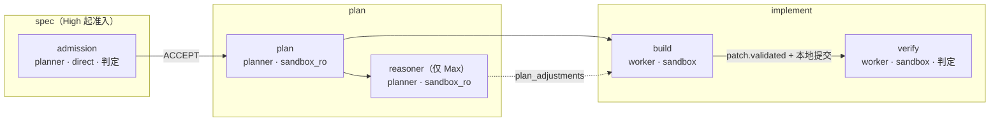
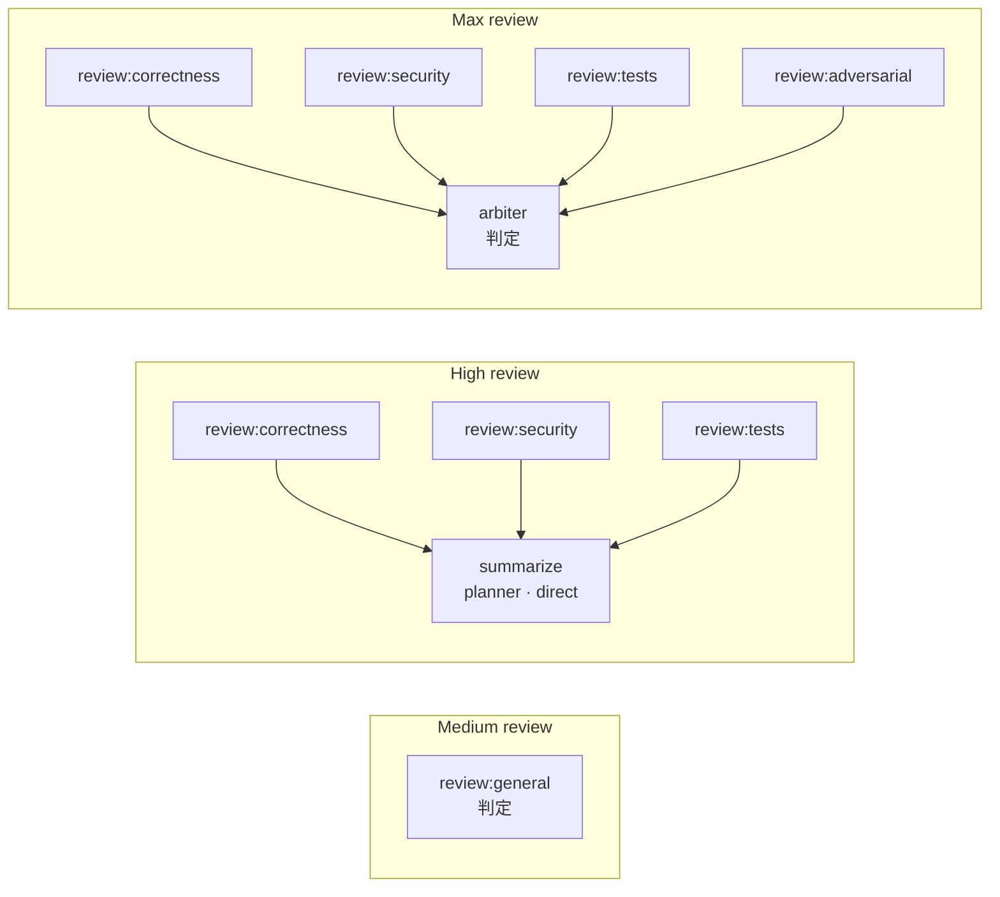

# 编排引擎（`engine`）

> 状态：设计 v0.1 · 里程碑：M1（Low 档）→ M2（Medium / High、准入、预算）→ M3（Max）→ M4（Ultimate） · 泳道：`be-engine` · crate / 目录：`crates/gantry-engine`

> **协作扩展边界（提议）** —— 多工作树协作的完整语义见 [collaboration.md](../collaboration.md)；**设计提案，待单独契约批准，不替换本文现行规格**。
>
> - 执行上下文与预算仍按交付单元独立；跨交付并行是现有基础能力，不限于 `Ultimate`。`Ultimate` 只增加父交付单元的自动拆分与依赖统筹。
> - 一条消息至多对应一个交付单元、`source_message_id` 幂等、多目标 `Ambiguous` 均不变；多目标展开与控制需单独冻结。
> - 协作请求的注入（提案）只发生在接收方下一次正常调度、且该 Attempt 尚未准备的输入中，一次；固定 `graph_rev`、节点与实际 attempt，不修改运行中的 `job.json` / `inputs`，不自动重试、恢复或扩大预算。
> - 目标已终结或请求陈旧时拒绝或过期，不转投；已投递不等于已读或已执行。
> - 组合验证（提案）是独立步骤：固定所有候选 head、base 与契约版本，任一变化即过期重验。不跨树修改，不自动 merge，也不替代 `policy`、审批或 Forge Outbox。
> - 协作协议的字段、状态与请求生成归契约与 `worker`；本模块只按获批的注入点接收已冻结的请求。

引擎把"档位（Level） + GitHub 证据"变成"阶段内的图 + 阶段推进"：按档位展开图，把节点调度到沙盒（Sandbox）或直接调用，按预算熔断，让交付单元（Delivery）沿阶段机前进，遇到需要人的事就上报。它是 `delivery.*`、`workflow.*`、`node.*`、`attempt.*` 事件的唯一写入者，也是沙盒尝试 `budget.*` 事件的写入者（直接调用的用量由 `models` 写，含 None 档的会话台账，P-58）。

## 1. 职责

1. **模板族登记与图实例化**：登记 `levels.*.graph_template` 引用的模板族（[config.md §4](../interfaces/config.md)），按（`level_effective`，阶段）实例化出图（Workflow）：节点（Node）、边、判定（Gate）规则、退出规则。向 `api` 提供模板目录（`catalog.levels.graph_templates`，校验 V08）。
2. **阶段机推进**：以 [data-model §4.1](../data-model.md) 的状态机为准（P-55：准入只在 High 及以上；计划是独立阶段；任何非终态阶段可到 `abandoned`），只在"退出证据"成立时写 `delivery.stage_changed`；证据中的交付事实一律取自 GitHub 快照（I4）。
3. **调度**：把就绪节点变成尝试（Attempt）；遵守预算并发、全局沙盒槽位、工作树（Worktree）写权锁；取消、暂停 / 继续（`delivery.paused` / `delivery.resumed`）、人工重试失败节点（`node.retry_requested`，P-56）。
4. **尝试生命周期**：预留预算 → 生成 JobSpec 的可信部分 → 交给 `SandboxService`（或 `models` 直接调用）→ 终结管线（运行时事实归并、`result.json` 与 `structured_output` 校验、调 `repo` 校验补丁、提议分诊、失败分类）→ 写 `attempt.finished`。校验步骤 V1 / V3 / V4 / V6 与失败分类归引擎（[worker-protocol §3.2 阶段 8、§8、§9](../interfaces/worker-protocol.md)）。
5. **图改写与有界迭代**：判定 `REVISE` 时追加一轮"修正 + 复审"；`graph_rev` 只增不减；轮次、节点数受预算约束；"无进展"即上报。
6. **预算**：交付单元创建时按 `level_cap` 固化预算台账（BudgetLedger，P-57）；预留、记账（按 `levels.token_weights` 加权，P-70）、检查、耗尽（`budget.exhausted`）。None 档挂在会话上的临时图记入会话台账（P-58）。
7. **档位实际值与自动加码**（P-57）：在规格阶段按风险评估给出 `level_effective` 初值（≤ `level_cap`）；之后只在上限内按 `policies.escalation` 抬高，不自动降；超过上限则上报 `escalation`（P-63）并暂停等人；已触发的闸门永不撤销。
8. **上报**：创建与关闭引擎产生的上报项（InboxItem），并保持"阶段状态（`stage_status`）与未决上报项"一致。
9. **出站队列（Outbox）入队**：经 `core::ports::OutboxPort::enqueue_in`（[forge.md §6](forge.md)，与决策事件同事务）入队 `push_branch`、`create_pr`、`update_issue`、`close_issue`、`merge_pr`、`update_pr`、评审摘要评论等；只入队，不执行（I2）。
10. **审批流程**：入队前向 `policy` 取判定（`PolicyPort::decide_action`，结果写入 `requires_approval`，P-62）；合并前请求 Gantry 审批（Approval），审批授予后入队 `merge_pr`；审批在执行前由 `forge` 消费，执行终态失败需要新审批（P-54）；审批失效即回评审（I3）。
11. **崩溃恢复**：重启后从事件日志重建状态，接管未终结的尝试，保证不重复入队、不重复提交。
12. **对外控制面**：为 `conversation` 提供创建 / 定位交付单元、补规格、代码问答；为 `api` 实现 `DeliveryControl`（调档、放弃、暂停、继续、重试节点，[api.md §6.3](api.md)，P-56）；为 `guardian` 实现 `HealPort`（`request_heal`）与 `ClassifyPort`（`classify_ci` / `classify_finding`）（M2，P-60；§6）。
13. **配置热加载**：按 [config.md §2.6](../interfaces/config.md) 的求值时点切换 `EffectiveSettings`。
14. **读取 GitHub 原文材料**：经 `ForgeReader::discussion` 按需拉取 Issue / PR 正文与评论，作为不可信文本放进材料，不进快照（P-59）。

### 1.1 各里程碑交付

| 里程碑 | 引擎交付 |
| --- | --- |
| M0 | 无引擎代码。引擎依赖的 `core` 类型 / 状态机 / 事件枚举 / `core::ports`、`schemas/events/*.json`、`schemas/worker/*.json`、`schemas/forge/*.json` 与替身（`FakeForge`、`FakeSandboxService`、`FakeRepo`、`FakeModelProvider`、`FakePolicy`、`FakeInbox`、`Store::open_in_memory`，P-51）由 `contract` 泳道交付；本规格在 M0 末与契约一起评审 |
| M1 | `low.single` 模板；完整阶段机骨架（含 `merge` 阶段审批、`forge.base_advanced` 重验、任意非终态 → `abandoned`）；`stage_status` 五值；暂停 / 继续 / 重试节点（P-56）；终结管线；Outbox 入队；`levels.low` 预算固化与最小记账（tokens / nodes / wall_time / forge_writes）；受保护路径拒绝的上报（workflow 补丁 `decision_needed` + `manual_action`，P-48）；`ForgeReader::discussion` 取材；None 档代码问答的会话台账（P-58）；放弃；崩溃恢复；设置热加载 |
| M2 | Medium / High 模板族；`admission` 准入（仅 High，P-55）与 `spec_needed`；`REJECT` / `BLOCKED` 上报；预算全维度与耗尽上报；自动加码；`needs_approval` 补丁挂起与补丁审批（`patch_apply_protected`）；评审摘要入队；守护端口 `request_heal` 与 `classify`（P-60）；有界迭代机制（通用，见 OQ-19） |
| M3 | Max 模板族：`reasoner` 预演、对抗 review、`arbiter` 唯一裁决；多轮有界迭代与图修订历史；无进展检测 |
| M4 | Ultimate：父交付单元按 Milestone 拆子交付单元、依赖调度、受 GitHub 配额约束的并发；台账汇总（OQ-18） |

## 2. 不负责

- **意图解析、消息 → 交付单元或查询、对话与卡片**：归 [`conversation`](conversation.md)。引擎只接收其调用。
- **放行判定、审批验签、路径规则、补丁规则表**：归 `policy`（I3）。引擎只请求判定、持有结果。
- **GitHub 读写、webhook、对账、幂等执行**：归 `forge`。引擎不持有 token、不调用 GitHub（I2）；交付事实只读事件日志与快照。
- **补丁应用 / 校验 / 提交、镜像仓、工作树、沙盒工作区准备（由 `sandbox` 调 `repo`）、写权锁实现**：归 `repo`。引擎不解析 patch，也不在沙盒产出的 `.git` 上运行 git（I8、W4）。
- **沙盒创建 / 注入 / 提取 / 销毁、资源限制**：归 `sandbox`；引擎只依赖引擎面 `SandboxService`，不接触容器面（P-52）。
- **模型调用、模型解析、用量折算**：归 [`models`](models.md)。引擎不直接发模型请求。
- **PR 事件分流、CI 失败自愈的决策、无进展的守护侧判定、状态清单评论、愈合轮的推送与回复**：归 `guardian`。引擎只实现 `HealPort` / `ClassifyPort`，**不**为 `heal` 节点自动入队 `push_branch` 或 proposals（guardian 要在推送前做冻结复核，guardian.md §6）；守护静默自愈不改变交付阶段（P-60）。
- **上报项的存储、去重、自动关闭规则、推送通知**：归 `notify`（`core::ports::InboxPort`，[notify.md §6](notify.md)）；引擎只决定"何时上报、上报什么、选项与 `reason_code`"。
- **事件存储、投影、游标**：归 `store`。
- **安全相关的配置写入**：引擎不写任何设置（I7）；也不把自然语言解析成设置变更。

## 3. 依赖

| 依赖 | 用到什么 | 契约 |
| --- | --- | --- |
| `core` | 领域类型（`Level`、`Stage`、`StageStatus`、`Role`、`Tier`、`Exec`、`Verdict`、ID）、阶段机转移表与触发器（[core.md §7.4](core.md)）、事件枚举、`EffectiveSettings` 合并 / 收紧、Outbox 幂等键派生、JSON Schema 校验器；端口 trait `core::ports`（§3 下列各行，P-51） | [data-model §1–§5](../data-model.md)、[forge-actions §2.2](../interfaces/forge-actions.md)、[core.md §6.10](core.md) |
| `store` | `WriteTx`（单写者事务：`tx.read()` 读投影、`append`、`advance_cursor`；实现 `TxHandle`，[store.md §6.1](store.md)）、`ReadSnapshot`（含会话台账）、`events().tail` 订阅、`Cursors`、CAS（读结果对象） | architecture §4、§6 |
| `models` | `ModelRouter`：`resolve`（档位 / 层级 → 具体模型与推理深度）、`invoke_direct`（`admission`、`summarize`、`classify`，用量由 `models` 记账） | [models.md](models.md)、[config.md §3](../interfaces/config.md) |
| `sandbox` | `core::ports::SandboxService`（只依赖引擎面，P-52）：`submit`（受理即返回，内部负责创建 / 注入工作区 / 启动 / 监督 / 提取）、`wait`、`progress`、`cancel`、`release`（`attempt.finished` 落库后）、`recover`、`sweep_orphans`、`capacity` | [sandbox.md §6.1](sandbox.md)、[worker-protocol §3](../interfaces/worker-protocol.md) |
| `repo` | `core::ports::RepoService`：`create_worktree`、`acquire_lock` / `renew_lock` / `release_lock`、`resolve`（默认分支头）、`validate_patch`、`commit_patch`、`advance_head`、`remove_worktree`。沙盒工作区由 `sandbox` 调 `prepare_workspace`，引擎不调 | [repo.md §6](repo.md)、[worker-protocol §8.3](../interfaces/worker-protocol.md) |
| `policy` | `core::ports::PolicyPort`：`decide_action`（入队时，结果写入 `requires_approval`，P-62）、`request_approval`、`invalidate`、`decide_proposals`、`path_rules_snapshot`（填 JobSpec 路径约束）、`path_rules`（加码规则 `when.paths`）；审批状态经 `store` 投影读 | [policy.md §6](policy.md)、[config.md §5](../interfaces/config.md)、[api.md §6](../interfaces/api.md) |
| `forge`（P-59） | `core::ports::ForgeReader`：`discussion`（按需拉取 Issue / PR 正文与评论，作为不可信文本，不进快照）、本地快照读（`pull_request`、`issue`、`project_snapshot`）、`reconcile_now`、`sync_mirror`；GitHub 写只经 `core::ports::OutboxPort`（`enqueue_in` / `cancel`，`forge` 实现，I2） | [forge.md §6](forge.md)、[forge-actions §2–§3](../interfaces/forge-actions.md) |
| `notify`（P-59） | `core::ports::InboxPort`：`raise`（可并入引擎事务）、`resolve` | [notify.md §6.1](notify.md)、[data-model InboxItem](../data-model.md) |
| `worker` | `WorkerAdapter`：镜像、启动命令、非密环境变量，用于组装 `SandboxSpec.exec`；`capabilities()` | [worker.md §6.3](worker.md) |

依赖按裁决 C13（P-59）：`engine` 依赖 `core, store, models, sandbox, repo, policy, forge, notify`（`forge` 只用 `ForgeReader`，`notify` 只用 `InboxPort`），外加 `worker` 的 `WorkerAdapter`；跨模块调用一律经 `core::ports` 端口注入（`cargo tree -p gantry-engine` 不含 `gantry-forge`）。事件日志与 Outbox 表之外的间接关系：`conversation`、`guardian` 订阅引擎事件。

Issue / PR 正文与评论的**原文**（准备 `materials` 需要，worker-protocol §4.4 步骤 1）由 `ForgeReader::discussion` 按需拉取（P-59）：作为 `UntrustedText` 只进材料，不进快照、不进事件日志；CI 日志经 `ForgeReader::ci_log`。

引擎在实现里使用的端口名以对应模块规格为准；本文只写引擎需要的语义，不重新定义对方接口。

## 4. 输入

| 输入 | 来源 | 格式 / 契约 | 信任级别 |
| --- | --- | --- | --- |
| 命令：创建交付单元、调档、放弃、补规格、问答、自愈 / 分类、暂停 / 继续 / 重试 | `conversation`（`EngineApi`）、`api`（`DeliveryControl`，含 `POST /v1/deliveries/{delivery_id}/pause`、`/resume`、`POST /v1/nodes/{node_id}/retry`，P-56）、`guardian`（`HealPort` / `ClassifyPort`） | §6 | 调用方已鉴权；`ActorCtx`（P-78）带发起设备、角色与档案。用户文字可信，模型产出的字段（`intent` 的 `delivery_id` 等）不可信 |
| ForgeEvent（`forge.<kind>`）与 `forge.synced` | `store` 订阅 | [forge-actions §6](../interfaces/forge-actions.md) | 结构字段可信（`forge` 已回读对账）；文本字段（标题、正文、评论、check 输出）是 `UntrustedText` |
| Outbox 结果（`outbox.succeeded` / `failed` / `cancelled`） | `store` 订阅 | [forge-actions §2.3、§2.6](../interfaces/forge-actions.md) | 可信（`forge` 写入） |
| 审批事件（`approval.granted` / `consumed` / `invalidated` / `expired` / `denied`） | `store` 订阅 | [api.md §6](../interfaces/api.md) | 可信（`policy` 验签后写入） |
| 上报项事件（`inbox.resolved` 含 `resolution`、`option_id`，`inbox.dismissed`） | `store` 订阅 | [notify.md §7.3](notify.md) | 选项经 `notify.choose` 校验属于 `payload.options`；`note` 是用户文字 |
| `settings.updated` | `store` 订阅 | [config.md §2.3](../interfaces/config.md) | 可信 |
| 沙盒回传：`JobOutcome`（四个白名单文件、运行时事实、Egress 计量）、采样进度 | `SandboxService::wait` / `progress` | [worker-protocol §5、§7](../interfaces/worker-protocol.md) | **不可信**（W2）。只有运行时事实与 Egress 计量可作决策依据（W3） |
| 直接调用结果（`admission`、`summarize`、`classify`） | `models` | 与 worker-protocol §6 同一套 schema | schema 已校验，但内容由模型据不可信输入产出，当数据对待 |
| 补丁校验结论 `ValidatedPatch` | `repo` | [worker-protocol §8.3](../interfaces/worker-protocol.md) | 可信（服务端自己的 git 与 `policy`） |
| 原文材料（Issue / PR 正文与评论、CI 日志） | `ForgeReader::discussion` / `ci_log`（按需，P-59） | `UntrustedText` | **不可信**（I5） |
| 定时器 | 引擎内部 | 租约到期、锁续租、恢复巡检、重试退避 | 可信 |

## 5. 输出

| 输出 | 去向 | 格式 / 契约 |
| --- | --- | --- |
| 事件：`delivery.created` / `stage_changed` / `level_changed` / `paused` / `resumed` / `abandoned`，`workflow.created` / `revised` / `finished`，`node.queued` / `started` / `finished` / `superseded` / `retry_requested`，`attempt.started` / `finished` / `progress`，`budget.charged`（沙盒尝试、`rounds`、`nodes`、`wall_time`、`forge_writes`）/ `budget.exhausted` | `store` | [data-model §5](../data-model.md)；`actor = {kind: "engine", id: "engine"}`，用户触发的写入沿用调用方 `ActorCtx.actor`；`data` 字段以 `schemas/events/<type>.json` 为准，§11 列出引擎需要的最小字段 |
| Outbox 动作（`push_branch`、`create_pr`、`update_issue`、`close_issue`、`merge_pr`、`update_pr`、`create_comment` / `upsert_status_comment`） | `OutboxPort::enqueue_in` → `outbox` 表，由 `forge` 执行 | [forge-actions §2–§3](../interfaces/forge-actions.md)；幂等键（idempotency key）由 `core` 派生，引擎只给 `intent` 字段与 `epoch` |
| `SandboxSpec`（JobSpec 可信部分、原始材料、上游产物引用、`ExecSpec`、限额、Egress 请求） | `SandboxService::submit` | [sandbox.md §6.1](sandbox.md)、[worker-protocol §3.2、§4](../interfaces/worker-protocol.md) |
| 直接调用请求 | `models` | `DirectCall`（[models.md](models.md)） |
| 动作判定与审批请求（`merge_pr`；M2 起补丁审批 `patch_apply_protected`） | `policy`（`PolicyPort`） | `approval.requested`；`subject_digest`：PR 类为 head SHA，补丁为 `ValidatedPatch.sha256`（P-20、P-54） |
| 上报项 | `InboxPort::raise`（`notify` 写 `inbox.raised`；`conversation`、`desktop-shell` 订阅） | [notify.md §6.1](notify.md)；词表见 §7.11 |
| 模板目录、模块状态 | `api` | `TemplateCatalog`、`ModuleStatus`（`settings/status` 的 `modules.engine`） |

## 6. 对外接口

只写签名与语义。`async` 与错误类型是草案。

```rust
/// 供 conversation 调用。写操作对"目标状态"幂等：
/// 已在目标状态则返回当前表示，不重复产生事件。`ActorCtx`（`core::ports`，P-78）取自触发该操作的请求或事件（设备或系统）。
#[async_trait]
pub trait EngineApi: Send + Sync {
    /// 创建交付单元。`level_cap` 不得为 `Level::None`（None 档不建交付单元）。
    /// 以 `cmd.source_message_id` 为幂等键：同一条消息重复调用返回同一个交付单元。
    /// 同步完成：写 `delivery.created`（含固化的预算台账与 `config_rev`），
    /// 其余推进（准入、规划、实现）由引擎异步进行。
    /// 所需层级的模型未配置（该档位图用到的 `models.planner` / `worker` 缺 `model`）→ `EngineError::NotConfigured`，不创建。
    async fn create_delivery(&self, cmd: CreateDelivery) -> Result<DeliveryHandle, EngineError>;

    /// 定位：给定 refs，返回已绑定且未终结的交付单元（0..n 个）。只读投影，不产生事件。
    async fn locate_deliveries(&self, project: &ProjectId, refs: &[Ref])
        -> Result<Vec<DeliveryHandle>, EngineError>;

    /// 自由文本答复 `spec_needed`（conversation 解析消息后调用）。
    /// 引擎把文字作为"用户亲手输入"的补充规格重新准入；**不** resolve 上报项——
    /// 调用方（conversation）在本调用成功后对该项 `InboxPort::resolve(Answered)`（notify.md §7.4）。
    async fn supply_spec(&self, id: &DeliveryId, inbox: &InboxId, msg: MessageRef, ctx: ActorCtx)
        -> Result<(), EngineError>;

    /// None 档涉及代码的问答（P-58）：不建交付单元，创建挂在会话上的临时图
    /// （`Workflow.delivery_id = None`，`conversation_id` 必填），派一个 `answer` 节点（sandbox_ro）。
    /// 用量记入该项目的会话台账（`BudgetLedger.subject = conversation`），当日超过 `levels.none.daily_tokens`
    /// → `EngineError::BudgetExhausted`，不派发。完成后以事件通知，不阻塞调用方。
    async fn run_answer(&self, req: AnswerRequest) -> Result<AnswerTicket, EngineError>;

    /// `levels.graph_templates`，供 catalog 与 V08 校验。
    fn template_catalog(&self) -> TemplateCatalog;

    /// `settings/status` 中 `modules.engine` 所需：`applied_rev` 与健康。
    fn status(&self) -> ModuleStatus;
}

/// `core::ports::DeliveryControl`（core.md §6.10），由引擎实现（PATCH / abandon / pause / resume / retry 路由的业务部分）；
/// `conversation` 在桌面端消息带 `level_cap` 且 `@` 已有交付时也调用 `set_level_cap`（P-82）。
/// `ctx: ActorCtx`（`core::ports`，P-78）带发起设备、角色、档案与请求 ID；API 层的 `Idempotency-Key` 由 api 处理（控制路由必带，C26），引擎按目标状态幂等。
#[async_trait]
impl DeliveryControl for Engine {
    /// 终结阶段 → `InvalidState`。预算模板在创建时按 `level_cap` 固定，调档不改台账（P-57）；
    /// 用户降上限时 `level_effective` 取 min(原值, 新上限)，已触发的闸门保留；引擎自己从不自动降档。
    /// `Level::None` 不是合法的交付单元上限 → `Validation`。产生 `delivery.level_changed`；新值等于当前上限 → 不产生事件（P-82）。
    async fn set_level_cap(&self, ctx: ActorCtx, id: DeliveryId, cap: Level) -> Result<Delivery, ModuleError>;
    /// 任何非终态阶段可用（P-55）。取消运行中尝试、取消排队中的 Outbox 动作、作废该交付单元的活跃补丁审批
    /// （`PolicyPort::invalidate`）、有 PR 则入队 `update_pr(state=closed)`、释放工作树。产生 `delivery.abandoned`。
    async fn abandon(&self, ctx: ActorCtx, id: DeliveryId, reason: Option<String>) -> Result<Delivery, ModuleError>;
    /// POST /v1/deliveries/{delivery_id}/pause（operator，P-56）：停止派发新节点，运行中尝试到安全点结束；
    /// `stage_status = paused`、`Workflow.status = paused`；产生 `delivery.paused`。已暂停 → 幂等返回。
    async fn pause(&self, ctx: ActorCtx, id: DeliveryId) -> Result<Delivery, ModuleError>;
    /// POST /v1/deliveries/{delivery_id}/resume（operator，P-56）：恢复到暂停前的 `stage_status`；产生 `delivery.resumed`。
    async fn resume(&self, ctx: ActorCtx, id: DeliveryId) -> Result<Delivery, ModuleError>;
    /// POST /v1/nodes/{node_id}/retry（operator，P-56）：只接受 `failed` 节点；`failed → queued`，产生 `node.retry_requested`，
    /// 之后按正常调度新建 Attempt。所属交付单元已终结 → `InvalidState`。
    async fn retry_node(&self, ctx: ActorCtx, id: NodeId) -> Result<Node, ModuleError>;
}

/// 守护端口（P-60；实现 M2 由 be-engine 交付）。trait 定义在 `core::ports`（core.md §6.10，P-51 的跨泳道原则），M0 冻结，
/// 替身 `FakeEngine`；签名与 guardian.md §6 一致，`guardian` 只依赖 `core`。
#[async_trait]
pub trait HealPort: Send + Sync {
    /// 幂等于 req.round_id；派一个 `heal` 节点，`rounds` + 1，锁持有者记为 `guardian`；守护静默自愈不改变交付阶段。
    async fn request_heal(&self, req: HealRequest) -> Result<HealTicket, EngineError>;
    /// 返回已校验的 `HealOutcome`（Patched / ProposalsOnly / NoChange / Denied / Failed / Cancelled / Superseded）。
    async fn outcome(&self, ticket: &HealTicket) -> Result<Option<HealOutcome>, EngineError>;
    async fn cancel(&self, ticket: &HealTicket, why: CancelWhy) -> Result<(), EngineError>;
}
#[async_trait]
pub trait ClassifyPort: Send + Sync {
    /// 派一个 `classify` 节点（计入 `nodes` 与 `tokens_by_tier.utility`，OQ-9(e)）。
    async fn classify_ci(&self, req: CiClassifyRequest) -> Result<CiClassification, ClassifyError>;
    async fn classify_finding(&self, req: FindingClassifyRequest) -> Result<FindingTriage, ClassifyError>;
}
/// 引擎不为 `heal` 的结果自动入队 `push_branch` 或 proposals（OQ-16）。

pub struct CreateDelivery {
    pub project_id: ProjectId,
    pub title: String,                 // 调用方生成，≤ 120 字符，纯文本
    pub level_cap: Level,              // Low..=Ultimate
    pub refs: Vec<Ref>,                // 已由 conversation 解析为快照存在的引用
    pub origin: DeliveryOrigin,        // conversation | github_label | github_command
    pub source_message_id: MessageId,  // 幂等键
    pub user_text: String,             // 用户亲手输入的原文，可信，进入 task.instructions 的唯一文字来源
    pub ctx: ActorCtx,                 // core::ports（P-78）
}
```

引擎内部的关键抽象（crate 内部可见，供测试替换）：

```rust
/// 图模板：纯函数，不做 IO。同一模板族为每个阶段给出一张图。
pub trait GraphTemplate: Send + Sync {
    fn name(&self) -> &'static str;                  // 例如 "medium.plan_build_verify"
    fn level(&self) -> Level;
    /// 阶段图；该阶段没有 agent 图（如 Low 的 spec / review）返回 None。
    fn stage_graph(&self, stage: Stage, cx: &TemplateCx) -> Result<Option<GraphSpec>, TemplateError>;
    /// 一轮修正所需追加的子图（有界迭代，§7.5）。
    fn revise_graph(&self, stage: Stage, cx: &TemplateCx, round: u32) -> Result<GraphSpec, TemplateError>;
}

pub struct GraphSpec {
    pub template: String,                // Workflow.template，例如 "medium.implement"
    pub nodes: Vec<NodeSpec>,
    pub verdict: VerdictRule,
    pub exit: ExitRule,
}
pub struct NodeSpec {
    pub key: NodeKey,                    // 模板内稳定键，如 "build"、"review:security"、"build@r1"
    pub role: Role,                      // tier / exec 由 role_binding(role) 推出，不单独指定
    pub depends_on: Vec<NodeKey>,
    pub upstream: Vec<NodeKey>,          // 产物挂载进 inputs/upstream/ 的节点
    pub required: bool,
    pub critical: bool,                  // 推理深度取 effort_by_level.<level>.critical（config §3.2）
    pub patch: PatchMode,                // Required | Optional | Forbidden
}
pub enum VerdictRule { None, Single(NodeKey), Fold(Vec<NodeKey>), Arbiter(NodeKey) }

/// 状态归约 + 决策：纯函数，给定当前状态与一个输入，返回要执行的决策。
/// 所有"决定"都在这里发生，副作用由执行器按决策列表执行（§7.1）。
pub fn decide(state: &DeliveryState, input: &Input, env: &DecideEnv) -> Vec<Decision>;

/// tier / exec 固定搭配（architecture §9）。模板、实例化与恢复都只通过它取值。
pub fn role_binding(role: &Role) -> (Tier, Exec);

/// 自动加码求值：纯函数（§7.10）。
pub fn evaluate_escalation(rules: &EscalationRules, sig: &RiskSignals, cap: Level, eff: Level) -> EscalationOutcome;

/// level_effective 初值（P-57）：规格阶段按风险评估给出，≤ cap；可注入，测试用它构造 effective < cap 的场景。
pub trait LevelPolicy: Send + Sync {
    fn initial_effective(&self, cap: Level, risk: &RiskSignals) -> Level;   // 结果经 core::check_level_change 夹到 ≤ cap
}

/// 预算预留策略（worker-protocol OQ-14 未决）：决定 JobSpec 的 tokens_total。
pub trait ReservationPolicy: Send + Sync {
    fn reserve(&self, ledger: &BudgetLedger, tier: Tier, concurrent_in_batch: usize) -> u64;
}
```

## 7. 内部设计

### 7.1 总体结构：事件溯源（event sourcing） + 纯决策

引擎的状态只有事件日志（architecture §6）。`DeliveryState` 是从 `store` 投影折叠出的读视图，随时可丢弃重建。

```
store 事件 ──► EventRouter（持久游标 "engine"）──► DeliveryActor[delivery_id]（串行执行体，邮箱）
命令（EngineApi / DeliveryControl / HealPort）────────────────►          │
AttemptRunner 报告（尝试进展 / 终结）─────────────────────────►          ▼
                              ┌─ 打开 WriteTx ──────────────────────────────────────┐
                              │ 1. tx.read() 读该交付单元的投影，得到 DeliveryState   │
                              │ 2. decide(state, input) -> Vec<Decision>（纯函数，无 IO）│
                              │ 3. tx.append(事件…)；InboxPort::raise(Some(tx), …)；     │
                              │    OutboxPort::enqueue_in(tx, …)                     │
                              │ 4. tx.advance_cursor("engine", seq)；commit            │
                              └───────────────────────────────────────────────────┘
                                                  │ 提交之后
                                                  ▼
          副作用执行：SandboxService::submit / wait / cancel / release、RepoService、models 调用、ForgeReader 拉取材料
```

要点：

- **每个活跃交付单元一个串行执行体（actor）**：交付单元内严格串行，交付单元之间并行；全局只有一个调度器（派发队列与在途 `submit` 上限）。
- **决策在事务内、副作用在提交后**：`store` 是单写者，`WriteTx` 里先读后写不会被他人插入（[store.md §6.1](store.md)），因此不需要额外的乐观版本守卫；事务内只做 CPU 计算（`decide` 是纯函数），不做外部 IO，也不 `await` 无界的东西。事务内追加的事件由 `core` 的状态机校验，非法迁移得到 `TransitionError`（暴露契约缺口，core.md §7.4）。Outbox 入队经 `OutboxPort::enqueue_in` 与决策事件**同事务**（`WriteTx` 作为 `TxHandle` 传入，入队只做校验与插入，不做外部 IO）；外部副作用（起沙盒、调模型、拉取材料）在提交之后发起；它们都是幂等的，崩溃后由 `decide(Tick)` 重新派生同样的请求补上（§7.13）。
- **决策幂等**：`decide` 对同一状态与同一输入返回相同结果；每个决策都带前置条件（例如"节点仍为 `pending`"），状态已前进则不产生重复事件。
- **ID 在事件里**：节点 / 尝试 / 工作流 ID 在决策时生成并写进事件，恢复时从事件读取，不重新生成。
- **读写分离**：读 `Delivery` / `Workflow` / `Node` / `Attempt` / `BudgetLedger` / PR 与 Issue 快照用 `store` 投影；写一律走事件。

### 7.2 关键数据结构

```rust
pub struct DeliveryState {
    pub id: DeliveryId, pub project_id: ProjectId, pub origin: DeliveryOrigin,
    pub level_cap: Level, pub level_effective: Level,
    pub stage: Stage, pub stage_status: StageStatus,                 // running | waiting_human | blocked | paused | done（P-55）
    pub status_before_pause: Option<StageStatus>,                  // 暂停前的值，resume 时恢复（P-56）
    pub issues: Vec<IssueRef>, pub pr: Option<PullRequestRef>,   // 快照（GitHub 事实源，I4）
    pub worktree: Option<WorktreeInfo>, pub branch: String,      // 分支名由引擎在创建时确定（§7.12）
    pub parent_id: Option<DeliveryId>, pub depends_on: Vec<DeliveryId>,
    pub config_rev: u64,                                          // 创建时固化
    pub ledger: BudgetLedger,
    pub workflows: BTreeMap<WorkflowId, WorkflowState>,
    pub triggered_gates: BTreeSet<GateId>,                        // 已触发的闸门，永不撤销（P-57）
    pub evidence: Evidence,                                       // 见下
    pub open_inbox: BTreeMap<InboxId, OpenInbox>,                 // 引擎创建且未关闭的上报项
    pub pushed_head: Option<GitOid>,                              // 最近一次入队推送的本地提交
    pub round_history: Vec<RoundRecord>,                          // 每轮 REVISE 的 finding 指纹，用于无进展检测
}
pub struct WorkflowState { pub id: WorkflowId, pub stage: Stage, pub graph_rev: u32,
    pub status: WorkflowStatus, pub template: String, pub nodes: BTreeMap<NodeId, NodeState>,
    pub verdict: VerdictRule, pub round: u32 }
pub struct NodeState { pub id: NodeId, pub key: NodeKey, pub role: Role, pub tier: Tier, pub exec: Exec,
    pub depends_on: Vec<NodeId>, pub upstream: Vec<NodeId>, pub required: bool, pub critical: bool,
    pub status: NodeStatus, pub verdict: Option<Verdict>, pub superseded_by: Option<NodeId>,
    pub attempts: Vec<AttemptState> }
pub struct Evidence {                       // 退出证据的本地记录，全部绑定 head（见 §7.6）
    pub judged_head: Option<GitOid>,        // 最近一次判定所基于的候选 head
    pub candidate_head: Option<GitOid>,     // repo 为已通过校验的补丁生成的最新本地提交
    pub patch_sha256: Option<Sha256Digest>, // 最近一份已校验补丁（补丁审批的 subject_digest）
}
```

`tier` / `exec` 永远由 `role_binding` 填，不接受模板或事件里的其他值（测试强制，§12）。`critical` 与 `required` 不是 data-model Node 字段，只记在 `workflow.created` / `workflow.revised` 的节点描述里（OQ-12）。

`workflow.created` / `workflow.revised` 的 `NodeDescriptor` 必须带 `node_id`（`nod_…`），与 `node.*` 事件使用同一 ID；否则事件日志无法重建 `WorkflowState.nodes` 映射。

### 7.3 角色的引擎属性

tier / exec 的固定搭配见 [architecture §9](../architecture.md#9-三类模型)，此处只补引擎要用的属性：

| role | 判定节点（产出 verdict） | 补丁 | 默认 `required` | 谁调度 | 说明 |
| --- | --- | --- | --- | --- | --- |
| `admission` | 是 | — | 是 | 引擎 | `direct`；只在 High 及以上（P-55）；`REVISE` = NOT_READY |
| `plan` | 否 | forbidden | 是 | 引擎 | `blocking_questions` 非空 → 追问，不算失败 |
| `reasoner` | **否**（P-45） | forbidden | 否 | 引擎 | 只产出预演报告；worker-protocol 已去掉其 `verdict`（C25） |
| `build` | 否 | optional | 是 | 引擎 | `no_change_reason` 处理见 OQ-15 |
| `verify` | 是 | forbidden | 是 | 引擎 | 在候选 head 上跑检查 |
| `single` | 否 | optional | 是 | 引擎 | Low 档实现 + 自检 |
| `review:<视角>` | 是 | forbidden | 是 | 引擎 | |
| `arbiter` | 是（Max 评审阶段的唯一裁决） | forbidden | 是 | 引擎 | |
| `summarize` | 否（无 verdict） | — | 否 | 引擎 | `direct`；结果用于评审摘要，不决定阶段结论 |
| `heal` | 否 | optional | 是 | `guardian` 经 `HealPort::request_heal` | |
| `answer` | 否 | forbidden | 是 | `conversation` 经 `run_answer` | 挂在会话上的临时图（`Workflow.delivery_id = None`，P-58） |
| `classify` | 否 | — | — | `guardian` 经 `ClassifyPort`（节点，计入 `nodes`）；引擎自己的辅助调用（commit 说明、通知文案）不是节点，见 §7.9"辅助调用" | |
| `intent` | 否 | — | — | `conversation` 直接经 `models` 调用 | 不是图节点 |

### 7.4 图模板（每个档位）

**模板族**以 `levels.*.graph_template` 的建议名登记（config §4.3："以 engine 登记为准"）：`low.single`、`medium.plan_build_verify`、`high.multi_review`、`max.adversarial`、`ultimate.milestone`。族内每个阶段的图用 `Workflow.template = "<level>.<stage>"` 命名（与 api.md §4.7 示例的 `medium.implement` 一致）。`BudgetLedger.template` 记族名（按 `level_cap`），`Workflow.template` 记阶段图名（按 `level_effective`）。

**通则**

- `Workflow` 与阶段运行一一对应：每次进入一个有 agent 图的阶段就新建一个 Workflow（`graph_rev = 1`）；`propose`、`merge`、`closed` 没有 agent 图，不建 Workflow。计划是独立阶段（P-55）：计划阶段图 = `plan`（Max 起加 `reasoner`）；实现阶段图 = `build → verify`（Low 为 `single`）；准入图 = `admission`（仅 High 及以上）。
- None 档代码问答（P-58）：`answer` 节点所在的 Workflow 挂在会话上（`delivery_id = None`、`conversation_id` 必填、`stage` 为空），不属于任何交付单元的阶段机。
- 节点的 `depends_on` 满足条件：每个 `required` 依赖已 `succeeded`，且每个非 `required` 依赖已进入终态。`required` 依赖终态失败（重试耗尽）→ 下游 `skipped`，Workflow `failed`，上报（§7.8）。
- `exec = sandbox` 的节点需要工作树写权锁，`sandbox_ro` 与 `direct` 不需要（§7.7）。
- 视角清单、critical 标注、`required` 取值为 [提议]，见 OQ-5。

**实现路径与评审图总览**





**逐档位的图**（`R` = `required`，`C` = `critical`；"上游"= 产物挂进 `inputs/upstream/` 的节点）

*Low：`low.single`*

| 阶段 | Workflow.template | 节点 | 说明 |
| --- | --- | --- | --- |
| spec | —（无图） | — | 免准入；规格确认后 `spec → implement`（`AdmissionSkipped`） |
| plan | — | — | 无计划阶段（P-55） |
| implement | `low.implement` | `single`（R；worker · sandbox；补丁 optional；proposals 允许 `open_pr`、`escalate`） | 实现 + 自检 |
| review | —（无图） | — | 只等 CI：退出证据是当前 head 的 `checks.required_ok` |

*Medium：`medium.plan_build_verify`*

| 阶段 | Workflow.template | 节点与边 | 判定规则 |
| --- | --- | --- | --- |
| spec | —（无图） | — | 免准入（P-55）：规格确认后 `spec → plan`（`AdmissionSkipped`） |
| plan | `medium.plan` | `plan`（R） | `None` |
| implement | `medium.implement` | `build`（R，上游：`plan`）→ `verify`（R，上游：`build`、`plan`；依赖 `build` 且 `build` 的补丁已通过校验并生成本地提交） | `Single(verify)` |
| review | `medium.review` | `review:general`（R；上游：`plan`） | `Single(review:general)` |

*High：`high.multi_review`*：plan / implement 同 Medium（模板名换成 `high.*`；`verify` 为 C）；spec 有准入（P-55）；review 为：

| 阶段 | Workflow.template | 节点与边 | 判定规则 |
| --- | --- | --- | --- |
| spec | `high.spec` | `admission`（R） | `Single(admission)` |
| review | `high.review` | 并行：`review:correctness`（R，C）、`review:security`（R，C）、`review:tests`（R）；汇总：`summarize`（非 R；依赖三者，上游：三者） | `Fold([三个 review 节点])` |

*Max：`max.adversarial`*

| 阶段 | Workflow.template | 节点与边 | 判定规则 |
| --- | --- | --- | --- |
| spec | `max.spec` | `admission`（R） | `Single(admission)` |
| plan | `max.plan` | `plan`（R，C）→ `reasoner`（非 R，C；上游：`plan`） | `None` |
| implement | `max.implement` | `build`（R，C；上游：`plan`、`reasoner`）→ `verify`（R，C） | `Single(verify)` |
| review | `max.review` | 并行：`review:correctness`、`review:security`、`review:tests`、`review:adversarial`（均 R，C）；裁决：`arbiter`（R，C；依赖四者，上游：四者，且只引用本轮 reviewer） | `Arbiter(arbiter)`，reviewer 自己的 verdict 不单独决定阶段结论 |

`reasoner` 放在 `plan` 阶段（预演产出供 `build` 消费），其所在阶段与"反驳"步骤见 OQ-5。

*Ultimate：`ultimate.milestone`（M4，[提议]，OQ-18）*

- 父交付单元（`level_cap = Ultimate`）：`spec`（对 Milestone 的 `admission`）→ `plan`（拆分节点，`plan` 的 `steps[]` 及其 `depends_on` 映射为子交付单元与 `Delivery.depends_on`）→ 展开（子交付单元并行推进，父阶段保持 `implement`）→ 全部子交付单元 `closed` 后父交付单元 `closed`。父交付单元没有 PR，不经过 `propose` / `review` / `merge`。
- 子交付单元：`parent_id` 指向父，`level_cap = Max`，按 `max.adversarial` 走完整阶段机；其 `depends_on` 未满足时不进入 `implement`（`stage_status = blocked`）。
- 台账：父台账用 `levels.ultimate`，汇总所有子交付单元的用量；子台账各自用 `levels.max`（data-model BudgetLedger）。

**节点数核对**（按上表模板与建议默认预算，供调参，非契约）：

| 档位 | 首轮节点数 | 每轮 REVISE 追加 | 预算 `nodes` / `rounds`（C29 调整后的建议值） | 用满轮次所需节点 |
| --- | --- | --- | --- | --- |
| Medium | 4（plan、build、verify、review；免准入） | 3（build、verify、review） | ≥ 20 / 3 | 4 + 3×3 = 13，留出守护 `heal` / `classify` 余量 |
| High | 8（admission、plan、build、verify、3 个 reviewer、summarize） | 6（build、verify、3 个 reviewer、summarize） | ≥ 40 / 4 | 8 + 6×4 = 32，在预算内 |
| Max | 10 | 7 | 60 / 6 | 10 + 7×6 = 52，在预算内 |

守护的 `heal` 节点也占 `nodes`。C29 已把 config 中各档 `nodes` 建议值调到不先于 `rounds` 耗尽（仍标"建议值，待调优"）；Low 档的 `nodes` 是否同步上调见 OQ-9(f)。

### 7.5 判定与有界迭代

**阶段结论（`StageVerdict`）的取得**：按 `VerdictRule`——`Single` 取该节点 verdict；`Arbiter` 取裁决节点 verdict；`Fold` 对 `required` 且已成功的判定节点做确定性折叠，优先级 `REJECT` > `BLOCKED` > `REVISE` > `ACCEPT`（OQ-6）。

**verdict 的处置**（所有阶段通用，P-24；"判定节点失败 / 结果无效"不是 verdict，走 §7.8 的失败处理）：

| verdict | 处置 |
| --- | --- |
| `ACCEPT` | 该判定通过；记录 `Evidence.judged_head`；阶段退出条件满足后推进 |
| `REVISE` | 有界迭代（下）。`spec` 阶段的 `admission` 例外：`REVISE` 即 NOT_READY，写 `spec_needed`，等用户补规格 |
| `REJECT` | `stage_status = waiting_human`；上报 `decision_needed`（`reason_code = gate_reject`，选项 `abandon` / `replan`）；该尝试 `failure_class = verdict_fail`（`verdict.reject`）。选 `replan`：`implement` / `review` 阶段经 `Replan` 直接回到 `plan`（新 plan Workflow，P-55），`spec` 阶段重新准入；Low 无计划阶段，`replan` 等同重新实现 |
| `BLOCKED` | 上报 `escalation`（`reason_code = gate_blocked`），`payload.evidence` 附该尝试的 `result_ref` 与 `blocking_reasons`；`stage_status = blocked`（OQ-7）；`failure_class = verdict_fail`（`verdict.blocked`） |

结果里 `arbiter.escalate.needed = true`：无论 verdict，都上报 `escalation`（`reason_code = arbiter_escalate`）并 `waiting_human`，用户处理前不推进（OQ-6）。

**一轮（round）**：一次 `REVISE` 触发的"修正子图 + 复审子图"。

1. 检查预算：`ledger.used.rounds < limits.rounds` 且追加后 `used.nodes + 新节点数 <= limits.nodes`；否则不追加，写 `budget.exhausted`（`dimension = rounds` 或 `nodes`），上报 `budget_exhausted`，`waiting_human`。**不会出现追加一半的图。**
2. 无进展检测（下）；命中则不追加，上报 `escalation`（`reason_code = no_progress`）。
3. 追加：单个事务写 `workflow.revised`（`graph_rev + 1`、`reason`、`round`、新增节点、被替换节点）+ 对应 `node.superseded` + `budget.charged(rounds, +1)`；`JobSpec.context.revision_round = round`。

**两种落点**（OQ-4）：

| 触发 | 做法 |
| --- | --- |
| `implement` 阶段 `verify` 返回 `REVISE` | 同一 Workflow 内改写：追加 `build@r<k>`（上游：`verify` 的结果）与 `verify@r<k>`；`workflow.revised`；阶段不变 |
| `review` 阶段结论为 `REVISE` | 按 data-model §4.1 的 `review → implement`：写 `stage_changed(review → implement, reason = revise)`，新建 `implement` Workflow（`<level>.implement` 的修正形态：只含 `build@r<k>` → `verify@r<k>`，不含 `plan` / `reasoner`；修正 `build` 的上游：本轮评审结果，Max 档含 `arbiter.required_changes`），随后 `propose`（只 `push_branch`，PR 已存在）→ `review`（新 Workflow，全套 reviewer 在新 head 上重评） |

修正节点的 `workspace.base_sha` 取当前候选 head（补丁相对它；`repo` 要求提交的 parent 等于 `base_sha`，P10）；因此多轮会形成提交链，推送时 `expected_remote_oid` 取上一次推送的 head。

**无进展（OQ-6）**：每轮结束记录 `RoundRecord { fingerprints }`，指纹 = 每条 blocker / major finding 的（`category`，`location.path`）（只到文件，不含行号）。阈值取 `guardian.no_progress.same_class_repeats` 与 `stalled_rounds`（config §6.2，暂用，OQ-6）：同指纹累计达到前者，或连续 `stalled_rounds` 轮 blocker / major 指纹集合没有缩小，即判无进展。finding 是不可信自报：该检测**只会让引擎更早上报**，永远不会让引擎放行或降低审视（I5）。

### 7.6 阶段推进条件

下表中"证据"一律取自事件日志与 GitHub 快照（I4）；涉及 head 的证据必须等于快照的当前 `head_sha`，不一致即视为失效。除表中所列外，不存在其他推进路径。

| # | 迁移 | 触发 | 守卫（全部满足） | 动作 |
| --- | --- | --- | --- | --- |
| T1 | （创建）→ `spec` | `create_delivery` | `level_cap ≠ None`；模型已配置；`source_message_id` 未建过 | `delivery.created`（按 `level_cap` 固化台账与 `config_rev`，P-57）；`LevelPolicy::initial_effective` 给出 `level_effective` 初值（≤ `level_cap`） |
| T2 | `spec → implement`（`AdmissionSkipped`） | 规格确认（`delivery.created` 之后，规格已足够） | `level_effective = Low`（免准入、无计划阶段，P-55） | `stage_changed(reason = admission_skipped)`；不建 Workflow |
| T2b | `spec → plan`（`AdmissionSkipped`） | 同上 | `level_effective = Medium`（免准入，P-55） | 建 `medium.plan` Workflow |
| T3 | `spec → plan`（`AdmissionAccept`） | `admission` 节点 `succeeded` | `level_effective ≥ High`；verdict `ACCEPT`；若 `refined_spec` 非空且已绑定 Issue，则 `update_issue` 已 `outbox.succeeded`（失败码 `spec_edited_by_human` → 重新准入） | 建 `<level>.plan` Workflow |
| T4 | `spec → spec`（`AdmissionRevise`） | `admission` verdict `REVISE` | `level_effective ≥ High` | 上报 `spec_needed`（`missing[]` 来自 `admission.missing`）；`waiting_human`；用户经 `supply_spec` 答复后追加新的 `admission` 节点（图改写，不占 `rounds`，受 `nodes` 与 tokens 约束，OQ-9） |
| T5 | `plan → implement`（`PlanProduced`） | `plan`（Max 含 `reasoner`）进入终态 | `plan` `succeeded` 且 schema 有效；`blocking_questions` 为空（非空 → 以 `aspect = other` 上报 `spec_needed`，留在 `plan`，答复后重跑 `plan`）；`reasoner` 为非 R，失败不阻塞 | 确保工作树与分支（§7.12）；建 `<level>.implement` Workflow |
| T6 | `implement → propose`（`PatchValidated`） | 实现图完成 | Low：`single` `succeeded`，`patch.validated(allow)`，已生成本地提交（`Evidence.candidate_head`）。Medium 起：`verify` verdict `ACCEPT`，且其基于的候选 head = `candidate_head`。`needs_approval`（M2 起）：补丁 `held`，请求 `patch_apply_protected` 审批，授予并提交后才满足 | `stage_changed`；入队 `push_branch`（§7.12） |
| T7 | `implement / review → plan`（`Replan`）；`implement → plan`（`PlanInfeasible`） | 用户对 `gate_reject` 选 `replan`；实现阶段判定计划不可行 | 非 Low（P-55）；`spec` 阶段的 `replan` = 重新准入（`AdmissionRevise`） | 新建 plan Workflow，`rounds` 不计 |
| T8 | `propose → review`（`PrCreated`） | Outbox 结果 | 首次：`create_pr` `outbox.succeeded` 且快照里 `Delivery.pr` 已绑定、`head_sha` = 已推送的本地提交。修正轮：`push_branch` `outbox.succeeded` 且快照 `head_sha` = 已推送的本地提交（OQ-4） | `stage_changed`；Medium 起建 `<level>.review` Workflow（以当前 `level_effective` 的模板，加码在此求值，§7.10）；Low 无图，`review` 只等 CI（P-55） |
| T9 | `review → implement`（`ReviewRevise` / `CiFailureNeedsCode`） | 阶段结论 `REVISE`；或用户在 `guardian` 上报的 `decision_needed`（`review_dispute`）上选择 `fix`（需要改代码且超出自愈范围，P-60、P-79） | 预算与无进展检查通过（§7.5） | 见 §7.5；守护的静默自愈**不**走此边，阶段不变 |
| T10 | `review → merge`（`ReviewAcceptCiGreen`） | 评审图完成或 CI 状态变化 | Medium 起：阶段结论 `ACCEPT` 且 `Evidence.judged_head` = 快照 `head_sha`；全档：快照 `checks.required_ok = true` 且 PR 仍 open；无未决的 `escalation` / `decision_needed` | `stage_changed`；请求 `merge_pr` 审批（§7.11） |
| T11 | `merge → review`（`ApprovalInvalidated` / `BaseAdvanced`） | `approval.invalidated`，或 `forge.pr_synchronized`（head 变化），或 `forge.base_advanced` 命中本交付单元的 PR | — | `stage_changed(reason = head_changed \| base_advanced)`；关闭该审批对应的上报项；head 变化 → 旧证据作废，重新评审；仅 base 前移 → 刷新快照后条件仍满足即回 `merge`（OQ-14） |
| T12 | `merge → closed`（`MergedAndIssuesClosed`） | `forge.pr_merged` | `merge_commit` 已知；合并前 head = 审批的 `subject_digest`；绑定的 Issue 全部关闭——合入默认分支由 GitHub 自动关闭，否则引擎入队 `close_issue`（`require_merged_pr`）并等其成功 | `stage_changed`；`stage_status = done`；释放工作树 |
| T13 | 任一非终态 → `abandoned`（`UserAbandoned` / `IssueNotPlanned`） | 用户放弃（`DeliveryControl::abandon`），或绑定 Issue 以 `not_planned` 关闭 | 阶段不是 `closed` / `abandoned`（P-55） | 取消尝试与排队动作；作废补丁审批；PR 仍 open 时 `update_pr(closed)`；释放工作树；`delivery.abandoned` |
| T14 | 任一非终态 → `abandoned`（`PrClosedUnmerged`） | `forge.pr_closed`（未合并），含 `merge` 阶段（P-55） | — | `delivery.abandoned(reason = pr_closed)`；`update_pr` 不需要（已关） |
| T15 | `abandoned → review`（`PrReopened`） | `forge.pr_reopened` | 放弃原因为 `pr_closed`（T14），且 PR 仍绑定本交付单元（P-55） | `stage_changed(reason = pr_reopened)`；重新求值评审证据 |

其余外部变化（PR 被转为草稿等）：`core` 没有对应的边，不自动迁移，上报 `decision_needed`（`reason_code = github_state_changed`，选项 `abandon` / `continue`）并 `waiting_human`。

`stage_status` 取值规则（P-55，以 data-model 为准）：`running` = 正在推进或等 CI / GitHub；`waiting_human` = 存在引擎创建的未决阻塞上报项（`spec_needed`、`decision_needed`、`budget_exhausted`、`approval_needed`、`escalation` 中需人动作的）；`blocked` = 判定 `BLOCKED`，以及子交付单元等待 `depends_on`（M4）；`paused` = 用户暂停（`delivery.paused`，恢复时回到暂停前的值，P-56）；`done` = 阶段完成或进入 `closed` / `abandoned`。

### 7.7 调度

- **就绪条件**：见 §7.4 通则；`pending → queued` 由引擎写 `node.queued`。节点状态机只放行 `pending → queued → running → succeeded | failed | skipped | cancelled`（core.md §7.4）：同一节点的多次尝试之间节点保持 `running`，只有重试耗尽才 `failed`；因此自动重试是同一节点下新建 Attempt，不是节点回到 `queued`。人工重试（`POST /v1/nodes/{node_id}/retry`）是例外：`failed → queued`，写 `node.retry_requested`（P-56），然后按正常调度新建 Attempt。
- **派发顺序**：全局队列按（优先级，入队时间）；优先级 = 用户可见的前台任务 > `heal` / `classify` / `answer` [提议]。同一交付单元内按 DAG 拓扑。
- **并发闸**（全部满足才派发）：
  1. 该交付单元在途节点数 < `ledger.limits.concurrency`；
  2. 全局：`sandbox` 受理 `submit` 后自己排队（"受理即返回，可能仍在排队"，sandbox.md §6.1），宿主总数上限 `sandbox.max_concurrent_sandboxes` 归 `sandbox` 强制；引擎再按 `SandboxService::capacity()` 限制在途 `submit` 数，避免无界堆积；`direct` 节点不占沙盒；
  3. 写权锁：`exec = sandbox` 的节点先 `RepoService::acquire_lock`（持有者 `engine`，`heal` 为 `guardian`），拿到 `LockToken` 才派发（`commit_patch` 需要它）。锁被 `human` 持有或租约未到期时节点保持 `queued`，不算失败，也不占并发额度；
  4. 预算：`used.nodes`、`wall_time`、`tokens` 未耗尽；预留成功（§7.9）。
- **锁租约（lease）**：`lease_until = now + 有效 wall_time_s + kill_grace_s + 60 s` [提议]，尝试运行期间每半个租约 `renew_lock` 一次，尝试终结（含取消）后立即 `release_lock`；`sandbox_ro` 节点基于 `base_sha` 的独立工作区副本，不需要锁。
- **取消**：用户放弃 / 暂停 / 节点被图改写替换时调用 `SandboxService::cancel(job_id)`（SIGTERM → SIGKILL 由 `sandbox` 执行）；取消的尝试 `failure_class = cancelled`，不计入重试与上报。自动加码的图改写**只替换尚未开始的节点**，不打断运行中的尝试。
- **暂停 / 继续**（P-56）：`pause` 停止派发新节点，运行中的尝试跑完（安全点）；`stage_status = paused`、`Workflow.status = paused`，写 `delivery.paused`；`resume` 恢复暂停前的 `stage_status`，写 `delivery.resumed`。
- **唤醒**：事件驱动，没有轮询；定时器只有：锁续租、租约 / 超时检查、重试退避到期、启动后的恢复扫描。

### 7.8 尝试生命周期、终结管线与失败处理

**派发（对应 worker-protocol §3.2 阶段 0）**：

1. 预留预算（§7.9）；`models.resolve(...)`（`purpose = Sandbox`）得到 `ResolvedModel`（provider、model、推理深度，及 `sandbox` 部分的 adapter、`attempt_wall_s`、`max_turns`；`level_effective` 与 `critical` 参与取值，config §3.2–§3.3）。
2. 追加 `node.started`（首个尝试）+ `attempt.started`，`data` 带：`attempt.n`、实际使用的 provider / model / `reasoning_effort`、`config_rev`、`base_sha`、预留的 `tokens_total`、有效 `wall_time_s`（= min(`attempt_wall_s`，`sandbox.limits.wall_time_s`，预算剩余 `wall_time`)，config §3.2）。**先落事件再起沙盒**。
3. 生成 `SandboxSpec`（[sandbox.md §6.1](sandbox.md)）：
   - `job: JobSpecTrusted`：`task.instructions` = 角色模板（引擎内置）+ `CreateDelivery.user_text` / `supply_spec` 的用户原文；**任何来自 GitHub、沙盒、模型产出的文字不得进入此字段**（W5、I5）。`context.previous_attempts[]` 只含 `{attempt_id, failure_class, failure_detail}` 码值；重试反馈的文本以 `upstream_output` 材料进入。`constraints.paths` = `PolicyPort::path_rules_snapshot`；`constraints.limits`、`output.*`（含 `proposals.allowed_kinds`）按 role 取；`sandbox_ro` 节点 `tools.edit = false`、`output.patch = forbidden`。
   - `raw_materials`（`issue_body`、评论等，经 `ForgeReader::discussion` 按需拉取，P-59；CI 日志经 `ci_log`）与 `upstream`（`{node_id, role, attempt_id, ref, files}`，从 CAS 取）交给 `sandbox.stage` 做规范化 / 截断 / 隔离包装。
   - `workspace = {repo, base_sha, pr_base_sha?, mode}`：`base_sha`（首个 `build` / `single` 取 `RepoService::resolve(默认分支)`；`verify` 与评审取候选 head；修正轮取当前候选 head），评审 / `verify` 另给 `pr_base_sha`；工作区由 `sandbox` 向 `repo` 准备，引擎不碰。
   - `exec = {image_digest, argv, env}` 取自 `WorkerAdapter`；`limits`、`timers`、`io` 取自 `sandbox.*` 设置；`egress = {profile, groups, tokens_total, weights}` 的 `tokens_total` 即预留值，`weights` 取 `levels.token_weights`（P-70）；`job_token` 由 `sandbox` 向 Egress 申请（P-49），引擎不接触。
   - None 档 `answer` 节点：`SandboxSpec.delivery_id = None`、`conversation_id` 必填（P-58）。
4. `exec = sandbox | sandbox_ro` → `SandboxService::submit`，再 `SandboxService::wait(job_id)` 取 `JobOutcome`（进度经 `SandboxService::progress(job_id)` 采样转发为 `attempt.progress`）；`exec = direct` → `models.invoke_direct`（同样有 Attempt，`sandbox_id` 为空；材料同样隔离包装，由 `models` 执行）。
5. `attempt.finished` 落库后调用 `SandboxService::release(job_id)`（删除 `meta.json`，让 Egress 忘记该 job 的最终用量）。

**终结管线（尝试停止后；对应 worker-protocol §8.1）**：

| 步 | 做什么 | 失败 → |
| --- | --- | --- |
| V1 | 归并运行时事实（退出状态、信号、OOM、计时器、取消标记、Egress 切断标记） | 按 worker-protocol §9 的优先级给出候选分类 |
| V3 | `result.json`：schema；`job_id`、`job_sha256` 匹配；产物声明的哈希 / 大小与实际一致 | `exec.protocol` |
| V4 | `structured_output`：role schema；一致性规则（`ACCEPT` ⇒ 无 blocker；`REVISE` / `REJECT` ⇒ 至少一条 finding；`BLOCKED` ⇒ `blocking_reasons` 非空）；引用完整性（`arbiter` 的 `finding_ref` 必须指向本轮 `upstream` 的 reviewer） | `exec.output_invalid` |
| V5 | 补丁：`RepoService::validate_patch`（仅当 V1–V4 通过且 `status = succeeded`；幂等于 `job_id`）。`Validated(allow)` → 生成提交说明（utility 辅助调用或模板）后 `commit_patch`（需 `LockToken`；提交身份取 `github.commit_identity`，P-69；`repo` 按 `refs/gantry/attempt/<job_id>` 幂等）；`Validated(needs_approval)` → 补丁挂起，请求 `patch_apply_protected` 审批；授予后 `commit_patch(approval = 该审批)`，`repo` 在提交前消费它（P-54）；`Validated(deny)`（`policy` 规则判定）→ 丢弃；`Rejected{reason}`（`repo` 机械拒绝：`not_applicable` → `exec.output_invalid`；`binary` / `symlink` / `submodule` / `path_invalid` / `dotgit` → `policy_denied` 类，按 worker-protocol §9 映射）；`BaseConflict` → 不自动 rebase，用新的 `base_sha` 重新派发（计一次重试）；`NoChange` → 视为无补丁（OQ-15） | `policy.*` / `exec.output_invalid` |
| V6 | proposals：`PolicyPort::decide_proposals`；`Accepted` 的由引擎入队（`open_pr` → `create_pr`），`escalate` 写上报项，`NeedsApproval` / `Held` 随补丁挂起，`Denied` 记 `policy.denied`；单条失败不使尝试失败 | 逐条 `rejected` |
| 终结 | 按 worker-protocol §9 的优先级分类；用 Egress 计量（不是自报）填 `usage`；写 `attempt.finished`（`result_ref`、`failure_class`、`failure_detail`、`usage`、`result_tree`）、`budget.charged`、`node.finished`；然后把结果交 `decide` | — |

V2（intake）归 `sandbox`。V3 / V4 / V6 与分类归引擎，worker-protocol §1 的责任表没有逐项写明这几项归属，见 OQ-12。

**失败处理**（`failure_class` / `failure_detail` 取自 [worker-protocol §9](../interfaces/worker-protocol.md)；"重试"= 同一节点新建 Attempt，旧尝试不改）：

| 分类 | 处理 |
| --- | --- |
| `cancelled` | 不重试不上报；节点 `cancelled` |
| `timeout.wall` | 重试 1 次；仍超时 → 上报 `escalation`（`attempt_failed`） |
| `timeout.idle` | 重试，受 `MAX_ATTEMPTS_PER_NODE` 约束 |
| `exec.oom` | 不自动重试（需调大限额才有意义）→ 上报 |
| `exec.killed` / `exec.worker_crash` / `exec.protocol` | 重试 |
| `exec.model_api` | 退避后重试 |
| `exec.bad_job` | 不重试（引擎或镜像缺陷）→ 上报 |
| `exec.agent_failed` | 重试 1 次；`result.error.kind = max_turns` 不重试 → 上报（`retryable_hint` 是自报，仅作线索） |
| `exec.output_invalid` | 带反馈重试（反馈以 `upstream_output` 材料进入）；仍无效 → 上报 |
| `infra.*` | 新沙盒重试；`infra.lost` 来自恢复（§7.13） |
| `budget.tokens` | 不重试；`budget.exhausted`；上报 `budget_exhausted` |
| `policy.path_protected:workflows`（任何里程碑，P-48） | 不重试；上报 `decision_needed`（`payload.kind = manual_action`，`reason_code = policy.path_protected:workflows`），附补丁（CAS 引用）供用户手动应用；选项 `done`（primary）/ `abandon`（P-79） |
| `policy.path_protected:<依赖清单 / lockfile 等>`（M1） | 不重试；**必须**上报 `escalation`（`reason_code = policy.path_protected:<rule_id>`），证据 = `policy.denied` 与 `patch.rejected` 事件、路径列表；M2 起这类补丁走 `patch_apply_protected` 审批 |
| 其他 `policy.*` | 重试 1 次并带"缩小改动"反馈；仍被拒 → 上报（OQ-15） |
| `verdict.*` | 不是失败，进入 §7.5 |

每个节点的尝试数上限 `MAX_ATTEMPTS_PER_NODE`（内部常量，建议 3；没有对应配置键，OQ-9）；耗尽 → 节点 `failed`，`required` 节点失败则 Workflow `failed` 并上报 `escalation`（`reason_code = attempt_failed`，`payload.attempt_id`、`failure_detail`）。

### 7.9 预算

**创建**：`create_delivery` 时读取 `levels.<level_cap 转小写>`（如 `levels.high`，P-71；已合并项目覆盖的生效值），写入台账：`template` = 族名，`limits` = `budget` 各项，`used` 全零；连同 `config_rev` 一起放进 `delivery.created.data`（台账创建没有独立事件，OQ-12）。之后配置变化不影响该交付单元（config §2.6）。预算模板**在创建时按 `level_cap` 固定**（P-57），不随 `level_effective` 或之后的调档变化，自动加码不追加预算（architecture §8）。

**会话台账**（P-58）：None 档问答不建交付单元；`answer` 节点所在的临时图的用量记入该项目的会话台账（`BudgetLedger.subject = conversation`，按 UTC 日），每日上限 `levels.none.daily_tokens`；派发前检查，超限 → `BudgetExhausted`，由 `conversation` 回复用户。

**维度与记账**（口径见 data-model BudgetLedger；记账一律写 `budget.charged`）：

| 维度 | 何时记 | 来源 |
| --- | --- | --- |
| `tokens_by_tier` | 沙盒尝试：终结时由引擎写（`JobOutcome.usage_metered`，Egress 按 `job_token` 计量）。`direct` 调用（含 `admission` / `summarize` 节点和辅助调用）：由 `models` 在调用结束后按 Egress 的 `call_usage` 写，引擎**不重复记** | Egress 计量，折算为加权 token（P-44，权重 `levels.token_weights`，P-70）。**不用 worker 自报** |
| `nodes` | 节点创建时（含被替换的） | 引擎 |
| `attempts` | 尝试创建时 | 引擎（无上限，仅记录） |
| `wall_time` | 尝试终结时 | `JobOutcome.timings`（`sandbox` 观察的起止时间）之和 |
| `rounds` | 追加一轮时（评审迭代）；`HealPort::request_heal` 时（自愈轮） | 引擎 |
| `forge_writes` | 观察到 `outbox.succeeded` 时 +1 | 事件；按小时限速由 Outbox 令牌桶执行，不进台账（P-22） |

**预留（OQ-9，对应 worker-protocol OQ-14）**：派发前由 `ReservationPolicy` 决定本尝试的 `tokens_total`（JobSpec `constraints.limits.tokens_total`，Egress 强制硬切断）。默认实现：同一批同时派发的 *n* 个同层级尝试平分该层级剩余额度；尝试终结后以计量值替换预留。预留失败（剩余为零）→ 不派发，走耗尽处置。`direct` 调用没有 Egress 级别的 job 封顶（`models` 的调用按 `call_id` 计量，egress.md §6.3），引擎在调用前检查该层级剩余额度（台账含 `models` 写入的 `budget.charged`），最多超支一次调用。

**辅助调用**：引擎自己的 commit 说明等 utility 调用**不是图节点**（否则占 `nodes`）：由引擎直接调 `models.invoke_direct`（`Attribution::Aux`），用量由 `models` 以 `budget.charged` 记入 utility 层。失败或额度耗尽时退回确定性模板（commit 说明退回 `<title>` + `Gantry-Attempt` trailer）。`guardian` 经 `ClassifyPort` 要求的 `classify` 则是节点，占 `nodes`（guardian.md §6 已对齐）。是否应统一建模见 OQ-9。

**耗尽**：任一维度达到上限 → `budget.exhausted`（`dimension`、`limit`、`used`）+ 上报 `budget_exhausted`（`payload = {dimension, limit, used, options: raise_cap / abandon}`，P-79）+ `waiting_human`；停止派发新节点，运行中的尝试：token 超限由 Egress 切断，其余维度让其在安全点结束（不在推送途中打断）。耗尽后用户能做什么（追加预算 / 放弃）骨架未定（config OQ-10），暂只有放弃与调档。

**档位变化与台账**（P-57）：台账 `limits` 在创建时按 `level_cap` 固定，`set_level_cap` 与自动加码都不改台账；已触发的闸门保留。耗尽后追加预算的方式仍未决（config OQ-10）。

本节 `budget.charged` data 的送审字段见 [event-data.md](../interfaces/event-data.md)（尚未批准）。契约批准前运行时仍按 fail-closed 拒绝，本节其余语义不变。

### 7.10 自动加码

输入 `RiskSignals { touched_paths, estimated_path_globs, diff_stats, labels, admission_risk_flags }`：

- `touched_paths` / `diff_stats`：`ValidatedPatch.files[]` 与 PR 快照（权威）；
- `estimated_path_globs`：`plan.touched_paths_estimate`（自报，只作线索，阶段早期用）；
- `labels`：绑定 Issue / PR 的标签（外部文本）；`admission_risk_flags` 仅供参考，不直接触发规则（config 规则只有 `paths` / `diff` / `labels` 三种，OQ-5）。

求值时点：进入每个有图阶段时、`patch.validated` 之后、PR head 变化之后。规则按 [config.md §5.3](../interfaces/config.md)：多条命中取最高 `raise_to`；只升不降；结果与 `level_cap` 比较：

| 结果 | 动作 |
| --- | --- |
| ≤ 当前 `level_effective` | 无事 |
| > 当前且 ≤ `level_cap` | `level_effective` 抬高；写 `delivery.level_changed`（`reason = escalation:<rule_id>`）；把 rule 记入 `triggered_gates`；在**阶段边界或节点边界**应用新模板（对尚未开始的节点做图改写：`workflow.revised`，不打断运行中的尝试） |
| > `level_cap` | 不自行突破：上报 `escalation`（P-63：升档一律用 `escalation`，手机档案不可 `choose`；`reason_code = level_cap_exceeded`，`payload.target_level`，`payload.options[]` = `upgrade` / `narrow` / `abandon`，P-79），`waiting_human`，停在当前阶段 |

选项语义：`upgrade` = `set_level_cap(target_level)`（手机档案不可选，`notify` 对 `escalation` 拒绝手机 `choose`，P-35、P-63）；`narrow` = 保持上限，记录该规则已确认，`level_effective = level_cap` 继续（缩小范围由用户后续消息表达）；`abandon` = 放弃。外部文本触发的规则只能提高审视，不得降低档位或放宽处置（I5）；`level_effective` 不自动降，已触发的闸门永不撤销（P-57）。

### 7.11 上报

引擎通过 `InboxPort::raise(Some(&mut tx), RaiseRequest)` 创建上报项——并入"阶段变化 / 进入 `waiting_human`"的同一事务；`inbox.raised` 由 `notify` 写，`conversation` 把它投成卡片，`desktop-shell` 对 `severity ≥ warn` 弹系统通知（P-63）。`RaiseRequest.project_id` 必带，`RaiseRequest.dedup_key` 必填（notify.md §7.2，P-63）：取（交付单元，`kind`，`reason_code`，`node_id` 或 `attempt_id`，轮次），已有同键 open 项则返回它，重放安全。`summary` 只能由模板或 `UntrustedText::to_summary()` 构造（`SafeSummary`），不直接拼入不可信文本；不可信内容只放在 `payload.evidence` 的引用里。

| 情形 | `kind` | `severity` | `reason_code` / 选项（词表以 [data-model](../data-model.md#上报项的-reason_code-与选项词表) 为准，P-79） | `stage_status` |
| --- | --- | --- | --- | --- |
| `admission` `REVISE` / `plan` 有 `blocking_questions` | `spec_needed` | blocker | `payload.missing[]` | `waiting_human` |
| 判定 `REJECT` | `decision_needed`（`payload.kind = gate_reject`） | blocker | `gate_reject`；`replan`（primary）/ `abandon` | `waiting_human` |
| 判定 `BLOCKED` | `escalation` | blocker | `gate_blocked`；evidence 含 `result_ref` | `blocked` |
| 评审 / 裁决要求人 | `escalation` | blocker | `arbiter_escalate` | `waiting_human` |
| 超过 `level_cap` | `escalation`（P-63） | blocker | `level_cap_exceeded`；`upgrade`（primary）/ `narrow` / `abandon` | `waiting_human` |
| 预算耗尽 | `budget_exhausted` | blocker | `{dimension, limit, used}`；`raise_cap`（仅桌面，追加方式待决 Q-11）/ `abandon` | `waiting_human` |
| 策略拒绝（含 M1 受保护路径） | 取 `ReportHint`（M1 依赖清单 / lockfile 为 `escalation`；workflow 为 `decision_needed` + `payload.kind = manual_action`，附补丁，P-48） | 取 `ReportHint` | `ReportHint.reason_code`（如 `policy.path_protected:workflows`）；`manual_action` 的选项 `done`（primary）/ `abandon` | `waiting_human` |
| 重试耗尽 / 无进展 / 无补丁 | `escalation` | blocker | `attempt_failed` / `no_progress` / `no_change` | `waiting_human` |
| 合并需要 Gantry 审批 | `approval_needed` | blocker | `{approval_id}` | `waiting_human`（GitHub 闸门未满足时同样，由用户在 GitHub 上完成） |
| Outbox 终态失败 | `escalation` | warn / blocker | `outbox_failed:<code>`（映射见 §9） | 视码 |
| `propose` / `merge` 阶段 GitHub 状态外部改变 | `decision_needed`（`payload.kind = other`） | warn | `github_state_changed`；`continue` / `abandon` **[提议，P-79 未覆盖]** | `waiting_human` |

**选项形状**（P-63、P-79）：`escalation`（仅 `level_cap_exceeded`）、`decision_needed`、`budget_exhausted` 的 `payload.options[]` 为 `{id, label, primary?}`；`spec_needed` 无选项（自由文本答复）；升档一律用 `escalation`（手机档案不可 `choose`）。`label` 由引擎模板生成（可信文本），选项 `id` 只取 data-model 词表。

**关闭与执行**（notify.md §7.4–§7.5）：

- `choose` 由 `notify` 校验并写 `inbox.resolved`（`resolution = chosen`、`option_id`），**不调用引擎**；引擎订阅该事件后执行：`abandon` → `abandon`；`replan` → T7；`upgrade` → `set_level_cap(target_level)`；`narrow` → 保持上限、`level_effective = level_cap` 继续；`done` → 解除阻塞并按 GitHub 快照重新求值当前阶段；`continue` → 解除阻塞并重新求值；`raise_cap` → 按 Q-11 追加额度后继续（追加量与事件待决）；`fix`（守护的 `review_dispute`）→ T9；`keep` → 不动作。失败节点的重试走 `POST /v1/nodes/{id}/retry`，不是选项。执行失败是引擎的错误（再上报），不回滚选择。
- 自动关闭：`notify` 内置 R1（审批 `granted` / `denied` / `invalidated` / `expired` / `consumed` 关闭对应 `approval_needed`）、R2（交付单元 `abandoned` / `closed` 关闭其全部 open 项）；其余由引擎显式 `InboxPort::resolve`（R4，如节点重试成功、GitHub 上已处理、`supersedes`）。自由文本答复 `spec_needed` 由 `conversation` 在 `supply_spec` 成功后 `resolve(Answered)`。
- `dismiss` 只表示"不再提醒"：**不改变交付单元状态，引擎不得依赖收件箱状态推进**（notify.md I3）。引擎用自己事件日志里的"未决阻塞项"集合（`DeliveryState.open_inbox`，由引擎创建时加入、由 `inbox.resolved` 移出，不看 `dismissed`）判断 `waiting_human`，所以 dismiss 一个阻塞项不会解除暂停（OQ-13）。

### 7.12 Outbox 入队与审批流程

引擎只入队，经 `OutboxPort::enqueue_in(tx, EnqueueRequest)`（[forge.md §6](forge.md)），与决策事件**同一事务**。幂等键由 `core` 按 [forge-actions §2.2](../interfaces/forge-actions.md) 派生，引擎提供 `kind`、`payload`、`requires_approval`、`depends_on`、`priority`、`epoch`、`enqueued_by = {module: "engine", causation_id}`；重复入队返回已有行（`created = false`）。Outbox 临时错误由 `forge` 留在 `queued` 退避，终态 `failed` 才发 `outbox.failed`（P-53）；人工重试 = 引擎以 `epoch + 1` 创建新动作（例如用户 `retry` 后重新 `create_pr`），需要审批的动作同时需要新审批（P-54）。

**每个动作入队前先过 `PolicyPort::decide_action`**（I3，P-62：判定在入队时做，结果写入 `requires_approval`；`forge` 不读策略，只在执行前消费审批）：`Allow { approval }` → 入队，`requires_approval` 取其 `approval`；`NeedsApproval { spec, pending }` → 无 `pending` 则 `request_approval(spec, ctx)`，并上报 `approval_needed`，审批 `granted` 后再次 `decide_action`；`Deny { reason, report }` → 不入队，按 `report`（`ReportHint`）上报。`EnqueueError::ApprovalRequired` 视为引擎缺陷（说明漏了判定）；`PermissionMissing` → 上报 `app_permission_missing`。

分支名 `gantry/` + `dlv-<交付单元 ID 末 8 位>` + `-<slug>` [提议]，slug 取自标题，只含 `[a-z0-9-]`、≤ 40 字符；在 `delivery.created` / 第一次 `create_worktree` 时确定并记录，之后不变。

| 时机 | `kind` | 关键 `payload` 来源 | `requires_approval` | `priority` | `depends_on` |
| --- | --- | --- | --- | --- | --- |
| T6 / 修正轮后 | `push_branch` | `branch`；`base_ref` = 默认分支；`worktree_id`；`local_head_oid` = `candidate_head`；`expected_tree_oid` / `validation_ref` = `ValidatedPatch.result_tree` / `.sha256`；`expected_remote_oid` = 上次推送的 head（首次 null）；`force = false`；`transport = git` | 取 `decide_action` 结果（补丁审批 `patch_apply_protected` 已由 `repo` 在提交前消费，不在此处，P-54） | high | — |
| T6 | `create_pr`（首次） | `head`、`base`、`title` / `body`（取 `open_pr` 提议，缺省用交付单元标题与模板正文）、`draft`、`closes`（仅 `base` = 默认分支时填绑定的 Issue 编号）、`expected_head_oid` | 取 `decide_action` 结果 | high | 本次 `push_branch` |
| T3 | `update_issue` | `spec_block_markdown` = `admission.refined_spec`，`expected_block_hash` | 取 `decide_action` 结果 | normal | — |
| 评审完成 | `create_comment`（或 `upsert_status_comment` 的一个小节，forge-actions OQ-11） | High：`summarize.text`；Max：`arbiter.pr_summary`；文本是不可信数据，`forge` 出站净化 | 取 `decide_action` 结果 | low | — |
| 合并审批授予 | `merge_pr` | `expected_head_sha` = `approval.subject_digest`；`merge_method`（OQ-14）；`mode = auto`；`commit_title` / `commit_message`（含绑定 Issue 的 `Closes #N`，仅 `forge` 允许的位置） | **必填**，= 审批 ID | high | — |
| T12，合入非默认分支 | `close_issue` | `state_reason = completed`、`require_merged_pr` | 取 `decide_action` 结果 | normal | — |
| 放弃 | `update_pr` | `state = closed`（只有 PR 仍 open 时） | 取 `decide_action` 结果 | normal | — |

**合并审批流程**（T10 之后）：`decide_action(MergePr { repo, number, expected_head_sha = 快照 head })` → `NeedsApproval { spec }`（`policy` 读 `store` 里的 PR 快照核对 head，不一致 → `Deny(HeadMismatch)`，引擎先 `ForgeReader::reconcile_now` 刷新再重试）→ `request_approval(spec)` → 上报 `approval_needed` → 用户在审批单签名（`api` 路由，非引擎）→ `approval.granted` → 再次 `decide_action` 得 `Allow { approval: Some(id) }` → 前置满足时入队 `merge_pr`：快照 `mergeable_state` 为可合并，或项目启用 merge queue（`mode = auto` 由 `forge` 决定直接合并还是入队）。入队不是合并——合并结果只认 `forge.pr_merged`；审批在 `forge` 执行前被消费（`consumed_by` = 该 `merge_pr` 动作 ID，P-54），执行终态失败（如 `not_mergeable`）不退回，重做需新 `epoch` 与新审批。`decide_action` 返回 `Deny(ActionDenied)`（`policies.actions.merge_pr = deny`）→ 不入队，上报 `escalation`（`merge_denied_by_policy`）。head 变化导致的审批失效由 `policy` 订阅 `forge.pr_synchronized` 自己完成（policy.md §7.7）；补丁审批（`patch_apply_protected` + `path_rules`）由引擎在补丁被新尝试取代或交付单元放弃时调用 `PolicyPort::invalidate`。

`create_pr` / `push_branch` / 各动作的 Outbox 终态失败如何影响流程见 §9。

### 7.13 并发模型、持久化与恢复

- **运行时**：tokio。`EventRouter`（一个任务）用 `events().tail` 订阅 `store`，持久化游标 `engine`（与决策同事务 `advance_cursor`）；按 `delivery_id`（事件的 `subject` / `correlation_id`）分发到 `DeliveryActor` 邮箱（None 档临时图按 `conversation_id` 分发到会话执行体）；`AttemptRunner` 是每个尝试一个任务，驱动 `SandboxService` / `models` 并向执行体回报；`Scheduler` 单例持有派发队列与在途计数。
- **持久化**：引擎没有自己的表。事件 + 游标同事务；"事件已处理"靠决策幂等而不是游标精确一次。
- **启动恢复**：
  1. 读所有非终结交付单元的投影，折叠游标之后的事件，重建 `DeliveryState`；
  2. 对每个有 `attempt.started` 而无 `attempt.finished` 的尝试，调用 `SandboxService::recover(unfinished)`（worker-protocol §3.5）：仍在运行 → 继续监督；已退出 → 直接 `collect` 并走终结管线；已不存在 → 终结为 `infra_error`（`infra.lost`）并按 §7.8 重试；`direct` 尝试没有沙盒，按 `infra.lost` 重试；终结后 `release`；再用存活的 `job_id` 集合调 `sweep_orphans(live)`；
  3. 终结管线内的补丁提交幂等：先查 `attempt.finished` 是否已存在 `result_tree`，再由 `repo` 按 `refs/gantry/attempt/<job_id>` 查已有提交，已存在则不重复提交；
  4. 对每个交付单元补一次 `decide(Tick)`：应有未建的 Workflow / 悬空的上报项（`dedup_key` 相同则 `Deduped`）都会被补齐（Outbox 入队与决策同事务，不会悬空）；
  5. 锁租约过期的工作树由 `repo` 回收；引擎重新 `acquire_lock` 取得新的 `LockToken`。
- **关闭客户端不影响任务**：引擎不依赖任何客户端连接。
- **settings 热加载**：订阅 `settings.updated`；持有 `ArcSwap<EffectiveSettings>`（含 `config_rev`），在两次决策之间原子切换，不在一次决策途中切换；创建类键（`levels.*`）只在创建交付单元时读取，判定类键（`policies.escalation`）每次求值读当前值；向 `status` 报告 `applied_rev`（config §2.6）。

## 8. 不变式与安全要求

| 不变式 | 引擎如何保证 |
| --- | --- |
| I1 沙盒只计算 | 引擎只通过 `SandboxService` 与沙盒交互（不接触容器面 `SandboxDriver`，P-52）；不向沙盒开任何端点；JobSpec 不含 token、key；进度事件只用于展示，**不驱动状态机**（W3）；决策只依据运行时事实、Egress 计量、服务端校验结果 |
| I2 GitHub 写入唯一路径 | 引擎没有 GitHub 客户端依赖（crate 依赖检查，§12）；所有写动作 = `OutboxPort::enqueue_in`；幂等键由 `core` 派生；`ForgeReader` 只读 |
| I3 放行唯一决策点 | 每个动作入队前先 `PolicyPort::decide_action`，危险动作（`merge_pr`、补丁审批）只请求 `policy`；审批只信 `policy` 写入的状态；`merge_pr` 带审批 ID 入队，`forge` 在执行点再复核 head；`approval.invalidated` / `forge.pr_synchronized` 使引擎回 `review`，守护之外引擎不在已审批的 PR 上推送 |
| I4 状态各有事实源 | 阶段推进的交付证据只读快照与 `forge.*` 事件；GitHub 与本地预期冲突时（`forge.drift_detected`）以快照为准并重新求值；本地事件日志是图、尝试、预算的唯一事实源 |
| I5 外部文本不可信 | `task.instructions` 只含内置模板与用户亲手输入；`ForgeReader::discussion` 取回的 Issue / PR 正文与评论只进材料；材料全部以 `UntrustedText` 交给 `sandbox.stage` / `models` 做隔离包装；finding、`summary`、`pr_summary`、`refined_spec` 等模型产出文字只当数据存储与展示，写到 GitHub 前由 `forge` 净化；外部文本触发的加码 / 无进展检测只会提高审视；上报项 `summary` 用模板，不拼不可信文本 |
| I7 配置与工作分离 | 引擎不写设置；不接受"在聊天里改设置"；`levels.*`、预算只读；任务级 `level_cap` 是工作输入（`set_level_cap` 允许，api.md §8.2） |
| I8 执行产物先验后推 | 沙盒补丁只经 `repo` 校验并生成提交，推送的 `local_head_oid` 必须等于 `candidate_head`；引擎不解析 patch、不在沙盒 `.git` 上运行 git；`validation_ref` / `expected_tree_oid` 随 `push_branch` 下发供 `forge` 核对 |

补充要求：

- **模型产出不是权限**：`intent` 等字段不能决定对哪个交付单元做修改；引擎的命令都带显式 ID 与 `ActorCtx`，由调用方（`api` / `conversation`）保证鉴权与档案限制（手机档案不可升档，P-35）。
- **失败闭合**：不认识的 verdict / role / `structured_output.kind`、与 `role_binding` 不符的 `tier` / `exec`、`result.json` 与 JobSpec 不一致，一律按失败处理，不"尽力而为"（W8）。
- **日志脱敏**：日志与事件里不出现 token、模型 key；不可信文本只记长度与哈希，需要时截断并转义。

## 9. 错误与恢复

| 失败 | 处理 |
| --- | --- |
| 事件追加的乐观并发守卫失败 | 重读该交付单元状态，重新 `decide`；不重试同一批事件 |
| `store` 暂不可用 | 执行体暂停该交付单元的决策并退避重试；不丢弃输入（事件仍在日志里） |
| 模型未配置 / 配置变为无效（`models` 返回 `NotConfigured`） | 不创建交付单元；已有交付单元的新尝试不派发，上报 `escalation`（`reason_code = models_not_configured`），配置修复后在 `settings.updated` 时恢复派发 |
| `sandbox.create / stage` 失败（`infra.*`） | 新沙盒重试，受 `MAX_ATTEMPTS_PER_NODE` 约束 |
| 终结管线中 `repo` 不可用 | 尝试保持"待终结"，退避重试 V5；`collect` 的结果是幂等的，重复执行得到同一内容寻址对象 |
| 引擎在 `collect` 之后 / 提交之前崩溃 | 重启后重走终结管线；提交幂等（§7.13） |
| 引擎在入队之后崩溃 | 入队与决策事件同事务，要么都在要么都不在；都在则重放得到同一幂等键 |
| `outbox.failed`（终态）`precondition_failed(head_changed)` 于 `merge_pr` | 不盲重试；回 `review`（T11），head 变了就是新证据 |
| `outbox.failed` `existing_pr` | 人手开了同名分支的 PR：上报 `escalation`，不覆盖 |
| `outbox.failed` `not_mergeable` | 留在 `merge`，上报 `escalation`（`outbox_failed:not_mergeable`，GitHub 返回的原因是不可信文本，放进 evidence） |
| `outbox.failed` `permission_denied` | 上报"App 缺权限"，不重试（`escalation`，`app_permission_missing`） |
| `outbox.failed` `rate_limited`（等待次数耗尽） | 上报；由用户决定是否重试（新动作 `epoch + 1`，P-53） |
| `outbox.failed` `validation_failed` / `target_missing` / `approval_invalid` | 上报；`approval_invalid` 先重新请求审批；已消费审批的动作终态失败后重做需要新审批（P-54） |
| `outbox.cancelled` 因前置动作失败 | 沿依赖链向上找到根因动作，按该动作的失败码处理 |
| `OutboxPort::enqueue_in` 返回 `PermissionMissing` | App 缺权限：上报 `escalation`（`app_permission_missing`），不重试 |
| `OutboxPort::enqueue_in` 返回 `ApprovalRequired` | 引擎缺陷（漏了 `decide_action`）：记错误日志并上报，不绕过 |
| `validate_patch` 返回 `Rejected{reason}`（机械拒绝） | 不调用 `policy`；按 `reason` 映射失败分类（§7.8 V5），`not_applicable` 带反馈重试 |
| `validate_patch` 返回 `BaseConflict` | 不自动 rebase；以分支当前头为新的 `base_sha` 重新派发（计一次重试，受 `MAX_ATTEMPTS_PER_NODE` 约束） |
| `SandboxService::submit` 返回 `InvalidSpec` | 引擎缺陷，不重试，上报 |
| `forge.drift_detected` | 刷新快照后重新求值当前阶段的退出证据；不自行"补做"被人删除的对象 |
| `ForgeReader::discussion` 失败 / 限流 | 退避重试；仍失败则以已有快照标题与用户原文派发，并在 `context` 记"材料缺失"（不阻塞，不伪造材料） |
| None 档会话台账超 `levels.none.daily_tokens` | `run_answer` 返回 `BudgetExhausted`，不派发（P-58） |
| 审批 `expired` / `denied` | 关闭对应上报项；`expired` 且仍满足 T10 → 重新请求审批；`denied` → 回 `review` 并上报 `decision_needed`（prototype §2.7："拒绝"把交付退回评审） |
| 预算耗尽 | §7.9 |
| `required` 节点终态失败 | Workflow `failed`，下游 `skipped`，上报 `escalation` |
| 配置回滚 / 收紧使进行中的判定变严 | 按 config §2.6：判定类键下一次判定起生效，不追溯 |
| 孤儿沙盒、悬空锁 | 恢复扫描 + `sandbox` 巡检；锁租约到期由 `repo` 回收 |

## 10. 配置

引擎读取（不写）下列设置；都经 `EffectiveSettings`，项目覆盖已合并。

| 配置项 | 默认 | 说明 |
| --- | --- | --- |
| `levels.default_level` | `"Medium"` | 仅由 `conversation` 用于解析任务默认上限；引擎收到的 `level_cap` 已经是定值 |
| `levels.<档位>.graph_template` | 见 config §4.3 | 必须在模板目录中存在；仅全局、approver 键 |
| `levels.<档位>.budget.*` | 见 config §4.3（`nodes` 建议值按 C29 调整：Medium ≥ 20、High ≥ 40，仍待调优） | 交付单元创建时按 `level_cap` 固化（`tokens_by_tier`、`nodes`、`rounds`、`wall_time_s`、`concurrency`、`forge_writes`；`forge_writes_per_hour` 归 Outbox） |
| `levels.token_weights.*` | 建议值，待按价格调优（P-70） | 加权 token 口径；进 `SandboxSpec.egress.weights` |
| `levels.none.daily_tokens` | 建议值，待调优（P-58） | 会话台账每日上限（None 档 `answer`） |
| `policies.escalation.*` | 见 config §5.3 | 每次求值读当前值 |
| `policies.actions.*`、`policies.paths.*` | 见 config §5 | 引擎不解读，交 `policy`；JobSpec 的路径约束取自 `policy` 快照 |
| `models.utility / planner / worker` | 无默认 | 经 `models.resolve` 间接读取；记入 `attempt.started` |
| `sandbox.limits.wall_time_s`、`sandbox.idle_timeout_s`、`sandbox.kill_grace_s`、`sandbox.max_concurrent_sandboxes` | 3600 / 300 / 10 / 6 | 参与有效 `wall_time` 与全局槽位 |
| `guardian.no_progress.*` | 2 / 2 | 暂用于评审迭代的无进展阈值（OQ-6） |

引擎内部常量（编译期默认值，不是设置，不进设置页，I7）：

| 常量 | 建议默认 | 说明 |
| --- | --- | --- |
| `MAX_ATTEMPTS_PER_NODE` | 3 | 无配置键，OQ-9 |
| 重试退避 | `min(300 s, 2 s × 2^(n-1))` 加全抖动 | 与 forge-actions §2.6 同形 |
| 锁租约余量 | 60 s | §7.7 |
| `attempt.progress` 节流 | 每尝试不低于 1 s 一条 | 仅展示 |
| 恢复扫描间隔 | 60 s | 补齐悬空决策 |
| 分支名前缀 | `gantry/` | 与 `forge.push.branch_prefix` 一致 |
| 视角清单 | `general`；`correctness`、`security`、`tests`；再加 `adversarial` | 模板参数，OQ-5 |

## 11. 可观测性

**发出的事件**（[data-model §5.2](../data-model.md)；`data` 以 `schemas/events/<type>.json` 为准，下表是引擎需要的最小字段，缺口见 OQ-12）：

| 事件 | 最小字段 |
| --- | --- |
| `delivery.created` | `title`、`level_cap`、`level_effective`、`origin`、`source_message_id`、`issues[]`、`budget = {template, limits}`、`config_rev` |
| `delivery.stage_changed` | `from`、`to`、`reason`、`stage_status` |
| `delivery.level_changed` | `from`、`to`、`kind`（`cap` / `effective`）、`reason`（`user` / `initial_risk` / `escalation:<rule_id>`）；`effective` 只升（P-57） |
| `delivery.paused` / `delivery.resumed` | `by`、`status_before`（paused）/ `status_after`（resumed）（P-56） |
| `delivery.abandoned` | `reason`、`by` |
| `workflow.created` | `stage`（临时图为空）、`template`、`graph_rev`、`nodes[]`（`node_id`、`key`、`role`、`depends_on`、`required`、`critical`）、`delivery_id` 或 `conversation_id`（P-58） |
| `workflow.revised` | `graph_rev`、`reason`（`revise` / `escalation:<rule_id>` / `supply_spec`）、`round`、`added[]`、`superseded[]` |
| `workflow.finished` | `status` |
| `node.queued` / `started` / `finished` / `superseded` | `node_id`、`status`、`verdict`、`superseded_by` |
| `node.retry_requested` | `node_id`、`by`（P-56） |
| `attempt.started` | `attempt_id`、`node_id`、`n`、`provider`、`model`、`reasoning_effort`、`config_rev`、`base_sha`、`tokens_total`、`wall_time_s` |
| `attempt.finished` | `status`、`result_ref`、`failure_class`、`failure_detail`、`usage`、`result_tree`、`served_by` |
| `attempt.progress` | 采样节流后的展示字段 |
| `budget.charged`（引擎写的部分） | `dimension`、`tier?`、`delta`（含加权值）、`used_after`、`source = {kind, id}`、`delivery_id` 或 `conversation_id`；`direct` 调用的 token 由 `models` 写 |
| `budget.exhausted` | `dimension`、`limit`、`used` |

上表涉及的 `attempt.progress` / `budget.charged` data 送审字段见 [event-data.md](../interfaces/event-data.md)（尚未批准）。契约批准前运行时仍按 fail-closed 拒绝，本节其余语义不变。

`inbox.raised` / `resolved` / `dismissed` 由 `notify`（`InboxPort`）写（`data` 见 notify.md §7.3），引擎不直接追加。

**消费的事件**：`forge.*`（`pr_synchronized`、`pr_merged`、`pr_closed`、`pr_reopened`、`base_advanced`、`issue_closed`、`drift_detected`、`synced`）、`outbox.*`、`approval.*`、`inbox.resolved`（`resolution`、`option_id`）/ `dismissed`、`patch.validated` / `rejected`、`policy.denied`、`guardian.escalated`（只用于审计与展示）、`settings.updated`；守护 `decision_needed`（`review_dispute`）的 `fix` 选择经 `inbox.resolved` 触发 T9（P-79）（P-60）。

**日志**：结构化，字段至少含 `delivery_id`、`workflow_id`、`node_id`、`attempt_id`、`stage`、`decision`、`config_rev`；每个决策记录输入事件的 `seq`。

**指标**（名称 [提议]，骨架没有指标系统）：`engine_deliveries_active{stage,status}`、`engine_stage_transitions_total{from,to,reason}`、`engine_node_queue_depth`、`engine_sandbox_slots_in_use`、`engine_attempt_seconds{role,outcome}`、`engine_attempt_failures_total{class,detail}`、`engine_budget_used_ratio{dimension}`、`engine_rounds_total{level}`、`engine_escalations_total{rule}`、`engine_inbox_open{kind}`、`engine_recovery_total{outcome}`、`engine_decide_seconds`。

**健康**：向 `settings/status` 报告 `applied_rev`；缺模型配置、事件游标落后超过阈值时报 `degraded` / `unhealthy`。

## 12. 测试与验收

### 12.1 使用的替身

| 替身 | 用法 |
| --- | --- |
| `FakeForge`（M0） | 实现 `ForgeReader` + `OutboxPort`：内存仓库 / PR / check / Issue 正文与评论（`discussion`）；执行 Outbox 行；注入 `forge.pr_synchronized`、`check_suite_completed`、`pr_merged`、`pr_closed`、`base_advanced`、`issue_closed`、重复投递、乱序 |
| `FakeSandboxService`（M0，P-52） | 实现 `SandboxService`：回放 `schemas/worker/fixtures/` 的黄金 `out/` 目录与 stdout 录像，返回脚本化的 `JobOutcome`；可注入超时、OOM、`exec.*`、`infra.*`、取消；回传脚本化的 Egress 计量（可与自报不同） |
| `FakeRepo`（M0） | 内存镜像仓与工作树；`validate_patch` 按脚本返回 `Validated(allow \| needs_approval \| deny)` / `Rejected{reason}` / `BaseConflict` / `NoChange`；记录 `commit_patch` 调用以断言幂等；实现锁 |
| `FakeModelProvider`（M0，经 `models`） | 按规则返回固定的 `admission` / `summarize` / `classify` 输出；需要支持注入失败 / 慢响应 / 模型不可用 |
| `store` | `Store::open_in_memory`（M0，P-51）；崩溃类测试用 `Store::open_temp` |
| `FakePolicy`（M0，P-51） | 实现 `PolicyPort`，可脚本化 `Allow` / `NeedsApproval` / `Deny`，可授予 / 失效审批 |
| `FakeInbox`（M0，P-51） | 实现 `InboxPort`：记录 `raise` / `resolve`，按 `dedup_key` 去重 |
| `WorkerAdapter` 桩 | 返回固定的镜像 / 命令 / 环境变量 |

### 12.2 M1 验收（`be-engine`，Low 档端到端；对应 milestones M1 退出标准）

- [ ] **端到端（替身）**：`create_delivery(Low)` → `FakeSandboxService` 回放 `single` 黄金结果（含补丁与 `open_pr` 提议）→ `FakeRepo` 判 `allow` → 入队 `push_branch`、`create_pr`（`depends_on` 正确）→ `FakeForge` 注入 `check_suite_completed(success)` → 阶段序列恰为 `spec → implement → propose → review → merge → closed`，其中 `spec → implement` 的 `reason = admission_skipped`，`review` 只等 CI（P-55）。
- [ ] **合并需要审批**：进入 `merge` 时引擎调 `PolicyPort::decide_action(MergePr)` 得 `NeedsApproval`、`request_approval` 并上报 `approval_needed`；审批授予前 Outbox 无 `merge_pr`；授予后再次 `decide_action` 得 `Allow`，入队的 `merge_pr` 带该审批 ID 且 `expected_head_sha` = 审批的 `subject_digest`；`Deny` 时不入队并按 `ReportHint` 上报。
- [ ] **新推送使审批失效**：`FakeForge` 注入 `pr_synchronized` / `FakePolicy` 发 `approval.invalidated` → `merge → review`，原 `approval_needed` 被引擎 `resolve`，head 变化后旧 `judged_head` 不再满足 T10。
- [ ] **base 前移**：`merge` 阶段注入 `forge.base_advanced`（`affected_prs` 含本 PR）→ `merge → review(reason = base_advanced)`；快照刷新后条件满足则回到 `merge`；`merge` 之外的阶段不受影响。
- [ ] **关闭客户端任务继续**：全程没有任何订阅者 / 客户端，交付单元照常推进到 `closed`；之后新订阅者从任意游标回放得到的事件序列与实时一致。
- [ ] **上报幂等**：重放同一决策，`InboxPort::raise` 因 `dedup_key` 相同返回 `Deduped`，收件箱只有一项；`dismiss` 一个阻塞项后 `stage_status` 不变、引擎不推进；`choose` 产生的 `inbox.resolved(option_id)` 驱动 `abandon` / `replan` / `upgrade` / `narrow` / `done` / `fix`；`raise_cap` 在 Q-11 定案后补用例。
- [ ] **release**：每个 `attempt.finished` 落库后恰调用一次 `SandboxService::release`；重启后对存活 `job_id` 调 `sweep_orphans`。
- [ ] **重启一致**：在每个崩溃点（`delivery.created` 后、`attempt.started` 后、`collect` 后提交前、提交后 `attempt.finished` 前、入队后、`outbox.succeeded` 后）杀掉引擎并重建，最终状态与不崩溃一致；`outbox` 表中同一幂等键只有一行；同一 `job_id` 只有一个本地提交；没有重复的 `attempt.started`。
- [ ] **不重复创建 PR**：重放 T6 的决策得到相同的 `create_pr` 幂等键（与 `FakeForge` 联测：崩溃发生在"GitHub 已创建、本地未记录"时不新增 PR）。
- [ ] **受保护路径**：`FakeRepo` 对 `.github/workflows/x.yml` 补丁返回 `deny(policy.path_protected:workflows)` → 尝试 `failed(policy_denied, policy.path_protected:workflows)`；写 `decision_needed`（`payload.kind = manual_action`）且附补丁引用；对 `Cargo.lock` 补丁写 `escalation`（`policy.path_protected:lockfiles`）且 `payload.evidence` 含 `patch.rejected` 引用；两者都无任何 Outbox 行、不自动重试、`stage_status = waiting_human`（P-48）。
- [ ] **材料来源**：Issue 正文与评论经 `ForgeReader::discussion` 取得，只出现在 `raw_materials`；快照与事件日志里没有正文（P-59）。
- [ ] **暂停 / 继续 / 重试**（P-56）：`pause` 写 `delivery.paused`、停止派发、运行中尝试跑完；`resume` 写 `delivery.resumed` 并恢复暂停前的 `stage_status`；对 `failed` 节点 `retry_node` 写 `node.retry_requested`、节点 `failed → queued` 并新建 Attempt；对非 `failed` 节点 → `InvalidState`；重复调用幂等。
- [ ] **None 档代码问答**（P-58）：`run_answer` 建 `delivery_id = None` 的 Workflow，`budget.charged` 带 `conversation_id`；当日达到 `levels.none.daily_tokens` 后 `BudgetExhausted`。
- [ ] **预算与计量**：台账创建自 `levels.low` 且 `config_rev` 记入事件；`FakeSandboxService` 自报 token 与 Egress 计量不同时，`budget.charged` 与 `attempt.finished.usage` 取计量值；JobSpec 的 `tokens_total` = 预留值；`levels.low` 中途被改，已有台账不变、新交付单元用新值。
- [ ] **JobSpec 隔离**：在 Issue 正文里放入标记串 `INJECT-1`，断言它只出现在 `materials` 请求里，不出现在 `task.instructions`、`task.title`、`context`、上报项 `summary`；用户原文只出现在 `task.instructions`。
- [ ] **自报不驱动状态**：`FakeSandboxService` 伪造 `finish: succeeded` 进度而实际退出码非 0 → 分类 `exec.*`；伪造 `usage` 不改账本。
- [ ] **失败分类优先级**：表驱动覆盖 worker-protocol §9 的 10 条优先级（取消 > 计时器 > OOM / 信号 > 封顶 > 退出码 > `exec.protocol` > `agent_failed` > `output_invalid` / `policy.*` > `verdict.*` > 成功），含"取消与超时同时发生先记录者胜"。
- [ ] **重试策略**：逐项断言 §7.8 表（`timeout.wall` 重试 1 次后上报；`exec.bad_job` 不重试；`cancelled` 不上报；`MAX_ATTEMPTS_PER_NODE` 耗尽上报）。
- [ ] **放弃**：在每个非终结阶段调用 `abandon`（P-55，含 `plan` / `implement` / `propose` / `merge`）：运行中的尝试收到 `cancel`、排队中的 Outbox 动作变 `cancelled`、PR 仍 open 时入队 `update_pr(closed)`、工作树锁释放、重复调用幂等。
- [ ] **角色表**：遍历所有模板族与阶段，每个节点的（`tier`，`exec`）等于 architecture §9；构造"事件里 tier 与 role 不符"的输入被拒。
- [ ] **无 GitHub 依赖**：`cargo tree -p gantry-engine` 不含 `gantry-forge`、`gantry-sandbox` 的容器面与任何 GitHub 客户端 crate（端口经 `core::ports`）；测试中 `FakeForge` 只通过 `OutboxPort` / `ForgeReader` 被驱动。
- [ ] **PR 关闭与重开**（P-55）：`merge` 阶段注入 `pr_closed`（未合并）→ `abandoned(reason = pr_closed)`；再注入 `pr_reopened` → `review`；用户放弃造成的 `abandoned` 收到 `pr_reopened` 不迁移。
- [ ] **事件形状**：引擎在以上所有场景发出的事件通过 `schemas/events/*.json` 校验。
- [ ] **决策纯度**：属性测试——同一 `(state, input)` 调用两次 `decide` 结果相同；对同一输入重复应用不产生重复事件。
- [ ] **设置热加载**：`settings.updated` 在两次决策之间生效；进行中的决策使用旧值；`status.applied_rev` 更新。

### 12.3 M2 验收

- [ ] **Medium / High 图结构**：`medium.*`、`high.*` 各阶段的节点、边、`required`、`critical`、`VerdictRule` 与 §7.4 表一致（逐模板快照测试）；节点 `depends_on` 无环。
- [ ] **准入只在 High 及以上**（P-55）：Medium 交付单元不建 `admission` 节点，规格确认后 `spec → plan`；High 的 `admission` `ACCEPT` → `plan`，规格写回时入队 `update_issue`；`REVISE` → `spec_needed`（`missing[]` 原样来自 `admission`），`waiting_human`，`supply_spec` 后追加新 `admission` 节点（`workflow.revised`），阶段仍为 `spec`；`REJECT` → `decision_needed(gate_reject)`，选项 `abandon` / `replan`；`BLOCKED` → `escalation` 且 `evidence` 含 `result_ref`，`stage_status = blocked`。
- [ ] **verify 迭代**：`verify` 返回 `REVISE` → 同一 Workflow `graph_rev + 1`，追加 `build@r1`、`verify@r1`，`rounds + 1`，`revision_round = 1`；`REJECT` / `BLOCKED` 不迭代。
- [ ] **review 迭代**：`review:general` / High 折叠结论 `REVISE` → `review → implement`（reason `revise`）→ 修正 `build` → `verify` → `propose` 只入队 `push_branch`（`expected_remote_oid` = 上次推送）→ 新 `review` Workflow 全套 reviewer；原 PR 不重建。
- [ ] **折叠规则**：High 的 `Fold` 对 `{ACCEPT,ACCEPT,REVISE}`、`{ACCEPT,REJECT,REVISE}`、`{BLOCKED,REVISE,ACCEPT}` 等全组合结果符合 `REJECT > BLOCKED > REVISE > ACCEPT`；非 `required` 节点（`summarize`）失败不改变结论。
- [ ] **预算维度**：对 `tokens_by_tier` 三层、`nodes`、`rounds`、`wall_time`、`concurrency`、`forge_writes` 各构造一个耗尽场景：写 `budget.exhausted`、上报 `budget_exhausted`（payload 含 `dimension` / `limit` / `used` 与选项 `raise_cap` / `abandon`）、不再派发新节点、不出现追加一半的图；并发不超过 `limits.concurrency`；全局沙盒槽位不足时节点排队而非失败。
- [ ] **迭代有界**：循环 `REVISE` 的脚本在 `used.rounds = limits.rounds` 时停止追加；`nodes` 先于 `rounds` 耗尽的场景同样不追加。
- [ ] **自动加码**：用注入的 `LevelPolicy`（初值 `Medium`，`cap = Max`）构造触及 `**/auth/**` 的补丁：`level_effective` 抬到 `Max`、写 `delivery.level_changed`、后续评审用 `max.review`、预算不变（P-57）；`cap = High` 时规则要求 `Max` → `escalation(level_cap_exceeded)`（P-63）、`waiting_human`、不自行突破；选 `upgrade` 后继续；用户降上限后已加入的闸门仍在；引擎从不自动降 `level_effective`。
- [ ] **外部文本不得降级**：Issue 标签 / 正文试图触发"降低档位 / 放宽处置"的输入不能产生降低（只能抬高审视）。
- [ ] **`needs_approval` 补丁**：`FakeRepo` 返回 `needs_approval` → 补丁挂起、`implement` 不退出、请求 `patch_apply_protected` 审批（`subject_digest` = `ValidatedPatch.sha256`）；授予后 `commit_patch` 带该审批（`repo` 提交前消费，审批 `consumed`、`consumed_by = att_…`，P-54），之后照常推送（`push_branch.requires_approval` 不含补丁审批）；拒绝视同 `deny`。
- [ ] **评审摘要**：High 的 `summarize.text` 入队 `create_comment`（priority `low`）；入队的 payload 原样交 `forge`（出站净化是 `forge` 的职责，forge-actions §2.4，引擎不重复实现），且摘要文本不进入任何上报项 `summary`。
- [ ] **自愈与分类端口**（P-60）：`HealPort::request_heal` 对同一 `round_id` 重复调用只产生一个 `heal` 节点、`rounds` 只 +1、锁持有者为 `guardian`、JobSpec 的 `output.proposals.allowed_kinds` 符合 role 表；`outcome` 返回已校验的 `HealOutcome`，引擎**不**入队 `push_branch`；`cancel` 取消运行中的尝试；预算耗尽时拒绝派发。`ClassifyPort` 的 `classify` 节点计入 `nodes` 与 `tokens_by_tier.utility`；自愈轮不改变交付阶段；守护的 `decision_needed`（`review_dispute`）被选择 `fix` 后才 `review → implement`（P-79）。
- [ ] **多尝试 / 并行评审**：`review:*` 并行节点受 `concurrency` 与槽位约束，`sandbox_ro` 节点不争写权锁。

### 12.4 M3 验收

- [ ] **Max 图结构**：`max.plan` 含 `plan → reasoner`；`max.review` 含四个 reviewer + `arbiter`；`arbiter.upstream` 只含本轮 reviewer；跨轮引用被 V4 拒绝（`exec.output_invalid`）。
- [ ] **reasoner 不是判定节点**：`reasoner` 的结构化输出没有 `verdict`（C25），`Node.verdict` 恒为空、不影响阶段结论；`reasoner` 失败不阻塞 `plan → implement`。
- [ ] **唯一裁决**：Max 档任一轮评审恰有一个 `arbiter` 节点，其 verdict 是该轮阶段结论；整个交付单元的 `arbiter` 节点数 = 评审轮数，且评审轮数 ≤ `limits.rounds + 1`。
- [ ] **轮次不超预算**：`REVISE` 脚本循环至预算上限后停止，上报 `budget_exhausted(rounds)`。
- [ ] **图修订历史**：每轮产生 `workflow.revised`；`GET /workflows/{id}?include_superseded=true` 的数据来源（被替换节点、`superseded_by`）完整；`graph_rev` 单调递增。
- [ ] **无进展**：同类 finding 指纹连续两轮不减少 → 上报 `escalation(no_progress)`，不再追加；脚本化 finding 的"自报"不能使引擎放行。
- [ ] **`arbiter.escalate.needed`**：`ACCEPT` 且 `needed = true` 仍上报并暂停。

### 12.5 M4 验收

- [ ] 一个 Milestone 被拆成多个子交付单元（`parent_id`、`depends_on`），依赖顺序正确：被依赖者 `closed` 前依赖方不进入 `implement`（`stage_status = blocked`）。
- [ ] 并发受 `ledger.limits.concurrency` 与（OQ-18 定义的）GitHub 配额信号约束；父台账汇总子台账用量；父 / 子任一台账耗尽即停。
- [ ] 子交付单元按 `max.adversarial` 运行，父交付单元不产生 PR。

## 13. 开放问题

骨架没有定的点；"本文暂用"不是决定，实现者不得自行拍板，需要时开 Issue。

| # | 问题 | 本文暂用 | 影响 |
| --- | --- | --- | --- |
| OQ-1 | **已决：见裁决 C11 / P-57（初值由引擎在规格阶段按风险评估给出、≤ `level_cap`，只升不降，闸门永不撤销，预算模板创建时按 `level_cap` 固定）**。原问题：`level_effective` 的初值与降级：data-model 只说"≤ 上限"，config §5.3 只定义了"抬高"，api.md 示例有 cap = High、effective = Medium。初值若等于 cap 则自动加码无从抬高；降档规则未定（config OQ-14）。`set_level_cap` 与台账 `limits` 的关系也未定（config OQ-10） | 已落实到 §1、§6、§7.9、§7.10 | `engine`、`conversation`、api.md §4.4 示例 |
| OQ-2 | **已决：见裁决 C9 / P-55（准入只在 High 及以上；Medium 免准入 `spec → plan`）**。原问题：Medium 是否做准入：architecture §8 对 Medium 写"全部"、对 High / Max 写"全部，含准入"；data-model §4.1 只说 Low 免；milestones M2 把准入与 Medium / High 并列 | 已落实到 §7.4、§7.6 | 模板、成本 |
| OQ-3 | **已决：见裁决 C9 / P-55（任何非终态 → `abandoned`；`REJECT` 后"重新规划" → `plan`；`merge` 阶段 PR 关闭 → `abandoned`、重开回 `review`）；C14 / P-60（守护静默自愈不改阶段，需要改代码且超出自愈范围才走 `review → implement`）。`implement → plan` 的自动触发信号仍只经用户选择**。原问题：阶段机缺边（与 core.md OQ-6 同源，`core` 不自行补边，缺边处得到 `TransitionError`）：用户放弃 / PR 关闭 / Issue `not_planned` 在非 `spec`、`review` 阶段；"重新规划"（`REJECT` 后）的边（`review → plan` 没有）；`review → implement`（"CI 失败需改代码"）与守护静默自愈（architecture §7.3）的关系；`implement → plan` 的自动触发信号（"实现发现计划不可行"没有机器可读的来源） | 已落实到 §7.6 | data-model §4.1、`core` |
| OQ-4 | `review` 阶段 `REVISE` 的图改写落点：architecture §8 说"追加一轮修正 + 复审节点"（同图改写），data-model §4.1 说 `review → implement`（跨阶段）。`propose` 对"PR 已存在"的再推送，退出证据只定义了 `create_pr` | 跨阶段（新 `implement` Workflow）+ 新 `review` Workflow；修正轮 `propose` 以 `push_branch` 成功且快照 head 一致为证据 | 图修订历史、UI |
| OQ-5 | **部分已决：`reasoner` 无判定见裁决 C25 / P-45（worker-protocol 去掉 `verdict`）；视角清单、`required` / `critical`、Max 的"反驳"步骤仍未决**。原问题：图模板内容中骨架没定的部分：review 视角清单（worker-protocol OQ-8）、`required` / `critical` 的取值、Max 的"反驳"步骤（角色表没有对应角色，只能靠 `arbiter.rulings`）、`reasoner` 所在阶段与 `plan_adjustments` 的消费方式、reasoner 是否 判定（P-45 已定"不是"，但 worker-protocol §6.2 仍带可选 `verdict` 并标未决） | §7.4 的表 | 模板、`schemas/worker` |
| OQ-6 | 判定聚合与无进展：High 无 `arbiter` 时多个 reviewer 的 verdict 怎么合并（`summarize` 无 verdict 字段）；`arbiter.escalate.needed` 与 verdict 的关系；评审迭代的"无进展"定义与阈值（config 只给了守护的 `guardian.no_progress.*`） | 折叠优先级 `REJECT > BLOCKED > REVISE > ACCEPT`；`needed` 一律上报；指纹法 + 借用 `guardian.no_progress.*` | 行为正确性 |
| OQ-7 | **已决：见裁决 C9 / P-55（`stage_status` 为 `running` / `waiting_human` / `blocked` / `paused` / `done`，转移规则写进 data-model）**。原问题：`stage_status` 取值语义：`blocked` 与 `waiting_human` 的分界；暂停时的取值 | 已落实到 §7.6 | UI、api |
| OQ-8 | **已决：见裁决 C10 / P-56（新增 `POST /v1/deliveries/{delivery_id}/pause`、`/resume`、`POST /v1/nodes/{node_id}/retry`，事件 `delivery.paused`、`delivery.resumed`、`node.retry_requested`）**。原问题：P-37 的暂停 / 继续 / 重试失败节点：api.md 的 42 条路由里没有对应入口，事件目录没有对应事件，`Workflow.status = paused` 已存在 | 已落实到 §6（`DeliveryControl`）、§7.7 | `api`、data-model |
| OQ-9 | （(b) **已决：见裁决 C24 / P-70**——`levels.token_weights`；(f) 中 Medium / High **已决：见裁决 C29**——`nodes` 建议值上调；其余未决）预算：(a) 预留 / 回收规则（worker-protocol OQ-14）；(b) P-44 说权重是配置项，config.md 没有权重键且 OQ-7 称不加权（core OQ-10、egress OQ-E4 同问）；(c) 耗尽后的处置（追加预算？）；(d) 节点尝试次数没有上限键；(e) utility 辅助调用是否为节点（本规格：引擎自己的不是，`guardian` 的 `classify` 是）、utility 层耗尽是否应阻塞交付；(f) 建议默认预算下 Medium / High 的 `nodes` 先于 `rounds` 耗尽（§7.4 末表），guardian.md G-OQ-15 指出 Low 的 `nodes = 4` 也易被 `heal` / `classify` 先耗尽；(g) `admission` 追问轮次不占 `rounds`，是否需要单独上限；(h) `direct` 调用的 `budget.charged` 由 `models` 写（egress.md §6.3）、沙盒尝试由引擎写，台账是两个写入方 | 平分预留、权重取 `levels.token_weights`、仅放弃 / 调档、`MAX_ATTEMPTS_PER_NODE = 3`、不加上限 | 成本控制 |
| OQ-10 | **已决：见裁决 C13 / P-59（`engine` 依赖 `forge`，只用 `ForgeReader` 按需读取 Issue / PR 正文与评论，作为不可信文本，不进快照）**。原问题：材料来源：worker-protocol §4.4 要求引擎"从 forge 的快照取原始文本"，但 data-model 快照只有标题，forge.md 的 `ForgeReader` 也只有快照与 CI 日志 / 改动文件 / 线程 / 注解的实时读（forge.md F-OQ-6），没有 Issue 正文与评论；architecture §4 引擎不依赖 `forge`。Issue 正文 / 评论 / CI 日志由谁读取、放在哪里 | 已落实到 §3、§7.8（`ForgeReader::discussion`） | 准入、规划、评审的输入 |
| OQ-11 | （`answer` 部分**已决：见裁决 C12 / P-58**——`Workflow.delivery_id` 可空并带 `conversation_id`，用量记入会话台账，每日上限 `levels.none.daily_tokens`；`heal` 的挂靠仍未决）没有交付单元的节点：`answer`（None 档）与 `heal`——`Workflow.delivery_id` 必填；None 档没有台账，`answer` 的 token 封顶无处可取。`heal` 应挂在哪个 Workflow | `heal`：每轮单独的 `stage = review` Workflow（`<level>.heal`）；`answer` 按 P-58 落实到 §6、§7.9 | `conversation`、`guardian` |
| OQ-12 | （暂停 / 继续事件**已决：P-56**；`Workflow.status` 示例**已决：C26**，统一为 `succeeded`）事件 / 实体缺口：台账创建无事件（暂放 `delivery.created.data`）；`Delivery.pr` 绑定由哪个事件投影；消息与交付单元的关联无事件；`critical` / `required` 不是 Node 字段；worker-protocol §1 责任表未列 V3 / V4 / 分类归属 | 见各处标注 | `schemas/events`、data-model |
| OQ-13 | ~~上报词表：`reason_code` 与选项 `id`~~ | 已决：见 decisions.md P-79（词表固定在 data-model）；`dismiss` 阻塞项不解除 `waiting_human`（§7.11）；`raise_cap` 的追加量待决（Q-11） | — |
| OQ-14 | base 前移后：forge-actions 没有 update-branch / rebase 动作，分支 `behind` / `dirty` 时无手段；审批是否随 base 前移失效；`merge_pr.merge_method` 由引擎还是 `forge` 填；仓库没有必需 check 时 `checks.required_ok` 是否为真（T10 依赖它，由 `forge` 定义） | 回 `review` 刷新快照；审批不因 base 前移失效；`merge_method` 取仓库允许方法与 forge 默认优先级的交集 | `merge` 阶段 |
| OQ-15 | `build` / `single` 无补丁（`no_change_reason`）如何处理；非受保护路径的 `deny` 是否一律上报（worker-protocol OQ-5） | 无补丁 → `escalation(no_change)`；其他 `deny` 重试 1 次后上报 | 体验 |
| OQ-16 | （部分**已决：见裁决 C14 / P-60**——端口为 `request_heal` 与 `classify`，M2 交付；守护静默自愈不改变阶段）守护自愈的接口（guardian.md G-OQ-2，阻塞 M2）：`HealPort` / `ClassifyPort` 的签名以本文 §6 为准（guardian.md §6 已对齐）；`heal` 的推送与 proposals 由 `guardian` 入队（引擎不入队）；`HealRequest.head_sha` 与 `base_sha`（P10）的关系；愈合轮是否改变 `stage`；`mechanical_conflict` 由谁执行 | 引擎不改 `stage`，不入队推送；head 变化按 T10 重新取得证据 | `guardian` |
| OQ-17 | head 变化后复审能否只评增量（成本）；worker-protocol 的 `diff.patch` 只有 `pr_base_sha..base_sha` | 全量复审 | 成本 |
| OQ-18 | Ultimate：父交付单元的阶段映射、`plan.steps` 与子交付单元的对应、子 Issue 创建方式、Milestone 数据来源（需读 GitHub，同 OQ-10）、受 GitHub / Actions 配额约束的并发信号从哪来、台账双重限额 | §7.4 Ultimate 段，M4 前定稿 | M4 |
| OQ-19 | milestones 把"有界迭代、图修订"列在 M3，但 M2 的 Medium / High 模板里 `verify` / 评审会返回 `REVISE` | 迭代机制作为通用能力在 M2 交付，Max 专有部分（`arbiter`、无进展、修订历史）在 M3 | M2 范围 |
| OQ-20 | **已决：见裁决 C13 / P-59（`engine` 依赖 `forge`（只用 `ForgeReader`）与 `notify`；`conversation` 依赖 `notify`）**。原问题：模块依赖与 architecture §4 不一致：引擎实际依赖 `forge`（`Forge::enqueue`）、`notify`（`Inbox`）、`worker`（`WorkerAdapter`），而 §4 的依赖列只写了 `core, store, models, sandbox, repo, policy`；`conversation` 同样依赖 `notify` | 已落实到 §3 | architecture §4 |
| OQ-21 | **已决：见裁决 C5 / P-51（`core::ports::OutboxPort::enqueue_in` 接收调用方事务 `TxHandle`，决策事件与入队同事务）**。原问题：Outbox 入队的入口有两个：`store` 的 `WriteTx::outbox().enqueue`（可与决策事件同事务，store.md）与 `Forge::enqueue`（forge.md，含 payload 校验、权限自检、`upsert_status_comment` 合并）。引擎应走哪个，决定"决策事件 + 入队"能否原子 | 已落实到 §7.1、§7.12 | 崩溃一致性测试 |
