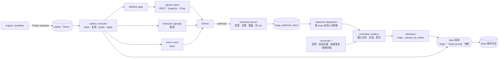
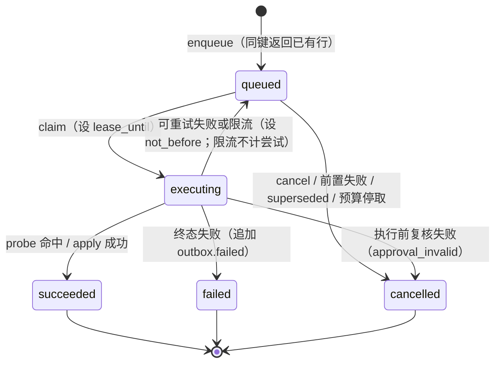

# GitHub 接入（`forge`）

> 状态：设计 v0.1 · 里程碑：M1 起（M0 出契约与 `FakeForge`，M1–M3 逐步交付，见 §1.1）· 泳道：`be-forge`（[milestones.md](../milestones.md)）· crate / 目录：`crates/gantry-forge`

`forge` 是 Gantry 与 GitHub 之间唯一的通道：所有对 GitHub 的写都经它的发件箱（Outbox）执行，所有来自 GitHub 的事实都经它回读、去重、归一化之后才进入事件日志。

> 实现者读法：本规格书只写"这个模块怎么做、怎么验收"，**不重复**契约。动作目录、幂等键算法、崩溃点矩阵、ForgeEvent 目录、权限与限流数值的权威定义都在 [interfaces/forge-actions.md](../interfaces/forge-actions.md)（下文简称 FA），本文用"FA §x"引用；冲突时按 [AGENTS.md](../../AGENTS.md) 的优先级处理，并登记到 §13。标注"需核实"的 GitHub 行为不要当作事实写进代码，先做 spike 核实。

## 1. 职责

**鉴权与令牌**

- 用 App 私钥（经 `secrets` 的 `forge` 使用方视图读取）签 JWT，换取安装令牌（installation token）。按用途分只读令牌与写令牌，均限定到 Project 的那一个仓库，且不含 `workflows` / `administration` 权限；按响应里的 `expires_at` 提前 `token_refresh_margin` 刷新；令牌只存在于进程内存（FA §9.4）。
- 启动时与每次 `installation_changed` 之后做权限自检：出现高危权限则拒绝该 Project 的写路径，缺少权限则关闭对应动作并上报（FA §9.5）。
- 维护仓库设置快照（`Project.default_branch`、`allowed_merge_methods`、`merge_queue_enabled`），变化时追加 `project.updated`；保存 App 机器人账号 ID 到 `Project.bot_user_id`（取得方式待核实，FA OQ-10）。

**Webhook 接收与去重**

- 独立监听只服务 `POST /webhook`：限制体积、校验头、对**原始字节**做 HMAC-SHA256（同时接受当前与上一个 secret）、按 `X-GitHub-Delivery` 落盘去重、**先落盘再回 2xx**，之后异步处理（FA §5）。
- 订阅清单之外的事件与 action 在落盘前丢弃并计数（FA §9.3）。

**归一化（normalization）**

- 把 webhook 当作"提示"：按 `(repo, PR 或 Issue)` 分邮箱（mailbox）串行处理，窗口内合并，**回读** GitHub 当前状态，与本地快照比较，由**状态差异**产生 `ForgeEvent`（FA §5.4、§6）。保证已去重、已对账、单目标有序、陈旧标记（FA §6.1 G1–G5）。
- 维护 `IssueRef` / `PullRequestRef` 快照（含 `head_epoch` 等 forge 内部字段），每次变化追加 `forge.synced`。

**自身事件识别**

- 按 FA §4.4 的归因算法给每个事件标 `origin`（`self` / `self_unattributed` / `external`）与 `caused_by_action`，使 `guardian` 不被自己的动作唤醒，同时 `engine` / `policy` 仍看得到 head 变化（FA §4.5）。

**对账器（reconciler）**

- 周期巡检（周期来自 `guardian.patrol_interval_s`）、启动全量、webhook 投递记录恢复（`GET /app/hook/deliveries` + 重投）、关键点强制对账（`merge_pr` 执行前、审批签名前）；产出合成事件与 `forge.drift_detected`；**以 GitHub 为准**，不自行补做被人删除或改动的对象（I4，FA §7）。

**Outbox 执行与幂等**

- 接收 `engine` / `guardian` 的入队请求（`enqueue` 是幂等的），按幂等键去重；执行器按"claim → 审批复核 → 存在性检查（probe）→ 预写预期效果 → 变更调用 → 同事务记录"协议执行，崩溃重启后重放不重复创建（FA §2.3 崩溃点矩阵）。
- 出站文本净化与标记（marker）、失败分类与重试、`upsert_status_comment` 合并、限流闸与按交付单元的写速率令牌桶（FA §2.4–§2.7、§10）。
- 在**执行点**复核审批：`merge_pr` 的 head 三方一致，`push_branch` 的目标与摘要一致（I3，FA §2.5）。

**镜像仓更新与推送**

- 用令牌拉取更新 `repo` 维护的服务端裸镜像仓（`git fetch`，令牌不落盘）；订阅默认分支的 `push` 产生 `forge.base_advanced`（decisions P-26）。
- 推送 `repo` 在补丁校验后生成的提交（`push_branch`）：默认 `git` 传输，检测到"要求签名提交"时降级 `api` 传输，且推送的必须是 `policy` 校验过的同一个对象（I8，FA §8）。

**对内接口**

- 向 `engine` / `guardian` / `policy` / `api` 提供 `Forge`（入队、取消、强制对账）与 `ForgeReader`（快照读与受限实时读）两个 trait（§6）；`FakeForge` 实现同样的 trait。

### 1.1 里程碑交付

| 里程碑 | 本模块交付 |
| --- | --- |
| M0 | 不写实现代码。依赖 `contract` 泳道产出并以本文 §6 为准核对：`Forge` / `ForgeReader` trait、`FakeForge`（内存仓库 / PR / check，可注入 webhook）、`core` 里的 `ForgeEvent` / `OutboxAction` / 幂等键纯函数、`schemas/forge/*.json`（14 个动作 payload、`forge.event.v1`、drift）、`forge.synced` 的 `data` schema（§13 F-OQ-7）；FA §2.2 的黄金向量作为测试数据 |
| M1 | **主体**：App 鉴权与令牌缓存；权限自检；webhook 接收（两把 secret、去重、先 2xx）；归一化 PR 生命周期（`pr_opened` … `pr_merged`、`base_advanced`）、`check_suite_completed` / `check_run_completed`、`review_submitted` / `review_dismissed`、`issue_closed` / `issue_reopened` / `issue_updated`、`installation_changed`、`repo_changed`；自身事件归因；对账（巡检、启动全量、强制对账、drift）；镜像仓拉取；Outbox 与动作 `push_branch`（`git` 传输）、`create_pr`、`update_pr`、`close_issue`、`merge_pr`（直接合并；启用 merge queue 的仓库先 `validation_failed(merge_queue_unsupported)`，F-OQ-18）；崩溃点矩阵全部通过；出站净化与标记；基础限流（写串行、1 秒间隔、遵守 `retry-after`、惩罚期）；`forge.synced` |
| M2 | 动作 `upsert_status_comment`（含合并 superseded）、`create_comment`、`create_issue`、`update_issue`、`add_labels`、`request_reviewers`、`rerun_failed_jobs`；事件 `review_comment`、`issue_comment`、merge queue 事件与 `merge_pr` 的队列路径；`check_suite_completed.workflow_runs[]` / `failed_check_runs[]` 回读补充；`ForgeReader::ci_log` 等读接口（Actions: read）；**感知限流的 Outbox**（点数桶、内容桶、按交付单元的 `forge_writes_per_hour` 令牌桶、优先级饿死 `low`、低配额时停巡检）；`api` 传输的签名降级（以 M1 的 OQ-3 实测为准） |
| M3 | 动作 `reply_review_thread`、`resolve_review_thread`（GraphQL，FA OQ-9）；`review_thread_changed`；App 私钥 / webhook secret 轮换的热加载（`github.*` 变更后令牌缓存失效，两把 secret 过渡） |
| M4 | 提供 GitHub 原生任务入口所需的原始事件与 `author_association`（Q-04 待决，本模块不解析命令、不做授权）；`pass_unbound` 放行未绑定对象（Q-04 预留） |

## 2. 不负责

| 事项 | 归属 |
| --- | --- |
| 判断某动作"该不该做"、是否需要 Gantry 审批、审批验签与审批状态机 | `policy`（I3）；`forge` 只做机械复核（§7.8），**不解释 `policies.*`** |
| 创建审批、写 `approval.requested` / `granted` / `invalidated` | `policy` / `engine` |
| 补丁的生成、应用、校验与提交的创建 | `repo`（P-25）；`forge` 只推送已校验提交，并核对它与 `patch.validated` 记录一致 |
| 镜像仓的创建、清理、gc、工作树与写权锁 | `repo`；`forge` 只对镜像仓执行 `git fetch` |
| 阶段推进、`merge → review` 重验、预算台账与 `budget.exhausted` | `engine`；`forge` 只发 `forge.*` / `outbox.*` 事实 |
| 分流、自愈、上报、状态清单的内容 | `guardian`；`forge` 只负责把 `upsert_status_comment` 的结构化数据渲染并写出 |
| 解析 `/gantry` 命令、Issue label 入口 | Q-04（M4 待决）；`forge` 只提供原始事件 |
| 客户端 HTTP 路由、事件流 | `api` |
| 通知推送、收件箱投影 | `notify` |
| GitHub PR review 的 `APPROVE`（永不提供） | 无：P-12，`forge` 的 GitHub 客户端层**不得暴露**该调用（FA §3.4） |
| `delete_branch`、`publish_release`、`change_repo_settings` | 第一版不实现（P-27） |
| 沙盒内的任何 GitHub 访问 | 无：I1，沙盒没有 GitHub 网络 |

## 3. 依赖

| 依赖 | 用到什么 | 契约 |
| --- | --- | --- |
| `core` | ID 类型、`ForgeActionKind`、`ForgeEvent` / `Origin`、`OutboxAction`、`UntrustedText`、`PullRequestRef` / `IssueRef`、`EffectiveSettings`；幂等键与 JCS 规范化的纯函数（提议放 `core`，让 `FakeForge` 共用同一实现） | [data-model §1–§3](../data-model.md)、FA §2.2、§6.2 |
| `store` | 追加事件（`forge.*`、`outbox.*`、`project.updated`）、投影读写（快照、Delivery 绑定、Approval、`patch.validated`）、`outbox` 表（入队去重、原子 claim、状态迁移）、跨表事务、事件 `dedup_key` 唯一索引、事件订阅游标 | [architecture §4](../architecture.md#4-模块地图)、data-model [OutboxAction](../data-model.md#outboxaction)、§4.3、§5 |
| `repo` | `MirrorPort`：镜像仓路径、拉取更新的协调、提交对象信息（parent / tree / trailer） | FA §3.3、§8；[worker-protocol §2.4](../interfaces/worker-protocol.md)（工作区从镜像准备） |
| `secrets` | `forge` 使用方视图：App 私钥、webhook secret（当前与上一个） | [config.md §2.4、§10](../interfaces/config.md)；architecture §6 |
| `policy` | `ApprovalPort`：读 Approval 状态、成功后置 `consumed`；读 `patch.validated` 的 `ValidatedPatch.verdict` 与 `result_tree`；密钥扫描器（与 worker-protocol P9 同一个） | FA §2.5；[api.md §6](../interfaces/api.md)；worker-protocol §8.3 |
| 设置（经 `core::EffectiveSettings`，由 `store` 投影提供） | `github.app.*`、`guardian.patrol_interval_s`、`levels.*.budget.forge_writes_per_hour` | config.md §10、§6.2、§4.1 |
| GitHub（外部） | REST、GraphQL、git over HTTPS、webhook、App JWT 端点 | FA §5–§10 |

> 与 [architecture §4](../architecture.md#4-模块地图) 的出入：地图里 `forge` 依赖 `core, store, repo`；依赖图里另有 `secrets → forge`；`forge` 还需要 `policy`（读审批、置 `consumed`、读补丁校验记录）。见 §13 F-OQ-5。

## 4. 输入

| 输入 | 来源 | 格式 / 契约 | 信任级别 |
| --- | --- | --- | --- |
| Webhook 投递 | GitHub（公网直连或只转发 `/webhook` 的隧道，P-13） | `POST /webhook`；头 `X-GitHub-Event`、`X-GitHub-Delivery`、`X-Hub-Signature-256`、`X-GitHub-Hook-Installation-Target-ID`；JSON body ≤ 25 MB（FA §5.1） | HMAC 通过只证明"来自 GitHub"；载荷是**提示**，状态字段不当事实，文本字段是 `UntrustedText`（I5） |
| GitHub API 回读响应 | GitHub（REST / GraphQL） | FA §5.4、§7.2 | 不可信数据（状态字段为权威值，文本字段为 `UntrustedText`） |
| 入队请求 `EnqueueRequest` | `engine` / `guardian`（同进程调用） | FA §2.1 信封 + §3.3 payload | 可信调用方，但文本字段可能带不可信内容 → 出站净化（§7.11） |
| Approval 状态 | `policy`（经 `store` 投影） | data-model §4.4 | 可信 |
| `patch.validated` 记录 | `repo` / `policy`（经 `store`） | worker-protocol §8.3 `ValidatedPatch` | 可信 |
| `budget.exhausted` | `engine`（经 `store`） | data-model §5.2 | 可信 |
| 设置 | `store` 投影 | config.md | 可信（放宽类改动需 approver 签名） |
| 密钥 | `secrets` | — | 机密，不得入日志 / 事件 |
| 镜像仓与提交对象 | `repo` | git 对象 | 提交由 `repo` 在校验后创建；其内容是不可信代码 |
| 定时事件 | 内部 | 巡检、投递恢复、令牌刷新、`self_event_grace` 到期 | 可信 |

## 5. 输出

| 输出 | 去向 | 格式 / 契约 |
| --- | --- | --- |
| `forge.<kind>`（共 23 种 ForgeEvent） | `store` 事件日志 | FA §6.2 信封 + §6.3 目录；`kind` 见 §6 的 `ForgeEventKind` |
| `forge.synced` | `store` | 快照变化；`data` 形状为本文提议（§7.5），待契约 PR（F-OQ-7） |
| `forge.drift_detected` | `store` | FA §7.4 |
| `outbox.enqueued`（入队同事务）、`outbox.executing`、`outbox.succeeded`、`outbox.failed`（仅终态）、`outbox.cancelled` | `store` | data-model §5.2；`outbox.failed.data.code` 取 FA §2.6 |
| `approval.consumed` 通知 | `policy` | `ApprovalPort::consume`（§6） |
| `project.updated` | `store` | 仓库设置快照变化 |
| 快照投影 | `store` | `IssueRef` / `PullRequestRef`（含 `synced_at`） |
| GitHub 写调用 | GitHub | FA §3；git push / git data API |
| 镜像仓对象更新 | `repo` 的镜像仓 | `git fetch` |
| 模块健康 | `status`（config.md §2.8 `modules.forge`） | `ok` / `degraded` / `unhealthy` + `detail` |
| 日志、指标 | 运维 | §11 |

## 6. 对外接口

> Rust 草案：以签名与语义为准，类型细节以 `core` 为准。`FakeForge` 必须实现同样的 trait，并通过同一套一致性测试（§12 D）。

```rust
// crates/gantry-forge/src/lib.rs

/// engine / guardian / policy / api 看到的门面。唯一的 GitHub 写入口是 `enqueue`（I2）。
#[async_trait::async_trait]
pub trait Forge: Send + Sync + 'static {
    /// 幂等入队：键 = FA §2.2；键已存在则返回已有行（created = false），不新建。
    /// 已存在且为 failed / cancelled 的行，调用方要重做必须 epoch + 1。
    /// upsert_status_comment 入队时，同一 (delivery, target, slot) 的旧 queued 行被置
    /// cancelled(superseded)（FA §2.7）。
    async fn enqueue(&self, req: EnqueueRequest) -> Result<EnqueueOutcome, EnqueueError>;

    /// 取消非终态动作。executing 中的动作不可取消（返回 NotCancellable），由执行器自行收尾。
    async fn cancel(&self, id: &ActionId, reason: CancelReason) -> Result<CancelOutcome, ForgeError>;

    async fn action(&self, id: &ActionId) -> Result<Option<OutboxAction>, ForgeError>;

    /// 立即对账一个目标并等待快照更新完成（审批签名前、merge 前；api.md §6.4 第 5 步）。
    /// 同一目标的并发调用合并为一次（single-flight）。
    async fn reconcile_now(&self, target: ReconcileTarget) -> Result<ReconcileReport, ForgeError>;

    fn reader(&self) -> &dyn ForgeReader;
}

pub struct EnqueueRequest {
    pub project_id: ProjectId,
    pub delivery_id: DeliveryId,
    pub kind: ForgeActionKind,                 // 14 个；预留的 3 个返回 UnsupportedKind
    pub payload: serde_json::Value,            // 按 schemas/forge/<kind>.json 校验
    pub requires_approval: Option<ApprovalId>, // 由 engine 向 policy 取判定后填写
    pub depends_on: Vec<ActionId>,
    pub priority: Priority,                    // high | normal | low
    pub not_before: Option<Timestamp>,
    pub epoch: u32,                            // 默认 0
    pub enqueued_by: Enqueuer,                 // { module: "engine" | "guardian", causation_id }
}
pub struct EnqueueOutcome { pub action: OutboxAction, pub created: bool }

pub enum EnqueueError {
    UnsupportedKind(String),                      // delete_branch / publish_release / change_repo_settings
    InvalidPayload { pointer: String, message: String },
    ApprovalRequired { reason: &'static str },    // merge_pr 缺审批；push_branch force / 越界前缀缺审批
    PermissionMissing { kind: ForgeActionKind, permission: &'static str }, // FA §9.5
    ProjectUnknown,
    Internal(anyhow::Error),
}
pub enum CancelOutcome { Cancelled, AlreadyTerminal(OutboxStatus), NotCancellable }

/// 只读接口。FA 未定义读接口（F-OQ-6），下列为本文提议。
#[async_trait::async_trait]
pub trait ForgeReader: Send + Sync {
    // ---- 本地快照（不访问 GitHub）----
    async fn pull_request(&self, p: &ProjectId, number: u64) -> Result<Option<PullRequestRef>, ForgeError>;
    async fn issue(&self, p: &ProjectId, number: u64) -> Result<Option<IssueRef>, ForgeError>;
    async fn project_snapshot(&self, p: &ProjectId) -> Result<ProjectSnapshot, ForgeError>;
    // ---- 直连 GitHub（读令牌、过读闸、带 ETag）。返回的文本一律是 UntrustedText ----
    async fn ci_log(&self, p: &ProjectId, q: CiLogQuery) -> Result<CiLog, ForgeError>;        // Actions: read（M2）
    async fn changed_files(&self, p: &ProjectId, number: u64, head_sha: &GitOid)
        -> Result<Vec<ChangedFile>, ForgeError>;
    async fn review_thread(&self, p: &ProjectId, thread: &ThreadNodeId)
        -> Result<ReviewThreadView, ForgeError>;                                              // M2；含"是否有人类评论"
    async fn check_annotations(&self, p: &ProjectId, check_run_id: u64)
        -> Result<Vec<Annotation>, ForgeError>;
}

pub enum ReconcileTarget { Pr { project: ProjectId, number: u64 }, Issue { project: ProjectId, number: u64 },
                           Delivery(DeliveryId), Project(ProjectId) }
pub struct ReconcileReport { pub emitted: Vec<EventId>, pub drifts: Vec<DriftKind>, pub synced_at: Timestamp }

/// 本模块需要 policy 提供的端口（policy 实现；FakePolicy 实现测试替身）。
#[async_trait::async_trait]
pub trait ApprovalPort: Send + Sync {
    async fn get(&self, id: &ApprovalId) -> Result<Option<Approval>, PortError>;
    /// 幂等：已 consumed 返回 AlreadyConsumed。成功后追加 approval.consumed。
    async fn consume(&self, id: &ApprovalId, by: &ActionId) -> Result<ConsumeOutcome, PortError>;
    async fn validated_patch(&self, sha256: &str) -> Result<Option<ValidatedPatchRecord>, PortError>;
}

/// 本模块需要 repo 提供的端口（F-OQ-4）。
#[async_trait::async_trait]
pub trait MirrorPort: Send + Sync {
    async fn mirror_path(&self, p: &ProjectId) -> Result<PathBuf, PortError>;
    /// 拉取期间 repo 不得 gc / 删除对象；Drop 即释放。
    async fn begin_fetch(&self, p: &ProjectId) -> Result<MirrorFetchGuard, PortError>;
    async fn commit_info(&self, p: &ProjectId, oid: &GitOid) -> Result<Option<CommitInfo>, PortError>; // parent、tree、trailers
}

/// Webhook 入口：只含 POST /webhook。gantryd 把它挂在独立监听（forge.webhook.listen），
/// 与 mTLS API 不共享端口、中间件与鉴权。
pub fn webhook_router(state: WebhookState) -> axum::Router;

/// 装配与生命周期。
pub struct ForgeRuntime;
impl ForgeRuntime {
    pub async fn start(deps: ForgeDeps, boot: ForgeBootstrapConfig) -> Result<ForgeHandle, StartError>;
}
pub struct ForgeHandle { pub forge: Arc<dyn Forge>, pub webhook: axum::Router /* + shutdown() */ }
```

`ForgeEventKind`（FA §6.3 的 23 个 `kind`，snake_case，与事件类型 `forge.<kind>` 一一对应）：`pr_opened`、`pr_reopened`、`pr_synchronized`、`pr_updated`、`pr_closed`、`pr_merged`、`base_advanced`、`pr_enqueued`、`pr_dequeued`、`merge_group_checks_requested`、`merge_group_destroyed`、`check_suite_completed`、`check_run_completed`、`review_submitted`、`review_dismissed`、`review_comment`、`review_thread_changed`、`issue_comment`、`issue_closed`、`issue_reopened`、`issue_updated`、`installation_changed`、`repo_changed`。

`FailureCode`（`outbox.failed.data.code`，FA §2.6）：`rate_limited`、`transient`、`token_expired`、`precondition_failed`（子码 `head_changed` `remote_diverged` `spec_edited_by_human` `existing_pr` `thread_has_new_replies` `run_not_failed` `stale_head`）、`not_mergeable`、`validation_failed`、`permission_denied`、`target_missing`、`approval_invalid`、`signature_required`。

事件由消费方（`engine` / `guardian` / `policy`）经 `store` 订阅 `forge.*` 获得，**不**经本 trait 回调。

## 7. 内部设计

### 7.1 组件与数据流



建议的 crate 内模块：`auth/`（JWT、令牌缓存、权限自检）、`webhook/`（`server`、`inbox`、`dispatcher`、`subscriptions`）、`normalize/`（`mailbox`、`readback`、`diff`、`events`）、`attribution/`、`reconcile/`（`patrol`、`sweep`、`recovery`、`drift`）、`outbox/`（`enqueue`、`executor`、`handlers/<kind>.rs`、`sanitize`、`marker`、`render`）、`ratelimit/`、`transport/`（`git`、`api`）、`mirror/`、`github/`（客户端；**`pub(crate)`**，不对外暴露，机械防线）、`testkit/`（`FakeGitHub`，§12）。

### 7.2 并发模型

- 运行时：tokio 多线程。所有 SQLite 访问经 `store` 的连接池与事务接口。
- **Webhook 入口**：一个 axum 处理器，步骤全是 CPU 轻量 + 一次写盘；处理器内不做任何 GitHub 调用（目标 p99 < 1 s，FA §5.1）。落盘后 `Notify` 唤醒分发器。
- **邮箱（mailbox）**：每个 `(repo, target)` 一个串行任务（`target` = `pr:N` / `issue:N` / `repo`），邮箱之间并行；邮箱数量不设上限，空闲 60 秒回收 [自选]。`check_*` 载荷里的 `pull_requests[]` 可能对应多个 PR，则分发到多个邮箱；为空时按 `head_sha` 反查快照，仍无则丢弃并计数（FA §6.3）。
- **Outbox 执行器**：每个 `installation_id` 一个写任务，**严格串行**（FA §10.2 并发闸：写 1）；读请求（回读、巡检、`ForgeReader`）走独立读闸（并发上限 4 [自选]）。不同安装之间并行。
- **对账器**：巡检调度器单任务；回读经读闸，优先级最低，限流紧张时先停（FA §10.2）。
- **关闭**：停止接收新入队以外的新工作，等待 `executing` 行在租约内收尾；来不及的留在 `executing`，下次启动按租约过期重放（FA §2.3）。

### 7.3 持久化

`outbox` 表由 `store` 定义（字段见 data-model [OutboxAction](../data-model.md#outboxaction)），`forge` 经 `store` 的 Outbox 接口读写。下列为 `forge` 私有表，与事件日志同在一个 SQLite 数据库，**必须能与事件追加放进同一个事务**（`store` 提供事务句柄，F-OQ-3）。迁移文件放 `crates/gantry-forge/migrations/`。

```sql
CREATE TABLE forge_webhook_inbox (
  delivery_id     TEXT PRIMARY KEY,          -- X-GitHub-Delivery（UNIQUE 即第一层去重）
  event           TEXT NOT NULL,             -- X-GitHub-Event
  action          TEXT,
  installation_id INTEGER,
  repo            TEXT,                      -- 载荷里的 owner/repo（仅作路由提示）
  received_at     TEXT NOT NULL,
  body            BLOB,                      -- 原始字节；payload_retention 后置 NULL，保留本行
  status          TEXT NOT NULL,             -- received | processing | parked | done | failed | dropped
  attempts        INTEGER NOT NULL DEFAULT 0,
  retry_at        TEXT,
  last_error      TEXT
);
CREATE TABLE forge_snapshot_ext (            -- 快照里 data-model 没有的 forge 内部字段
  project_id TEXT NOT NULL, kind TEXT NOT NULL /* pr|issue|repo */, number INTEGER NOT NULL,
  head_epoch INTEGER NOT NULL DEFAULT 0, etag TEXT,
  cursors JSON NOT NULL,                     -- 已见的评论 / review / check suite 游标
  thread_states JSON NOT NULL,               -- thread_node_id → {resolved, thread_epoch}
  updated_at TEXT NOT NULL,
  PRIMARY KEY (project_id, kind, number)
);
CREATE TABLE forge_effect_index (            -- 自身事件归因的反查索引（预期效果与 github_ref 同写）
  effect_kind TEXT NOT NULL,                 -- pr_head | pr | branch | comment | thread | issue | marker
  effect_key  TEXT NOT NULL,                 -- 如 "acme/shop-api:gantry/42-x->main"（pr_head）、"acme/shop-api#57"（pr）
  action_id   TEXT NOT NULL, delivery_id TEXT NOT NULL, created_at TEXT NOT NULL,
  PRIMARY KEY (effect_kind, effect_key)
);
CREATE TABLE forge_rate_state (              -- 重启后仍遵守惩罚期，避免"限流期间继续发请求"
  installation_id INTEGER PRIMARY KEY, penalty_until TEXT, headroom REAL NOT NULL, headroom_restore_from TEXT
);
CREATE TABLE forge_delivery_bucket (         -- forge_writes_per_hour 令牌桶
  delivery_id TEXT PRIMARY KEY, tokens REAL NOT NULL, updated_at TEXT NOT NULL
);
CREATE TABLE forge_project_state (
  project_id TEXT PRIMARY KEY, effective_transport TEXT NOT NULL DEFAULT 'git', -- git | api
  permissions_ok INTEGER NOT NULL DEFAULT 0, last_sweep_at TEXT
);
```

- **快照可重建但 `head_epoch` 不可**：`head_epoch` 进入 `pr_sync:{repo}:{n}:{head_epoch}` 这个 `dedup_key`。重建快照（例如从备份恢复后）时，`head_epoch` 必须取事件日志里该 PR 已有的 `forge.pr_synchronized` 的最大值，不得从 0 开始，否则新事件会被唯一索引静默吞掉（F-OQ-9）。
- `dedup_key` 的唯一索引在 `store` 的事件表上（G1 兜底，F-OQ-3）。
- `forge_webhook_inbox.body` 保留 `payload_retention`（7 天），`delivery_id` 保留 `dedupe_retention`（30 天）[自选]，到期只删载荷（FA §5.3）。
- 内存中不持久的只有：令牌、读闸 / 写闸的瞬时计数、邮箱队列（可由 inbox 与快照重建）。

### 7.4 Webhook 接收流水线

按 FA §5.1 的 8 步实现，下表只补实现要点：

| 步 | 实现要点 |
| --- | --- |
| 体积 | 先看 `Content-Length`，再用带上限的流式读取（超 `max_body_bytes` 即 413，不缓冲整包） |
| 头 | 三个必需头缺任一 → 400；`X-GitHub-Hook-Installation-Target-ID` 不等于本 App ID → 丢弃并计数（返回 200，不给探测者信号）|
| HMAC | 对**原始字节**计算 HMAC-SHA256；用常量时间比较（`hmac::Mac::verify_slice`）；先试当前 secret，失败再试上一个；两把都失败 → 401 空 body，不落盘，只计数 + 限频日志。**不要**读 `X-Hub-Signature`（SHA-1）|
| 过滤 | `ping` → 200 不落盘；不在订阅清单的 `(event, action)` → 200 不落盘并计数。订阅清单是**单一常量表**（`subscriptions.rs`），内容以 FA §9.3 为准，有测试逐行对照 |
| 落盘 | `INSERT … ON CONFLICT(delivery_id) DO NOTHING`；`rows_affected = 1` → 202；`= 0` → 200（重复）；写盘失败 → 503（GitHub 不重试，靠对账与投递恢复补）|
| 异步 | 落盘提交后才发响应；随后 `Notify` 唤醒分发器。**绝不**在响应前做回读 |
| 路由提示 | 从载荷取 `installation.id`、`repository.full_name`、目标编号，仅用于选邮箱；`installation.id` 不属于任何 Project 且事件不是 `installation*` → 丢弃并计数 |

分发器启动时扫描 `status ∈ {received, processing}` 与 `retry_at <= now` 的 `parked` / `failed` 行重新入邮箱（崩溃安全）。

### 7.5 归一化与快照差异

每个邮箱循环：取一批（`coalesce_ms` 内同目标的事件）→ 标 `processing` → **回读** → 差异 → 归因 → 一个事务提交 → 标 `done`。

1. **回读**：PR 用一次 GraphQL 取 PR 本体、reviews、review threads、当前 head 的 check 汇总与合并状态（带 `If-None-Match`，304 不更新）；Issue 用 REST；`push` 到默认分支只比较分支 head。具体字段（`mergeStateStatus`、`reviewDecision`、`isRequired`、`closingIssuesReferences`）在 installation token 下是否可用需核实（FA OQ-9）；不可用时的降级：`mergeable_state` 取 REST `mergeable_state` 原值，`required_ok` 在 required 信息缺失时**按全部 check 都必需**计算（保守，F-OQ-16）。
2. **差异 → 事件**：

   | 快照变化 | 产生的 `kind` | `dedup_key`（FA §6.3 模板） |
   | --- | --- | --- |
   | 快照不存在且 PR 存在 | 先 `pr_opened`；若同时已关闭 / 合并，再依次 `pr_closed` / `pr_merged`（保证 `closed` 先于 `opened` 到达时序列仍正确） | 同模板 |
   | `head_sha` 变化 | `pr_synchronized`，`head_epoch += 1`，`previous_head_sha`；A→B→A 每次变化都是新事件 | `pr_sync:{repo}:{n}:{head_epoch}` |
   | `state` open→closed 且未合并 / closed→open | `pr_closed` / `pr_reopened` | `pr_closed:…:{closed_at}` / `pr_reopened:…:{updated_at}` |
   | 合并 | `pr_merged`（`via_merge_queue`、`merge_method` 可空） | `pr_merged:{repo}:{n}:{merge_commit_sha}` |
   | 标题 / 正文 / base / draft / 标签 / reviewer 变化 | `pr_updated`，`changed[]` 列出字段 | `pr_upd:…:{updated_at}` |
   | 默认分支（及活跃 PR 的 base 分支）`push` | `base_advanced`，`affected_prs[]` | `base:{repo}:{ref}:{after}` |
   | 出现新 review / review 被撤销 | `review_submitted`（`state` 大小写归一）/ `review_dismissed` | `review:{repo}:{review_id}` / … |
   | 评论游标之后的新 review 评论 / PR 对话评论 / Issue 评论 | `review_comment` / `issue_comment` | `rcomment:…` / `icomment:…` |
   | 线程 `isResolved` 翻转 | `review_thread_changed`，`thread_epoch += 1` | `rthread:{repo}:{node}:{thread_epoch}` |
   | 当前 head 的 check suite / run 进入 completed | `check_suite_completed` / `check_run_completed`；`is_current_head`、`workflow_runs[]`、`failed_check_runs[]` 由回读补充 | `check_suite:…:{updated_at}` / `check_run:…:{completed_at}` |
   | Issue 关闭 / 重开 / 编辑 | `issue_closed` / `issue_reopened` / `issue_updated` | 同模板 |
   | merge queue 入队 / 出队、`merge_group` | `pr_enqueued` / `pr_dequeued` / `merge_group_*` | 同模板 |
   | 安装、仓库设置 | `installation_changed` / `repo_changed` | 含 `delivery_guid`（系统类事件不经对账合成） |

   同一事实经 webhook 或经对账得到，`dedup_key` 必须相同（G1），所以键只用 GitHub 侧时间戳 / ID（取**回读值**），不用接收时间。
3. **内容字段**：评论正文、check 输出等取载荷；对账合成的事件没有载荷，必须按 ID 另行拉取。所有来自 GitHub 的文本包成 `UntrustedText`（`source` 形如 `github:review_comment.body`），写入事件日志前按 `forge.events.max_text_bytes`（默认 65536 [自选]）截断并置 `truncated`。
4. **陈旧标记**：针对非当前 head 的 check / review 事件 `stale = true`（G4）。
5. **绑定**：`delivery_id` 的解析顺序：① `forge_effect_index`（自己创建的 PR / Issue 评论等，早于 `engine` 的投影）；② `Delivery.pr` / `Delivery.issues` 投影；③ 停放至多 `self_event_grace`，仍未绑定则丢弃并计数（`forge.events.pass_unbound=false`，FA §5.4）。
6. **`forge.synced` 的 `data`（本文提议，F-OQ-7）**：`{target, source: "webhook"|"reconcile", changes: [{field, from, to}], synced_at}`，`field` 取 `IssueRef` / `PullRequestRef` 的字段名（`head_sha`、`state`、`mergeable_state`、`review_state`、`checks`、`draft`、`in_merge_queue` 等）。快照每次变化都发一条，使 `guardian` 能响应"合并状态变脏""review 状态变化"这类没有对应 webhook 事件的事实。
7. **`review_state` 口径**：优先取 GraphQL `reviewDecision`；为空（仓库没有"必需 review"规则时它为空）则由各 reviewer 最新一条非 `COMMENTED`、未被撤销的 review 推出：存在 `CHANGES_REQUESTED` → `changes_requested`；否则存在 `APPROVED` → `approved`；否则 `none`（保守：任何人的 approve 都算，供 `guardian` 的"已审批不得静默推送"使用，F-OQ-16）。

### 7.6 自身事件归因

输入：归一化前的候选事件。实现 FA §4.4 的 5 条规则，查询靠 `forge_effect_index` 与 `Project.bot_user_id`，不扫 Outbox 全表：

```
1. effect_index 命中 (effect_kind, effect_key) 且对应 action 有 github_ref 对象 ID  -> self, caused_by_action
2. effect_index 命中预期效果元组（分支名 / PR 号 / 标记）                           -> self
3. sender.id == bot_user_id 且同目标有 executing 或刚完成的动作                      -> 停放(parked)至多 self_event_grace，到期后回到 1-2
4. sender.id == bot_user_id 仍无记录                                               -> self_unattributed，并追加 forge.drift_detected(orphan_effect)
5. 其余                                                                            -> external
```

- 规则 1–2 **不看** `sender`（队列合并的 `sender` 不可靠，FA OQ-1）；绝不仅凭正文标记判 self（标记只是索引，认定必须叠加作者 `id == bot_user_id` 且标记里的 `act` 在 Outbox 存在、`dlv` 一致，FA §2.4）。
- 停放 = `forge_webhook_inbox.status = parked` + `retry_at`，崩溃安全。
- `rerun_failed_jobs` 引起的新 `check_*` **不算自身事件**（FA §4.6）；CI 结果、其他 bot、人对 Gantry 对象的编辑一律 `external`。
- **每个**自身事件仍照常更新快照并追加 `forge.*`（只是 `origin` 不同）；`policy` 因 `pr_synchronized` 使旧 head 的审批失效，与 `origin` 无关（FA §4.5）。

### 7.7 对账器

```
loop (patrol, 周期 = guardian.patrol_interval_s ±20% 抖动，最小 300 s):
  due = 非终态交付单元（stage ∉ {closed, abandoned}）中到期者，按仓库分批（batch_size = 20）
  对每批：读闸放行（低配额降级：主限流剩余 < min_remaining_ratio 则跳过本轮）
    → 回读（§7.5 同一套 readback + diff）→ source = "reconcile" 的 ForgeEvent + forge.synced
    → drift 检测（下表）→ forge.drift_detected + 合成事件
  记录 last_sweep_at
```

- **触发源**：周期巡检；启动全量（`startup_sweep`）；投递恢复（每 10 分钟：用 App JWT 调 `GET /app/hook/deliveries`，对 `status != OK` 的投递调 `POST /app/hook/deliveries/{id}/attempts`，按 `redeliver_rate` 限速；注意投递记录里的整数 `id` 不同于 `guid`；保留期未知，只是加速，FA OQ-5）；`Forge::reconcile_now`（single-flight）；`merge_pr` 执行前的强制回读。
- **drift 检测实现**（`drift.kind` 与判定见 FA §7.4，下表只给数据来源）：

  | `drift.kind` | 比较什么 |
  | --- | --- |
  | `pr_state_diverged` | 快照 / 期望 open，回读为 closed / merged，且没有对应事件已处理 |
  | `head_diverged` | 回读 head ≠ 最近一次成功 `push_branch` 的 `local_head_oid`，且无 self 归因；同时合成 `pr_synchronized(origin=external)` |
  | `effect_missing` | 最近成功的 `create_pr` / `push_branch` / `upsert_status_comment` 的对象不存在或正文哈希不符 |
  | `orphan_effect` | 分页列评论时发现作者为 bot + 带标记、但 `forge_effect_index` 无对应行 |
  | `issue_state_diverged` / `review_state_diverged` / `merge_state_diverged` | 对应快照字段与回读不一致且无事件 |
  | `default_branch_changed` | `default_branch` 变化 → 更新 `Project` 快照（`project.updated`）并合成 `repo_changed` |
  | `installation_unreachable` | 换不到令牌或仓库不可访问 → 合成 `installation_changed`，停该 Project 的写路径 |

- 差异一律"GitHub 为准"：快照按回读值更新；**不补做**被删除 / 改变的对象，是否重做由 `engine` / `guardian` 入队 `epoch + 1` 的新动作（FA §7.3）。
- 对账的成本粗算与降级见 FA §7.1；GraphQL 点数需核实（FA OQ-9）。

### 7.8 Outbox 执行器

状态机（data-model §4.3，本文取"可重试失败不发 `outbox.failed`"，F-OQ-15）：



**执行循环**（每个安装一个写任务）：

1. `claim`：原子 `UPDATE … WHERE status='queued'`，取 `(priority, enqueued_at)` 最靠前、`not_before <= now`、`depends_on` 全部 `succeeded` 的一行；该行的 delivery 已 `budget.exhausted` → 跳过（保持 `queued`，不取，FA §2.7）。任一前置终态失败 → 本行 `cancelled`。设 `lease_until = now + lease`，执行中每 `lease/4` 续租。
2. **前置检查**（任一失败不发网络请求）：权限仍满足（FA §9.5）；审批复核（FA §2.5 的 4 项，下表）；出站净化与密钥扫描（§7.11）；按交付单元的令牌桶与安装闸放行（§7.9，不放行则放回 `queued` 并设 `not_before`）。
3. **probe**（存在性检查，每个 `kind` 的规则见 FA §3.2）：命中 → 补记 `github_ref`，直接 `succeeded`；`Conflict` → 终态 `precondition_failed(子码)`；未命中 → 继续。
4. **预写预期效果**：把 `expected_effects` 写入动作行并同事务写 `forge_effect_index`（write-ahead，早于变更调用）。
5. **apply**：变更调用，多步动作逐步各自 probe。
6. **记录**（同一事务）：`github_ref` + `status=succeeded` + `forge_effect_index` 补对象 ID + 追加 `outbox.succeeded`。事务提交**之后**才调用 `ApprovalPort::consume`（幂等）；启动时扫描"已 `succeeded`、带 `requires_approval`、审批仍是 `granted`"的动作补做 `consume`（崩溃在两者之间的窗口）。
7. 错误按 FA §2.6 分类；`transient` **先 probe 再重试**（超时意味着"结果未知"）；`token_expired` 换令牌立即重试一次；限流等待不消耗尝试次数（有 `rate_limit_max_waits` 上限）；终态失败追加 `outbox.failed` 且**不自行补救**。

**执行点审批复核**（FA §2.5，`requires_approval` 非空时每次尝试前做；`forge` 不验签）：

| # | 复核项 | 不通过 |
| --- | --- | --- |
| 1 | Approval 存在、`status = granted`、未过期 | `approval_invalid`，动作 `cancelled` |
| 2 | `approval.action` 与动作 `kind` 匹配，`target` 与 payload 一致 | 同上 |
| 3 | `merge_pr`：`approval.subject_digest == payload.expected_head_sha == GitHub 实时 head`（执行前 `GET` PR） | `precondition_failed(head_changed)` |
| 4 | `push_branch`：`target.branch == payload.branch`；`force=true` 时摘要与 `expected_remote_oid` 相符；命中需审批路径时 `subject_digest == payload.validation_ref` | `approval_invalid` |

**I8 机械复核**（`push_branch` 执行点，**不论是否带审批**）：`MirrorPort::commit_info(local_head_oid)` 的 tree 等于 `payload.expected_tree_oid`，且等于 `patch.validated`（`validation_ref`）记录的 `result_tree`；该记录的 `verdict` 为 `allow`，或为 `needs_approval` 且带匹配的 `granted` 审批；非强推时 parent 等于 `expected_remote_oid`。不符 → `precondition_failed`（不推送）。这使 `forge` 不必解释 `policies.*` 也能保证"推送的就是被校验过的那个对象"。

**入队时的机械校验**（`enqueue`）：payload schema；`merge_pr` 必带 `requires_approval`；`push_branch` 的 `force=true` 或分支不以 `forge.push.branch_prefix` 开头必带 `requires_approval`；`add_labels` / `create_issue` 的标签前缀（`forge.labels.allowed_prefix`）；预留动作 → `UnsupportedKind`；动作所需权限缺失 → `PermissionMissing`。

**`upsert_status_comment` 渲染**：`forge` 把 `items[]` 渲染成 Markdown 勾选清单（`passed` → `- [x]`；其余状态 → `- [ ]` 加文字后缀"（进行中）""（失败）""（受阻）""（跳过）"，颜色 / 图标不得是唯一信息），标题取 `title`，末行追加 marker（`slot`）。渲染是纯函数，有黄金文件测试；`render_digest` = 渲染后正文（不含 marker）的哈希。

**各 `kind` 的实现要点**（草案调用，**实现前对照官方文档核实**；幂等键、probe 规则、重试特例以 FA §3.2 为准）：

| `kind` | 主要调用（草案） | 额外机械校验 |
| --- | --- | --- |
| `push_branch` | `git push`（默认）/ git data API（降级，§7.10） | 分支前缀；I8 机械复核；`expected_remote_oid` |
| `create_pr` | `POST /repos/{o}/{r}/pulls` | `expected_head_oid` 等于远端分支 head；`closes` 仅在 `base == default_branch` 时写 `Closes #N`；刚推送的分支 422 短重试 |
| `update_pr` | `PATCH /repos/{o}/{r}/pulls/{n}` | 逐字段比较（忽略标记） |
| `upsert_status_comment` | `POST` / `PATCH /repos/{o}/{r}/issues/{n}/comments[/{id}]` | 三步找评论（投影 `comment_id` → 分页列 → 创建）；正文哈希相同则空操作 |
| `create_comment` | `POST …/issues/{n}/comments` | 按 marker 的 `act` 探测 |
| `reply_review_thread` | REST 评论回复端点（需核实）或 GraphQL | 线程已删 → `target_missing` |
| `resolve_review_thread` | GraphQL `resolveReviewThread`（需核实，FA OQ-9） | `expected_comment_count` 相符；含人类评论的线程由 `policy` 以 `resolve_review_thread_human` 管 |
| `create_issue` | `POST …/issues` | 不用 Search API；按 marker 探测 |
| `update_issue` | `PATCH …/issues/{n}` | 只替换 `<!-- gantry:spec:begin -->` 与 `<!-- gantry:spec:end -->` 之间的块；块哈希不符 → `spec_edited_by_human` |
| `close_issue` | `PATCH …/issues/{n}`（`state=closed`、`state_reason`） | `require_merged_pr` 指定的 PR 必须已合并 |
| `add_labels` | `POST …/issues/{n}/labels` | 只补缺的；标签前缀 |
| `request_reviewers` | `POST …/pulls/{n}/requested_reviewers` | 已在列表则跳过 |
| `merge_pr` | 优先 merge-async（需核实，FA OQ-1）；无队列回退 `PUT …/pulls/{n}/merge`（带 `sha`）；队列入队回退 GraphQL `enqueuePullRequest` | 审批复核三方一致；`merge_method` 被仓库允许；**绝不**传 `bypass_rules`；超时是未知结局，必须先重读 PR |
| `rerun_failed_jobs` | `POST /repos/{o}/{r}/actions/runs/{run_id}/rerun-failed-jobs` | `expected_run_attempt`、`head_sha`；`forge.rerun.max_per_run` |

### 7.9 限流闸

按 `installation_id` 一组，所有出站调用过闸（FA §10.2）：

```rust
struct InstallationGate {
    write: Semaphore,            // 1
    read: Semaphore,             // 4
    last_write_at: Instant,      // 相邻变更请求 >= 1 s
    points: TokenBucket,         // 900/min × headroom；REST 读 1、写 5；GraphQL 查询 1、mutation 5
    content_min: TokenBucket,    // 80/min × headroom；C 类调用各扣 1
    content_hour: TokenBucket,   // 500/h × headroom
    primary: HashMap<Resource, (remaining, reset_at)>, // 读 x-ratelimit-* 头，按 x-ratelimit-resource 分别记
    penalty_until: Option<Instant>, // 持久化到 forge_rate_state；期间零请求
    headroom: f32,               // 默认 0.5；惩罚期后减半，10 分钟线性恢复
}
```

- 响应处理按 FA §10.3：`retry-after` → 惩罚期 + 放回 `queued` 并设 `not_before`（不计尝试）；`x-ratelimit-remaining: 0` → 暂停到 `x-ratelimit-reset`；两者皆无但消息表明二级限流 → 至少等 60 秒再指数退避；连续超过 `rate_limit_max_waits` → `failed(rate_limited)`；403 无任何限流特征 → `permission_denied`；`304` 不扣主限流但仍占并发闸。
- **按交付单元的写速率**：令牌桶容量与每小时补充量都等于 `levels.*.budget.forge_writes_per_hour`（读当前 `EffectiveSettings`），按 Outbox 动作数扣减；桶空则放回 `queued` 并设 `not_before`——**延迟而不是失败**，不进台账（decisions P-22）。
- **优先级**：`high`（`merge_pr`、`push_branch`、`create_pr`）> `normal` > `low`（状态评论、标签、`resolve_review_thread`）；巡检读取最低。
- 读侧：GET 一律带 `If-None-Match`；分页只用 `Link` 头给出的 URL；不用 Search API 与事件 API 轮询（FA §10.4）。

### 7.10 推送与镜像仓

**`git` 传输**（默认，`forge.push.transport = git`）：

```
env: GIT_TERMINAL_PROMPT=0  GIT_CONFIG_NOSYSTEM=1  HOME=<空临时目录>  GIT_ASKPASS=<helper>  GANTRY_PUSH_TOKEN=<令牌>
git -C <mirror> -c core.hooksPath=/dev/null push --porcelain [--force-with-lease=refs/heads/<b>:<expected>]
    https://github.com/<owner>/<repo>.git  <local_head_oid>:refs/heads/<branch>
```

- 令牌只经环境变量与 askpass 注入，**不进** remote URL、`.git/config`、日志、命令行参数（I1）；askpass 辅助程序只回显该环境变量（用户名 `x-access-token`，需核实）。`forge` 与沙盒使用不同系统用户，进程环境对沙盒不可见。
- 推送前机械检查：分支前缀；diff 是否触及 `.github/workflows/**`（见下"Workflows 权限"）；`expected_remote_oid`；`--force-with-lease` 仅在 `force=true` 且审批通过时使用。
- probe：先读远端 ref（`git ls-remote` 或 `GET /git/ref/heads/{branch}`）：等于 `local_head_oid` → 已完成；等于 `expected_remote_oid`（或不存在且期望 `null`）→ 推送；否则 `remote_diverged`。推送后再读一次核对。
- 被"要求签名提交"规则拒绝 → `signature_required` → 把 `forge_project_state.effective_transport` 置为 `api` 并**重试一次**（FA §8）。检测：`GET /repos/{o}/{r}/rules/branches/{branch}`（所需权限需核实）+ 被拒信号。

**`api` 传输**（降级）：按序对补丁里的每个提交创建 blob → tree → commit（**不带**自定义 author / committer / signature，否则失去 bot 签名；归属放 trailer：保留 `Gantry-Attempt`，追加 `Gantry-Action`、`Gantry-Delivery`）→ 最后**一次**更新 ref（`force=false`）；创建后核对 `commit.tree.sha == expected_tree_oid` 且 `verification.verified == true`，否则报错而不是静默继续。重放靠 `Gantry-Action` trailer 判断是否已完成。是否 `verified`、大小与文件模式限制需核实（FA OQ-3，M1 用真实测试仓库做一次 spike）。

**Workflows 权限**：App 不申请 `Workflows`（FA §9.2）。GitHub 会拒绝没有该权限的 App 令牌创建 / 更新 `.github/workflows/**` 的推送（需核实原文），因此"经 M2 审批后推送 workflow 改动"在当前权限设计下**无法成功**，推送会以 `permission_denied` 失败。这与 milestones M2 退出标准冲突，见 §13 F-OQ-1，**需用户决定后才能实现该路径**。

**镜像仓拉取**（`mirror::sync`）：`MirrorPort::begin_fetch` 取得保护后，对镜像仓执行 `git fetch`（同样的环境变量注入，`core.hooksPath=/dev/null`），触发点：启动；`base_advanced`；`pr_opened` / `pr_synchronized`（含自己的推送，使 `repo` 能为 review / heal 准备候选 head）；`repo` 经 `Forge` 的显式请求（草案：`ForgeReader` 之外的 `request_mirror_sync`，F-OQ-4）。refspec 命名空间（`refs/heads/*` 还是 `refs/remotes/origin/*`、是否拉 `refs/pull/N/head`）由 `repo` 规格书定，本模块只执行（F-OQ-4）。拉取失败退避重试，**不阻塞** webhook 处理。

### 7.11 出站文本净化与标记

对 payload 里所有会变成 GitHub 文本的字段（标题、正文、评论、线程回复、`merge_pr` 的 `commit_title` / `commit_message`、`update_issue` 的规格块）按顺序执行（FA §2.4 表格，细则不重复）：去 HTML 标签与注释（含伪造的 `<!-- gantry:… -->`）→ `@user` / `@org/team` 包反引号 → 跨仓库引用中和 → 行首 `/word` 命令串加零宽字符转义 → 关闭关键字只允许引用本交付单元已绑定的 Issue 且只出现在 `forge` 自己生成的位置 → 密钥扫描（命中 → `validation_failed(secret_detected)`，不写出、不重试）→ 按对象类型截断 → **最后**追加 `forge` 自己的 marker：`<!-- gantry:v1 act=act_… dlv=dlv_… kind=… [slot=…] -->`。调用方提供的文本里的 marker 一律剥离重写。`push_branch` 的提交说明由 `repo` 生成，对象不可变，`forge` 不改写。

`parse_marker` 只产出"候选"；认定自己的对象必须同时满足作者 `id == bot_user_id` 且 `act` 在 Outbox 存在、`dlv` 一致（I5）。

### 7.12 令牌与权限自检

```rust
pub trait TokenProvider {
    async fn token(&self, project: &ProjectId, purpose: TokenPurpose) -> Result<Token, AuthError>; // Read | Write
    fn invalidate(&self, installation: InstallationId);
}
```

- JWT：RS256，`exp` 取 `jwt_ttl`（默认 9 分钟，须小于官方上限，需核实）；`iat` 回拨一小段容忍时钟偏差（需核实官方建议）。
- 安装令牌：`POST /app/installations/{id}/access_tokens`，用 `repositories` 收窄到 Project 仓库、用 `permissions` 收窄用途（是否按预期工作需核实，FA OQ-13）；`expires_at` 取自响应，提前 `token_refresh_margin` 刷新；刷新 single-flight；`401` → `invalidate` 后重试一次。
- 令牌（`secrecy::SecretString`）不实现 `Debug`/`Serialize`，日志与事件里永不出现；`Drop` 时清零。
- 自检：`GET /app/installations/{id}` 对比实际获批权限（需核实返回结构）与 FA §9.1 / §9.2：出现高危权限且 `forge.permissions.deny_extra_high_risk=true` → 该 Project 写路径置为拒绝并上报；缺少某动作所需权限 → 该动作入队时 `PermissionMissing`，`installation.new_permissions_accepted` 到来后自动恢复。

### 7.13 启动顺序

1. 经 `secrets` 取私钥与 webhook secret（缺失 → 不崩溃，`forge` 置 `unhealthy`，写路径与 webhook 验签关闭，config.md §2.4）；读 `EffectiveSettings`。
2. 换令牌，权限自检，读取 / 校验 `Project.bot_user_id` 与仓库设置快照。
3. 重放：`lease_until` 已过期的 `executing` 行（FA §2.3）；`status ∈ {received, processing, parked}` 的 inbox 行；"已 `succeeded` 未 `consume`"的审批。
4. 启动 webhook 监听（落盘先行，处理在重放之后）；启动 Outbox 执行器。
5. 启动全量对账（`startup_sweep`），随后进入巡检与投递恢复。

## 8. 不变式与安全要求

| 不变式 | 本模块如何保证 |
| --- | --- |
| I1 沙盒只计算 | 令牌只在 `forge` 进程内存；git 推送与 API 调用都在 `forge` 进程内；令牌经 env/askpass，不写 URL、config、日志、命令行；沙盒没有 GitHub 网络，也没有任何 `forge` 端点 |
| I2 GitHub 写入唯一路径 | `github::client` 是 `pub(crate)`；对外只有 `Forge::enqueue`；所有写带幂等键，先查后做；`ForgeReader` 的实时读只用读令牌；客户端层**不暴露** `approve` 类调用（机械防线，测试用静态检查断言） |
| I3 放行唯一决策点 | `forge` 不判断"该不该做"，也不解释 `policies.*`；执行点复核审批状态与 head 三方一致；成功后才 `consume`；`pr_synchronized` 无论 `origin` 都照常发出，使 `policy` 失效旧审批 |
| I4 状态各有事实源 | 事件来自"回读后的状态差异"，webhook 只是提示；对账器补漏并记 drift；冲突时 GitHub 为准；不自行补做被人删除的对象 |
| I5 外部文本不可信 | 所有来自 GitHub 的文本是 `UntrustedText` 并截断；标记只是索引，认定自身对象须叠加作者校验；出站文本二道净化（`@` 提及、跨仓引用、命令串、关闭关键字、HTML）与密钥扫描 |
| I6 客户端不持凭据 | 没有任何返回令牌、私钥、webhook secret 的接口 |
| I7 配置与工作分离 | `forge.*` 内部参数不进设置页（引导配置或编译默认值）；本模块只**读取** `github.*`、`guardian.patrol_interval_s`、`levels.*.budget.forge_writes_per_hour` |
| I8 执行产物先验后推 | 推送前机械复核 `local_head_oid` 的 tree 与 `patch.validated` 记录一致；不在沙盒产出的 `.git` 上运行 git；镜像仓上的 git 命令禁用 hooks、不读系统配置 |

补充要求：

- Webhook 入口与 mTLS API 不共享端口、中间件、鉴权；API 监听器对 `/webhook` 返回 404（api.md §1.1）。
- HMAC 比较用常量时间；先试当前 secret、再试上一个，任一通过即可；失败响应不带任何细节。
- 内部参数缺省值 fail-closed：例如 required 信息缺失按全部必需、权限不明按缺失处理。
- 任何日志、事件、指标标签不含令牌、secret、完整 webhook body；`last_error` 脱敏后存入。

## 9. 错误与恢复

| 失败 | 处理 |
| --- | --- |
| Webhook 验签失败 / 缺头 / 超大 | 401（空 body）/ 400 / 413，不落盘，计数 + 限频日志 |
| 落盘失败 | 503；GitHub 不重试，靠对账（L1）与投递恢复（L2）补；`forge` 置 `degraded` |
| 回读失败、限流、内部错误 | inbox 行 `failed` + 退避重试；超过上限转由对账器兜底并追加 `forge.drift_detected` |
| 乱序 / 重复 / 严重延迟 | 只信回读值；`dedup_key` 与快照差异挡重复；旧 head 事件标 `stale` |
| 事件指向尚未绑定的对象 | 停放至多 `self_event_grace`，再绑定；仍无则丢弃并计数 |
| 写请求 5xx / 超时 / 连接重置 | `transient`：**先 probe 再重试**（退避 `min(300s, 2s×2^(n-1))` 加全抖动，最多 `max_attempts`） |
| `401` | `token_expired`：换令牌立即重试一次 |
| 二级限流 | 安装进入惩罚期（持久化），期间零请求；动作放回 `queued`，不计尝试 |
| 主限流耗尽 | 暂停到 `x-ratelimit-reset`；只放行高优先级 |
| `403`（无限流特征） | `permission_denied`，不重试；`engine` 应上报"App 缺权限" |
| `404` | `target_missing`；刚推送的分支 `create_pr` 422 短重试 3 次 × 2 s [自选] |
| `409` / 期望值不符 | `precondition_failed`（子码），不重试 |
| `405` | `not_mergeable`；`mergeable` 仍在计算时短重试最多 3 次 × 2 s [自选] |
| `422` | `validation_failed`（且 probe 证明对象不存在） |
| 推送被签名规则拒绝 | 降级 `api` 传输，重试一次；仍失败 → `signature_required` 终态 |
| 进程崩溃 | FA §2.3 矩阵：`executing` 行租约过期后重放，probe 命中则补记，不重复创建；inbox 行重放；未 `consume` 的审批补 `consume` |
| 审批在执行前失效 | `approval_invalid`，动作 `cancelled` |
| 安装被挂起 / 删除 / 仓库不可访问 | `installation_unreachable` drift + `installation_changed`；停该 Project 写路径，`unhealthy` |
| 出现高危权限 / 缺权限 | 拒绝写路径并上报 / 关闭对应动作并上报，`installation.new_permissions_accepted` 后自动恢复 |
| App 私钥或 webhook secret 缺失 | 不崩溃，`unhealthy`，写路径与验签关闭（config.md §2.4）|
| 镜像仓 `git fetch` 失败 | 退避重试；不阻塞事件处理；`repo` 取不到候选 head 时由其自行报错 |
| 备份恢复后 `head_epoch` 回退 | 重建快照时取事件日志最大值（§7.3） |
| 默认分支改名 | `default_branch_changed` drift → 更新快照与 `project.updated`；`closes` 判断改用新值 |
| 磁盘满 / SQLite 写失败 | 入口返回 503，执行器暂停领取，`unhealthy`；已 `executing` 的行靠租约重放 |

## 10. 配置

`forge.*` 是引导配置或内部常量，**不是设置**（I7）；权威表见 FA §11 B / C，下表为实现用的汇总（默认值均为 FA 的 [自选]，除非标明）。

| 配置项 | 默认 | 说明 |
| --- | --- | --- |
| `forge.webhook.listen` | `127.0.0.1:8787` | 独立监听，路径固定 `/webhook`（引导配置，重启生效，`deploy` 拥有） |
| `forge.webhook.max_body_bytes` | `26214400` | 官方载荷上限 25 MB（官方） |
| `forge.webhook.ip_allowlist` | `false` | `GET /meta` 的出口 IP，隧道场景不可用 |
| `forge.webhook.dedupe_retention` / `payload_retention` | `30d` / `7d` | 到期只删载荷 |
| `forge.webhook.coalesce_ms` | `1000` | 邮箱窗口 |
| `forge.webhook.recovery_interval` / `redeliver_rate` | `10m` / `10/min` | 投递恢复 |
| `forge.self_event_grace` | `30s` | 归因停放上限 |
| `forge.reconcile.startup_sweep` / `batch_size` / `min_remaining_ratio` | `true` / `20` / `0.1` | 对账 |
| `forge.outbox.max_attempts` / `backoff_base` / `backoff_cap` / `lease` | `5` / `2s` / `300s` / `120s` | 重试与租约 |
| `forge.push.branch_prefix` | `gantry/` | 越界需审批 |
| `forge.push.transport` / `signed_fallback` | `git` / `api` | FA §8 |
| `forge.merge.method` | 未设置时取 `Project.allowed_merge_methods` 中优先 `squash` > `merge` > `rebase` | [提议]，FA OQ-14 / config OQ-26 |
| `forge.rerun.max_per_run` | `2` | `rerun_failed_jobs` |
| `forge.labels.allowed_prefix` | `gantry/` | 标签前缀 |
| `forge.ratelimit.headroom` / `rate_limit_max_waits` | `0.5` / `6` | FA §10 |
| `forge.auth.token_refresh_margin` / `jwt_ttl` | `5m` / `9m` | FA §9.4 |
| `forge.permissions.deny_extra_high_risk` | `true` | FA §9.5 |
| `forge.events.pass_unbound` | `false` | Q-04 预留 |
| `forge.events.max_text_bytes` | `65536` | 本文新增：事件日志里单个文本字段的截断上限 [自选] |
| `forge.http.timeout` / `forge.git.timeout` | `30s` / `300s` | 本文新增：REST / 子进程超时 [自选]，租约执行中续期 |

读取的设置（热加载，config.md §2.6）：`github.app.app_id` / `private_key` / `webhook_secret` / `webhook_secret_previous`（变更后令牌缓存失效、两把 secret 过渡）、`guardian.patrol_interval_s`（下个周期生效）、`levels.*.budget.forge_writes_per_hour`（令牌桶每次补充时读当前值：它不进台账，config §2.6 的"创建时固化"是否覆盖它见 F-OQ-11）。

## 11. 可观测性

- **事件**（data-model §5.2）：`forge.<kind>`（23 种）、`forge.synced`、`forge.drift_detected`、`outbox.enqueued` / `executing` / `succeeded` / `failed` / `cancelled`、`project.updated`；`approval.consumed` 由 `policy` 追加。`actor.kind = "forge"`。
- **日志**（结构化，字段：`project_id`、`delivery_id`、`action_id`、`kind`、`github_delivery`、`attempt`、`rule`）：webhook 拒绝（限频）、每次 `claim` / `probe` / `apply` 的结论、限流事件（带 `retry-after`、`x-ratelimit-resource`）、归因规则编号、停放与到期、drift。**永不**记录令牌、secret、完整 body、未净化的出站文本。
- **指标**（草案）：`forge_webhook_received_total{event,result}`、`forge_webhook_ack_seconds`（直方图）、`forge_inbox_depth{status}`、`forge_outbox_depth{status,priority}`、`forge_outbox_exec_total{kind,result}`、`forge_github_requests_total{resource,status}`、`forge_ratelimit_remaining{resource}`、`forge_penalty_active`、`forge_reconcile_runs_total{trigger}`、`forge_drift_total{kind}`、`forge_event_emitted_total{kind,origin}`、`forge_self_attribution_total{rule}`、`forge_token_refresh_total`、`forge_mirror_fetch_seconds`。
- **健康**：`modules.forge.health`：`ok`；`degraded`（惩罚期、落盘失败、权限缺失、某 Project 不可达）；`unhealthy`（密钥缺失、全部写路径关闭）；`detail` 写原因码，不含敏感内容。

## 12. 测试与验收

**替身**：`FakeGitHub`（本模块自建的 HTTP 级替身，见下）、`FakeRepo`（M0，镜像仓与提交）、`FakePolicy`（Approval 行与 `patch.validated` 记录）、`FakeSecrets`、`TestClock`（可拨快的时钟）、`MemStore`（`store` 的内存实现，F-OQ-14）、故障注入点（`fail` crate 或等价物）。`FakeForge`（M0）不用于测试本模块，而是**被**本模块的一致性测试约束（D 组）。

**`FakeGitHub`**：进程内 axum 服务，实现被测路径所需的 REST / GraphQL / git-http 子集，状态在内存里（仓库、分支、PR、评论、review、check、Issue、合并队列）；可注入：投递 webhook（自动签名，可重复、乱序、丢弃）、响应丢失（变更成功但连接断开）、`403 + retry-after`、`401`、`5xx`、延迟、"要求签名提交"规则、权限集合。milestones 的 M0 替身清单里没有它（F-OQ-14），由本模块在 M1 交付。

### A. M1 退出标准（本泳道可独立验证的部分）

- [ ] **重复投递**：同一 `X-GitHub-Delivery` 投递两次 → `forge_webhook_inbox` 一行、只产生一组 `ForgeEvent`，`FakeGitHub` 上只有一个 PR（首次 202，二次 200）。M1 没有评论类动作，"不产生重复评论"由 B 组第 1–2 条在 M2 用 `upsert_status_comment` 复验。
- [ ] **同一事实不同 GUID**：`push` 与 `pull_request.synchronize` 各一条投递 → 只有一个 `pr_synchronized`（快照差异 + `dedup_key`）。
- [ ] **创建 PR 后写库前崩溃**：在"变更调用成功、记录之前"注入崩溃 → 重启后 probe 命中（按 marker 与作者），补记 `github_ref`，动作 `succeeded`，`FakeGitHub` 上 PR 数仍为 1。
- [ ] **崩溃矩阵**：对 `push_branch`、`create_pr`、`close_issue`、`merge_pr` 在 FA §2.3 的每个崩溃点（claim 前、claim 后变更前、变更后记录前、记录后、多步中间）注入崩溃，重放结果一致。
- [ ] 两次入队同键动作 → 只有一行（`created=false`）；`epoch+1` → 新行；已 `failed` / `cancelled` 的同键行不被复活。
- [ ] 黄金向量：FA §2.1 的 `create_pr` 信封，`intent_digest = d94ed68ae5111e1a996d038b3283e0b787bac2d1363dba2090df25b5754968fb`，`idempotency_key = gk1_anbfwcip7r36is6wsqcuxxfd34`（已用 JCS + SHA-256 + base32 复核）。
- [ ] 签名错误、缺头、超大 body 的请求分别返回 401 / 400 / 413，均不落盘；当前 / 上一个 secret 都能通过；两者皆错 → 401。
- [ ] 乱序：`closed` 先于 `opened`；旧 head 的 `check_suite` 晚到 → 事件序列正确（`pr_opened`、`pr_closed`），旧 head 的事件 `stale=true`。
- [ ] 丢弃一个 `pull_request.closed` 投递 → 巡检补发 `pr_merged(source=reconcile)` 并追加 `forge.synced`；`dedup_key` 与 webhook 路径一致（再投递原 webhook 不产生第二个事件）。
- [ ] 人在 GitHub 上推了一个提交 → `forge.drift_detected(head_diverged)` + `pr_synchronized(origin=external)`。
- [ ] 默认分支 `push` → `base_advanced`（含 `affected_prs`）；`gantry/` 分支的 `push` 在落盘前被丢弃。
- [ ] `merge_pr`：审批 `subject_digest`、`payload.expected_head_sha`、GitHub 实时 head 任一不一致 → `precondition_failed(head_changed)`，**不发出变更请求**；审批已失效 → `approval_invalid` 且动作 `cancelled`；成功后才 `consume`，崩溃在两者之间 → 启动补 `consume`。
- [ ] `push_branch` I8 机械复核：`local_head_oid` 的 tree 与 `patch.validated.result_tree` 不一致 → 不推送；`force=true` 或非 `gantry/` 前缀缺审批 → 入队被拒（`ApprovalRequired`）。
- [ ] webhook 先于 `github_ref` 记录到达 → 停放后正确归因为 `self`，不误判 `external`；`github_ref` 丢失但 `sender == bot` → `self_unattributed` + `orphan_effect`。
- [ ] 注入二级限流 `403 + retry-after` → 该安装零请求直到到期，动作回 `queued` 且尝试次数不增；重启后仍在惩罚期内（持久化）。
- [ ] 安装出现 `workflows` 权限 → 启动自检拒绝该 Project 写路径并上报；缺权限的动作入队即 `PermissionMissing`。
- [ ] 令牌不出现在：日志、事件、`last_error`、子进程命令行（用测试断言扫描）。

### B. M2 / M3 退出标准（本泳道的部分）

- [ ] （M2）同一 `upsert_status_comment` slot 连续入队 3 次 → 前两次 `cancelled(superseded)`，`FakeGitHub` 上只有 1 条评论；评论被人删后再入队 → 重新创建并记 `effect_missing`；人编辑了评论 → 下次 upsert 覆盖并保持单条。
- [ ] （M2）同一状态评论的 webhook（`issue_comment.created/edited`）投递两次、且为自己的动作 → `origin=self`，无重复评论；`guardian` 侧不触发分流（见 guardian 规格书）。
- [ ] （M2）`forge_writes_per_hour` 超限 → 动作保持 `queued` 并延后，不进入 `failed`；`budget.exhausted` 后该交付单元的 `queued` 写动作不再被领取。
- [ ] （M2）出站净化：含 `@user`、`owner/repo#N`、行首 `/gantry`、`Fixes #999`（未绑定）、伪造 `<!-- gantry:… -->` 的正文，写出时全部被中和 / 剥离；含密钥的正文 → `validation_failed(secret_detected)` 且 `FakeGitHub` 无写入。
- [ ] （M2）要求签名的仓库：`git` 传输被拒 → 自动降级 `api` 并重试一次，`verified == true` 且 tree 一致（以 M1 spike 结论为准）。
- [ ] （M2）`ForgeReader::ci_log` 返回 `UntrustedText`，受 `max_bytes` 限制并标 `truncated`；重定向后的下载请求**不携带** Authorization（需核实）。
- [ ] （M2）低配额（主限流剩余 < 10%）时巡检暂停、高优先级动作仍放行。
- [ ] （M3）`reply_review_thread` + `resolve_review_thread`：`resolve` `depends_on` `reply`；线程评论数变化 → `precondition_failed(thread_has_new_replies)`；线程含人类评论且策略为 `deny` 时不执行。
- [ ] （M3）轮换 webhook secret：窗口内新旧 secret 的投递都通过；窗口后旧 secret 的投递 401。

### C. 补充

- [ ] FA §3.3 的 14 个 payload 示例与 `forge.event.v1` 示例都通过 `schemas/forge/*.json` 校验（`contract` 泳道产出后接入）。
- [ ] 订阅清单常量表与 FA §9.3 逐行一致（解析文档表格或生成式对照）。
- [ ] 静态检查：`github::client` 无 `approve` / `APPROVE` 相关调用；`pub` 面不泄露客户端类型。
- [ ] 快照重建后 `head_epoch` 取日志最大值，新的 `pr_synchronized` 不被唯一索引吞掉。
- [ ] 渲染黄金文件：`upsert_status_comment` 的渲染输出与 marker 位置稳定。
- [ ] 属性测试：任意顺序、任意重复的 webhook 序列（含丢失）最终收敛到同一快照与同一组 `dedup_key`。

### D. 一致性测试（`FakeForge` 与真实 `Forge` 共用）

- [ ] 同一套 `Forge` trait 一致性用例（幂等入队、`epoch`、`cancel` 语义、`upsert_status_comment` 合并、`reconcile_now` single-flight）分别跑在 `FakeForge` 与"真实 `Forge` + `FakeGitHub`"上，结果相同。

## 13. 开放问题

> 规格没定、必须有人决定的项。实现者遇到时停下来提问，不要自行拍板。GitHub 行为类的"需核实"项另见 FA §13（OQ-1…14），其中阻塞 M1 的是：OQ-1（`merge-async` 与队列）、OQ-3（签名提交 spike）、OQ-4（App 令牌触发 workflow 与"需手动批准"）、OQ-5（投递记录保留期）、OQ-10（机器人账号 ID）、OQ-13（令牌收窄）。

| # | 问题 | 影响 | 本文暂用 |
| --- | --- | --- | --- |
| F-OQ-1 | **冲突**：milestones M2 退出标准要求"改动 `.github/workflows/` 的补丁签名批准后才提交推送"，但 FA §9.2 / §9.5 规定 App **不申请** `Workflows` 权限（出现即拒绝启动），而没有该权限的 App 令牌无法推送 workflow 文件改动（需核实）。需用户决定：给 App 加 `Workflows: write`（并改 FA §9.2 / §9.5 与审批类别）、改由人手动推送、或改 M2 退出标准 | `push_branch` 的 M2 审批路径、`policy` 路径规则审批 | 不实现该路径；推送会 `permission_denied` |
| F-OQ-2 | GitHub 行为的"需核实"项汇总在 FA §13；本文新增的待核实点：GraphQL 在安装令牌下的字段可用性、`x-access-token` 用户名、Actions 日志下载的重定向与鉴权头、`GET /app/installations/{id}` 的返回结构、`refs/pull/N/head` 拉取、`merge_queue_enabled` 的探测方式 | M1–M2 | 均标"需核实"，spike 后定 |
| F-OQ-3 | `store` 的事务接口：`forge` 私有表、事件追加、`outbox` 表能否在同一事务；事件表 `dedup_key` 唯一索引；原子 claim；事件订阅游标。`store` 规格书未成稿 | 崩溃点矩阵、G1 | 假定 `store` 提供事务句柄与上述能力 |
| F-OQ-4 | `repo` 端口：`MirrorPort` 形状、拉取与 `repo` 的 gc / 清理如何协调、refspec 命名空间、`repo` 如何请求"现在拉取一次"、`commit_info` | 镜像、`push_branch` 复核 | §6 草案 |
| F-OQ-5 | 依赖图缺口：`forge` 还依赖 `policy`（读审批、`consume`、读补丁校验记录）；`approval.consumed` 由 `forge` 通知 `policy` 追加还是 `forge` 直接追加；成功与 `consume` 无法同事务 | 模块地图、审批一致性 | 事务后 `consume`，启动补做 |
| F-OQ-6 | FA 没有定义**读接口**（CI 日志、PR 改动文件、线程详情、check 注解、评论者权限）；`guardian` 需要前四项 | `guardian` M2 | §6 `ForgeReader` 草案，需契约 PR 写入 FA |
| F-OQ-7 | `forge.synced` 的 `data` 形状（data-model 只有一句话） | `guardian` 对合并状态变化的响应 | §7.5 第 6 点提议 |
| F-OQ-8 | **幂等键与状态评论**：`upsert_status_comment` 的 `intent` 只含 `render_digest`，状态 A→B→A 回到先前取值时同键命中旧的已成功行，评论会停在 B。调用方必须用单调递增的 `epoch` 区分（guardian 已采用），建议 FA §3.2 明示 | 状态评论正确性 | 调用方负责 `epoch` |
| F-OQ-9 | `head_epoch` 是 forge 本地计数器且进入 `dedup_key`，但 architecture §6 说 PR 快照"不需要备份、可重建"：重建若从 0 开始会与历史事件撞键 | 备份恢复 | 重建取日志最大值（§7.3） |
| F-OQ-10 | config.md §1.3 / FA §11 A 写 `forge` 读取 `policies.actions/paths` 以决定 `requires_approval`，与 I3、FA §1（"判断该不该做不归 forge"）有出入 | I3 的落点 | `forge` 不解释 `policies.*`，由 `engine` 向 `policy` 取判定；`forge` 做机械复核（§7.8） |
| F-OQ-11 | `BudgetLedger.used.forge_writes` 由谁记账（FA §2.7 写"forge 记一笔"，但台账归 `engine`）；预算耗尽后哪些动作豁免（例如状态评论的最终更新）；`forge_writes_per_hour` 对运行中交付单元按当前值执行是否与 config §2.6"创建时固化"一致 | 预算 | `forge` 只发 `outbox.succeeded`，由 `engine` 记账；耗尽后一律不取 |
| F-OQ-12 | 项目绑定（`project.added`）由谁触发（api.md OQ-8）；`bot_user_id` 如何取得；`forge` 的权限 / 健康问题经哪条路径上报（模块地图没有 `forge → notify` / 收件箱） | 部署、上报 | 假定 `forge` 追加 `inbox.raised`（`escalation`，`delivery_id=null`）并置模块健康 |
| F-OQ-13 | 密钥扫描器归属（FA §2.4 / worker-protocol P9 称"同一扫描器"，未说明在哪个 crate） | 依赖方向 | 假定 `policy` 导出，`forge` 调用 |
| F-OQ-14 | 测试替身缺口：M0 清单没有 HTTP 级的 `FakeGitHub`、也没有 `store` 的内存实现；本泳道与 `be-engine` 并行开发，缺 `MemStore` 无法独立测试 | 并行度 | 本模块自建 `FakeGitHub`；`MemStore` 请 `contract` / `be-engine` 在 M0 补 |
| F-OQ-15 | data-model §4.3 把 `failed` 同时当"可重试"和终态（FA §14.1 已记）；`outbox.failed` 事件是否包含可重试失败 | 事件消费方 | 仅终态发 `outbox.failed`；重试只更新 `last_error` / `attempts` |
| F-OQ-16 | `review_state` 在仓库没有"必需 review"规则时 `reviewDecision` 为空；`required_ok` 在 required 信息不可得时的口径 | `guardian` 的"已审批"判定、合并闸门 | §7.5 第 1、7 点的保守口径 |
| F-OQ-17 | FA §4.2 示例里 `expected_effects[].matched_delivery_ids` 装的是 `X-GitHub-Delivery` 的 GUID，名字易与 `dlv_` 混淆 | 命名 | 实现中改用 `matched_webhook_guids`，契约 PR 再对齐 |
| F-OQ-18 | M1 是否支持启用 merge queue 的仓库（FA OQ-1 未核实前 `merge_pr` 的队列路径不可靠） | M1 范围 | M1 不支持：`validation_failed(merge_queue_unsupported)`；M2 补 |
| F-OQ-19 | "采纳已有 PR / Issue"（人手开的）是否进入交付单元（design.md 的 Propose"创建或采纳"）；决定未绑定对象的事件是否放行（`pass_unbound`，Q-04） | 绑定解析 | `pass_unbound=false` |
