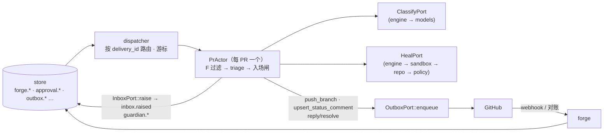
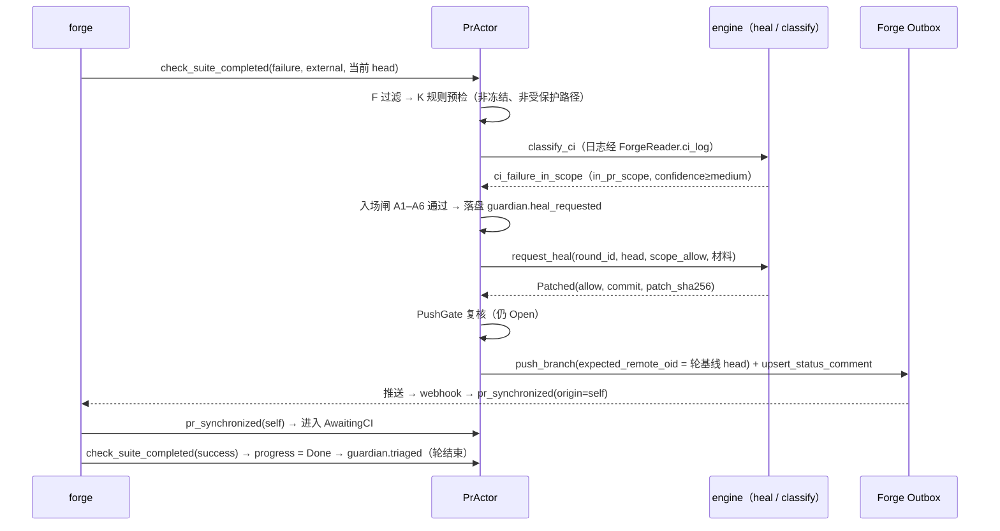
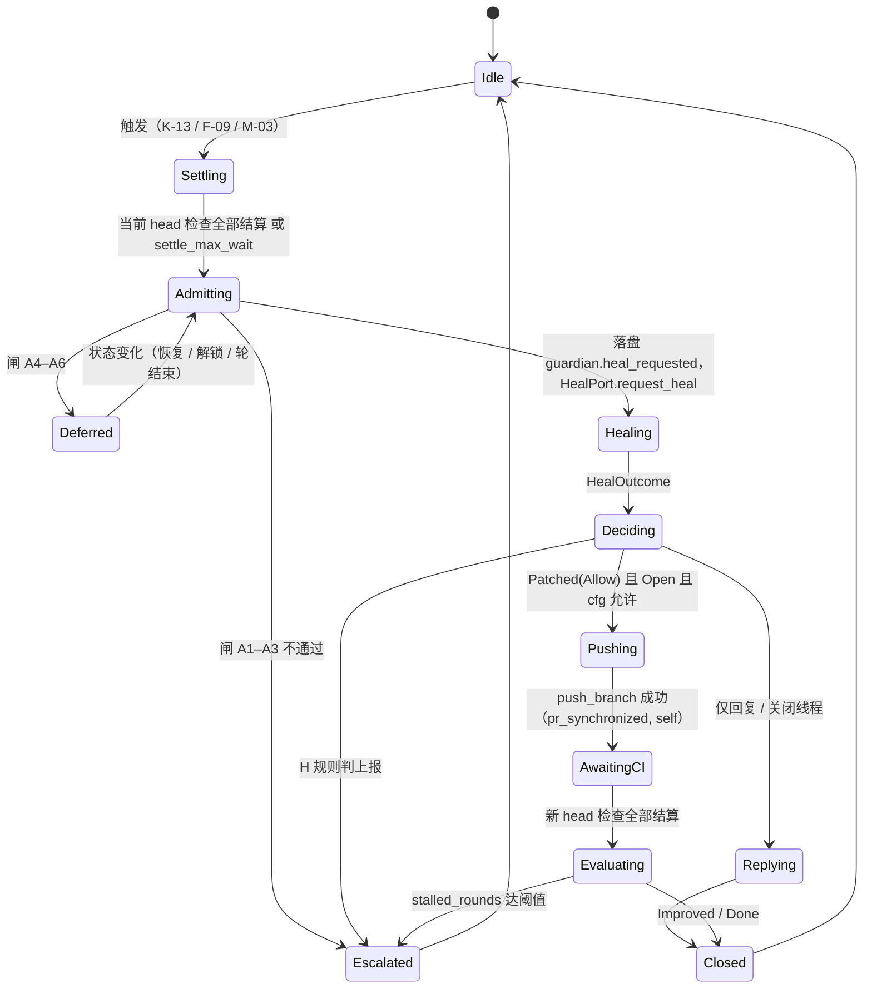

# PR 后台守护（`guardian`）

> 状态：设计 v0.1 · 里程碑：M2（M0 契约、M1 无交付，见 §1.1）· 泳道：`be-forge`（[milestones.md](../milestones.md)）· crate / 目录：`crates/gantry-guardian`

`guardian` 在 PR 打开之后无人值守地消费 `forge` 归一化后的事件，按一张固定的分流表决定"静默自愈 / 攒批 / 上报"：没有问题不打扰，有问题不静默越界，已审批的 PR 不被悄悄推送。

> 实现者读法：分流规则的**唯一来源是本文 §7.3 的决策表**（P-60；含"无需动作"的显式行；architecture §7.3 与 [config.md §6](../interfaces/config.md) 的 `guardian` 小节与之对齐，类 id 与取值必须和它一致；规则表外的事件一律上报）；事件来自 [forge-actions.md](../interfaces/forge-actions.md)（下文简称 FA）§6，动作经 FA §3 的发件箱（Outbox）发出，守护的架构依据是 [architecture §7.3](../architecture.md#73-pr-后台守护) 与 [§7.4](../architecture.md#74-危险动作与两类审批)。本文里带"【G-OQ-n】"的取值是**骨架没定、本文暂用的保守默认**，见 §13，不是决定。

## 1. 职责

- **分流**：订阅交付单元 PR 的 `forge.*` 事件，对每个事件按 §7.3 的有序规则表求值，得出处置：静默自愈（`silent_fix`）、静默回复（`silent_reply`）、攒批（`batch`）、上报（`escalate`）、无需动作（`noop`）等；**上报优先于静默**，规则表之外的情形兜底上报。
- **静默自愈循环**：经 `engine` 的 `HealPort::request_heal` 派发 `heal` 节点（沙盒内）修复"本 PR 范围内的 CI 失败""经验证属实的 bot finding"，把已校验的提交经 Outbox 推送；静默自愈**不改变交付阶段**，需要改代码且超出自愈范围时才由用户选择交回前台、走 `review → implement`（P-60）；经验证不成立的非安全类 bot finding，回复理由；每一轮都在入场闸（冻结、预算、重复 / 无进展、暂停、写权锁）之后才开始。
- **无进展与重复检测**：对问题指纹（fingerprint）计数，并在每轮结束后评估"失败集合是否缩小"，达到 `guardian.no_progress.*` 阈值即上报。
- **自触发循环防护**：忽略 `origin = self | self_unattributed` 的事件，按指纹与预算限制"推送 → CI 失败 → 修复 → 推送"。
- **已审批 PR 不得静默推送**：以 `PushGate` 为唯一出入口，冻结期内任何需要推送的问题一律上报（`push_after_approval`）。
- **单条可编辑的状态清单评论**：根据结构化事实渲染数据，经 `upsert_status_comment`（`slot = delivery_status`，幂等键含单调递增的 `revision`，计数保存在本地事件日志，P-61）维护 PR 上唯一一条清单，节流到 `guardian.status_checklist.min_update_interval_s`。
- **上报**：经 `core::ports::InboxPort::raise` 写 InboxItem（`security_finding` / `escalation` / `budget_exhausted` / `decision_needed`），带 `project_id` 与 `dedup_key`（P-63），按去重键不重复上报同一问题；同时追加 `guardian.escalated`。对话里的事件行与卡片由 `conversation` 据 `inbox.raised` 与 `guardian.*` 事件渲染（P-60），守护不直接写对话。
- **审计**：每个非平凡处置落一条可回放的记录（§7.10），"静默"不等于"不可追溯"。
- **善后**：消费自己动作的失败与 drift（如状态评论被删、推送因 head 移动被拒），转为重新评估而不是重试。

### 1.1 里程碑交付

| 里程碑 | 本模块交付 |
| --- | --- |
| M0 | 不写实现代码。依赖 `contract` 泳道：`guardian.triaged` / `guardian.heal_requested` / `guardian.escalated` 的事件 schema（P-60）；`FakeForge`（能注入 §7.3 用到的所有 `forge.*` 事件）、`FakePolicy`、`FakeInbox`、`Store::open_in_memory`（P-51）。本泳道在 M0 末确认 §6 的端口签名与 engine.md §6 的 `HealPort` / `ClassifyPort` 一致 |
| M1 | **无交付**。PR 创建后只由 `engine` 等 CI 与审批；M1 不运行守护，不做静默自愈。`forge` 的 `forge.*` 事件与 `forge.base_advanced` 在 M1 已产生，M2 直接消费 |
| M2 | **全部**：`TriageEngine`（§7.3 决策表）、愈合轮状态机、`PushGate`、无进展 / 重复检测、自触发防护、CI 日志获取与分类（`classify`）、状态清单评论（`revision`，P-61）、上报与审计事件（`guardian.triaged` / `heal_requested` / `escalated`）、对 `forge` 限流感知（`priority: low` 的状态评论、`not_before` 延后）、`bot_finding_invalid` 的静默回复（`reply_review_thread` 已提前到 M2，P-60）。依赖 `be-engine` 同期交付的 `request_heal` 与 `classify` 端口（P-60） |
| M3 | 线程关闭（`resolve_review_thread`）上线；`arbiter` 统一发出的评审摘要进入清单的 `review` 条目（由 `engine` 提供事实，本模块只渲染） |
| M4 | 无新功能。Ultimate 下多个 PR 同时被守护，验证每个 PR 一个的独立执行体（actor）互不干扰、全局并发受 `levels.*.budget.concurrency` 与沙盒上限约束；GitHub 原生任务入口（Q-04）不归本模块 |

## 2. 不负责

| 事项 | 归属 |
| --- | --- |
| 回读 GitHub、去重、归因 `origin`、对账、drift 检测 | `forge`；本模块只**信任其结论**（并对 `actor.github_id == Project.bot_user_id` 做一次防御性复核） |
| 一切 GitHub 写 | `forge` Outbox（I2）；本模块只入队 |
| 在沙盒里运行 `heal` / 补丁校验 / 提交生成 / 工作树写权锁 | `engine`（派发与预算）→ `sandbox` + `worker` → `repo`（补丁闸门）→ `policy`（校验） |
| 审批的创建、验签、状态机；"需要审批"的补丁如何请求审批 | `policy` / `engine`（P-20、worker-protocol §8.5）；本模块只**读**审批状态并据此冻结 |
| 合并、`merge` 阶段推进、base 前移后的重验（`merge → review`）、前台 review 图 | `engine` |
| 预算台账的记账与 `budget.exhausted` 的发出 | `engine`；本模块只读台账并在入场闸处停手 |
| 通知推送（桌面 / 手机） | `notify`（消费 `inbox.raised`） |
| `/gantry` 命令式入口、Issue label 入口 | Q-04（M4 待决） |
| 解析人类评论里的自然语言指令 | 无：I5，且"不得把自然语言解析成设置变更"（config §5.5 I7） |
| 修改守护设置 | `api` 的 settings 路由；本模块只读 |

## 3. 依赖

| 依赖 | 用到什么 | 契约 |
| --- | --- | --- |
| `forge` | 经 `store` 订阅 `forge.*`（含 `forge.synced`、`forge.drift_detected`）；`core::ports::OutboxPort::{enqueue, cancel}`；`core::ports::ForgeReader::{ci_log, changed_files, review_thread, check_annotations}` | FA §6、§2、§3；forge.md §6 |
| `engine` | `HealPort::{request_heal, outcome, cancel}`（派发 `heal` 节点；`rounds` + 1、写权锁持有者记为 `guardian`、不改 `stage`、不自动推送）与 `ClassifyPort::{classify_ci, classify_finding}`（派发 `classify` 节点，计入 `nodes`）；两个 trait 定义在 `core::ports`（core.md §6.10），M0 冻结、替身 `FakeEngine`，实现 M2 由 `be-engine` 交付（P-60）| [engine.md §6](engine.md)；worker-protocol §4.3、§6.2、§8；本文 §6 |
| `policy` | `core::ports::PolicyPort`：`decide_action`（每次入队前判定 `push_branch` / `reply_review_thread` / `resolve_review_thread` / `upsert_status_comment`，结果写入 `requires_approval`，P-62）、`live_approvals_for_pr`（冻结判定的审批来源）、`path_rules`（`PathRuleSet`，对一组路径求值 `policies.paths`，路径规则的唯一实现）| [policy.md §6.1、§6.2、§7.2](policy.md)；config.md §5.2；api.md §6；data-model §4.4 |
| `notify`（P-59） | `core::ports::InboxPort::raise`（`RaiseRequest{ project_id, kind, severity, summary: SafeSummary, payload, dedup_key, supersedes, actor }`）与 `InboxPort::resolve`（M4 前不用）；去重键模板见 notify.md §7.2 | [notify.md §6.1、§7.2](notify.md) |
| `store`（P-59） | 事件订阅与游标（`Cursors`）、投影读（Delivery / PullRequestRef / BudgetLedger / InboxItem / Worktree）、追加 `guardian.*`（经 `WriteTx::append`）、`ModuleSpec{module: "guardian", migrations, projector}` 注册自己的 `guardian_pr_state` 投影器 | [store.md §6.1、§7.10](store.md)；data-model §3、§5；architecture §4 |
| `core`（P-59） | ID、`ForgeEventEnvelope` / `ForgeEventKind`、`Level`、`UntrustedText`、`Ref`、`EffectiveSettings`、`core::ports`；纯函数共享类型 | data-model §1；[core.md §6.6、§6.10](core.md) |
| 设置 | `guardian.triage.*`、`guardian.no_progress.*`、`guardian.status_checklist.*`、`policies.paths`（只读；热加载，config.md §2.6） | config.md §6、§5.2 |

`models` 不直接依赖：`classify` 是 `engine` 派发的节点（经 `models.invoke_direct`，计入 `nodes` 与 `tokens_by_tier.utility`），守护只经 `ClassifyPort` 使用。`conversation` 不被调用：它订阅 `guardian.triaged` / `guardian.heal_requested` / `guardian.escalated` 与 `inbox.raised` 生成事件行与卡片（P-60）。依赖按裁决 C13（P-59）：`engine`、`forge`、`policy`、`core`、`store`、`notify`。

## 4. 输入

| 输入 | 来源 | 格式 / 契约 | 信任级别 |
| --- | --- | --- | --- |
| `forge.<kind>`（23 种 ForgeEvent） | `store` 订阅（`forge` 产生） | `forge.event.v1`：FA §6.2；`origin`、`actor`、`stale`、`caused_by_action` 由 `forge` 判定 | 信封字段可信；`data` 里的文本字段（评论、check 输出、标题）是 `UntrustedText`，**只当数据** |
| `forge.synced` | 同上 | `{target, source, changes[{field,from,to}], synced_at}`（forge.md §7.5 提议） | 可信（`forge` 回读值） |
| `forge.drift_detected` | 同上 | FA §7.4 | 可信 |
| 自己动作的结果 | `outbox.succeeded` / `failed` / `cancelled` | data-model §5.2；`failed.data.code` 取 FA §2.6 | 可信 |
| 审批事件 | `approval.requested` / `granted` / `invalidated` / `consumed` / `expired` / `denied` | data-model §4.4、§5.2 | 可信 |
| 交付单元与预算事实 | `FactsSource`（`store` 投影：`Delivery`、`PullRequestRef`、`BudgetLedger`、open `InboxItem`、`Worktree.lock`、是否暂停）；`delivery.stage_changed`、`budget.exhausted`、`worktree.unlocked` 事件 | data-model §3；architecture §8 | 可信 |
| 愈合结果 `HealOutcome` | `engine` | §6 | 结构可信；补丁与 proposals 已经 `repo` + `policy` 校验；其中的文本仍是 `UntrustedText` |
| 分类结果 | `engine`（`ClassifyPort`，`classify` 节点） | worker-protocol §6.2 `classify`；本文 §7.11 | **不可信输出**：枚举字段经 schema 校验后使用；分类只能把处置推向"更严"，永远不能放宽（I5） |
| CI 日志、PR 改动文件、线程详情 | `ForgeReader` | `UntrustedText` / 结构 | 不可信数据 |
| 设置 | `store` 投影 | config.md §6、§5.2 | 可信 |
| 定时器 | 内部 | 结算窗口、状态清单节流 | 可信 |

## 5. 输出

| 输出 | 去向 | 格式 / 契约 |
| --- | --- | --- |
| `HealRequest` | `engine` | §6；幂等于 `round_id` |
| Outbox 入队 | `forge` | `OutboxPort::enqueue`（自开事务，守护没有要与入队原子绑定的其他状态变化；审计事件另在 `guardian_pr_state` 事务里追加）：`push_branch`（FA §3.3 ①）、`upsert_status_comment`（④）、`reply_review_thread`（⑥）、`resolve_review_thread`（⑦）；`enqueued_by = {module: "guardian", causation_id}`；入队前先 `PolicyPort::decide_action`（P-62）；**不**入队 `merge_pr`、`create_comment`（`rerun_failed_jobs` 见 G-OQ-8）|
| 取消 | `forge` / `engine` | `OutboxPort::cancel`（排队中的守护推送）；`HealPort::cancel`（进行中的愈合轮） |
| 上报项 | `notify`（`InboxPort::raise` 追加 `inbox.raised`）| InboxItem（`security_finding` / `escalation` / `budget_exhausted` / `decision_needed`），payload 见 data-model [InboxItem](../data-model.md#inboxitem--approval)；`reason_code` 取 §7.9 |
| 对话事件行 | 不由守护写：`conversation` 订阅 `guardian.triaged` / `heal_requested` / `escalated` 渲染（模板 + `Ref`，**不内联外部文本**，P-60）| conversation.md §7.7 |
| `guardian.triaged` / `guardian.heal_requested` / `guardian.escalated` | `store` | P-60 新增的事件，形状见 §7.10（以 data-model §5.2 为准） |
| 指标与日志 | 运维 | §11 |

## 6. 对外接口

> Rust 草案：签名与语义为准。分流核心是**纯函数**（无 IO），副作用都在 `Guardian` 的 actor 里。

```rust
// crates/gantry-guardian/src/lib.rs

pub struct Guardian { /* actors, ports, config view */ }
impl Guardian {
    pub fn new(deps: GuardianDeps) -> Self;
    /// 主循环：从 store 订阅 forge.* / outbox.* / approval.* / delivery.* / budget.* / worktree.* / settings.updated，
    /// 按 delivery_id 分发给每 PR 一个的 actor；启动时按游标重放并恢复进行中的轮。
    pub async fn run(&self, shutdown: tokio_util::sync::CancellationToken) -> Result<(), GuardianError>;
    /// 检视器"后台守护"区块的数据（路由是否存在见 G-OQ-13）。
    pub async fn handled_items(&self, delivery: &DeliveryId, page: Page) -> Result<Vec<HandledItem>, GuardianError>;
}

// ---------- 纯函数核心（每条规则一个单元测试，§12） ----------
/// 两阶段：先用确定性信息裁决；需要模型分类的返回 NeedClassify，拿到结果后再调一次。
pub fn triage(input: &TriageInput, cls: Option<&Classification>, cfg: &GuardianSettings) -> TriageStep;
pub enum TriageStep { Done(TriageDecision), NeedClassify(ClassifyNeed) }
pub struct TriageDecision {
    pub rule: RuleId,                    // 如 "K-12"，写入审计
    pub class: Option<TriageClass>,
    pub disposition: Disposition,
    pub also_matched: Vec<TriageClass>,  // 同时命中的其他上报类（上报优先，取最严者为 class）
}
pub fn push_gate(f: &DeliveryFacts) -> PushGate;                       // §7.5
pub fn admit(f: &DeliveryFacts, problems: &[Fingerprint], st: &PrState, cfg: &GuardianSettings) -> Admission; // §7.3.5
pub fn progress(before: &FailureSet, after: &FailureSet) -> Progress;  // §7.6
pub fn render_checklist(f: &ChecklistFacts) -> StatusChecklistPayload; // 与 FA §3.3 ④ 同形

// ---------- 类型（枚举与 config.md §6.1 / architecture §7.3 一致） ----------
#[derive(Copy, Clone, Eq, PartialEq, Hash, Serialize, Deserialize)]
#[serde(rename_all = "snake_case")]
pub enum TriageClass {
    // 可配置（config.md §6.1）
    CiFailureInScope, BotFindingValid, BotFindingInvalid, Nit, MechanicalConflict,
    // 锁定，恒为 escalate（config.md §6.1 锁定类表）
    SecurityFinding, TouchesProtectedPath, ScopeExpandingFix, RepeatedOrNoProgress,
    BudgetExhausted, ApprovalNeeded, PushAfterApproval, DesignOrApiChange, Unknown,
}
/// config.md §6.1 的四个取值，原样。
pub enum ConfigDisposition { SilentFix, SilentReply, Batch, Escalate }
pub enum Disposition {
    Noop, Bookkeeping, Ignore, Finalize,
    Defer(DeferReason),                  // paused | lock_held | round_active | settling
    Batch, SilentFix, SilentReply,
    Escalate(ReasonCode),                // §7.9
}

pub struct TriageInput<'a> {
    pub event: &'a ForgeEventView,       // kind、origin、actor、stale、data（UntrustedText 保持包装）
    pub facts: &'a DeliveryFacts,
    pub state: &'a PrState,              // 指纹计数、批、已上报键、进行中的轮
    pub pr_files: Option<&'a [ChangedFile]>,
}
pub enum Classification { Ci(CiClassification), Finding(FindingTriage) }
pub enum Progress { Improved, Stalled, Done /* 失败集合为空 */ }

// ---------- 守护使用的外部端口 ----------
// 已在对方规格书里定义的（此处不重新定义）：
//   core::ports::OutboxPort / ForgeReader   forge.md §6（enqueue、cancel；ci_log / changed_files / review_thread / check_annotations）
//   core::ports::PolicyPort                 policy.md §6（decide_action、live_approvals_for_pr、path_rules）
//   core::ports::InboxPort                  notify.md §6.1（raise、resolve）
//   Store / WriteTx                         store.md §6.1（事件订阅、guardian_pr_state 投影器、guardian.* 追加）
// engine 提供、定义在 engine crate 的守护端口（P-60，签名以 engine.md §6 为准，此处照录）：
#[async_trait] pub trait HealPort: Send + Sync {              // engine 实现
    /// 幂等于 req.round_id；预算（rounds + 1）、JobSpec、工作树写权锁（holder = guardian）、终结管线归 engine；
    /// 不自动入队 push_branch / proposals；不改变交付阶段（P-60）。
    async fn request_heal(&self, req: HealRequest) -> Result<HealTicket, EngineError>;
    /// 取已终结的愈合结果（聚合 attempt.finished、patch.validated / rejected、proposals 判定）。
    async fn outcome(&self, ticket: &HealTicket) -> Result<Option<HealOutcome>, EngineError>;
    async fn cancel(&self, ticket: &HealTicket, why: CancelWhy) -> Result<(), EngineError>;
}
#[async_trait] pub trait ClassifyPort: Send + Sync {          // engine 实现（classify 节点，计入 nodes，经 models.invoke_direct）
    async fn classify_ci(&self, req: CiClassifyRequest) -> Result<CiClassification, ClassifyError>;
    async fn classify_finding(&self, req: FindingClassifyRequest) -> Result<FindingTriage, ClassifyError>;
}
#[async_trait] pub trait FactsSource: Send + Sync {           // 本 crate 内部：store 投影 + PolicyPort::live_approvals_for_pr
    async fn delivery_facts(&self, id: &DeliveryId) -> Result<DeliveryFacts, FactsError>;
}
```

`HealRequest` / `HealOutcome`（与 engine.md §6 共用同一定义）：

```rust
pub struct HealRequest {
    pub round_id: RoundId,                // 幂等键
    pub delivery_id: DeliveryId, pub pr: PrRef,
    pub head_sha: GitOid,                 // 补丁基线（worker-protocol P10）：基线之外的前移 → 补丁作废
    pub task: HealTask,                   // CiFailure | BotFinding | MechanicalConflict | NitBatch
    pub problems: Vec<ProblemSpec>,       // { fingerprint, kind, material_refs[] }
    pub scope_allow: Vec<Glob>,           // = PR 改动文件集合 → JobSpec.constraints.paths.allow
    pub targets: Vec<ThreadTarget>,       // review_thread 句柄 → thread_node_id（供 proposals 落到 Outbox）
    pub materials: Vec<Material>,         // { kind: ci_log|review_comment|review_thread|..., text: UntrustedText }
    pub config_rev: u64,
}
pub enum HealOutcome {
    Patched { commit: GitOid, tree: GitOid, patch_sha256: String, verdict: PatchVerdict /* Allow | NeedsApproval */,
              files: Vec<RepoPath>, proposals: Vec<ValidatedProposal>, result_ref: ResultRef },
    ProposalsOnly { proposals: Vec<ValidatedProposal>, result_ref: ResultRef },
    NoChange { reason: UntrustedText, result_ref: ResultRef },
    Denied { detail: String /* policy.path_protected 等，worker-protocol §9 */, result_ref: ResultRef },
    Failed { failure_class: FailureClass, detail: String, attempt_id: AttemptId },
    Cancelled, Superseded { why: String },
}
```

约定：`HealPort::outcome` 返回**已校验**的结果后，由 `guardian` 决定是否入队推送与回复——`engine` 不为 `heal` 节点自动入队 `push_branch` / proposals（否则无法在推送前做冻结复核；engine.md `request_heal` 的注释与 OQ-16 同此）。`HealRequest.head_sha` 必须等于该交付单元工作树分支头，否则 `repo` 报 `BaseMoved`（P10）；外部推送后分支头与 GitHub 的对齐（`repo.advance_head`，repo.md OQ-R10）由 `engine` 在 `request_heal` 内完成还是守护先调用，见 G-OQ-10。`materials`（CI 日志、评论文本）由守护经 `ForgeReader` 取得后随请求交给 `engine`（`engine` 也能经 `ForgeReader::discussion` 自取 Issue / PR 正文，P-59，但守护已取的材料不重复拉取）。

## 7. 内部设计

### 7.1 总览



一次典型的静默自愈：



### 7.2 并发模型

- **dispatcher**：一个任务，从 `store` 按游标顺序读事件，按 `delivery_id` 路由到该交付单元的 actor 邮箱；游标与该事件引起的 `guardian.*` 事件在同一事务推进（至少一次投递 + `dedup_key` 幂等，FA §6.1 G5）。无 `delivery_id` 的事件（如 `installation_changed`）广播给该项目的全部 actor。
- **PrActor**：每个"有 PR 的非终态交付单元"一个 tokio 任务，邮箱串行处理，因此同一 PR 同一时刻只有一个愈合轮；不同 PR 之间并行，全局并发由 `engine` 的预算与沙盒调度限制，守护自己不设全局锁。
- **定时器**：结算窗口、状态清单节流、`awaiting_ci_max_wait`，都在 actor 内以 `tokio::time` 驱动，时钟可注入（测试）。
- **崩溃恢复**：actor 状态可由 `guardian.*` 事件与投影重建（§7.10）。启动时对每个有 `guardian.heal_requested` 而无"轮结束"`guardian.triaged` 的轮：查 `engine`（`outcome`）→ 已有结果则继续决策；尚未开始则幂等地 `request_heal`；基线 head 已变则作废。
- **顺序约束**：先落盘（`guardian.triaged` / `heal_requested` / `escalated` + 游标），**后**产生副作用；所有副作用幂等（`request_heal` 幂等于 `round_id`；Outbox 幂等键由确定性 intent 派生）。

### 7.3 分流决策表

**求值方式**：每个事件先过 §7.3.2 的前置过滤（有序，首个命中即止），再在 §7.3.3 的有序规则表里取**首个命中**的规则；规则内"条件"是全部满足。凡同时满足上报类与静默类的情形，表中**上报规则排在前面**（"上报优先于静默"）；落入 `silent_fix` / `silent_reply` 候选的，必须再通过 §7.3.5 的入场闸才真正开始，闸不通过则按闸的类上报或延后。表中所有**上报**一律 `InboxPort::raise` 写 InboxItem + `guardian.escalated`（`engine` / `policy` 已为同一事项写过 InboxItem 的情形，如 H-05、T-07，只审计、不重复写；`notify` 的 `dedup_key` 兜底）；所有**静默**处置一律写审计事件。对话里的事件行由 `conversation` 渲染。

#### 7.3.1 谓词

| 谓词 | 定义 |
| --- | --- |
| `bound` | 事件的 `delivery_id` 非空，且该交付单元已绑定 PR（交付单元是否终态由 PF-3 判，以免 `pr_merged` 在交付单元已 `closed` 后到达而收不了尾）|
| `self` | `origin ∈ {self, self_unattributed}`，或 `actor.github_id == Project.bot_user_id`（防御性复核） |
| `bot` | `actor.type ∈ {bot, app}` 且非 `self` |
| `human` | `actor.type ∈ {user, unknown}` 且非 `self`（`unknown` 按人处理，更严）|
| `current_head` | 事件 `stale = false` 且（若有）`data.is_current_head != false` |
| `frozen` | `push_gate(facts) = Frozen`（§7.5） |
| `protected` | 一组路径中任一命中 `policies.paths` 的任一规则（`deny` 或 `approve` 均算），由 `PolicyPort::path_rules` 返回的 `PathRuleSet` 求值 |
| `ci_in_scope` | `CiClassification.category ∈ {lint, type, test, build}` ∧ `in_pr_scope` ∧ `confidence ≥ medium` |
| `low_conf` | 任一分类的 `confidence = low`，或分类失败 / 超时 / 预算不足（一律按"更严"处理，I5） |
| `security_source` | 事件来源应用 / 作者命中"安全来源"（内置名单，需核实，G-OQ-4）或带 `security` 标签 / 类别 |
| `finding.security` | `FindingTriage.security` ∨ `security_source` |
| `finding.nit` | `FindingTriage.severity = nit` ∧ ¬`finding.security` |
| `cfg(c)` | 当前有效设置（项目覆盖已合并）里类 `c` 的取值（`guardian.triage.<c>`） |

#### 7.3.2 前置过滤（有序）

| 序 | 条件 | 处置 | 说明 |
| --- | --- | --- | --- |
| PF-1 | 事件目标是 Issue（`issue_*`、`on = issue`），或目标是 PR 但 ¬`bound` | `ignore` | 未绑定的对象 `forge` 默认已丢弃（`pass_unbound=false`）；这里再兜一道。项目级事件（`installation_changed`、`repo_changed`、`base_advanced`、`merge_group_*`）不受此条约束，由 dispatcher 广播给该项目的 actor |
| PF-2 | 该 `dedup_key` 已处理 | `ignore` | 至少一次投递的幂等（G5） |
| PF-3 | 交付单元已终态，且事件不是 `pr_closed` / `pr_merged` | `ignore` | 终态收尾由 P-09 / P-10 负责 |
| PF-4 | `stale = true` | `noop`（只记账） | G4：做放行判断时必须忽略陈旧事件；不触发任何动作 |
| PF-5 | `self` | 仅允许 P-01、P-04、P-05、P-09、P-10 命中；其余一律 **S-01** `bookkeeping` | 自触发防护的第一道：**自身事件从不进入分流** |
| PF-6 | 其余 | 进入 §7.3.3 | — |

#### 7.3.3 主决策表（有序规则）

处置词汇：`noop` 无需动作（可能刷新状态清单）；`bookkeeping` 记账（更新守护状态，不分流）；`ignore`；`finalize` 收尾；`defer` 延后；`batch`；`silent_fix`；`silent_reply`；`escalate`。`class` 列使用 config.md §6.1 的类 id。

**PR 生命周期（P）**

| 规则 | 事件 `kind` | 条件 | class | 处置 | 说明 |
| --- | --- | --- | --- | --- | --- |
| P-01 | `pr_opened` | `self`（自己创建） | — | `bookkeeping` | 建立守护状态；若 `status_checklist.enabled`，入队首版清单（§7.8） |
| P-02 | `pr_opened` | `external`（绑定已有 PR 的情形） | — | `bookkeeping` | 同上；是否支持"采纳已有 PR"见 forge.md F-OQ-19 |
| P-03 | `pr_reopened` | — | — | `noop` | 恢复守护；等待当前 head 的检查结算后按 K 规则评估 |
| P-04 | `pr_synchronized` | `self` ∧ `caused_by_action` 是本守护入队的 `push_branch` | — | `bookkeeping` | 轮观察到推送：进入 `AwaitingCI(new head)`（§7.4） |
| P-05 | `pr_synchronized` | `self` ∧ 不是本守护的动作（前台 `engine` 推送） | — | `bookkeeping` | 作废进行中的轮基线与排队中的守护推送（`superseded: head_moved`），重新评估 |
| P-06 | `pr_synchronized` | `external`（人 / 其他 bot 推送） | — | `noop` + 取消 | 取消进行中的愈合轮与排队中的守护推送（`superseded: head_moved_externally`），清空 `AwaitingCI`，重新评估；审批失效由 `policy` 负责。是否因此暂停守护见【G-OQ-10】|
| P-07 | `pr_updated` | `changed ⊆ {title, body, labels, reviewers, draft}` | — | `noop` | 刷新清单 |
| P-08 | `pr_updated` | `changed ∋ base` | — | `noop` | 记录；`merge` 阶段重验归 `engine`；合并状态变化经 M 规则 |
| P-09 | `pr_closed` | — | — | `finalize` | 取消进行中的轮与排队中的守护动作；终版清单；摘除 actor |
| P-10 | `pr_merged` | — | — | `finalize` | 同上 |
| P-11 | `base_advanced` | `affected_prs ∋` 本 PR | — | `noop` | `engine` 负责 `merge → review` 重验 |

**检查（K）**——`check_suite_completed` 是 CI 失败的**唯一**分诊入口（避免与 `check_run_completed` 重复分诊）

| 规则 | 事件 `kind` | 条件（按序，首个命中） | class | 处置 | reason_code |
| --- | --- | --- | --- | --- | --- |
| K-01 | `check_suite_completed` | `current_head` ∧ `conclusion ∈ {success, neutral, skipped}` | — | `noop` | 刷新清单；若在 `AwaitingCI` 且该 head 全部结算 → 进展评估（§7.6）|
| K-02 | `check_suite_completed` | `conclusion = stale` | — | `ignore` | — |
| K-03 | `check_suite_completed` | `current_head` ∧ `conclusion = cancelled` | — | `noop` | 记录，不当失败【G-OQ-8】|
| K-04 | `check_suite_completed` | `current_head` ∧ `conclusion = action_required` | `approval_needed` | `escalate` | `guardian.workflow_run_approval`：工作流运行需要人在 GitHub 上批准（FA OQ-4）；守护不批准运行 |
| K-05 | `check_suite_completed` | `current_head` ∧ `conclusion = startup_failure` | `unknown` | `escalate` | `guardian.ci_startup_failure` |
| K-06 | `check_suite_completed` | `current_head` ∧ `conclusion ∈ {failure, timed_out}` ∧ `security_source` | `security_finding` | `escalate` | `guardian.security_finding` |
| K-07 | 同上 | ∧ 任一 `workflow_runs[].path` ∈ PR 改动文件 ∧ `protected` | `touches_protected_path` | `escalate` | `guardian.protected_path`（失败源于本 PR 改过的受保护文件，静默修复不可行）|
| K-08 | 同上 | ∧ `frozen` | `push_after_approval` | `escalate` | `guardian.push_after_approval` |
| K-09 | 同上 | ∧ 改动文件列表不完整（超过 `changed_files` 上限，需核实） | `unknown` | `escalate` | `guardian.scope_unknown` |
| K-10 | 同上 | → 调 `classify_ci`；∧ `low_conf` | `unknown` | `escalate` | `guardian.ci_low_confidence` |
| K-11 | 同上 | ∧ ¬`ci_in_scope`（`in_pr_scope = false` 或 `category ∈ {infra, flaky, unknown}`） | `unknown` | `escalate` | `guardian.ci_out_of_scope`【G-OQ-8】|
| K-12 | 同上 | ∧ `ci_in_scope` ∧ `cfg(ci_failure_in_scope) = escalate` | `ci_failure_in_scope` | `escalate` | `guardian.ci_failure_escalated` |
| K-13 | 同上 | ∧ `ci_in_scope` ∧ `cfg(ci_failure_in_scope) = silent_fix`（默认） | `ci_failure_in_scope` | `silent_fix` | → §7.3.5 入场闸 → 愈合轮 → §7.3.6 |
| K-14 | `check_run_completed` | 应用为 GitHub Actions | — | `noop` | 由 suite 级规则处理 |
| K-15 | `check_run_completed` | 应用非 GitHub Actions ∧ `current_head` ∧ `conclusion ∈ {failure, timed_out, action_required}` | — | 与 K-04…K-13 同一求值 | 外部 CI / 扫描器：日志不可取，改用 check 的 `output` 与注解（`ForgeReader::check_annotations`）作为材料；命中 `security_source` 走 K-06 |
| K-16 | `check_run_completed` | 其他 | — | `noop` | — |

K-06..K-13 的求值有成本顺序：K-06/K-07/K-08/K-09 只用结构化字段（不花模型）；K-10 起才调用分类。冻结（K-08）先于分类，避免在冻结期为注定上报的问题花 token。

**评审（R）**

| 规则 | 事件 `kind` | 条件 | class | 处置 | reason_code / 说明 |
| --- | --- | --- | --- | --- | --- |
| R-01 | `review_submitted` | `state = approved`（任何非 self 作者） | — | `noop` | 重算 `PushGate`（GitHub 审批会冻结，§7.5）|
| R-02 | `review_submitted` | `human` ∧ `state = changes_requested` | `unknown` | `escalate` | `guardian.human_feedback`【G-OQ-7】|
| R-03 | `review_submitted` | `human` ∧ `state = commented` ∧ body 非空 | `unknown` | `escalate` | 同上 |
| R-04 | `review_submitted` | `human` ∧ `state = commented` ∧ body 为空 | — | `noop` | 内容随 `review_comment` 到达 |
| R-05 | `review_submitted` | `bot` ∧ body 非空 ∧ `state ∈ {changes_requested, commented}` | — | → **F 组**（来源 `review_summary`） | — |
| R-06 | `review_submitted` | `bot` ∧ body 为空 | — | `noop` | — |
| R-07 | `review_dismissed` | — | — | `noop` | 重算 `PushGate` |
| R-08 | `review_comment` | `human` | `unknown` | `escalate` | `guardian.human_feedback`【G-OQ-7】|
| R-09 | `review_comment` | `bot` | — | → **F 组**（来源 `review_comment`） | — |
| R-10 | `review_thread_changed` | `state = unresolved` ∧ `human` | `unknown` | `escalate` | `guardian.human_feedback` |
| R-11 | `review_thread_changed` | 其他 | — | `noop` | — |

**评论（C）**

| 规则 | 事件 `kind` | 条件 | class | 处置 | 说明 |
| --- | --- | --- | --- | --- | --- |
| C-01 | `issue_comment` | `on = issue` | — | `ignore` | 非 PR 评论，不归守护 |
| C-02 | `issue_comment` | `on = pull_request` ∧ `human` | — | `noop` | 记录；**不据文本行动**（命令入口属 Q-04）【G-OQ-7】|
| C-03 | `issue_comment` | `on = pull_request` ∧ `bot` | — | → **F 组**（来源 `pr_comment`） | — |

**发现项分诊（F 组：bot finding 的统一入口）**——先经 `classify_finding` 得 `FindingTriage`（枚举字段，经 schema 校验）

| 规则 | 条件（按序，首个命中） | class | 处置 | reason_code |
| --- | --- | --- | --- | --- |
| F-01 | `finding.security` | `security_finding` | `escalate`（InboxItem `security_finding`） | `guardian.security_finding`；**不回复、不关闭线程**（M2 退出标准）|
| F-02 | `FindingTriage.design_or_api` | `design_or_api_change` | `escalate` | `guardian.design_or_api_change`【G-OQ-12】|
| F-03 | `low_conf` | `unknown` | `escalate` | `guardian.finding_low_confidence`（分类失败同此）|
| F-04 | ¬`actionable` ∧ `confidence ≥ medium` | — | `noop` | 记录；不是问题 |
| F-05 | `finding.nit` ∧ `cfg(nit) = escalate` | `nit` | `escalate` | `guardian.nit_escalated` |
| F-06 | `finding.nit` ∧ `cfg(nit) = batch`（默认） | `nit` | `batch` | 进批（§7.4）；`frozen` 时也只进批，不推送 |
| F-07 | `frozen` | `push_after_approval` | `escalate` | `guardian.push_after_approval` |
| F-08 | `cfg(bot_finding_valid) = escalate` ∧ `cfg(bot_finding_invalid) = escalate` | `bot_finding_valid` | `escalate` | `guardian.bot_finding_escalated`（省去模型验证）|
| F-09 | 其他 | `bot_finding_valid` / `bot_finding_invalid`（**验证后定**） | `silent_fix` / `silent_reply` | → 入场闸 → 愈合轮做"验证并修复或回复" → §7.3.6 的 H 规则按 `cfg` 兑现 |

**合并状态与队列（M）**——来自 `forge.synced` 与队列事件

| 规则 | 事件 | 条件 | class | 处置 | reason_code |
| --- | --- | --- | --- | --- | --- |
| M-01 | `forge.synced` | `changes` 含 `mergeable_state → dirty` ∧ `frozen` | `push_after_approval` | `escalate` | `guardian.push_after_approval` |
| M-02 | 同上 | ∧ ¬`frozen` ∧ `cfg(mechanical_conflict) = escalate`（默认） | `mechanical_conflict` | `escalate` | `guardian.mechanical_conflict` |
| M-03 | 同上 | ∧ ¬`frozen` ∧ `cfg(mechanical_conflict) = silent_fix` | `mechanical_conflict` | `silent_fix` | → 入场闸 → 愈合轮（合并 base，**不 rebase、不强推**；谁执行见【G-OQ-12】）；锁文件冲突仍受 `policies.paths` 约束 |
| M-04 | `forge.synced` | 其他变化 | — | `noop` | 刷新清单；重算 `PushGate`；`checks` 结算完成时触发 K-01 的进展评估 |
| M-05 | `pr_enqueued` | — | — | `noop` | 进入合并队列，视作冻结（§7.5）|
| M-06 | `pr_dequeued` | — | `unknown` | `escalate` | `guardian.dequeued`：出队意味着合并组检查失败或失效，其 head 不是 PR 分支，无从自愈 |
| M-07 | `merge_group_checks_requested` / `merge_group_destroyed` | — | — | `noop` | 记录 |

**系统与 drift（Y）、其余**

| 规则 | 事件 | 条件 | class | 处置 | 说明 |
| --- | --- | --- | --- | --- | --- |
| Y-01 | `installation_changed` | `action ∈ {suspend, deleted, repos_removed}` | — | `noop` + `defer(all)` | 该项目暂停开新轮；`forge` 已把健康置降级并上报 |
| Y-02 | `installation_changed` / `repo_changed` | 其他 | — | `noop` | — |
| Y-03 | `issue_closed` / `issue_reopened` / `issue_updated` | — | — | `ignore` | 规格 / Issue 状态归 `engine`（实际由 PF-1 先行命中，此行使表对 23 个 `kind` 完备）|
| Y-04 | `forge.drift_detected` | `kind = effect_missing` ∧ 目标是本守护的状态评论 | — | `bookkeeping` | 以 `epoch` 递增重建**一次**；再次被删则停止维护该 PR 的清单并记录【G-OQ-13】|
| Y-05 | `forge.drift_detected` | 其他 `kind` | — | `noop` | 记录；对应的合成事件按各自规则处理 |
| S-01 | 任何 `self` 事件（不满足 P-01/04/05/09/10） | — | — | `bookkeeping` | 如：自己的状态评论 / 回复的回流（`issue_comment`、`review_comment`）、`pr_updated`、`review_thread_changed` |
| U-01 | 任何事件 | **未被上面任何规则匹配**（含将来新增的 `kind` / `action`，以及条件组合漏洞） | `unknown` | `escalate` | `guardian.unknown_event`（architecture §7.3「兜底：不在规则表里的事件一律上报」；这里的「规则表」含上面全部 `noop` / `ignore` 行，见【G-OQ-6】）|

#### 7.3.4 内部触发（T）

这些不是 ForgeEvent，但同样驱动 actor。

| 规则 | 触发 | 条件 | 处置 |
| --- | --- | --- | --- |
| T-01 | `approval.granted` | 目标为本 PR（`merge_pr`，或本分支的 `push_branch` / `patch_apply_protected`） | 重算 `PushGate` → `Frozen`；`OutboxPort::cancel` 本守护排队中的 `push_branch`；`HealPort::cancel` 进行中的轮（`superseded: frozen`）。已在 `executing` 的推送无法取消，其残余风险由 I3 的执行点复核兜底（§8）|
| T-02 | `approval.invalidated` / `expired` / `denied` / `consumed` | — | 重算 `PushGate`；若转为 `Open`，重新评估被延后 / 被上报抑制的问题 |
| T-03 | `delivery.stage_changed` | 进入 `review` | 建立 / 恢复守护 |
| T-04 | `delivery.stage_changed` | 进入 `merge` | `Frozen`（阶段即冻结）|
| T-05 | `delivery.stage_changed` | `merge → review`（审批后有新推送或 base 前移） | 重算 `PushGate`；重新评估 |
| T-06 | `delivery.stage_changed` | 进入 `closed` / `abandoned` | `finalize` |
| T-07 | `budget.exhausted` | — | 停止开新轮；若 `engine` 尚未写对应 InboxItem 则补写（按 `(delivery, kind, dimension)` 去重）；处置记为 `budget_exhausted` |
| T-08 | `worktree.unlocked` | 原持有者为 `human` / `engine` | 重试因 `lock_held` 延后的轮 |
| T-09 | `settings.updated` | `guardian` 或 `policies` resource | 重新评估延后的项；`escalate` 新生效时，进行中的自愈循环在下一步检查转为上报（config §2.6）|
| T-10 | `outbox.failed`（本守护的动作） | `precondition_failed(head_changed \| remote_diverged \| stale_head)` | 轮 `superseded`，重新评估（不重试）|
| T-11 | `outbox.failed`（本守护的动作） | `permission_denied` / `validation_failed` / `not_mergeable` / `signature_required` 等终态 | `unknown` → `escalate` `guardian.github_write_failed`；`rate_limited` / `transient` 由 `forge` 重试，守护不介入 |
| T-12 | 结算计时器到期 | 当前 head 的检查全部结算，或达 `settle_max_wait` | 汇总待愈合问题，进入入场闸 |
| T-13 | `AwaitingCI` 超时（`awaiting_ci_max_wait`） | 新 head 的检查始终未结算 | 轮以 `progress = null` 结束，`unknown` → `escalate` `guardian.ci_timeout` |

#### 7.3.5 入场闸（silent_fix / 需要验证的 silent_reply 候选，按序）

任一不通过即终止，不开轮。上报类优先于延后类。

| 闸 | 条件（不通过） | 结果 |
| --- | --- | --- |
| A1 | `push_gate = Frozen` | `escalate` `push_after_approval` |
| A2 | 预算不足：`used.rounds ≥ limits.rounds`，或 worker 层 token / `nodes` / `wall_time` / `forge_writes` 已耗尽（读 `BudgetLedger`，含本轮预计新增的一个 `heal` 节点；`classify` 也是节点，已在分类时计入 `nodes`）| `escalate` `budget_exhausted`（InboxItem `budget_exhausted`，`{dimension, limit, used}`；`engine` 已写则不重复）|
| A3 | 重复：任一待愈合指纹 `attempts[fp] ≥ same_class_repeats − 1`；或无进展：`stalled_rounds ≥ no_progress.stalled_rounds` | `escalate` `repeated_or_no_progress`（`guardian.repeated_problem` / `guardian.no_progress`）|
| A4 | 交付单元暂停，或 `stage_status ∈ {waiting_human, blocked}` | `defer(paused)`；状态变化后重评 |
| A5 | 该 PR 分支的工作树写锁被 `human` 或 `engine` 持有 | `defer(lock_held)`；`worktree.unlocked` 后重评 |
| A6 | 已有进行中的轮 | `defer(round_active)`；新问题并入待处理集合，轮结束后重评 |

#### 7.3.6 愈合结果处置（H）

`HealOutcome` 回来后，守护**再次**检查 `push_gate`（审批可能在愈合期间落下）并按 `cfg` 兑现。

| 规则 | `HealOutcome` / 条件 | class | 处置 |
| --- | --- | --- | --- |
| H-01 | `Patched{verdict=Allow}` ∧ `push_gate = Frozen` | `push_after_approval` | `escalate`；补丁 `result_ref` 留作证据，**不推送** |
| H-02 | `Patched{Allow}` ∧ 任务为 CI 失败 ∧ `Open` | `ci_failure_in_scope` | `silent_fix`：入队 `push_branch`（`expected_remote_oid = 轮基线 head`，`validation_ref = patch_sha256`）；同时入队状态清单更新 |
| H-03 | `Patched{Allow}` ∧ 任务为 bot finding ∧ `cfg(bot_finding_valid) = silent_fix` ∧ `Open` | `bot_finding_valid` | `silent_fix`：入队 `push_branch`；再入队 `reply_review_thread`（模板文案"已在 `<oid>` 中修复"）与 `resolve_review_thread`，均 `depends_on` 该推送 |
| H-04 | `Patched{Allow}` ∧ 任务为 bot finding ∧ `cfg(bot_finding_valid) = escalate` | `bot_finding_valid` | `escalate`，不推送 |
| H-05 | `Patched{verdict=NeedsApproval}`（M2 起，依赖清单 / lockfile 等受保护路径） | `touches_protected_path` | `escalate`；`engine` / `policy` 负责请求 `patch_apply_protected` 审批并写 `approval_needed`，守护**只记录**，不重复写 InboxItem |
| H-06 | `Denied{policy.path_protected:<rule_id>}` | `touches_protected_path` | `escalate`；`rule_id = workflows` 时按 `ReportHint` 写 `decision_needed`（`payload.kind = manual_action`），附补丁供用户手动应用（P-48） |
| H-07 | `Denied{policy.path_outside_allow}` | `scope_expanding_fix` | `escalate` |
| H-08 | `Denied{其他 policy.*}`（size / secret / binary / symlink / dotgit …） | `unknown` | `escalate` `guardian.patch_denied`（带子码）|
| H-09 | `ProposalsOnly` 含 `reply_review_thread` ∧ `cfg(bot_finding_invalid) = silent_reply` | `bot_finding_invalid` | `silent_reply`：入队 `reply_review_thread`（理由来自 worker 的 proposal，经 V6 校验与 `forge` 二次净化）；线程无人类评论时再入队 `resolve_review_thread`（`depends_on` 回复），否则只回复 |
| H-10 | `ProposalsOnly` 含 `reply_review_thread` ∧ `cfg(bot_finding_invalid) = escalate` | `bot_finding_invalid` | `escalate` |
| H-11 | 任一 proposal 为 `escalate` | 按 `inbox_kind`：`security_finding` → `security_finding`；其余 → `unknown` | `escalate`（以 proposal 为准，更严者生效）|
| H-12 | `NoChange` | `unknown` | `escalate` `guardian.heal_no_change` |
| H-13 | `Failed{budget_exhausted}` | `budget_exhausted` | `escalate` |
| H-14 | `Failed{其他}`（`engine` 重试耗尽后） | `unknown` | `escalate` `guardian.heal_failed`，并计一次无进展轮 |
| H-15 | `Cancelled` / `Superseded` | — | 丢弃，重新评估 |

**入队前的策略判定**（P-62）：H-02、H-03、H-09 里的每一个入队动作（`push_branch`、`reply_review_thread`、`resolve_review_thread`、`upsert_status_comment`）之前，守护先用 `PolicyPort::decide_action` 取判定：`Allow{approval}` → 把 `approval` 填进 `requires_approval` 再入队；`NeedsApproval` → 不入队，`escalate`（已有 `pending` 审批则只审计）；`Deny` → 不入队，`unknown` → `escalate`，`reason_code = guardian.action_denied`（附 `DenyReason`）。这是 I3 的要求：放行只由 `policy` 判定，守护不自行放行。

### 7.4 愈合轮（round）状态机



- **一个 PR 同一时刻至多一个轮**（A6）。轮期间到达的新问题并入待处理集合（去重指纹），轮结束后统一评估。
- **批（batch）**：`nit` 与 F-06 进入 `batch`，只在**下一次愈合轮**随任务一并交给 `heal`（`HealTask::NitBatch` 部分）；守护不为 nit 单独开轮。PR 终态时仍留在批里的 nit 记入收尾的审计事件，不再处理。无后续推送时的冲刷时机见【G-OQ-11】。
- **推送的比较并交换（CAS）**：`push_branch.expected_remote_oid` = 轮基线 head，`local_head_oid` = `HealOutcome.commit`，`force = false`。远端已被他人推进 → `forge` 返回 `precondition_failed(remote_diverged)` → T-10，不覆盖对方。
- **材料**：CI 日志经 `ForgeReader::ci_log` 取得（`UntrustedText`，有大小上限并标 `truncated`），与评论 / 线程文本一起以 `Material` 交 `engine`，由 `sandbox.stage` 按 worker-protocol §4.4 加隔离标记写入沙盒；守护自己**不**把外部文本拼进任何 prompt。
- **范围**：`scope_allow` = PR 的改动文件集合（`ForgeReader::changed_files`，对 base 的 diff），映射到 JobSpec 的 `constraints.paths.allow`；补丁越界由 `policy` P8 拒绝（`policy.path_outside_allow`），守护把它映射为 `scope_expanding_fix`（H-07）。"范围"的度量是否过严见【G-OQ-9】。

### 7.5 `PushGate`：已审批 PR 不得静默推送

```rust
pub enum PushGate { Open, Frozen(FreezeReason) }
pub enum FreezeReason { GantryApprovalGranted(ApprovalId), GithubApproved, StageMerge, InMergeQueue }
```

`Frozen` 当且仅当以下任一成立（【G-OQ-5】：架构只说"已审批"，本文取保守的并集）：

1. `PolicyPort::live_approvals_for_pr(repo, number)` 返回的审批里存在 `status = granted` 者（目标为本 PR 或其分支）；
2. `PullRequestRef.review_state = approved`（forge.md §7.5 第 7 点的保守口径，任何人的 approve 都算）；
3. `Delivery.stage = merge`（`review → merge` 意味着评审通过且 CI 通过，随后请求 Gantry 审批，`pending` 也落在这里）；
4. `PullRequestRef.in_merge_queue = true`。

重算时机：每个 `approval.*` 事件、`forge.synced` 的 `review_state` / `in_merge_queue` 变化、`delivery.stage_changed`、愈合轮的两个检查点（入场闸 A1 与推送入队前 H-01）。`Frozen` 期内：不开会推送的轮（`silent_fix`、需验证的 bot finding、冲突愈合）；`nit` 只进批；只回复不推送的处置不受影响（但"是否会推送"在验证前不可知，所以 F-07 对非 nit 的 bot finding 一律上报）。

深度防御：即使本模块有缺陷导致推送发生，I3 仍成立——`pr_synchronized` 无论 `origin` 都使绑定旧 head 的审批失效，`merge_pr` 在执行点核对 head 三方一致（FA §2.5）。`PushGate` 保证的是**不静默打扰**：不让一次已经签出的审批被悄悄作废。

### 7.6 无进展与重复检测

**指纹**（`Fingerprint`，不含行号 / 时间戳 / 哈希值等易变部分）：

- CI 失败：`sha256(JCS(["ci", check_name, category, signature]))`。`signature` 由守护**确定性**地从日志算出（不依赖模型输出的稳定性）：取匹配 `error|fail|panic|assert` 的行，去掉时间戳、`:行:列`、十六进制地址、临时路径、纯数字后去重，取前 20 条拼接再哈希；无匹配行则只用 `(check_name, category)`。算法是启发式 **[待调优]**，也可由 `classify` 返回签名（G-OQ-3）。
- bot finding：`sha256(JCS(["bot", source_app_or_login, rule_or_category, path]))`（`path` 不含行号；无路径则为空）。

**问题集 `F(head)`**：某 head 上检查全部结算后，所有仍失败的检查指纹与仍未处理的 bot finding 指纹（线程未 resolve 的）。

**`same_class_repeats`（默认 2）**：`attempts[fp]` = 针对该指纹已开过的轮数。入场时 `attempts[fp] ≥ same_class_repeats − 1` 即上报。默认值 2 ⇒ 每个问题只有 1 次静默机会，第二次出现（修了又回来）即上报，对应 M2 退出标准"同类问题重复两次时上报"；值为 1 ⇒ 永远直接上报。

**`stalled_rounds`（默认 2）**：每个**推送后**的轮在新 head 结算时评估 `progress(F(head_before), F(head_after))`：`F_after = ∅` → `Done`；`|F_after| < |F_before|` → `Improved`；否则 `Stalled`（修 A 坏 B、A→B→A 振荡也属于此，因集合大小未减少）。`Stalled` 使计数 +1，`Improved` / `Done` 清零；计数达到阈值**立即**上报（不等下一次触发），对应"连续两轮无进展"。失败的轮（H-14）、`NoChange`（H-12）直接上报，不再等阈值。

两层并存，先触发者生效；**预算熔断**（A2）是独立的硬上限，轮次上限属于预算，不作为"死循环"的判据。`same_class_repeats` / `stalled_rounds` 可在设置里调（仅收紧，P-46），生效点见 §10。

### 7.7 自触发循环防护

1. **来源过滤（第一道）**：`origin ∈ {self, self_unattributed}` 的事件不进分流（PF-5 / S-01）；并以 `actor.github_id == Project.bot_user_id` 复核，防止 `forge` 归因遗漏。
2. **CI 结果不算自身事件**（FA §4.6）：推送引起的 CI 失败照常分诊，其环路由第 3–5 项约束。
3. **指纹重复上限**（`same_class_repeats`）与**无进展上限**（`stalled_rounds`）：修复与回复不会无限往返。
4. **预算熔断**：每轮计入 `BudgetLedger.used.rounds`，`limits.rounds` 是硬上限（A2）。
5. **单轮串行**：A6 保证同一 PR 同时只有一个轮；轮期间的新问题不另开轮。
6. **回复只发一次**：同一 `(thread, fingerprint)` 至多一次 `reply_review_thread`（键含指纹；`bot_finding_invalid` 的 bot 再次发同类 finding → 指纹重复 → 上报，而不是再回复）。
7. **状态评论不触发自己**：清单更新是 `origin = self` 的 `issue_comment`，被 PF-5 吞掉；人编辑了清单评论是 `external` 的 `issue_comment`（C-02，`noop`），守护下次渲染覆盖它；节流（`min_update_interval_s`）与 `forge` 的"正文哈希相同则空操作"共同避免编辑风暴。
8. **文本零回流**：守护写出的任何文本（清单、回复模板、`InboxItem.summary`）都由结构化事实生成，不含外部原文（I5）；`forge` 另有出站净化，兜底再挡 `/gantry` 之类命令串（FA §2.4）。

### 7.8 状态清单评论

- **一条评论**：`upsert_status_comment`，`target = {type: pr, number}`，`slot = "delivery_status"`（FA §3.3 ④ 的示例值），`head_sha` = 当前 head，`title` = "Gantry 状态"。是否维护由 `guardian.status_checklist.enabled` 决定（那是入队方的责任，FA §3.3）；关闭时不入队，审计记录与收件箱不受影响。
- **条目**（`id` / 含义；`state` 取 `pending` `running` `passed` `failed` `skipped` `blocked`）：

  | `id` | 含义 | 状态来源 |
  | --- | --- | --- |
  | `build` | 实现与本地校验 | PR 已创建 → `passed` |
  | `ci` | CI | `PullRequestRef.checks`：`pending > 0` → `running`；`failed > 0` → `failed`；`required_ok` → `passed`。`detail`："`passed`/总数 个 check 通过" |
  | `heal` | 后台自愈 | 无问题 → `skipped`；轮进行中 → `running`；已上报 → `blocked`；最近一轮 `Done` → `passed`。`detail`："自愈 `used`/`limit` 轮" |
  | `review` | 评审 | `review_state` / `engine` 的评审结论 |
  | `merge` | 合并 | 冻结 / 待审批 → `blocked`（`detail` 说明等待 GitHub 审批或 Gantry 审批）；已合并 → `passed` |

  `detail` 一律由模板和计数生成，**不含外部文本**；若需要打杂模型润色（architecture §9 把状态清单文案归 Utility），也只能润色模板，失败回落模板，且不得阻塞更新。有未处理的上报项时追加一条 `attention`（`blocked`，"N 项需要你处理，见控制台"）。
- **幂等键与 `revision`**（P-61）：`upsert_status_comment` 的幂等键含单调递增的 `revision`，使状态 A→B→A 也得到新键。守护为每个 `(delivery, slot)` 取"本地事件日志里该 slot 已入队的最大 `revision`（`outbox.enqueued.data.revision`）+ 1"，计数随事件日志备份，**不依赖**可重建的 PR 快照或 `guardian_pr_state` 投影（投影里的 `checklist_rev` 只是缓存，重建时从日志取最大值）；`forge` 仍会在正文哈希相同时空操作。
- **节流**：渲染结果与上次已发送的 `render_digest` 相同则不入队；否则按 `min_update_interval_s`（默认 30 秒）做**尾沿合并**——窗口内的多次变化只发最后一版，窗口结束时保证发出。`priority = low`。`forge` 对排队中的旧版置 `cancelled(superseded)`。
- **终态**：`pr_merged` / `pr_closed` 时发终版（"已合并" / "已关闭"），之后不再更新。

### 7.9 上报

| class | InboxItem `kind` | `severity` | payload（data-model 形状） | 去重键 |
| --- | --- | --- | --- | --- |
| `security_finding` | `security_finding` | `blocker` | `{source: Ref(pr), finding: {severity, category: "security", title: UntrustedText}, attempt_id?}` | `(delivery, class, fingerprint)` |
| `budget_exhausted` | `budget_exhausted` | `blocker` | `{dimension, limit, used, options: [raise_cap, abandon]}`（P-79；`raise_cap` 仅桌面，追加方式见 decisions D-19） | `(delivery, kind, dimension)` |
| `approval_needed`（K-04） | `escalation` | `blocker` | `{reason_code, evidence: [Ref(pr)]}` | `(delivery, reason_code, check_suite)` |
| `touches_protected_path`（workflow 补丁，P-48） | `decision_needed` | `warn` | `{kind: "manual_action", reason_code: "policy.path_protected:workflows", patch: {kind:"result", ref:"sha256:…"}, options: [done（primary）, abandon]}`（P-79） | `(delivery, manual_action, patch_sha256)` |
| 评审争议：`reason_code` ∈ `guardian.human_feedback`、`guardian.scope_expanding_fix`、`guardian.design_or_api_change`（需要用户决定是否交回前台改代码） | `decision_needed` | `warn` | `{kind: "review_dispute", reason_code, node_id?, evidence: [Ref(pr) \| {kind:"result", ref:"sha256:…"}], options: [fix（primary）, keep]}`（P-60、P-79；`fix` → `engine` 走 T9 `review → implement`，`keep` → 只关闭该项） | `decision:{delivery_id}:review_dispute:{reason_code}:{target}` |
| 其余：`touches_protected_path` / `push_after_approval` / `repeated_or_no_progress` / `mechanical_conflict` / `unknown`（`guardian.human_feedback` 除外） | `escalation` | `warn` | `{reason_code, node_id?, attempt_id?, evidence: [Ref(pr) \| {kind:"result", ref:"sha256:…"}]}`，**无选项**（P-79；经控制路由、发消息或 `dismiss` 处理） | `(delivery, class, fingerprint 或 reason_code)` |

- `severity` 的取值是本文提议（data-model 只给了枚举）。`summary` 由模板生成，不含外部文本；外部字符串（check 名、评论标题）只放在 `UntrustedText` 字段里。
- **去重**：同一去重键在已有 `open` 的 InboxItem 时不再新建，只在审计里记一次"抑制重复"；`resolved` / `dismissed` 之后再出现则重新上报。写入前查 open 的 InboxItem 投影，避免与 `engine` / `policy` 已写的项（如 `approval_needed`、`budget_exhausted`）重复。
- **去重键**取 notify.md §7.2 的模板：`escalation` → `esc:{delivery_id}:{reason_code}:{target}`（`target` 为 PR、检查 / 线程的稳定标识或补丁 sha256，不含行号）；`security_finding` → `sec:{repo}:{finding 来源 Ref}:{category}:{标题哈希}`；`budget_exhausted` → `budget:{delivery_id}:{dimension}`。同一键已有 `open` 项时 `InboxPort::raise` 返回 `Deduped`，不产生事件、不重复通知；守护据此只记一次"抑制重复"。`summary` 只用模板构造的 `SafeSummary`（notify.md §8），不拼外部文本。
- 对话里的事件行与卡片不由守护写：`conversation` 订阅 `inbox.raised`（转卡片）与 `guardian.triaged` / `heal_requested` / `escalated`（转事件行，P-60）。已消除条件的项是否自动 `InboxPort::resolve`【G-OQ-14】：默认不做，由用户 dismiss；PR 终态时 notify 的 R2 规则会关闭该交付单元全部 open 项。

`reason_code` 词表（`guardian.` 前缀；同一 `class` 可有多个）：

| reason_code | class |
| --- | --- |
| `guardian.security_finding` | `security_finding` |
| `guardian.protected_path` | `touches_protected_path` |
| `guardian.scope_expanding_fix` | `scope_expanding_fix` |
| `guardian.repeated_problem`、`guardian.no_progress` | `repeated_or_no_progress` |
| `guardian.budget_exhausted` | `budget_exhausted` |
| `guardian.workflow_run_approval` | `approval_needed` |
| `guardian.push_after_approval` | `push_after_approval` |
| `guardian.design_or_api_change` | `design_or_api_change` |
| `guardian.mechanical_conflict` | `mechanical_conflict` |
| `guardian.ci_failure_escalated`、`guardian.nit_escalated`、`guardian.bot_finding_escalated` | 对应可配置类（`cfg = escalate`）|
| `guardian.ci_out_of_scope`、`guardian.ci_low_confidence`、`guardian.ci_startup_failure`、`guardian.ci_timeout`、`guardian.scope_unknown`、`guardian.finding_low_confidence`、`guardian.human_feedback`、`guardian.dequeued`、`guardian.heal_failed`、`guardian.heal_no_change`、`guardian.patch_denied`、`guardian.github_write_failed`、`guardian.action_denied`、`guardian.unknown_event` | `unknown` |

### 7.10 持久化与审计事件

守护的编排状态以事件日志为准（I4）。P-60 新增三种事件（形状以 data-model §5.2 与 `schemas/events/` 为准，下表为本模块需要的字段）；`conversation` 把它们渲染为事件行：

本节事件 data 的字段见 [event-data.md](../interfaces/event-data.md)（已批准（2026-10-27，用户统一批准））。运行时按 `core` 事件目录的实际落地情况校验：已落地 data 校验的事件按本契约校验，尚未落地的仍按 fail-closed 拒绝；本节其余语义不变。

| 事件 | `data`（要点） |
| --- | --- |
| `guardian.triaged` | `{event_ref, class, action, delivery_id, rule, reason_code?, fingerprint?, also_matched[], config_rev, round_id?, inbox_id?, action_ids[]}`。`event_ref` 是触发它的事件（`forge.*` 的 `{kind, dedup_key, head_sha}`，或轮结束时的 `attempt.finished` / 结算检查）；`action` 即处置（`silent_fix` / `silent_reply` / `batch` / `defer` / `finalize` / `round_closed` …）。除 `noop` / `ignore` / `bookkeeping` 外每个处置都写；`defer` 与"抑制重复上报"也写（它们改变行为）。轮结束也写一条（`action = round_closed`，附 `outcome`、`head_before`、`head_after?`、`failing_before[]`、`failing_after[]?`、`progress`、`stalled_rounds`）。外部字符串放在 `UntrustedText` 字段 |
| `guardian.heal_requested` | `{round_id, delivery_id, task, head_sha, problems[{fingerprint, kind}], batch_included[], request_digest, config_rev}`；在调用 `HealPort::request_heal` **之前**落盘 |
| `guardian.escalated` | `{delivery_id, class, reason_code, inbox_id?, fingerprint?, round_id?}`；与 `InboxPort::raise` 同一处置写出（`Deduped` 时也写，标 `suppressed_duplicate`） |

`actor.kind = "guardian"`；`correlation_id` = `delivery_id`；`causation_id` = 触发它的 `forge.*` 事件。

**投影** `guardian_pr_state`（由上述事件 + `store` 投影重建；与事件追加同事务维护）：`delivery_id`、`status(attached|finalized)`、`frozen`、`active_round`、`awaiting_ci_head`、`stalled_rounds`、`attempts{fp→n}`、`failing_by_head{head→[fp]}`、`batch[]`、`escalated{dedup_key→inbox_id}`、`checklist_rev`（缓存，权威计数在事件日志，P-61）、`checklist_digest`、`checklist_last_sent_at`、`status_comment_recreated`、`cursor_seq`。检视器"后台守护"区块（prototype §2.6）读 `handled_items`，其数据来自 `guardian.triaged`（G-OQ-13：目前 api.md 没有对应路由）。

### 7.11 分类与不可信文本

- 两类分类请求（经 `ClassifyPort`，即 `engine` 派发的 `classify` 节点，计入 `nodes` 与 `tokens_by_tier.utility`，engine.md §6）：
  - `classify_ci`：worker-protocol §6.2 已有的 `ci_classification` → `{category ∈ lint|type|test|build|infra|flaky|unknown, in_pr_scope, confidence}`；
  - `classify_finding`：**契约里没有对应 `target`**（现有枚举：`ci_classification` `event_line` `status_answer` `commit_message` `status_checklist` `notification`），本文提议新增 `finding_triage`，输出 `{security: bool, design_or_api: bool, severity ∈ blocker|major|minor|nit, category（沿用 Finding.category）, actionable: bool, confidence}`（G-OQ-3，需契约 PR）。
- **分类输出不可信**：只接受 schema 内的枚举与布尔；文本字段不参与任何判定；解析失败 / 越界 / 超时按 `low_conf` 处理（上报）。
- **只能更严**：外部文本触发的规则只能提高审视，不得降低档位或放宽处置（config §5.3 / I5）；模型说"不是安全问题"不能取消来自 `security_source` 的 F-01，模型说"不可操作"（F-04）只在高置信度时才 `noop`。
- **安全来源**【G-OQ-4】：内置名单（需核实各扫描应用的 slug，如 GitHub 代码扫描）+ `security` 标签 / 类别；没有对应的设置键，建议契约 PR 增加 `guardian.security_sources`。
- **成本**：每个 bot 评论 / CI 失败各一次分类，计入 `tokens_by_tier.utility` 与 `nodes`；每个愈合轮的 `heal` 节点占 `nodes` 与 `rounds`（`nodes` 建议值按 C29 上调；Low 档是否足够见 G-OQ-15）。

### 7.12 配置读取

每次分流、每轮结束时读**当前**有效设置并记 `config_rev`（config §2.6）；`guardian.triage` 的锁定类出现在设置里时忽略并记日志（V17 在写入侧已拒绝，这里防御）；项目覆盖仅收紧（P-46），`EffectiveSettings` 已合并，守护不自己合并。

## 8. 不变式与安全要求

| 不变式 | 本模块如何保证 |
| --- | --- |
| I1 沙盒只计算 | 守护不接触沙盒、不持有任何 GitHub 令牌；愈合经 `engine`→沙盒，结果只作为已校验的补丁与 proposals 返回 |
| I2 GitHub 写入唯一路径 | 只通过 `OutboxPort::enqueue` / `cancel`；不直接调用 GitHub；`push_branch` 的幂等键与 `expected_remote_oid` 使重放安全 |
| I3 放行唯一决策点 | 不判定放行，也不创建 / 验签审批；入队前经 `PolicyPort::decide_action` 取判定（P-62）；`PushGate` 只读审批状态并停手；审批因新推送失效是 `policy` 对 `pr_synchronized` 的反应，与守护无关；残余竞态由 `merge_pr` 执行点的 head 三方一致兜底 |
| I4 状态各有事实源 | 只据 `forge` 回读后的事件与快照决策；忽略 `stale`；不据 webhook 载荷里的状态字段；编排状态（轮、指纹、批）在事件日志 |
| I5 外部文本不可信 | 外部文本只经 `UntrustedText` 包装进入 `engine` 的材料流水线；分类输出只许收紧；守护写出的文本全部由结构化事实生成；人类评论不被解释为命令（C-02 / Q-04）|
| I7 配置与工作分离 | 只读 `guardian.*` / `policies.paths`；**没有任何写设置的路径**，也不把评论里的自然语言解析为设置变更 |
| I8 执行产物先验后推 | 推送的只能是 `HealOutcome.Patched` 里 `repo` 已校验并提交的对象；`local_head_oid` / `validation_ref` 原样传给 `forge`，由 `forge` 复核与 `patch.validated` 一致 |
| architecture §7.3 | 上报类 / 兜底 / 忽略自身事件见 §7.3；「上报优先于静默」是表的求值规则，由属性测试保证 |
| architecture §7.4 | `PushGate`（§7.5）：已审批的 PR 上守护不得静默推送；需要推送则上报 `push_after_approval` |
| decisions P-11 / P-19 / P-48 | 受保护路径（workflow、依赖清单、lockfile）的修复一律上报（K-07、H-05、H-06）；workflow 补丁任何里程碑都被拒绝并附补丁上报（`manual_action`）；依赖清单 / lockfile 的 M1 `deny` / M2 `approve` 差异由 `policy` 体现，守护两种情形都不静默推送 |
| decisions P-46 | 项目覆盖只能收紧：守护读取已合并的有效设置，不放宽任何分流 |

## 9. 错误与恢复

| 失败 | 处理 |
| --- | --- |
| `classify` 失败 / 超时 / 预算不足 | 视为 `low_conf`，上报（`guardian.ci_low_confidence` / `finding_low_confidence`）；不重试到静默 |
| `HealPort::request_heal` 失败 | 可重试错误退避重试（幂等于 `round_id`）；不可重试 → H-14 |
| `HealOutcome::Failed`（`engine` 已按 worker-protocol §9 重试） | H-14：上报并计无进展 |
| 愈合期间 head 被推进 / 审批落下 | 补丁基线作废（P10）→ 丢弃，`superseded`，重新评估（H-15 / P-06 / T-01）|
| `push_branch` 失败 | `precondition_failed(head_changed \| remote_diverged \| stale_head)` → T-10 重评；`permission_denied` 等终态 → T-11 上报；`rate_limited` / `transient` 由 `forge` 重试 |
| 状态评论被删 / 编辑 | 被删：Y-04 重建一次；被编辑：下次渲染覆盖 |
| 守护进程崩溃 | 按游标重放事件（`dedup_key` 幂等）；有 `heal_requested` 而无轮结束 `triaged` 的轮按 §7.2 恢复；Outbox 键确定性派生，重放不重复入队 |
| `ForgeReader` 读失败（日志 / 改动文件） | 退避重试若干次；仍失败 → `unknown` 上报 `guardian.scope_unknown` / `ci_low_confidence`；不在缺少范围信息时静默修复 |
| 事件指向已终态的交付单元 | PF-3 忽略 |
| 设置变更使 `escalate` 生效 | 进行中的循环在下一步检查转为上报（config §2.6），不回滚已发出的动作 |
| 预算耗尽 | A2 / T-07：停止新轮，上报一次；清单显示 `heal` 为 `blocked` |
| 未知 `kind` / 字段 | U-01 兜底上报，不崩溃 |

## 10. 配置

读取的设置（权威定义在 [config.md §6](../interfaces/config.md)，下表是默认值汇总）：

| 配置项 | 默认 | 说明 |
| --- | --- | --- |
| `guardian.triage.ci_failure_in_scope` | `silent_fix` | 允许 `silent_fix` / `escalate` |
| `guardian.triage.bot_finding_valid` | `silent_fix` | 允许 `silent_fix` / `escalate` |
| `guardian.triage.bot_finding_invalid` | `silent_reply` | 允许 `silent_reply` / `escalate` |
| `guardian.triage.nit` | `batch` | 允许 `batch` / `escalate` |
| `guardian.triage.mechanical_conflict` | `escalate` | 允许 `escalate` / `silent_fix` |
| 锁定类 `security_finding` `touches_protected_path` `scope_expanding_fix` `repeated_or_no_progress` `budget_exhausted` `approval_needed` `push_after_approval` `design_or_api_change` `unknown` | `escalate` | 不可配置，出现在设置里即 `422 locked_key` |
| `guardian.no_progress.same_class_repeats` | `2` | 整数 ≥ 1；§7.6 |
| `guardian.no_progress.stalled_rounds` | `2` | 整数 ≥ 1；§7.6 |
| `guardian.status_checklist.enabled` | `true` | 项目可自由覆盖 |
| `guardian.status_checklist.min_update_interval_s` | `30` | 整数 ≥ 0 [建议值，待调优] |
| `guardian.patrol_interval_s` | `1800` | **`forge` 读取**，本模块不用 |
| `policies.paths.*` | 见 config §5.2 | 经 `PolicyPort::path_rules` 求值 |

项目覆盖：`guardian.triage.*`、`no_progress.*` 仅收紧；`status_checklist.*` 自由；`patrol_interval_s` 仅全局（config §2.2）。热加载：判定类键每次分流 / 每轮结束读当前 rev（config §2.6）。

本模块内部常量（**不是设置**，编译默认值，[自选] 待调优；不进设置页以免违背 I7）：

| 常量 | 默认 | 说明 |
| --- | --- | --- |
| `settle_max_wait` | 15 分钟 | 等当前 head 检查全部结算的上限，超时按已知失败开轮 |
| `awaiting_ci_max_wait` | 60 分钟 | 推送后等新 head 结算的上限，超时 T-13 |
| `ci_log_max_bytes` | 262144 | `ci_log` 取回上限，超出标 `truncated` |
| `changed_files_limit` | 与 `ForgeReader::changed_files` 的上限一致 | 超出则 K-09 |

缺口：没有 `guardian.enabled`（无法整体关闭守护，只能把各类改为 `escalate`）、没有安全来源的设置键（G-OQ-4）。

## 11. 可观测性

- **事件**（data-model §5.2）：`inbox.raised`（经 `notify`）、`outbox.enqueued`（经 `forge`）；`guardian.triaged`、`guardian.heal_requested`、`guardian.escalated`（P-60，§7.10）。`actor.kind = "guardian"`。
- **日志**（结构化，字段：`delivery_id`、`pr`、`rule`、`class`、`disposition`、`round_id`、`fingerprint`、`config_rev`）：每个规则命中、每道闸的结论、`defer` 原因、冻结原因与解冻。不记录外部文本原文（只记长度与哈希）。
- **指标**（草案）：`guardian_triage_total{rule,class,disposition}`、`guardian_events_skipped_total{reason}`（`self` / `stale` / `duplicate` / `unbound` / `terminal`）、`guardian_rounds_total{outcome}`、`guardian_round_seconds`、`guardian_frozen_prs`、`guardian_escalations_total{class,reason}`、`guardian_suppressed_duplicates_total`、`guardian_batch_depth`、`guardian_checklist_updates_total{result}`、`guardian_classify_total{target,result}`、`guardian_defer_total{reason}`。
- **健康**：`modules.guardian.health`（config §2.8）：`ok`；`degraded`（`ClassifyPort` / `HealPort` 连续失败、游标落后过多）；`unhealthy`（无法读 `store` 投影）。

## 12. 测试与验收

**替身**：`FakeForge`（M0，实现 `OutboxPort` + `ForgeReader`：注入 `forge.*` 事件、记录 `enqueue` / `cancel`、回放 `outbox.*` 与 `pr_synchronized(self)`）、`ScriptedEngine`（本模块自建：脚本化实现 `HealPort` / `ClassifyPort` / `FactsSource`，按规则返回 `HealOutcome` 与分类；M0 替身清单没有 `engine` 的替身）、`FakePolicy`（M0，实现 `PolicyPort`：脚本化 `decide_action` / `live_approvals_for_pr` / 路径规则，P-51）、`FakeInbox`（M0，实现 `InboxPort`：记录 `raise`，并按 `dedup_key` 去重，P-51）、`Store::open_in_memory`（M0，含 `guardian_pr_state` 投影器，P-51）、`TestClock`。守护的单元测试不依赖 `forge` / `engine` 真实实现。

### A. M2 退出标准（本泳道的守护部分）

- [ ] **本 PR 范围内的 CI 失败被自愈，全程不产生上报**：`FakeForge` 注入 `check_suite_completed(failure, external)` → `ScriptedEngine` 分类为 `ci_in_scope`、愈合返回 `Patched{Allow}` → `FakeForge` 收到 `push_branch`（`expected_remote_oid` = 基线 head）→ 回流 `pr_synchronized(self)` → `check_suite_completed(success)` → 事件日志中**没有** `inbox.raised` 与 `guardian.escalated`，有 `guardian.triaged(action = silent_fix)`、`guardian.heal_requested` 与轮结束的 `guardian.triaged(action = round_closed, progress = done)`，状态清单更新；交付阶段始终是 `review`（P-60）。
- [ ] **security 类 finding 被上报，不会被静默关闭**：bot 的 `review_comment` 分类为 `security`（以及仅凭来源名单命中、分类说"非安全"的两种）→ `inbox.raised(kind=security_finding)`；`enqueue` 记录里**没有**任何 `reply_review_thread` / `resolve_review_thread`；`HealPort::request_heal` 未被调用。
- [ ] **已审批 PR 不静默推送**：`approval.granted` 之后注入 CI 失败 → 不调用 `request_heal`、无 `push_branch` 入队，`inbox.raised(escalation, guardian.push_after_approval)`；愈合进行中收到 `approval.granted` → 取消轮，已返回的补丁不推送（H-01）；`approval.invalidated` 后恢复静默处理。
- [ ] **审批后出现新推送，审批自动失效并重新进入评审**（本模块侧）：外部 `pr_synchronized` → 取消进行中的轮与排队中的守护推送，`PushGate` 随 `approval.invalidated` 重算，重新评估问题。
- [ ] **workflow 补丁被拒绝并附补丁上报**（本模块侧，P-48）：`Denied{policy.path_protected:workflows}` → 不入队 `push_branch`，写 `decision_needed`（`payload.kind = manual_action`，附补丁引用）；依赖清单 / lockfile 的 `Patched{NeedsApproval}` → 不入队 `push_branch`，`escalate(touches_protected_path)`，且不重复写 `approval_needed`；K-07 预检在不启动愈合的情况下上报。
- [ ] **守护不会被自己的评论、推送触发循环**：`FakeForge` 把守护每个动作回流成 `origin=self` 的事件（含 `issue_comment`、`pr_synchronized`、`review_comment`）→ 这些事件不产生任何新轮 / 新入队；模拟 1000 个"推送→CI 失败→修复"周期，入队总数被 `limits.rounds`、`same_class_repeats`、`stalled_rounds` 约束，循环终止于上报。
- [ ] **同类问题重复两次、或连续两轮无进展时上报**：同一指纹第二次出现 → A3 上报（`guardian.repeated_problem`）；两轮 `F` 集合大小未减少（含 A→B→A 振荡）→ 第二轮结束立即上报（`guardian.no_progress`）；把阈值改成 1 / 3，行为随之改变。

### B. 分流决策表（逐行可测）

- [ ] **每条规则一个参数化用例**（P-01…P-11、K-01…K-16、R-01…R-11、C-01…C-03、F-01…F-09、M-01…M-07、Y-01…Y-05、S-01、U-01、T-01…T-13、A1…A6、H-01…H-15）：输入事件 + 事实 → 期望 `rule`、`class`、`disposition`、`reason_code`。
- [ ] **覆盖性**：遍历 `ForgeEventKind` 的 23 个值 × `origin` 三种 × `actor.type` 四种 × `stale` 两种，`triage()` 对每个组合都返回确定结果、不 panic；表里没有的组合落 U-01（`unknown` / `escalate`）；新增一个未知 `kind` 字符串 → U-01。
- [ ] **上报优先（属性测试）**：对随机生成的事件与事实，若存在任一匹配的上报类规则，则最终处置是 `escalate`（不会因为同时匹配静默规则而静默）；`also_matched` 记录了被压过的类。
- [ ] **冻结 ⇒ 绝不入队 `push_branch`（属性测试）**：随机事件序列 × `PushGate` 随机翻转 × `ScriptedEngine` 随机返回补丁，断言每个 `push_branch` 入队时刻 `push_gate = Open`。
- [ ] **`self` ⇒ 不开轮（属性测试）**。
- [ ] **config 兑现**：`cfg(ci_failure_in_scope) = escalate` → K-12；`cfg(nit) = escalate` → F-05；`cfg(bot_finding_valid) = escalate` 且 `Patched` → H-04；两类 bot finding 都 `escalate` → F-08 且不调用 `classify` 之后的愈合；设置在轮中途收紧 → 下一步检查转为上报；设置里出现锁定类 → 被忽略。
- [ ] **分类只能收紧**：`classify` 返回 `security = false` 但来源在安全名单 → 仍 F-01；`classify` 失败 / 非法枚举 → `low_conf` → 上报；`actionable = false` 且 `confidence = low` → 上报（F-03 先于 F-04）。

### C. 其他行为

- [ ] **入场闸顺序**：同时满足 A1（冻结）与 A2（预算）→ 报 `push_after_approval`；A4 / A5 / A6 → `defer`，对应解锁事件后自动重评，不产生上报。
- [ ] **CAS 推送**：`push_branch.expected_remote_oid` = 轮基线 head；`FakeForge` 返回 `precondition_failed(remote_diverged)` → 轮 `superseded`，无强推、无重试。
- [ ] **指纹稳定**：同一失败只变行号 / 时间戳 / 哈希的日志得到同一指纹；不同失败得到不同指纹（黄金文件）。
- [ ] **状态清单**：关闭 `enabled` → 不入队；A→B→A 状态序列使用递增 `revision`（从事件日志取最大值 + 1；删掉 `guardian_pr_state` 投影后重建仍单调，P-61），`FakeForge` 上评论最终是 A；节流窗口内的多次变化只发最后一版；终态发终版后不再更新；渲染结果不含任何外部文本（用含注入文本的 PR 标题 / check 名做模糊测试）。
- [ ] **崩溃恢复**：在"`heal_requested` 已落盘、`request_heal` 之前"和"`Patched` 已返回、`push_branch` 入队之前"各注入崩溃 → 重启后不重复开轮、不重复入队（同一 `round_id` / 同一 Outbox 键）。
- [ ] **事件重放幂等**：同一批事件按游标重放两次 → 审计事件与入队结果相同。
- [ ] **上报去重**：同一去重键已有 `open` 的 InboxItem → 不新建；`dismissed` 后再出现 → 新建；`engine` 已写 `budget_exhausted` → 不重复。
- [ ] **终态收尾**：`pr_merged` / `pr_closed` → 取消进行中的轮与排队动作，发终版清单，actor 摘除；之后到达的该 PR 事件被 PF-3 忽略。
- [ ] **多 PR 隔离**（M4 前置，M2 即测）：两个 PR 并行，一个冻结一个不冻结，互不影响。
- [ ] **决策表是唯一来源**：config `guardian` 小节的每个类 id 在 §7.3 表中存在且取值一致（表驱动对照测试，P-60）；表外事件 → U-01 上报并写 `guardian.escalated`。
- [ ] **`bot_finding_invalid` 静默回复**（M2，P-60）：`ProposalsOnly` 含 `reply_review_thread` → 入队一次回复；`resolve_review_thread` 自 M3 起才入队（M2 只回复不关闭线程）。

## 13. 开放问题

> 下列各项骨架没定，实现者遇到时停下来提问，不要自行拍板；表中"本文暂用"是为了能写出决策表的保守默认，不是决定。"阻塞"表示 M2 开工前必须由契约 PR / 用户定下。

| # | 问题 | 影响 | 本文暂用 |
| --- | --- | --- | --- |
| G-OQ-1 | **已决：见裁决 C14 / P-60（新增 `guardian.triaged`（`event_ref`、`class`、`action`）、`guardian.heal_requested`、`guardian.escalated`）；`forge.synced` 的 `data` 形状仍见 forge.md F-OQ-7**。原问题：**阻塞**：data-model §5.2 没有 `guardian.*` 事件，而"静默可审计"要求落事件；`forge.synced` 的 `data` 形状也未定义（forge.md F-OQ-7）| 审计、崩溃恢复、检视器 | 已落实到 §7.10 |
| G-OQ-2 | **部分已决：见裁决 C14 / P-60（`reply_review_thread` 提前到 M2；M2 的 `be-engine` 泳道交付 `request_heal` 与 `classify` 端口；`HealPort` / `ClassifyPort` 定义在 engine crate，签名见 engine.md §6；`classify` 是节点）。M0 仍没有 `engine` 的替身**。原问题：**阻塞**：`engine` 端口。engine.md §6 有 `request_heal(HealRequest) -> HealTicket` 但**未定义** `HealRequest` 的字段（本文 §6 提议）、愈合结果如何取回（本文提议 `HealPort::outcome`，由 engine 聚合 `attempt.finished` / `patch.validated` / proposals 判定）、`classify` 辅助调用的对外入口（`EngineApi` 没有）；`heal` 的推送与 proposals 由 `guardian` 入队（engine.md 同此，OQ-16）；`heal` 挂在每轮单独的 `stage = review` Workflow（engine.md OQ-11，不改 `stage`）；"暂停"如何暴露给守护（`Workflow.status = paused`，engine.md OQ-8）。milestones.md M2 的 `be-engine` 范围**没有列** `heal`（engine.md M2 行列了 `request_heal`），M0 替身清单没有 `engine` 的替身 | M2 并行开发 | 本模块自建 `ScriptedEngine` |
| G-OQ-3 | `classify` 的 `target` 枚举没有"bot finding 分诊"（`finding_triage`）；CI 失败指纹的 `signature` 由确定性算法还是模型返回（`ci_classification` 无此字段） | F 组、§7.6 | 提议新增 `finding_triage`；指纹用确定性算法 |
| G-OQ-4 | "安全来源"（security 扫描 bot、`security` 标签）的判定名单与设置键；官方 app slug 需核实 | F-01 / K-06 的漏报风险 | 内置名单 + 模型分类；建议新增 `guardian.security_sources` |
| G-OQ-5 | "已审批"的精确定义：本文取并集（`granted` 审批 / GitHub `approved` / `merge` 阶段 / 在队列中）；`pending` 的审批是否冻结；GitHub 审批在未开启"提交后撤销过期审批"时是否应冻结；`policy` 是否在 `decide_action(push_branch)` 里再拦一道（policy.md OQ-P10，现只提供 `live_approvals_for_pr`）| `PushGate`、打扰频率 | §7.5 的保守并集 |
| G-OQ-6 | architecture §7.3"不在规则表里的事件一律上报"与"没有问题不打扰（CI 通过、approve 等）"的关系：本文把"规则表"解释为含 `noop` / `ignore` 行的完整表，兜底只管表外情形；§7.3 的静默清单也没有"属实的 bot finding 静默修复""机械冲突"（config §6.1 有）| U-01 的范围 | 如 §7.3.3 |
| G-OQ-7 | **人类**评审意见 / 评论怎么处理：§7.3 与 config §6.1 都没有对应类。本文：`changes_requested` / 人类 `review_comment` / 人重开线程 → `unknown` 上报；人类对话区评论 → `noop`（不据文本行动）。design 评审曾建议"有写权限的人的明确修改要求可静默修复"，未被采纳 | R-02/03/08/10、C-02；可能很吵或漏事 | 全部上报或记录 |
| G-OQ-8 | 范围外 / flaky / infra 的 CI 失败：上报，还是先 `rerun_failed_jobs`（`forge.rerun.max_per_run`，M2）再上报；`cancelled` / `action_required` 的处置 | K-03/04/11；FA 里 `rerun_failed_jobs` 无人使用 | 上报；`cancelled` 记录不处理 |
| G-OQ-9 | "本 PR 范围"的度量：本文取"补丁路径 ⊆ PR 改动文件"，可能过严（PR 改了函数签名，调用方测试在未改动文件里）；备选：同目录 / 测试文件映射 / 模型判定 | `scope_expanding_fix` 的命中率、自愈价值 | 严格子集 |
| G-OQ-10 | 外部推送（人 / 其他工具）后是否暂停守护、是否需要"人工接管 / 交还"；与工作树 `human` 写锁的关系（design 评审的待决）；工作树分支头与 GitHub 的对齐由谁调 `repo.advance_head`（repo.md OQ-R10：仅快进；engine 在 `request_heal` 内做，还是守护先做）| P-06、A5 | 不暂停，靠 CAS 与基线作废；锁被 `human` 持有则延后；分支头对齐按 engine 负责 |
| G-OQ-11 | `nit` 批在没有后续推送时的冲刷时机（审批请求前先清空？）、是否转 follow-up Issue（`create_issue`）| 批会长期积压 | 只随下一次愈合轮；终态时写入事件行 |
| G-OQ-12 | `mechanical_conflict = silent_fix` 的执行者与方式（合并 base，不 rebase、不强推；`repo` 是否支持"合并 base 生成提交"）；`design_or_api_change` 是否有路径级判据（如 `schemas/**`、OpenAPI 文件）；`pr_dequeued` 的处置 | M-03、F-02、M-06 | 默认 `escalate`；仅模型判据；`pr_dequeued` 上报 |
| G-OQ-13 | （对话事件行**已决：见裁决 C14 / P-60**——`conversation` 渲染 `guardian.*`；其余未决）状态清单：`slot` 的所有权（FA §3.3 的示例含 `build` / `merge` 等 `engine` 概念，本文约定由 `guardian` 独占该 slot、`engine` 不写）；被删后重建次数；文案语言；对话事件行由 `conversation` 渲染（其注册表 conversation.md §7.7 没有 `guardian.*` 行）；检视器"后台守护"区块的数据路由（api.md 无）| §7.8、Y-04 | 独占；重建 1 次；中文模板；`conversation` 加行 |
| G-OQ-14 | ~~上报项的可选处置与 `choose` 之后由谁执行~~ | 已决：见 decisions.md P-63（选项形状）、P-79（词表：评审争议为 `decision_needed`（`review_dispute`）+ `fix` / `keep`，其余 `escalation` 无选项；`choose` 由 `notify` 写 `inbox.resolved`，`engine` 订阅执行）。已消除条件的项是否自动 `resolve` 仍按默认：不做，由用户 dismiss | — |
| G-OQ-15 | （Medium / High 的 `nodes` 建议值**已决：见裁决 C29**；`classify` 按 engine.md 计为节点）`heal` 与 `classify` 节点计入 `nodes`（Low 默认 `nodes` 是否足够未决）；utility 层耗尽是否阻塞（engine.md OQ-9(e)）；每个 bot 评论各一次分类的频率 / 成本无上限；`settle_max_wait` 等内部常量的取值 | 预算过早耗尽 | 如实计入；常量见 §10 |
| G-OQ-16 | **已决：见裁决 C14 / P-60（`reply_review_thread` 提前到 M2）**。原问题：`bot_finding_invalid` 的静默回复要 `reply_review_thread`，FA §3.1 把它标为 **M3**，而 architecture §7.3 与 milestones M2 的守护范围含"回复理由" | M2 范围 | 已落实到 §1.1、§12 |
| G-OQ-17 | **已决：见裁决 C14 / P-60（守护静默自愈不改变交付阶段；需要改代码且超出自愈范围时才走 `review → implement`，由用户在 `decision_needed`（`review_dispute`）上选择 `fix` 后 `engine` 执行，选项词表见 P-79）**。原问题：暂停 / `waiting_human` / `blocked` 时守护的行为；状态机边 `review → implement`（"CI 失败需改代码"）与守护"静默自愈、不改阶段"的关系：谁处理 `review` 阶段的 CI 失败（本文：守护；阶段不变，`engine` 不对 CI 失败直接回退）| A4、阶段机 | 已落实到 §1、§7.9 |
| G-OQ-18 | **已决：见裁决 C13 / P-59（`guardian` 依赖 `core`、`store`、`notify`，另有 `engine`、`forge`、`policy`）**。原问题：模块地图依赖缺口：`guardian` 还依赖 `store`、`core`（订阅、投影、写事件）、`notify`（`Inbox`）；`models` 经 `engine`；`conversation` 经事件 | architecture §4 | 已落实到 §3 |
