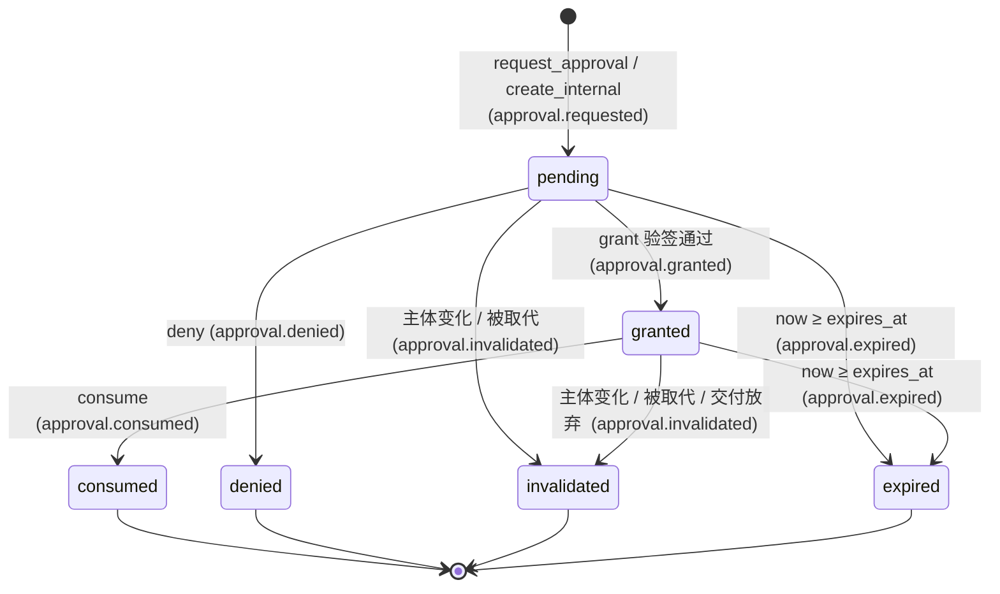

# 策略与审计（`policy`）

> 状态：设计 v0.1 · 里程碑：M1（policy v0，失败即关闭）→ M2（路径规则审批、审计日志、规则可配置）· 泳道：`sec` · crate / 目录：`crates/gantry-policy`

`policy` 是危险动作"放行"的唯一决策点（I3）：判定一个动作是自动放行、需要设备签名审批还是拒绝；对沙盒交回的补丁施加路径、大小、敏感文件规则（I8）；验证审批签名、维护审批状态机、保证"审批绑定的主体没变"；并把每个拒绝与审批的来龙去脉写进审计轨迹。它自己不执行任何 GitHub 写，也不碰 git。

## 1. 职责

1. **动作判定**：把一个待入队的 `ForgeActionKind`（连同它的载荷事实）解析成 `policies.actions` 里的动作 id（含三个条件伪动作 `force_push`、`push_outside_prefix`、`resolve_review_thread_human`），按生效的处置 `auto` / `approve` / `deny` 给出 `Allow` / `NeedsApproval` / `Deny`。**由入队方（`engine` / `guardian`）在入队时调用**，结果写入 `OutboxAction.requires_approval`；`forge` 不读 `policies.*`，只在执行时调用本模块验证并消费审批（P-62）。依据：[config.md §5.1](../interfaces/config.md)、[forge-actions §3.5](../interfaces/forge-actions.md)、decisions P-28、P-42、P-62。
2. **补丁规则判定**：`repo` 做机械检查并产出补丁事实 `PatchFacts`（能否干净应用、文件列表、大小、二进制、符号链接、子模块、权限位，P-69）；本模块只基于 `PatchFacts` 与配置做**规则判定**：路径规则（`policies.paths`、`allow_globs`、`JobSpec` 的 `allow` / `deny`）、大小上限（`policies.patch.*`）、敏感文件与密钥扫描、权限位变更，产出 `PatchPolicyVerdict`（`allow` / `needs_approval` / `deny`）。二进制与符号链接一律拒绝、子模块一律拒绝是 `repo` 的机械拒绝（P-68），本模块只对收到的事实再断言一遍。触及 `.github/workflows/` 一律拒绝（`policy.path_protected:workflows`），并建议上报 `decision_needed`（`payload.kind = manual_action`，附补丁供用户手动应用，P-48）。依据：[worker-protocol §8.3](../interfaces/worker-protocol.md) 的 P6、P8、P9，config.md §5.2、§5.4，decisions P-48、P-68、P-69。
3. **proposals 判定**：对 worker 的动作提议（`open_pr` 等）给出 `accepted` / `needs_approval` / `denied`（[worker-protocol §8.4](../interfaces/worker-protocol.md)）。文本净化与 `target` 句柄校验不归本模块。
4. **审批生命周期**：创建审批（Forge 动作与补丁审批由 `engine` / `guardian` 经本模块创建，内部动作由 `api` 代客户端创建）、签发挑战（challenge）、验签放行（`grant`）、拒绝（`deny`）、消费（`consume`）、失效（`invalidated`）、过期（`expired`）。`Approval.action` ∈ `ForgeActionKind` ∪ {`settings_update`、`device_role_change`、`device_revoke`、`force_push`、`push_outside_prefix`、`resolve_review_thread_human`、`patch_apply_protected`}；每个动作的 `target` / `subject_digest` 形状以 data-model 的列表为准，**未定义形状的动作一律失败即关闭**。**审批在执行开始前消费**（`consumed`，记录 Outbox 动作 ID）；执行终态失败不退回，需要新审批（P-54）。状态机见 [data-model §4.4](../data-model.md)，decisions P-20、P-54。
5. **验签与主体一致性**：按 [api.md §6.2–§6.4](../interfaces/api.md) 的规范化（canonicalization）载荷与 ES256（ECDSA P-256 + SHA-256）重建、验证签名；验签只用设备配对时登记的**审批签名公钥** `approval_pubkey`（与 mTLS 客户端证书密钥是两把不同的密钥，P-47）；`subject_digest`（PR 类为 head SHA，补丁为 `sha256:…`，内部动作为请求体摘要）在放行与消费两个时点各核对一次；任何推送使绑定旧 head 的审批失效（architecture §7.4）。
6. **审计**：每次拒绝写 `policy.denied`，每次审批状态转移写对应 `approval.*` 事件；所有判定事件带做决定时的 `config_rev`（config.md §2.6）；M2 起提供基于事件日志的审计查询。审计是事件日志的视图，不另设可改写的存储。
7. **M1 → M2 过渡**：M1 的 policy v0 用内置规则，对 `.github/workflows/`、依赖清单、lockfile 的改动一律拒绝并建议上报（失败即关闭 fail-closed，P-19），`merge_pr` 等动作的设备签名审批 M1 起即可用（P-18）；M2 起 `policies.*` 可配置，依赖清单与 lockfile 由"拒绝"改为"需要审批"（`patch_apply_protected`，P-11）；**workflow 文件在任何里程碑都拒绝**（P-48）。
8. **配置消费**：读取 `policies.*` 的生效值（全局 + 项目覆盖，经 `core` 的 merge / clamp），原子热加载，向 `settings/status` 汇报 `applied_rev` 与健康。

### 1.1 各里程碑交付

| 里程碑 | 交付 |
| --- | --- |
| M0 | 不交付实现。依赖 M0 产物：`core` 中的 `Approval`、`ApprovalStatus`、`ApprovalAction`、`ForgeActionKind`、`PatchFacts`、事件枚举，`core::ports::PolicyPort`（P-51），`schemas/events/approval.*.json`、`policy.denied.json`，`schemas/config/policies.json`；`contract` 泳道交付的 `FakePolicy`（P-51，§12.1）。本模块在 M0 只落 crate 骨架 |
| M1 | policy v0：内置规则（不读 `policies` 设置，`applied_rev = 0`）；动作判定（`merge_pr` 恒需审批、`push_branch` 等按内置默认）；补丁规则判定（大小上限、P6 / P8 / P9，受保护路径一律 deny + 上报提示，workflow 文件附补丁上报 `manual_action`）；审批状态机全部状态与转移；challenge / 用 `approval_pubkey` 验签 / 主体一致性（`merge_pr` 与三个内部动作 `settings_update`、`device_role_change`、`device_revoke`）；`forge.pr_synchronized` 驱动的失效；过期清扫；`policy.denied` 与 `approval.*` 事件；`PolicyPort::consume_for_execution` 供 `forge` 执行前消费审批 |
| M2 | `policies.*` 可配置（热加载、项目覆盖 clamp、`applied_rev`）；依赖清单 / lockfile 的路径规则由 deny 改为 `needs_approval`，补丁审批（`patch_apply_protected`，`subject_digest` = 补丁 sha256，`repo` 提交前经 `consume_patch_approval` 消费，P-54；workflow 仍拒绝，P-48）；审批因新推送失效后的重新请求路径（与 `engine` 配合）；审计查询；`repo_meta` 等规则生效 |
| M3 | `reply_review_thread` / `resolve_review_thread` 判定上线（含 `resolve_review_thread_human` 条件伪动作）；审计保留期若已决（config.md OQ-21）则落地；无其他新增 |
| M4 | 无新增功能；回归：手机档案设备在任何情形下都不能 `grant`（§8） |

## 2. 不负责

| 事 | 归谁 |
| --- | --- |
| 执行任何 GitHub 写；执行点对 GitHub 实时 head 的复核 | `forge`（Outbox，I2；[forge-actions §2.5](../interfaces/forge-actions.md)）。本模块只提供 `PolicyPort::consume_for_execution` 的审批状态半边 |
| 运行 git、应用补丁、枚举补丁变更、路径规范化（P2、P3、P4）、机械拒绝（应用失败、二进制、符号链接、子模块，发 `patch.rejected`）、base 一致（P10）、空补丁（P11）、创建提交 | `repo` 的补丁闸门（decisions P-25、P-68、P-69）。本模块只吃它给的 `PatchFacts`；`policy.denied` 只用于本模块的策略判定 |
| proposals 的 `target` 句柄、文本净化（HTML、`@` 提及、跨仓库引用、命令串） | `engine` / `repo` / `forge`（forge-actions §2.4 第二道） |
| HTTP 路由、challenge 的 HTTP 外壳、`Idempotency-Key`、限流、角色 / 档案的路由级判定 | `api`。本模块对 `grant` 另做防御性检查（§8），不依赖调用方 |
| 设备证书、审批签名公钥 `approval_pubkey` 的保管与吊销表 | `pki`；`approval_pubkey` 由 `api` 从 `pki` 取出后随请求传入，本模块不依赖 `pki` crate（architecture §4 依赖图） |
| 写 InboxItem、推送通知 | `notify`；本模块只在返回值里给 `ReportHint`，由调用方（`engine` / `guardian`）经 `InboxPort::raise` 上报 |
| 守护的分流表、"已审批 PR 上不得静默推送"的执行（锁定类 `push_after_approval`） | `guardian`（config.md §5.5）。本模块提供查询 `live_approvals_for_pr`（§6.1） |
| 档位自动加码 `policies.escalation` 的求值 | `engine`（config.md §5.3）。本模块经 `PolicyPort::path_rules` 导出 `PathRuleSet`（§6.2）供其复用 |
| 设置的读写、合并、校验（V01–V22）、`dry_run` | `api` + `core`（config.md §2.1、§11）。本模块只消费结果 |
| GitHub review approve | 永不提供（P-12；forge-actions §3.4） |

## 3. 依赖

本文中不带路径的 `api.md`、`config.md`、`forge-actions`、`worker-protocol` 均指 `docs/interfaces/` 下的契约；模块规格写作 `modules/<id>.md`，本规格自身称"本文"。

| 依赖 | 用到什么 | 契约 |
| --- | --- | --- |
| `core` | 端口 trait `core::ports::PolicyPort`（本模块实现，P-51）与 `TxHandle`；`Approval`、`ApprovalStatus`、`ApprovalAction`（= `ForgeActionKind` ∪ 七个非 Forge 动作，P-54）、`PatchFacts`、`ApprovalTarget`、`SubjectDigest`、`Nonce`、`ForgeActionKind`、`PolicyActionId`（20 个）、`DeviceRole`、`DevicePlatform`、`Actor`、`GitOid`、`RepoSlug`、`Sha256Digest`、`UntrustedText`、`Clock`、`Entropy`、事件枚举；审批状态机 `machines::approval::{check, can_consume, on_subject_changed}`；待签字节的唯一构造点 `ApprovalPayload::signing_bytes`、`jcs` / `jcs_digest`；`effective` / `merge_patch`（设置合并与收紧）、`Consumer` | [core.md §6.1–§6.6](core.md)；[data-model §3 Approval、§4.4、§5](../data-model.md)；[config.md §2](../interfaces/config.md) |
| `store` | 见 §3.1：写事务、一致读、事件订阅、持久游标、`dedup_key`、模块私有表 | [store.md §6、§7.10](store.md) |
| 非依赖 | **不依赖** `pki`、`forge`、`repo`、`engine`（`forge`、`repo`、`engine`、`guardian` 经 `core::ports::PolicyPort` 反过来调用本模块，P-59）。审批签名公钥、当前 PR head、补丁事实都由调用方传入或从 `store` 投影读取 | architecture §4 |

### 3.1 对 `store` 的用法（接口以 [store.md](store.md) 为准）

| 用法 | `store` 提供的接口 |
| --- | --- |
| 审批转移：读当前状态 + 追加事件 + 推进游标，同一事务 | `Store::begin_write()` → `WriteTx::read()`（`ProjectionRead::approval`）+ `append(NewEvent)`（返回 `Appended::{New, Duplicate}`）+ `advance_cursor`；单写者保证"先检查后写入"之间不会被他人插入（store.md §6.1 约定）；`approval.consumed` 追加时 `store` 调 `core::machines::approval::can_consume` 二次校验 |
| 读 | `Store::snapshot()` → `ReadSnapshot`：`approval`、`approvals`、`due_approvals`（已到期仍为 `pending` / `granted`，供清扫）、`pr_snapshot`（当前 PR head）、`device`、`settings_current`、`config_rev` |
| 订阅 | `EventLog::tail(after, EventFilter)` 订阅 `forge.pr_synchronized`、`forge.synced`、`forge.pr_closed`、`forge.pr_merged`、`delivery.abandoned`、`settings.updated`；持久游标 `Cursors::{load, advance}`，消费者名 `"policy"` |
| 去重 | `NewEvent.dedup_key`；命中返回 `Appended::Duplicate`，无副作用（`policy.denied` 去重靠它） |
| 私有表 | `ModuleSpec { module: "policy", migrations, projector: None }`：`policy_challenges`、`policy_consumed`，经 `WriteTx::module_conn("policy")` 在同一事务读写 |
| `approvals` 投影 | 默认由 `store` 内置投影器维护；是否由本模块接管（`owns`）是 store.md OQ-2。**本规格只通过 `ProjectionRead` 读取，不依赖由谁维护** |

## 4. 输入

| 输入 | 来源 | 格式 / 契约 | 信任级别 |
| --- | --- | --- | --- |
| `ActionRequest`（待判定的 Forge 动作与载荷事实） | `engine`、`guardian`（入队时，P-62） | §6.1；动作词表见 [forge-actions §3.1](../interfaces/forge-actions.md) | 调用方可信；载荷里来自 GitHub 或沙盒的文本字段（分支名、标题）是数据，只比较不解释 |
| `PatchFacts` + `AddedLineSource`（补丁的机械检查事实与新增行） | `repo` | §6.2；类型在 `core`，形状以 [repo.md §6.3](repo.md) 为准（P-69）；事实来自服务端 git 在干净检出上的输出（worker-protocol §8.3 P3） | **事实的来源是不可信补丁**：路径、内容都当数据；本模块不执行、不解释其中任何文本（I5） |
| `Vec<Proposal>` | `engine`（已过 V6 的 `kind` / `target` / 净化检查） | worker-protocol §5.4 | 不可信（worker 产出）；只按 `kind` 与结构化字段判定 |
| `GrantRequest`（nonce、签名、审批签名公钥与角色快照） | `api` | §6.4；签名串为 base64url | `nonce`、`signature` 不可信，验证前不采纳；`approval_pubkey` / 角色由 `api` 从 `pki` 实时读取，视为可信 |
| `ConsumeInternal`（内部动作写入时的校验上下文） | `api`（与业务写入同一事务） | §6.4 | 请求体摘要由 `api` 用本模块的 `signing::request_digest` 计算 |
| `ExecutionCheck` | `forge` 执行器（执行开始前，P-54） | §6.5；`live_head_sha` 来自 `forge` 执行前对 GitHub 的实时 `GET` | GitHub 内容，不可信但被当作"待比较的事实" |
| ForgeEvent / 生命周期事件流 | `store` | [forge-actions §6.3](../interfaces/forge-actions.md)：`forge.pr_synchronized`（`head_sha`、`previous_head_sha`）、`forge.synced`、`forge.pr_closed`、`forge.pr_merged`；`delivery.abandoned` | 结构可信，文本字段当数据 |
| `policies.*` 生效配置 | `store`（`settings.updated` + `core` merge） | [config.md §5](../interfaces/config.md) | 可信（经 `api` 校验与角色 / 签名闸门写入） |

## 5. 输出

| 输出 | 去向 | 格式 / 契约 |
| --- | --- | --- |
| `ActionDecision`（`Allow` / `NeedsApproval` / `Deny`） | `engine`、`guardian` | §6.1 |
| `PatchPolicyVerdict`（含 `reasons[]`、`matched_approval_rules[]`、`ReportHint?`） | `repo`（据此写 `patch.validated`；策略拒绝由本模块写 `policy.denied`，`engine` 据此推进） | §6.2；reason 码取 worker-protocol §9 的 `policy.*` 子码 |
| `ProposalDecision[]` | `engine` | §6.3 |
| `Approval`（投影行）及其转移 | `api`（读、challenge、grant、deny）、`forge`（执行前消费）、`engine`（读状态） | api.md §6.1 的表示；data-model §4.4 |
| 事件：`approval.requested` / `approval.granted` / `approval.consumed` / `approval.invalidated` / `approval.expired` / `approval.denied`、`policy.denied` | `store` | data-model §5.2；`data` 的 JSON Schema 在 `schemas/events/<type>.json`（M0）。所有判定类事件带 `config_rev` |
| `ReportHint`（建议上报的 InboxItem 类别、`payload.kind` 与 `reason_code`） | 调用方经 `InboxPort::raise` 转交 `notify` | §6.1 |
| `applied_rev` / 健康 | `api` 的 `GET /v1/settings/status` | [config.md §2.8](../interfaces/config.md)（`modules.policy`） |
| 审计查询结果（M2） | `api` 之外的内部调用方；暂无客户端路由（OQ-P8） | §6.6 |

## 6. 对外接口

以下是 Rust 签名草案，`async` 使用 `async_trait` 或等价物；类型 `GitOid`、`Sha256Digest`、`RepoPath`、`Seq`、`Timestamp`、`PatchFacts` 来自 `core`。服务端模块之间的端口 trait 一律定义在 `core::ports`（P-51）：**`PolicyPort`** 是 `engine`、`guardian`、`repo`、`forge` 调用本模块的唯一端口，由 `PolicyEngine` 实现，`gantryd` 装配时注入；`api` 用到的 `ApprovalService`（§6.4）与 `AuditLog`（§6.6）只有 `api` 一个调用方，留在本 crate。M0 的 `FakePolicy`（`contract` 泳道交付，P-51）实现同一个 `PolicyPort`。

```rust
// core::ports（签名以本节为准；core.md §6.10 引用）
#[async_trait]
pub trait PolicyPort: Send + Sync {
    // ---- 入队方（engine、guardian）：§6.1、§6.3 ----
    /// 判定一个**待入队**的 Forge 动作（P-62：入队方在入队时调用，结果写入 OutboxAction.requires_approval）。
    /// 幂等、可重复调用；不产生副作用，除非结果为 Deny（追加 policy.denied，按 dedup_key 去重）。
    async fn decide_action(&self, req: ActionRequest) -> Result<ActionDecision, PolicyError>;
    /// 创建（或返回已存在的同主体 pending）审批。事件 approval.requested。
    /// spec 只能来自 decide_action / evaluate_patch / decide_proposals 返回的 NeedsApproval，调用方不能自拟。
    async fn request_approval(&self, spec: ApprovalSpec, ctx: ActorCtx /* core::ports，P-78 */) -> Result<Approval, PolicyError>;
    /// 审批的发起方在主体被替换时主动作废（如补丁被新 Attempt 取代、交付单元被放弃）。
    async fn invalidate(&self, id: &ApprovalId, reason: InvalidateReason, actor: Actor) -> Result<Approval, PolicyError>;
    /// 守护用：某 PR 上是否存在 pending / granted 的审批（"已审批 PR 上不得静默推送"）。
    async fn live_approvals_for_pr(&self, repo: &RepoSlug, number: u64) -> Result<Vec<Approval>, PolicyError>;
    async fn decide_proposals(&self, ctx: &ProposalContext, items: &[Proposal]) -> Result<Vec<ProposalDecision>, PolicyError>;

    // ---- repo：补丁规则判定（§6.2，P-69）----
    async fn evaluate_patch(&self, facts: &PatchFacts, added: &dyn AddedLineSource) -> Result<PatchPolicyVerdict, PolicyError>;
    /// held 补丁提交前核对并消费 patch_apply_protected 审批（P-54），在 repo 传入的写事务里追加 approval.consumed；consumed_by = att_…。
    async fn consume_patch_approval(&self, tx: &mut dyn TxHandle, approval: &ApprovalId, check: &PatchApprovalCheck)
        -> Result<PatchPermit, GateError>;
    fn path_rules(&self, project: &ProjectId) -> Arc<dyn PathRuleSet>;            // guardian、engine 复用
    fn path_rules_snapshot(&self, project: &ProjectId) -> PathRulesSnapshot;       // JobSpec.constraints.paths
    fn scan_text(&self, text: &str) -> Vec<SecretFinding>;                         // repo / forge 出站净化复用

    // ---- forge：执行开始前验证并消费审批（§6.5，P-54、P-62）----
    async fn consume_for_execution(&self, approval: &ApprovalId, check: &ExecutionCheck, act: &ActionId)
        -> Result<ExecutionPermit, GateError>;
}
```

### 6.1 动作判定（入队方：`engine`、`guardian`）

`decide_action`、`request_approval`、`invalidate`、`live_approvals_for_pr` 的语义见上方 trait 注释；类型如下。

```rust

pub struct ActionRequest {
    pub project_id: ProjectId,
    pub delivery_id: Option<DeliveryId>,
    pub kind: ForgeActionKind,               // core；14 个之一
    pub facts: ActionFacts,                  // 按 kind 的结构化事实，见下
    pub requested_by: Actor,              // {kind: engine|guardian, id}
}

pub enum ActionFacts {
    MergePr { repo: RepoSlug, number: u64, expected_head_sha: GitOid },
    PushBranch {
        repo: RepoSlug, branch: String, branch_prefix: String,   // forge.push.branch_prefix（默认 "gantry/"）
        force: bool, local_head_oid: GitOid, expected_remote_oid: Option<GitOid>,
        expected_tree_oid: Option<GitOid>,                          // = ValidatedPatch.result_tree（forge-actions §3.3）
        validation_ref: Option<Sha256Digest>,                    // = ValidatedPatch.sha256
    },
    ResolveReviewThread { repo: RepoSlug, thread_has_human_comment: bool },
    Other { repo: RepoSlug },                                     // 其余动作无需额外事实
}

pub enum ActionDecision {
    /// auto 放行，或已有 granted 且仍有效的审批（approval = Some）
    Allow { action_id: PolicyActionId, approval: Option<ApprovalId>, config_rev: Seq },
    /// 需要设备签名；pending 为已存在的待签审批（没有则调用方用 spec 调 request_approval）
    NeedsApproval { spec: ApprovalSpec, pending: Option<ApprovalId>, config_rev: Seq },
    /// 拒绝；report 为建议的上报
    Deny { action_id: PolicyActionId, reason: DenyReason, report: Option<ReportHint>, config_rev: Seq },
}

pub struct ApprovalSpec {                    // 与 api.md §6.1 的 action / target / subject_digest 一一对应
    pub action: ApprovalAction,              // 序列化为动作 id 字符串
    pub target: ApprovalTarget,
    pub subject_digest: SubjectDigest,
    pub delivery_id: Option<DeliveryId>,
    pub ttl: Duration,                       // 来自 policies.approval.ttl_s（Forge 动作）
}

/// payload_kind：decision_needed 的 payload.kind（如 workflow 补丁为 manual_action，P-48）；attach_patch：上报项附补丁原文引用供手动应用
pub struct ReportHint { pub inbox_kind: InboxKind, pub payload_kind: Option<String>, pub reason_code: String, pub severity: Severity, pub attach_patch: bool }

#[non_exhaustive]
pub enum DenyReason {
    ActionDenied,                // 处置为 deny
    ApprovalDenied,              // 同主体的审批已被拒绝
    ApprovalConsumed,            // 同主体审批已被消费（动作已执行过）
    HeadMismatch,                // 载荷 expected_head_sha 与 store 里 PR 快照的 head 不一致
    NoValidatedPatch,            // push_branch 找不到匹配的 patch.validated（I8）
    PatchDenied,                 // 关联补丁的结论是 deny
    MultipleApprovalsRequired,   // 同时命中两类审批（如 force + 路径规则），契约没有单审批覆盖方案
    ApprovalShapeUndefined,      // 处置为 approve，但该动作的 action/target/subject_digest 形状在 data-model 未定义（P-54：fail-closed）
    ApprovalChainUnavailable,    // 审批链路不可用，approve 按 deny（config.md §5 fail-closed）
}
```

`PolicyActionId` 取 [config.md §5.1](../interfaces/config.md) 的 20 个 id 之一（判定用）；`ApprovalAction`（审批用，P-54）= `ForgeActionKind`（14 个）∪ {`settings_update`、`device_role_change`、`device_revoke`、`force_push`、`push_outside_prefix`、`resolve_review_thread_human`、`patch_apply_protected`}，线上序列化为同一字符串空间（data-model Approval.`action`）；预留的 `delete_branch`、`publish_release`、`change_repo_settings` 不是审批动作。

### 6.2 补丁规则判定与路径规则（`repo`、`engine`、`guardian`）

分工（P-69）：`repo` 做机械检查并产出 `PatchFacts`（类型在 `core`，形状以 [repo.md §6.3](repo.md) 为准）；应用失败、二进制、符号链接、子模块等**机械拒绝**由 `repo` 发 `patch.rejected`（`reason`），不调用本模块。本模块只对能干净应用的补丁做**规则判定**（路径规则、大小上限、权限位、敏感内容），`policy.denied` 只用于这类策略判定。

- `evaluate_patch`：主责大小上限（P1，阈值即 `policies.patch.*`）、P6、P8、P9；对 `PatchFacts` 里不应出现的机械事实（二进制、符号链接、子模块）再断言一遍（纵深防御，§7.4 b–d 行）。结果为 deny 时追加 `policy.denied`；`patch.validated` 由 `repo` 写。
- `scan_text`：与 P9 同一个密钥扫描器，供 `repo` / `forge` 的出站净化复用（OQ-P3）。命中只返回位置与模式名，不返回明文。
- `consume_patch_approval`：held 补丁在批准后、`repo` 创建提交前**核对并消费**审批（P-54，data-model 审批形状表"`repo` 在应用补丁、创建提交之前消费"）：审批 `granted`、未过期、`action = patch_apply_protected`、`subject_digest` == 补丁 sha256、`target.attempt_id` == 该补丁的尝试、`target.rules` 覆盖该补丁命中的 `approve` 规则、`target.paths` 覆盖命中路径；通过则 `granted → consumed`（`approval.consumed`，`data.consumed_by = att_…`），在 `repo` 传入的写事务里追加；`repo` 随后创建提交（幂等锚点 `refs/gantry/attempt/<job_id>`，repo.md §7.5）。已被同一尝试消费 → `AlreadyConsumedBySameAttempt`（崩溃重放）；被别的尝试消费 → `ConsumedByOther`。承载该提交的 `push_branch` 不再需要补丁审批（§7.3 第 3 步只核对"已被消费"）。

```rust
pub struct PatchApprovalCheck { pub repo: RepoSlug, pub attempt_id: AttemptId, pub patch_sha256: Sha256Digest,
                                pub rules: Vec<RuleId>, pub paths: Vec<RepoPath> }   // 取自 ValidatedPatchRecord
pub enum PatchPermit { Consumed, AlreadyConsumedBySameAttempt }
```
- `path_rules` / `path_rules_snapshot`：路径规则的唯一实现（`guardian` 的 `protected` 判定、`engine` 的加码规则 `when.paths` 复用）；快照给 `JobSpec.constraints.paths` 与沙盒外观用（决策取 `evaluate_patch` 当时的当前规则，worker-protocol §4.5）。

```rust
pub trait PathRuleSet: Send + Sync {
    /// 对一组路径逐条求值：命中的规则 id 与处置；allow_globs 之外的路径标记 OutsideAllow。区分大小写。
    fn evaluate(&self, paths: &[RepoPath]) -> Vec<PathRuleHit>;
}
pub struct PathRuleHit { pub path: RepoPath, pub rule_id: Option<String>, pub disposition: Disposition, pub outside_allow: bool }

// PatchFacts / PatchFile 定义在 core，形状以 repo.md §6.3 为准（P-69）；本模块读取的字段：
//   project_id、delivery_id、attempt_id、patch_sha256（= 补丁审批的 subject_digest）、patch_bytes、total_changed_lines、
//   job_paths（JobSpec.constraints.paths.{allow, deny}）、files[]：{path（已过 P4 规范化）、status、old_mode、new_mode、
//   added、deleted、is_binary、is_symlink、is_submodule、size_after}。

/// 新增行的惰性来源（core::ports）：repo 在干净检出上按需读取，本模块逐行扫描后丢弃，不持久化。
pub trait AddedLineSource: Send + Sync {
    fn added_lines<'a>(&'a self, path: &'a RepoPath) -> Box<dyn Iterator<Item = std::io::Result<String>> + 'a>;
}

pub struct PatchPolicyVerdict {
    pub verdict: PatchVerdict,               // Allow | NeedsApproval | Deny
    pub reasons: Vec<PatchReason>,           // {code: PolicyCode, path: Option<RepoPath>, rule_id: Option<String>}
    pub matched_approval_rules: Vec<String>, // 命中 approve 的规则 id → Approval.target.path_rules
    pub report: Option<ReportHint>,
    pub config_rev: Seq,
}
/// 稳定字符串，等于 worker-protocol §9 的 failure_detail 子码（core 不做封闭枚举，这里是本模块会产出的子集）
/// PathProtected 带规则 id 后缀，如 policy.path_protected:workflows（P-48）
pub enum PolicyCode { Size, PathInvalid, Dotgit, Symlink, Submodule, Binary, PathOutsideAllow, PathDenied, PathProtected { rule_id: String }, Secret }
```

### 6.3 proposals 判定

`PolicyPort::decide_proposals` 逐条判定；任一条不通过只影响该条（worker-protocol §8.4）。

```rust
pub struct ProposalContext {
    pub project_id: ProjectId, pub delivery_id: DeliveryId, pub attempt_id: AttemptId,
    pub patch: Option<PatchVerdict>,         // open_pr 依赖本 Attempt 补丁的结论
    pub thread_has_human_comment: HashMap<ThreadHandle, bool>,   // resolve_review_thread 用
}
pub enum ProposalDecision {
    Accepted      { proposal_id: String, action_id: Option<PolicyActionId> },   // escalate 无 action_id
    NeedsApproval { proposal_id: String, spec: ApprovalSpec },
    Held          { proposal_id: String },                                // 依赖的补丁 needs_approval，一并挂起
    Denied        { proposal_id: String, reason: DenyReason },            // 每条拒绝一个 policy.denied
}
```

### 6.4 审批服务 `ApprovalService`（`api`、`engine`）

```rust
#[async_trait]
pub trait ApprovalService: Send + Sync {
    // ---- 读 ----
    async fn get(&self, id: &ApprovalId) -> Result<Option<Approval>, PolicyError>;
    async fn list(&self, q: ApprovalQuery, page: PageReq) -> Result<Page<Approval>, PolicyError>;   // status, delivery_id

    // ---- 内部动作的审批（客户端经 POST /v1/approvals）----
    /// action 必须是 InternalAction，否则 PolicyError::NotInternalAction（api 映射 422）。
    /// 有效期 policies.approval.ttl_s（含内部动作，api.md §3.7，C27）；同 (action, target, digest) 已有 pending 则返回它。
    async fn create_internal(&self, spec: InternalApprovalSpec, creator: Actor) -> Result<Approval, PolicyError>;

    // ---- challenge / grant / deny（api.md §6.2–§6.4）----
    /// 同一 (approval, device) 在有效期内重复调用返回同一份；用掉或过期后换新 nonce。
    async fn challenge(&self, id: &ApprovalId, device: &DeviceKey) -> Result<Challenge, ChallengeError>;
    async fn grant(&self, req: GrantRequest) -> Result<Approval, GrantError>;
    async fn deny(&self, id: &ApprovalId, device: &DeviceKey, reason: Option<String>) -> Result<Approval, GrantError>;

    // ---- 内部动作的消费：必须与业务写入同一事务 ----
    async fn consume_internal(&self, tx: &mut WriteTx, req: ConsumeInternal) -> Result<(), ConsumeError>;
}

/// 由 api 从 pki 实时读取后传入；policy 不信任调用方已做的授权，自己再查 role / profile（§8）。
/// verifying_key 是配对时登记的审批签名公钥 approval_pubkey（P-47），不是 mTLS 证书里的公钥。
pub struct DeviceKey {
    pub device_id: DeviceId, pub role: DeviceRole, pub profile: ClientProfile, pub status: DeviceStatus,
    pub approval_pubkey_fpr: String, pub verifying_key: p256::ecdsa::VerifyingKey,
}
pub struct GrantRequest {
    pub approval_id: ApprovalId, pub device: DeviceKey,
    pub nonce: String,                       // base64url，无填充，43 字符
    pub signature: String,                   // base64url，无填充，86 字符（r‖s 共 64 字节）
    pub current_subject: Option<CurrentSubject>,   // PR 类：api 先让 forge 对账后填入
    pub request_id: String,
}
pub enum CurrentSubject { PrHead { repo: RepoSlug, number: u64, head_sha: GitOid, observed_at: Timestamp } }
pub struct ConsumeInternal {
    pub approval_id: ApprovalId,
    pub expected_action: InternalAction,
    pub expected_target: ApprovalTarget,     // 由路径参数 / 路由推出
    pub body_digest: SubjectDigest,          // api 用 signing::request_digest 对本次请求体算出
    pub rev_check: Option<RevCheck>,         // settings：{ if_match_rev, current_rev }
    pub actor: Actor,                     // {kind: device, id}
}
pub enum GrantError {
    Forbidden,                               // 设备非 approver / 非桌面档案 / 非 active
    NotPending { status: ApprovalStatus },
    ChallengeInvalid { reason: ChallengeReason },   // Expired | Used | Mismatch | None
    SignatureInvalid,
    StaleHead { current_head_sha: GitOid },    // 审批已被置为 invalidated 并落盘
}
pub enum ConsumeError { Mismatch { reason: MismatchReason }, Store(StoreError) }
/// = api.md §3.1 approval_mismatch 的 reason 集合
pub enum MismatchReason { NotGranted, Consumed, Expired, ActionMismatch, TargetMismatch, DigestMismatch, BaseRevMismatch }
```

### 6.5 执行前消费审批：`PolicyPort::consume_for_execution`（`forge`）

`forge` 经 `core::ports::PolicyPort` 调用本模块（P-59：`forge` 依赖 `policy` 只为执行时验审批）；`forge` 不读 `policies.*`（P-62）。原草案中的 `ApprovalGate { get, validated_patch, consume, check_for_execution }` 合并为下面一个方法；`push_branch` 的 I8 机械复核改用 `RepoService::provenance`（repo.md §6.3），不再经本模块读 `patch.validated`。

**消费时点**（P-54）：审批在**执行开始前**消费——`forge` 认领动作、完成机械前置检查之后、发出任何 GitHub 变更请求之前调用一次；成功即 `granted → consumed`（`approval.consumed`，`data.consumed_by = act_…`，`data.subject_digest` 为核对时的主体）。之后执行无论成败都不退回审批：终态失败需要入队方用新 `epoch` 重新入队并取得**新审批**。

```rust
// core::ports（PolicyPort 的一部分）
//   async fn consume_for_execution(&self, approval: &ApprovalId, check: &ExecutionCheck, act: &ActionId)
//       -> Result<ExecutionPermit, GateError>;
pub enum ExecutionCheck {
    MergePr   { repo: RepoSlug, number: u64, expected_head_sha: GitOid, live_head_sha: GitOid },
    PushBranch{ repo: RepoSlug, branch: String, force: bool, local_head_oid: GitOid,
                expected_remote_oid: Option<GitOid>, validation_ref: Option<Sha256Digest> },
    Other     { kind: ForgeActionKind, target: String },   // 被配置为 approve 的其他动作（形状以 data-model 为准）
}
/// Consumed：本次完成消费，可以执行。
/// AlreadyConsumedBySameAction：此前已被同一 act 消费（崩溃后重放），可以继续执行（先 probe）。
pub enum ExecutionPermit { Consumed, AlreadyConsumedBySameAction }
/// forge-actions §2.6：ApprovalInvalid → 动作 cancelled；HeadChanged → precondition_failed(head_changed)；
/// ConsumedByOther → 动作 cancelled（approval_invalid）。三者都不发出 GitHub 变更请求，也不改变审批状态。
pub enum GateError { ApprovalInvalid { reason: MismatchReason }, HeadChanged { live_head_sha: GitOid },
                     ConsumedByOther { by: ActionId }, Store(StoreError) }
```

### 6.6 审计 `AuditLog`（M2）

```rust
#[async_trait]
pub trait AuditLog: Send + Sync {
    /// 只读；数据源是事件日志里的 policy.denied 与 approval.* （以及 OQ-P7 若决定增加的放行记录）。
    async fn query(&self, q: AuditQuery, page: PageReq) -> Result<Page<AuditRecord>, PolicyError>;
}
pub struct AuditQuery { pub project_id: Option<ProjectId>, pub delivery_id: Option<DeliveryId>,
    pub approval_id: Option<ApprovalId>, pub types: Vec<String>, pub since_seq: Option<Seq> }
```

### 6.7 签名原语：`core` 提供待签字节，本模块提供验签

待签字节与摘要的规范化由 `core` 实现并作为唯一构造点（core.md §6.2：`ApprovalPayload::signing_bytes`、`jcs`、`jcs_digest`），`api`（验签）与 `desktop-shell`（签名）共用它，字节不会分歧。本模块只加上验证与构造 challenge：

```rust
pub mod signing {
    /// 校验并 ES256 验签：签名串必须是严格 base64url、无填充、长度 86、解码后恰为 64 字节（r‖s，非 DER）。
    pub fn verify_es256(key: &VerifyingKey, input: &[u8], sig_b64: &str) -> Result<(), SigningError>;
    /// 由已存的 Approval + 设备 + nonce 构造 core::ApprovalPayload（v = 1；delivery_id 仅 Forge 动作带）。
    pub fn build_payload(a: &Approval, device: &DeviceId, nonce: Nonce, challenge_expires_at: Timestamp) -> ApprovalPayload;
    /// 内部动作的请求体摘要：core::jcs_digest(body)，格式 "sha256:" + 小写十六进制（api.md §6.6）。
    /// 无请求体按 {} 计算；api 与 desktop-shell 共用。
    pub fn request_digest(body: &serde_json::Value) -> Result<SubjectDigest, SigningError>;
}
```

`ApprovalPayload` 的字段与 api.md §6.2 一致（`action`、`approval_id`、`delivery_id?`、`device_id`、`expires_at`、`nonce`、`subject_digest`、`target`、`v`）。`target.path_rules` 是字符串数组，而 api.md §6.3 写"payload 只含字符串、整数、对象"，实现须支持字符串数组（OQ-P4 ②）。

## 7. 内部设计

### 7.1 关键数据结构

```rust
pub struct PolicyConfig {                    // 一个 (全局 | 项目) 的生效配置，已 clamp，不可变
    pub config_rev: Seq,                     // 所有适用 settings.updated 的最大 seq（config.md §2.3）
    pub actions: BTreeMap<PolicyActionId, Disposition>,   // 20 个 id 全覆盖
    pub unlisted_action: Disposition,        // Approve | Deny，不能是 Auto
    pub allow_globs: GlobSet,                // 默认 ["**"]
    pub paths: BTreeMap<String, PathRule>,   // id → {globs, disposition: Approve|Deny}
    pub approval_ttl: Duration,              // 默认 86400 s
    pub patch: PatchLimits,                  // max_files / max_bytes / max_changed_lines / max_file_bytes
}
pub enum Disposition { Auto, Approve, Deny } // 严格度 Auto < Approve < Deny
pub struct PolicyBuild { pub patch_approvals: bool, pub settings: SettingsSource }  // M1: {false, Builtin}；M2: {true, Store}
```

**审批投影**：`Approval` 的读写走 `store` 的 `approvals` 投影（`ProjectionRead::approval` / `approvals` / `due_approvals`，store.md §6.2、§7.2；谁维护投影见 store.md OQ-2，本模块不依赖）。状态转移必须同时满足 `core::machines::approval::check`（转移表）与 `can_consume`（消费时：`granted` ∧ 未过期 ∧ `subject_digest` 仍等于当前主体），`store` 追加事件时会再校验一次，非法转移被拒绝而不会进入日志。

本模块自有的两张表（`ModuleSpec { module: "policy" }` 的迁移，表名前缀 `policy_`，在**同一写事务**里经 `WriteTx::module_conn("policy")` 读写）：

| 表 | 列与约束 | 说明 |
| --- | --- | --- |
| `policy_challenges` | `approval_id`、`device_id`、`nonce`、`payload_canonical`（待签字节）、`issued_at`、`expires_at`、`used_at?`；主键 `(approval_id, device_id, nonce)`；部分唯一索引保证每个 `(approval_id, device_id)` 至多一个"未用且未过期"的行 | **用过的行保留**（审计：可凭它复原当时的待签字节与设备公钥指纹），保留期同事件日志 |
| `policy_consumed` | `approval_id` 主键、`consumed_by`（`act_…`、`att_…`（补丁审批）或 `req:<request_id>`）、`consumed_at` | 让崩溃重放的 `consume_for_execution` / `consume_patch_approval` 幂等（§6.5）；**不在 API 表示里**。`approval.consumed` 事件的 `data.consumed_by` 与它一致 |

审批创建时的 `config_rev` 记在 `approval.requested` 事件的 `data` 里（config.md §2.6），不另存列。

### 7.2 配置与热加载

- `ArcSwap<Arc<ConfigSet>>`，`ConfigSet = { global: Arc<PolicyConfig>, by_project: HashMap<ProjectId, Arc<PolicyConfig>> }`；`settings.updated`（`resource = "policies"`，任意 scope）到达时重算受影响项并**整体原子替换**。一次判定从开始到结束只用同一个快照（不在操作中途切换，config.md §2.6）。
- 生效值 = `clamp(merge(builtin, global, project), against = global)`，函数在 `core`；本模块不自写 merge。
- **硬底线**（校验器之外，本模块在装载时再断言一次，违反则拒绝该份配置、沿用上一份并把健康置 `degraded`）：`merge_pr`、`force_push`、`push_outside_prefix`、`resolve_review_thread_human`、三个预留动作的处置不是 `auto`（V14、P-42）；`sensitive_files` 与 `workflows` 处置为 `deny`（P-48）；`approval.ttl_s ≤ 604800`；`patch.*` 不超过 `core` 的硬上限；`unlisted_action ≠ auto`。
- **M1（`PolicyBuild.settings = Builtin`）**：不读 `policies` 设置，`applied_rev` 恒为 0，`status.modules.policy` 显示 `detail: "builtin_v0"`。内置值 = config.md §5.1–§5.4 的出厂默认。
- 冷启动无法读到配置：用内置值（比任何合法配置都严格或相等）。
- 路径通配符（glob）：gitignore 风格、区分大小写、仓库相对 POSIX 路径，用 `ignore` crate 的 `GitignoreBuilder` 或等价实现；**不支持 `!` 取反**（取反会让 `deny` 规则语义不可判定，V15 `glob_invalid` [建议]）。路径规则求值经 `PolicyPort::path_rules` 以 `PathRuleSet` 公开导出（§6.2），供 `guardian` 的 `protected` 判定与 `engine` 的加码规则 `when.paths` 复用，避免多处匹配语义漂移。

### 7.3 动作判定算法 `decide_action`

1. **解析 id**：`merge_pr` → `merge_pr`；`push_branch` 且 `force` → `force_push`；否则分支名不以 `branch_prefix` 开头 → `push_outside_prefix`；否则 `push_branch`；`resolve_review_thread` 且 `thread_has_human_comment` → `resolve_review_thread_human`；其余同名。force 与非前缀同时成立时取 `force_push`（审批的 `target.branch` 让签名者看到分支）。**此优先级契约未规定，属临时处理**（OQ-P5）。
2. **取处置**：`config.actions[id]`，缺失则 `unlisted_action`。
3. **`push_branch` 族的 I8 前置**（`push_branch` / `force_push` / `push_outside_prefix`）：必须从 `store` 读到 `validation_ref` 对应的 `patch.validated` 记录，其 `sha256 == validation_ref` 且 `result_tree == expected_tree_oid`；找不到 → `Deny(NoValidatedPatch)`。该补丁的结论为 `deny` → `Deny(PatchDenied)`；为 `needs_approval`（M2）→ 必须存在一份已被 `repo` 消费的 `patch_apply_protected` 审批（`consumed_by` = 该补丁的 `att_…`、`subject_digest = validation_ref`，P-54），否则 `Deny(PatchNotApproved)`；补丁审批在提交前已消费，**不**成为本次 `push_branch` 的 `requires_approval`，第 2 步的处置照常适用。
4. **`merge_pr`**：从 `store` 的 PR 快照读当前 head；`expected_head_sha ≠` 快照 head → `Deny(HeadMismatch)`（调用方应先重读）；否则审批规格为 `{merge_pr, {kind:"pr", repo, number}, digest = head}`。`merge_pr` 的 GitHub 侧就绪条件（必需 review、checks、merge queue）由 `engine` 在请求审批前确认、由 GitHub 在合并时强制；本模块不重复判断（P-12、P-33）。
5. **处置分派**：`auto` → `Allow`（`approval = None`）；`deny` → `Deny(ActionDenied)`；`approve` → 查同主体审批：`granted` 且未过期且主体仍一致 → `Allow{approval}`；`pending` → `NeedsApproval{pending}`；`denied` → `Deny(ApprovalDenied)`（同主体不再自动重新询问；主体变了才会产生新规格）；`consumed` / `invalidated` / `expired` → `NeedsApproval{pending: None}`（`expired` / `invalidated`）或 `Deny(ApprovalConsumed)`（`consumed`）。
6. **审批形状表**（`approve` 处置时的 `action` / `target` / `subject_digest`）：

| 判定 id | `Approval.action` | `target` | `subject_digest` | 出处 |
| --- | --- | --- | --- | --- |
| `merge_pr` | `merge_pr` | `{kind:"pr", repo, number}` | PR head SHA（40 位十六进制） | api.md §6.1 |
| `force_push` | `force_push` | `{kind:"branch", repo, branch, expected_remote_oid}` | `local_head_oid` | forge-actions §2.5 |
| 补丁需审批（M2，依赖清单 / lockfile 等；由 `evaluate_patch` 的 `NeedsApproval` 产生，不经本算法） | `patch_apply_protected` | `{kind:"patch", repo, attempt_id, rules:[…], paths:[…]}` | `ValidatedPatch.sha256`（`sha256:…`） | data-model 审批形状表（P-54）；`repo` 在提交前经 `consume_patch_approval` 消费 |
| `push_outside_prefix`、`resolve_review_thread_human`、被配置为 `approve` 的其他 `ForgeActionKind` | 同名 | 以 data-model 审批形状表为准 | 以 data-model 审批形状表为准 | P-54 |
| data-model 未列形状的动作 | — | — | — | → `Deny(ApprovalShapeUndefined)` + 上报（失败即关闭，P-54） |

本表只是对 data-model 审批形状表的引用摘录；两者不一致时以 data-model 为准，本模块的形状常量表由 `core` 生成并有逐行对照测试。

7. **失败即关闭**：读 `store` 失败、配置装载失败、审批链路不可用（无法创建 / 读取审批行）→ `approve` 按 `deny` 处理，`Deny(ApprovalChainUnavailable)`，`ReportHint` 建议 `escalation`（config.md §5 fail-closed）。
8. **审计**：`Deny` 追加 `policy.denied`：`data = {action_id, kind, target, reason_code, config_rev, subject?}`，`dedup_key = hash(project, delivery, action_id, target, subject_digest?, reason_code, config_rev)`，同一判定被反复调用不会刷屏。`NeedsApproval` 的事件是创建审批时的 `approval.requested`（`data` 含 `action`、`target`、`subject_digest`、`expires_at`、`config_rev`、`requested_by`）。

### 7.4 补丁策略算法 `evaluate_patch`

在 repo 已完成机械检查（能干净应用、P2–P4、二进制 / 符号链接 / 子模块拒绝）的前提下（P-69：a 行大小上限由本模块判定，阈值由本模块持有；b–d 行是对 repo 所给事实的纵深防御复查），按下表顺序逐条取"最严"结论（`deny` > `needs_approval` > `allow`），**收集全部命中的 reasons**（不在首个 deny 处停止，便于审计；但任一 deny 即整体 deny）。规则取调用时的**当前**配置（worker-protocol §8.3 P8）。

| 步 | 检查 | 结论 | reason 码 |
| --- | --- | --- | --- |
| a | P1 大小：`patch_bytes > max_bytes`、`files.len() > max_files`、`total_changed_lines > max_changed_lines`、任一 `size_after > max_file_bytes` | deny | `policy.size` |
| b | P5 防线（repo 已机械拒绝，此处再断言）：`is_symlink` 或 `new_mode` 为 `120000` | deny（P-68：符号链接一律拒绝，无审批路径） | `policy.symlink` |
| c | P5 防线（repo 已机械拒绝，此处再断言）：`is_submodule`、`160000` 或路径为 `.gitmodules` | deny | `policy.submodule` |
| d | P7 二进制：`is_binary`（repo 已机械拒绝，此处再断言） | deny（P-68：二进制一律拒绝，无审批路径；`binary_allowlist` 已撤销） | `policy.binary` |
| e | P8 allow：路径不在 `JobSpec.allow ∩ allow_globs` | deny | `policy.path_outside_allow` |
| f | P8 deny：命中 `JobSpec.deny` 或 `policies.paths` 中处置为 `deny` 的规则 | deny | `policy.path_denied`；规则 id 为 `sensitive_files` 时用 `policy.secret`（OQ-P5） |
| g0 | 路径命中 `workflows`（`.github/workflows/**`） | **任何里程碑都 deny**，不可配置为 `approve`（P-48）；`ReportHint{decision_needed, payload_kind = "manual_action", attach_patch = true}`，附补丁供用户手动应用 | `policy.path_protected:workflows` |
| g | P8 approve：命中处置为 `approve` 的规则（默认 `dependency_manifests`、`lockfiles`、`repo_meta`） | M1（`patch_approvals = false`）：deny + `ReportHint{escalation, "policy.path_protected:<rule_id>"}`；M2：needs_approval（`patch_apply_protected`），记 `matched_approval_rules` | `policy.path_protected:<rule_id>`（M1） |
| h | P6 权限位：已有文件 `100644 ↔ 100755`；新文件 `100755` 允许并记录 | M1 deny；M2 needs_approval（伪规则 id `file_mode_change`） | 码待定（OQ-P5） |
| i | P9 敏感内容：对每个新增行运行密钥扫描器；路径命中 `sensitive_files` 已在 f 处理 | deny | `policy.secret` |

- "新旧路径都算"：`--no-renames` 使重命名表现为删除 + 新增两条记录，两条都参与 e–g。
- 多规则命中：处置取最严；`matched_approval_rules` 去重排序，保证同一补丁的审批规格稳定。
- 密钥扫描器：与 forge 出站净化共用（OQ-P3）；逐行流式扫描，不缓存内容，扫描结果与日志里**不得出现命中的明文**，只记路径与模式名。
- 事件里的路径来自不可信补丁：作为 `UntrustedText`（`source: "sandbox:patch_path"`）写入，截断到合理长度（建议 512 字节）。

### 7.5 审批状态机



| 规则 | 说明 |
| --- | --- |
| 转移 = 一次 CAS + 一条事件 | 在同一 `WriteTx` 里 `tx.read().approval(id)` 取当前状态 → `core::machines::approval::check(from, to)` → `append(event)`；单写者下读到的状态在本事务提交前不会被他人改变（store.md §6.1、§7.10），等价于比较并交换。失败即返回最新状态对应的错误 |
| 终态不可变 | `consumed` / `denied` / `invalidated` / `expired` 之后没有任何转移；要重做必须创建新审批 |
| 一次消费 | `granted → consumed` 只发生一次；内部动作与业务写入同一事务（失败则一起回滚）；Forge 动作在执行开始前由 `consume_for_execution` 消费，执行终态失败不退回（§6.5，P-54） |
| 并发 grant | 多个 approver 设备并发：先提交者赢，其余 `NotPending` |
| 懒过期 | 任何读 / 转移入口先比较 `now ≥ expires_at`，是则先 CAS 到 `expired` 再返回，不依赖清扫任务及时运行 |
| `granted` 后规则变 deny | 消费时重判（config.md §2.6）：被阻止，审批状态**不变**，`GateError::ApprovalInvalid`；不自动 `invalidated`（契约只把"绑定 head 变化"定义为失效原因） |
| 有效期 | 所有动作（含内部动作）：`created_at + approval.ttl_s`（默认 86400 s，创建时固化，api.md §3.7，C27）；挑战的存活时间（TTL）120 s 且不超过审批的 `expires_at` |

### 7.6 challenge 与验签

**`challenge(id, device)`**：校验设备是 `approver`、桌面档案、`active`（否则 `Forbidden`）；审批必须 `pending`（先懒过期）。查 `policy_challenges` 中该 `(approval, device)` 未用且未过期的行，有则原样返回；无则生成 32 字节 CSPRNG nonce（base64url 无填充，43 字符），`expires_at = min(now + 120 s, approval.expires_at)`，用 `signing::build_payload` 构造 `core::ApprovalPayload`（`v = 1`）并取其 `signing_bytes()`，存入 `policy_challenges`，返回 `{payload, signing: {alg:"ES256", canonicalization:"JCS", prefix:"gantry/approval/v1\n"}}`。`payload.delivery_id` 仅 Forge 动作带；`nonce` 用 `core::Nonce`（32 字节，base64url 无填充）。

**`grant(req)`** 严格按 api.md §6.4 校验顺序，任一步失败立即返回、不进入下一步：

1. 设备 `active` 且 `role = approver` 且 `profile = desktop`（防御性复查，§8）→ 否则 `Forbidden`。
2. 审批 `pending`（懒过期）→ 否则 `NotPending{status}`。
3. 取该设备的 challenge：无 → `ChallengeInvalid{None}`；`nonce` 不等（常量时间比较）→ `Mismatch`；已用 → `Used`；已过期 → `Expired`。
4. 用**服务端保存的** `payload_canonical` 重建待签字节（客户端不能提交 payload），`verify_es256`，不通过 → `SignatureInvalid`。签名串必须是严格 base64url、无填充、长度 86，解码后恰为 64 字节；其余一律 `SignatureInvalid`。
5. PR 类动作：`payload.subject_digest == current_subject.head_sha`（`current_subject` 由 `api` 在调用前让 `forge` 强制对账一次后传入，其 `repo` / `number` 须与审批 `target` 一致，否则视为未提供；缺失则退回读 `store` 快照）。不等 → **先落盘** `pending → invalidated`（`approval.invalidated`，`data` 含新旧 head），**再**返回 `StaleHead{current_head_sha}`（这次调用不回滚状态转移）。补丁与内部动作的主体在消费时核对。
6. 通过：同一事务写 `device_id`、`signature`、`status = granted`，标记 challenge `used_at`，追加 `approval.granted`（`data`：`approval_id`、`device_id`、`approval_pubkey_fpr`、`payload_sha256`），`200`。

**`consume_internal(tx, req)`** 对应 api.md §6.6 第 4 步的 #2–#5（#1 缺头与 #6 角色由 `api` 判）：`status` 不是 `granted` → `NotGranted`（`consumed` → `Consumed`，过期 → `Expired`）；`action` / `target` 与路由推出的不一致 → `ActionMismatch` / `TargetMismatch`；`body_digest ≠ subject_digest` → `DigestMismatch`；`rev_check`（settings）：`target.base_rev` 须等于 `if_match_rev` 且等于 `current_rev` → 否则 `BaseRevMismatch`（`if_match_rev ≠ current_rev` 的 `412` 由 `api` 在此之前判，优先级更高）。全部通过则 `consumed` + `approval.consumed`（`data.consumed_by = "req:<request_id>"`），与调用方传入的 `tx` 同事务。

**`consume_for_execution`**（Forge 动作，`PolicyPort`，P-54）：在**一个**写事务里完成核对与消费，`forge` 在执行开始前调用：

1. 审批已是 `consumed`：`policy_consumed.consumed_by` 等于本动作 `act` → `AlreadyConsumedBySameAction`（崩溃后重放，`forge` 先 probe 再继续）；否则 → `ConsumedByOther`。
2. 审批必须 `granted` 且未过期（懒过期）→ 否则 `ApprovalInvalid`。
3. `action` 与 `kind` 匹配、`target` 与载荷目标一致（`push_branch`：`target.branch == branch`；`force` 时 `expected_remote_oid` 也要一致）；`merge_pr`：`approval.subject_digest == expected_head_sha == live_head_sha` → 否则 `HeadChanged`；`force_push`：`subject_digest == local_head_oid`。（`patch_apply_protected` 不经本方法：它由 `repo` 在提交前经 `consume_patch_approval` 消费。）
4. 按当前配置重判该动作，处置为 `deny` → `ApprovalInvalid{NotGranted}`（审批状态不变）。
5. 通过：`granted → consumed`，写 `policy_consumed(consumed_by = act)`，追加 `approval.consumed`（`data` 含 `consumed_by`、`subject_digest`——core.md 要求消费事件带消费时核对的摘要），返回 `Consumed`。

这些比较与 forge-actions §2.5 / forge.md §7.8 的机械复核重复，是有意的纵深防御；规则重判是 `forge` 做不了的部分。消费之后执行失败（终态）**不退回**审批：`forge` 追加 `outbox.failed`，入队方要重做须新 `epoch` 并取得新审批（P-54）。

### 7.7 失效与过期（后台任务）

| 任务 | 触发 | 动作 |
| --- | --- | --- |
| `InvalidationSubscriber` | `EventLog::tail`，持久游标 `Cursors`（consumer = `"policy"`）；至少一次，转移受 `machines::approval::check` 约束，所以幂等 | `forge.pr_synchronized`（**无论 `origin`**，forge-actions §4.5）与 `forge.synced` 中 PR head 变化：对该 PR 上 `merge_pr` 类的 `pending` / `granted` 审批调用 `machines::approval::on_subject_changed(a, new_head)`，返回 `Some(invalidated)` 的置 `invalidated`。`forge.pr_closed`：该 PR 上全部活跃审批 `invalidated`。`forge.pr_merged`：`pending` 的 `invalidated`，`granted` 的由消费路径处理。`delivery.abandoned`：该交付单元的活跃审批 `invalidated`。事件带 `stale = true` 的 check / review 不参与（G4） |
| `ExpirySweeper` | `tokio::time::interval`（建议 30 s） | 用 `ProjectionRead::due_approvals(now, limit)` 取已到期仍为 `pending` / `granted` 的审批，逐个转 `expired`（懒过期之外的兜底，保证 `approval.expired` 事件及时出现） |
| `ConfigSubscriber` | `settings.updated` | §7.2 |

补丁审批（`patch_apply_protected`，`target.rules` / `target.paths`）的主体是补丁摘要，不随 PR head 变；它的失效由 `engine` 在补丁被新 Attempt 取代或交付单元放弃时调用 `invalidate`。**`forge.base_advanced` 是否使审批失效契约未定**（OQ-P9）；本规格不失效。

### 7.8 并发模型与持久化

- `PolicyEngine: Send + Sync`，无进程内可变状态（除 `ArcSwap` 配置与游标），所有审批读写走 `store`；多线程调用安全，进程重启无需恢复内存。
- 写路径一律 `WriteTx`（SQLite 单写者串行化）；读路径用 `ReadSnapshot`。`decide_action` 本身是读 + 条件追加 `policy.denied`。
- 事件是事实源，`approvals` 为 `store` 里的投影（§7.1）；`policy_challenges`、`policy_consumed` 是本模块的辅助表（不是事件，nonce 不进事件日志，OQ-P7）。
- 恒定时间比较（`subtle`）用于 nonce；随机数用 `Entropy` trait（生产 `OsRng`）。
- 依赖 crate 建议：`p256` / `ecdsa`（验签）、`sha2`、`base64`（`URL_SAFE_NO_PAD`，严格解码）、`serde_json`（JCS 与待签字节用 `core` 的实现，须通过测试向量）、`ignore`（glob）、`arc-swap`、`subtle`、`zeroize`。

### 7.9 M1 → M2 过渡

| 关注点 | M1（v0） | M2 |
| --- | --- | --- |
| 规则来源 | 内置常量 | `policies.*` 生效配置（`PolicyBuild.settings = Store`） |
| 路径规则处置 `approve` | 一律按 `deny` 执行 + `ReportHint{escalation}`（`policy.path_protected:<rule_id>`）。包括 `repo_meta`（OQ-P5） | `needs_approval`（`patch_apply_protected`）；`patch_approvals = true` |
| `workflows` 路径 | deny + `ReportHint{decision_needed, manual_action}`，附补丁 | 同 M1，不变（P-48） |
| 权限位变更（P6） | deny | needs_approval |
| 补丁审批 | 不存在（没有这类审批的创建路径） | `patch_apply_protected`（`target.rules` / `target.paths`），`engine` 把补丁置 `held`，批准后由 `repo` 消费审批并提交（worker-protocol §8.5，P-54）；workflow 补丁仍 deny + `manual_action` 上报（P-48） |
| `merge_pr` / 内部动作签名审批 | **已可用**（P-18，不受过渡影响） | 同 |
| 开关实现 | 同一份代码，`PolicyBuild` 两个字段；**不得**为 M1 另写一套判定逻辑 | — |

## 8. 不变式与安全要求

本模块要保证 [architecture.md §5](../architecture.md#5-信任边界与不变式) 中的 **I3**（放行唯一决策点）与 **I8**（执行产物先验后推），并遵守 I2、I5、I6、I7。

| 不变式 | 本模块如何保证 |
| --- | --- |
| **I3 放行唯一决策点**（核心） | ① 所有危险动作（`merge_pr`、`force_push`、`push_outside_prefix`、路径规则命中的推送）的放行都以 `PolicyPort::decide_action`（入队时）/ `consume_for_execution`（执行前）的结果为前提；`Approval` 只能经本模块创建（构造函数私有，不导出 `Approval::new`）。② `ActionDecision::Allow` 携带 `config_rev`，建议再带一个不可在 crate 外构造的 `AllowProof`（私有字段），由 `engine` 入队时附在 `OutboxAction` 的入队参数上，使"没经过 policy 的危险动作"在类型层面无法入队（是否采纳见 OQ-P2）。③ 审批绑定 `(action, target, subject_digest)`，`subject_digest` 在 `grant` 与消费两个时点核对；PR 类审批在任何新推送时失效（§7.7），`forge` 执行点再对 GitHub 实时 head 复核（`HeadChanged`），三道各自独立。④ 消费时按当前规则重判。⑤ 内部动作的审批 `subject_digest` 覆盖整个请求体，base_rev 绑定写入版本，同一签名不能挪作他用（api.md §6.6）。⑥ 审批只能被消费一次（CAS + `consumed_by`） |
| **I8 先验后推** | 路径、大小、敏感文件三项规则不可关闭（`sensitive_files` 的 `deny` 不可降低、阈值不超过 `core` 硬上限，config.md §5.5）；`push_branch` 在没有匹配 `patch.validated` 时一律拒绝（§7.3 第 3 步），所以"推送的就是校验过的那个对象" |
| **I5 外部文本不可信** | 补丁路径、行内容、PR 标题、分支名都当数据：只比较、不拼进任何命令或提示；写入事件 `data` 时按 `UntrustedText` 截断；本模块没有任何配置键或判定路径能被外部文本改变或放宽；`reason_code` 是固定枚举，不含自由文本 |
| **I7 配置与工作分离** | 本模块不提供任何写配置的入口，不解析自然语言；规则只来自 `policies.*` 设置（M1 为内置常量） |
| **I2** | 本模块不写 GitHub，不持有 token |
| **I6** | 本模块不持有任何设备私钥，只验证公钥签名；返回给客户端的 `Approval` 里只有签名与摘要 |
| 威胁：会话劫持 / 低权限设备越权 | `grant` 复查 `role = approver` 且 `profile = desktop`（手机档案即使被提为 approver 也 `Forbidden`，api.md §2.3）；签名密钥属于设备，nonce 绑定 `(approval, device)` |
| 威胁：重放 / 跨仓库挪用 | 待签载荷含 `approval_id`、`device_id`、`nonce`、`expires_at`、`target`（含 `repo`）；nonce 单次有效；服务端从自存的 challenge 重建待签字节 |
| 威胁：时序 / 枚举 | nonce 恒定时间比较；`challenge_invalid` 的 `reason` 只对已认证的 approver 设备可见 |
| 威胁：日志泄密 | 不记录签名串全文以外的敏感值（签名本身不是秘密）；密钥扫描命中只记路径与模式名 |
| 不防的 | 服务端失陷（服务端持有 App 私钥，可绕过任何审批；设计评审已明确这条边界）；用户在签名界面被社工后主动签字 |

## 9. 错误与恢复

| 失败 | 处理 |
| --- | --- |
| `store` 不可用 / 写事务失败 | 返回 `PolicyError::Store`；`approve` 判定按 `Deny(ApprovalChainUnavailable)` 失败即关闭；调用方（`engine`）重试或上报 |
| 配置装载失败 / 校验不过 | 沿用上一份有效配置；健康 `degraded`；`status.modules.policy.detail` 说明；冷启动无上一份则用内置值 |
| `grant` 过程中崩溃 | 事务要么提交（granted + challenge used）要么不提交；重试同一 `Idempotency-Key` 由 `api` 重放首次响应；换 key 重发已用 nonce → `ChallengeInvalid{Used}`，客户端再 `GET` 审批看最终状态 |
| `StaleHead` 落盘后崩溃 | 失效事务已提交即为失效；未提交则审批仍 `pending`，下一次 `grant` 会再次发现 head 不一致并失效 |
| 订阅游标丢失 / 事件重放 | 转移是 CAS 且按 `consumed_by` / 终态幂等，重放无副作用；游标丢失则从 `0` 重扫活跃审批（以 `approvals` 现状与 PR 快照对比，补做失效） |
| `forge` 在 `consume_for_execution` 之后、GitHub 变更前后崩溃 | 重放时审批已 `consumed` 且 `consumed_by` 是本动作 → `AlreadyConsumedBySameAction`，`forge` 先 probe（已完成则补记 `succeeded`），不误取消、不重复消费 |
| 消费后执行终态失败 | 审批保持 `consumed`，不退回；入队方以新 `epoch` 重新入队并请求新审批（P-54） |
| 审批已 `granted` 但 PR head 同时被推送，事件尚未到达 | `forge` 执行点的 `live_head_sha` 复核兜底（`HeadChanged`）；事件到达后审批随即 `invalidated` |
| 时钟回拨 / 跳变 | 以 `store` 事务内的单调 `seq` 与事件时间戳为准做审计；过期判断用 `Clock`（单调基准 + 墙钟），回拨不会让已过期审批复活（终态不可变），最多使 pending 的有效期变长一个跳变量 [建议：启动时若墙钟早于最近事件时间戳则告警] |
| 密钥扫描器 panic / 超时 | 该补丁按 `deny(policy.secret)` 处理（失败即关闭） |
| 未知 `kind` / 未知 `PolicyActionId` | 视为 `unlisted_action`（`approve`）→ `Deny(ApprovalShapeUndefined)` + 上报 |

## 10. 配置

本模块**没有自己的设置键**（I7）；读取 `policies.*`，默认值即 config.md §5 的出厂默认。下表列出其对本模块的含义与硬约束；键与取值以 [config.md §5](../interfaces/config.md) 为准，不在此复制。

| 配置项 | 默认 | 说明 |
| --- | --- | --- |
| `policies.actions.<id>` | config.md §5.1 的 20 个出厂值 | 前七个 id 不允许 `auto`（V14）；项目覆盖仅收紧 |
| `policies.unlisted_action` | `approve` | 兜底；不能 `auto` |
| `policies.allow_globs` | `["**"]` | 仅全局、approver 键 |
| `policies.paths.<id>` | `workflows`、`dependency_manifests`、`lockfiles`、`sensitive_files`、`repo_meta`（config.md §5.2） | M1 内置、不可改；M2 可配；`sensitive_files` 与 `workflows` 的 `deny` 不可降（P-48） |
| `policies.approval.ttl_s` | 86400（即 24 小时，60–604800）[建议值，待调优] | 审批有效期（`pending → expired`，含内部动作，C27、api.md §3.7）；challenge 有效期 120 s |
| `policies.patch.max_files` / `max_bytes` / `max_changed_lines` / `max_file_bytes` | 200 / 5,000,000 / 10,000 / 1,000,000 [建议值，待调优] | 不超过 `core` 硬上限 |
| 引导常量（不是设置） | challenge TTL 120 s；过期清扫间隔 30 s [建议]；`policy.denied` 去重窗口随 `config_rev` | 实现为 crate 内常量，集中在一个 `consts` 模块，不散落（对照 api.md §3.7 的做法） |

## 11. 可观测性

发出的事件见 [data-model §5](../data-model.md#5-事件)。

- **事件**（data-model §5.2）：`approval.requested` / `approval.granted` / `approval.consumed` / `approval.invalidated` / `approval.expired` / `approval.denied`、`policy.denied`。`data` 一律不含签名以外的凭据、不含补丁内容、不含未截断的外部文本；判定类事件带 `config_rev`；`approval.granted` 带 `approval_pubkey_fpr` 与 `payload_sha256`，使审批"不可抵赖"可事后核验。
- **日志**（结构化，`tracing`）：每次判定一行 `decision`（`action_id`、`project_id`、`delivery_id`、`outcome`、`reason_code`、`config_rev`、`request_id`）；`grant` 失败按原因分级（`signature_invalid` 记 `warn`，反复出现是安全信号）；密钥扫描命中只记路径与模式名。
- **指标**：`policy_decisions_total{action_id,outcome}`、`policy_denials_total{reason_code}`、`policy_patch_verdicts_total{verdict}`、`approvals_total{action,status}`、`approval_grant_failures_total{reason}`、`approval_time_to_grant_seconds`（直方图）、`policy_config_applied_rev` / `policy_config_lag`（与 `settings/status` 的最新 seq 之差）、`policy_expiry_sweep_seconds`。
- **健康**：`ok` / `degraded`（配置装载回退）/ `unhealthy`（`store` 不可用），汇入 `GET /v1/settings/status` 的 `modules.policy`。

## 12. 测试与验收

### 12.1 测试替身与夹具

| 替身 / 夹具 | 用途 |
| --- | --- |
| `Store::open_in_memory`（store.md §6.1，即其他规格里的 `InMemoryStore`；带 `ModuleSpec { module: "policy" }`） | 全部单元与组件测试；崩溃类测试用 `Store::open_temp` 并在提交前注入失败 |
| `FakeClock`、`SeededEntropy` | 过期、TTL、nonce 可复现 |
| `TestCA`（M0，`contract` 泳道）的 `TestDevice` | 产出 P-256 设备密钥并对待签字节签名（`sign_approval`）；提供"他人密钥""手机档案设备""已吊销设备"变体。若缺能力，提替身 PR，不在本模块里另造 |
| `FakeForge`（M0） | 注入 `forge.pr_synchronized` / `forge.synced` / `forge.pr_closed` / `forge.pr_merged` 事件与 PR 快照 |
| `FakeRepo`（M0） | 不直接使用；补丁策略测试直接构造 `PatchFacts` 与 `VecAddedLines`（内存 `AddedLineSource`）。worker-protocol §11.3 的对抗用例转成 `PatchFacts` 夹具 |
| `FakePolicy`（M0，`contract` 泳道交付，实现 `core::ports::PolicyPort`，P-51） | 按脚本返回固定 `ActionDecision` / `PatchPolicyVerdict` / `ExecutionPermit` 与审批状态，给 `engine`、`guardian`、`repo`、`forge` 测试用；本模块的一致性测试约束它与 `PolicyEngine` 行为一致 |
| api.md §6.3 测试向量 | 公钥 `BHL4aSHz…sTk`、规范化字节 SHA-256 `be72c31c…1d7a`、有效签名 `QAzQTiBf…DLg`（已用独立实现核对：SHA-256 吻合、签名验证通过） |

### 12.2 验收项

**签名原语与规范化（M1）**

- [ ] 测试向量：给定 api.md §6.3 的 payload，`core::ApprovalPayload::signing_bytes` 去掉前缀后逐字节等于文中单行串，`SHA-256(待签字节)` = `be72c31cfcdc6b5eed579c8d77def70ea64afa994f89205904cd05ba07fd1d7a`，`verify_es256` 对文中公钥与签名通过。
- [ ] 同一 payload 键顺序打乱后再规范化，字节不变；含非 ASCII 字符的字符串原样输出 UTF-8，不转义为 `\uXXXX`；控制字符按 JCS 转义。
- [ ] 拒绝：浮点、`null`、重复键、毫秒位数不是 3 的时间、`expires_at` 不是 `Z` 结尾。
- [ ] payload 被改一个字节 → `SignatureInvalid`；签名串带 `=` 填充、长度不是 86、含非 URL 安全字符、解码后不是 64 字节 → `SignatureInvalid`；DER 编码签名 → `SignatureInvalid`。
- [ ] `target.path_rules` 为字符串数组时规范化可用（契约文字只列字符串 / 整数 / 对象，OQ-P4 登记）。
- [ ] `request_digest`：空白、键顺序不同的两份等价请求体摘要相同；无请求体按 `{}` 计算；带 secret `value` 的请求体按原样计算且不落日志。

**challenge / grant（M1）**

- [ ] 同一设备在有效期内重复 `challenge` 得到同一个 nonce 与 payload；使用或过期后换新 nonce。`expires_at = min(now + 120 s, approval.expires_at)`。
- [ ] `grant` 校验顺序：设备 / 角色 → 审批 `pending` → challenge → 验签 → 主体一致性（PR 类）→ 落盘；每一步的失败返回对应错误且不执行后续步骤（逐步构造失败，断言错误类型与"无副作用"）。
- [ ] 篡改 nonce → `ChallengeInvalid{Mismatch}`；用过的 nonce → `{Used}`；过期 → `{Expired}`；该设备没有 challenge → `{None}`。
- [ ] 手机档案设备（即使 `role = approver`）`grant` / `challenge` → `Forbidden`；`operator` 设备 → `Forbidden`；已吊销设备 → `Forbidden`。
- [ ] 他人密钥签名 → `SignatureInvalid`；签名后 PR 有新推送再 `grant` → `StaleHead{current_head_sha}`，**审批已落盘为 `invalidated`**，发出 `approval.invalidated`。
- [ ] 两个 approver 设备并发 `grant` 同一审批 → 恰有一个成功，另一个 `NotPending{granted}`。
- [ ] `deny`：不需要签名，approver 起，`pending → denied`，发 `approval.denied`；非 `pending` → `NotPending`。

**状态机与失效（M1）**

- [ ] 全部 7 条合法转移各一个测试；非法转移（如 `consumed → granted`、`expired → pending`）被 CAS 拒绝。
- [ ] 懒过期：`FakeClock` 越过 `expires_at` 后，任何读 / `grant` / `consume` 入口都先把审批置 `expired` 并发 `approval.expired`；清扫任务对批量过期审批只发一次事件。
- [ ] `forge.pr_synchronized` 使该 PR 上绑定旧 head 的 `pending` 与 `granted` 的 `merge_pr` 审批都变 `invalidated`；`origin = self` 的事件同样生效；同一事件重放无副作用；其他 PR 的审批不受影响。
- [ ] `forge.pr_closed` 使该 PR 的活跃审批失效；`delivery.abandoned` 使该交付单元的活跃审批失效。
- [ ] `granted` 之后规则被改为 `deny`：`consume_for_execution` 返回 `ApprovalInvalid`，审批状态不变。
- [ ] 订阅游标持久化：杀掉订阅任务重启后不漏处理、不重复产生事件。

**消费（M1）**

- [ ] `consume_internal` 的 `MismatchReason` 各一个测试（`NotGranted`、`Consumed`、`Expired`、`ActionMismatch`、`TargetMismatch`、`DigestMismatch`、`BaseRevMismatch` 共七种）：为内容 A 批准的审批提交内容 B → `DigestMismatch`；第二次使用 → `Consumed`；业务写入失败回滚时审批仍为 `granted`（同事务）。
- [ ] `consume_for_execution(MergePr)`：`approval.subject_digest`、`expected_head_sha`、`live_head_sha` 三者任一不等 → 不放行（`HeadChanged` / `ApprovalInvalid`），不触发任何转移。
- [ ] `consume_for_execution` 被同一 `act_…` 调用两次 → 第二次 `AlreadyConsumedBySameAction`；被另一个动作调用 → `ConsumedByOther`；消费发生在执行开始前，`approval.consumed.data.consumed_by` 为该 Outbox 动作 ID；消费后执行终态失败，审批仍为 `consumed`，同主体再次 `decide_action` 得到需要新审批（P-54）。
- [ ] 审批链路故障注入（`store` 写失败）：`approve` 判定得到 `Deny(ApprovalChainUnavailable)`，不会 `Allow`。

**动作判定（M1，M2 扩展）**

- [ ] 20 个动作 id 在出厂默认下的处置与 config.md §5.1 表逐行一致（表驱动测试）；前七个 id 配置为 `auto` 被硬底线拒绝装载。
- [ ] `merge_pr`：无审批 → `NeedsApproval`；`pending` → 带 `pending`；`granted` 且 head 未变 → `Allow{approval}`；`expected_head_sha` 与快照不符 → `Deny(HeadMismatch)`；`denied` → `Deny(ApprovalDenied)`；`consumed` → `Deny(ApprovalConsumed)`。
- [ ] `push_branch` 条件伪动作：`force = true` → `force_push`；非 `gantry/` 前缀 → `push_outside_prefix`；两者同时 → `force_push`；`gantry/` 前缀、非 force、补丁 `allow` → `Allow`。
- [ ] `push_branch` 没有匹配的 `patch.validated`（或 `validation_ref` 对不上）→ `Deny(NoValidatedPatch)`。
- [ ] 处置为 `approve` 而审批形状未定义的动作（如把 `create_pr` 配成 `approve`、`push_outside_prefix`）→ `Deny(ApprovalShapeUndefined)` + `ReportHint`，不会 `Allow` 也不会创建审批。
- [ ] 同一 `Deny` 被连续判定 100 次，`policy.denied` 只有一条（`dedup_key`）。
- [ ] `resolve_review_thread` 含人类评论 → `resolve_review_thread_human` → 默认 `Deny(ActionDenied)`（M3）。

**补丁策略（M1：失败即关闭；M2：审批）**

- [ ] M1：补丁改 `package.json`、`Cargo.lock`、`go.sum` 各一个用例 → `Deny`，reason `policy.path_protected:<rule_id>`，`ReportHint.inbox_kind = escalation`；`repo_meta`（如 `CODEOWNERS`）在 M1 同样 `Deny`（OQ-P5 登记）。
- [ ] M2：同上用例 → `NeedsApproval`，`matched_approval_rules` 为命中的规则 id（去重排序）；批准后（`patch_apply_protected`）`consume_patch_approval` 要求 `subject_digest == validation_ref`、`target.attempt_id` 为该尝试、`target.rules` 覆盖命中规则，通过后审批 `consumed`（`consumed_by = att_…`）；同一尝试重放 → `AlreadyConsumedBySameAttempt`；之后的 `push_branch` 在 `decide_action` 第 3 步只核对"已被该尝试消费"，未消费 → `Deny(PatchNotApproved)`。
- [ ] 补丁改 `.github/workflows/x.yml`：M1 与 M2 都 `Deny`，reason `policy.path_protected:workflows`，`ReportHint{decision_needed, payload_kind = manual_action, attach_patch = true}`；把 `policies.paths.workflows` 配置为 `approve` 被硬底线拒绝装载（P-48）。
- [ ] 路径在 `JobSpec.allow` 之外 / 命中 `JobSpec.deny` / 命中 `policies.paths` 的 `deny` → `Deny`，码分别为 `policy.path_outside_allow` / `policy.path_denied`；命中 `sensitive_files` → `policy.secret`。
- [ ] 取"当前"规则：先用规则 R1 校验通过，更新配置为 R2（更严）后同一份 `PatchFacts` 再校验 → 按 R2 得出 `Deny`，且事件带新 `config_rev`。
- [ ] 大小：文件数、总字节、总变更行、单文件字节四个阈值各一个越界用例 → `policy.size`；刚好等于阈值 → `Allow`。
- [ ] 纵深防御：`PatchFacts` 里出现符号链接（`120000`）、子模块（`160000`、`.gitmodules`）、二进制（正常情况下 `repo` 已机械拒绝）→ `Deny`，无审批路径（P-68）；权限位变更（M1 deny、M2 needs_approval）。
- [ ] 密钥扫描：新增行含 `sk-…`、`ghp_…`、`-----BEGIN … PRIVATE KEY-----` 的补丁 → `Deny(policy.secret)`；事件与日志不含命中的明文。
- [ ] 多规则同时命中取最严（`deny` > `approve`）；重命名（删除 + 新增）的新旧路径都参与判定。
- [ ] worker-protocol §11.3 的对抗清单转成夹具逐条通过：`a/../../x`、`.GIT/config`、`GIT~1`（这三条由 `repo` 的 P4 先拒，本模块断言收到未规范化路径时同样拒绝）。

**proposals（M1 基础，M3 扩展）**

- [ ] `open_pr`：补丁 `Allow` → `Accepted{create_pr}`；补丁 `NeedsApproval` → `Held`；补丁 `Deny` / 无补丁 → `Denied`。
- [ ] `escalate`：`inbox_kind` 在允许集合内 → `Accepted{action_id: None}`；否则 `Denied`。
- [ ] 一条被拒不影响其余条目的判定。

**配置与过渡（M1 / M2）**

- [ ] M1 构建：即使事件日志里存在 `policies` 的 `settings.updated`（测试注入），判定也只用内置规则；`applied_rev = 0`。
- [ ] M2 构建：`settings.updated` 后新判定立即用新规则，进行中的判定不被打断；收紧立即作用于已 `granted` 未消费的审批（消费时重判）；`applied_rev` 与 `settings/status` 一致。
- [ ] 项目覆盖只收紧：全局放宽后既有项目覆盖被 clamp；`config_rev` 取全局与项目 `settings.updated` 的最大 `seq`。
- [ ] 同一套判定代码在 M1 / M2 仅由 `PolicyBuild` 两个字段区分（编译期 / 构造期断言，不存在两套实现）。

**审计（M2）**

- [ ] 任一拒绝都能凭 `policy.denied` 事件还原 `{action_id, 目标, reason_code, config_rev}`；任一已授予的审批都能凭 `approval.granted` 与保留的 challenge 行复原待签字节并用 `approval_pubkey_fpr` 对应的审批签名公钥重新验签。
- [ ] 审计查询按 `project_id` / `delivery_id` / `approval_id` / 类型 / `since_seq` 过滤与分页；没有任何删除或改写入口（编译期：`AuditLog` 无写方法）。

**I3 / I8 / 端到端（M1 退出标准）**

- [ ] 端到端（与 `api`、`pki`、`forge`、`FakeForge`、`TestCA` 集成）：Low 任务到合并——`merge_pr` 需审批 → approver 设备用审批签名密钥签名（用户在场）→ `forge` 执行前 `consume_for_execution` 通过并消费 → 合并。
- [ ] 用设备的 mTLS 客户端密钥（而不是审批签名密钥）对待签字节签名 → `SignatureInvalid`（P-47）。
- [ ] 没有 `granted` 审批时，`forge` 的 `merge_pr` 不会被执行（以 `FakeForge` 断言零写调用）。
- [ ] "改动 `.github/workflows/`、依赖清单或 lockfile 的补丁被策略拒绝并上报"（M1 退出标准）：`policy.denied` 事件 + `ReportHint` 被 `engine` 写成 InboxItem `escalation`。
- [ ] "写入模型凭据需要 approver 设备签名；没有签名的写入被拒绝"：与 `api` 联调，`settings_update` 审批链路全通；缺头 / 摘要不符 / 已消费 / 过期各被拒。
- [ ] M2 退出标准："审批后出现新推送，审批自动失效并重新进入评审"；"workflow 补丁被拒绝并附补丁上报"（P-48）；依赖清单 / lockfile 补丁进入"需要审批"（`patch_apply_protected`），签名批准后才提交推送。

**属性与模糊测试（建议）**

- [ ] 对 `signing_bytes` / `jcs` 做属性测试（用例放在 `core`，本模块做一致性复测）：任意随机 JSON（限于字符串 / 整数 / 对象 / 字符串数组）经 `serde_json` 往返与键重排后规范化结果不变；与参考实现（如 `serde_jcs`）交叉比对。
- [ ] 对状态机做属性测试：随机事件序列（grant / deny / invalidate / expire / consume / 重放）下恒满足"终态不可变、`consumed` 至多一次、`granted` 前必有合法 challenge"。

## 13. 开放问题

骨架没有定、必须决定的点；**"临时处理"只为让本规格自洽，不是决定**。

| # | 问题 | 本文的临时处理 | 影响 |
| --- | --- | --- | --- |
| OQ-P1 | **已决：见裁决 C5 / P-51**（`FakePolicy` 由 `contract` 泳道在 M0 交付，实现 `core::ports::PolicyPort`；各邻接规格统一用它）。原问题：milestones 的替身清单没有 policy 替身，而 `engine`、`guardian`、`repo`、`forge` 都依赖 `policy`：engine.md、guardian.md、forge.md、repo.md 已各自在测试夹具里造了一个 `FakePolicy`，形状互不相同，会随真实接口漂移 | 已落实到 §1.1、§12.1 | milestones、`contract`、engine / guardian / forge / repo 规格 |
| OQ-P2 | **已决：见裁决 C5 / C13 / C16（P-51、P-59、P-62）**：端口为 `core::ports::PolicyPort`，`forge` 依赖 `policy` 只为执行时验审批，`approval.consumed` 由本模块在 `consume_for_execution` 内追加。`AllowProof` 是否成为入队必需参数仍未决。原问题：`forge` 需要调用审批状态（forge-actions §2.5），但 architecture §4 / 依赖图里 `forge` 无指向 `policy` 的边（forge.md F-OQ-5 同）；`ApprovalGate` / `AllowProof` 放哪个 crate；`forge` 自定义的 `ApprovalPort`（forge.md §6）与本文 `ApprovalGate` 的关系；`approval.consumed` 由谁追加（本文：`consume` 在 `policy` 内追加，forge.md 同） | 已落实到 §6；`AllowProof` 暂不采纳 | architecture §4、`core`、`forge`、`engine` |
| OQ-P3 | **密钥扫描器**的归属：worker-protocol P9、forge-actions §2.4 出站净化、config.md V02（内联凭据检测）都用"同一个扫描器"，architecture §4 没有模块拥有它（repo.md OQ-R8、forge.md F-OQ-13 同）。JCS 与待签字节已由 `core` 提供（core.md §6.2），不再是问题；`verify_es256` 暂放本 crate 的 `signing` | 本模块经 `PolicyPort::scan_text` 导出，`repo` / `forge` 经它调用（`forge` 依赖 `policy` 已由 P-59 认可）；是否下沉到 `core` 仍未决 | `core`、`repo`、`forge`、`api` |
| OQ-P4 | **已决**：① 见裁决 C8 / P-54（全部审批动作的形状在 data-model 列表定义，未定义的 fail-closed）；② 见裁决 C26（api §6.3 规范化规则允许数组）；③ 见裁决 C22 / P-68（撤销 `binary_allowlist`，二进制一律拒绝）。原问题：契约缺口：① `push_outside_prefix`、`resolve_review_thread_human` 以及被配置为 `approve` 的其余动作，其 `Approval.action` / `target` / `subject_digest` 形状未定义（api.md §6.1、forge-actions §2.5 只有三类）；② api.md §6.3 规范化规则写"只含字符串、整数、对象"，但 §6.1 的 `target.path_rules` 是数组；③ decisions P-41 的 `policies.patch.binary_allowlist` 在 config.md §5.4 没有，worker-protocol P7 / OQ-4 暂定"一律 deny"，且补丁生成不带 `--binary`，二进制变更没有可应用的内容 | 已落实到 §6.1、§7.3、§7.4 | api.md、forge-actions、config.md、worker-protocol（需契约 PR） |
| OQ-P5 | 契约没规定的细则：① force 与非前缀同时成立时用哪个 id；force 与路径审批同时需要时怎么办；② P6 权限位变更的 reason 码（`failure_detail` 词表是封闭的）与伪规则 id；③ 命中 `sensitive_files` 用 `policy.secret` 还是 `policy.path_denied`；④ config.md §5.2 的 `repo_meta` 默认 `approve` 但没有"M1 同上"，P-19 只点名 workflows / 依赖清单 / lockfile | ① `force_push` 优先；同时需要两类审批 → `Deny(MultipleApprovalsRequired)`；② 沿用 `policy.path_protected`，伪规则 id `file_mode_change`；③ `policy.secret`；④ M1 对**所有** `approve` 规则一律 deny（更保守） | worker-protocol §9、config.md §5.2、P-19 |
| OQ-P6 | `core` 定义的硬上限（`approval.ttl_s`、`patch.*`）的具体数值未给 | 取 config.md 的范围上限（ttl 604800）；`patch.*` 硬上限待 `core` 规格 | `core`、config.md V15 |
| OQ-P7 | api.md OQ-6：challenge / nonce 的存放位置与是否进事件日志；放行（`Allow`）决策是否也要记事件（现有目录只有 `policy.denied`） | nonce 存 `policy_challenges` 表、不进事件日志；`Allow` 不记事件；`approval.granted` 记 `payload_sha256` 与 `pubkey_fpr` | data-model §5.2、`store`、审计完整性 |
| OQ-P8 | 审计日志的读取路径：契约的 48 条路由里没有审计读取；保留期未定（config.md OQ-21） | 仅内部 `AuditLog` trait，事件永久保留 | api.md、config.md OQ-21 |
| OQ-P9 | `forge.base_advanced` 使 `merge` 阶段回到评审重验时，已 `granted` 的 `merge_pr` 审批（head 未变）是否仍有效、是否需重新签名 | 不因 base 前移而失效（契约只定义 head 变化失效） | engine、UI 文案、I3 的解读 |
| OQ-P10 | 守护"已审批 PR 上不得静默推送"由 `guardian` 锁定类强制，`policy` 是否在 `decide_action(push_branch)` 里再做一道（PR 上有活跃的 granted 审批时拒绝非 engine 来源的推送） | 只提供 `live_approvals_for_pr`，不额外拒绝 | guardian、config.md §5.5 |
| OQ-P11 | M1 的 policy v0 不读 `policies` 设置；契约列出的 `policies` resource 在 M1 能不能被写入（写了却不生效会误导用户） | 依 [modules/api.md §1.1、§7.8](api.md) 的建议，M1 只开放 `models` 的写入，`policies` 写入从 M2 开放；`status` 显示 `builtin_v0` | api、desktop-ui、milestones |
| OQ-P12 | **已决：见裁决 C2 / P-48**（Gantry 不修改 `.github/workflows/`，workflow 补丁一律拒绝并附补丁上报 `manual_action`）。原问题：**M2 退出标准与 App 权限冲突**（同 forge.md F-OQ-1）：milestones M2 要求"改动 `.github/workflows/` 的补丁进入'需要审批'，签名批准后才提交推送"，但 forge-actions §9.2 / §9.5 规定 App **不申请** `Workflows` 权限（出现即拒绝启动），没有该权限的令牌推不了 workflow 文件改动（需核实）。本模块的路径规则审批按契约产出，但推送这一步可能 `permission_denied` | 已落实到 §1、§7.4（g0 行）、§12.2 | milestones M2、forge-actions §9、`forge` |
| OQ-P13 | **已决：见裁决 C23 / P-69**（`repo` 机械检查并产出 `PatchFacts`、发 `patch.rejected`；本模块做路径规则与大小上限判定）。原问题：补丁校验的归属措辞并存：architecture I8、config.md §5.4 把"大小 / 路径 / 敏感文件"校验归 `policy`；worker-protocol §8.3 的"归属"列把 P1（大小）、P4、P5、P7 归 `repo` 的闸门，P6 / P8 / P9 归 `policy` | 已落实到 §6.2、§7.4；`patch_limits` 已删除 | worker-protocol §8.3、config.md §5.4、repo.md §7.4 |
| OQ-P14 | **已决：见裁决 C5 / P-51**（统一为 `core::ports::PolicyPort`，方法名以本文 §6 为准，各邻接规格已改）。原问题：邻接规格与本文的接口形状尚未对齐：repo.md §6.4 的 `PatchFacts` / `PolicyDecision`（repo.md OQ-R6）、forge.md §3 表里的 `mark_consumed`（本文为 `consume`）、engine.md / guardian.md 使用的 `FakePolicy` | 已落实 | repo、forge、engine、guardian 规格 |
