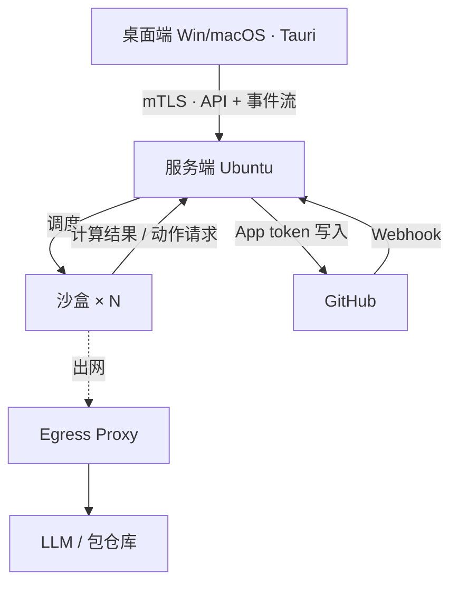

# 设计评审发现（2026-10-24）

> 对 `README.md` 与 `docs/design.md` 初版做的多视角评审。6 个视角（架构、编排语义、安全、GitHub 可行性、产品范围、文档质量）共提出问题，合并去重后 57 条。每条由正确性、价值、对齐三个视角独立核验；评审在核验到 F27 时中断，F27 之后的条目尚未核验。
> 这些发现已作为 `docs/architecture.md`、`docs/decisions.md`、`docs/data-model.md` 等新文档的输入；最终一致性评审会逐条确认是否已处理。

| 编号 | 严重度 | 核验 | 位置 |
| --- | --- | --- | --- |
| F1 | 高 | 通过 3/3 | docs/design.md#编排档位：None → Ultimate / #交付阶段机 / #核心判断（完成判定）；README.md#核心理念 |
| F2 | 高 | 通过 3/3 | docs/design.md#核心判断：GitHub 对象即持久状态；README.md 第 11 行 |
| F3 | 高 | 通过 3/3 | docs/design.md#核心判断（Gate 判定行）/ #交付阶段机 / #PR 后台守护（工程要点） |
| F4 | 高 | 通过 3/3 | docs/design.md#交付阶段机 |
| F5 | 高 | 通过 3/3 | docs/design.md#核心判断：GitHub 对象即持久状态 |
| F6 | 高 | 通过 3/3 | docs/design.md#沙盒机制（网络行、核心原则）/ #产品形态与 CS 架构（GitHub App 而非 PAT）；README.md 第 16 行；架构图沙盒框 |
| F7 | 高 | 通过 3/3 | docs/design.md#产品形态与 CS 架构（Worker Adapter）/ #沙盒机制（文件系统行：产物只从约定路径取出） |
| F8 | 高 | 通过 3/3 | docs/design.md#沙盒机制（核心原则）/ #风险（prompt 注入行） |
| F9 | 高 | 通过 3/3 | docs/design.md#沙盒机制（威胁模型、网络行） |
| F10 | 高 | 通过 3/3 | docs/design.md#沙盒机制（环境复现：复用 devcontainer.json） |
| F11 | 高 | 通过 3/3 | docs/design.md#产品形态与 CS 架构 / #通信安全（部署步骤）/ #风险 |
| F12 | 高 | 通过 3/3 | docs/design.md#PR 后台守护（分流表与工程要点）/ #通信安全（危险动作审批） |
| F13 | 高 | 通过 3/3 | docs/design.md#PR 后台守护（分流表） |
| F14 | 高 | 通过 3/3 | docs/design.md#PR 后台守护（工程要点·防死循环）/ #编排档位（预算模板、Max）/ #风险 |
| F15 | 高 | 通过 3/3 | docs/design.md#PR 后台守护（工程要点·唤醒机制）/ #通信安全（通道分离：Webhook HMAC）/ #风险 |
| F16 | 高 | 通过 3/3 | docs/design.md#风险（Webhook 丢失或内网不可达行）/ #待决问题（Ubuntu 机器在公网还是内网） |
| F17 | 高 | 通过 3/3 | docs/design.md#背景与定位（第 9、11 行）/ #待决问题（graph-agent successor、License）；README.md 第 5 行 |
| F18 | 高 | 通过 3/3 | docs/design.md 全文结构；README.md#核心理念 |
| F19 | 高 | 通过 3/3 | docs/design.md#背景与定位（缺失：目标 / 非目标） |
| F20 | 高 | 否决 1/3 | docs/design.md#产品形态与 CS 架构；README.md 首行与#核心理念 |
| F21 | 高 | 通过 3/3 | docs/design.md（缺失：第一版范围 / 里程碑） |
| F22 | 高 | 通过 3/3 | docs/design.md（缺失：关键用户旅程） |
| F23 | 高 | 通过 3/3 | docs/design.md#待决问题与下一步（缺失项：worker 凭据与成本） |
| F24 | 中 | 通过 3/3 | docs/design.md#核心判断（完成判定行）/ #交付阶段机（Propose、Close）/ #编排档位（Ultimate 行） |
| F25 | 中 | 通过 3/3 | docs/design.md#PR 后台守护（工程要点·分支所有权 / 锁） |
| F26 | 中 | 通过 3/3 | docs/design.md#沙盒机制（隔离行与“档位 × 信任级别”表）/ #待决问题（fork PR） |
| F27 | 中 | 未核验 | docs/design.md#通信安全（危险动作审批用设备私钥签名）/ #核心判断（人工闸门行） |
| F28 | 中 | 未核验 | docs/design.md#通信安全：私有 CA + mTLS 配对（开头段、部署与配对流程 2/4/6） |
| F29 | 中 | 未核验 | docs/design.md#通信安全（部署步骤 1、CA 备份）/ #风险（CA 私钥丢失） |
| F30 | 中 | 未核验 | docs/design.md#产品形态与 CS 架构（架构图与分层） |
| F31 | 中 | 未核验 | docs/design.md#编排档位（档位是上限）/ #产品形态（先定契约） |
| F32 | 中 | 未核验 | docs/design.md#编排档位（档位是上限） |
| F33 | 中 | 未核验 | docs/design.md#PR 后台守护（后台档位可独立配置） |
| F34 | 中 | 未核验 | docs/design.md#PR 后台守护（工程要点·防死循环、静默但可审计、唤醒机制） |
| F35 | 中 | 未核验 | docs/design.md#通信安全（设备管理）/ #待决问题 |
| F36 | 中 | 未核验 | docs/design.md#产品形态与 CS 架构（桌面端：Tauri，前端用 Web 技术）/ #通信安全（私钥存储、实现） |
| F37 | 中 | 未核验 | docs/design.md#通信安全（通道分离：沙盒 ↔ 服务端） |
| F38 | 中 | 未核验 | docs/design.md#沙盒机制（命令拦截行、危险动作清单） |
| F39 | 中 | 未核验 | docs/design.md#产品形态与 CS 架构（GitHub App 而非 PAT）/ #PR 后台守护（静默自愈：CI 失败） |
| F40 | 中 | 未核验 | docs/design.md#编排档位（Ultimate 行、每档绑定预算模板）/ #风险（成本失控行） |
| F41 | 中 | 未核验 | docs/design.md#核心判断（需求 / 规格节点行）/ #编排档位（Ultimate 行） |
| F42 | 中 | 未核验 | docs/design.md#PR 后台守护（静默但可审计）/ #交付阶段机（Propose） |
| F43 | 中 | 未核验 | docs/design.md#交付阶段机（Merge、Implement/Propose） |
| F44 | 中 | 未核验 | docs/design.md#PR 后台守护 / #产品形态与 CS 架构 |
| F45 | 中 | 未核验 | docs/design.md#待决问题与下一步（缺失项：任务入口、forge 范围、Engine 语言） |
| F46 | 中 | 未核验 | docs/design.md（缺失：成功标准） |
| F47 | 中 | 未核验 | docs/design.md#背景与定位（缺失：术语表）/ #核心判断 / #编排档位 / #沙盒机制（命令拦截行）；全文缩写 |
| F48 | 中 | 未核验 | docs/design.md#产品形态与 CS 架构（分层：Forge Adapter）/ #待决问题（SpecGit 并入还是独立 CLI） |
| F49 | 中 | 未核验 | docs/design.md#产品形态与 CS 架构（ASCII 架构图） |
| F50 | 低 | 未核验 | docs/design.md#沙盒机制（暂不做桌面端本地执行） |
| F51 | 低 | 未核验 | docs/design.md#产品形态与 CS 架构（Forge Adapter）/ #核心判断映射表 |
| F52 | 低 | 未核验 | docs/design.md#风险（PR 噪音行）/ #编排档位（High / Max） |
| F53 | 低 | 未核验 | docs/design.md#通信安全（证书轮换、吊销行） |
| F54 | 低 | 未核验 | docs/design.md#沙盒机制（审计行） |
| F55 | 低 | 未核验 | docs/design.md#待决问题与下一步（已有条目缺推荐） |
| F56 | 低 | 未核验 | docs/design.md 文首状态行 |
| F57 | 低 | 未核验 | docs/design.md#编排档位（档位表 Ultimate 行） |

## F1 · 高 · 通过 3/3

**位置**：docs/design.md#编排档位：None → Ultimate / #交付阶段机 / #核心判断（完成判定）；README.md#核心理念

**问题**：档位、阶段机、DAG 三者的层级和完成判定对不上：(1) 档位表里只有 High 写了“开 PR”。None 是“单轮对话，不建图”（典型场景还写了“改一行”），Low 是“单节点，直接提交”，Medium 是“plan → build → verify”。可阶段机固定走 7 个阶段，含 Propose/Merge/Close，完成判定又是“Merge + 关联 Issue 关闭”，低档位不开 PR 就拿不到完成证据。(2) “直接提交”如果是推默认分支，会跳过 Propose/Review 和 branch protection，和“危险动作经服务端策略”“沙盒只计算，服务端才动作”冲突。(3) “DAG 只负责阶段内部展开”和 Ultimate 的 Milestone 级 fan-out 冲突，后者跨多个阶段机实例。(4) README 和 design.md 都写“同一个 runtime，只是同一张图的不同规模”，但 None 不建图。另外“单轮”比用户原话“单对话提交”范围窄。

**建议**：1. 在“交付阶段机”开头写明三层模型：① 交付图（仅 Ultimate）：节点是 Issue 级交付，边是依赖与合并顺序；② 交付阶段机：每个 Issue/PR 一个实例；③ 阶段内 DAG：Engine 在单个阶段内部展开。
2. 档位表后加“档位 × 阶段 × 完成证据”表：
| 档位 | 经过的阶段 | 完成证据 |
| None | 不进阶段机，不产生 GitHub 对象；只问答或给出改法，由用户自行应用；需要写仓库时，策略升到 Low | 无（会话记录） |
| Low | Implement → Propose → Review（只有 CI）→ Merge → Close；Specify/Plan 可跳过，Issue 可选 | PR 合并（有关联 Issue 时加上 Issue 关闭） |
| Medium | 全部阶段，Plan 简化；verify 结果写成 check run（如 `gantry/verify`），不能只留在本地 | PR 合并 + Issue 关闭 |
| High–Max | 全部 7 个阶段，含多角色 review | 同上 |
| Ultimate | 交付图 + 每个 Issue 一个阶段机 | Milestone（或父 Issue）下全部 Issue 关闭 |
3. Low 的“直接提交”改为“单节点改动后直接开 PR，不做多角色 review”。合并要不要人工闸门，由 branch protection 和服务端策略决定，命中敏感路径时一律要（见 F8）。如果用户确实希望 None/Low 能直推默认分支，就加一条待决问题“None/Low 是否允许绕过 PR 直接写默认分支”，并写明这种情况下的完成证据是“目标分支 commit SHA + 该 SHA 上 required checks 通过 + Issue 关闭”，只在分支保护允许、服务端策略放行时可用。
4. 核心判断表的“完成判定”一行改为“按档位，见档位 × 阶段表”。
5. README 和 design.md 统一改为“同一个 runtime；None 不建图，退化为单次对话（可多轮），其余档位是同一张图的不同规模”。None 的编排形态改为“单次对话（可多轮），不建图”。
6. 结构上把“交付阶段机”挪到“编排档位”前面：阶段是骨架，档位决定每个阶段内部怎么展开。

**核验意见**：

- 正确性（接受）：我对照原文逐条核实了这个问题，基本属实，修改方向也对，但改法里有几处错误，需要修正后再采纳。  属实的部分： (1) 档位表里只有 High 写了“开 PR”（design.md L37）。None 写的是“单轮对话，不建图／改一行”（L34），Low 写的是“单节点，直接提交”（L35），Medium 写的是“plan → build → verify”（L36）。可阶段机固定走 7 个阶段，含 Propose/Merge/Close（L49-55），完成判定又写死为“Merge + 关联 Issue 关闭”（L26）。按这个定义，低档位拿不到完成证据。 (3) L47 写“DAG 只负责阶段内部展开”，但 Ultimate 要做 Milestone 级、多 Issue × 多 PR 的 fan-out（L39），这已经跨了多个阶段机实例，两处确实冲突。另外 L21 把“需求/规格节点”映射到 Issue/Milestone，也说明 DAG 节点并不只在阶段内部。 (4) README L12 与 design L30 都写“同一张图的不同规模”，这和 None 的“不建图”矛盾。用户原话是“单对话提交”，“单轮”确实把范围说窄了。  说过头的部分： (2) 直推默认分支同样要走服务端 Forge Adapter，并不违反“沙盒只计算，服务端才动作”。真正的问题是 L138 的危险动作清单里没有“直推默认分支”，这是遗漏，不是冲突。  改法里的错误： a) None 写成“需要写仓库时，策略升到 Low”，违反 L41 的规则：档位是上限，超过上限才问用户。None 本身就是上限，不能被策略自动升到 Low。 b) None 写成“不产生 GitHub 对象，由用户自行应用”，等于把用户已经确认的低端语义“单对话提交”拆成了两半：“单对话”留在 None，“提交”挪到了 Low。这有推翻用户决策的风险，原文“改一行”也说明 None 会改代码。 c) “命中敏感路径时一律要（见 F8）”有两个问题。一是把评审编号写进了设计文档。二是硬编码了一条新规则，和 L138“由配置决定自动放行或上报”冲突。 d) Low 写成“Review（只有 CI）”，和 L59“后台档位可独立配置（写得快、审得狠）”冲突。 e) “如果用户确实希望……就加待决问题”是条件句，改文档的人无法判断条件是否成立，而且把 Low 改成必开 PR 本身就是在替用户拍板。这条应该无条件写成待决问题，附上推荐。 f) 把 L26 改成单纯的引用，会丢掉映射表里原有的语义。  其余内容技术上成立：check run 只有 GitHub App 能创建，与 L111 选用 App 一致；`gantry/verify` 只是示例；Ultimate 以“Milestone/父 Issue 下全部 Issue 关闭”为证据合理；直推时把 required checks 作为证据，也和分支保护的语义一致。改法里没有发现编造的数字。 修正：1. 三层模型按原提议写入。同时把 design.md L47 的“DAG 只负责阶段内部展开”改为“阶段内 DAG 负责单个阶段内部展开；Ultimate 在阶段机之上另有交付图”。L49 的 Specify 改为“创建或选择 Issue（Ultimate 的 Milestone / 父 Issue 属于交付图层）”。 2. 档位 × 阶段 × 完成证据表，按以下几点修正： - None 行改为：单次对话（可多轮），不建图，不走完整阶段机；纯问答不产生 GitHub 对象；产出改动时由服务端提交为 PR（之后与 Low 走同一条 Propose→Close 路径），不在沙盒内直写。完成证据：有提交时为 PR 合并，纯问答时为会话记录。删掉“策略升到 Low”；如需写仓库而超出上限，按 L41 的规则问用户。 - Low 行的 Review 改为“默认只有 CI；配置了后台档位时按后台档位”。 - Medium / High–Max / Ultimate 三行沿用原提议。 3. Low 的“直接提交”改为“单节点改动后经服务端开 PR，不做多角色 review（推荐默认）”。合并要不要人工闸门，写成“由 branch protection 与服务端策略决定，敏感路径可配置为强制人工闸门”。不要写“一律要”，也不要写“见 F8”。    同时无条件新增一条待决问题：“None/Low 是否允许绕过 PR 直接写默认分支？”附推荐和理由：推荐默认不允许。若允许，完成证据为目标分支 commit SHA + 该 SHA 上 required checks 通过 +（有关联 Issue 时）Issue 关闭；仅在分支保护允许、服务端策略放行时可用；并把“直推默认分支”加入 L138 的危险动作清单。 4. L26 的完成判定改为“默认：PR Merge + 关联 Issue 关闭；各档位见档位 × 阶段表”，保留原有映射语义。 5. 沿用原提议：README L12 和 design L30 统一改为“同一个 runtime；None 不建图，退化为单次对话（可多轮），其余档位是同一张图的不同规模”。L34 的编排形态改为“单次对话（可多轮），不建图”。 6. 沿用原提议：把“交付阶段机”一节挪到“编排档位”前面。
- 价值（接受）：原文核实后，矛盾确实存在，而且会被对抗评审第一时间抓住，值得修。(a) design.md 第 26 行写死“完成判定 = Merge + 关联 Issue 关闭”，第 47 行写“每个阶段的出口绑定 GitHub 证据”。可第 34–36 行的 None、Low、Medium 都没提 PR，只有 High 写了“开 PR”，结果六个档位里有三个的完成证据没有定义。(b) 第 47 行“DAG 只负责阶段内部展开”跟第 39 行 Ultimate 的“Milestone 级 fan-out：多 Issue × 多 PR 带依赖”对不上，后者是跨多个阶段机实例的图。(c) 第 30 行和 README 第 12 行写“同一张图的不同规模”，第 34 行的 None 却“不建图”。(d) “单轮对话”比用户原话“单对话提交”范围窄。  但原提案做得过头，有几处不能照收。 1. 把 None 定义成“不产生 GitHub 对象，只给改法，由用户自行应用”，和用户原话“单对话提交”冲突：用户口中的最低档是会提交的。问题描述自己也说“单轮”太窄，提案却改得更窄，前后自相矛盾。 2. 默认把 Low 的“直接提交”改成“开 PR”，等于替用户拍板。用户定的是“从单对话提交到 PR 多角色 review”，低档位要不要走 PR 恰恰是该留给用户的待决问题。 3. 5 行的“档位 × 阶段 × 完成证据”表里有不少凭空细节：`gantry/verify` 这个 check 名、Low 的 Review“只有 CI”、Issue 可选、Specify/Plan 可跳过。这是在往规格书方向膨胀。 4. “见 F8”是评审流程里的编号，不该写进文档。 5. 调整章节顺序是结构性改动，收益不明显。 6. 问题描述 (2) 说直写默认分支会冲突“沙盒只计算”，这条不成立：push 照样可以由服务端 Forge Adapter 执行。真正冲突的是 branch protection、人工闸门和完成判定。  所以只收澄清和统一措辞的部分，具体怎么走交给待决问题。 修正：只改下面几处，不加 5 行的档位 × 阶段表，不调整章节顺序，不引用 F8。  1. design.md“交付阶段机”第 47 行，把“DAG 只负责阶段内部展开”换成三层说明，不超过三句：“阶段机按交付单元实例化，每个 Issue/PR 一个实例；DAG 在单个阶段内部展开；Ultimate 在其上多一层交付图，节点是 Issue 级交付，边是依赖与合并顺序。档位决定阶段内部展开的规模，不改变阶段出口证据。”  2. 统一措辞。design.md 第 30 行和 README 第 12 行改为“同一个 runtime；None 不建图，其余档位是同一张图的不同规模”。档位表 None 的编排形态由“单轮对话，不建图”改为“单次对话（可多轮），不建图”。  3. 核心判断表“完成判定”一行改为“Merge + 关联 Issue 关闭；Ultimate 为 Milestone 下全部 Issue 关闭；低档位见待决问题”。  4. 档位表的 Low 行（“直接提交”）、Medium 行、High 行先不改。在“待决问题”里加一条，写推荐但不拍板： “- [ ] None / Low / Medium 是否经 PR 交付？（档位表中只有 High 写了开 PR，低档位的完成证据目前没有定义） 推荐：Low 起一律走 PR，Low/Medium 只是不做多角色 review；None 需要写仓库时也走 PR，或自动升到 Low。理由：完成判定、branch protection 和人工闸门都以 PR 为载体。 若允许直写默认分支：完成证据改为‘目标分支 commit SHA + 该 SHA 上 required checks 通过 + 关联 Issue 关闭’，并且只在分支保护允许、服务端策略放行时可用。”
- 对齐（接受）：原文核实无误，诊断成立。design.md 第 30 行和 README 第 12 行写“同一张图的不同规模”，但 None 行（第 34 行）写的是“不建图”。第 26 行把完成判定固定为“Merge + 关联 Issue 关闭”，可 Low（第 35 行）是“直接提交”，Medium（第 36 行）也没有 PR，拿不到这个证据。第 47 行写“DAG 只负责阶段内部展开”，和 Ultimate 的 Milestone 级 fan-out（第 39 行）跨多个阶段机实例对不上。第 34 行的“单轮”也比用户原话“单对话提交”范围窄。三层模型、档位 × 阶段 × 完成证据表、完成判定改为“按档位”、统一 None 的措辞，这几处都补强了已定决策的一致性，没有推翻已定决策。  但原改法有四处要修正才能对齐。 (a) None 的改法弱化了已定决策。用户定的是档位范围“从单对话提交到…”，最低一档就是“提交”。原文 None 的典型场景也有“改一行”。提案把 None 写成“不产生 GitHub 对象，由用户自行应用”，等于拿掉了最低一档的提交能力，这是替用户改了档位语义。 (b) “需要写仓库时，策略升到 Low”违反文档自己的规则（第 41 行）：档位是上限，超过上限要先问用户。None 是上限时不能自动升到 Low。 (c) 问题 (2) 说过头了。直推仍然经服务端 Forge Adapter 执行，并不违反“沙盒只计算，服务端才动作”。真正的问题是跳过了 Propose/Review 和 branch protection，也拿不到完成证据。另外，第 138 行的危险动作清单里没有“直推默认分支”。 (d) “如果用户确实希望直推，就加一条待决问题”这种条件式写法，实际上是先默认 PR 化、替用户拍了板。这条待决问题应该无条件加上，同时写明推荐与理由。第 6 点（调整章节顺序）可以采纳，但要注明“None 除外；Ultimate 在阶段机之上还有一层交付图”。 修正：按原提案执行，以下几处替换： 1. 档位 × 阶段 × 完成证据表中 None 一行改为： | None | 不建图，不走完整阶段机；纯问答不产生 GitHub 对象；有改动时以单个 commit 经服务端 Forge Adapter 提交，走直推还是最短 PR 路径（Implement → Propose → Merge → Close）见待决问题 | 纯问答：无（会话记录）；有提交时随提交方式而定，见待决问题 | 删掉“需要写仓库时，策略升到 Low”。改写为：“None 不自动升档；需要的编排超出上限时，按‘档位是上限’规则询问用户。” 2. Low 一行的“直接开 PR”标为“（推荐默认，见待决问题）”，不写成定论。 3. 问题 (2) 改为：“直接提交仍由服务端执行，不违反‘沙盒只计算’，但会跳过 Propose/Review 和 branch protection，也拿不到统一的完成证据。直推默认分支应列入服务端策略管控的动作。”同时在第 138 行的危险动作清单里补上“直推默认分支”。 4. 在“待决问题”里无条件加一条： - [ ] None / Low 产生代码改动时，是一律走 PR，还是允许经服务端直推默认分支？推荐默认走 PR，理由：完成证据统一（PR 合并 + Issue 关闭），复用 branch protection 和后台守护，不必为直推单设审计路径。如果允许直推，只在分支保护允许、服务端策略放行、未命中敏感路径时可用，完成证据为“目标分支 commit SHA + 该 SHA 上 required checks 通过 +（有关联 Issue 时）Issue 关闭”。 5. 第 6 点（章节顺序调整）附带说明：“阶段是骨架（None 除外）；Ultimate 在阶段机之上还有一层交付图。” 6. 其余部分（三层模型、Medium verify 写成 check run、完成判定改为“按档位”、README 和 design.md 统一写成“单次对话（可多轮），不建图”）照原提案执行。

## F2 · 高 · 通过 3/3

**位置**：docs/design.md#核心判断：GitHub 对象即持久状态；README.md 第 11 行

**问题**：原文说“是否完成一律以 GitHub 为准；本地只保存编排过程状态（图结构、节点尝试、预算）”，但没交代哪些状态归谁、本地预期和 GitHub 现实冲突时谁说了算。服务端实际保存的远不止这些：还有分支所有权/锁、待执行动作、审批记录、收件箱，以及私有 CA、设备与吊销表、审计日志。后几项必须备份，风险表里的“CA 私钥丢失”就属于这一类。另外，“PR 上维护实时状态清单”是 Gantry 写回 GitHub 的投影，文中没说能不能读回来当输入；如果能，评论注入就能伪造状态。

**建议**：在本节表格后新增“状态归属与对账”：
| 类别 | 例子 | 权威方 |
| 事实 | Issue/PR 开闭、head SHA、check 结论、review、merge | GitHub；本地只缓存 |
| 意图与过程 | 图及其版本、节点尝试、预算消耗、分支所有权、待执行动作、审批记录 | 本地状态库 |
| 安全与审计 | 私有 CA、设备与吊销表、审计日志 | 本地状态库，纳入备份 |
| 投影 | PR 状态清单、label | 由本地生成并写回 GitHub，只写不读，不作为任何决策输入 |
规则：① 冲突时以事实为准：本地预期和 GitHub 不一致时，按 GitHub 修正本地 run，不反过来“纠正” GitHub。② 只信任身份可验证的对象，如 App 自己写的 check run、有权限的人提交的 review；评论正文只当待处理输入，不当状态。③ Webhook 与对账规则见 F15。
把“本地只保存编排过程状态（图结构、节点尝试、预算）”改为“交付结果以 GitHub 为准；服务端另存编排过程状态与安全审计状态，后者纳入备份”。README 同步改为“交付结果以 GitHub 为准”。

**核验意见**：

- 正确性（接受）：问题确实存在。design.md 第 17 行和 README 第 11 行都写着“本地只保存编排过程状态（图结构、节点尝试、预算）”，可文档别处写明服务端还要保存这些东西：分支所有权/锁（76）、经策略审核后才执行的动作请求（117、138）、审批签名（164）、收件箱（78）、私有 CA（148）、设备管理与吊销表（159–160）、审计与回放（128）。风险表 180 行“CA 私钥丢失”也说明存在 GitHub 上没有、必须备份的状态。78 行的“PR 上维护实时状态清单”也确实没说这份清单能不能读回来当输入。所以“只保存”与全文自相矛盾，文档也没有冲突裁决规则，F2 的诊断成立。  但原改法有几处技术错误或不一致，不能原样采纳： 1. 表里把“私有 CA”的权威方写成“本地状态库”。这和 148 行的存放方式（私钥 0600、可选 TPM）冲突，也是安全反模式：状态库或它的备份一旦泄露，攻击者就能签发客户端证书。表里还漏了文档中出现过的同类密钥：GitHub App 私钥（111）、webhook HMAC secret（165）、Egress Proxy 注入的凭据（125）。 2. 把所有 label 都定成“只写不读的投影”太绝对了。41 行写明策略要按“风险标签”升降档，人工打的 label 很可能就是输入。应该只把 Gantry 自己写的状态类 label 算作投影；人工 label 是输入，要核对操作者权限。另外“只写不读”本身也不严谨，因为更新清单前得先读到自己写的那条评论。准确的说法是“不作为决策输入”。 3. 规则①“不反过来纠正 GitHub”和投影行矛盾：投影由服务端负责，被人改动后 Gantry 应该覆盖回去。所以规则①只能约束“事实”这一类。 4. 规则②里“App 自己写的 check run”的例子容易误导。CI 的 check（63 行，比如 GitHub Actions）并不是 Gantry 自己的 App 写的。正确做法是按 check run 的来源 App 校验，只认 Gantry 自己的和配置允许的 CI App。 5. “见 F15”是评审编号，写进正文就是悬空引用。 6. 审批记录放在“意图与过程”行，而备份只覆盖“安全与审计”，这样审批签名就不在备份范围内。164 行要求审批不可抵赖，签名必须是可留存的审计证据，所以应移到“安全与审计”行。原问题描述提到了收件箱，表里却漏了。 7. 改写稿说要把正文去掉“本地”的说法，表里却仍用“本地”。在 CS 架构下，“本地”容易被读成桌面端，应统一写“服务端”。 8. 句子替换的范围有歧义：只替换后半句会得到“是否完成一律以 GitHub 为准；交付结果以 GitHub 为准；……”这样的重复，应整句替换。  修正后的改法没有引入新数字，也没有引入文档里不存在的事实，全部依据原文已有的组件。 修正：在 design.md 第 17 行之后、映射表之后新增小节“状态归属与对账”。全文统一写“服务端”，不写“本地”，避免和桌面端混淆。  | 类别 | 例子 | 权威方 | | --- | --- | --- | | 事实 | Issue/PR 开闭、head SHA、check 结论、review、merge | GitHub；服务端只缓存，可从 GitHub 重建 | | 意图与过程 | 图结构、节点尝试、预算消耗、分支所有权、待执行动作、收件箱 | 服务端状态库 | | 安全与审计 | 设备与吊销表、审批签名记录、审计日志 | 服务端状态库，纳入备份 | | 密钥 | 私有 CA 私钥、GitHub App 私钥、webhook secret、出网注入凭据 | 服务端独立存放（见部署流程第 1 步），不入状态库；CA 私钥单独离线备份 | | 投影 | Gantry 写回的 PR 状态清单、状态类 label | 由服务端生成并写回 GitHub，被改动时直接覆盖；不作为任何决策输入 |  规则： ① 事实冲突以 GitHub 为准。服务端预期与 GitHub 不一致时（如有人推了新 commit、手动关了 PR），按 GitHub 修正 run 后重新决策，不去“纠正”GitHub 上的事实。投影不受此限。 ② 只信任可验证来源。check run 要核对来源 App，只认 Gantry 自己的和配置允许的 CI App。review 只认有权限者提交的。评论正文、PR 描述、人工 label 一律当待处理输入，并核对操作者权限，不当状态。 ③ 不要写“见 F15”。如果另有 Webhook/巡检对账小节被采纳，就用章节名链接过去；否则省略这一条。  第 17 行首句整句替换为：“交付结果一律以 GitHub 为准；服务端另存编排过程状态，以及设备、审批、审计等安全状态，后者纳入备份。”后半句“这样‘信现实，不信模型自述’……”保留。  README 第 11 行改为：“交付结果一律以 GitHub 为准（Issue、PR、Check、Review、Merge），服务端另存编排过程与安全审计状态。”  可选：节标题“GitHub 对象即持久状态”和上表不符，可改为“GitHub 对象即交付事实”。这个标题是助手的提议，不是用户已确认的决策，可以改。
- 价值（接受）：问题属实，而且是文档自身前后矛盾，不是凭空补规格。design.md 第 17 行和 README 第 11 行写的是"本地只保存编排过程状态（图结构、节点尝试、预算）"，但同一份文档里另有几处服务端持久状态：第 159 行的"数据库吊销表"、第 160 行的设备与角色、第 164 行的签名审批、第 128 行可回放的审计、第 78 行的收件箱和状态清单、第 76 行的分支锁、第 162/180 行的 CA 备份。另外，CS 架构里"本地"一词有歧义，容易被理解成桌面端，改成"服务端"本身就是准确性收益。"投影不读回"也对应文档第 119 行的威胁模型（PR 评论、Issue 正文的 prompt 注入），是实打实的安全约束。"GitHub 即持久状态"是助手提出的，并非用户已确认的决策，这里做精确化不算推翻。篇幅只有一张短表加两条规则，没有膨胀。  不过原改法有 5 处需要修正： (1)"见 F15"是评审内部编号，写进文档就成了悬空引用，F15 还不一定被采纳。 (2) 把 label 整体归为"只写不读"的投影，与第 41 行把"风险标签"当作升降档输入相矛盾。投影只能限定为 Gantry 自己写的 label 和状态清单。 (3) 把私有 CA 私钥归入"本地状态库，纳入备份"，与第 148 行"私钥 0600，可选 TPM"、第 162 行"离线备份"冲突。随数据库例行备份反而扩大了私钥的暴露面，应单独保管。 (4) 审批记录是设备私钥签名的不可抵赖证据，应归入安全与审计，需要备份，不应归入过程状态。 (5) problem 里提到了收件箱，表里却漏了。 规则①的"不纠正 GitHub"还需说清只针对交付事实，因为投影被人改动后 Gantry 会重写，否则自相矛盾。 修正：在 design.md"核心判断"一节表格后新增一小节"状态归属"，内容如下，保持精简：  | 类别 | 例子 | 权威方 | | --- | --- | --- | | 交付事实 | Issue/PR 开闭、head SHA、check 结论、review、merge | GitHub；服务端只缓存 | | 编排过程 | 图及其版本、节点尝试、预算消耗、分支所有权/锁、待执行动作、收件箱 | 服务端状态库 | | 安全与审计 | 设备与吊销表、审批签名记录、审计日志 | 服务端状态库，纳入定期备份；CA 私钥不随库备份，按"通信安全"一节单独离线备份 | | 投影 | PR 状态清单、Gantry 自己写的 label | 由服务端生成并写回 GitHub；不读回作为决策输入 |  规则： ① 交付事实冲突时以 GitHub 为准，修正本地 run，不去"纠正"GitHub。投影被改动时只重写，不据此改变决策。 ② 判定只采信身份可验证的对象，例如 App 自己写的 check run、有写权限者提交的 review 或打的风险 label。评论正文只作为待处理输入，不当作状态。  不要引用 F15 等评审编号。  措辞同步修改： - design.md 第 17 行"本地只保存编排过程状态（图结构、节点尝试、预算）"改为"交付结果以 GitHub 为准；服务端另存编排过程状态与安全审计状态（后者需备份）"。 - README 第 11 行"本地只保存编排过程状态"改为"服务端另存编排过程与安全审计状态"。 - 两处小标题"GitHub 即持久状态"可保留。
- 对齐（接受）：我核对过两份文件，这个缺口确实存在。design.md 第 17 行和 README 第 11 行都说"本地只保存编排过程状态（图结构、节点尝试、预算）"，但文中服务端另外还存着不少东西：第 76 行的分支所有权/锁，第 78 行的收件箱，第 159-162 行的设备、吊销表和 CA，第 128 行的审计日志。风险表第 180 行还专门写了"CA 私钥丢失→离线备份"，和"只保存过程状态"自相矛盾。另一个问题是第 78 行的"PR 上维护实时状态清单"没说能不能读回来当输入，有评论注入的风险。补一张状态归属表加对账规则，能明显提高准确性和一致性。"GitHub 对象即持久状态"本来就是助手的提议，用户没确认过，可以细化。这次改动没有推翻用户已定的决策，"与 GitHub 业务强关联"反而更清楚了，也没有替用户拍板待决问题。篇幅只是 4 行表加 3 条规则，不算膨胀。  但原改法有几处必须修正： (1) 表里沿用了"本地/本地状态库"。CS 架构下"本地"容易被读成桌面端，正文把它改成"服务端"正是这条要修的点，表格不该再把歧义带回来。 (2) 把 label 一律定为"只写不读，不作为任何决策输入"，和第 41 行冲突：档位自动升降要读"风险标签"。人打的 label 是输入，不是投影。 (3) "③ 见 F15"是内部评审编号，写进文档就是一条悬空引用。 (4) 规则②只把"评论正文"当不可信输入。威胁模型（第 119 行）也点名了 Issue 正文，应该一并覆盖。 (5) 规则①"按 GitHub 修正本地 run"缺一个处理分支：外部的非预期变化（比如有人推送到 Gantry 持有写权的分支）应该暂停并上报，不能静默接受。另外投影被人改动后要能重写，这不算"纠正 GitHub"。 (6) 如果采用设备签名审批，"不可抵赖"依赖记录长期留存，所以审批记录应该归入安全与审计类并纳入备份。 (7) 替换文本会和第 17 行原有的"是否完成一律以 GitHub 为准"拼成重复句，需要给出整句。 修正：在 design.md "核心判断"一节的映射表后新增"状态归属与对账"： | 类别 | 例子 | 权威方 | | 事实 | Issue/PR 开闭、head SHA、check 结论、review、merge | GitHub；服务端只缓存 | | 意图与过程 | 图及其版本、节点尝试、预算消耗、分支所有权、待执行动作、收件箱 | 服务端状态库 | | 安全与审计 | 私有 CA、设备与吊销表、审批记录（若采用设备签名）、审计日志 | 服务端状态库；无法从 GitHub 重建，必须纳入备份 | | 投影 | Gantry 写的 PR 状态清单评论、Gantry 自己管理的状态类 label | 由服务端生成并写回 GitHub，不读回作为决策输入；被人改动时按服务端状态重写 | 规则： ① 冲突时以事实为准：服务端预期与 GitHub 不一致时，按 GitHub 修正 run，不回滚或覆盖 GitHub（投影除外）。非预期的外部变化，比如他人推送到 Gantry 持有写权的分支、PR 被他人关闭，要暂停该 run 并上报。 ② 只信任身份可验证的对象，比如 App 自己写的 check run、有权限者提交的 review、有权限者打的 label（如风险标签）。评论和 Issue/PR 正文一律当作不可信的待处理输入，不当作状态。 ③ Webhook 只作唤醒信号，处理前回读 GitHub 当前状态（不要写"见 F15"；如果文内另有对账小节，就指向那个章节标题）。  正文第 17 行首句整体改为："交付结果（是否完成）以 GitHub 为准；服务端状态库另存编排过程状态与安全审计状态，后者纳入备份。"后半句"这样'信现实，不信模型自述'……"保持不变。  README 第 11 行改为："交付结果以 GitHub 为准（Issue、PR、Check、Review、Merge），服务端另存编排过程与安全审计状态。"  可选：节标题"GitHub 对象即持久状态"、README 的"GitHub 即持久状态"、架构图第 103 行"持久状态的真相"统一改成"交付状态的真相"一类说法，避免和新表里服务端也有持久状态这一点冲突。这几处原本就是助手的措辞，改了不触及用户已定的决策。

## F3 · 高 · 通过 3/3

**位置**：docs/design.md#核心判断（Gate 判定行）/ #交付阶段机 / #PR 后台守护（工程要点）

**问题**：“Gate 判定 | Check run、Review（APPROVE / REQUEST_CHANGES）”没写清 Review 由谁发出。如果是 Gantry 的 reviewer 角色以 App 身份提交，会有几个问题：(1) PR 作者不能批准自己的 PR，而 PR 是 Gantry 用 App 创建的，所以它的 APPROVE 用不了；(2) 对采纳来的人类 PR，有写权限的 App 发 APPROVE 可能被算进 required approvals（需按官方文档核实），等于模型自己满足了人工闸门；(3) bot 发了 REQUEST_CHANGES 后会一直挡住 merge，只能由 App 自己 dismiss；(4) CODEOWNERS 不能指定 App。此外，证据没有绑定 head SHA，新 push 之后旧的 check/review 可能仍被当作有效；同名 check 可能被其他 App 或 workflow 冒充；Gantry 自己的 check 是模型判断，外部 CI 的 check 才是“现实”，两者放在同一行，削弱了“信现实，不信模型自述”。

**建议**：映射表把这一行拆成两行：
- “Gate 判定（机器） | Gantry 自有 Check run（如 `gantry/review`、`gantry/verify`，可设为 required status check），由汇总节点或 arbiter 发布；外部 CI 的 Check / Status 作为事实证据”；
- “人工闸门 | 人类账号的 Review APPROVE、Required reviewers / CODEOWNERS、branch protection / rulesets”。
在“PR 后台守护·工程要点”加一条：“Gantry 不提交 APPROVE 或 REQUEST_CHANGES 类型的 Review。多角色结论只用 COMMENT review（行内评论）、一条汇总评论和 Check run conclusion 表达；阻断合并靠 check 的 failure / action_required，不占用人类 review 槽位。”
在映射表下补注：“Gate 证据一律绑定 head SHA，head 变化后旧证据失效，需要重新评估。rulesets / 分支保护里把必需 check 的来源固定为 Gantry App（expected source），防冒充。控制台和 check 命名上区分 Gantry check（模型判断）和 CI 原生 check（事实）。”v1 裁决值与 check 结论怎么对应，见术语表（F47）。

**核验意见**：

- 正确性（接受）：核心问题属实。design.md 第 23 行“Gate 判定 | Check run、Review（APPROVE / REQUEST_CHANGES）”没写 Review 由谁发出，也没提 head SHA。全文只在第 164 行审批签名处出现 commit SHA，Gate 证据没有绑定 SHA。第 17 行强调“信现实，不信模型自述”，而这一行把模型判断和外部 CI 混在一起。下面几条事实判断都成立：PR 作者不能批准自己的 PR；分支保护的必需 check 可以固定来源 App（classic 保护叫 expected source，ruleset 用 integration_id）；action_required 不算通过，能挡住合并；CODEOWNERS 只能写用户或团队。把阻断改由 required check 承担，是 GitHub 原生的正确做法。被改的映射表属于助手提案、用户尚未确认，可以修改。  原改法有四处需要修正： (1) 误读：表里已经有第 24 行“人工闸门 | Required reviewers、branch protection”。说“拆成两行”会多出一行重复的“人工闸门”，应改写现有的两行。 (2) 问题描述第 (3) 条不准确，不能写进文档。REQUEST_CHANGES 只在分支保护要求审批时才挡合并，而且有写 / 管理权限的人通常也能 dismiss，不只 App 自己。 (3) 原文写“由汇总节点或 arbiter 发布”，与第 117 行“沙盒无写权限，动作经 Forge Adapter”冲突。应改为节点只产出结论，由 Forge Adapter 发布。 (4) 引用“术语表（F47）”会指向不存在的位置。F47 是审核条目编号，不是文档章节，文档目前也没有术语表。  建议补两点。第一，按 SHA 绑定时人工批准同样失效，这和“静默自愈”有冲突，需要写出处理办法。第二，GitHub Free 的私有仓库不能用分支保护或 ruleset，这时闸门只能靠服务端策略。这一点很确定，不是编造。 修正：一、映射表不新增行，改写第 23、24 行： | Gate 判定（机器） | Gantry 自有 Check run（如 `gantry/review`、`gantry/verify`，可设为 required status check）：结论由汇总节点或 arbiter 产出，经 Forge Adapter 以 Gantry App 身份发布。外部 CI 的 Check / Status 作为事实证据 | | 人工闸门 | 人类账号的 Review APPROVE、必需审批数 / CODEOWNERS、branch protection / rulesets |  二、表下补注： “Gate 证据一律绑定 head SHA，head 变化后旧证据失效，需要重新评估。人工批准同样按 SHA 失效，所以后台修复应在请求人工批准之前完成；批准后再推送，就要重新批准。rulesets / 分支保护里把必需 check 的来源固定为 Gantry App（expected source），防止同名 check 冒充。控制台和 check 命名上区分 Gantry check（模型判断）与 CI 原生 check（事实）。如果目标仓库不能启用分支保护或 rulesets（例如 GitHub Free 的私有仓库），闸门只能由服务端策略执行。”  三、在“PR 后台守护·工程要点”加一条： “- **不占人工审批槽位**：Gantry 不提交 APPROVE 或 REQUEST_CHANGES 类型的 Review。多角色结论只用 COMMENT review（行内评论）、一条汇总评论和 Check run conclusion 表达；阻断合并靠 required check 的 failure / action_required。原因：App 不能批准自己创建的 PR；对采纳来的人类 PR，App 的 APPROVE 可能被计入必需审批（需按官方文档核实），等于模型自己满足了人工闸门。”  四、不要把“只能由 App 自己 dismiss”写进文档。不要在文档里出现“F47”。只有另一条修改确实新增了术语表，才写“裁决值与 check 结论的对应见术语表”。
- 价值（接受）：我接受这条，但改法需要修正。我核对了 design.md 第 23–24 行、第 72 行、第 117 行、第 164 行、第 174 行，以及 README 第 11 行。  这条问题点得准。现在的写法是“Gate 判定 | Check run、Review（APPROVE / REQUEST_CHANGES）”，没写这个 Review 由谁发出。如果按“Gantry 自己的 reviewer 用 App 身份发 APPROVE”去理解，会撞上 GitHub 的硬约束： - PR 作者不能批准、也不能对自己的 PR request changes。由 App 创建的 PR，App 的 APPROVE 根本发不出去。 - 对采纳来的人类 PR，有写权限的 bot 发 APPROVE 可能被算进 required approvals。GITHUB_TOKEN 默认不能批准 PR，只有在仓库设置里显式允许后才行，这说明官方把这件事当作风险。那样就等于模型自己满足了人工闸门，和第 24 行、第 72 行“需要人的 approval”相矛盾。  另外，Gantry 自己的 check 是模型判断。把它和 CI 的 check 都当作“GitHub 真相”放在同一行，会削弱第 17 行“信现实，不信模型自述”这个核心论点。这是一致性层面的真实漏洞。正式文档要做对抗评审，这一点一定会被挑出来。  改法的收益： - 拆成“机器 Gate / 人工闸门”两行，只是改写现有表格，几乎不增加篇幅。 - “不提交 APPROVE / REQUEST_CHANGES”与第 174 行“汇总成一条摘要 + 少量行内评论，由 arbiter 统一发出”一致，也没有推翻用户“多角色 review、对抗 review”的决定，review 照做，只是换了表达通道。 - 证据绑定 head SHA，和第 164 行审批签名绑定 commit SHA 的思路一致。 - 规定必需 check 的来源（expected source），在分支保护和 rulesets 里都有现成配置，成本很低。  需要修正的地方： 1. 改法末尾“见术语表（F47）”引用了另一条优化项的编号。F47 是否被接受不确定，文档里也不该出现评审项编号，应删除。 2. 补注三条压成一句，避免向规格书膨胀。 3. 问题描述里“REQUEST_CHANGES 只能由 App 自己 dismiss”不准确：有相应权限的仓库成员或管理员也能 dismiss。好在这句不写进文档，不影响结论；但修改时不要把它带进文档。 4. action_required 作为补充写进括号即可，不要作为主路径。 修正：1) design.md 映射表第 23–24 行替换为： | Gate 判定（机器） | Gantry 自有 Check run（如 `gantry/review`、`gantry/verify`，可设为 required check），由汇总节点 / arbiter 发布；外部 CI 的 Check / Status 作为事实证据 | | 人工闸门 | 人类账号的 Review APPROVE、Required reviewers / CODEOWNERS、branch protection / rulesets |  2) 表格下补一句注： "Gate 证据绑定 head SHA，head 一变旧证据即失效，需要重新评估；必需 check 在 rulesets / 分支保护中把来源固定为 Gantry App，防止同名冒充；Gantry check 是模型判断，CI check 才是事实，控制台和命名上要区分两者。"  3) "PR 后台守护·工程要点"加一条： "- **不占人类 review 槽位**：Gantry 不提交 APPROVE / REQUEST_CHANGES 类型的 Review，多角色结论只通过 COMMENT review（行内评论）、一条汇总评论和 Check run 结论表达；要阻断合并，就让 check 的结论为 failure（必要时用 action_required）。"  4) 不要写"见术语表（F47）"或任何引用评审项编号的句子。只有术语表实际已写进文档时，才可以按章节名引用"裁决值与 check 结论的对应"；否则省略。也不要把"REQUEST_CHANGES 只能由 App 自己 dismiss"写进文档，因为有权限的仓库成员同样可以 dismiss。
- 对齐（接受）：核心判断成立，也没有推翻用户已定的决策。(1) GitHub 不允许 PR 作者对自己的 PR 提交 APPROVE 或 REQUEST_CHANGES。由 Gantry App 创建的 PR，App 根本发不出这两类 review，所以现有表里“Gate 判定 | Review（APPROVE / REQUEST_CHANGES）”这一行，在 Gantry 自建的 PR 上做不到。(2) 对采纳来的人类 PR，有写权限的 bot 发 APPROVE 可能被算进 required approvals（GitHub Actions 有“允许创建并批准 PR”这个开关，就是因为这个原因）。原文把这一点写成“需核实”，没有当成定论，处理得当。(3) required status check 可以限定来源 App，check 本身挂在 commit SHA 上，这两点都是真实机制。把 Gantry 自有 check（模型判断）和外部 CI check（事实）分开写，强化了“信现实，不信模型自述”，也和已定的“人工闸门”“上报：需要人的 approval”方向一致。多角色 review、对抗 review 仍然完整保留，只是改成用 COMMENT review、汇总评论和 check 来表达，与风险表里“汇总成一条摘要 + 少量行内评论”一致。这条改动不替任何待决问题拍板。但有几处需要修正：a) 问题描述第 (3) 点不准确。REQUEST_CHANGES 并非只能由 App 自己 dismiss，仓库管理员或有 dismiss 权限的人也可以；而且它只有在开启 required reviews 时才会挡住 merge。b) 设计文档的“人工闸门”行已经存在，应改写现有两行，不要再新增一行重复的。c) 文档里不应出现“F47”这类评审内部编号；当前文档也没有术语表，直接引用会成为悬空引用。d) 方案完全依赖 branch protection / rulesets，但这一能力受 GitHub 计划和仓库可见性限制（例如免费计划下的私有仓库不可用），用户也可能根本没配置。需要补一条兜底：由服务端策略在 merge 前自行校验同样的条件。这也正好对应阶段机里的“Merge：经服务端策略与人工闸门”。e) “head 变化后旧证据失效”与“nit 攒到下次推送”、后台自愈推送叠加，每次 push 都可能触发一整轮多角色重评，会放大成本风险，应该说明可以增量重评。 修正：映射表改写现有两行，不新增重复行： - “Gate 判定 | Gantry 自有 Check run（如 `gantry/review`、`gantry/verify`，可设为 required status check），由汇总节点或 arbiter 发布；外部 CI 的 Check / Status 作为事实证据” - “人工闸门 | 人类账号的 Review APPROVE、Required reviewers / CODEOWNERS、branch protection / rulesets”  表下补注：“Gate 证据一律绑定 head SHA，head 变化后旧证据失效，需要重新评估（可只评估相对上次已评 SHA 的增量，控制成本）。如果仓库可用 rulesets / 分支保护，就把必需 check 的来源固定为 Gantry App，防止冒充；如果不可用（受计划与仓库可见性限制）或未配置，由服务端策略在 merge 前自行校验 check 来源与 head SHA。控制台和 check 命名上区分 Gantry check（模型判断）与 CI 原生 check（事实）。”  在“PR 后台守护·工程要点”加一条：“Gantry 不提交 APPROVE 或 REQUEST_CHANGES 类型的 Review（GitHub 本来就不允许 Gantry 对自己创建的 PR 这样做；对采纳来的 PR 则避免模型替人满足闸门，或留下只能靠 dismiss 解除的阻断）。多角色结论只用 COMMENT review（行内评论）、一条汇总评论和 Check run conclusion 表达，阻断合并靠 check 的 failure / action_required。”  不要把“见术语表（F47）”写进文档。只有当术语表确实被采纳、加进文档后，才写“裁决值与 check 结论的对应见术语表”，否则省略这句。

## F4 · 高 · 通过 3/3

**位置**：docs/design.md#交付阶段机

**问题**：阶段机只有 7 个阶段名、每个一句话，按 1→7 线性走。文中说“每个阶段的出口绑定 GitHub 证据”，但没写各阶段的退出证据是什么，Plan 和 Implement 尤其不清楚。也没有回退路径（Review 打回、Merge 时冲突或 check 失败或 base 前移、合并后 revert），没有外部触发的迁移和非正常终态（人关掉 PR、Issue 以 not planned 关闭、等待人），也没写采纳外部 PR 时从哪个阶段进入。PR 后台守护和 Review/Merge 阶段是什么关系同样没写：是阶段内的子图，还是独立常驻的任务？

**建议**：把阶段列表改成一阶段一行的表（不扩成规格）：
| 阶段 | 退出证据（GitHub） | 典型回退 |
| Specify | Issue（含验收标准）或 Milestone 已存在；Ultimate 下子 Issue 已建好 | — |
| Plan | 计划以评论或正文清单写回 Issue（高档位附准入问答结论） | 准入不通过 → Specify |
| Implement | 服务端已推送工作分支 commit SHA；沙盒内检查通过 | 方案不可行 → Plan（按档位上报） |
| Propose | PR 已打开，head 为上述 SHA，正文含 Issue 引用 | — |
| Review | 当前 head SHA 上 required checks 全绿、人工闸门满足、没有未解决的阻断项 | 需要改代码 → Implement（同一分支、同一 PR）；设计分歧 → Plan（上报） |
| Merge | PR 已 merged（记录 merge commit SHA） | base 前移冲突、check 失败、merge queue 失败 → Review / Implement，并记录原因 |
| Close | 关联 Issue 已按 F24 的规则关闭 | revert 或 Issue 重开 → 开新一轮 Specify |
表后补充：① 非正常状态：等待人（上报中）；Cancelled（PR 被关闭且未合并）；Abandoned（Issue 以 not planned 关闭）。人在 GitHub 上的动作视为指令，由对账（F15）驱动迁移。② 采纳已有 PR 时从 Propose 或 Review 进入，缺失的前置证据（如 Issue 引用）补齐或标记为缺失。③ PR 后台守护就是 Propose 之后到 Merge 完成之前的常驻执行体，PR 合并或关闭后结束；它的档位单独配置（F33），状态挂在同一个阶段机实例上。④ 阶段证据一律绑定 head SHA（F3）。

**核验意见**：

- 正确性（接受）：问题属实。design.md 第45-55行的阶段机只有 7 个编号条目，每条一句话。文中写了“每个阶段的出口绑定 GitHub 证据”，但没写任何一个阶段的证据，也没有回退、终止或外部触发的迁移。第52行“创建或采纳 PR”提到了采纳，但没说从哪个阶段进入。第53行“后台修复”和“PR 后台守护”一节的关系也没讲清。补成表的方向对，也没有膨胀成规格。但原改法本身有几处错误或不一致，需要修正后才能接受： 1) 引用了 F24、F15、F33、F3 这些评审编号，文档里不存在，单独采纳就会悬空。 2) “阶段证据一律绑定 head SHA”在技术上不对。Specify、Plan、Close 的证据是 Issue 状态，没有 head SHA 可绑。 3) Review 的回退写成“需要改代码 → Implement”，会让每次 lint 或 nit 修复都显示为阶段回退。这和第53行“Review…后台修复”冲突，也和守护“没问题不打扰”的静默自愈冲突。静默自愈应当在 Review 内完成。 4) Implement 的退出证据写“沙盒内检查通过”，这不是 GitHub 证据，和“出口绑定 GitHub 证据”、“信现实不信自述”矛盾。应由服务端把结果写成该 SHA 上的 check run。 5) 把“Ultimate 下子 Issue 已建好”放在 Specify 出口，和“Plan：拆解与设计”冲突，拆子 Issue 是 Plan 的事。 6) 把守护说成“常驻执行体”，和文档的“事件驱动唤醒、webhook 为主”有歧义，容易被理解成常驻占用沙盒。 7) 新表丢掉了每个阶段原来的“做什么”描述，比如 Review 的多角色/对抗 review 和后台修复，应当保留。 8) 新表默认每个档位都必须走 Issue 和 PR，但档位表里 Low 是“直接提交”，High 才写“开 PR”。这等于替用户定了一件未决的事，应改为列入待决问题。 9) “等待人”是可以叠加在任一阶段上的挂起状态，不是终态，不应和 Cancelled、Abandoned 并列。 修正：把 design.md“交付阶段机”一节中第49-55行的编号列表换成下表，保留第47行导语：  | 阶段 | 做什么 | 退出证据（GitHub） | 典型回退 | | --- | --- | --- | --- | | Specify | 创建或选择 Issue / Milestone | Issue（含验收标准）或 Milestone 已存在 | — | | Plan | 拆解与设计，高档位含需求准入问答 | 计划写回 Issue（评论或正文清单）；Ultimate 下子 Issue 已建好，每个子 Issue 各走一条阶段机 | 准入不通过 → Specify | | Implement | 沙盒内改代码、跑检查 | 服务端已推送工作分支并记录 commit SHA；检查结果由服务端以 check run 写回该 SHA | 方案不可行 → Plan（上报） | | Propose | 创建或采纳 PR，保留 Issue 引用 | PR 已打开，head 为该 SHA，正文含 Issue 引用 | — | | Review | 多角色 / 对抗 review，后台修复 | 当前 head SHA 上 required checks 通过、人工闸门满足、无未解决的阻断项 | 静默自愈在本阶段内完成，不回退；需要重做实现 → Implement（同一分支、同一 PR）；设计分歧 → Plan（上报） | | Merge | 经服务端策略与人工闸门合并 | PR 已 merged，记录 merge commit SHA | base 前移冲突、check 失败、merge queue 失败 → Review / Implement，并记录原因 | | Close | forge 确认合并与 Issue 关闭 | 关联 Issue 已关闭 | 合并后 revert 或 Issue 重开 → 开新一轮 Specify |  表后补四条短 bullet： - **挂起与终止**：“等待人（上报中）”是挂起标记，可以出现在任一阶段，不是终态。终态除了 Close，还有 Cancelled（人关闭 PR 且未合并）和 Abandoned（Issue 以 not planned 等非完成原因关闭）。人在 GitHub 上关闭或重开 PR、Issue，视为指令，经 webhook 或巡检对账后驱动迁移。 - **采纳已有 PR**：从 Propose 或 Review 进入。缺失的前置证据（如 Issue 引用）补齐，或标记为缺失。fork PR 能否写回、用哪一级沙盒，取决于“是否支持 fork PR”这条待决问题。 - **与 PR 后台守护的关系**：守护就是 Review 和 Merge 两个阶段的执行体。PR 打开后启动，事件驱动唤醒，不常驻占用沙盒；PR 合并或关闭后结束。档位单独配置，状态挂在同一个阶段机实例上。 - **证据时效**：Implement 之后的代码类证据（check、review、approval）绑定 head SHA，head 一变就失效、需要重新取得。Specify、Plan、Close 的证据是 Issue 状态，不绑 SHA。  在“待决问题”里加一条，不替用户定： - [ ] 低档位（None / Low / Medium）是否全程走阶段机，即是否必经 Issue 与 PR？档位表中 Low 写的是“直接提交”，High 才写“开 PR”。  正文中不要出现 F3、F15、F24、F33 这类评审编号。
- 价值（接受）：问题确实存在，而且属于一致性问题，不只是写得不够细。design.md 第 47 行写了"每个阶段的出口绑定 GitHub 证据"，但第 49–55 行只列了 7 个阶段名，每个一句话，证据是什么没有写。阶段按 1→7 线性排列，而 PR 后台守护（第 57–79 行）和 Review 阶段的"后台修复"本身就会回到改代码，两者对不上。后台守护和阶段机是什么关系也没写。到了对抗评审，这里一定会被首先追问。阶段式管理是用户确认过的核心决策，用一张 7 行的表补齐，信息密度高，不会膨胀成规格书，可以接受。但原提案有几处必须改： 1) 引用了 F24、F3、F15、F33 四个其他优化点。如果这些没被采纳，引用就会悬空，文档里也不应该出现评审编号，必须改成自洽的表述。 2) "阶段证据一律绑定 head SHA"说过头了。Specify 和 Plan 阶段还没有 SHA，只有 Propose 之后的证据能绑定 SHA，而且新推送之后需要在新 SHA 上重新取得。 3) 漏掉一个更大的不一致：档位表里只有 High 起才写"开 PR"（None 不建图，Low 是"直接提交"，Medium 只写了 plan→build→verify）。阶段机却默认每次都走 Propose、Review、Merge。原提案的表把"PR 已打开"写成硬性证据，反而会把这个矛盾固化下来。应该把它列为待决问题，可以给推荐，但不替用户拍板。 4) Close 一行的"按 F24 的规则"要换成可以核实的事实：GitHub 的 closing keyword 只在 PR 合并进默认分支时才会自动关闭 Issue。 5) 这些证据和回退路径是助手提出的，应该标注为"待确认"，和用户已确认的"阶段式管理"区分开。 6) 后台守护的档位已经在第 59 行写过可以独立配置，不用再重复。 修正：把 design.md 第 49–55 行的编号列表替换为下面的内容（第 47 行导语保留，末尾加一句"以下证据与回退为助手提议，待确认。"）：  | 阶段 | 退出证据（GitHub） | 典型回退 | | --- | --- | --- | | Specify | Issue（含验收标准）或 Milestone 已存在；Ultimate 下子 Issue 已建 | — | | Plan | 计划写回 Issue（评论或正文清单）；高档位附准入问答结论 | 准入不通过 → Specify | | Implement | 服务端已推送工作分支并记录 commit SHA；沙盒内检查通过 | 方案不可行 → Plan（按档位决定自动处理或上报） | | Propose | PR 已打开，head 为该 SHA，正文引用 Issue | — | | Review | 当前 head SHA 上 required checks 通过、人工闸门满足、无未解决的阻断项 | 需要改代码 → Implement（同一分支、同一 PR）；设计分歧 → 上报 | | Merge | PR 已合并，记录 merge commit SHA | 冲突 / check 失败 / base 前移 → Review 或 Implement，记录原因 | | Close | 关联 Issue 已关闭（合并进非默认分支时 closing keyword 不会自动关闭 Issue，由服务端关闭） | revert 或 Issue 重开 → 新一轮 Specify |  - **证据随代码失效**：Propose 之后的证据绑定当前 head SHA，新推送后要在新 SHA 上重新取得。 - **非正常状态**：上报待决时停在当前阶段，标记"等待人"；PR 被关闭且未合并 → Cancelled；Issue 以 not planned 关闭 → Abandoned。人在 GitHub 上的操作视为指令，由 webhook 和巡检驱动状态迁移。 - **采纳已有 PR**：从 Propose 进入，缺失的前置证据（如 Issue 引用）补齐或标记为缺失。 - **与 PR 后台守护的关系**：后台守护是同一个阶段机实例在 Propose 之后、合并或 Cancelled 之前的常驻执行体，需要改代码时回到 Implement。  并在"待决问题"里加一条（只给推荐，不拍板）： - [ ] 档位与阶段如何对应？档位表只在 High 起写"开 PR"（Low 是"直接提交"），和阶段机的 Propose / Review / Merge 有冲突。推荐：None 不进入阶段机，Low / Medium 仍走 PR，只是不做多角色 review。理由：服务端动作审核、人工闸门和完成判定都以 PR 为载体。直接推送默认分支会绕开这些机制。
- 对齐（接受）：问题属实。design.md 第 45-55 行的阶段机只有 7 个阶段名，"出口绑定 GitHub 证据"这句话没有落到具体证据上。文中也没有回退路径、非正常终态和采纳 PR 的入口。PR 后台守护（第 57 行起）和 Review/Merge 的关系同样没写。补一张一阶段一行的表，不算膨胀成规格书。它也没有推翻用户已定的"步骤式管理交付"和"PR 后台守护"，只是把它们讲清楚。但原改法有几处需要修正才能对齐： 1. 和用户已定的档位语义冲突。档位要覆盖"从单对话提交到 PR 多角色 review"，档位表里 None 写着"不建图"，Low 写着"直接提交"，High 才写"开 PR"。原改法把 7 阶段写成人人必经的线性路径，Propose/Review 必须有 PR 证据，这等于暗中规定低档位也要走 PR，削弱了用户的决策。需要声明这张表是完整路径，低档位可以裁剪，并把"直接提交是否也必经 PR"留作待决，不替用户拍板。 2. 和文中现有表述矛盾。第 53 行写的是"Review：多角色 / 对抗 review，后台修复"，静默自愈本来就发生在 Review 阶段内。原改法写"需要改代码 → Implement"，会让每次修 nit 或 CI 都回退阶段，和守护的定位冲突。 3. 证据不准确。Implement 的"沙盒内检查通过"不是 GitHub 证据，和列名"退出证据（GitHub）"以及"完成以 GitHub 为准"不一致，应该标为本地记录。"阶段证据一律绑定 head SHA"也不对，Specify、Plan、Close 的证据和 head SHA 无关。 4. 安全缺口。"人在 GitHub 上的动作视为指令"没有按动作者区分权限。外部作者能关闭自己的 PR 或 Issue，按文中的威胁模型，外部输入属于不可信输入，不能直接驱动状态迁移。 5. 默认迁移不合理。PR 未合并就被关闭时直接判 Cancelled，会让仍然开着的 Issue 悬空。 6. 采纳外部 PR 牵涉待决问题"是否支持 fork PR"，需要注明。 7. 原文引用了 F3、F15、F24、F33，这些是本轮优化点的编号，在文档里不存在，必须改成章节名或者直接写出内容。 修正：把第 47-55 行改成下面的内容（第 47 行的导语保留，"出口绑定 GitHub 证据"后面加"（本地记录另注）"）：  下表是完整路径，各档位可以裁剪：  | 阶段 | 退出证据 | 典型回退 | | --- | --- | --- | | Specify | Issue（含验收标准）或 Milestone 已存在；Ultimate 下子 Issue 已建好 | — | | Plan | 计划清单写回 Issue（评论或正文；高档位附准入问答结论） | 准入不通过 → Specify | | Implement | 服务端已推送工作分支，记录 commit SHA；沙盒检查结果（本地记录，不算 GitHub 证据） | 方案不可行 → Plan（上报） | | Propose | PR 已打开，head 为该 SHA，正文含 Issue 引用 | — | | Review | 当前 head SHA 上 required checks 通过、人工闸门满足、没有未解决的阻断项 | 静默自愈在本阶段内追加 commit，不回退阶段，head 变化后重新收集证据；需重新设计 → Plan（上报） | | Merge | PR 已 merged，记录 merge commit SHA | base 前移冲突、check 或 merge queue 失败 → Review，原因进收件箱 | | Close | 关联 Issue 已以 completed 关闭（自动关闭或服务端关闭均可） | revert 或 Issue 重开 → 开新一轮 Specify |  - **档位裁剪**：低档位可以跳过或合并阶段，跳过的阶段标为 skipped，不伪造证据。None/Low 的"直接提交"是否也必经 PR，需要和档位表对齐，建议列入待决问题。 - **非正常状态**：等待人（上报中）、Cancelled、Abandoned（Issue 以 not planned 关闭）。PR 未合并就被关闭时，该 PR 的守护结束；如果 Issue 还开着，进入等待人，由人决定开新 PR 还是取消，不自动判 Cancelled。GitHub 上的人工动作由对账驱动迁移，但只有写权限持有者或已配置角色的动作才视为指令；外部作者的动作只更新事实状态。 - **采纳已有 PR**：从 Propose 进入，前置证据齐全就直接进 Review；缺失的证据（如 Issue 引用）补齐或标记为缺失。fork PR 按不可信输入处理，是否支持见待决问题。 - **与 PR 后台守护的关系**：守护是 Propose 之后、Merge 完成之前的常驻执行体，挂在同一个阶段机实例上，PR 合并或关闭后结束；档位单独配置（见"PR 后台守护"）。 - **SHA 绑定**：从 Propose 起，证据绑定 head SHA；head 变化后，已收集的 Review 证据作废并重新收集。  不要引用 F3、F15、F24、F33 这类优化点编号，改用章节名，或者直接把内容写出来。

## F5 · 高 · 通过 3/3

**位置**：docs/design.md#核心判断：GitHub 对象即持久状态

**问题**：“这样‘信现实，不信模型自述’自然成立，并卸掉 v1 的部分崩溃恢复复杂度”说得太满。GitHub 写操作和本地记录之间不是原子的：如果服务端在创建 PR、push 或发评论成功后、落库前崩溃，重启后会重复创建 PR、重复评论或重复推送。文中没有任何幂等手段。

**建议**：把该句改为：“完成判定交给 GitHub，可以省掉 v1 中‘结果是否已生效’那部分恢复逻辑；但对 GitHub 的写操作仍需幂等设计。”然后补充：
- 动作分三步：先写意图日志（outbox），再执行，最后观测 GitHub 确认，确认后才标记完成。崩溃恢复时，对未确认的意图先查后做。
- 每个写操作带可查询的幂等键：分支名含 run/节点 ID；PR 正文和 commit trailer 带 `Gantry-Run: <id>`；创建 PR 前先按 head 分支查重。
- 推送带预期旧 SHA（效果等同 force-with-lease），SHA 对不上就放弃，转入对账。
- 同一 Issue 同一时间只允许一个活跃交付 run。
- 所有写操作统一经 Forge Adapter 的动作执行器（见 F30）。

**核验意见**：

- 正确性（接受）：我对照原文核实过，问题是真的，但给出的改法要修正后才能用。  核实结果：design.md 第 17 行只说"卸掉 v1 的部分崩溃恢复复杂度"。两份文件里都没有出现幂等、去重、对账、意图记录之类的内容，只在第 117 行写了"push、评论、review、merge 都是调用服务端 Forge Adapter 的请求"。文档又说"本地只保存编排过程状态"，所以服务端在 GitHub 写入成功后、写库之前崩溃，重启重放时确实会重复建 PR 或重复发评论。这对之后的对抗评审是实打实的缺口。"说得太满"这一点要打折扣，原句已经用了"部分"来限定，真正的缺口是幂等。  改法里技术上成立的部分： - 先记录意图，再执行，最后观测确认，这个模式正确。 - 建 PR 前按 head 分支查重可行：GitHub 的 list PR 接口支持 head 过滤，同一 head/base 已有开着的 PR 时再建会返回 422。 - commit trailer 写法合规。 - 推送时带上预期旧 SHA，git 推送协议和 `--force-with-lease` 都支持。  需要修正的地方： 1. 改写后的句子断言 v1 里有"结果是否已生效那部分恢复逻辑"，原文没有这个信息，属于编造 v1 的实现细节。应保留原句，只在后面补充限定。 2. 问题里点名了"重复评论"，改法却只给 PR 正文和 commit 加了标记，没覆盖评论和 review。GitHub 的评论接口没有幂等键，需要在评论正文里放隐藏标记、发之前先查；状态清单这类评论应原地编辑，不要每次新发。这样还能和第 77 行的"PR 上维护实时状态清单"对上。 3. "SHA 对不上就放弃"不准确。远端已经是目标 SHA，说明崩溃前已经推成功了，应算作已完成，不该放弃。 4. "同一 Issue 同一时间只允许一个活跃交付 run"是新加的产品约束，用户没有确认。它和第 76 行的"分支所有权 / 锁"（前台和后台可能并存，靠锁来仲裁）以及 Ultimate 档的 fan-out 可能冲突，而且幂等本身并不需要它。应删掉，或者挪到待决问题里。 5. "见 F30"是评审内部编号，放进文档就成了悬空引用。另外第 117 行已经写明所有动作都经 Forge Adapter，这一条可以删掉或改成指向沙盒章节。 6. 篇幅应压到 3 条以内，不要把文档写成规格书。"outbox"这个说法可以换成"意图记录"，免得和事务性 outbox 模式的特定含义混淆。 修正：保留第 17 行原句不动，紧跟其后补一段：  "这只解决'是否完成'的判定。对 GitHub 的写操作（建 PR、push、评论、review）和本地记录之间不是原子的，崩溃后重放可能重复建 PR 或重复发评论。所以由 Forge Adapter 执行的写操作必须可幂等、可对账： - **先记录，后执行，再确认**：执行前在状态库记下动作意图和动作 ID，执行后以观测到的 GitHub 状态为准标记完成。重启时，对还没确认的意图先查 GitHub，再决定要不要重做。 - **动作自带可查标记**：分支名包含 run / 节点 ID；commit trailer 和 PR 正文带 `Gantry-Run: <id>`；评论带隐藏标记（如 `<!-- gantry:<动作ID> -->`），发之前先查；状态清单类评论原地编辑，不新发；建 PR 前按 head 分支查重。 - **推送带预期旧 SHA**（效果等同 `--force-with-lease`）：远端已经是目标 SHA 就视为已完成；其他不一致的情况转入对账，不强推。"  可选：在"风险"表加一行"崩溃重放导致 GitHub 写操作重复 | 意图记录 + 幂等标记 + 对账"。  不加"同一 Issue 同一时间只允许一个活跃交付 run"。如果确实需要，以问题形式列进"待决问题"，并说明它和"分支所有权 / 锁"以及 Ultimate fan-out 的关系。不写"见 F30"这类评审内部编号，也不对 v1 原有的恢复逻辑下具体断言。
- 价值（接受）：问题属实，而且出在核心判断上。design.md 第 17 行说靠“以 GitHub 为准”就能“卸掉 v1 的部分崩溃恢复复杂度”，但全文没有任何幂等或对账手段。服务端在写 GitHub 成功后、写本地记录前崩溃，重启重试就会产生重复副作用。“读状态以 GitHub 为准”只解决“结果是否已生效”的判断，解决不了“写操作重做”。这条改动纠正了一处说过头的话，补的是正确性缺口，不是锦上添花，所以接受。  原改法有三处要收窄： 1）问题描述不够准确。GitHub 本身会拒绝同一 head/base 再建第二个 open PR（返回 422），所以“重复创建 PR”主要发生在分支名不确定的情况下。真正容易重复的是评论、review、Issue，以及重试时新建的分支。 2）“同一 Issue 同一时间只允许一个活跃交付 run”是用户还没定的产品策略，和 Ultimate 档“多 Issue × 多 PR”的形态可能冲突，而且和已有的“分支所有权 / 锁”重叠，应删掉。 3）“见 F30”是悬空引用，F30 不一定会被采纳。另外沙盒一节已经写明 push、评论、review、merge 都经 Forge Adapter，不用再写一遍。  只保留三条短要点，避免把讨论记录写成规格书。 修正：把 docs/design.md 第 17 行改为： “是否完成一律以 GitHub 为准；本地只保存编排过程状态（图结构、节点尝试、预算）。这样‘信现实，不信模型自述’自然成立。崩溃后‘结果是否已生效’可以直接查 GitHub 判断，省掉 v1 的这部分恢复逻辑。但 GitHub 写操作与本地记录之间不是原子的，写操作本身仍需幂等：”  紧接着加三条要点（不加其他内容）： - **先记意图，再执行，后确认**：本地先记录待执行的动作，执行后查 GitHub 确认，确认后才标记完成。恢复时对未确认的动作先查再做。 - **可查询的幂等标记**：分支名包含 run / 节点 ID；commit trailer、PR 正文和 bot 评论带 `Gantry-Run: <id>`（评论里可以用隐藏的 HTML 注释）。状态类评论就地更新同一条，不新发。 - **force push 带预期旧 SHA**（`--force-with-lease=<ref>:<sha>`）：SHA 对不上就放弃，转入对账。  不加入原改法中“同一 Issue 只允许一个活跃 run”和“见 F30”这两条。
- 对齐（接受）：问题属实。设计里没有任何幂等手段，"自然成立并卸掉恢复复杂度"说得太满：GitHub 写成功、本地还没落库时崩溃，重启后会重复建 PR、重复评论或重复推送。"GitHub 对象即持久状态"是助手提出、用户未确认的内容，可以修正。这条改法是补强，没有推翻或弱化用户已定的决策，也没有替待决问题拍板。按原文直接用有四个问题，需要改写： (1) 改写后的句子删掉了"信现实，不信模型自述"，这是 SpecGit"以 forge 真实状态为准"的核心原则，应保留，只收窄后半句。 (2) "v1 中'结果是否已生效'那部分恢复逻辑"把具体细节归到 v1 头上，现有材料无法核实，属于凭空细化。 (3) "见 F30"引用的是另一个评审条目，不是文档里的章节，F30 也未必被采纳，不能写进文档。应改为引用现有的"沙盒机制：服务端负责动作"。 (4) "同一 Issue 同一时间只允许一个活跃交付 run"是新的产品硬约束，幂等并不需要它，还可能和 Ultimate 的多 Issue × 多 PR fan-out、前台开发与后台守护并存的模型冲突。单写者已有"分支所有权 / 锁"覆盖，这里应改成查重，不设硬性限制。 另有两处遗漏和不一致： - 问题里提到重复评论，但方案没给评论 / review 的去重手段（GitHub 评论没有原生幂等键）。 - outbox 本身是本地状态，"本地只保存……"的列举要同步加上，否则前后矛盾。 另外 merge 也应带 head SHA 前置条件（GitHub merge API 支持 sha 参数），这样和"设备私钥对 动作+PR+commit SHA 签名"的审批对象一致。篇幅压到 4 条，避免膨胀。 修正：把第 17 行替换为：  是否完成一律以 GitHub 为准；本地只保存编排过程状态（图结构、节点尝试、预算、待确认的写意图）。这样在完成判定上"信现实，不信模型自述"成立，恢复时"结果是否已生效"可以直接查 GitHub，由此卸掉部分崩溃恢复复杂度。但 GitHub 写操作与本地记录之间不是原子的，写操作本身仍需幂等：  - **意图先行**：先记写意图（outbox），再执行，再从 GitHub 观测确认后才标记完成；崩溃恢复时对未确认的意图先查后做。 - **可查询的幂等标记**：分支名含 run / 节点 ID；commit trailer 带 `Gantry-Run: <id>`；PR、评论、review 正文带隐藏标记（如 `<!-- gantry:<action-id> -->`）；创建 PR 前按 head 分支查重，状态清单类评论原地更新而不新发。 - **带前置条件的写**：push 带预期旧 SHA（效果等同 force-with-lease），merge 带预期 head SHA；不符就放弃，转入对账。 - **单写者**：沿用下文"分支所有权 / 锁"；同一 Issue 被重复触发时先查已有活跃 run，避免重复交付。所有写操作统一经 Forge Adapter 执行（见"沙盒机制"：服务端负责动作）。  （不要写"见 F30"。不要把"同一 Issue 只允许一个活跃 run"写成硬约束。不要把具体恢复逻辑归到 v1 名下。）

## F6 · 高 · 通过 3/3

**位置**：docs/design.md#沙盒机制（网络行、核心原则）/ #产品形态与 CS 架构（GitHub App 而非 PAT）；README.md 第 16 行；架构图沙盒框

**问题**：网络层写“凭据由代理在出站时注入”，原则又写“沙盒里永远没有 GitHub 写权限和长期凭据”。如果代理对发往 github.com / api.github.com 的请求注入 App token，沙盒里的代码就能借代理 git push 或调用写 API（confused deputy）：凭据不在沙盒里，权限照样被沙盒用上。文中没说代理注入哪些凭据、对哪些目标注入，也没说沙盒 clone 私有仓库用什么凭据、长任务怎么续期。原文只写“token 短期”，没提 installation token 有效 1 小时，也没提签发时可以收窄到指定仓库和权限子集。另外，Claude Code / Codex 跑在哪里、模型 API key 从哪来，都没交代，架构图里也没有 LLM 提供方。README 和图里的“无写权限”有歧义，因为沙盒显然要写工作区文件。

**建议**：在网络行后补“代理凭据注入白名单”：
“代理只注入三类凭据，都按 沙盒→任务→仓库 绑定，沙盒结束即失效：① 模型 API key（worker 在沙盒内运行时调用模型；代理顺带做 token 计量，与档位预算联动熔断）；② 目标仓库的只读拉取凭据：按任务签发、只限单仓库、`contents:read` 的 installation token，只放行 git upload-pack / GET，一律拒绝 receive-pack 和 api.github.com 的非 GET 请求；③ 私有包仓库的只读凭据（拒绝 PUT/publish）。GitHub App 写 token 只在 Forge Adapter 进程内使用，永远不经过代理。”
GitHub App 那条改为：“installation token 有效期 1 小时，签发时用 `repositories` + `permissions` 参数收窄；Forge Adapter 按任务签发、缓存，并在过期前续期。”
README 改为：“沙盒只计算，服务端才动作：沙盒内不持有任何凭据；出站凭据由代理按只读、按任务注入，写操作只能经服务端 Forge Adapter。”架构图里的“无写权限”统一改为“无 GitHub 写权限”（工作区可写）。

**核验意见**：

- 正确性（接受）：问题属实，我对照原文逐条核过：design.md 第 125 行写“凭据由代理在出站时注入”，但没说注入哪些凭据、对哪些目标注入；第 117 行的原则只写了“沙盒里永远没有 GitHub 写权限和长期凭据”。如果代理对 github.com 注入的是带写权限的 App token，沙盒就能借代理 push（confused deputy），这条原则就落空了。文中也没交代 clone 私有仓库用什么凭据、worker 跑在哪里、模型 key 从哪来，架构图里也没有模型出口。README 第 16 行和架构图第 102 行写的“无写权限”有歧义，design.md 写的是“GitHub 写权限”。GitHub 相关事实没错：installation token 有效 1 小时，签发时可以用 repositories / repository_ids / permissions 收窄，也可以主动吊销（DELETE /installation/token）。总体方向正确，价值高，但原改法有以下几处错误或会引入新矛盾，需要修正后再接受： 1. README 新文案“沙盒内不持有任何凭据”与 design.md 第 165 行冲突，那里写的是“每沙盒短期 token，只能调用‘提出动作’接口”，沙盒其实持有一个内部凭据。 2. “都按 沙盒→任务→仓库 绑定，沙盒结束即失效”在技术上不成立：模型 API key 和包仓库的 read token 通常是长期凭据，不会随沙盒失效。能撤销的只是代理的注入授权，再加上可以主动吊销的 installation token。 3. README 里“出站凭据由代理按只读注入”套不到模型凭据上，模型调用本身就是 POST；“写操作只能经 Forge Adapter”也还是没写明是 GitHub 写操作，歧义没消除。 4. 改法把“worker 在沙盒内运行”定成了事实，这本来是助手的提议，应标为“倾向”。而且一旦 worker 在沙盒内，就和档位×信任表里不可信输入的“禁止出网”冲突：worker 连不上模型。改法没有处理这一点。 5. “GitHub App 那条改为…”是整句替换，会丢掉原文“权限更细、自带 webhook”这两个理由，应改成在原文后追加。installation token 不能延长有效期，只能重新签发，“续期”的说法不准。 6. 代理要注入凭据、按 HTTP 方法过滤，就必须终止 TLS，沙盒得信任代理的 CA。这是隐含的前提，应当写出来。 7. 风险表里“prompt 注入”一行的应对写的是“沙盒无凭据”，没有同步修改，改完会和新文案不一致。 修正：一、在 design.md 沙盒机制表的“网络”行之后补一段（标为倾向）： “代理凭据注入白名单（倾向，待确认）：沙盒内只持有调用服务端‘提出动作’接口的短期 token，不持有任何外部凭据。代理只对下列目标注入，注入授权按 沙盒→任务→仓库 绑定，沙盒销毁即撤销。代理需终止 TLS 才能注入凭据、按方法过滤，因此沙盒要信任代理的 CA。 ① 模型凭据：worker（Claude Code / Codex）倾向在沙盒内运行，模型请求由代理注入 key。key 是长期凭据，只存在于代理。代理顺带计量 token，与档位预算联动熔断。 ② 目标仓库只读：Forge Adapter 按任务签发只限该仓库、`contents: read` 的 installation token。代理只对该仓库路径注入，只放行 git upload-pack 与 GET，拒绝 receive-pack 以及 api.github.com 的非 GET 请求。沙盒结束时主动吊销该 token。 ③ 私有包仓库的只读凭据（如有），拒绝 PUT / publish。 GitHub App 的写 token 只在 Forge Adapter 进程内使用，永不经过代理。不可信输入不注入 ②③，代码由服务端预先放入沙盒。若 worker 在沙盒内，档位×信任表里的‘禁止出网’应注明‘仅保留经代理的模型端点’；否则 worker 须在沙盒外运行，只把命令送进沙盒。”  二、“GitHub App 而非 PAT”一条保留原文，只在后面追加：“installation token 有效 1 小时，签发时可用 `repositories` / `permissions` 收窄到指定仓库和权限子集；Forge Adapter 按任务签发并缓存，过期前重新签发。”  三、README 第 16 行改为：“**沙盒只计算，服务端才动作**：沙盒内无 GitHub 写权限、不持有外部凭据；出站凭据由代理按任务注入（GitHub 只读），GitHub 写操作只经服务端 Forge Adapter。”  四、架构图沙盒框里的“无写权限”改为“无 GitHub 写权限”，并重新对齐框线；可选地在 Egress Proxy 旁标出“模型 API”出口。风险表“prompt 注入”一行的应对改为“沙盒无外部凭据，代理只注入只读 / 模型凭据，动作经服务端策略”。
- 价值（接受）：核心问题成立，而且碰的是“沙盒只计算，服务端才动作”这条核心安全原则，对抗评审一定会查到这里。design.md 第 125 行只写了“凭据由代理在出站时注入”，没限定注入哪类凭据、对哪些目标注入。按现在的写法，代理完全可以给发往 github.com 的请求带上 App 写 token，第 117 行“沙盒里永远没有 GitHub 写权限”就会被绕过（confused deputy）。另外，沙盒里 clone 私有仓库用什么凭据、worker 在哪里跑、模型 key 从哪来，原文都没交代，确实是缺口。  事实核对没问题：installation token 有效期 1 小时；POST /app/installations/{id}/access_tokens 支持用 repositories / repository_ids / permissions 收窄。另外，文档 mTLS 一节已经写到 P-256、10 分钟、30 天这种粒度，这条补充的细节程度和全文一致，不算膨胀。  但原改法有四个问题，需要修正后再用： 1. README 改成“沙盒内不持有任何凭据”是错的。design.md 第 165 行明确写了“每沙盒短期 token，只能调用‘提出动作’接口”，原文用“无长期凭据”恰恰是准确的措辞。照改会造成新的不一致。 2. README 里“出站凭据由代理按只读注入”套不到模型 API key 上：调用模型就是在花钱，谈不上只读。 3. “worker 在沙盒内运行”是直接替人拍板的架构选择，而且和第 134 行不可信输入档的“禁止出网”冲突：worker 在沙盒内就必须能连模型 API。不可信输入档本来就不出网，所以服务端准备代码副本这条路无论如何都得有。worker 放在哪应该写成有条件的提议，或者列为待决问题，不能写成既定事实。 4. 第 ③ 类“私有包仓库只读凭据”是提前扩范围，第一版没有依据，应删掉或写成“按需扩展”。 修正：1. design.md 沙盒表“网络”行改为：“默认禁止出网，经 Egress Proxy 走白名单；凭据只留在代理侧注入，从不注入 GitHub 写凭据”。表后加一条要点： “**代理凭据注入白名单（提议）**：所有凭据都只在代理侧，按 沙盒→任务 绑定，沙盒销毁即停止注入。① 模型 API key（仅当 worker 在沙盒内运行时需要；代理顺带计量 token，与档位预算联动熔断）；② 目标仓库只读拉取：由 Forge Adapter 按任务签发、只限单仓库、`contents: read` 的 installation token，代理只放行 git-upload-pack 与 GET，拒绝 git-receive-pack 和 api.github.com 的写请求。GitHub 写 token 只在 Forge Adapter 进程内使用，永远不经过代理。其他私有源（如包仓库）以后按同样规则（只读、按任务）扩展。”  2. 待决问题新增一条（不替用户拍板，只写推荐）：“worker（Claude Code / Codex）跑在沙盒内，还是由服务端驱动、沙盒只执行命令？前者实现简单，但沙盒必须放行模型 API 出网（不可信输入档的‘禁止出网’要改为‘仅模型 API’）；后者隔离更彻底，但要自己做工具调用转发。”  3. design.md 第 111 行改为：“**GitHub App 而非 PAT**：权限更细、自带 webhook；installation token 有效期 1 小时，签发时可用 `repositories` / `permissions` 收窄到单仓库和所需权限，由 Forge Adapter 按任务签发，过期前续期。”  4. README 第 16 行改为：“**沙盒只计算，服务端才动作**：沙盒内无 GitHub 写权限、无长期凭据；出站凭据只在代理侧按任务注入，写操作只能经服务端 Forge Adapter。”（保留“无长期凭据”，不要写“不持有任何凭据”。）  5. 架构图沙盒框里的“无写权限”改为“无 GitHub 写权限”，同时重新对齐 ASCII 边框。
- 对齐（接受）：问题属实。design.md 第 125 行写“凭据由代理在出站时注入”，第 117 行写“沙盒里永远没有 GitHub 写权限”。如果代理给发往 github.com 的流量注入写 token，就是典型的 confused deputy：凭据不在沙盒里，权限照样被沙盒用上。文中也确实没交代 worker 跑在哪里、模型 key 从哪来、私有仓库用什么凭据 clone、长任务怎么续期。提案涉及的事实我核实过：installation token 有效期 1 小时，签发接口支持 `repositories`/`repository_ids` 和 `permissions` 收窄，权限名 `contents:read` 也写对了。整个提案属于助手提出、用户未逐条确认的沙盒细节，是在补强用户已定的“需要沙盒机制”，没有推翻任何已定决策，也没有替待决问题拍板。不过照原文落地会带进新的不一致，所以需要修正： 1) README 写“沙盒内不持有任何凭据”，和 design.md 第 165 行“每沙盒短期 token，只能调用‘提出动作’接口”冲突。 2) “沙盒结束即失效”对模型 API key 不成立。这个 key 是代理长期持有的，随沙盒结束撤销的只是注入授权。 3) ① 隐含 worker 在沙盒内调用模型，但第 134–136 行不可信输入那几档写着“禁止出网”，两者冲突，必须对齐。 4) git smart HTTP 的 clone/fetch 本身就要用 POST `/git-upload-pack`，而 `info/refs?service=git-receive-pack` 是 GET。“只放行 upload-pack / GET”这个写法容易实现错。 5) README 写“出站凭据按只读注入”，但模型 key 谈不上只读。 修正：网络行后的“代理凭据注入白名单”改为： “代理只注入以下凭据。注入授权按 沙盒→任务→仓库 绑定，沙盒结束即撤销。凭据本体只放在代理 / Forge Adapter 内： ① 模型 API key：worker（Claude Code / Codex）暂定在沙盒内运行，模型调用经代理，由代理注入并计量，与档位预算联动熔断； ② 目标仓库只读凭据：按任务签发的 installation token，只限单仓库、`contents:read`。代理只放行 git-upload-pack（含其 POST）和 GET，拒绝 git-receive-pack（含对应的 info/refs 探测）和 api.github.com 的非 GET 请求。沙盒结束时主动吊销，否则最多 1 小时自然过期； ③ 私有包仓库的只读凭据（拒绝 PUT / publish）。 GitHub App 写 token 只在 Forge Adapter 进程内使用，永远不经过代理。” 同时改“档位 × 信任级别”表，把不可信输入的“禁止出网”改为“仅放行模型 API（经代理），不注入 ②③”，以免和 worker 在沙盒内运行冲突。如果 worker 运行位置还想保持开放，就写成“倾向在沙盒内，待原型验证”，不要写成定论。  GitHub App 那条采用原提案：“installation token 有效期 1 小时，签发时用 `repositories` + `permissions` 参数收窄；Forge Adapter 按任务签发、缓存，并在过期前续期。”可以补半句：“沙盒侧经代理注入，续期对沙盒透明”。  README 第 16 行改为：“沙盒只计算，服务端才动作：沙盒内无 GitHub 写权限，也不持有外部凭据（只有调用‘提出动作’接口的短期 token）；代理只注入按任务收窄的凭据（GitHub 侧仅只读），写操作一律经服务端 Forge Adapter。”  架构图第 102 行的“无写权限”改为“无 GitHub 写权限”，改后要重排框线对齐。可选：在 Egress Proxy 的说明里标出出站目标为“模型 API · 包仓库 · GitHub（只读）”。  风险表“prompt 注入”一行的“沙盒无凭据”同步改为“沙盒不持外部凭据，代理只注入只读 / 计量凭据”。

## F7 · 高 · 通过 3/3

**位置**：docs/design.md#产品形态与 CS 架构（Worker Adapter）/ #沙盒机制（文件系统行：产物只从约定路径取出）

**问题**：Worker Adapter 的边界没定义。架构图把“Worker Adapter：Claude Code / Codex”放在服务端，“沙盒 × N”画在另一处，worker 进程究竟跑在哪里没说清；而 worker 会执行 shell，必须跑在沙盒里。“产物只从约定路径取出”没说产物格式，也没说服务端怎么处理。如果服务端直接在沙盒产出的工作目录里运行 git（或复制整个 .git），沙盒可控的 .git/config（core.fsmonitor、core.hooksPath、filter/diff driver、core.sshCommand）和 hooks 就会在宿主上执行任意代码，等于绕过全部隔离；产物里的符号链接也可能让服务端越界读写。“预算”要统计 token，但没有要求 worker 回报用量。

**建议**：在“Engine 是无界面 runtime”一段后新增“Worker 契约”：
- Worker Adapter 是服务端控制器；worker CLI 在沙盒内以非交互模式运行（如 Claude Code 的 `-p --output-format stream-json`、Codex 的 `exec`），结构化事件流回传给 Adapter。
- 输入：任务规格、基线 commit SHA、可用工具与命令范围、预算、超时。仓库读取凭据按 F6 由代理注入；也可以由服务端拉好只读副本再注入沙盒。
- 输出：相对基线 SHA 的 git bundle 或补丁、符合 schema 的结构化结论（JSON）、用量、日志。
- 产物交接：服务端把 bundle/补丁导入自己持有的 bare 仓库（安全配置、禁用 hooks、不读产物里的任何 config），确认提交只落在预期分支、父提交符合预期，并检查改动路径与体积、是否碰到敏感路径（见 F8），通过后才由 Forge Adapter 从该仓库推送。服务端从不在沙盒产生的目录里执行 git 或构建命令；解包时拒绝符号链接和越界路径。
- worker 自带的权限机制只作纵深防御，不是安全边界；Adapter 负责把不同 worker 的用量统一换算后计入预算。

**核验意见**：

- 正确性（接受）：核实属实，严重度 high 合理。(1) 架构图服务端框内写着“Worker Adapter：Claude Code / Codex”，沙盒框只写“只计算”；第 107 行只说“作为 worker 被调用”，没说 worker CLI 跑在哪。但威胁模型（第 119 行“agent 执行任意代码”）和 Implement 阶段（“沙盒内改代码”）都隐含它在沙盒里，所以确实是边界没写清。(2) 第 124 行“产物只从约定路径取出”没有格式，也没有交接流程。而推送由服务端执行（第 117 行），服务端必须拿到沙盒里的提交，文档对此完全没写。在沙盒产出的目录里运行 git 会受 core.fsmonitor、core.hooksPath、filter/diff driver、core.sshCommand 和 hooks 控制，这是真实存在的攻击面（git 的 safe.directory 只是部分缓解）。(3) 第 42 行要求预算统计 token，但没写用量从哪来。 改法总体正确，没有编造数字。“导入服务端自有 bare 仓库、只认预期分支和父提交、服务端从不在沙盒目录里跑 git”这个方向也对。但有以下问题需要修正： a) 正文引用了“按 F6”“见 F8”，这是评审内部编号，写进文档就成了悬空引用。 b) 预算用量以 worker 自报为准，与文档自己的威胁模型（agent 可被注入、可执行任意代码，能伪造 stream-json）和“信现实，不信模型自述”相矛盾，而预算在 Ultimate 下是安全阀。权威计量应在服务端可观测的位置完成：模型 API 调用本就经过 Egress Proxy（第 125 行写明凭据在那里注入），可以在那里读取响应里的用量。 c) “解包时拒绝符号链接”如果作用到 git 树条目，会误伤合法仓库（许多仓库含符号链接）。服务端只在 bare 仓库里操作、从不检出，所以树里的符号链接不会让宿主越界。这条应只针对服务端从沙盒输出目录读取的文件（JSON、日志、bundle 文件本身），树中新增或修改的符号链接则当作需要检查的改动。 d) 没有处理文件系统行里的“一次性 clone / worktree”：worktree 依赖宿主仓库的 .git（commondir），和同一行的“不挂载宿主目录”自相矛盾，也正是本条要堵的攻击路径，应改成沙盒持有独立的 .git。 e) 架构图仍把 Claude Code / Codex 画在服务端框内，没有同步修改，一致性问题依然存在。 f) 写死的 CLI 参数有问题：Claude Code 在 -p 下使用 stream-json 还需要 --verbose（据我所知），照抄会出错，而且这类参数容易过时，设计记录里写成通用描述即可。 g) “服务端拉好只读副本再注入沙盒”有歧义，worker 需要改写工作区，应表述为“服务端预先 clone 后复制进沙盒，.git 独立”。 修正：在“Engine 是无界面 runtime”一段之后新增“Worker 契约”（不出现 F6/F8 等评审编号）： - Worker Adapter 是服务端的调度与事件解析组件；worker CLI（Claude Code、Codex 等）在沙盒内以非交互模式运行，以结构化事件流回传，不写死具体 CLI 参数。 - 输入：任务规格、基线 commit SHA、可用工具与命令范围、预算、超时。仓库内容二选一：在沙盒内用代理注入的只读凭据 clone，或由服务端预先 clone 后复制进沙盒。无论哪种，沙盒持有独立的 .git，不与宿主仓库共享。 - 输出：相对基线 SHA 的 git bundle 或补丁、符合 schema 的结构化结论（JSON）、日志；worker 自报的用量。 - 产物交接：服务端把 bundle 或补丁导入自己持有的 bare 仓库（开启对象校验、禁用 hooks、不采用产物带来的任何配置），只接受预期分支，并校验父提交链从基线 SHA 出发；再检查改动路径和体积，凡涉及敏感路径或新增、修改符号链接的改动，一律按策略处理；全部通过后，才由 Forge Adapter 从该仓库推送。服务端从不在沙盒产生的目录里执行 git 或构建命令。服务端读取沙盒输出目录中的文件时，拒绝符号链接和越界路径。 - 预算计量以服务端可观测的数据为准：模型 API 调用经 Egress Proxy，在那里记录用量，Adapter 再把不同 worker 的用量统一换算后计入预算。worker 自报的用量只用于展示和对账，不作为熔断依据。 - worker 自带的权限机制只作纵深防御，不是安全边界。 同步修改两处：(1) 沙盒机制表“文件系统”行的“一次性 clone / worktree”改为“一次性独立 clone（不与宿主共享 .git）”，“产物只从约定路径取出”后补“格式与交接见 Worker 契约”；(2) 架构图中，把 Worker Adapter 格的“Claude Code / Codex”改为“worker 调度·事件解析”，沙盒框内注明“worker CLI（Claude Code / Codex）”。
- 价值（接受）：接受，但要按修正版写入。核心问题属实，严重度定为 high 也合理。现文档只说"沙盒只计算、服务端负责动作"，Forge Adapter 负责 push，却没说服务端怎么拿到沙盒里的提交。最自然的实现是服务端直接在沙盒产出的工作目录里跑 git push，而这会让沙盒控制的 .git/config（core.fsmonitor、core.hooksPath、filter/diff 驱动、core.sshCommand）和 hooks 在宿主上执行任意代码，等于把用户已确定的沙盒隔离整个绕过。另外，架构图把"Worker Adapter：Claude Code / Codex"画在服务端框内，可以读成 worker 跑在宿主上，和"Implement：沙盒内改代码"对不上，确实需要一句话说清。原改法有五处要修：(1) 引用了 F6、F8 这类评审编号，写进文档会变成悬空引用，必须删掉。(2) "解包时拒绝符号链接"不准确：仓库里的符号链接是合法的 git 内容（mode 120000），bundle 导入 bare 仓库、不 checkout 时它只是 blob，没有风险。只有日志这类非 git 产物以普通文件取出时，才需要"不跟随符号链接"。(3) "bundle 或补丁"两条路并存：补丁要在服务端有工作区才能应用，又会引入新的攻击面，统一用 bundle 更简单。(4) 具体 CLI 参数（-p --output-format stream-json）有过时或不完整的风险，Claude Code 在 -p 下用 stream-json 似乎还要加 --verbose；讨论记录写到"非交互模式"就够了。(5) 用量靠 worker 自报，违背文档自己"不信模型自述"的原则，被注入的 worker 可以少报来绕过预算。模型 API 本来就经 Egress Proxy 注入凭据，用量应以代理侧计量为准。此外，原改法让 worker CLI 跑在沙盒内，就会和信任表里不可信输入"禁止出网"冲突：worker 连模型都调不到。修正版需要一句话消解这个矛盾。文件系统行里的"worktree"也有同样问题：沙盒要用宿主仓库的 worktree，就得挂载宿主的 git 目录，与"不挂载宿主目录"矛盾。修正版保持在 5 条以内，不扩成规格书。 修正：在"Engine 是无界面 runtime……作为 worker 被调用。"一段后新增小节"Worker 契约"： - **位置**：Worker Adapter 是服务端控制器；worker CLI（Claude Code、Codex）以非交互模式运行在沙盒内，通过结构化事件流回传给 Adapter。worker 自带的权限/审批机制只作纵深防御，不是安全边界。 - **输入**：任务规格、基线 commit SHA、预算与超时。代码由服务端从自己持有的仓库导出副本，注入沙盒，沙盒不需要任何 GitHub 访问。模型 API 经 Egress Proxy 放行，凭据由代理注入；因此"档位 × 信任级别"表中的"禁止出网"，指除模型 API 外一律禁止。 - **输出**：相对基线 SHA 的 git bundle、符合 schema 的结构化结论（JSON）、日志。 - **产物交接**：服务端把 bundle 导入自己持有的 bare 仓库（禁用 hooks、不 checkout），校验提交只落在预期分支、父提交为基线，改动路径与体积在任务范围内；通过后才由 Forge Adapter 从该仓库推送。服务端从不在沙盒产生的目录里执行 git 或构建命令，否则沙盒可控的 `.git/config`（如 `core.fsmonitor`、`core.hooksPath`、filter/diff 驱动、`core.sshCommand`）和 hooks 会在宿主上执行任意代码。日志等非 git 产物按普通文件取出，不跟随符号链接，拒绝越界路径。 - **用量**：以 Egress Proxy 侧对模型 API 的计量为准，计入预算；worker 的自报只作明细，不作依据。  同时把"沙盒机制"表的文件系统行改为："一次性 clone（由服务端注入），基础镜像只读，不挂载宿主目录，产物以 git bundle + 结构化结果交回（见 Worker 契约）"。
- 对齐（接受）：我核对了 docs/design.md，F7 指出的缺口确实存在。架构图把 Worker Adapter（Claude Code / Codex）画在服务端，沙盒 × N 画在另一处，文中没有写 worker 进程跑在哪里。第 51 行“沙盒内改代码”和第 117 行“沙盒只负责计算”可以间接推出 worker 应在沙盒内，但没有明说。第 124 行“产物只从约定路径取出”没有格式，也没有说服务端怎么接收。预算（第 42 行）要统计 token，却没有用量从哪来。  git 攻击面的描述准确：core.fsmonitor、core.hooksPath、filter/diff 驱动、core.sshCommand 都能让宿主上的 git 执行任意命令。服务端一旦在沙盒产出的目录里跑 git，用户定下的沙盒隔离就整体失效，定为 high 合理。  对齐方面，提案只是补强“需要沙盒机制”这一已定决策，没有推翻或弱化 Gantry 定位、档位、CS 架构、私有 CA 配对，也没有替待决问题拍板。“worker 在沙盒内运行”不在待决清单里，而且和文档现有表述一致。篇幅大约 5 条要点，没有膨胀成规格书。  但提案原文不能直接落地，有五处要改： (1) 正文里写了“按 F6”“见 F8”，这是评审编号，不是文档章节。别的优化点如果没被采纳，这些引用就落空了，必须换成文档已有的概念：Egress Proxy 凭据注入，以及档位一节已有的“敏感路径”。 (2) 只提到仓库读取凭据，漏了 worker 调模型 API 也要凭据。文档规定沙盒内没有长期凭据，所以模型 API key 也必须由 Egress Proxy 出站注入。不写清楚，实现时很容易把 API key 直接塞进沙盒。 (3) 用量写成“worker 回报、Adapter 换算”，就成了以不可信沙盒的自报为准。这违背文档“信现实，不信模型自述”的原则，而文档又把预算定为 Ultimate 的安全阀。模型 API 流量本来就要经过注入凭据的 Egress Proxy，计量应以代理侧为准，worker 回报只用来细分和对账。 (4) “解包时拒绝符号链接”有歧义：仓库里提交符号链接是正常内容，不能拒收。应限定为解包日志等归档时拒绝；提交里的符号链接只作为 git 对象导入，服务端不在宿主上检出。 (5) CLI 参数会随版本变化。Claude Code 用 -p 加 stream-json 输出时，当前版本还要求 --verbose，所以原文写的参数组合不完整。只保留“如”字引导的示例，不写成精确的命令行。  另外，沙盒表“文件系统”一行要同步改，否则和新段落说法不一致。 修正：在“Engine 是无界面 runtime……”一段后新增：  **Worker 契约**（worker 会执行 shell，必须跑在沙盒内）： - Worker Adapter 是服务端的控制器。worker CLI 在沙盒内以非交互、结构化输出模式运行（如 Claude Code headless 模式的 stream-json 输出、Codex `exec`），事件流回传给 Adapter。worker 自带的权限机制只作纵深防御，不是安全边界。 - 输入：任务规格、基线 commit SHA、工具与命令范围、预算、超时。沙盒内不放任何长期凭据：仓库读取和模型 API 的凭据都由 Egress Proxy 在出站时注入；也可以由服务端预先拉好只读副本，再注入沙盒。 - 输出：相对基线 SHA 的 git bundle 或补丁、按 schema 校验的结构化结论（JSON，内容仍视为不可信）、日志。review 类节点只产出结论。 - 产物交接：服务端把 bundle 或补丁导入自己持有的 bare 仓库，导入时开启对象校验、禁用 hooks、不读取产物里的任何 config，并只接受预期分支和预期父提交。然后检查改动路径与体积，确认是否触及敏感路径（和档位策略用同一份清单），通过后才交给 Forge Adapter 推送。服务端从不在沙盒产生的目录里执行 git 或构建命令，也不在宿主上检出导入的提交。提交里的符号链接只作为 git 对象处理；解包日志等归档时，拒绝符号链接和越界路径。 - 用量：以 Egress Proxy 侧对模型 API 的计量为准，计入档位预算。worker 自报的用量只用来细分和对账，不作为熔断依据。  同时把沙盒表“文件系统”一行末尾的“产物只从约定路径取出”改为“产物按 Worker 契约交接，服务端不在沙盒目录内执行 git”。

## F8 · 高 · 通过 3/3

**位置**：docs/design.md#沙盒机制（核心原则）/ #风险（prompt 注入行）

**问题**：“即使 agent 被注入，也只能‘提出’动作”，风险表对 prompt 注入的应对也只有“沙盒无凭据，动作经服务端策略”。可注入最主要的后果恰恰走的是合法动作：被注入的 agent 把后门、恶意依赖或改过的 .github/workflows 写进 PR，服务端照常 push。workflow 文件一旦被 push，CI 就会带着仓库 secrets 执行攻击者的代码，“沙盒无凭据”管不到这一层。另外，后台守护“没问题不打扰”，被注入的 reviewer 只要给出“无问题”，就会被静默放行。

**建议**：在核心原则后补：“服务端策略不仅审动作类型，也审动作内容。下列 diff 一律由确定性规则（不靠模型判断）升级为上报，并要求人工闸门：.github/workflows 和其他 CI 配置；依赖清单和 lockfile 中依赖集的变化；新增 registry 或脚本钩子；权限、鉴权相关的敏感路径（按仓库配置）；devcontainer.json 与 setup 脚本（见 F10）。GitHub App 默认不申请 Workflows、Administration、Secrets 权限（权限清单见 F39），也不进入分支保护的 bypass 名单。”
风险表 prompt 注入行改为：“沙盒无凭据 + 动作经服务端策略 + 敏感路径确定性升级 + 敏感路径的合并必须过人工闸门；后台 review 的‘无问题’结论不能豁免敏感路径规则。”

**核验意见**：

- 正确性（接受）：我核对了原文，问题确实存在。design.md 第 117 行写“即使 agent 被注入，也只能‘提出’动作”；第 138 行的危险动作只按动作类型列举（merge、force push、删分支、release）；第 177 行风险表对 prompt 注入的应对只有“沙盒无凭据，动作经服务端策略”。全文没有任何按 diff 内容做检查的规则。第 41 行的“敏感路径”只用于自动升降档，不触发人工闸门。所以，被注入的 agent 通过合法的 push 带入后门、恶意依赖或 workflow 改动，这个口子在文档里确实没堵上。同仓库分支的 push 和 pull_request 事件会用分支里的 workflow 定义运行，可以拿到仓库 secrets。GitHub App 的安装 token 推送也会触发 workflow。问题描述在技术上成立，评为 high 合理。  改法的方向和事实大体正确。Workflows、Administration、Secrets 都是真实存在的 App 仓库权限。App 缺少 workflows 权限时，GitHub 会拒绝它创建或修改 .github/workflows 下的文件，所以“默认不申请 Workflows 权限”是硬性兜底，不只是策略层面的约束。“不进入 bypass 名单”也成立。新增内容和用户已定的“没问题不打扰”不冲突，属于“需要人决定时上报”。但原改法有四处需要修正：  (1) 文本里直接写了“见 F10”“权限清单见 F39”。这些是评审流程内部的编号，写进文档会变成悬空引用，必须删掉。  (2) 闸门的时机不对。风险表一行只写了“敏感路径的合并必须过人工闸门”，可 CI 在 push 时就会带着 secrets 执行代码，等到合并前才拦已经晚了。对依赖、脚本钩子、setup 脚本这类 diff，应该在 push 之前暂停。workflow 文件已经有缺权限这层硬拦截。  (3) 路径规则不可能列全，测试代码本身也会在 CI 里执行，这一点应该写明是残余风险，避免给人“已经全覆盖”的错觉。这里给出的缓解办法用的是 GitHub 已有的功能：environment 的分支限制，以及 CODEOWNERS 配合“要求 code owner review”。这样闸门落在 GitHub 侧，不只依赖 Gantry 自身的策略，也和文档里“人工闸门 = Required reviewers、branch protection”的映射一致。  (4) 第 66 行把“可机械解决的冲突（lockfile）”列为静默自愈，和新加的“依赖集变化要上报”会冲突，需要加一个限定条件。  修正后的文本只是一段话加两处改动，没有引入任何数字，篇幅没有明显膨胀。 修正：1) 在 design.md 第 117 行核心原则段之后插入一段，正文中不出现 F10、F39 等评审编号： “服务端策略不仅审动作类型，也审动作内容。push 前用确定性规则（不靠模型判断）检查 diff，命中下列任一项就暂停 push，上报并等待人工批准。CI 在 push 时就会带着仓库 secrets 运行，等到合并前再拦为时已晚。 - `.github/workflows/` 及其他 CI 配置 - 依赖清单 / lockfile 中依赖集的变化、新增 registry、安装期脚本钩子 - `devcontainer.json` 与 setup 脚本 - 按仓库配置的鉴权、权限等敏感路径  GitHub App 默认不申请 Workflows、Administration、Secrets 权限，也不进入分支保护的 bypass 名单。缺少 Workflows 权限时，GitHub 会直接拒绝 App 推送 workflow 文件，这类改动只能交给人推送。敏感路径的合并闸门同时落在 GitHub 侧（CODEOWNERS + 要求 code owner review），不只依赖 Gantry 自身的策略。路径规则无法列全（测试代码本身也会在 CI 中执行），高价值 secrets 应放进限定分支的 environment，不暴露给 agent 分支的 CI。”  2) 第 66 行静默自愈改为：“可机械解决的冲突（lockfile、生成文件），以不改变依赖集为限”。  3) 第 177 行风险表 prompt 注入一行的应对改为：“沙盒无凭据；动作经服务端策略，敏感路径 diff 按确定性规则在 push 前上报并要求人工批准；后台 review 的‘无问题’结论不能豁免该规则”。
- 价值（接受）：问题属实，结论是接受，但改法需要修正。核对 docs/design.md 的结果如下。  1. 第 117 行写“即使 agent 被注入，也只能‘提出’动作”，第 177 行风险表的应对只有“沙盒无凭据，动作经服务端策略”。这两句隐含了“注入无法造成实质危害”，说过头了。被注入后最主要的后果，是借合法动作（push 代码进 PR）把有害内容送出去，现有设计没有覆盖，这是准确性问题，不是锦上添花。  2. 第 138 行把 merge 列为“由配置决定自动放行或上报”，第 59 行又说后台“没问题不打扰”。两者叠加，确实存在“被注入的 reviewer 判定无问题，然后被静默合并”的路径。  3. 提案的缓解措施事实上站得住，而且成本低。GitHub App 没有 Workflows 权限时，GitHub 会直接拒绝它推送对 .github/workflows 的修改，所以这一条是平台强制，不是自定的软规则。Administration、Secrets 是真实存在的 App 权限，分支保护和 ruleset 也确实有 bypass 名单。按路径确定性匹配实现成本很低，不会把第一版范围做大。它还和第 41 行已有的“敏感路径”概念保持一致。  需要修正的地方： (a) 提案引用了 F10、F39 这类评审编号，文档里不应出现，要删掉。 (b) 完整清单塞进“核心原则”一段太重，应放到第 138 行“危险动作”条目旁，作为一个独立条目。 (c) 提案没说清规则管的是 push 还是 merge。改 workflow 的提交在 push 时就会被权限拦下，其他敏感 diff 只能在合并时设人工闸门，这一点应写明。 (d) 提案的问题陈述漏了一个剩余风险：就算不改 workflow，CI 照样会执行 PR 分支上的测试和构建代码，路径规则堵不住 CI secrets 外泄。应补一句剩余风险，避免新的过度承诺。 (e) 第 66 行把“可机械解决的冲突（lockfile）”列为静默自愈，和“依赖集变化要上报”有冲突，需要补限定条件。 修正：一、第 117 行末句改为：“即使 agent 被注入，也只能‘提出’动作；但合法动作的内容（写进 PR 的代码）仍可能有害，所以服务端策略既审动作类型，也审 diff 内容。”  二、核心原则段不再展开，在第 138 行“危险动作”条目后新增一条： - **敏感 diff 确定性升级**：diff 命中以下路径时，由确定性规则（不靠模型判断）升级上报，合并必须过人工闸门，后台 review 给出的“无问题”结论不能豁免。   - 适用范围：CI 配置（`.github/workflows` 等）；依赖清单、lockfile 与包管理器配置中依赖集、registry、安装钩子的变化；`devcontainer.json` 与 setup 脚本；按仓库配置的敏感路径。   - App 权限：GitHub App 默认不申请 Workflows、Administration、Secrets 权限，也不进分支保护 / ruleset 的 bypass 名单。因此改 workflow 的提交 Gantry 推不上去，只能交给人处理。   - 剩余风险：即使不改 workflow，CI 仍会执行 PR 分支上的测试与构建代码，暴露给 PR 的 CI secrets 应尽量少。  三、第 177 行风险表“prompt 注入”的应对改为：“沙盒无凭据 + 动作经服务端策略 + 敏感 diff 确定性升级、合并过人工闸门（后台‘无问题’不豁免）+ App 不申请 Workflows 权限”。  四、为保持一致，第 66 行改为“可机械解决的冲突（依赖集不变的 lockfile、生成文件）”。  文中不出现 F10、F39 等评审编号。
- 对齐（接受）：问题属实，已核对原文。design.md 第 117 行写“即使 agent 被注入，也只能‘提出’动作”，第 177 行风险表对 prompt 注入的应对只有“沙盒无凭据，动作经服务端策略”。但注入最主要的后果走的正是合法的 push：把后门、恶意依赖或改过的 CI 配置写进 PR。push 一发生就触发 CI，仓库 secrets 也在那一层，所以“沙盒无凭据”管不到。后台守护“没问题不打扰”（第 59 行），被注入的 reviewer 判“无问题”就能静默通过。这是实打实的安全缺口。  事实层面我核实过：GitHub App 没有 Workflows 权限时，GitHub 会拒绝它推送 .github/workflows 下的改动，所以“默认不申请 Workflows 权限”是真实可用的第二道防线。Administration、Secrets 权限，以及分支保护和 ruleset 的 bypass 名单，也都确实存在。  对齐方面，这条没有推翻用户已定的决策：“只在需要人决定时上报”本来就留了口子，现有上报项里也有 security finding 和 API/schema 变更，第 54 行的 Merge 本来也要过“服务端策略与人工闸门”。这条是补强。  但原改法有 5 处需要修正，所以带 amendment 接受： (1) 引用了 F10、F39 这类评审编号，它们不是文档里的锚点，那两条也未必会被采纳，留在文中会成为悬空引用，应删掉，内容直接写进来。 (2) “一律”要求人工闸门，等于替待决问题“目标用户（决定闸门轻重）”拍了板，也和第 138 行“由配置决定自动放行或上报”冲突。应改成“默认”，同时明确只有人能放宽，模型结论不能豁免。 (3) 和第 66 行“静默自愈：可机械解决的冲突（lockfile…）”有冲突，要加上“不改变依赖集”的限定，保持一致。 (4) 闸门放在什么时候不清楚：风险行只写了“合并必须过人工闸门”，但 CI 在 push 时就会执行，CI 配置变更必须在 push 前拦下。 (5) 夸大了路径规则的效果：CI 本来就会执行 PR 里的测试和构建代码，确定性规则堵不住这一点，应写一句残余风险和仓库侧的缓解（用 environment 保护 secrets），避免给人虚假的安全感。 修正：【design.md 沙盒机制·核心原则段后补一段】 注入最主要的后果走的是合法动作：把后门、恶意依赖或改过的 CI 配置写进 PR，再由服务端照常 push。因此服务端策略不只审动作类型，也审 diff 内容。下列变更由确定性规则识别（不靠模型判断），默认升级为上报并要求人工闸门：.github/workflows 及其他 CI 配置（如 .github/actions）；依赖清单和 lockfile 中依赖集的变化，以及新增 registry 或安装脚本钩子；devcontainer.json 与 setup 脚本；按仓库配置的鉴权、权限等敏感路径。CI 配置变更在 push 前拦截，因为 push 就会触发 CI；其余变更至少在合并前过闸门。闸门轻重可以随“目标用户”这个待决问题由人配置放宽，但后台 review 给出的“无问题”结论不能豁免这些规则。GitHub App 默认不申请 Workflows、Administration、Secrets 权限（缺 Workflows 权限时，GitHub 会拒绝 App 推送 workflow 文件，这是第二道防线），也不进入分支保护或 ruleset 的 bypass 名单。残余风险：CI 本身会执行 PR 中的测试与构建代码，仓库侧应把高价值 secrets 放进需要审批的 environment，不暴露给 PR 触发的 workflow。  【PR 后台守护表】把“静默自愈 | 可机械解决的冲突（lockfile、生成文件）”改为“静默自愈 | 可机械解决的冲突（生成文件；lockfile 仅限不改变依赖集）”。  【风险表 prompt 注入行】应对改为：“沙盒无凭据 + 动作经服务端策略 + 敏感 diff 确定性升级并过人工闸门（CI 配置在 push 前拦截，模型的‘无问题’结论不能豁免）+ App 最小权限、不进 bypass 名单；CI 执行 PR 代码的残余风险靠仓库侧 environment 保护 secrets”。  正文中不要出现 F10、F39 等评审编号。

## F9 · 高 · 通过 3/3

**位置**：docs/design.md#沙盒机制（威胁模型、网络行）

**问题**：威胁模型只写了“凭据外泄、滥用网络”，网络层只写“经 Egress Proxy 走白名单”。按域名放行拦不住白名单内部的外泄：被注入的 agent 或恶意依赖可以带上攻击者自己的 token，把仓库代码写进攻击者在 github.com 上的 gist / issue / repo，或发布到 npm/PyPI 的攻击者包里。还可以用 DNS 查询做隧道外泄（容器运行时通常默认提供 DNS 解析）。只看 SNI 的过滤也可能被域前置（SNI 与 Host 不一致）绕过。测试代码读取环境变量、再经这些通道发出去的情况，同样没覆盖。

**建议**：威胁模型改为枚举：“① 任意代码执行（构建、测试、postinstall、恶意依赖）；② prompt 注入（Issue/PR 正文、评论、review、依赖文档、网页、工具输出）；③ 数据外泄（白名单内借外来凭据写出、DNS 隧道、包仓库发布、写进 PR/提交内容本身）；④ 宿主破坏与逃逸；⑤ 网络滥用。”
网络行补充：“代理在 L7 工作：用一套只给沙盒信任的独立 CA 终止 TLS（和配对 CA 分开），按 主机 + 方法 + 路径 放行；剥离沙盒自带的 Authorization/Cookie，只保留代理注入的凭据（F6）；拒绝 SNI 与 Host 不一致的请求；沙盒网络命名空间里不提供 DNS 解析器，封禁 UDP/TCP 53，所有出站只能走代理 CONNECT/HTTP，由代理解析域名。沙盒内环境变量默认为空，不注入任何 secret。”

**核验意见**：

- 正确性（接受）：我对照了原文，问题确实存在。design.md 第 119 行的威胁模型只写了“凭据外泄、破坏宿主、滥用网络”，第 125 行的网络行只写了“经 Egress Proxy 走白名单；凭据由代理在出站时注入”，第 177 行风险表对 prompt 注入的应对是“沙盒无凭据，动作经服务端策略”。三处都默认“沙盒里没有凭据就外泄不了”。这个前提不成立：被注入的 agent 可以带上攻击者自己的 token，写到白名单域名上（gist、issue、包仓库发布），也可以走 DNS 查询外带数据。按域名放行管不住这些，文档里也没写防 SNI 绕过、剥离沙盒自带凭据头这类 L7 措施。补上这个缺口是对的。另外，原文“代理在出站时注入凭据”本来就要求代理终止 TLS，所以提案里的“独立 CA 终止 TLS”和原文一致，没有引入新前提。  提案方向对，但有几处技术错误或不严谨，需要修正后才能用： 1. “沙盒内环境变量默认为空”不成立。代理方案本身就依赖 HTTPS_PROXY 以及 SSL_CERT_FILE / NODE_EXTRA_CA_CERTS 这类 CA 路径变量，PATH、HOME 也是必需的。应改成“secret 不以环境变量或文件进入沙盒”。 2. “由代理解析域名”漏了一个关键前提：代理必须先比对白名单再解析。否则代理去解析 &lt;data&gt;.attacker.com 时同样会发出 DNS 查询，DNS 隧道只是从沙盒挪到了代理上。 3. “（F6）”是评审流程里的内部编号，写进文档就成了悬空引用，要删掉。 4. “拒绝 SNI 与 Host 不一致”放在终止 TLS 的方案里，正确的写法是：按解密后的 Host 放行，并用这个 Host 重新发起上游连接；CONNECT 目标、SNI、Host 三者不一致就拒绝。单写 SNI≠Host 不够完整。 5. 提案把一大段细节塞进表格单元格，会把讨论记录撑成规格书。表格行应保持简短，细节放到表格下面的一条要点里。 6. 提案只改了威胁模型和网络行，没同步第 177 行风险表。那一行的应对理由恰恰就是错的那个前提，不改的话文档前后不一致。档位表里不可信输入一栏的“不给 secrets”，在“secret 一律不进沙盒”之后就没有区分意义了，应改成“代理也不注入凭据”。 7. 白名单内的外泄只能缩小、不能杜绝（例如数据可以直接写进 PR 或提交内容），应如实说明残余风险，并指出这一项靠服务端动作约束兜底，不要写得像已经解决。 提案里没有编造数字或事实。问题描述中“容器运行时通常默认提供 DNS”取决于具体实现（比如 --network=none 就没有 DNS），属于条件成立，作为风险提示可以接受。 修正：修正后的改法（只读评审，以下为建议文本）：  一、第 119 行威胁模型替换为： “威胁模型：① 任意代码执行（构建、测试、postinstall、恶意依赖）；② prompt 注入（Issue/PR 正文、评论、review、依赖文档、网页、工具输出）；③ 数据外泄：沙盒虽然没有凭据，仍可带攻击者自己的 token 写到白名单域名上（gist、issue、包仓库发布），可经 DNS 查询隧道外带，也可把内容写进 PR/提交本身；④ 宿主破坏与逃逸；⑤ 网络滥用。”  二、第 125 行网络行保持简短： “| 网络 | 默认禁止出网，只能经 Egress Proxy 出站；代理按 L7 规则放行，出站时注入凭据（要点见表下） |”  三、在沙盒分层表下方的要点列表中新增一条（不写“F6”这类内部编号）： “- **出网代理要点**：代理用一套只给沙盒信任的独立 CA 终止 TLS（与配对 CA 分开，私钥不进沙盒；出站注入凭据本来就要求这一点）。按解密后的 主机 + 方法 + 路径 放行，并用该主机重新发起上游连接；CONNECT 目标、SNI、Host 三者不一致即拒绝（防域前置）。剥离沙盒自带的 Authorization / Cookie 等凭据头，只保留代理注入的。沙盒内不提供 DNS 解析器，除代理外任何地址都不可达；域名只由代理解析，且先比对白名单、白名单外的域名一律不解析（否则 DNS 隧道只是挪到了代理上）。secret 不以环境变量或文件形式进入沙盒；代理地址、CA 路径等非机密变量照常注入。白名单内的外泄只能缩小、不能杜绝：不可信输入仍以禁止出网为准；写进 PR/提交的外泄，靠服务端动作只写任务绑定的仓库与 PR、并经策略审核来约束。”  四、同步风险表第 177 行： “| prompt 注入 / 数据外泄 | 沙盒无凭据，动作经服务端策略；出网走 L7 代理（剥离沙盒自带凭据、先比对白名单再解析、沙盒内无 DNS） |”  五、（可选）档位表第 135 行不可信输入一栏的“不给 secrets”改为“代理也不注入凭据”，与“secret 一律不进沙盒”区分开，避免歧义。
- 价值（接受）：核实了 docs/design.md 第 117–136 行和第 177 行。问题确实存在，而且影响准确性。  1. 现有威胁模型只写了“凭据外泄”。但同一节已经写明沙盒里没有长期凭据，所以真正的外泄风险是仓库代码本身经白名单通道流出，这一点完全没写。第 117 行“即使 agent 被注入，也只能‘提出’动作”，第 177 行风险表把 prompt 注入的应对写成“沙盒无凭据”，两处都把安全性说高了：被注入的 agent 可以带上攻击者自己的 token，把代码写进 github.com 上的 gist 或仓库，也可以发布到包仓库，还可以走 DNS 隧道。这些都是公认的攻击面，不是编出来的，原文措辞也用了“可能”“通常”，留有余地。  2. 这条提议在一致性上有好处，不算扩大范围。原文已经写了“凭据由代理在出站时注入”，对 HTTPS 流量来说，这本身就要求代理在 L7 终止 TLS，只是没写出来。提议把它写明，并要求和配对 CA 分开。文档有一整节在讲私有 CA，这条区分很关键。另外三项都建在已经存在的 L7 代理上，成本低、收益明确：剥离请求头、按方法和路径放行（例如允许 git-upload-pack，拒绝 git-receive-pack 和包发布）、封禁 DNS。没有提前扩大第一版范围。  3. 原提议有以下问题，所以要修正后再接受： - 文中引用了“（F6）”。这是评审编号，不能写进文档正文。 - “沙盒内环境变量默认为空”说法不准，PATH、HOME 等变量是必需的。另外它和档位表冲突：表里只对不可信输入写“不给 secrets”，言下之意是可信输入可以有 secret。应改成“secret 默认不进入沙盒”，保留例外的余地。 - ③ 中的“写进 PR/提交内容本身”没有对应的缓解措施，而且推送本来就要经过服务端策略，属于噪音，应删掉。 - 把一大段细则塞进表格单元格，可读性很差。表格那一行应保持简短，细则单独写成表下的一条要点。 - 风险表第 177 行要同步更新，否则还是会把安全性说高。 修正：1) 第 119 行威胁模型替换为： “威胁模型：① 任意代码执行（构建、测试、postinstall、恶意依赖）；② prompt 注入（Issue/PR 正文、评论、review、依赖文档、网页、工具输出）；③ 数据外泄：代码或凭据经白名单内的通道流出（带外来 token 写入攻击者的 gist / issue / 仓库、向包仓库发布、DNS 隧道）；④ 破坏宿主与逃逸；⑤ 滥用网络。”  2) 第 125 行网络行改为一句话： “| 网络 | 默认禁止出网；Egress Proxy 在 L7 按 主机 + 方法 + 路径 放行（防白名单内外泄），凭据由代理在出站时注入 |”  3) 在档位 × 信任级别表下方的要点列表里新增一条（不要放进表格单元格）： “- **出网策略细则**：代理用独立 CA 终止 TLS，该 CA 只供沙盒信任，与配对 CA 分开；按 Host 判定，拒绝 SNI 与 Host 不一致的请求；剥离沙盒自带的 Authorization / Cookie，只保留代理注入的凭据；沙盒内不提供 DNS 解析，封禁 53 端口和所有不经代理的出站，由代理解析域名；secret 默认不以环境变量或文件形式进入沙盒。”  4) 第 177 行风险表的 prompt 注入行同步改为： “| prompt 注入 | 沙盒无凭据、出网走 L7 策略，动作经服务端策略 |”  5) 删除原提议中的“（F6）”引用，删除“环境变量默认为空”的说法，删除 ③ 中的“写进 PR/提交内容本身”。
- 对齐（接受）：问题属实，严重度判 high 也站得住。design.md 第 119 行的威胁模型只列了“凭据外泄、滥用网络”；第 125 行的网络行只写了“经 Egress Proxy 走白名单”。按域名放行确实拦不住几条路：在白名单域名内用外来 token 写出（gist / issue / 攻击者仓库）、往 npm/PyPI 发布、DNS 隧道。正式评审时，对抗方最先打的就会是这里。  对齐检查：沙盒是用户已定的需求，具体方案由助手提出，这条只是补强，没有推翻或弱化任何已定决策，也没有替“待决问题”拍板。独立 CA 明确与配对 CA 分开，不冲突。README 只有一句“沙盒只计算”，不受影响。  原改法需要修正以下几点后才能接受： 1. 引用了“（F6）”。F6 是评审编号，未必会被采纳，不应写进设计文档。原文已经写了“凭据由代理在出站时注入”，直接沿用即可。 2. “沙盒内环境变量默认为空”字面不准确，PATH、HOME 等变量都需要。它还和档位表冲突：表里只对不可信输入写“不给 secrets”，等于默认可信输入可以按需拿到测试凭据。应改为“默认不注入 secret”，并给可信输入留一个受限的显式开启口子。 3. 威胁模型里的“凭据外泄”被合进“数据外泄”后，字面上消失了，应保留。 4. 把“写进 PR/提交内容本身”列成外泄渠道却没给缓解，需要补一句推送前做 secret 扫描。 5. 把整段 L7 细则塞进表格单元格会让表格膨胀，也违背“不膨胀成规格书”。应让表格行保持简短，细则放到表格下方的条目里。另外应注明 TLS 终止的实际代价：沙盒 CA 要写进镜像里各个信任库，做证书固定的工具会出问题。还应写明残余风险：白名单只能缩小外泄面，不能消除。这样可执行性更好，也不编造数字。 修正：1) 第 119 行替换为： "威胁模型：① 任意代码执行（构建、测试、postinstall、恶意依赖）；② prompt 注入（Issue/PR 正文、评论、review、依赖文档、网页、工具输出）；③ 数据与凭据外泄（借外来凭据向白名单域名写出、DNS 隧道、包仓库发布、夹带进 PR/提交内容）；④ 宿主破坏与逃逸；⑤ 网络滥用。"  2) 网络行保持简短： "| 网络 | 默认禁止出网；只能经 Egress Proxy 按 主机 + 方法 + 路径 白名单出站（细则见下）；凭据由代理在出站时注入 |"  3) 在档位表之后的条目列表中新增两条（不引用任何评审编号）： "- **出网代理细则**：代理用一套只给沙盒信任的独立 CA 终止 TLS（与配对 CA 分开），代价是要把该 CA 写进镜像的各个信任库，做证书固定的工具需单独处理；剥离请求自带的 Authorization / Cookie，只保留代理注入的凭据；拒绝 SNI 与 Host 不一致的请求；沙盒内不提供 DNS 解析器，封禁 53 端口，所有出站只能经代理，由代理解析域名。白名单只能缩小外泄面，不能消除。 - **secret 最小化**：沙盒默认不注入任何 secret（环境变量和文件里都没有）；确需测试凭据时，仅限可信输入，按仓库显式开启，短期且最小作用域；不可信输入一律不给。服务端推送前对 diff 做 secret 扫描。"

## F10 · 高 · 通过 3/3

**位置**：docs/design.md#沙盒机制（环境复现：复用 devcontainer.json）

**问题**：“复用 devcontainer.json + setup 脚本”没有区分来源可不可信。devcontainer.json 里有能影响宿主的字段：initializeCommand（按规范在宿主上执行）、runArgs、mounts、privileged、capAdd、securityOpt，以及任意 image/features。fork PR 或被注入的修改都能借这些字段直接突破隔离。

**建议**：补一句：“devcontainer.json 只取镜像、features、postCreate 这类容器内字段，由 Sandbox Manager 翻译成自己的沙盒规格；initializeCommand、runArgs、mounts、privileged、capAdd、securityOpt 等宿主侧字段一律忽略或拒绝。环境定义以默认分支上的版本为准；PR 中修改 devcontainer.json 或 setup 脚本按敏感路径升级（F8）。”

**核验意见**：

- 正确性（接受）：问题属实。design.md 第 139 行只写了“复用 devcontainer.json + setup 脚本；按仓库缓存镜像层，维护预热沙盒池”，没有说只用其中哪些字段，也没有区分来源是否可信。按 devcontainer 规范，initializeCommand 在宿主机上执行。runArgs、mounts、privileged、capAdd、securityOpt 都是真实存在的字段，并且会影响宿主或隔离边界，这一点没有编造。如果实现时直接在宿主上调用 devcontainer CLI，PR 改一下就能让服务端宿主执行它的代码。这直接违背第 117 行“沙盒只负责计算”和第 124 行“不挂载宿主目录”，定为 high 合理。  改法方向对，但有五处技术缺口或不准确，需要修正： 1. features 不全是容器内字段。features 元数据（devcontainer-feature.json）本身就能声明 privileged、capAdd、securityOpt、mounts、init、entrypoint。镜像上的 devcontainer.metadata 标签也能带同类属性，规范会把它们合并进配置。只忽略 devcontainer.json 顶层字段，挡不住这条路径。 2. 宿主侧字段清单漏了最危险的几个：workspaceMount（挂宿主目录）、dockerComposeFile（compose 里可以写 privileged、host volumes、network_mode: host）、appPort（在宿主上发布端口）。还有 build.dockerfile：构建步骤本身就是执行任意代码，应当和运行时同等隔离。 3. “环境定义一律以默认分支为准”对可信输入代价过高。宿主侧字段已经剥掉，容器内的内容本来就在沙盒里运行（威胁模型已经假设 agent 执行任意代码）。这时强制用默认分支版本几乎没有额外安全收益，反而让自己的 PR 无法验证合法的环境变更。这条应只用于不可信输入（fork）。 4. 原改法漏了同一行的“按仓库缓存镜像层 / 预热池”。不可信输入构建出的层如果回流到可信池，就是缓存投毒。缓存和预热池应按信任级别隔离。 5. 正文不应出现内部编号“(F8)”。F8 是否被接受也未知，引用可能悬空。应改为引用文档第 41 行已有的“敏感路径”升档概念。  修正后的改法仍是一条 bullet，没有引入任何数字。 修正：将 design.md 第 139 行替换为：  - **环境复现**：复用 `devcontainer.json` + setup 脚本，但不在宿主上直接调用 devcontainer CLI，而是由 Sandbox Manager 翻译成自己的沙盒规格。只取镜像 / Dockerfile、features 和容器内生命周期命令（onCreate / postCreate 等）这类容器内字段。`initializeCommand`（按规范在宿主上执行）、`runArgs`、`mounts`、`workspaceMount`、`privileged`、`capAdd`、`securityOpt`、`appPort`、`dockerComposeFile` 等宿主侧字段一律忽略并记入审计。features 元数据和镜像 `devcontainer.metadata` 标签里的同类属性同样处理。镜像构建与 features 安装视同执行不可信代码，与运行同等隔离，拉取走出网白名单。不可信输入（fork）的环境定义以默认分支版本为准；PR 修改 `devcontainer.json`、Dockerfile 或 setup 脚本按敏感路径升档。镜像层缓存与预热池按仓库和信任级别隔离，不可信输入构建的层不回流到可信池。
- 价值（接受）：我核对了 docs/design.md 第 139 行。原文只写了“复用 devcontainer.json + setup 脚本”，没有限定能用哪些字段。devcontainer 规范里确实有宿主侧字段：initializeCommand 按规范在宿主机上执行，runArgs、mounts、privileged、capAdd、securityOpt 能直接改变容器隔离。照原文去读仓库里的 devcontainer.json，会和同一节第 117 行“沙盒只负责计算”、第 124 行“不挂载宿主目录”自相矛盾；fork PR 或被注入的改动也能借这些字段越过隔离。所以这是现有文字里的真实安全漏洞和前后不一致，不是凭空扩大范围。改法只是在原 bullet 后补一句，没有引入新组件：Sandbox Manager 在第 95 行已经存在，敏感路径升档在第 41 行也已出现。  原改法有三处需要修正： 1. 正文里写“（F8）”是本次评审流程内部的编号，文档里没有这个锚点，应删掉，直接说“视为敏感路径”。 2. “postCreate”不是规范里的字段名，应写作 postCreateCommand。 3. “默认分支”不够准，PR 可以以非默认分支为目标，应改为“PR 的基准分支”。  另外应并进原 bullet，保持一行，不要另起一段。 修正：把第 139 行替换为： - **环境复现**：复用 `devcontainer.json` + setup 脚本，但只取 `image`、`features`、`postCreateCommand` 这类容器内字段，由 Sandbox Manager 翻译成自己的沙盒规格；`initializeCommand`（规范规定在宿主执行）、`runArgs`、`mounts`、`privileged`、`capAdd`、`securityOpt` 等宿主侧字段一律忽略。环境定义取 PR 基准分支上的版本；PR 改动这些文件视为敏感路径，触发升档。按仓库缓存镜像层，维护预热沙盒池。
- 对齐（接受）：问题属实，而且确实是高危。design.md 第 139 行只写了"复用 devcontainer.json + setup 脚本"，没说只取哪些字段。按 devcontainer 规范，initializeCommand 在宿主上执行，runArgs、mounts、privileged、capAdd、securityOpt 会直接改容器的启动参数。如果实现时直接调 devcontainer CLI，Ubuntu 宿主就会执行仓库提供的命令，第 117 行"沙盒只负责计算"和第 124 行"不挂载宿主目录"这两条原则都会被绕过。这条改动是在补强用户已确定的"需要沙盒"，没有推翻决策，也没有替"是否支持 fork PR"拍板：它是按信任级别分开处理的，而第 132 行的档位×信任表本来就是这么划分的。  原改法有四处需要修正： (1) 漏了字段。dockerComposeFile 的 compose 文件可以写 privileged、volumes、network_mode: host；workspaceMount 也属于宿主侧。更关键的是 features 自己的元数据（devcontainer-feature.json）同样能声明 privileged、capAdd、securityOpt、mounts、entrypoint，所以原文"只取 features"留着一个后门。 (2) "环境定义一律以默认分支版本为准"太死。可信 PR 合理地修改开发环境（比如加一个依赖）时，会没法在新环境里验证。这条应该只用于不可信输入；可信 PR 改环境定义走第 41 行已有的"敏感路径自动升档"。 (3) 第 139 行同一条里的"按仓库缓存镜像层、预热池"有缓存投毒风险：不可信构建产出的镜像层可能被可信任务复用。缓存要按信任级别和环境定义哈希隔离。另外，镜像构建和 features 安装（以 root 跑 install.sh）本身也在执行任意代码，要放在同级隔离里做。 (4) "（F8）"是评审过程里的内部编号，不应该写进文档；直接引用正文里已有的"敏感路径升档"即可。 修正：把 design.md 第 139 行替换为： - **环境复现**：复用 `devcontainer.json` + setup 脚本，但只当作输入，由 Sandbox Manager 翻译成自己的沙盒规格：只取镜像、features、容器内生命周期命令（onCreate / postCreate 等）这类容器内字段；`initializeCommand`、`runArgs`、`mounts`、`workspaceMount`、`privileged`、`capAdd`、`securityOpt`、`dockerComposeFile` 等宿主侧字段一律拒绝并提示，features 元数据里声明的同类字段同样不生效。镜像构建与 features 安装也在同级隔离内执行。不可信输入的环境定义以默认分支版本为准；可信 PR 修改 `devcontainer.json` 或 setup 脚本视为敏感路径，按档位规则自动升档。按仓库缓存镜像层、维护预热沙盒池，缓存按信任级别与环境定义哈希隔离，不可信输入的构建产物不进入可信任务的缓存与预热池。

## F11 · 高 · 通过 3/3

**位置**：docs/design.md#产品形态与 CS 架构 / #通信安全（部署步骤）/ #风险

**问题**：服务端同时持有 GitHub App 私钥（长期有效，可以为所有安装签发写 token）、Webhook secret、模型 API key、私有 CA 私钥，又和运行不可信代码的 Sandbox Manager 部署在同一台主机上。文档没有服务端密钥清单，没写这些密钥之间、它们和沙盒管理组件之间怎么隔离，也没写存储、轮换和泄露后的处置。风险表只有“CA 私钥丢失”，没有任何“泄露”或“沙盒逃逸”类风险。部署流程（安装脚本步骤 1–6）也缺少创建和注册 GitHub App 这一步。

**建议**：在通信安全或沙盒章节后新增“服务端密钥与权限分离”：
“密钥清单：GitHub App 私钥、Webhook secret、模型 API key、CA 私钥（细节见 F29）、状态库凭据。原则：Forge Adapter、Egress Proxy、签发服务各以独立系统用户运行，只能读自己的密钥，静态加密存储（0600，TPM 可选）；Sandbox Manager 和沙盒进程对上述密钥都没有文件访问权。GitHub 允许 App 同时有多把私钥，借此做无中断轮换；Webhook secret 可轮换。”
部署流程加一步：“通过 GitHub App Manifest 流程创建私有 App（靠浏览器回跳完成，内网也能用），保存 App ID、私钥和 webhook secret，引导用户只装到选定仓库。”
风险表新增：“沙盒逃逸 → 宿主密钥泄露 | 分层隔离 + 密钥按进程分离 + 不可信输入走 microVM”；“GitHub App 私钥 / webhook secret 泄露 | 最小权限、按仓库安装、只有 Forge Adapter 可读；审计异常 token 签发；泄露时在 App 设置里撤销该私钥并轮换 secret”；“依赖/供应链投毒 | 沙盒执行 + 依赖集变化上报 + 只读镜像源”。

**核验意见**：

- 正确性（接受）：问题属实，我对照 design.md 原文逐条核实过： (1) 全文只给 CA 私钥写了存储方式（第 148 行“私钥 0600，可选 TPM”）。GitHub App 私钥、Webhook secret、模型凭据都没有清单，也没写存储、隔离和轮换。Egress Proxy 的“凭据注入”（第 97、125 行）说明服务端确实持有可注入的凭据。 (2) 风险表（第 171–180 行）只有“CA 私钥丢失”，没有任何泄露类或沙盒逃逸类风险。 (3) “部署与配对流程”1–6 步只讲 CA 和配对，没有创建、安装 GitHub App 这一步，而第 111 行已经定了用 GitHub App。 所以缺口真实，严重度 high 也合理。  方向正确，但原改法有几处技术错误或不准确，接受前要修正： a) “细节见 F29”是评审内部编号，不能写进文档。 b) “静态加密存储（0600，TPM 可选）”把文件权限和静态加密混成一件事。0600 只是权限，不算加密。 c) “审计异常 token 签发”做不到。攻击者用偷来的私钥在别处签 token，服务端看不到，GitHub 也不向一般 App 所有者提供 installation token 签发记录。可行的办法是对账：凡是以 App 身份发生的写操作，都和服务端动作审计逐条比对。 d) “密钥按进程分离”应该是按系统用户分离。同一个 uid 下的不同进程，挡不住彼此读文件。 e) “在 App 设置里撤销该私钥”漏了前提：App 至少要保留一把私钥，所以得先生成新钥、部署好，再删旧钥。另外已签发的 installation token 不会随之失效，紧急时要暂停或卸载安装。 f) Manifest 流程有两个坑。第一，回跳如果落在服务端，就要开一个不走 mTLS 的回调端点，和“全程 mTLS”矛盾；而且临时 code 可以直接换出私钥，本身就是敏感凭据。所以应该在配对完成后由桌面端发起，回跳落在桌面端本地，再经 mTLS 交给服务端。第二，私有 App 只能装到所属账号，组织仓库必须在组织下创建。“内网也能用”只对创建流程成立，webhook 投递仍然取决于“公网还是内网”这个待决问题。 g) 供应链那一行，“依赖集变化上报”会让每个加依赖的 PR 都打扰用户，和用户已定的“没问题不打扰”冲突。“只读镜像源”含义也不清楚。 h) 漏了一个关键点：Egress Proxy 如果给沙盒流量注入有 GitHub 写权限的 token，就等于绕过了“沙盒无写权”。必须限定为只读或限定用途，并按目的地和方法约束。 i) “签发服务”不是架构图里的组件名，要和图对上。“状态库凭据”只在用 Postgres 时才有。 另外，microVM 驱动通常需要更高权限，这一点只写成“需核对”，不给具体结论，避免编造。修正后的文本见 amendment，篇幅仍然克制。 修正：一、在“通信安全”之后新增小节“服务端密钥与权限分离”（不要写“见 F29”这类内部编号）：  - 密钥清单：GitHub App 私钥（可以为该 App 的所有安装签发 installation token）、Webhook secret、模型凭据（API key 或订阅登录态）、私有 CA 私钥、状态库凭据（改用 Postgres 时才有）。 - 按系统用户隔离：Forge Adapter 读 App 私钥和 Webhook secret；Egress Proxy 读模型凭据；CA 签发（建议从 API 网关拆成独立进程）读 CA 私钥。三者各用独立系统用户运行，密钥文件 0600，只有本用户可读，可选 TPM 封装。Sandbox Manager 和沙盒进程所在的用户对这些文件没有读权限。microVM 驱动（Firecracker / Kata）通常需要更高权限，接入时要按它的实际权限边界重新核对这条隔离。 - 注入边界：Egress Proxy 注入沙盒出站流量的凭据只能是只读或限定用途的，并按目的地和方法约束；不得注入任何带 GitHub 写权限的 token，否则等于绕过“沙盒无写权”。 - 轮换：GitHub App 可以同时挂多把私钥，按“加新钥 → 切换 → 删旧钥”做无中断轮换。更换 Webhook secret 时，服务端在短暂过渡期内同时接受新旧签名。  二、“部署与配对流程”在配对完成后加一步： “在控制台发起 GitHub App 创建（Manifest 流程），在目标账号下创建私有 App。私有 App 只能安装到所属账号，组织仓库要在组织下创建。浏览器回跳落在桌面端本地回调，也可以手动粘贴 code，再经 mTLS 交给服务端换取 App ID、私钥和 webhook secret。服务端不为此开放非 mTLS 端点；临时 code 能直接换出私钥，按敏感凭据处理。安装时引导用户只选定仓库。创建过程不要求服务端公网可达，webhook 投递方式仍取决于‘公网还是内网’这个待决问题。”  三、风险表新增： | 沙盒逃逸 → 宿主密钥泄露 | 分层隔离；密钥按系统用户分离，沙盒侧无读权限；不可信输入走 microVM | | GitHub App 私钥 / Webhook secret 泄露 | 最小权限，只装选定仓库，只有 Forge Adapter 可读；以 App 身份发生的写操作逐条与服务端动作审计对账，不在审计内即告警；webhook 只当唤醒信号，处理前回 API 取真实状态。处置：先生成并部署新私钥再删泄露的私钥，必要时先暂停或卸载安装，并更换 webhook secret | | 依赖 / 供应链投毒 | 在沙盒内执行；依赖下载只经 Egress Proxy 白名单内的注册表；依赖变更列入 PR 状态清单，命中策略或来自不可信来源时才上报 |
- 价值（接受）：核实了 docs/design.md，问题基本属实。服务端同时持有 GitHub App 私钥、Webhook secret、模型 key（第 125 行“凭据由代理在出站时注入”）和 CA 私钥，而 Sandbox Manager 与这些密钥部署在同一台主机。整份文档的安全论证都建立在“沙盒无凭据”（117、177 行）之上，但风险表（169–180 行）没有“沙盒逃逸后宿主密钥泄露”这一条，也没有任何密钥泄露类风险，只有“CA 私钥丢失”。部署流程 1–6 步全部讲 CA 和配对，没有创建、注册 GitHub App 这一步，而第 111 行已经定了用 GitHub App，所以这是可执行性上的真实缺口。提案里有两点我按已知的 GitHub 行为核对过：App 可以同时登记多把私钥用于轮换；Manifest 流程回跳后用 code 换取 App ID、pem 和 webhook_secret。这两点都准确。  但原提案不能原样接受，问题有五处： (1)“细节见 F29”指向审核清单里的编号，文档中不存在，会留下悬空引用。 (2)“Forge Adapter、Egress Proxy、签发服务各以独立系统用户运行”等于提前定下多进程、多用户的架构切分，超出讨论记录的粒度。真正关键的只有一条原则：沙盒相关进程读不到密钥。 (3)“审计异常 token 签发”默认 GitHub 会提供 installation token 签发审计，我无法确认 GitHub 侧有这项能力，有编造之嫌。 (4)“状态库凭据”和第一版用的 SQLite 不符。 (5)“依赖/供应链投毒”这一行偏离 F11 的主题（密钥与逃逸），还会顺带引入未经讨论的新上报规则“依赖集变化上报”和新设施“只读镜像源”，等于扩大范围；而且 postinstall 任意代码已经写在威胁模型里了。  另外有一处准确性问题：Manifest 回跳要求浏览器能访问接收 code 的一方。如果把这一步放在配对之前，就要在 mTLS 之前开一个未认证的 HTTP 端点。放到配对之后、由控制台引导更自洽，桌面端可以接住回跳，再通过 mTLS 把 code 转交给服务端。综上，接受，但必须按下面的修正收缩为最小改动。 修正：不新开章节，只做三处小改动：  1. 在“沙盒机制”末尾的要点列表中加一条（不规定进程和用户怎么拆）： “- **服务端密钥隔离**：服务端集中持有 GitHub App 私钥、Webhook secret、模型 API key、CA 私钥。原则是每把密钥只给需要它的组件读（App 私钥只给 Forge Adapter，模型 key 只给 Egress Proxy），Sandbox Manager 与沙盒进程以低权限身份运行，读不到任何密钥。App 私钥利用 GitHub 允许多把私钥并存来做无中断轮换。具体按什么拆分进程和用户，留到正式架构文档再定。”  2. 在“部署与配对流程”末尾加第 7 步（放在配对之后，避免在 mTLS 建立之前暴露未认证端点）： “7. 配对后由控制台引导，通过 GitHub App Manifest 流程创建私有 App：浏览器回跳拿到 code，服务端用它换取 App ID、私钥和 webhook secret 并保存；引导用户只把 App 装到选定仓库。Webhook 能否送达取决于‘公网还是内网’这一待决问题。”  3. 风险表只加两行： “| 沙盒逃逸 → 宿主密钥泄露 | 分层隔离（gVisor / microVM）+ 沙盒相关进程无密钥读权限 |” “| GitHub App 私钥 / Webhook secret 泄露 | 最小权限、只装到选定仓库；在 App 设置中删除泄露的私钥并换新，同时轮换 webhook secret |” 如果 F29 没有覆盖 CA 私钥泄露，可以把现有一行顺手改成“CA 私钥丢失或泄露 | 离线备份；泄露则重建 CA，所有设备重新配对”。  删除原提案中的以下内容：“细节见 F29”、“状态库凭据”、“各以独立系统用户运行”、“审计异常 token 签发”（GitHub 侧能力未经核实），以及“依赖/供应链投毒”整行（偏离本条主题，还会引入未经讨论的新上报规则和新设施；如需要可另立一条单独评估）。
- 对齐（接受）：我对照 design.md 逐条核了一遍，F11 指出的问题都成立。架构图里，Forge Adapter（GitHub App、Webhook）、Egress Proxy（凭据注入）、mTLS 鉴权/设备管理（CA 签发）、状态库和 Sandbox Manager 都在同一台 Ubuntu 服务端。文档里的"沙盒无长期凭据"只覆盖沙盒内部，宿主被攻破的情况没写。全文没有服务端密钥清单，也没说这些密钥怎么隔离、怎么轮换。风险表只有"CA 私钥丢失"一行，没有泄露类和沙盒逃逸类。部署流程 1–6 全是 CA 和配对，没有创建 GitHub App 这一步。  这条补强没有推翻用户已定的决策（私有 CA 配对、沙盒、CS 架构、后台不打扰）。我核过的事实也都对：Manifest 流程能拿回 App ID、pem 和 webhook_secret；App 可以同时注册多把私钥，用来做无中断轮换；可以只装到选定仓库；可以在设置里删私钥、改 secret。  原改法有五处需要调整： (1) 文中写了"细节见 F29"，正式文档里不能出现评审编号。 (2) "静态加密存储（0600）"把文件权限说成了加密，不准确。 (3) 风险表写"不可信输入走 microVM"，和"档位 × 信任级别"表矛盾（None–Medium 档的不可信输入用的是 gVisor）。这个说法还默认了 microVM 一定存在，而"是否支持 fork PR / 第一版可不做 microVM"在待决问题里，等于替用户拍板了。 (4) "内网也能用"容易让人以为 webhook 接入也解决了。实际上只有创建流程不需要公网可达，webhook 地址仍然取决于待决的公网/内网问题。另外，服务端如果没有浏览器，这一步的位置需要说明。 (5) "依赖集变化上报"如果对每次依赖变化都上报，和用户定下的"没问题就不打扰"冲突，应改为记入状态清单，是否上报交给策略。另外，"审计异常 token 签发"在个人账户下 GitHub 侧不一定有对应日志，应改为 Gantry 自己记录每次签发，便于事后比对。"状态库凭据"应注明是换 Postgres 之后才有（SQLite 没有凭据）。 修正：一、在"沙盒机制"或"通信安全"之后新增小节"服务端密钥与权限分离"（篇幅控制在一段加一个列表以内）： "密钥清单：GitHub App 私钥、Webhook secret、模型 API key、CA 私钥、状态库凭据（换 Postgres 后）。原则：Forge Adapter（App 私钥、Webhook secret）、Egress Proxy（模型 API key）、证书签发（CA 私钥）各以独立系统用户运行，只能读自己的密钥；文件权限 0600，可选 TPM 加密存储。Sandbox Manager 和沙盒进程都读不到上述密钥。轮换：GitHub App 可以同时注册多把私钥，先加新钥再删旧钥，实现无中断轮换；Webhook secret 在 App 设置中更换，切换期间服务端同时接受新旧两个值。" （删除"细节见 F29"之类的评审编号引用。）  二、在"部署与配对流程"中加一步"创建 GitHub App"： "通过 GitHub App Manifest 流程创建私有 App。回跳由浏览器完成，所以创建本身不要求服务端公网可达；如果服务端没有浏览器，可以在配对完成后由桌面端发起。服务端用回跳带回的 code 换取并保存 App ID、私钥和 webhook secret，并引导用户只安装到选定仓库。webhook 地址取决于'公网还是内网'这个待决问题，内网时填隧道地址。"  三、风险表新增三行： - 沙盒逃逸 → 宿主密钥泄露 | 分层隔离（按"档位 × 信任级别"表选择 gVisor / microVM）+ 密钥按进程分离 - GitHub App 私钥 / webhook secret 泄露 | 最小权限、只装选定仓库、仅 Forge Adapter 可读；Gantry 记录每次 installation token 签发及用途，便于比对；泄露时在 App 设置中删除该私钥并更换 webhook secret - 依赖 / 供应链投毒 | 沙盒执行 + 出网白名单；依赖集变化记入 PR 状态清单，是否上报由策略配置

## F12 · 高 · 通过 3/3

**位置**：docs/design.md#PR 后台守护（分流表与工程要点）/ #通信安全（危险动作审批）

**问题**：审批绑定了 SHA，但后台推送会让它失效。“nit 与小的局部修改，攒到下次推送”和“可机械解决的冲突”都意味着人工 approve 之后后台仍可能推送。这时设备签名对应的已是旧 SHA；而且分支保护 / rulesets 常开“Dismiss stale pull request approvals when new commits are pushed”和“Require approval of the most recent reviewable push”，后台一推，人的 approval 就作废，只能重审，直接违背“没问题不打扰”。不处理的话，要么合并用的是对旧代码的审批，要么人被反复叫回来重新审批。

**建议**：工程要点新增“审批冻结”：
“所有 review / check / 仲裁结果都绑定 head SHA，旧 SHA 的结果作废。PR 一旦发出人工审批请求，或已获人工 approve，就进入冻结：后台守护不再往当前分支推送；非阻断问题（nit、bot finding）转成 follow-up Issue 或合并后的后续 PR，也可以丢弃；阻断问题修复前先上报，由人决定是否接受重审。合并时校验签名里的 SHA 等于当前 head SHA（见 F27）。”
分流表“上报”补一行：“人工批准后出现的新问题或必需改动（推送会让 approval 失效）”。
Propose 阶段先调用 `GET /repos/{owner}/{repo}/rules/branches/{branch}`，再读分支保护配置，拿到目标分支的有效规则：是否 dismiss stale、是否要求 last-push approval、是否用 merge queue、是否要求签名提交。后台推送策略和合并路径（F43）都据此决定。

**核验意见**：

- 正确性（接受）：问题属实，已对照原文核实。design.md 分流表把“nit 与小的局部修改，攒到下次推送”（第 65 行）和“可机械解决的冲突”（第 66 行）归为静默自愈；第 164 行规定危险动作审批对“动作 + PR + commit SHA”签名。全文没有说明人工审批之后后台还能不能推送，“需要人的 approval”（第 72 行）也只是一个上报项，没有冻结语义。后台在人工审批后推送，会带来两个后果：一是 Gantry 自己的设备签名对应的 SHA 失效，这一点与 GitHub 设置无关；二是开启 dismiss stale / last-push approval 时 GitHub 会撤销已有 approval，只能重审。两者都会冲击用户已确定的“没问题不打扰”。这个风险判为 high 合理。  技术事实已核对： - “Dismiss stale pull request approvals when new commits are pushed”“Require approval of the most recent reviewable push”是真实的分支保护选项，rulesets 里对应 dismiss_stale_reviews_on_push 和 require_last_push_approval。 - `GET /repos/{owner}/{repo}/rules/branches/{branch}` 是真实端点，只返回 rulesets 规则，所以另读经典分支保护是对的。 - merge queue 和签名提交也都是真实规则。  改法方向正确，但有以下几处需要修正： 1. “合并时校验签名 SHA 等于 head SHA”是先查后合并，存在竞态。应改为把签名里的 SHA 作为 merge API（PUT /pulls/{n}/merge）的 `sha` 参数传入，head 已变时由 GitHub 原子地拒绝合并。 2. 上报行的括注写的是“推送会让 approval 失效”，但 GitHub 只在开启相应规则时才撤销 approval；SHA 绑定的设备签名则无论如何都会失效。措辞应写成条件式。 3. 冻结本身代价不小：冻结后 nit 只能转成 Issue 或丢弃，冲突必须上报。应补上“请求人工审批前先排空静默自愈队列、等 CI 通过”，从源头减少冻结后的打扰。 4. 读取经典分支保护需要 GitHub App 的 Administration 只读权限。这与文档“GitHub App 权限更细”的取向有冲突，需要写明，并给出拿不到权限时按最严格配置处理的兜底。另外应补“要求分支最新再合并”这一项，它在 base 移动时会强制推送。 5. F27 / F43 是本轮评审的内部编号，文档里不存在，不能写进正文，应改为指向文档内的章节或直接删掉。 6. 为避免膨胀，冻结规则宜并入或紧跟现有的“分支所有权 / 锁”一条，不另起大段。改法没有编造数字。 修正：一、工程要点：紧跟“分支所有权 / 锁”新增一条（或并入该条）。 - **审批冻结**：review、check、arbiter 裁决都绑定 head SHA，head 一变，旧结果作废。发出人工审批请求前，先排空静默自愈队列（nit、可机械解决的冲突一并推送），并等 CI 通过。请求发出后直到合并，分支冻结，后台不再推送。之后出现的非阻断问题（nit、bot finding）转成 follow-up Issue，或在收件箱记下理由后丢弃。阻断问题（包括新冲突、必需的 base 更新）先上报，由人决定是否修复并重审。合并时把签名里的 commit SHA 作为 merge API 的 `sha` 参数传入；head 已变，GitHub 会拒绝合并，不做先查后合并。  二、分流表“上报”加一行： | 上报 | 已请求或已获人工审批后出现的必需改动（任何推送都会改变已签名的 SHA，并可能触发 GitHub 撤销 approval） |  三、在 Propose 阶段或本节工程要点加一句： 读取目标分支的有效规则，包括 rulesets（`GET /repos/{owner}/{repo}/rules/branches/{branch}`）和经典分支保护，确认以下几项：是否撤销过期 approval、是否要求最后一次推送后的 approval、是否要求分支最新再合并、是否走 merge queue、是否要求签名提交。据此选择合并路径和后台提交方式。读取经典分支保护需要 GitHub App 的 Administration 只读权限；拿不到时按最严格配置处理。  不要在文档里出现 F27 / F43 等评审内部编号。
- 价值（接受）：问题确实存在，而且是文档内部的矛盾。docs/design.md 第 65-66 行的静默自愈包括“nit 攒到下次推送”和“可机械解决的冲突”，这两种都会在人工审批之后继续推送。第 72 行“需要人的 approval”和第 164 行“对‘动作 + PR + commit SHA’签名”又把审批绑在了具体的 SHA 上。GitHub 的 dismiss stale approvals 和 require approval of the most recent push 都是真实存在的设置。所以不处理的话，结果只有两种：合并用的是对旧代码的审批，或者人被反复叫回来重审，直接违背用户已确定的“没问题不打扰”。补一条规则就能堵住，成本低，收益明确。  原改法有几处要收紧： 1）文中引用了 F27、F43。这是评审编号，不应写进文档，而且那两条未必会被接受。 2）原改法从“发出审批请求”起冻结，却没说之前攒着的 nit 怎么办，这些改动会被迫变成 follow-up Issue，反而制造噪音。应该在发请求前先把待推送的修复推完、checks 通过，再冻结。 3）Propose 阶段固定先调 API、再读分支保护，对一份讨论记录来说过细；读传统分支保护还要求 App 申请额外的管理类只读权限，和最小权限原则冲突。更稳的做法是默认按最严格情况处理（一推送 approval 就作废），读 rulesets 只用来判断能否放宽。merge queue 和签名提交属于合并路径的问题，不必塞进这一条。 4）“合并时校验 SHA”可以落到 GitHub 合并 API 现成的 `sha` 参数上：head 不一致就拒绝合并，可执行性更高。 修正：一、“PR 后台守护 · 工程要点”新增一条： - **审批冻结**：review、check 和仲裁结果都绑定 head SHA，SHA 一变，旧结果作废。发出人工审批请求前，先把攒着的静默修复推完，并等 checks 通过；请求发出后（包括已获 approve），后台不再往该分支推送。之后发现的非阻断问题（nit、bot finding）转成 follow-up Issue，或丢弃并在收件箱写明理由；阻断问题先上报，由人决定是否修复并重审。合并时调用 merge API 并带上 `sha` 参数，确保合并的正是签名里的那个 SHA。 - 目标分支规则默认按最严格情况处理：一推送，approval 就作废。如需放宽，再用 `GET /repos/{owner}/{repo}/rules/branches/{branch}` 读取 rulesets 的有效规则。传统分支保护的详细配置需要 App 额外申请管理类只读权限，第一版可以不申请；读不到时仍按最严格情况处理。  二、分流表： - 第 65 行改为“静默自愈 | nit 与小的局部修改，攒批推送（发出人工审批请求前清空）”。 - “上报”补一行：“上报 | 人工审批请求发出后出现的必需改动（推送会让 approval 失效）”。  三、第 164 行“危险动作审批用设备私钥签名”句末补一句：“执行前校验签名中的 SHA 等于当前 head SHA，不一致则作废，重新请求审批。”  （不要写入 F27 / F43 等评审编号；merge queue 与签名提交要求留给合并路径的讨论。）
- 对齐（接受）：问题成立，而且是现有文本的内部矛盾。分流表第 65、66 行允许后台在任意时刻静默推送（nit 攒到下次推送、机械解决冲突）。第 164 行又把危险动作审批签名绑定到“动作 + PR + commit SHA”。只要 approve 之后后台再推一次，签名对应的就是旧 SHA。目标分支如果开了 “Dismiss stale pull request approvals when new commits are pushed” 或 “Require approval of the most recent reviewable push”（这两个设置名准确），GitHub 上人的 approval 也会失效。结果要么拿旧代码的审批去合并，要么人被反复叫回来，直接违背用户定下的“没问题不打扰”。补这一条是补强已定决策，不推翻也不弱化。它不涉及任何待决问题，也没有编造数字。`GET /repos/{owner}/{repo}/rules/branches/{branch}` 这个端点确实存在，返回目标分支上生效的 ruleset 规则（含组织级）。  但原改法有三处需要修正： 1）冻结从“发出人工审批请求”就开始，范围太宽。在人 approve 之前推送，并不会让任何 approval 失效。如果请求一发出就冻结，之后的 CI 失败、flake 都得上报给人，反而削弱“PR 审核与修复作为后台任务”和“没问题不打扰”这两条用户决策。冻结应该从人工 approve（或设备签名）落到某个 SHA 上时开始。请求审批前，后台应先把可自愈项处理完。 2）“（见 F27）”“（F43）”是评审内部编号，正式文档里没有对应内容，不能写进文档。 3）rules/branches 端点只返回 rulesets，不含经典分支保护。读经典分支保护的详细配置要单独调用，而且 App 需要 Administration 只读权限，这和“GitHub App 权限更细”的最小权限取向有张力。应如实写明，并给一个不授权时的退路。另外，“也可以丢弃”要和“静默但可审计”一致，丢弃时必须记录理由。 修正后的措辞见 amendment，篇幅仍是一条要点、一行表格加一句说明，没有膨胀成规格书。 修正：工程要点新增一条： - **审批冻结**：review、check、仲裁结果都绑定 head SHA，旧 SHA 上的结果不能作为合并依据。请求人工 approval 之前，后台先把能自愈的问题处理完（CI 转绿、攒着的 nit 一次推完），避免人审到一半代码还在变。等待审批期间，只推送阻断性修复（如 CI 失败），nit 继续攒着。人工 approve（或设备签名审批）落到某个 SHA 后，PR 进入冻结，后台不再向该分支推送。非阻断问题（nit、bot finding）转成 follow-up Issue 或合并后的后续 PR，也可以记录理由后放弃。阻断问题（包括新出现的冲突）先上报，由人决定是修复后重审还是另行处理。合并前校验审批签名里的 SHA 是否等于当前 head SHA。  分流表“上报”补一行： | 上报 | 人工 approve 后仍需改动的阻断问题（推送会使 approval 失效） |  Propose 阶段补一句： 读取目标分支的有效合并规则，包括是否 dismiss stale approvals、是否 require approval of the most recent reviewable push、是否用 merge queue、是否要求签名提交，后台推送策略和合并路径据此决定。rulesets 用 `GET /repos/{owner}/{repo}/rules/branches/{branch}` 读取。这个接口不返回经典分支保护，经典分支保护要单独读取，而且需要 App 有 Administration 只读权限。不授予该权限时，就按“合并前 approval 必须落在当前 head SHA 上”的保守假设处理。

## F13 · 高 · 通过 3/3

**位置**：docs/design.md#PR 后台守护（分流表）

**问题**：分流表有冲突、有漏项，也没有兜底。① 规则冲突：“静默自愈：经验证属实的 bot finding；不属实则回复理由后关闭”和“上报：security finding”打架，安全扫描 bot（CodeQL、Dependabot 等）的 finding 一旦被模型判成“不属实”，就会被静默关掉。② “可机械解决的冲突（lockfile、生成文件）”允许静默自愈，可 lockfile 正是依赖投毒的载体，静默改写会把依赖替换藏起来。③ 漏了人类 reviewer 的评论和 REQUEST_CHANGES：能否静默修复、能否反驳或 resolve 人的线程，都没写。④ 只有“本 PR 范围内的 CI 失败”，没覆盖 flaky、默认分支本身已坏、基础设施故障、fork PR 拿不到 secrets。⑤ 非机械冲突和语义冲突没写。⑥ 没限定谁的评论能触发动作，外部评论是一条 prompt 注入入口。⑦ 不属于任何一行的情形没有默认处理；表格第一列反复写“静默自愈”“上报”，信息密度低。

**建议**：把表改成“静默自愈”和“上报”两个列表，开头写优先级：“上报规则优先于静默规则；一个情形同时命中两类时按上报处理；没命中任何规则时默认上报。”
补充条目：
- 静默：不是本 PR 引起的 CI 失败，先重跑一次（计入预算），还失败就上报并标注 blocked by upstream；不改与本 PR 无关的代码。
- 静默：人类 reviewer 在范围内、意图明确的修改要求，修完后在原线程回复说明；不自动 resolve 人的线程，不自动反驳人的意见。
- 静默（受限）：lockfile 冲突只允许用仓库声明的包管理器按清单重新生成；生成后依赖集（包名、版本、来源 registry）有变化就上报。
- 上报：人类评论意图有歧义，或和 bot / 其他 reviewer 的意见冲突。
- 上报：非机械冲突（base 前移带来的语义冲突）；在档位上限内可以先升档尝试。
- 上报：安全类来源（安全扫描 bot、security 标签、敏感路径）的 finding 一律上报、不得自动关闭，判定为误报的附上理由一起上报。
再加一条规则：“只有 author_association 为 OWNER / MEMBER / COLLABORATOR 的评论才算可执行的修改请求；其他来源的文本只作为数据参与分析，不触发写动作（与 F26 的信任判定一致）。”

**核验意见**：

- 正确性（接受）：我对照了 design.md 第 57–79 行，这条问题是真实的，不是误读。 ① 第 64 行写"不属实则回复理由后关闭"，第 68 行写"上报 security finding"，两条之间没有优先级。安全扫描 bot 的 finding 一旦被判成误报，按第 64 行就会被静默关掉，这个歧义确实存在。 ② 第 66 行允许 lockfile 静默自愈。重新生成锁文件可能改动解析出的版本和来源，在供应链上有风险。 ③ 全表只提到 bot finding 和 nit，人类 reviewer 的评论和 REQUEST_CHANGES 没有对应条目。 ④ 第 63 行只覆盖"本 PR 范围内"的 CI 失败。 ⑤ 非机械冲突没有写。 ⑥ 第 130–136 行的"档位 × 信任级别"表把"外部评论"列为不可信输入，但只决定沙盒强度，没规定谁的评论能触发写动作。第 177 行"动作经服务端策略"也没写清这条授权规则。在静默自愈的设定下，这就是一个注入入口。 ⑦ 没命中任何规则时怎么处理，没有写。 分流表是助手提出的方案，可以修改。改成"上报优先、未命中默认上报"更安全，也不违背用户"没问题不打扰"的决策。  改法方向正确，但有几处技术错误，要修正后才能落文： (a) 只认 author_association 为 OWNER / MEMBER / COLLABORATOR 的规则，会和"bot finding 静默自愈"冲突。review bot 和扫描 bot 的评论不属于这三类，按原规则它们永远不能触发修复。 (b) author_association 只是粗粒度的代理。MEMBER 只说明作者是组织成员，不代表对该仓库有写权限；COLLABORATOR 也可能只有 read 或 triage 权限。直接放行会让低权限的人借 agent 的 GitHub App 写权限越权（confused deputy，"借刀"越权）。 (c) "与 F26 的信任判定一致"引用的是文档外的评审编号，写进文档会成为悬空引用。 (d) lockfile 的"依赖集有变化就上报"没有说跟什么比。如果以 PR head 为基准，因为 base 已经前移，结果几乎总会变化，静默路径就形同虚设。 (e) "上报：非机械冲突……可以先升档尝试"和它自己提出的"上报优先"规则自相矛盾。 (f) "blocked by upstream"把一个标签名写死了，而且基础设施故障、fork 拿不到 secrets 都不算 upstream。 其余内容（重跑一次并计入预算、不自动 resolve 或反驳人的线程、安全类 finding 不得自动关闭、敏感路径的说法）与文档已有概念一致，没有编造数字或事实。 修正：按原提议把表改成"静默自愈 / 上报"两个列表，开头加优先级：上报规则优先于静默规则；同时命中两类按上报处理；没命中任何规则时默认上报。原有条目全部保留，以下按修正后的写法落文： 1. bot finding 条目改为："经验证属实、修复代价相称的非安全类 bot finding；不属实则在原线程回复理由后 resolve。" 2. 安全类条目照原提议："安全类来源（安全扫描 bot、security 标签、敏感路径）的 finding 一律上报，不得自动关闭；判定为误报的，附上理由一起上报。" 3. 触发权限规则改为："可执行的修改请求只来自两类：(a) 对本仓库有 write 及以上权限的人，以仓库权限 API 实查为准；author_association 只作预筛，因为 MEMBER 不代表对该仓库有写权限，COLLABORATOR 可能只有 read 或 triage 权限，直接放行会借 agent 的 App 写权限越权。(b) 配置中按 GitHub App 身份列入白名单的 review 或扫描 bot。其他来源的文本只作为数据参与分析，不触发写动作。可信与不可信的划分和「档位 × 信任级别」表一致。"文中删去"与 F26 一致"这类文档外引用。 4. lockfile 条目改为："静默（受限）：只允许用仓库声明的包管理器重新生成；结果中出现 base 与 PR head 两侧锁文件都没有的包、版本或来源 registry，就上报。" 5. 非机械冲突条目改为："上报：非机械冲突（包括 base 前移带来的语义冲突），附上 agent 的候选解法，但不推送。"删去"可先升档尝试"，以免与优先级规则矛盾。 6. 人类评论条目改为："静默：有权限的人类 reviewer 在范围内、意图明确的修改要求，修完后在原线程回复，并重新请求该 reviewer 复审；不自动 resolve 人的线程，不反驳人的意见。"对应的上报条目改为："上报：人类评论意图有歧义、与 bot 或其他 reviewer 的意见冲突，或 agent 不同意该要求。" 7. CI 条目改为："静默：不是本 PR 引起的 CI 失败（base 已坏、基础设施故障、flaky、fork PR 拿不到 secrets），先重跑一次并计入预算；还失败就上报，注明不是本 PR 引起，并说明原因。不改与本 PR 无关的代码。"不写具体的标签名。
- 价值（接受）：I checked this against the PR 后台守护 section of docs/design.md (lines 57-79). The main problems it raises are real, and some of them are security holes, not just gaps in wording. ① A CodeQL or Dependabot finding counts as both a "bot finding" and a "security finding". Line 64 lets it be closed silently if the model judges it untrue, which contradicts line 68 (上报 security finding). The table never says which rule wins. ② Line 66 lets lockfile conflicts be resolved silently. Rewriting a lockfile is the classic place to hide a dependency swap, which runs against the doc's own threat model (line 119). ③ The table only covers CI and bot findings. Human reviewers and REQUEST_CHANGES are not mentioned, which is a large gap for a GitHub PR guard. ⑥ The sandbox section already treats external comments as untrusted input (lines 132-136). The guard rules never say whose comments may trigger a write, so an outside comment on a public repo could have a "small change" applied silently. ⑦ There is no fallback rule. One line, "上报优先, 未命中默认上报", fixes ①, ⑤ and ⑦ at almost no cost. The triage rules were proposed by the assistant and the user has not confirmed them, so changing them is allowed. Defaulting to 上报 fits the user's decision "没有问题就不打扰": anything no rule covers counts as uncertain.  Four things in the original proposal need fixing: (a) It cites "与 F26 一致". F26 is an internal finding ID that may never be accepted, and readers of the doc cannot see it. Point to the trust split in the doc's own 沙盒 section instead. (b) The trust rule allows only OWNER/MEMBER/COLLABORATOR. Bot reviewers usually do not hold those roles, so this would conflict with the bot-finding self-heal rule. Also, author_association MEMBER only means org membership; it does not guarantee write access to the repo. State it as "has write access to the repo, or is a configured bot / check", and require bot findings to be verified independently before any action. (c) The lockfile rule, "依赖集有变化就上报", does not say what it compares against. After base moves, base's own dependency changes would always trigger it. It should say: regenerate from base's lockfile, and report only changes beyond what base and this PR's manifests already account for. (d) It adds too many items. Fold the human-ambiguity case into the human reviewer item, compress the upstream-CI case into one sentence, and drop the hard-coded "重跑一次". Without these cuts the section grows into a spec. 修正：Replace the triage table with two lists, and open with one line: "上报规则优先：同时命中静默与上报按上报处理；未命中任何规则默认上报。"  静默自愈: - CI failures within this PR's scope (lint, types, tests). For failures this PR did not cause (flaky, base already broken, infrastructure), do not touch unrelated code. Re-run to confirm, counting it against the budget; if it still fails, report and mark it blocked by upstream. - Bot findings that are verified as real and worth the cost to fix. If a finding is not real, reply with the reason and close it. Security findings are excluded (see 上报). - nits and small local changes, batched into the next push. - In-scope, clearly stated change requests from human reviewers who have write access. After fixing, reply in the original thread. Do not auto-resolve or auto-rebut a human's thread. If the intent is ambiguous, or conflicts with a bot or another reviewer, report instead. - Conflicts in generated files. A lockfile conflict may only be resolved by regenerating with the repo's declared package manager, starting from base's lockfile and following the manifests. If the result contains dependency changes (package name, version or source registry) beyond what base and this PR's manifest changes account for, report it.  上报 (keep the existing rows for design disagreement / API-schema changes, scope growth, repeated problems, exhausted budget or tier ceiling, and required approval; change or add the following): - Findings from security sources (security scanners, the security label, sensitive paths) are always reported and never auto-closed. If one is judged a false positive, include the reason in the report. - Non-mechanical conflicts (semantic conflicts from base moving forward). Within the tier ceiling, the system may first try a higher tier.  Add one more rule about triggers: "只有对仓库有写权限的人类评论，以及已配置的 bot / check 的结果，能触发修改；bot finding 须经独立验证后才动作。其他来源（fork、外部评论）的文本只作为数据参与分析，不触发写动作，与“沙盒机制”一节的信任划分一致。" Do not cite F26, and do not enumerate author_association values.
- 对齐（接受）：我核对了 docs/design.md 第 57–79 行，这条优化的问题判断基本成立。① 第 64 行写着“不属实则回复理由后关闭”，第 68 行写着“security finding 上报”，两条确实冲突：安全扫描 bot 的 finding 一旦被模型判成误报，就会被静默关掉，绕过上报。② 第 66 行允许静默改写 lockfile，可 lockfile 正是依赖投毒的载体。③④⑤⑦ 说的漏项和缺兜底也都属实。分流规则是助手提的方案，用户没确认，可以改。改法没有推翻用户已定的决策，不碰“沙盒只计算”“危险动作经服务端”，也没替用户决定“是否支持 fork PR”这类待决问题（新规则对支不支持 fork PR 都适用）。  但原改法有五处需要修正，否则会引入新的不一致，或削弱用户的“没问题不打扰”： (1) “没命中任何规则时默认上报”范围太宽。CI 通过、approve、无 finding 的 review 这类事件都不命中任何规则，照字面会全部上报，违背用户已定的“没有问题就不打扰”。这条要限定为“需要动作但未命中规则的情形”。 (2) “只有 author_association 为 OWNER / MEMBER / COLLABORATOR 的评论才可执行”和原改法自己保留的“经验证属实的 bot finding 静默自愈”冲突：bot 和 App 的评论不在这三类里，规则一落地，bot 自愈这条就失效。而且 author_association 不等于仓库写权限：MEMBER 只说明是组织成员，COLLABORATOR 也可能只有读权限。应以仓库实际权限判定，bot 来源单列为“仓库已配置的检查与 App”。 (3) “与 F26 的信任判定一致”引用的是评审内部编号，不能写进正文，应改为引用本文沙盒一节“档位 × 信任级别”表里的“不可信输入”口径。 (4) “生成后依赖集有变化就上报”没说跟谁比。解冲突重新生成后，结果相对任何一侧几乎必然有变化，这条会退化成“总是上报”。应改为与 base、PR 两侧原有锁定结果比较；除了包名、版本、来源，还要加上同版本校验和变化。 (5) “非机械冲突（base 前移带来的语义冲突）”把“文本冲突但要理解意图才能解”和“没有文本冲突、rebase 后才出问题的语义冲突”混成一类，应分开写。 另外，“敏感路径”整体算作安全来源，会让敏感路径上的 nit 也全部上报、增加打扰，应收窄为敏感路径上的安全类问题。表格改成两个列表时要保持精简，不要膨胀成规格书。 修正：把第 61–72 行的表格换成下面的内容（两个短列表加两条前置规则，正文不出现评审编号）：  先写两条规则： - 优先级：上报规则优先于静默规则；一个情形同时命中两类时按上报处理；需要动作但没命中任何规则的情形默认上报。不需要动作的事件（CI 通过、approve、没有 finding 的 review）不上报，只记入审计。 - 触发来源：可执行的修改请求只来自两类：对仓库有写权限（write / maintain / admin，按仓库实际权限判定，不用 author_association 代替）的人；仓库已配置的检查和 bot（check run、已安装的 App），这类 finding 仍须验证属实才动作。其他来源的文本只作为数据参与分析，不触发写动作，口径与“沙盒机制”中的“不可信输入”一致。  静默自愈： - 本 PR 引起的 CI 失败（lint、类型、测试）。 - 不是本 PR 引起的 CI 失败（flaky、基础设施故障、默认分支已坏、fork PR 拿不到 secrets）：重跑一次（计入预算），还失败就上报，标注 blocked by upstream；不改与本 PR 无关的代码。 - 经验证属实、修复代价相称的非安全类 bot finding；不属实就回复理由后关闭。 - 有写权限的人类 reviewer 提出的、在本 PR 范围内且意图明确的修改要求：修完在原线程回复说明；不自动 resolve 人的线程，不自动反驳人的意见。 - nit 与小的局部修改，攒到下次推送。 - 生成文件冲突：用仓库声明的生成命令重新生成。 - lockfile 冲突：只用仓库声明的包管理器按清单重新生成；与 base、PR 两侧原有的锁定结果相比，出现新包、新版本、新来源（registry / git / URL），或同一版本的校验和变化，就转为上报。  上报： - 安全类 finding（安全扫描 bot、security 标签、敏感路径上的安全问题）：不得自动关闭；判为误报的附上理由一起上报。 - 人类评论意图有歧义，或与 bot、其他 reviewer 的意见冲突。 - 需要理解双方意图才能解的合并冲突，以及 rebase 后才暴露的语义冲突：在档位上限内可以先升档尝试，失败再上报。 - 设计分歧、API / schema 变更；修复会扩大 PR 范围；同类问题反复出现（根因未找到）；预算耗尽或升档超上限；需要人的 approval。

## F14 · 高 · 通过 3/3

**位置**：docs/design.md#PR 后台守护（工程要点·防死循环）/ #编排档位（预算模板、Max）/ #风险

**问题**：轮次算不算硬约束，文档里说法不一：“每档绑定预算模板：token、节点数、轮次、并发”，Max 写“有限轮迭代”，风险表写“档位绑定硬预算与熔断”，上报表里有“预算耗尽或升档超上限”，防死循环一条却写“不设硬轮次上限，而是检测同类问题重复”。“同类问题”也没定义。还有两种情况检测不出来：修 A 坏 B、修 B 坏 A 的振荡，以及每次报错都不同但始终不收敛的“无进展”。

**建议**：把防死循环一条改写为：
“防死循环分两层，哪层先触发就按哪层处理：① 收敛检测（主要终止条件，不按固定次数）：同类问题指纹重复（check 名 + 失败用例或规则 ID + 文件位置；review finding 按类别 + 位置）、修复在两个状态间来回振荡、连续若干次推送都没让失败 check 或未决 finding 变少（无进展），命中任一项就转根因分析，仍无进展则上报。② 预算熔断（硬上限）：token、轮次、时长按档位预算模板计，耗尽时停在安全点（不在推送中途打断），上报，不静默重试。‘不设硬轮次上限’只表示不靠固定修复次数判定死循环，预算始终是硬上限。”
“连续若干次”的阈值做成配置项，文档里不写具体数字。

**核验意见**：

- 正确性（接受）：我对照 docs/design.md 原文核实过，这个问题确实存在。第 42 行写"每档绑定预算模板：token、节点数、轮次、并发"，第 38 行 Max 写"有限轮迭代"，第 173 行风险表写"档位绑定硬预算与熔断"，第 71 行上报表有"预算耗尽或升档超上限"，第 77 行却写"不设硬轮次上限，而是检测同类问题重复"。读者没法判断轮次到底算不算硬约束。"同类问题"全文没有定义。"修 A 坏 B 再修 B 坏 A"的振荡，以及每次报错都不同、始终不收敛的情况，按"同类重复"规则都检测不到。防死循环属于助手提出的 PR 守护工程要点，不在用户已拍板的决策里，可以修正。  改法的方向是对的：死循环判定用收敛检测，预算作为硬上限，两者分开，既保留"不靠固定次数判定"的原意，又消除了矛盾，也没有编造数字（阈值写成配置项）。不过原改法有几处需要修正：  1）收尾那句引用了"不设硬轮次上限"，可是这句话已经从改写后的正文里删掉了。引一个已删除的短语来解释，读者会困惑。而且这句话本身仍有歧义，因为预算里确实有硬轮次上限。应直接写明"轮次上限属于预算，不作为死循环判定依据"。  2）"在两个状态间来回振荡"只覆盖周期为 2 的情况。应泛化为"失败集合回到此前出现过的状态"。  3）指纹里的"文件位置"如果理解为行号，每次修复后行号都会变，同类问题就识别不出来。应只用到文件这一级（或规则 ID 加文件）。  4）改法在预算项里加了"时长"，但第 42 行的预算模板没有时长。第 126 行沙盒资源倒是写了时长"与档位预算联动"。要么同步在第 42 行补上"时长"，要么删掉，否则会产生新的不一致。  5）第 70 行上报表的"同类问题反复出现（根因未找到）"没有同步。改完后上报条件已经包括振荡和无进展，这一行应一并更新。  另外，原改法篇幅是原句的五倍左右，不符合"高信噪比、不膨胀成规格书"的要求，可以适当压缩。 修正：一、把 docs/design.md 第 77 行改为（篇幅压缩）： "- **防死循环**：两层，哪层先触发按哪层处理。① 收敛检测（判定死循环的依据，不按固定次数）：同类问题重复（指纹 = check 名 + 失败用例或规则 ID + 文件；review finding 按类别 + 文件），失败集合回到此前出现过的状态（振荡），连续 N 次推送都没让失败 check 或未决 finding 变少（无进展，N 为配置项）。命中任一项就转根因分析，仍无进展则上报。② 预算熔断（硬上限）：轮次、token、时长都计入档位预算模板，耗尽时在安全点停下（不在推送中途打断）并上报，不静默重试。轮次上限属于预算，不作为死循环判定依据。"  二、第 70 行上报表同步改为："| 上报 | 修复不收敛：同类问题重复、振荡或无进展（根因未找到） |"  三、第 42 行预算模板补上"时长"："token、节点数、轮次、并发、时长"，与第 126 行沙盒资源的"时长，与档位预算联动"保持一致。如果不想扩展预算模板，就从第一条改写里删掉"时长"。
- 价值（接受）：矛盾核实属实。design.md 第 42 行写“每档绑定预算模板：token、节点数、轮次、并发”，第 38 行 Max 写“有限轮迭代”，第 71 行把“预算耗尽”列为上报条件，第 173 行风险表写“档位绑定硬预算与熔断”，但第 77 行写的是“不设硬轮次上限”。这份文档之后要做对抗评审，这种字面冲突一定会被挑出来。而且第 77 行属于助手提出、用户未确认的分流规则，可以修正。“无进展”（每次报错不同但始终不收敛）也确实是现有表述覆盖不到的情况，值得补上。  原改法有三处需要收紧，否则会在消除一个矛盾的同时带进新问题，或者写得像规格书： 1. 熔断维度里加了“时长”。第 42 行的预算模板只有 token、节点数、轮次、并发，加“时长”会造成新的不一致（cgroups 的时长属于沙盒资源限制，不是档位预算）。应写成直接引用档位预算模板，不另列维度。 2. 把“振荡”单列为第三种检测，属于冗余。修 A 坏 B、修 B 坏 A 时，A 会再次出现，指纹重复检测本身就能抓到。在括号里注明一句就够了，不需要单独成为一条机制。 3. 指纹的具体组成（check 名 + 用例/规则 ID + 文件位置；finding 按类别 + 位置）和“停在安全点、不在推送中途打断”属于实现细节，在讨论记录里写成定论会提前锁定方案。指纹只留一个简短示例，构成与阈值都作为配置项。另外，原提案只改了第 77 行，第 70 行的上报条件也要同步，否则“无进展”只出现在工程要点里，分流表里没有。 修正：design.md 第 77 行改为： “- **防死循环**：不靠固定修复次数判定死循环，而是做收敛检测：同类问题指纹（如 check / 规则 ID + 位置）重复出现（A、B 来回振荡也表现为指纹重复），或连续若干次推送未减少失败 check / 未决 finding（无进展），即转根因分析，仍无进展则上报；指纹构成与阈值做成配置项。档位预算模板（见“编排档位”）始终是硬上限，耗尽即上报，不静默重试。”  第 70 行同步改为：“| 上报 | 同类问题反复出现或持续无进展（根因未找到） |”  不在预算维度里新增“时长”，文档中不写具体阈值数字。
- 对齐（接受）：我核对了 docs/design.md，这个矛盾确实存在。第 42 行说“每档绑定预算模板：token、节点数、轮次、并发”，Max 写“有限轮迭代”，风险表写“档位绑定硬预算与熔断”，上报表里有“预算耗尽或升档超上限”，而第 77 行防死循环却写“不设硬轮次上限”。“同类问题”没有定义，振荡和“报错各不相同但始终不收敛”这两种情况也确实检测不出来。  对齐检查： 1. 防死循环和分流规则属于 PR 后台守护的工程细节，是助手提出、用户还没确认的内容，可以修正。 2. 改法保留了用户已定的“后台任务、没问题不打扰”，只把已有的“预算耗尽就上报”说清楚，没有推翻或弱化用户决策，也没有替待决问题拍板。 3. 阈值做成配置项，文档里不写具体数字，符合“不编数字”的要求。  需要修正的地方有四处： 1. 原改法先保留“不设硬轮次上限”，再用一句话解释它的意思。这等于把矛盾表述留在原文里打补丁，应该直接改成正面表述。 2. 文档写明“后台档位可独立配置”，所以熔断应按后台档位的预算模板计算，原改法没写清楚。 3. 上报表里只有“同类问题反复出现（根因未找到）”这一行。新增了振荡和无进展两种情形后，这一行要同步改，否则会产生新的不一致。 4. 原文篇幅偏长，作为设计讨论记录应该压缩。指纹的组成写成示例就够了，不要写成定死的规格。 修正：一、把 docs/design.md“工程要点”里的防死循环一条改为： “- **防死循环**：分两层，哪层先触发按哪层处理。① 收敛检测（主要判据，不按固定修复次数）：命中下面任一种情况就转根因分析，仍无进展则上报。三种情况是：同类问题指纹重复（例如 check 名 + 用例或规则 ID + 位置，review finding 按类别 + 位置）；修复在两个状态间来回振荡；连续若干次推送都没让失败 check 或未决 finding 变少（无进展）。“若干次”的阈值做成配置项。② 预算熔断（硬上限）：token、轮次、时长按后台档位的预算模板计算，耗尽时停在安全点（不在推送中途打断）后上报，不静默重试。”  二、上报表中的“同类问题反复出现（根因未找到）”一行同步改为： “| 上报 | 同类问题反复、振荡或无进展，根因分析后仍未收敛 |”  三、第 42 行的预算模板和风险表“档位绑定硬预算与熔断”保持原样，改完后三处说法一致。

## F15 · 高 · 通过 3/3

**位置**：docs/design.md#PR 后台守护（工程要点·唤醒机制）/ #通信安全（通道分离：Webhook HMAC）/ #风险

**问题**：“webhook 为主，低频安全网巡检兜底，绝不轮询”字面上自相矛盾：巡检本身就是低频轮询，这样写会让后来的实现者把兜底删掉。文中也没写 GitHub webhook 的真实语义：要在 10 秒内返回 2xx，否则算失败；失败的投递不会自动重试，只能通过 API 手动 redeliver，而且只能补近几天的；投递不保证顺序，还可能重复。“HMAC 签名校验”也不完整：GitHub 的签名不含时间戳，存在重放问题；文中也没说 payload 本身能不能信。

**建议**：唤醒机制改写为：
“Webhook 只当作边沿触发，不当作状态来源：校验 `X-Hub-Signature-256`（常量时间比较）→ 按 `X-GitHub-Delivery` 落库去重（同时防重放）→ 立即返回 2xx → 异步处理。处理时按对象重新读取 GitHub 当前状态（电平触发的 reconcile），不依赖事件顺序或 payload 内容。兜底：服务启动时和低频巡检时，对所有活跃对象做一次全量对账；低频调用 `GET /app/hook/deliveries` 找出失败投递并 redeliver；对活跃 PR 用带 ETag 的条件请求巡检。原则是不做高频轮询，而不是绝不轮询。webhook secret 可轮换。”
自触发过滤见 F34；内网可达性与风险表对应行见 F16。

**核验意见**：

- 正确性（接受）：核实属实。design.md 第 79 行原文是“webhook 为主，低频安全网巡检兜底，绝不轮询”。巡检本身就是低频轮询，“绝不轮询”这几个字容易被实现者当成可以删掉兜底的依据。第 165 行只写了“HMAC 签名校验”，第 178 行风险表也只写了“隧道 + 低频巡检兜底”。全文没有交代 webhook 的投递语义。唤醒机制是助手提出的方案，用户没有拍板，可以改。  事实逐条对照 GitHub 官方文档核实过： (1) 服务端须在 10 秒内返回 2xx，否则 GitHub 断开连接并记为失败，属实； (2) GitHub 不会自动重投失败的投递，属实；只能重投过去 3 天内的投递，属实； (3) 签名在 `X-Hub-Signature-256` 头，HMAC-SHA256，文档要求常量时间比较，签名只由 secret 和 payload 算出，不含时间戳，属实； (4) 官方建议用 `X-GitHub-Delivery` 防重放；重投时这个头与原投递相同，属实； (5) 官方建议先快速返回 2xx，入队后异步处理，属实。  问题清单里有一处要改措辞。“投递不保证顺序”在文档里查不到原文。文档只是没有承诺顺序，应写成“不假设顺序”，不能写成 GitHub 的既定事实。  改法方向正确：边沿触发加电平触发的 reconcile 是标准做法，能让乱序、重复、重放都变得无害。ETag 条件请求、`GET /app/hook/deliveries` 加重投都确实存在。但原改法有四处需要修正： (a) “不依赖 payload 内容”说过头了。定位 installation、repo、PR 或 Issue 编号和事件类型都得靠 payload。应改成“payload 只用于定位，不作为状态来源”。 (b) 按 Delivery ID 落库去重之后，GitHub 重投同一 ID 会被直接丢弃，所以后续处理失败只能靠内部队列重试，不能指望 GitHub 重投。这一点要写明，否则会丢事件。 (c) 全量对账只覆盖“已知的活跃对象”，覆盖不到新开的 Issue、PR 或新评论这类触发；补漏重投正好填这个缺口。两者分工要写清，免得被当成冗余删掉。 (d) 文档风格偏精炼。验签、防重放、payload 可信度、secret 轮换属于通道安全，应并入第 165 行，唤醒机制本身保持紧凑。  另外，HMAC 只能证明请求来自 GitHub，payload 里的正文、评论、分支名仍是不可信输入，要对接第 119 行的 prompt 注入威胁模型。  改后没有新增捏造的数字。“3 天”有官方文档出处，也可以保留“近几天”。 修正：一、第 79 行改为（保持要点体，不扩成规格）： - **唤醒机制**：webhook 只作边沿触发，不作状态来源。原则是“不做高频轮询”，低频对账兜底不可省。   - 接收：验签 → 按 `X-GitHub-Delivery` 落库（落库成功才算收到，同时去重）→ 立即返回 2xx（GitHub 要求 10 秒内响应，失败投递不会自动重试）→ 异步处理。处理失败由内部队列重试，不依赖 GitHub 重投：重投沿用同一个 Delivery ID，会被去重丢弃。   - 处理：payload 只用于定位对象（installation / repo / Issue·PR 号）和事件类型。决策前重读 GitHub 当前状态（电平触发 reconcile），不假设事件顺序，重复和重放因此无害。   - 兜底：服务启动时和低频巡检时，对已知活跃对象全量对账（PR 巡检用带 ETag 的条件请求）。另用 `GET /app/hook/deliveries` 找出失败投递并重投（GitHub 只保留近 3 天），补上对账覆盖不到的新 Issue、新 PR、新评论等触发。  二、第 165 行“GitHub Webhook 单独监听，HMAC 签名校验”扩为： GitHub Webhook 单独监听，用常量时间比较校验 `X-Hub-Signature-256`。签名不含时间戳，靠 Delivery ID 去重防重放。验签只证明请求来自 GitHub，payload 里的正文、评论、分支名等仍按不可信输入处理（见威胁模型）。secret 轮换期间，服务端短期内同时接受新旧两个 secret。  三、第 178 行风险表的对应改动交给 F16，自触发过滤交给 F34，本条不重复。
- 价值（接受）：我核对了 design.md 第 79 行、第 165 行和第 178 行，问题属实。  1. 第 79 行写“低频安全网巡检兜底，绝不轮询”，前后自相矛盾。巡检本身就是低频轮询，后来的实现者很可能因为“绝不轮询”把兜底删掉，这是一处真实的一致性缺陷。 2. 提案引用的 GitHub 事实我逐条对过，都准确：    - 必须在 10 秒内返回 2xx，否则这次投递算失败。    - 失败的投递不会自动重试，只能用 `GET /app/hook/deliveries` 加 attempts 接口手动补投，而且只能补近 3 天的。    - 投递可能重复，也可能乱序。    - `X-Hub-Signature-256` 只对 body 做 HMAC，不含时间戳，所以能被重放。    - `X-GitHub-Delivery` 可以用来去重，而且补投时这个 ID 不变。    - 带 ETag 的条件请求返回 304 时，不计入主要速率限制。    提案的正文里没有写死任何数字，没有编造。 3. 最关键的一点：“Webhook 只当边沿触发，处理时重新读取 GitHub 当前状态（电平触发的 reconcile）”，正好是文档核心判断“GitHub 对象即持久状态、信现实不信自述”在唤醒层的延伸。它属于架构原则，不是实现细节。    - 有了这条原则，“payload 能不能信”“重放有什么危害”“乱序怎么办”都有了统一答案：重复、乱序、重放最多只会多触发一次对账。    - 这能让后续的对抗评审少争论好几个点，收益明显。  需要修正的地方： - 原文写法偏长，和文档简洁的条目风格不一致，应该压缩。 - 原文暗示靠 delivery ID 去重就能防重放，但去重表有保留期限，真正兜底的是电平触发处理，这一点应该写明。 - 全量对账只说了“活跃对象”，漏了尚未被跟踪、新出现的待处理 Issue/PR。 - 第 165 行的“HMAC 签名校验”需要同步改，否则两处描述不一致。改成引用唤醒机制即可，避免重复。 - 第 178 行风险表交给 F16，这里不动。 修正：第 79 行替换为（保持单条 bullet，不扩写成小节）： - **唤醒机制**：Webhook 只作边沿触发，不作状态来源。收到后验签 `X-Hub-Signature-256`（常量时间比较）→ 按 `X-GitHub-Delivery` 落库去重 → 立即回 2xx → 异步处理；处理时按对象重新读取 GitHub 当前状态再决策（电平触发对账），不依赖事件顺序与 payload 内容，因此重复、乱序、重放最多只多触发一次对账。兜底：服务启动时和低频巡检时，对账活跃对象及新出现的待处理 Issue/PR（巡检用带 ETag 的条件请求省配额），并通过 `GET /app/hook/deliveries` 补投失败投递（GitHub 不会自动重试，且只能补近期投递）。原则是“不做高频轮询”，而不是“绝不轮询”。  第 165 行中“GitHub Webhook 单独监听，HMAC 签名校验”改为：“GitHub Webhook 单独监听，只做验签与去重，payload 不作事实来源（见 PR 后台守护·唤醒机制），webhook secret 可轮换”。  第 178 行风险表不在本条修改，交由 F16。自触发过滤交由 F34。
- 对齐（接受）：Accepted, with wording changes.  The problem is real. Line 79 says "低频安全网巡检兜底，绝不轮询", which contradicts itself: a low-frequency check is still polling, so someone implementing this later could reasonably delete the fallback. The section also doesn't say that GitHub needs a 2xx within 10 seconds, doesn't retry failed deliveries automatically, and limits manual redelivery to the last few days. With those semantics in place, the fallback is required, not optional. Line 165 only says "HMAC 签名校验". GitHub's signature has no timestamp, so that line says nothing about replay.  I checked the technical facts and they hold: - `X-Hub-Signature-256`, plus a constant-time comparison. - `X-GitHub-Delivery` as the deduplication and anti-replay key, as GitHub's own guidance recommends. - `GET /app/hook/deliveries` with redelivery for a GitHub App. - ETag conditional requests. The proposal also avoids precise numbers it can't support ("近几天").  No conflict with the user's decisions. "绝不轮询" isn't on the list of decided items. The change keeps "webhook 为主" and strengthens two of the assistant's proposals, "GitHub 对象即持久状态" and quiet background guarding. It doesn't touch any open question.  Why it still needs amending: 1. "不依赖 payload 内容" is too absolute. You need the payload to locate the object (repo, PR number, installation). Some events carry intent that isn't stored as state, such as check_run rerequested or requested_action. It should say the payload is used only to locate the object and read the event type and action; the state fields in it are not trusted. 2. Deduplication alone doesn't fully stop replay. A replay after the dedup record has been cleared will get through. The real fallback is idempotent reconcile, so a replay costs at most one extra reconcile. The text should say so. 3. Reconciling on every event will hit rate limits once Ultimate runs many PRs in parallel. Events for the same object should be merged into one reconcile. 4. Spell out why redelivery is still needed when there's a full reconcile: the reconcile only covers active objects, and redelivery catches events for new ones, such as a new Issue or a new comment command. 5. A GitHub App webhook can only have one secret at a time. "可轮换" should add that the server checks both the old and new secret during the rotation window. 6. Line 165 in 通信安全 should change to match, kept short.  The text is a little more detailed than the bullets around it, but it's still the size of an engineering note, not a full spec. 修正：Rewrite line 79 of PR 后台守护 (the 唤醒机制 bullet in 工程要点) as:  - **唤醒机制**：webhook 只作边沿触发，不作状态来源；原则是"不做高频轮询"，低频兜底巡检必须保留。原因是 GitHub 要求 10 秒内收到 2xx 才算投递成功，失败不会自动重投，手动 redeliver 只能补近几天的，投递也不保证顺序、可能重复。   - 接收：校验 `X-Hub-Signature-256`（常量时间比较）→ 按 `X-GitHub-Delivery` 落库去重 → 立即返回 2xx → 入队异步处理。   - 处理：payload 只用来定位对象，判断事件类型和 action，不信任其中的状态字段。同一对象的多个事件合并后，重新读取 GitHub 当前状态做幂等对账（电平触发），不依赖事件顺序。签名不含时间戳，重放由去重加幂等对账兜底，最多多做一次对账。   - 兜底：服务启动时和低频巡检时，对活跃对象全量对账，用带 ETag 的条件请求。定期查 `GET /app/hook/deliveries`，对失败投递执行 redeliver，补回巡检范围外的新对象事件，例如新 Issue、新的评论指令。   - webhook secret 可轮换，轮换窗口内服务端同时接受新旧 secret。  Change "GitHub Webhook 单独监听，HMAC 签名校验" in the 通道分离 bullet on line 165 of 通信安全 to: "GitHub Webhook 单独监听，`X-Hub-Signature-256` 校验 + Delivery ID 去重防重放（细节见 PR 后台守护·唤醒机制）"  The risk table row (line 178) and intranet reachability are left to F16, and self-trigger filtering to F34. Neither is covered here.

## F16 · 高 · 通过 3/3

**位置**：docs/design.md#风险（Webhook 丢失或内网不可达行）/ #待决问题（Ubuntu 机器在公网还是内网）

**问题**：风险表的应对写的是“cloudflared / smee 隧道”。smee.io 官方说明只用于开发、不适合生产，而且 payload 要经过第三方公共中继，私有仓库的 Issue/PR 内容会外流。文中也没要求隧道只暴露 webhook 路径：如果整个服务端都被穿透出去，mTLS API 的暴露面就和“通道分离”的设计冲突了。

**建议**：风险表该行改为：“Webhook 丢失或内网不可达 | 投递去重 + 失败投递重放 + 条件请求对账（F15）；内网入口三选一：① cloudflared 隧道或 Tailscale Funnel 一类方案，只暴露 webhook 单一路径，和 mTLS API 端口分开；② 在公网部署一个极小的 relay，接收后入队，服务端主动出站拉取；③ 不接 webhook，退化为条件请求轮询 + deliveries 重放（用延迟换简单）。smee 只用于开发调试。”
待决问题“公网还是内网”后补推荐（不拍板）：“公网部署直连 webhook，按 GitHub `/meta` 公布的 hooks IP 段收紧入站；内网部署推荐 ①，理由是部署最轻，不用自研中继。”

**核验意见**：

- 正确性（接受）：问题属实。design.md 第 178 行的风险应对写的是“cloudflared / smee 隧道 + 低频巡检兜底”。smee.io 的 README 明写 “intended for use in development, not for production”，FAQ 还说 channel 没有鉴权，拿到 channel ID 的人都能看到 payload。私有仓库的 Issue/PR 内容走这条路会外泄，所以放在生产应对里是错的。全文也没有要求隧道只暴露 webhook 路径。第 165 行“通道分离”写的是“Webhook 单独监听”，隧道该只指向这个监听。另外，cloudflared 的 HTTP 隧道会在 Cloudflare 边缘终止 TLS，私有 CA 的客户端证书本来就到不了源站，所以 mTLS API 不应经隧道暴露，这是额外的理由。  改法方向对，下面几处经核实无误：cloudflared 的 ingress 规则支持 path 正则；`tailscale funnel` 支持 `--set-path`，而且 Funnel 在本机终止 TLS，中继服务器不解密；GitHub 官方文档写明不会自动重投失败的投递，要自己调 REST API 重投；GitHub `/meta` 里有 hooks IP 段。  但原改法有四处缺陷，需要修正后才能接受： 1. 正文里出现了“（F15）”这个内部编号，不能写进文档。“条件请求对账”也依赖 F15 是否被采纳，文档现有的说法是“低频巡检兜底”。 2. 选项③“不接 webhook，退化为条件请求轮询”与第 79 行“webhook 为主，低频安全网巡检兜底，绝不轮询”、第 25 行“唤醒信号 = Webhook 事件”直接矛盾，会引入新的不一致。而且“不接 webhook”和“deliveries 重放”放在一起，语义也不清。建议删掉选项③。 3. 改法反对 smee 的理由是“经第三方中继外流”，但这个理由对 cloudflared 也部分成立：Cloudflare 边缘能看到明文。应当如实写出来，并注明 Funnel 在本机终止 TLS，不然推荐就自相矛盾。 4. 公网用 `/meta` IP 段收紧入站时要写明两点：HMAC 仍是主校验；IP 段会变化，需要定期刷新。原表格单元格也偏长，可以压缩，避免膨胀。 修正：一、风险表该行改为：  | Webhook 丢失或内网不可达 | 按 `X-GitHub-Delivery` 去重；GitHub 不会自动重投，服务端定期用 REST API 找出失败投递并重投；低频巡检兜底。内网入口：cloudflared Tunnel 或 Tailscale Funnel，只暴露 webhook 单一路径（ingress `path` / `--set-path`），mTLS API 不经隧道暴露（Cloudflare 边缘能看到明文，Funnel 在本机终止 TLS）；或者在公网放一个极小的 relay 收件入队，服务端出站拉取。smee.io 官方定位为开发工具，channel 无鉴权，只用于开发调试。 |  （不写“F15”编号，也不加“不接 webhook、改为轮询”这个选项，以免与第 79 行“绝不轮询”冲突。如果 F15 被采纳，可以把“低频巡检兜底”换成 F15 的对账表述。）  二、待决问题“Ubuntu 机器在公网还是内网？”后补一句（不拍板）：  推荐：公网部署时 webhook 直连，HMAC 为主校验，可以再按 GitHub `/meta` 公布的 `hooks` IP 段收紧入站（这些 IP 段会变，要定期刷新）。内网部署推荐 Tailscale Funnel 或 cloudflared，只暴露 webhook 路径，不用自研中继；在意 payload 经过第三方时优先选 Funnel。
- 价值（接受）：核心问题属实，值得改。design.md:178 的风险表把 smee 当成 Webhook 丢失和内网不可达的应对。smee.io 的官方说明写明它只用于开发、不适合生产，而且 channel 是靠 URL 访问的公共中继，私有仓库的 Issue/PR 内容会经过第三方，跟文档的安全立场矛盾。另一点：:165 的“通道分离”只说 Webhook 单独监听，没约束隧道的暴露范围。补一句“只暴露 webhook 路径，不暴露 mTLS API”能把设计意图落实，成本很低。另外 cloudflared 本来就会在边缘终止 TLS，把 mTLS API 也穿透出去，端到端 mTLS 就失效了。  原改法有几处要修，不能照搬： 1. 引用了“F15”，这是评审内部编号，不是文档里的锚点，写进正文读者看不懂。 2. 方案③“不接 webhook，退化为条件请求轮询”和 :79“webhook 为主……绝不轮询”直接矛盾。“deliveries 重放”和“不接 webhook”放在一起逻辑也不通：没有 webhook 就没有投递可以重放。 3. 方案②是自建公网 relay 加入队加出站拉取，等于多一个组件，对第一版是过度设计。一个表格单元塞三选一，也让讨论记录变臃肿。 4. 待决问题那里，补“推荐 + 理由”是允许的，但要短，写成括号里的推荐，不能写成结论。  保留的部分：smee 只用于开发；隧道只暴露 webhook；按 X-GitHub-Delivery 去重；通过 App 的 deliveries API 重投失败投递（GitHub 有这个 API，也有官方指南）；/meta 公布的 hooks IP 段可以用来收紧入站，作为可选项。这些都是准确、可执行的事实。 修正：风险表该行改为： “| Webhook 丢失或内网不可达 | 内网部署用 cloudflared 等隧道，只暴露 webhook 监听路径，不暴露 mTLS API；按 `X-GitHub-Delivery` 去重，定期通过 GitHub App deliveries API 重投失败的投递；低频巡检兜底。smee 只用于开发调试（它是公共中继，不适合生产） |”  待决问题“Ubuntu 机器在公网还是内网？”后补充推荐，不拍板： “（推荐：公网部署时 webhook 直连，可以再按 GitHub `/meta` 公布的 hooks IP 段收紧入站；内网部署时用只暴露 webhook 路径的隧道，不自建中继。）”  不加入“公网自建 relay”和“条件请求轮询替代 webhook”这两个选项：前者第一版用不上，后者跟“webhook 为主，绝不轮询”矛盾。正文不引用 F15 之类的评审编号。
- 对齐（接受）：问题属实，已核实：GitHub 官方文档《Handling webhook deliveries》写明 "You should not use smee.io to forward your webhooks in production"；probot/smee.io 的 README 写明 "not designed for production use"，并说明 "channels are not authenticated, so if someone has your channel ID they can see the payloads"。所以把 smee 写进风险表当生产应对是错的，私有仓库的 Issue/PR 内容也确实会外流。design.md 第 165 行写了"Webhook 单独监听"，但没要求隧道只穿透这一路径，补上这条约束能把通道分离真正落实。GitHub App 的 GET /app/hook/deliveries 和 POST /app/hook/deliveries/{id}/attempts 确实存在，/meta 的 hooks IP 段也存在。本条没有推翻用户已定的决策（CS 架构、mTLS、沙盒），对待决问题也只是推荐。  原改法有四处要修正： (1) 正文里出现了"（F15）"。这是工作流内部的编号，不能写进文档；F15 若未被采纳，这处引用就会悬空。 (2) 方案③"不接 webhook，退化为条件请求轮询"和第 79 行"webhook 为主，低频安全网巡检兜底，绝不轮询"直接矛盾，会造成文档自相矛盾。"不接 webhook + deliveries 重放"本身也说不通：没配 webhook 就没有投递记录，端点不可达时重投也照样失败。所以删掉③，保留原有的"低频巡检兜底"措辞。 (3) 改法以"经第三方中继、内容外流"为由否掉 smee，却推荐 cloudflared。Cloudflare Tunnel 在 Cloudflare 边缘终止 TLS，同样能看到明文；Tailscale Funnel 的 TLS 在本机终止，中继看不到内容。不加说明，理由就前后不一。 (4) 三选一塞进一个表格单元格太长，违背高信噪比，需要压缩。  待决问题的推荐可以保留，不过要补一句：IP 段会变、要定期刷新，HMAC 校验仍是主防线。否则会让人误以为 IP 白名单可以替代签名校验。 修正：风险表该行改为： "| Webhook 丢失或内网不可达 | 按 delivery ID 去重；端点恢复后经 App API 重投失败投递；低频巡检兜底。内网时只暴露 webhook 单一路径，与 mTLS API 端口分离：可用单路径隧道（Tailscale Funnel 在本机终止 TLS；cloudflared 由 Cloudflare 边缘终止 TLS，payload 对其可见），或在公网自建极小 relay（入队，服务端主动出站拉取）。smee 仅限开发调试（官方不建议用于生产，频道无鉴权） |"  待决问题"Ubuntu 机器在公网还是内网？"后补推荐（不拍板）： "推荐（待定）：公网部署直连 webhook，以 HMAC 校验为主，可再按 GitHub `/meta` 的 hooks IP 段收紧入站（IP 段会变，需定期刷新）；内网部署优先用单路径隧道，部署最轻、不用自研中继；若不接受第三方看到 payload，选本机终止 TLS 的方案或自建 relay。"  不要加入"不接 webhook、退化为轮询"的方案，也不要在正文中出现"F15"等内部编号。

## F17 · 高 · 通过 3/3

**位置**：docs/design.md#背景与定位（第 9、11 行）/ #待决问题（graph-agent successor、License）；README.md 第 5 行

**问题**：Gantry 和 GraphAgent 的关系有三种说法：design.md 第 11 行“GraphAgent 提供执行引擎”，读起来像直接复用代码；README 第 5 行“GraphAgent 提供 DAG 执行引擎的经验”；design.md 第 9 行“继任项目将独立重设计 runtime”。这直接关系到 License：GraphAgent 的 DAG 引擎（packages/core/src/dag、packages/opencode/src/dag）是 AGPL-3.0-or-later，原文明确写了覆盖 “derivatives of it, including network-server deployments”；Gantry 目前是 MIT，服务端又正是网络部署形态。另外，待决问题“`graph-agent` 仓库是否已是 successor？”指代不明，文中别处从没出现过这个仓库。核对结果：LeXwDeX/Graph-Agent 是私有仓库，只有一行标题 README；v1 主仓库是 LeXwDeX/GraphAgent，而 README 链到的 LeXwDeX/OpenCode-GraphAgent 可能要靠重定向才能打开。

**建议**：design.md 第 11 行改为：“Gantry：继承 GraphAgent v1 的 DAG 执行模型与设计经验（节点、wave、gate、事件溯源）作为设计输入，runtime 独立重写，不复制 v1 的 AGPL 代码；继承 SpecGit 的交付生命周期；新增控制台作为管理面。”
License 待决项补事实：“v1 的 AGPL 覆盖 DAG 引擎及其衍生作品，包括网络服务部署；SpecGit 为 MIT，可直接复用。”
待决项“`graph-agent` 仓库是否已是 successor？”改为：“私有仓库 `LeXwDeX/Graph-Agent`（目前只有标题 README，原拟作继任项目）是归档，还是改名并入 Gantry？GraphAgent v1 README 里的继任指向是否改为 Gantry？”
README 链接改为 https://github.com/LeXwDeX/GraphAgent，或核实 OpenCode-GraphAgent 的重定向后保留。

**核验意见**：

- 正确性（接受）：问题属实，我逐条核对过：(1) design.md 第 11 行写"GraphAgent 提供执行引擎"，和 README 第 5 行"提供 DAG 执行引擎的经验""统一到一个独立 runtime"、design.md 第 9 行"继任项目将独立重设计 runtime"互相矛盾，第 11 行读起来就是直接复用代码。(2) 第 191 行的 `graph-agent` 全文只出现这一次，读者不知道指哪个仓库。核实结果：LeXwDeX/Graph-Agent 是私有仓库，只有一个 13 字节的 README，内容是 "# Graph-Agent"。(3) GitHub 返回的规范仓库名是 LeXwDeX/GraphAgent，README 链的是 OpenCode-GraphAgent，本会话没法验证重定向，所以改成规范地址是稳妥的做法。(4) AGPL 那句原文核实过，GraphAgent README 和 NOTICE 里都写着 "The AGPL covers the DAG engine and derivatives of it, including network-server deployments"。SpecGit 的 license 核实为 MIT。  但原改法有 5 处需要修正： (a) 第 11 行直接写"runtime 独立重写，不复制 v1 的 AGPL 代码"，等于替用户把 License 这个待决项定了。待决项原文是"若复用……需重写或调整许可证"，说明复不复用还没决定，第 11 行只能指向待决项，不能下结论。 (b) 漏了对 License 决策最关键的事实：NOTICE 和 LICENSE-SCOPE.json 里 AGPL 部分的版权声明是 "Copyright (c) 2026 LeXwDeX"，也就是用户本人。版权人可以把自己的代码另行按 MIT 授权给 Gantry，前提是要核实这些路径里没有第三方贡献。只写"AGPL 覆盖衍生作品"会把风险说得过重，让人误以为只能重写。 (c) "不复制代码"作为判断标准不够。把 TS 逐行移植或翻译成 Rust 仍然构成衍生作品，需要避开的是"移植/翻译实现"；借用概念和设计不受版权约束。 (d) GraphAgent v1 的中英文 README 都只写了 "A successor project will redesign the runtime independently"，没有任何指向继任项目的链接，所以"继任指向是否改为 Gantry"与事实不符。另外"原拟作继任项目"是推测，文档里没有依据。 (e) 原待决项后半句"SpecGit 并入还是作为独立 CLI 被调用？"必须保留，原改法替换整行时把它丢了。  严重度方面，因为版权人就是用户本人，建议从 high 降为 medium。 修正：design.md 第 11 行改为："**Gantry**：以 GraphAgent v1 的 DAG 执行模型与设计经验（节点、wave、gate、事件溯源、证据式恢复）为设计输入，runtime 独立重新设计；以 SpecGit 的交付生命周期为基础（其 Rust core 可下沉为 Forge Adapter）；新增控制台作为管理面。是否复用 v1 代码见待决项 License。"  README 第 5 行保持"提供 DAG 执行引擎的经验"不变，只把链接改为 https://github.com/LeXwDeX/GraphAgent（GitHub 返回的规范仓库名；OpenCode-GraphAgent 应该是旧名）。  待决项 License 改为："License：仓库当前为 MIT。GraphAgent v1 的 AGPL-3.0-or-later 覆盖 DAG 引擎等路径（以 v1 的 NOTICE / LICENSE-SCOPE.json 为准）及其衍生作品，包括网络服务部署；把实现移植或翻译成 Rust 同样算衍生作品，只借鉴概念与设计不受约束。这部分的版权声明是 LeXwDeX 本人；如果核实这些路径没有第三方贡献，版权人可以另行按 MIT 把代码授权给 Gantry。因此可选方案是：只借鉴设计、全部重写；或者自行按 MIT 再授权后复用；或者 Gantry 改用 AGPL。SpecGit 为 MIT，保留版权声明即可直接复用。"  待决项第 191 行改为："`LeXwDeX/Graph-Agent`（私有仓库，目前只有一个标题 README）如何处置：归档，还是另作他用？GraphAgent v1 README 的维护声明目前只写了'将有继任项目'，没有链接，是否补上指向 Gantry 的链接？SpecGit 并入，还是作为独立 CLI 被调用？"
- 价值（接受）：核实属实，问题本身成立，但原改法有两处越界，需要修正后才接受。  已核实的事实： 1) 文档里的说法确实互相打架。design.md 第 11 行写“GraphAgent 提供执行引擎”，读起来像直接复用代码；README 第 5 行写“提供 DAG 执行引擎的经验”；design.md 第 9 行写 v1 README 声明继任项目“独立重设计 runtime”；第 193 行 License 待决项又写“若复用……”。这正好卡在 AGPL 风险上，值得统一说法。 2) GraphAgent v1 README 的 License 段原文是 “The AGPL covers the DAG engine and derivatives of it, including network-server deployments”，AGPL 文件位于 packages/core/src/dag 与 packages/opencode/src/dag，仓库顶层是 MIT。SpecGit 是 MIT。 3) LeXwDeX/Graph-Agent 是私有仓库，只有一个内容为 “# Graph-Agent” 的 README。API 返回 v1 的规范仓库名是 LeXwDeX/GraphAgent。OpenCode-GraphAgent 是 v1 README 自称的发布名，本会话无法验证它是否重定向。  原改法的问题： a) 把第 11 行写成“不复制 v1 的 AGPL 代码”，等于替用户决定了 License 待决项。那一项写的是“需重写或调整许可证”，用户作为 v1 作者也可能选择调整许可证。这违反“待决问题不替用户拍板”。 b) “原拟作继任项目”是推测，不是事实。v1 README 只说 “A successor project will…”，并没有指向任何具体仓库，所以“继任指向是否改为 Gantry”中的“改为”不准确，应该是“补上”。原改法还可能丢掉同一待决项后半句“SpecGit 并入还是作为独立 CLI 被调用？”。 c) 第 11 行再列一遍“节点、wave、gate、事件溯源”，与第 9 行重复。  严重度应为 medium，不是 high：这是措辞不一致，不是架构错误。改动很小，不会让文档膨胀。 修正：1) design.md 第 11 行改为：“**Gantry**：以 GraphAgent v1 的 DAG 执行模型与工程经验为设计输入，runtime 独立重设计（是否复用 v1 代码见待决问题 License）；SpecGit 提供交付生命周期；新增控制台作为管理面。”不写“不复制 AGPL 代码”，也不重复列举 v1 特性。  2) License 待决项只补事实，不给结论：“License：仓库当前为 MIT。GraphAgent v1 的 DAG 引擎（packages/core/src/dag、packages/opencode/src/dag）为 AGPL-3.0-or-later，其 README 注明覆盖衍生作品，包括网络服务部署，而 Gantry 服务端正是网络部署形态；若复用这部分代码，需重写或调整许可证。SpecGit 同为 MIT。”  3) 待决项第 191 行改为：“私有仓库 `LeXwDeX/Graph-Agent`（目前只有标题 README）与 Gantry 的关系：归档、改名并入，还是另作他用？是否在 GraphAgent v1 README 补上指向 Gantry 的继任说明？SpecGit 并入还是作为独立 CLI 被调用？”保留 SpecGit 那半句，不写“原拟作继任项目”。  4) README 第 5 行的 GraphAgent 链接改为规范地址 https://github.com/LeXwDeX/GraphAgent，正文“经验”的措辞保持不变。
- 对齐（接受）：I accept it in principle, but the wording has to change. The contradiction is real. design.md line 11 says "GraphAgent 提供执行引擎", which conflicts with line 9 (citing v1 README: "A successor project will redesign the runtime independently"), with README line 5 ("提供 DAG 执行引擎的经验") and with line 107 (the Engine does not depend on any agent host). It also bears directly on the License question, so fixing it is worth doing. Facts I checked: (1) The v1 README License section does say "The AGPL covers the DAG engine and derivatives of it, including network-server deployments". (2) SpecGit LICENSE is MIT, Copyright (c) 2026 SpecGit Contributors. (3) LeXwDeX/Graph-Agent is a private repo whose README is just "# Graph-Agent". (4) The canonical v1 repo name is LeXwDeX/GraphAgent. The v1 README still says it is "published as OpenCode-GraphAgent" and its issue links use that old name.  Alignment problems: (a) Line 11 in the proposal says "不复制 v1 的 AGPL 代码", and "runtime 独立重写" also implies no reuse. Both settle the open License question for the user (the item currently reads "需重写或调整许可证"). The v1 README only says the runtime will be redesigned independently ("redesign"). "Rewrite" overstates that. (b) The premise is incomplete. The v1 NOTICE gives the copyright holder of the AGPL modules (packages/core/src/dag, packages/opencode/src/dag, packages/core/src/runtime-asset) as "Copyright (c) 2026 LeXwDeX". AGPL binds licensees, not the copyright holder, so the author can relicense their own code. That is an option the original text and the proposal both leave out, and only the user can choose it. (c) "原拟作继任项目" has no evidence behind it. It is an inference from the repo name. (d) The rewritten open question drops its second half, "SpecGit 并入还是作为独立 CLI 被调用？". That part has to stay. 修正：1) design.md line 11 should read: "**Gantry**：以 GraphAgent v1 的 DAG 执行模型与经验（节点、wave、gate、事件溯源、崩溃恢复）为设计输入，runtime 独立重设计；继承 SpecGit 的交付生命周期（并入方式见待决问题）；新增控制台作为管理面。v1 代码是否复用见待决问题 License。" Do not write "不复制 v1 的 AGPL 代码" or "重写".  2) The License open item becomes: "License：仓库当前为 MIT。事实：v1 的 DAG 引擎等模块（以 v1 NOTICE / LICENSE-SCOPE.json 为准，含 packages/core/src/dag、packages/opencode/src/dag）为 AGPL-3.0-or-later，v1 README 写明覆盖其衍生作品，包括网络服务部署；NOTICE 记载其版权人为 LeXwDeX，若这些目录没有他人贡献，作者可将自有代码另以 MIT 授权给 Gantry。可选路径：只借鉴设计、不复用代码 / 版权人重新授权后复用 / Gantry 改用 AGPL。SpecGit 与 v1 中上游 opencode 部分为 MIT，复用时保留许可声明即可。" You may add a recommendation and its reasons, but do not decide the path.  3) The open item "`graph-agent` 仓库是否已是 successor？SpecGit 并入还是作为独立 CLI 被调用？" becomes: "私有仓库 `LeXwDeX/Graph-Agent`（目前只有标题 README）与 Gantry 的关系：归档、改名并入，还是另作他用？GraphAgent v1 README 中 successor project 的指向是否更新为 Gantry？SpecGit 并入还是作为独立 CLI 被调用？" Delete "原拟作继任项目" and keep the SpecGit half.  4) Change the README line 5 link to https://github.com/LeXwDeX/GraphAgent, the canonical name. Leave the README line 5 wording as it is.

## F18 · 高 · 通过 3/3

**位置**：docs/design.md 全文结构；README.md#核心理念

**问题**：文档没有区分“用户已拍板”和“助手提议”。README 把提议当成既定理念写，比如“GitHub 即持久状态：是否完成一律以 GitHub 为准”“桌面端（Windows / macOS）只负责看与控制”；design.md 里“核心判断：GitHub 对象即持久状态”“桌面端：Tauri”“默认 rootless Podman/Docker + gVisor”等也都是肯定语气。之后要做对抗评审，分不清哪些可以挑战，评审的力气就会花错地方，或者把用户已经定下的决策当提议推翻。

**建议**：在 design.md“背景与定位”之后加一节“决策状态”，并在各节标题或关键句上加标记：
- 【已定】名称 Gantry；GraphAgent v1 + SpecGit 合并继任；DAG 编排 + GitHub 强关联 + 阶段式交付；六档 None–Ultimate；PR 审核与修复作为后台任务、没问题不打扰；CS 架构（Ubuntu 服务端，Win/Mac 桌面端）；首次连接双向配对 + 私有 CA；必须有沙盒。
- 【提议，待评审】GitHub 对象即持久状态；Tauri；不自研编辑器；沙盒分层与 gVisor/microVM 选型；mTLS 配对细节（TTL、SAS、证书期限）；设备私钥签名审批；PR 守护分流规则；风险表。
README 的“核心理念”也分两组：先列已定的，再在“当前设计方向（讨论中）”小标题下列 GitHub 即持久状态、沙盒只计算等提议。

**核验意见**：

- 正确性（接受）：问题属实，我对照原文逐条核过。README“核心理念”把助手的提议写成了既定事实，比如“GitHub 即持久状态：是否完成一律以 GitHub 为准”“桌面端……只负责看与控制”“沙盒只计算”，它们和用户已定的 CS 架构、六档、后台守护排在一起，读者分不出来。design.md 也有同样的问题：“核心判断：GitHub 对象即持久状态”“桌面端：Tauri（Rust……）”“默认 rootless Podman/Docker + gVisor”都是肯定语气。状态行写的是“同步记录设计讨论结论”，把提议也说成了结论。正文和待决问题之间还已经有矛盾：正文写“桌面端：Tauri”，待决问题里却是“Tauri（倾向）还是 Electron？”。这份文档接下来要做对抗评审，这个区分会直接决定评审力气用在哪里，所以给 high 合理。  提案的【已定】清单和用户确认的决策一一对得上，没有编造或越权。但原改法有三处漏洞，所以接受，但需要按 amendment 修正： (1) 【提议】清单不全。七阶段的具体划分（Specify→…→Close）、档位表里的具体映射（推理/编排两维拆分、自动升降档、预算模板）、Engine 无界面 runtime + Claude Code/Codex 作 worker、GitHub App 而非 PAT、代码同步用 Git、SQLite→Postgres、暂不做本地执行、档位×信任级别表、Tailscale 定位，这些都没列进去。只列一份不完整的提议清单，没列到的反而容易被当成已定，等于把问题反过来了。 (2) “在各节标题加标记”不适合混合节。“沙盒机制”“PR 后台守护”“通信安全”“编排档位”“交付阶段机”这几节里，大框架是已定的，具体内容是提议，整节打一个标签必然有错。 (3) README 的 CS 那一条本身是混合的。“CS 架构 + 私有 CA 配对”是已定，“桌面端只负责看与控制”是提议。原改法没说要拆这一条，照做会漏掉。 修正：1. design.md 在“背景与定位”之后加一节“决策状态”，只穷举已定项，其余一律默认是提议：    - 已定（用户确认，评审只补强、提风险和缓解，不推翻）：名称 Gantry；GraphAgent v1 + SpecGit 合并继任；DAG 编排 + 与 GitHub 业务强关联 + 按阶段管理交付；六档 None/Low/Medium/High/Max/Ultimate，覆盖从单对话提交到 PR 多角色 review、对抗性 review 的大规模编排；PR 审核与修复作为后台任务，没问题不打扰；CS 架构，服务端 Ubuntu，桌面端 Windows/macOS；首次连接双向配对，走私有 CA 从生成到部署的流程；必须有沙盒机制。    - 规则：本文其余内容都是助手提议，可以在评审中挑战。包括但不限于：GitHub 对象即持久状态、七阶段的具体划分、档位表的具体映射与自动升降档、产品形态（控制台、不自研编辑器、Tauri）、Engine/Worker 分层与状态库选型、沙盒分层与 gVisor/microVM、档位×信任级别、mTLS 配对细节（TTL、SAS、证书期限、吊销方式）、设备私钥签名审批、PR 守护分流规则、风险表。 2. 不在章节标题上整节打标签。只在肯定语气和提议身份冲突的地方改措辞，并且只在混合节里点明哪一句是已定：    - “核心判断：GitHub 对象即持久状态”改为“设计主张（提议）：GitHub 对象即持久状态”。    - “桌面端：Tauri”改为“桌面端：倾向 Tauri（待决）”，和待决问题保持一致。    - 沙盒表里的“默认 rootless Podman/Docker + gVisor”改为“建议默认……”。    - 在“沙盒机制”“PR 后台守护”“通信安全”“编排档位”“交付阶段机”这几节开头各加一句，说明本节哪部分已定（例如“需要沙盒为已定；以下分层与选型为提议”）。 3. 状态行把“同步记录设计讨论结论”改为“记录设计讨论，区分已定决策与待评审提议，见‘决策状态’”。 4. README“核心理念”分成两组：    - 已定：六档旋钮；按阶段管理交付；PR 后台守护（没问题不打扰）；CS 架构（Ubuntu 服务端，Win/Mac 桌面端）+ 首次双向配对 + 私有 CA；必须有沙盒。    - “当前设计方向（讨论中）”：GitHub 即持久状态；Specify→…→Close 七阶段；桌面端只看与控制；沙盒只计算、服务端才动作；mTLS 细节。    原来的 CS 那一条要拆开，分别归入这两组。
- 价值（接受）：问题属实，而且会影响下一步。文档之后要做对抗评审，可现在分不清哪些是用户已定、哪些是助手提议。核对原文： 1. design.md 第 15 行“核心判断：GitHub 对象即持久状态”、README 第 11 行“是否完成一律以 GitHub 为准”、README 第 15 行“桌面端只负责看与控制”、README 第 16 行“沙盒只计算”、第 123 行“默认 rootless Podman/Docker + gVisor”，都是助手提议，却用了定论口吻。 2. 第 109 行写“桌面端：Tauri”，第 192 行待决问题里又写“Tauri（倾向）还是 Electron？”，前后矛盾。 3. 第 3 行把全文称为“设计讨论结论”，说过头了。  加一节短的“决策状态”，能直接提升准确性和一致性，成本只有十来行，不算膨胀。  原改法有三处要修正： (a) 只列一份“提议”清单会漏项。至少漏了：七个具体阶段、各档位的具体形态与自动升降档、GitHub App 而非 PAT、代码同步用 Git、Worker 选 Claude Code/Codex、SQLite→Postgres、通道分离、两端 Rust、暂不做本地执行。读者容易把漏掉的当成已定。应改为：已定项完整列出，其余一律默认是提议。 (b) “已定”要写准范围。用户定的是“阶段式管理交付”，不是 Specify→Close 这七个阶段。定的是六个档位名，以及从单对话提交到 PR 多角色 review、再到对抗性 review 的规模光谱，每档具体怎么编排并没有定。定的是必须有沙盒，方案没定。定的是双向配对 + 私有 CA 从生成到部署的流程，TTL、SAS、证书期限、设备签名审批都不在内。 (c) 不建议在各节标题或关键句上逐处加【已定】/【提议】。大多数章节两类内容混在一起（比如“沙盒机制”：要有沙盒是已定，具体方案是提议），按节打标签会误导，还会让全文变杂乱。只需改掉几处定论口吻的说法。 修正：一、design.md 在“背景与定位”后新增一节“决策状态”，不超过 12 行： 【已定（用户确认，评审只补强、指风险、给缓解，不推翻）】 - 名称 Gantry；它是 GraphAgent v1 与 SpecGit 的合并继任者。 - 定位：DAG 编排、与 GitHub 业务强关联、阶段式管理交付。具体分几个阶段属于提议。 - 六档 None / Low / Medium / High / Max / Ultimate，覆盖从单对话提交到 PR 多角色 review、对抗性 review 大规模编排的整个光谱。每档的具体形态、预算、升降档规则属于提议。 - PR 的审核与修复作为后台任务运行，没有问题就不打扰。 - CS 架构：服务端部署在 Ubuntu，桌面端为 Windows / macOS。 - 首次连接双向配对，走私有 CA 从生成到部署的流程，保证通信安全。 - 必须有沙盒。具体方案属于提议。 【其余均为助手提议，可在评审中挑战】上面没列的内容默认都属于这一类。典型的有：GitHub 对象即持久状态、桌面端只看与控制、Tauri、不自研编辑器、七个阶段的划分、沙盒分层与 gVisor/microVM、mTLS 配对参数（TTL、SAS、证书期限）、设备私钥签名审批、PR 守护分流规则、风险表。没拍板的问题见文末“待决问题”。  二、不逐节、逐句打标签，只改几处说成定论的地方： - 第 3 行“同步记录设计讨论结论”改为“记录设计讨论；已定与提议的区分见‘决策状态’”。 - 第 15 行标题改为“设计主张（提议）：GitHub 对象即持久状态”。 - 第 109 行改为“桌面端：倾向 Tauri（见待决问题）……”，和第 192 行保持一致。  三、README“核心理念”拆成两组： - 已定：一个旋钮六个档位；阶段式管理交付（不写具体七个阶段）；PR 后台守护、没问题不打扰；CS 架构（Ubuntu 服务端，Windows / macOS 桌面端）；首次连接双向配对 + 私有 CA；必须有沙盒。 - “当前设计方向（讨论中）”：GitHub 即持久状态；Specify→…→Close 七个阶段；桌面端只负责看与控制；mTLS；沙盒只计算，服务端才动作。
- 对齐（接受）：核实属实。README 第 11、15、16 行和 design.md 第 15 行“核心判断”、第 109 行“桌面端：Tauri”、第 123 行沙盒选型，都用肯定语气写了尚未确认的提议。第 109 行和第 192 行待决问题“Tauri（倾向）还是 Electron”还互相矛盾。第 83 行“只看与控制”也和第 190 行待决的“是否内置编辑器”冲突。后面要做对抗评审，分清哪些已定、哪些是提议，直接关系到评审有没有用，所以这条有必要，严重度定 high 合理。 对齐方面：【已定】清单与用户确认的决策一致，没有弱化。把 Tauri、不自研编辑器标成提议，跟待决问题一致，也没有替用户拍板。 需要修正的地方有四处： 1. 提议清单不全。没列出的有：档位表里每档的具体编排形态、自动升降档和预算模板；七个阶段 Specify→Close 的具体划分；档位×信任级别矩阵；GitHub App、SQLite→Postgres、Worker 选型等。只列举而不写一条兜底规则，会让人以为没列出的都已定。 2. 原改法的 README 拆分只点名了“GitHub 即持久状态、沙盒只计算”。但混合行也得拆：第 12 行“同一个 runtime”是提议；第 13 行七阶段是提议，“阶段式交付”才是已定；第 15 行“桌面端只负责看与控制”是提议。 3. 少了第三种状态“待决（须用户拍板）”。待决和提议的处理方式不同：提议评审可以直接推翻，待决只能补推荐。 4. “各节标题或关键句都加标记”会把文档弄得很杂，不符合用户“高信噪比”的偏好。应该只给整节都是提议或已定与提议混在一起的标题加标记。 修正：在 design.md“背景与定位”之后加一节“决策状态”，控制在 10 行左右。 （1）分三类： - 【已定】：照用户原话列，不扩写。名称 Gantry；GraphAgent v1 与 SpecGit 的合并继任者；基于 DAG 编排、与 GitHub 业务强关联、步骤（阶段）式管理交付；六档 None/Low/Medium/High/Max/Ultimate，从单对话提交延伸到 PR 多角色 review、对抗性 review 的大规模编排；PR 审核与修复作为后台任务，没问题不打扰；CS 架构，服务端 Ubuntu，桌面端 Windows/macOS；首次连接双向配对，走私有 CA 证书生成到部署的流程；需要沙盒机制（具体方案未定）。 - 【提议】：助手提出、评审可以挑战。 - 【待决】：见文末待决问题，须用户拍板，评审只能补推荐。 （2）写明兜底规则：本文中未标【已定】的内容默认都是【提议】。提议举例只作示意，不用穷举。可以举：GitHub 对象即持久状态、档位内部映射与自动升降档、七阶段具体划分、PR 守护分流规则、沙盒分层与选型及档位×信任矩阵、mTLS 细节（TTL/SAS/证书期限）、设备私钥签名审批、技术选型（GitHub App、状态库、Worker）、风险表。 （3）有两处提议与待决问题重叠：Tauri、桌面端只看与控制/不自研编辑器。正文里改成“倾向 X，见待决问题”，不要写成定论。 （4）标记只加在整节都是提议或混合的节标题上，例如把“核心判断：GitHub 对象即持久状态”改为“设计提议：GitHub 对象即持久状态”；不要逐句加标记。 README“核心理念”拆成两组： - 已定：用上面已定条目的原话。CS 一行只保留“Ubuntu 服务端 + Win/Mac 桌面端，私有 CA 双向配对”。 - “当前设计方向（讨论中）”：GitHub 即持久状态；同一 runtime、同一张图的不同规模；Specify→…→Close 七阶段；桌面端只看与控制；沙盒只计算、服务端才动作。

## F19 · 高 · 通过 3/3

**位置**：docs/design.md#背景与定位（缺失：目标 / 非目标）

**问题**：“背景与定位”只有一句目标，没有非目标。“不做什么”散在各处：“产品倾向做编排与交付控制台而非自研编辑器”“暂不做桌面端本地执行”，还有待决问题里的 fork PR、多租户。没有集中的非目标，后续评审和实现会不断扩大范围。用户最初说的是“AI IDE”，这个词在文档里一次都没出现，读者也就理解不了为什么不做编辑器。

**建议**：在“背景与定位”后加“目标与非目标”：
目标：① 把一个 GitHub Issue 按所选档位交给 AI，由服务端在沙盒里推进到 PR、Review、Merge，完成状态以 GitHub 为准；② PR 审核与修复在后台持续进行，只在需要人决定时打扰；③ 桌面端可以随时断开，不影响服务端任务；通信经私有 CA 双向认证。
非目标（至少第一版不做）：自研代码编辑器和语言服务（见 F20）；桌面端本地执行代码；非 GitHub forge（只保留 Forge Adapter 接口，见 F51）；多租户 SaaS 托管；fork PR 与外部贡献者的自动处理（看待决问题的结论）。

**核验意见**：

- 正确性（接受）：问题本身属实：design.md 第 5–13 行“背景与定位”只有一句目标，没有非目标；“不做什么”确实散落在第 83 行（产品倾向做控制台而非自研编辑器）、第 140 行（暂不做桌面端本地执行）和第 187、189、190 行的待决问题里。全文也确实没有出现“IDE”。不过“用户最初说的是 AI IDE”这一点从现有材料里核实不了，本次任务给出的用户原话是“AI 开发平台”，所以这句只能当动机参考，不能写进文档。在要做对抗评审的文档里集中写明范围有实际价值，但对一份讨论记录来说，severity 定为 high 偏重，medium 更合适。  原改法有几处正确性问题，必须修正后才能接受： 1. 替用户拍板了待决问题。“自研代码编辑器”在第 190 行是未决问题，第 83 行也只写了“倾向”，任务约束里还把它列为“助手提出、用户未确认”。原改法把它放进非目标，等于定案，还凭空加了一项“语言服务”，原文没有讨论过。“多租户 SaaS 托管”和第 187 行“单人自托管还是多人共用 / 租户隔离”这个待决问题有重叠。 2. 与现有设计矛盾。第 132–136 行的沙盒表专门为“不可信输入（fork、外部评论）”设计了 microVM 方案，原改法却把 fork PR 列进非目标，同时又注明“看待决问题的结论”，自相矛盾。另外，外部评论带来的注入不管支不支持 fork PR 都存在。 3. 新增了原文没有讨论过的决策。“非 GitHub forge”作为非目标没有出处，而第 10 行写着 SpecGit 支持“原生 PR/MR”，MR 说明 GitLab 本来就在考虑范围内。 4. 目标①写得过窄，和档位表冲突。“把一个 Issue……推进到 PR、Review、Merge”对不上 None（单轮对话，不建图）、Low（直接提交）和 Ultimate（Milestone 级、多 Issue）。“由服务端推进到 Merge”还容易被读成自动合并，而第 54、138 行写的是 Merge 要经过策略和人工闸门。 5. 正文里写“见 F20”“见 F51”，引用的是评审流程内部的编号。这两条如果没被采纳，文档里就会留下指向不存在内容的引用。  修正原则：只收录用户已确定的内容或文中已明确写了“暂不做”的内容；凡是对应待决问题的，单独列为“范围待定”并指回待决问题，不下结论。 修正：在 docs/design.md“背景与定位”末尾（第 13 行之后）加一个“范围”小节，保持简短，不加 F 编号引用，不写“AI IDE”的说法：  ### 范围  **目标** - 一个档位旋钮（None–Ultimate）覆盖从单对话提交到 PR 多角色 review、对抗 review 的大规模编排，同一个 runtime。 - 交付按阶段推进，完成以 GitHub 为准（Merge + 关联 Issue 关闭）；Merge 等危险动作经服务端策略与人工闸门。 - PR 审核与修复作为后台任务，没问题不打扰，只在需要人决定时上报。 - 服务端（Ubuntu）常驻执行，代码只在服务端沙盒中运行；桌面端（Windows / macOS）只看与控制，断开不影响任务；首次连接经私有 CA 双向配对。  **非目标（第一版）** - 桌面端本地执行：执行全在服务端，本地 runner 以后作为可选 Worker 接入（见“沙盒机制”）。 - 自研加密协议：只用标准 X.509 + TLS 1.3（见“通信安全”）。  **范围待定**（不在此下结论，见“待决问题”） - 桌面端是否内置编辑器：当前倾向是编排与交付控制台 + 外部编辑器。 - 是否支持 fork PR / 外部贡献者：若不支持，沙盒表中“不可信输入”一列仍需覆盖外部评论 / Issue 正文带来的注入。 - 服务端单人自托管还是多人共用。  说明：不要把“非 GitHub forge”列为非目标。SpecGit 原本支持 PR/MR，架构也保留了 Forge Adapter，这一点应作为新的待决问题提出（或交由 F51 处理），而不是在这里定案。“多租户 SaaS 托管”同样不列入，以免和第 187 行的待决问题冲突。
- 价值（接受）：问题本身成立，但原提案的写法要大改，所以接受的是修正后的版本。  成立的部分：几条范围边界散在各处。第 83 行写的是“倾向”不做自研编辑器，第 140 行写“暂不做桌面端本地执行”，第 187、189、190 行是相关的待决问题。另外文档里有一处不一致：第 10 行 SpecGit 写的是“PR/MR”，而 Gantry 全文都按 GitHub 设计（GitHub App、required reviewers、webhook），但没有一句话说明第一版只对接 GitHub。在一个地方集中写明范围，对后面的正式文档和对抗评审有实际帮助，代价只有两三行。  原提案的问题： 1. 把未定的事写成非目标。“桌面端是否内置编辑器”（第 190 行）和“是否支持 fork PR”（第 189 行）都还在待决问题里。“不做自研编辑器”也只是助手的倾向，用户没有确认。把这些写进“非目标”就是替用户拍板，违反约束。“fork PR 自动处理（看待决问题的结论）”是一条有前提的非目标，等于没定。而且它和沙盒“档位 × 信任级别”表里的“不可信输入（fork、外部评论）”一列冲突。 2. “多租户 SaaS 托管”文档里没有出现过，和第 187 行“单人自托管还是多人共用”的待决问题重叠，属于新加的判断。 3. 目标①写成每个档位都推进到 PR、Review、Merge，与 None（单轮对话，不建图）和 Low（单节点，直接提交）不符。目标②③基本是在重复第 7、13 行和后面各节，再加一份目标清单就是膨胀。 4. 正文引用了 F20、F51 这类评审编号，正式文档里不会有这些编号。 5. “用户最初说的是 AI IDE”从仓库文件里无法核实，提案也没有用到这句。严重度定为 high 偏高，实际收益在中低之间。  结论：不新开“目标与非目标”大节，只在“背景与定位”末尾加一段短的范围说明。这段只汇总文中已经有的立场，并补上 GitHub 与 PR/MR 不一致的问题；未定的事指向待决问题，不替用户决定。 修正：不新增“目标与非目标”大节，也不写目标清单（本节首句和第 13 行已经是目标）。只在“背景与定位”末尾、第 13 行之后加一段：  **第一版范围**：执行全在服务端，桌面端不在本地执行代码（见“沙盒机制”）；forge 倾向只对接 GitHub，Forge Adapter 保留抽象，GitHub 以外的 forge（如 SpecGit 所说的 MR）不在第一版（待确认）。是否内置编辑器、是否处理 fork PR / 外部贡献者、服务端是否多人共用，见文末待决问题，定下后再写进本段。  约束：不写“多租户 SaaS 托管”“自研编辑器和语言服务”“fork PR 自动处理”为非目标；正文不出现 F20 / F51 等评审编号；不加入“AI IDE”的说法，除非用户确认过这是原话。
- 对齐（接受）：问题属实：design.md 的“背景与定位”（第 5-13 行）只写了目标，没有集中的范围边界，“不做什么”散在第 83、140、189、190 行。后续要做对抗评审，补一个范围小节有价值。但原改法有四处与用户决策或待决问题冲突，必须按 amendment 改写后才能接受。 1. 替用户拍板了待决问题。第 190 行“桌面端是否内置编辑器”还是待决问题，第 83 行“不做自研编辑器”也只是助手的倾向，用户没有确认。原改法直接把“自研代码编辑器和语言服务”列为非目标，等于替用户定了论。“多租户 SaaS 托管”与第 187 行“单人自托管还是多人共用（租户隔离）”有重叠，也会被读成已有结论。“fork PR（看待决问题的结论）”放进非目标，自相矛盾。 2. 目标①弱化了档位决策。原写法“把一个 GitHub Issue 推进到 PR、Review、Merge”把产品收窄成单 Issue 到 PR 的流程，没有覆盖用户已定的 None/Low（单对话提交、不建图、直接提交），也没有覆盖 Ultimate（Milestone 级、多 Issue × 多 PR）。“由服务端推进到 Merge”还容易读成自动合并，与第 54 行“经服务端策略与人工闸门”不一致。 3. 目标没写全用户已定的决策：步骤式阶段管理、DAG 编排、沙盒都没有明确列出。 4. 正文引用了内部编号 F20、F51，如果那两条没被采纳，链接就悬空了。 另外，问题描述里说用户最初讲的是“AI IDE”，这一点在仓库和本次任务里都无法核实，不应写进文档。如果确有此话，编辑器问题就更应该留在待决里，不能写成非目标。 修正：在“背景与定位”末尾加小节“### 目标、非目标与待定范围”，保持简短，正文不引用 F 编号：  **目标** 1. 一个档位旋钮覆盖全部规模：从单对话提交（None / Low），到 Issue / Milestone → PR → Review → Merge 的多阶段交付（Medium 及以上），再到 Ultimate 的 Milestone 级多 Issue × 多 PR 编排。所有档位共用同一个 DAG runtime。 2. 交付按阶段机逐步推进，每个阶段的出口以 GitHub 证据为准。Merge 必须经服务端策略和人工闸门。 3. PR 的审核与修复作为后台任务，没问题不打扰，只在需要人决定时上报。 4. 代码执行全部在 Ubuntu 服务端的沙盒里。桌面端（Windows / macOS）只负责看和控制，断开不影响任务。两端首次连接双向配对，通信经私有 CA 双向认证。  **非目标（第一版）** - 桌面端本地执行代码。本地 runner 以后可以作为可选 Worker 接入。 - 适配 GitHub 以外的 forge。保留 Forge Adapter 分层，但不承诺实现。  **范围待定（结论见“待决问题”，这里不预设）** - 桌面端是否内置编辑器。当前倾向是纯控制台加外部编辑器，理由是代码只在服务端，用 Git 同步即可，可以把精力放在编排与交付上。 - 服务端单人自托管还是多人共用，是否需要租户隔离。 - 是否处理 fork PR 和外部贡献者。  不要写入“AI IDE”这类无法核实的说法。“多租户 SaaS”不要单独列为非目标，把它并入上面“单人还是多人共用”那一条待定项。

## F20 · 高 · 否决 1/3

**位置**：docs/design.md#产品形态与 CS 架构；README.md 首行与#核心理念

**问题**：“AI IDE”和“控制台”两种说法前后不一。用户最初要的是“AI IDE”；design.md 写的是“产品倾向做编排与交付控制台而非自研编辑器”，用了“倾向”；README 已经写死“桌面端……只负责看与控制”；待决问题里又还留着“桌面端是否内置编辑器，还是纯控制台 + 外部编辑器？”。同一件事有三种确定程度，而且都没解释“IDE”在 Gantry 里指什么。

**建议**：在“产品形态与 CS 架构”开头加一段“产品定位：AI IDE 的含义”：
“用户最初的表述是‘AI IDE’。这里的 IDE 指集成的 AI 开发环境：需求、编排、执行、审查、合并在一个产品里闭环，不等于自研文本编辑器。当前倾向：Gantry 桌面端负责编排与交付控制，代码阅读和手改交给用户现有的编辑器（VS Code / JetBrains / Zed 等），通过‘在编辑器中打开分支 / diff’的深链接和 `git fetch` 衔接。要不要内置轻量 diff 查看或行内批注，见待决问题。”
README 的“桌面端……只负责看与控制”改为“桌面端是编排与交付控制台（是否内置编辑器待定）”，和待决问题保持一致。

**核验意见**：

- 正确性（拒绝）：我核对了 README.md 和 docs/design.md 原文，建议拒绝这条。  1. 关键前提核实不了，有编造的风险。两份文件里都没有“IDE”或“AI IDE”这个词。任务给出的用户已确认决策里，原话是“AI 开发平台”，也没有“AI IDE”。提案要往文档里写“用户最初的表述是‘AI IDE’”，这是一条拿不出出处的事实陈述。这份文档以后要整理成正式文档、再做对抗评审，不该写进这种来源不明的话。problem 里说“都没解释 IDE 在 Gantry 里指什么”也不成立：文档根本没用过 IDE 这个词，自然谈不上没解释。  2. “三种确定程度互相矛盾”是误读，severity=high 明显高估了。design.md 第 83 行写的是“产品倾向做编排与交付控制台而非自研编辑器”，待决问题里有“桌面端是否内置编辑器”。前者是倾向，后者是开放问题，两者本来就对得上，这也正是这类讨论记录的正常写法。README 第 15 行和 design.md 第 83 行的“只（负责）看与控制”放在 CS 架构的上下文里，后面紧跟着“关掉也不影响后台任务”，说的是执行在哪里（桌面端不执行，服务端常驻），不是在回答要不要编辑器。就算以后内置了编辑器，“执行在服务端”这一点也不会变。所以这里不构成矛盾，最多是 README 没有提到编辑器问题还没定。  3. README 的改法反而会把信息改丢。把“只负责看与控制”换成“编排与交付控制台（是否内置编辑器待定）”，会删掉“桌面端不承担执行”这个由用户确认过的 CS 架构核心点。  4. 改法里塞进了没人确认过的新设计，还改宽了待决问题。“深链接在编辑器中打开分支 / diff”“`git fetch` 衔接”都是新的方案细节，用户和助手都没讨论过。待决问题原来问的是“是否内置编辑器”，提案把它改成“要不要内置轻量 diff 查看或行内批注”，这已经替用户重新划定了问题范围。  5. 内部一致性也没修完。提案只在章节开头加一段，第 83 行的“桌面端只看与控制”原样保留，那它自己说的“不一致”在 design.md 里依然存在。  如果确实要处理，最小又安全的做法是在 design.md 第 83 行“而非自研编辑器”后面补一句“（是否内置编辑器见待决问题）”。README 保持“只负责看与控制”不动。这一处改动的价值很低，不足以作为一条 high 级别的优化点被接受。
- 价值（拒绝）：我拒绝这条，原因有四。  1）前提核实不了。README.md、docs/design.md 和整个仓库里都没有出现过"IDE"；编排脚本列出的用户已确认决策里，产品定位写的也是"AI 开发平台"，没有"AI IDE"。加一句"用户最初的表述是'AI IDE'"，等于往讨论记录里塞一条无法核实的事实，违反"不要凭空编造"。  2）"矛盾"被夸大了，severity: high 不成立。design.md 第 83 行"倾向做控制台而非自研编辑器"是倾向，第 190 行的待决问题"是否内置编辑器"是没定，这两处口径一致，本来就该这样写。"不自研编辑器"和"是否内置（现成的）编辑器"也不是一回事。README 第 15 行和 design.md 第 83 行的"只（负责）看与控制"，上下文是跟"服务端常驻执行"对照，意思是桌面端不执行任务、关掉也不影响后台，说的是执行边界，不是对编辑器问题下结论。最多算 README 措辞稍满一点，属于低优先级的措辞问题。  3）提案让文档膨胀，还提前做了设计。新增段落里的"编辑器深链接 + git fetch 衔接"、点名 VS Code / JetBrains / Zed、"内置轻量 diff 查看或行内批注"，都是讨论中没出现过的新方案细节。这等于替还没决定的待决问题预设了答案和实现路径，正是这份记录不该有的东西。  4）README 的改写反而丢了信息。把"只负责看与控制"换成"是编排与交付控制台（是否内置编辑器待定）"，会丢掉"桌面端不执行、服务端常驻执行"这层对照，而这正是 CS 架构那一行要传达的重点。  整体看收益很小、风险是引入事实错误和范围膨胀，所以拒绝。真想消除 README 的歧义，顶多在其他改 README 的条目里顺手补半句，没必要为此单独开一条优化。
- 对齐（接受）：问题属实，但原改法需要修正后才能用。  核实结果： - design.md 第 83 行说“倾向做编排与交付控制台而非自研编辑器”，同一句又把“桌面端只看与控制”写成定论。 - README 第 15 行“桌面端……只负责看与控制”也是定论口气。 - 待决问题第 190 行还在问“桌面端是否内置编辑器”。 - 任务说明把“不做自研编辑器”列为助手提出、用户未确认的内容。  所以 README 和 design.md 这两处“只看与控制”，等于替用户提前回答了待决问题。把它们改成与待决问题一致，方向是对的：给未确认的内容降级，没有推翻用户定下的 CS 架构，也没有替用户拍板。  原改法有四个问题： 1. 没有依据。“AI IDE”在 README、design.md 和这次转述的用户请求里都找不到；用户已确定的定位写的是“AI 开发平台”。如果核实不了原话，在文档里写“用户最初的表述是‘AI IDE’”就是凭空写出事实。 2. 改变了用户用词的含义。把 IDE 定义成“不等于自研文本编辑器”，是用下定义的方式把待决问题导向“不内置编辑器”，只是表面上标了“倾向”。 3. 加了新机制。“深链接、git fetch 衔接”、“VS Code / JetBrains / Zed”属于新增的实现细节，会把讨论记录往规格书方向推。而且代码在服务端，本地编辑器怎么拿到代码，还有 Remote-SSH 等别的做法，现在写死并不合适。 4. 漏改一处。只改了 README，design.md 第 83 行自己那句“桌面端只看与控制”仍然是定论，前后不一致的问题只解决了一半。  另外，“行内批注”指向待决问题，但待决问题里并没有这一项。 修正：1) design.md 第 83 行整句改为：“服务端部署在 Ubuntu 常驻执行，桌面端（Win / Mac）不承担执行，关掉也不影响后台任务。桌面端当前倾向做**编排与交付控制台**而非自研编辑器，代码阅读与手改交给用户现有的编辑器；是否内置编辑器或轻量 diff 查看，见待决问题。” 2) 只有在对话原文里确认用户确实说过“AI IDE”时，才在这一句前面加：“用户最初以‘AI IDE’描述本产品。本文中的 IDE 侧重需求、编排、执行、审查、合并在一个产品内闭环；是否包含编辑器尚未确定（见待决问题）。”不要写成“IDE 不等于自研文本编辑器”这种定义句。如果核实不了原话，就完全不引入 IDE 这个说法。 3) 不写深链接、git fetch、具体编辑器名单这类衔接机制。 4) README 第 15 行的“桌面端（Windows / macOS）只负责看与控制”改为“桌面端（Windows / macOS）不承担执行，作为编排与交付控制台（是否内置编辑器待定）”。 5) 可选：待决问题第 190 行改为“桌面端是否内置编辑器（或轻量 diff 查看 / 行内批注），还是纯控制台 + 外部编辑器？”。只扩展问题，不给结论。

## F21 · 高 · 通过 3/3

**位置**：docs/design.md（缺失：第一版范围 / 里程碑）

**问题**：全文没有 MVP 范围，也没有里程碑，“第一版”只零星出现两次。设计覆盖六个档位、两种隔离驱动、设备签名审批、Postgres、Web 版、多个 worker，从这个篇幅看不出先做哪一刀才能端到端跑通，可执行性差。

**建议**：新增“第一版范围与里程碑（提议）”，只排顺序，不写日期：
- M0 契约与骨架：OpenAPI + 带游标的事件 schema；服务端安装脚本、私有 CA、配对；桌面端能连上，能看到设备列表和空收件箱。
- M1 单仓库端到端：GitHub App 安装；None / Low / Medium 三档；只接一个 worker（Claude Code 或 Codex 二选一）；只做容器 + gVisor 一种驱动，带上不可信输入的任务不自动执行，转上报（与 F26 一致）；阶段机 Specify→Close 全程有 GitHub 证据；SQLite。
- M2 PR 后台守护：webhook + 对账兜底；只做 CI 失败自愈、bot finding 核验和上报通道；分支所有权锁。
- M3 High / Max：多角色并行 review、对抗 review + arbiter、自动升降档、预算熔断。
- M4 Ultimate 与扩展：Milestone 级 fan-out、microVM（看 fork PR 的结论）、第二个 worker、设备签名审批、Postgres。
另附“第一版明确推迟”清单：Ultimate、Max 对抗轮、microVM、Postgres、Web 版、本地 runner、Tailscale、SAS 确认、设备角色细分、自动升降档。每条注明推迟原因（依赖前置里程碑，或由待决问题决定）。

**核验意见**：

- 正确性（接受）：问题属实。我核对了 design.md：全文没有里程碑，“第一版”只在第 140 行（暂不做本地执行）和第 189 行（fork PR 与 microVM）出现两次，看不出先做哪一刀才能端到端跑通。不过这是讨论记录，severity 定为 high 偏重，medium 更合适。补一节简短的“第一版范围（提议）”方向是对的，但原改法有几处技术排序错误和越界，不能照写。  1. 预算熔断排在 M3 是错的。文档把预算定为安全阀（“每档绑定预算模板”“Ultimate 下预算就是安全阀”、风险表“档位绑定硬预算与熔断”），cgroups 也和档位预算联动。PR 守护的防死循环明确“不设硬轮次上限”，上报条件里还有“预算耗尽”。这样 M1 的自动执行和 M2 的后台静默自愈都没有硬止损，而“预算耗尽”这条上报在 M2 根本无从触发。预算模板与熔断必须在 M1。  2. webhook 排在 M2 也是错的。M1 写的是“阶段机 Specify→Close 全程”，其中 verify 要看 check run，Close 要靠 forge 确认合并和 Issue 关闭。文档定的是“webhook 为主……绝不轮询”，所以 M1 必须有 webhook 接入。M2 只补低频巡检对账。webhook 怎么接，取决于待决问题“公网还是内网”，风险表里已经有隧道方案。  3. “第一版”的边界自相矛盾。推迟清单里有自动升降档、Max 对抗轮，而这两项在 M3。可同在 M3 的 High 多角色 review、在 M4 的设备签名审批和第二个 worker 却不在清单里。清单和 M3/M4 大量重复，篇幅也膨胀了。  4. “（与 F26 一致）”是评审编号，不能写进文档。另外，M1 规定“不可信输入一律不自动执行”，这推翻了沙盒表里 None–Medium 不可信列已有的设计（容器 + gVisor、只读、禁止出网），而 M1 只做 gVisor 一种驱动也足以满足这一列。真正需要“转上报”的是 High 及以上档位、microVM 还没落地的阶段。  5. 把 SQLite 放进第一版、Postgres 推迟，等于预设了“单人自托管”；microVM 推迟等于预设了“不支持 fork PR”。按要求不能替用户拍板，必须标明这些依赖哪个待决问题。  改法里没有编造数字或日期，这一点可以接受。 修正：在“待决问题与下一步”之前新增一节“第一版范围与里程碑（提议，待决问题确定后修订）”。只排顺序，不写日期，不引用评审编号，不另列推迟清单：  - M0 契约与骨架：OpenAPI 与带游标的事件 schema；Ubuntu 安装脚本、私有 CA、mTLS 配对；桌面端能连上，能看到设备列表和收件箱（这时收件箱还是空的）。 - M1 单仓库端到端：GitHub App 加 webhook 接入。验证和 Close 依赖事件，文档又定了不轮询，所以 webhook 不能后置；接入方式取决于“公网还是内网”，内网先走隧道。档位只做 None / Low / Medium。只接一个 worker。隔离驱动接口保持可插拔，先只实现容器 + gVisor，覆盖沙盒表 None–Medium 的两列。档位预算模板与熔断在这一版就上，预算是安全阀，不能晚于自动执行。阶段机全程以 GitHub 证据推进，Merge 闸门先用 GitHub required reviewers / branch protection。状态库先用 SQLite；如果“多人共用”定为“是”，这一项要重新评估。 - M2 PR 后台守护：低频巡检对账兜底；CI 失败自愈、bot finding 核验、上报通道；分支所有权锁；同类问题重复检测。 - M3 High / Max：多角色并行 review；对抗 review 加 arbiter，含评论汇总，防止 PR 被刷屏；自动升降档。microVM 落地之前，High 及以上档位遇到不可信输入一律转上报，不自动执行。 - 之后（顺序由待决问题决定）：Ultimate；microVM（取决于是否支持 fork PR）；第二个 worker；设备私钥签名审批与设备角色细分；Postgres（取决于单人还是多人）；Web 版；本地 runner；SAS 确认；Tailscale。
- 价值（接受）：我核对过原文，这个缺口是真的。design.md 里“第一版”只出现两次（第 140 行本地 runner、第 189 行 microVM），全文没有“先做哪一刀”。文档同时铺开了六个档位、两种隔离驱动、设备签名审批、SQLite→Postgres、Web 版和多个 worker，后面的对抗评审几乎一定会问 MVP 是什么。补一个第一版切片，能直接提升可执行性。它的方向也是收窄范围，符合“不要提前把第一版做大”。  原方案按现在的写法不能接受，问题有五个： (1) 篇幅和定位。它新开一整节 M0–M4 路线图，再加一张 10 项推迟清单。这是正式架构文档或路线图该有的内容。原文第 184 行已经写明，待决问题定下来之后才整理正式文档。在讨论记录里提前排定 M3/M4 的先后，属于过度规划，而且用户没讨论过里程碑。 (2) 依赖另一条提案。M1 里“带不可信输入的任务转上报”标注了“与 F26 一致”，F26 未必会被接受。其实没必要依赖它：第 134 行已经写了 None–Medium 档遇到不可信输入时用“容器 + gVisor，只读，禁止出网”。第一版只做 None–Medium、只做容器 + gVisor 一种驱动，和现有表格本来就一致。 (3) 自身不一致。没说清“第一版”指 M1 还是 M2。“设备签名审批”“第二个 worker”放在了 M4，却没进推迟清单。 (4) 预算熔断放到 M3 不妥。第 42 行写的是每个档位都绑定预算模板，第 126 行写资源限制与档位预算联动。所以 Medium 档就需要硬预算上限，不能等到 M3。 (5) 推迟清单和原文重复。本地 runner、Tailscale、SAS、Web 版，原文已经标成可选或以后再做。重复列出来只会增加篇幅。  结论：保留“补第一版切片”这个核心，压缩成一条推荐，放进“待决问题”，不替用户拍板。严重度也应从 high 降为 medium：讨论记录本来就不承担路线图的职责。 修正：不新开“里程碑”章节。改为在“待决问题与下一步”列表里加一条（放在 License 那条前面），控制在 5 行以内，不写日期，也不排 M3/M4 的先后：  - [ ] 第一版切片（推荐，待确认）：先打通一条最薄的端到端链路——服务端安装 + 私有 CA 配对，桌面端能连上；契约先行（OpenAPI + 带游标的事件 schema）；GitHub App；只做 None / Low / Medium 三档，各档带硬预算上限；只接一个 worker；只做容器 + gVisor 一种隔离驱动（None–Medium 档对不可信输入本来就用这一档，见档位 × 信任级别表）；阶段机 Specify→Close 每个出口都有 GitHub 证据；人工闸门直接用 Required reviewers / branch protection；状态库 SQLite。紧接着做 PR 后台守护的最小集：webhook + 巡检兜底、CI 失败自愈、bot finding 核验、上报通道、分支所有权锁。High 及以上档位、microVM（取决于 fork PR 的结论）、第二个 worker、设备私钥签名审批、Postgres（取决于单人还是多人共用）都后移。理由：先验证“GitHub 即持久状态”和“沙盒只计算、服务端才动作”这两个核心假设，其余都是规模扩展。  注意事项：去掉对 F26 的引用；不另列推迟清单，原文已标为可选或以后的项（本地 runner、Tailscale、SAS、Web 版）不再重复；可以顺手把第 189 行的“第一版可不做 microVM”与这条互相引用，保持一致。
- 对齐（接受）：这个缺口确实存在。design.md 里没有 MVP 范围，也没有里程碑，“第一版”只在 140 行和 189 行各出现一次。补一节标明“提议”的里程碑、只排顺序不写日期，能提高可执行性，篇幅也可控。用户已定的决策都没有被删掉，只是排进了不同阶段；配对和沙盒放在 M0、M1，没有被推迟。但原改法有几处要修正才能接受：  1. M1 端到端跑不通。档位表写的是 High 才开 PR，Low 是“直接提交”，所以 None/Low/Medium 三档走不到 Propose→Merge→Close。原改法把 webhook 放到 M2，可 M1 判定 Close 需要 CI 和合并的证据，而文档写明“绝不轮询”。 2. 降低了用户已定决策的要求。用户定的是“PR 的审核与修复作为后台任务”，原改法 M2 只有 CI 自愈和 bot finding 核验，Gantry 自己不做后台审核，要到 M3 才有。 3. 安全和成本护栏放得太晚。M2 已经开始后台自愈，防死循环（同类问题重复检测）却没列进去；预算熔断放在 M3，M1、M2 没有任何预算上限。设备签名审批推迟到 M4，期间没写清楚危险动作怎么批准。 4. 待决问题之间的先后依赖没写出来。M0 就要做桌面端，前提是先定 Tauri 还是 Electron；共用 rustls/rcgen crate 也默认两端都用 Rust。M1 开始写引擎代码前，要先定 License 和仓库关系。Postgres 什么时候上，取决于“多人共用”。M1 对不可信输入“只上报不执行”应写成临时默认值，不能当作对 fork PR 问题的定论。 5. “第一版”边界不清，推迟清单和 M3、M4 的内容重复，彼此也不一致。另外不该引用“F26”这种内部编号。 修正：新增“第一版范围与里程碑（提议，待评审）”，只排顺序和依赖，不写日期。开头一句话说明：第一版 = M0–M2；这里的顺序不替代末尾的待决问题，受哪些待决问题影响就在对应条目里标出来。  前置条件：桌面端框架（Tauri / Electron）在 M0 之前定。License，以及 graph-agent / SpecGit 两个仓库的关系，在 M1 写引擎代码之前定，因为这决定能不能复用 v1 的代码。  - M0 契约与骨架：OpenAPI + 带游标的事件 schema；服务端安装脚本、私有 CA、配对，配对包含吊销和客户端证书自动续期（SAS 可以以后补）；桌面端能连上，能看到设备列表和空收件箱。 - M1 单仓库端到端：   - GitHub App 安装，接收 webhook，低频对账兜底。接入方式取决于“公网还是内网”这个待决问题。   - None / Low / Medium 三档；只接一个 worker（二选一，这里不定）。   - 只做“容器 + gVisor”一种驱动。从第一天起就要求：沙盒没有写权限，动作经 Forge Adapter 执行，出网走白名单。   - 每个任务有基础预算上限。   - 阶段机 Specify→Close 全程有 GitHub 证据。前提是先在档位表里写清 Low / Medium 怎么提交（直接提交还是开 PR），M1 至少要有一条能产出 PR 的路径。   - 状态库用 SQLite。   - 不可信输入（fork、外部评论）在 M1 只上报、不自动执行。这是临时默认值，不代表已经回答“是否支持 fork PR”。   - 设备签名审批上线之前，危险动作一律上报，由 GitHub 原生闸门（required reviewers）批准，控制台不提供不带签名的批准入口。 - M2 PR 后台守护：单角色后台 review、CI 失败自愈、bot finding 核验、上报通道；分支所有权锁；同类问题重复检测（防死循环）；PR 状态清单和收件箱审计。 - M3 High / Max：多角色并行 review、对抗 review + arbiter、自动升降档、按档位的预算模板与熔断。 - M4 Ultimate 与扩展：Milestone 级 fan-out；microVM（看 fork PR 的结论）；第二个 worker；设备签名审批；Postgres（如果确定“多人共用”，可能要提前）。  第一版之外另外推迟、不进里程碑的有：Web 版、本地 runner、Tailscale、设备角色细分。每项写一句原因。M3、M4 的内容不要在推迟清单里重复列，文中也不出现“F26”这类内部编号。

## F22 · 高 · 通过 3/3

**位置**：docs/design.md（缺失：关键用户旅程）

**问题**：三个关键流程都没法从文档里完整读出来。(1) 首次部署：只有“Ubuntu 执行安装脚本：生成私有 CA……”，没写怎么创建和安装 GitHub App（App 私钥、webhook secret、选择仓库），worker 凭据放在哪里，webhook 入口怎么暴露。(2) 配对：步骤 1–6 写得比较全，但没写用户在桌面端界面上做什么。(3) 第一次跑一个 Issue：用户从哪里发起，在哪一步、哪个界面选档位、看进度、收上报、批准合并，都没写。

**建议**：新增“关键用户旅程”一节，每条只写 5–8 步：
A. 首次部署：Ubuntu 运行安装脚本 → 生成 CA 和服务端证书，启动 systemd → 用 App Manifest 流程创建并安装 GitHub App（F11）→ 配置 worker 凭据（F23）→ 配置 webhook 入口（F16）→ 自检（GitHub 连通、webhook 收到 ping、沙盒能启动）→ 引导备份 CA（F29）。
B. 配对：服务端 `gantry pair` 输出配对串 → 桌面端首次启动时粘贴 → 自动生成密钥、提交 CSR → 管理员确认或核对 SAS（F28）→ 设备出现在列表里。
C. 第一个 Issue 到合并：控制台选择仓库和 Issue（或在 GitHub 上用约定的 label / 评论触发，待决，见 F45）→ 选档位 → 阶段推进，可展开查看图 → PR 创建后进入后台守护 → 需要人决定的事进入收件箱，并经上报通道通知（F44）→ 人在 GitHub 或控制台批准 → 合并、Issue 关闭、阶段机完成。
三条旅程写出来，缺的环节会自己暴露出来。

**核验意见**：

- 正确性（接受）：我对照了原文，问题属实，但原改法需要修正后才能用。  问题核实： (1) 首次部署只有 L148 一步：CA、服务端证书、systemd、TLS 1.3。GitHub App 只在 L111 说了"用 App 而非 PAT"，没写怎么创建和安装。worker 凭据只在 L125 有一句"凭据由代理在出站时注入"，没写怎么配置。webhook 入口只散落在风险表 L178（cloudflared / smee）和待决问题 L188（公网还是内网）。部署流程里这几步确实缺。 (2) 配对 L148–153 写的是协议步骤，桌面端界面上的操作没写，不过只是小缺口。 (3) 从 Issue 到合并这条路，全文没有一处串起来。阶段机 L49–55 只列了阶段名，档位在哪选、收件箱怎么通知、批准在哪做，都读不出来。  方向值得接受：三条旅程能把缺的环节暴露出来，篇幅也可控。但原改法有几处技术或一致性问题： 1. 文中引用了 F11、F16、F23、F28、F29、F44、F45 这些审核编号。设计文档里没有这些编号，被引的提案也未必被接受，不能写进正文。 2. 部署顺序不对。App Manifest 流程会把 webhook URL（hook_attributes.url）写进 manifest，所以入口要先定。另外 Manifest 流程要在浏览器里提交表单，再回调 redirect_url 拿到 code，code 在 1 小时内通过 POST /app-manifests/{code}/conversions 换出 App id、私钥和 webhook secret。服务端是 headless 的，又只接受 mTLS，用户浏览器拿不到客户端证书，所以在配对之前很难在服务端完成这一步。按原顺序（先建 App，后配 webhook 入口，再配对）执行不了。 3. 旅程 C 把两种"批准"混成了一种。在 GitHub 上 review approve 是为了满足 branch protection 和 Required reviewers（L24）。让 Gantry 服务端执行 merge 属于危险动作，按 L138 和 L164 要走服务端策略或设备私钥签名。写成"人在 GitHub 或控制台批准"，就绕过了文档自己的设备签名设计。 4. 旅程 C 默认每个档位都会开 PR、进后台守护。但档位表里 None 不建图，Low 是"直接提交"，开 PR 只在 High 一行明说；Medium 是否开 PR，表里和阶段机 Propose 之间就不一致。所以旅程要说明以哪个档位为例。 5. 旅程 B 的"管理员确认"是文档里没有的新步骤。第一台设备配对时还没有任何管理员设备，谁来确认、默认给什么角色，应该作为暴露出来的缺口写出来，而不是直接写成既定步骤。B 还重复了 L148–153，应该只补桌面端的动作。 6. 用 label 或评论触发是新点子，应该放进待决问题，不该写进主路径。评论触发还需要校验评论者权限，否则外部评论就成了注入入口，和 L119 的威胁模型冲突。 7. "webhook 收到 ping"不够准确。GitHub 在 App 创建时就发 ping，那时接收端可能还没起来，应改成"webhook 投递可达（收到 ping 或手动重投）"。  严重度我认为是 medium 更合适：这是设计讨论记录，缺旅程不影响已有结论的正确性。 修正：在“交付阶段机”之后，或在“通信安全”之后，新增“关键用户旅程”一节。正文不写任何审核编号；还没定的环节标“（待决）”，不替用户拍板。每条不超过 7 步：  A. 首次部署 1. Ubuntu 执行安装脚本：生成私有 CA 并签发服务端证书，然后立刻引导 CA 私钥离线备份，再启动 systemd。 2. 在服务端执行 pair，完成第一台设备配对（见旅程 B）。这台设备的角色（是否默认为管理员）待定。 3. 定 webhook 入口：公网直连，或经 cloudflared / smee 隧道。选哪种取决于待决问题“公网还是内网”。 4. 创建并安装 GitHub App：可以用 App Manifest 流程，由已配对的桌面端打开浏览器，回调拿到的 code 经 mTLS 交给服务端兑换 App id、私钥和 webhook secret；也可以手动创建后上传私钥。然后选择要安装的仓库。（具体方式待定） 5. 配置 worker 凭据（Claude Code / Codex），只存在服务端，由 Egress Proxy 注入。 6. 自检：GitHub API 连通；webhook 投递可达（收到 ping 或手动重投）；沙盒能启动并在白名单内出网。  B. 配对（不重复“部署与配对流程”1–6 步，只补桌面端动作） 桌面端首次启动 → 粘贴配对串 → 界面显示服务端地址和 CA 指纹（如启用 SAS，同时显示 6 位码供核对）→ 成功后在设备列表中可见，并显示所获角色。 暴露的缺口：第一台设备由谁确认、默认给什么角色；之后新增设备是否需要已有管理员设备批准。（待决）  C. 第一个 Issue 到合并（以会开 PR 的档位为例，如 High；None / Low 不经过 PR 与后台守护，Medium 是否开 PR 需在档位表中写明） 1. 在控制台选择仓库和 Issue，或新建 Issue。是否支持从 GitHub 侧用 label / 评论触发，列入待决问题；若支持，必须校验触发者权限，外部评论按不可信输入处理。 2. 选择档位上限，并显示对应预算模板。 3. 阶段机推进 Plan → Implement → Propose，用户看阶段进度，需要时展开查看图。 4. PR 创建（正文保留 Closes #N 引用）后，转入后台守护；静默处理的事项记在 PR 状态清单和收件箱。 5. 需要人决定的事进入收件箱。桌面端关闭时如何通知，待定。 6. 人在 GitHub 上完成 review 批准，满足 branch protection。合并由人在 GitHub 直接点合并，或在控制台用设备私钥签名授权服务端合并；按策略也可以配置为自动放行。 7. forge 确认已合并、Issue 已关闭，Close 阶段完成。  另外，在“待决问题”中补一条：任务是否支持从 GitHub 侧（label / 评论）触发，以及触发者权限如何校验。
- 价值（接受）：核实后，问题里有两处缺口是真的，但原改法写过头了。 (1) 第 146–153 行写明是"部署与配对流程"，但从头到尾只有 CA 和证书这一条线。第 111 行定了用 GitHub App，第 92 行 Forge Adapter 依赖它，第 125 行说凭据在出站时注入，可是 App 的创建与安装、webhook 入口、worker 凭据配在哪，都没出现在部署步骤里。webhook 入口只在风险表（第 178 行）和待决问题（第 188 行）里各提了一句。这是实际的完整性缺口。 (2) 阶段机第 49–55 行只讲阶段，没讲从哪里发起任务、什么时候选档位。还有两处和现有内容对不上：第 83 行说桌面端关掉也不影响后台，那桌面端关着时上报怎么送到人；第 138/164 行把 merge 算作危险动作、要设备签名审批，它和第 24 行的 GitHub required reviewers 是什么关系。这几处只有把一个 Issue 从头走到合并，才会露出来。对一份马上要做对抗评审的文档，这类走查有用。  原改法的问题： a) 旅程 B（配对）和第 148–153 行的步骤 1–6 基本重复，问题描述自己也承认"写得比较全"，单列一条是白加篇幅。 b) 掺进了没讨论过的新决策：配对时"管理员确认"，这等于默认面向团队，可目标用户还在待决（第 186 行）；"GitHub label / 评论触发"是新入口；"App Manifest 流程"是新技术选型；"上报通道通知"也是新增。这些都是在替用户拍板。 c) "人在 GitHub 或控制台批准"把合并审批写成了二选一。这跳过了第 164 行定的设备签名审批，等于在文档里埋下新的不一致。 d) 正文引用了 F11、F16、F23、F28、F29、F44、F45 这些评审编号。这些条目接不接受还不知道，设计文档里也不该出现评审编号。 e) 定成 high 偏重。这是讨论记录，不是规格书，缺口按中等处理就行。  结论：接受这个方向，但要收窄。 修正：新增精简一节"关键流程走查"，放在"交付阶段机"之后或"通信安全"之后。只写两条，每条不超过 6 步，只用文档里已有的元素，没定的地方写"待决"，不替用户决定。正文里不出现任何 F 编号。  A. 首次部署： ① Ubuntu 运行安装脚本：生成私有 CA 和服务端证书，启动 systemd（见通信安全一节）。 ② 创建并安装 GitHub App，选定仓库，保存 App 私钥和 webhook secret。具体创建方式待定。 ③ 配置 worker 凭据（Claude Code / Codex），只放在服务端，由 Egress Proxy 在出站时注入。 ④ 配置 webhook 入口。公网直连，还是走 cloudflared/smee 隧道，取决于待决问题"公网还是内网"。 ⑤ 自检：GitHub API 能连通、能收到 webhook ping、沙盒能启动。 ⑥ 引导离线备份 CA 私钥。  配对不单列旅程，只在现有步骤 2–3 里补半句："桌面端首次启动进入配对向导，粘贴配对串"。  B. 一个 Issue 到合并： ① 在控制台选择仓库和 Issue，或新建 Issue。还有没有 GitHub 侧的触发入口，待决。 ② 选档位。档位是上限，执行中按策略自动升降。 ③ 阶段推进：控制台看阶段进度，需要时展开看图。 ④ PR 创建后转入后台守护，静默自愈，需要人决定的事进入收件箱。 ⑤ 合并：按服务端策略自动放行，或上报后经设备签名审批。GitHub branch protection 和 required reviewers 照常生效。 ⑥ forge 确认已合并、Issue 已关闭，阶段机完成。  另外在"待决问题"里补两条： - 任务入口：只从控制台发起，还是也支持 GitHub label / 评论触发。 - 桌面端关闭时上报怎么送达：PR 上的状态清单加 GitHub 通知够不够，还是另设通知渠道。另外，控制台的设备签名审批和 GitHub required reviewers 的 approve 是什么关系。
- 对齐（接受）：我核对了 /home/user/gantry/docs/design.md 和 README，这个缺口确实存在。文档没有任何一节从用户视角串起"部署 → 配对 → 第一个 Issue 到合并"。GitHub App 怎么创建和安装、webhook 入口怎么接、谁在哪个界面选档位、在哪里批准合并，都只能从散落的段落里拼。补三条短旅程能暴露这些缺环，而且不推翻用户已定的决策（CS 架构、私有 CA 配对、档位、后台守护不打扰都保持原样）。我建议接受，但原改法有几处需要修正，否则会引入不一致，或替用户定下待决问题：  1. 正文引用了 F11、F16、F23、F28、F29、F44、F45 这些评审编号。它们不会出现在文档里，读者看不懂，也对其他发现能否被接受形成依赖，必须去掉。 2. 旅程 B 新增了"管理员确认"这一步，原文没有这个机制。原流程是一次性 token 校验后直接签发证书，SAS 核对是可选的。"管理员"这个说法还默认了团队场景，而"目标用户是个人还是团队"是待决问题。这一步应删掉，只保留"（可选）核对 SAS"。另外，B 和现有的配对步骤 1–6 大部分重复，应压缩成一句桌面端视角的补充，以免膨胀。 3. 旅程 C 写"人在 GitHub 或控制台批准 → 合并"，这和助手提出的"危险动作审批用设备私钥签名，会话被劫持也无法批准"有张力：如果 GitHub 上的一个 approve 就能触发 merge，签名审批的"不可抵赖"前提就被绕过了。设备签名审批本身用户还没确认，所以不应在旅程里定论。应写成"通过人工闸门"，并把"GitHub required review 和服务端 merge 审批是什么关系"标为待定。 4. 旅程 A 的"配置 webhook 入口"不能默认某种暴露方式，必须挂到待决问题"公网还是内网"上。另外，GitHub App Manifest 流程是真实存在的，一次能拿到 App ID、私钥和 webhook secret，但它需要浏览器完成回调；服务端是无界面的 Ubuntu，所以是由安装脚本给出链接，还是配对后由控制台引导，这个顺序没定，应标待定，不能写死"A 全部先于 B"。 5. 原问题说"worker 凭据放在哪里没写"，说得过头了。原文已有"凭据由 Egress Proxy 在出站时注入"、"沙盒无长期凭据"，旅程里应该直接复用这些表述，不要另起机制。 6. 旅程 C 默认一定会开 PR。但档位表里 Low 是"单节点，直接提交"，Medium 是否开 PR 也没写清，这和阶段机的 Propose 阶段本身就不一致。旅程应注明"以会开 PR 的档位（如 High）为例"，这样不会掩盖这个不一致，反而会把它暴露出来。 7. "在 GitHub 上用 label 或评论触发"是新的待决项，应放进待决列表，只写选项和理由，不在旅程里定论。  严重度我认为是 medium，不是 high：这是可执行性方面的缺口，不是正确性错误。 修正：新增“关键用户旅程”一节，建议放在“交付阶段机”之后。每条不超过 7 步，正文不出现评审编号；没定的地方写“待定”或“见待决问题”，不新增原文没有的机制。  A. 首次部署：Ubuntu 运行安装脚本 → 生成私有 CA 和服务端证书，启动 systemd → 创建并安装 GitHub App，选择授权仓库（可用 GitHub App Manifest 流程一次拿到 App ID、私钥和 webhook secret；这个流程需要浏览器完成回调，由安装脚本给出链接还是配对后由控制台引导，待定）→ 配置 worker 用的模型 API 凭据（只存服务端，由 Egress Proxy 出站时注入，不进沙盒）→ 配置 webhook 入口（公网直连，或 cloudflared / smee 隧道，取决于待决问题“公网还是内网”）→ 自检：GitHub API 连通、webhook 收到 ping、沙盒能启动 → 引导离线备份 CA 私钥。  B. 配对：不单独成条，只在“部署与配对流程”后补一句桌面端视角：首次启动时粘贴配对串 → 自动生成密钥、用 CA 指纹连接并提交 CSR → （可选）两端核对 SAS → 设备出现在控制台的设备列表。不新增“管理员确认”步骤。  C. 第一个 Issue 到合并（以会开 PR 的档位为例，如 High；None 和 Low 是否走 PR，以档位表为准，有待澄清）：在控制台选择仓库和 Issue → 选档位 → 看阶段推进，需要时展开图 → PR 创建后转入后台守护，没问题不打扰 → 需要人决定的事进入收件箱（桌面端关闭时怎么通知到人，待定）→ 通过人工闸门（GitHub required review 和服务端 merge 审批〔自动放行或设备签名审批〕是什么关系，待定；GitHub 侧的批准不应绕过服务端审批策略）→ 合并，Issue 关闭，Close 阶段确认。  另外在“待决问题”里补两条，只给选项和理由：(1) 任务是否也能在 GitHub 上用约定的 label 或评论发起；(2) 合并审批以 GitHub review 为准、以控制台签名为准，还是两者叠加。

## F23 · 高 · 通过 3/3

**位置**：docs/design.md#待决问题与下一步（缺失项：worker 凭据与成本）

**问题**：待决问题漏了一个决定系统能不能跑起来的问题：worker 在服务端以什么身份、什么凭据调用模型。架构图有“Worker Adapter：Claude Code / Codex”，Ultimate 写了“决策用顶级模型，量产用性价比模型”，风险表有“成本失控”，但全文没提：Claude Code / Codex 在无人值守的 Ubuntu 服务端用 API key 还是个人订阅登录，凭据放在哪里，预算面板统计的是 token 还是金额。这件事不定，M1 跑不起来，预算模板也没有单位。

**建议**：待决问题加两条：
- [ ] Worker 凭据与计费：服务端调用 Claude Code / Codex 用 API key 还是订阅账号？是否符合对应服务条款？预算按 token 计还是按金额计？（注入机制提议用 Egress Proxy，见 F6。）
- [ ] 第一版先接哪一个 worker？推荐只接一个。理由：Worker Adapter 接口要有两个实现才能验证抽象，但 M1 的目标是端到端跑通，第二个放到 M4。

**核验意见**：

- 正确性（接受）：问题基本属实。design.md 第 182–193 行的待决问题列表没有提到 worker 用什么身份调用模型、由谁付费。全文只在架构图里写了"Worker Adapter：Claude Code / Codex"（第 91–93 行），在第 107 行写了"作为 worker 被调用"。服务端无人值守地跑 Claude Code / Codex，用 API key 还是个人订阅、是否符合服务条款，确实决定第一版能不能跑起来，补成待决问题是合理的。  原提议有四处不准确，需要修正后才能接受： 1. 说"预算模板也没有单位"不对。第 42 行已经写了预算模板包含"token、节点数、轮次、并发"，单位是 token。真正的缺口是：第 39 行写明 Ultimate"决策用顶级模型，量产用性价比模型"，不同模型的 token 价格不同，按 token 计的预算跨模型不可比；订阅模式下的约束又是用量配额而不是金额，熔断没有对接的对象。 2. 说"凭据放在哪里全文没提"有夸大。第 97 行和第 125 行已经写了"凭据由 Egress Proxy 在出站时注入"。提议里写"见 F6"，F6 是评审内部编号，文档里没有，会成为悬空引用，应改为引用文档里已有的这一行。 3. 文档里没有 M1 / M4 里程碑。提议用 M1、M4 作为理由和排期，是引用不存在的计划，应去掉编号。 4. 订阅登录态通常要落在 worker 运行环境中，和"沙盒无长期凭据"原则可能冲突。这是这个问题真正的风险点，原提议没有点出来。  修正后的版本没有编造数字，也没有替用户拍板：服务条款部分保持为提问，推荐只接一个 worker 并给出理由，符合"可补充推荐与理由"的要求。 修正：在 docs/design.md「待决问题与下一步」列表中加两条（不引用 F6 或 M1/M4 编号）： - [ ] Worker 凭据与计费：服务端无人值守地调用 Claude Code / Codex，用 API key 还是个人订阅登录？是否符合对应服务条款？凭据是否都能按「沙盒机制」网络层的现有设计，由 Egress Proxy 在出站时注入、不落进沙盒（订阅登录态能否做到需要验证）？预算模板目前按 token 计，但档位会混用不同价位的模型（Ultimate"决策用顶级模型，量产用性价比模型"），token 数跨模型不可比：改为按金额计，还是按模型折算？订阅模式下的约束是用量配额而不是金额，硬预算与熔断怎样对接？ - [ ] 第一版先接哪个 worker？推荐只接一个。理由：第一版的目标是端到端跑通；Worker Adapter 抽象要等有第二个实现时才能得到验证，第二个 worker 放到后续版本。
- 价值（接受）：我核对了 docs/design.md，这个缺口确实存在。架构图写了 Worker Adapter 接 Claude Code / Codex，第 39 行写了“决策用顶级模型，量产用性价比模型”，第 173 行风险表列了“成本失控”，但全文没有说清 worker 用什么模型凭据：是 API key 还是个人订阅登录。这个选择会影响三件已有设计：(1) 第 117 行“沙盒无长期凭据”。worker 在沙盒里跑，模型凭据要靠第 125 行的 Egress Proxy 注入，订阅登录态能不能这样注入没有写。(2) 服务条款是否允许，第 173 行的成本风险也悬着。(3) 预算单位。这个问题需要用户来定，作为待决问题加一行，代价很小，对后面的正式架构文档和对抗评审有实际帮助，所以接受。  原提议有四处要改，否则会写进错误内容： - 前提不准确。第 42 行写了“每档绑定预算模板：token、节点数、轮次、并发”，预算有单位，是 token。说“预算模板也没有单位”与原文不符。真正的问题是 Ultimate 混用不同价位的模型，各模型的 token 加在一起不可比，所以要问是否改按金额计。 - “见 F6”是评审流程内部的编号，不能写进文档。原文第 97 行和第 125 行已经有“凭据注入 / 凭据由代理在出站时注入”，直接引用这部分即可。 - 文档里没有 M1 / M4 里程碑。引用不存在的里程碑会制造不一致，应删掉。 - “M1 跑不起来”说重了：用 API key 就能跑通，用不着把它当成阻断问题。  第二条（第一版只接一个 worker）是在收窄范围，符合“不要提前做大第一版”。只按“推荐”的口吻写，不替用户定，也不写里程碑编号。 修正：在 docs/design.md“待决问题与下一步”的清单末尾加两条，不引用 F6、M1、M4，也不写新数字：  - [ ] Worker 模型凭据与计费：服务端无人值守调用 Claude Code / Codex，用 API key 还是个人订阅登录？是否符合对应服务条款？凭据能否按现有设计由 Egress Proxy 在出站时注入、不落在沙盒内（订阅登录态尤其要确认）？预算目前按 token 计，Ultimate 混用不同价位的模型时，是否改按金额计？ - [ ] 第一版先接哪个 worker？推荐只接一个，先把 Worker Adapter 接口定好，第二个以后再接。理由：控制第一版范围，凭据、条款和计费也只需先解决一家。
- 对齐（接受）：This is a real gap, and adding it does not undo any decision the user has made. I checked docs/design.md. It has a Worker Adapter for Claude Code / Codex, "决策用顶级模型，量产用性价比模型", a "成本失控" risk and a budget panel. Nowhere does it say what identity or credential the worker uses to call the model when it runs unattended on the server. Adding it as an open question (待决问题) with a recommendation, rather than settling it, is within scope. The proposal has four problems that need fixing before it goes in: (1) The doc has no milestones. "M1 跑不起来" and "第二个放到 M4" invent a structure that does not exist. (2) "见 F6" points to a review item ID. Once it lands in the doc, readers have nothing to look it up in. (3) "全文没提凭据放在哪里" is not accurate. The architecture diagram's Egress Proxy box says "凭据注入", and the sandbox network row says "凭据由代理在出站时注入". The doc does have a generic injection mechanism. What it lacks is a decision on whether the model credential is an API key or a subscription login. These are different problems. An API key can be injected by the proxy on outbound requests. A subscription login usually has to keep its login state on disk where the worker runs, which conflicts with the already-written principle "沙盒无长期凭据". That conflict is the strongest reason to add this item, and the proposal does not mention it. (4) "预算模板也没有单位" is wrong. The doc says "每档绑定预算模板：token、节点数、轮次、并发". The real issue is that once top-tier and cheaper models are mixed, token counts cannot be compared directly. The second item, about which worker to connect first, is fine as a recommendation. Its reasoning just needs to drop M1/M4. 修正：Add two items to "待决问题与下一步": - [ ] Worker 凭据与计费：服务端无人值守调用 Claude Code / Codex，用 API key 还是个人订阅登录？需核对对应服务条款是否允许这种用法。API key 可沿用现有 Egress Proxy 出站注入，沙盒内不落凭据；订阅登录通常要在 worker 运行环境保存登录态，与"沙盒无长期凭据"冲突，需要单独方案。预算模板目前按 token 计，混用顶级模型与性价比模型时 token 不可直接比较，是否改为按金额或按模型加权计？ - [ ] 第一版接几个 worker？（推荐：先只接一个，端到端跑通后再接第二个。理由：第二个实现才能真正检验 Worker Adapter 抽象，但第一版的重点是跑通交付闭环，同时对接两个会分散精力。） Do not cite M1/M4, F6 or any other milestone or review ID. Do not claim the doc never mentions where credentials are stored, or that the budget has no unit.

## F24 · 中 · 通过 3/3

**位置**：docs/design.md#核心判断（完成判定行）/ #交付阶段机（Propose、Close）/ #编排档位（Ultimate 行）

**问题**：“完成判定 | Merge + 关联 Issue 关闭”和“Close：forge 确认合并与 Issue 关闭”默认 Issue 会被关闭关键字自动关掉。但关闭关键字有几个硬限制：(1) 只有 PR 合入默认分支时才生效，合入 release 分支、集成分支，或堆叠 PR 以非默认分支为 base 时，都不会自动关 Issue；(2) 跨仓库要写 `owner/repo#N`；(3) 一个 Issue 拆给多个 PR 时，第一个带 `Closes` 的 PR 合并就会提前关掉 Issue；(4) 以 not planned 关闭的 Issue 不等于完成。另外，Ultimate 的“多 Issue × 多 PR 带依赖并行”没有定义 PR 之间依赖的语义；“每个 PR 内按 Max”按字面读是固定档位，和“档位是上限”不一致。

**建议**：Propose 改为：“创建或采纳 PR，保留 Issue 引用。只有当这个 PR 是该 Issue 的最后一个交付 PR、且 base 是默认分支时，才写 `Closes #N`（跨仓库写 `owner/repo#N`），其余 PR 写 `Refs #N`。”
Close 改为：“由 Forge Adapter 确认该 Issue 关联的所有 PR 都已合入目标分支；如果 Issue 没有被自动关闭，就显式关闭（`state_reason=completed`）并写明依据；无法确认时上报。以 not planned 关闭的 Issue 记为 Abandoned，不算完成。”这和 SpecGit 已有的原则“merged request with open or uncertain Issues is not complete”一致。
Ultimate 补充：“① 第一版只支持合并顺序依赖：所有 PR 都以默认分支为 base，按依赖顺序合并；堆叠分支以后再考虑。② 交付图（Milestone 层）完成以其下全部 Issue 关闭为准。”把“每个 PR 内按 Max”改为“每个 PR 的上限为 Max，策略可以降档”。

**核验意见**：

- 正确性（接受）：问题属实。原文第 26 行写“完成判定 | Merge + 关联 Issue 关闭”，第 55 行写“Close：forge 确认合并与 Issue 关闭”，两处都只说“确认”，没有说 Issue 没被自动关闭时怎么办、由谁来关；Ultimate 行（第 39 行）没有定义 PR 之间依赖的语义；“每个 PR 内按 Max”与第 41 行“档位是上限，不是固定值”在字面上冲突。  四条 GitHub 事实都正确：(1) 关闭关键字只在 PR 的 base 是默认分支时生效，base 是其他分支时关键字会被忽略；(2) 跨仓库要写 owner/repo#N；(3) 一个 Issue 拆给多个 PR 时，第一个带 Closes 的 PR 合并就会关掉 Issue；(4) 以 not planned 关闭不等于完成。引用的 SpecGit 原文“A merged request with open or uncertain Issues is not complete.”我已在 LeXwDeX/SpecGit 的 README 中核实，确实存在，不是编造的。  但改法有三处需要修正。 ① Propose 的规则“只有该 Issue 的最后一个交付 PR 才写 Closes”在技术上不可靠。并行 PR 的合并顺序在创建 PR 时无法预知，被指定为“最后”的 PR 如果先合并，Issue 照样会被提前关掉，恰好重现了它要修的问题。更稳的做法是：只在 Issue 与 PR 一对一、且 base 为默认分支时写 Closes，其余情况一律写 Refs，由 Close 阶段显式关闭。 ② Close 依赖“Issue 关联的所有 PR”，但 `Refs #N` 在 GitHub 上只生成一条交叉引用，不会形成关联 PR（Development 关联）。因此 Issue→PR 的映射必须来自 Gantry 图中的记录，这一点要写清楚。“Abandoned”是新造的状态名，文档里没有对应的状态体系，应删去，改为“上报”。 ③ Ultimate 新增的“Milestone 完成以其下全部 Issue 关闭为准”与同一改法里“not planned 不算完成”自相矛盾。“按依赖顺序合并”也没说清下游 PR 能否在上游合并前开发（以默认分支为 base 时，下游拿不到上游的代码）。“第一版只支持合并顺序依赖”是新的范围决策，应标注为建议。  另外，问题里提到了核心判断表的“完成判定”行，但改法没有改它，要同步改。改法篇幅也应压缩，保持讨论记录的粒度。 修正：1) 核心判断表（第 26 行）改为：| 完成判定 | PR 合并 + 关联 Issue 以 completed 关闭 |  2) Propose（第 52 行）改为：“Propose：创建或采纳 PR，保留 Issue 引用。仅当 Issue 与 PR 一对一、且 base 为默认分支时写 `Closes #N`（跨仓库写 `owner/repo#N`；一个 PR 对应多个 Issue 时，每个 Issue 前都要写关键字）；其余情况写 `Refs #N`，由 Close 阶段显式关闭。” （理由：并行 PR 的合并顺序在创建时不可知，“最后一个交付 PR”无法可靠判定。）  3) Close（第 55 行）改为：“Close：Forge Adapter 按图中记录的 Issue→PR 映射（`Refs` 在 GitHub 上不会形成关联 PR），确认这些 PR 全部已合入目标分支；Issue 没有被自动关闭时，以 `state_reason=completed` 显式关闭，并评论说明依据；无法确认时上报。非 completed 的关闭（如 not planned）不算完成，上报。”可以附注它与 SpecGit 的原则一致：A merged request with open or uncertain Issues is not complete。不要引入 Abandoned 这一新状态名。  4) Ultimate 行把“每个 PR 内按 Max”改为“每个 PR 上限为 Max，策略可降档”。表下补一条，标注为建议：“Ultimate 第一版建议只支持合并顺序依赖：所有 PR 都以默认分支为 base，下游 Issue 在上游 PR 合入后，基于最新的默认分支实现，或 rebase 后重新验证；堆叠 PR 暂不支持。Milestone 完成以其下 Issue 全部以 completed 关闭为准，否则上报。”
- 价值（接受）：问题属实，而且落在“完成判定”这条核心原则上。设计里的完成判定（第 26 行“Merge + 关联 Issue 关闭”、第 55 行 Close 阶段）没有交代 Issue 由谁关、在什么条件下关。下面几条 GitHub 的硬限制都核实过：关闭关键字只在 PR 合入默认分支时生效；跨仓库要写 owner/repo#N；一个 Issue 拆成多个 PR 时，带 Closes 的 PR 一合并就会提前关掉 Issue；state_reason=not_planned 不等于完成。SpecGit README 原文确实写着“A merged request with open or uncertain Issues is not complete”，引用属实。此外，第 39 行“每个 PR 内按 Max”和第 41 行“档位是上限，不是固定值”确实矛盾，这处一致性修正收益明确。改动总量只有几句话，和文档现有的细致程度（比如 token 10 分钟、P-256）相称，不算膨胀。  原改法有四处需要修正： (1) “只有最后一个交付 PR 才写 Closes”这条规则很脆弱。Ultimate 下各 PR 并行，合并顺序在 Propose 阶段无法预知；如果被标成“最后一个”的 PR 先合并，Issue 照样会被提前关掉。改成更简单也更稳的规则：只有单 PR 交付、且 base 是默认分支时才写 Closes，其余一律写 Refs，由 Close 阶段负责。 (2) “该 Issue 关联的所有 PR”有歧义。外部人员的 PR、被放弃没合并的 PR 都可能引用这个 Issue。应改为“Plan 阶段计划内的全部交付 PR”。 (3) SpecGit 的原则是由 forge 负责普通的 Issue 关闭，它的 core 不会主动关 Issue。如果 Gantry 自己关 Issue，就成了“自证完成”，会削弱“信现实”。所以显式关闭应写成 Forge Adapter 按服务端策略执行的动作，并在 Issue 上留下合并证据；策略不允许或证据不全时上报。 (4) 不要另造一个文档里没有定义的 Abandoned 状态，直接写“不算完成并上报”即可。另外，“第一版只支持合并顺序依赖”是范围收窄，用户还没确认，应标成“建议”，不要写成定论。 修正：1) 核心判断表的“完成判定”行改为：“计划内 PR 全部合入 + 关联 Issue 以 completed 关闭”。 2) Propose 改为：“Propose：创建或采纳 PR，保留 Issue 引用。只有单 PR 交付、且 base 是默认分支时才写 `Closes #N`（跨仓库写 `owner/repo#N`）；多 PR 交付或 base 不是默认分支时一律写 `Refs #N`，由 Close 阶段收口。” 3) Close 改为：“Close：Forge Adapter 确认 Plan 阶段计划内的全部交付 PR 都已合入目标分支。如果 Issue 没有被自动关闭，就按服务端策略显式关闭（state_reason=completed），并在 Issue 上写明合并证据；策略不允许或证据不全时上报。以 not planned 关闭的 Issue 不算完成，上报。”可加一句“与 SpecGit 原则一致：A merged request with open or uncertain Issues is not complete”。 4) Ultimate 行把“每个 PR 内按 Max”改为“每个 PR 的上限为 Max，策略可以降档”。表下补一条，写明是建议：“Ultimate 的 PR 依赖第一版建议只做合并顺序依赖（所有 PR 都以默认分支为 base，按依赖顺序合并），堆叠 PR 以后再考虑；Milestone 完成以其下全部 Issue 以 completed 关闭为准。”
- 对齐（接受）：问题属实。按 GitHub 现有行为：关闭关键字只在 PR 合入默认分支时生效；跨仓库要写 owner/repo#N；一个 Issue 拆成多个 PR 时，第一个带 Closes 的 PR 合并就会提前关掉 Issue；以 not_planned 关闭不等于完成。现文档第 26 行和第 55 行没有说明 Issue 由谁关闭，所以合入 release 分支或集成分支后，Close 阶段会卡住；拆分交付时则会误判完成。引用的 SpecGit 原文我已在 LeXwDeX/SpecGit 的 README 中核实，原句为“A merged request with open or uncertain Issues is not complete.”。“每个 PR 内按 Max”与第 41 行“档位是上限”冲突，改成“上限为 Max”合理，也没有削弱 Ultimate 支持对抗 review 的能力。整体没有推翻用户已定的决策，也没有替用户决定待决问题。 需要修正的有四处： (1)“只在最后一个交付 PR 写 Closes”要事先知道哪个 PR 最后合并。计划一变、或者 PR 合并顺序乱了，Issue 照样会被提前关掉。更稳的做法是：一个 Issue 只对应一个 PR 时才写 Closes，拆成多个 PR 时一律写 Refs，由 Close 阶段统一关闭。这也和 SpecGit 的“一个 Issue 对应一个可独立验证的需求”一致。 (2) 显式关闭是服务端执行的 GitHub 写操作，应该写明经服务端策略执行，而不是默认直接执行。另外，Gantry 自己关掉 Issue 再拿“Issue 已关闭”判定完成，等于自己给自己作证。所以完成依据要落在 PR 合并这一事实上，并把依据写回 Issue。 (3)“第一版只支持”是新增的范围决定，用户没有确认过，应改为“建议”。还要写明代价：下游 PR 如果依赖上游代码，得等上游合入后才能开工或 rebase，并行度会下降。 (4) 不要另造 Abandoned 这个新状态名，直接写“不算完成并上报”即可。Milestone 完成也应要求其下 Issue 均以 completed 关闭。 修正：Propose（第 52 行）改为：“创建或采纳 PR，保留 Issue 引用。一个 Issue 只对应一个 PR、且 base 是默认分支时，写 `Closes #N`（跨仓库写 `owner/repo#N`）；Issue 拆成多个 PR，或 base 不是默认分支时，一律写 `Refs #N`，在 Close 阶段统一关闭。” Close（第 55 行）改为：“Forge Adapter 确认该 Issue 关联的全部 PR 都已合入目标分支。Issue 还没关的，按服务端策略显式关闭（`state_reason=completed`），或上报由人关闭；关闭时在 Issue 上写明依据（PR 号与合并 commit）。无法确认时上报。以 not planned 关闭的 Issue 不算完成，并上报。”（与 SpecGit 原则一致：merged request with open or uncertain Issues is not complete。） 完成判定行（第 26 行）可改为：“关联 PR 全部合入，且 Issue 以 completed 关闭”。 Ultimate 行（第 39 行）的“每个 PR 内按 Max”改为“每个 PR 的上限为 Max，策略可以降档”。在档位表下补一条：“Ultimate 的 PR 依赖（建议）：第一版只做合并顺序依赖，所有 PR 以默认分支为 base，按依赖顺序合并，堆叠分支以后再考虑。代价是：下游 PR 如果依赖上游代码，要等上游合入后才能开工或 rebase，并行度因此受限。Milestone 完成以其下全部 Issue 以 completed 关闭为准。”

## F25 · 中 · 通过 3/3

**位置**：docs/design.md#PR 后台守护（工程要点·分支所有权 / 锁）

**问题**：“分支所有权 / 锁：同一时刻只有一方有写权”只是 Gantry 内部的锁，GitHub 并不知道它存在。文中建议用户“`git fetch` agent 推送的分支”，那用户完全可能直接 push；同仓库的其他人或工具也可能 push。“前台开发”到底指前台 agent 还是人，没写。锁的粒度、持有者、崩溃后怎么释放、前后台谁能抢占、被抢占一方攒着的修复怎么办、遇到非 Gantry 推送怎么处理，也都没写。Ultimate 下多个 PR 改到相同文件、有先后合并顺序时的冲突，也不在锁的覆盖范围内。

**建议**：把这一条展开为：
“分支锁：写方包括前台 agent 任务、后台守护任务和人。Gantry 内部的两类任务按分支加锁，由服务端状态库统一持有，用租约 + 心跳，崩溃恢复后由 Engine 回收。前台优先：前台申请锁时，后台做完当前原子步骤（一次提交或推送）后让出；它还没推送的修复存成补丁排队，交给前台处理，或在锁释放后重新应用并验证。所有推送都带预期 head SHA（比较并交换，类似 force-with-lease）。对人：检测到非 Gantry 身份的推送时，放弃本次推送，后台守护立即让出写权，在 PR 状态清单和收件箱里标注‘人工接管中’；人通过控制台、label 或 PR 评论（如 `/gantry resume`）交还后，再基于新 head 重新分析。任何情况下都不对人的提交做 force push。读操作（review、分析）不加锁，但结果绑定 SHA。跨 PR 冲突（Ultimate）不靠锁解决，靠依赖顺序：前序 PR 合并后，后序 PR 由其所有者 rebase 并重新评估证据。”
待决问题加一条：“人和 agent 是否允许在同一个 PR 分支上交替提交？还是要求人只通过评论 / review 来驱动 agent？”

**核验意见**：

- 正确性（接受）：问题属实。design.md 第 76 行只写了“同一时刻只有一方有写权”。第 110 行又让用户 `git fetch` agent 推送的分支，而人推送进来时怎么办没有交代。“前台开发”指 agent 还是人，没写清楚。第 176 行风险表的应对也只有“分支所有权 / 锁”，同样没有覆盖人或外部推送。这个缺口和问题描述一致，不是误读。  原改法方向对，可以接受，但有三处要修正： 1. 内部矛盾：跨 PR 冲突那段要求后序 PR 去 rebase。rebase 必然要 force push，这和同段的“任何情况下都不对人的提交做 force push”冲突，也绕过了第 138 行“force push 经服务端策略”这条。默认做法应该是 merge 基础分支；只有分支上全是 Gantry 自己的提交时才 rebase，并且走危险动作策略。 2. 安全缺口：用 PR 评论 `/gantry resume` 交还写权，和本文威胁模型冲突，因为第 119 行把 PR 评论列为注入来源。必须限定为有写权限的人发出的命令，或者只认控制台 / label 操作。 3. 表述不准：“非 Gantry 身份的推送”还包括其他 bot，以及 GitHub 页面上的 Update branch 按钮，一律标成“人工接管中”不准确，应改成“外部推送”。“所有推送都带预期 head SHA”的说法要说清机制：普通推送在远端已前进时本来就会被拒（non-fast-forward），只有改写历史时才用 `--force-with-lease=<ref>:<sha>`。  另外，原文篇幅接近一段规格。按讨论记录的粒度应该压成子条目。风险表第 176 行要同步更新，否则前后不一致。下面的改法没有引入新的数字。 修正：把第 76 行替换为： - **分支写权**：写方有三类：前台 agent 任务、后台守护任务、人（以及其他 bot / 工具）。   - Gantry 内部任务按分支持锁，锁由状态库持有并带租约，进程崩溃后租约过期自动回收。前台优先：后台做完当前原子步骤后让出，还没推送的修复存成补丁挂起，等锁释放后基于新 head 重放并重新验证。   - 推送一律以预期 head SHA 为前提。普通推送在远端已前进时本来就会被拒；只有必须改写历史时才用 `--force-with-lease=<ref>:<sha>`，并走危险动作策略。推送失败就重新分析，不覆盖远端。   - 通过 push webhook 发现非 Gantry 身份的推送时，后台立即让出写权，在 PR 状态清单和收件箱里标注“外部推送 / 接管中”。之后由控制台交还，或由有写权限的人通过 label / 评论命令交还（命令发出者要校验权限），再基于新 head 重新分析。含他人提交的分支一律不 force push。   - 读操作（review、分析）不加锁，结果绑定 SHA，head 一变就作废。   - 跨 PR 冲突（Ultimate）不靠锁，靠依赖顺序：前序 PR 合并后，后序 PR 默认 merge 基础分支来更新；只有分支上全是 Gantry 自己的提交时才 rebase。 把风险表第 176 行的应对改为：“Gantry 内部租约锁 + 推送以预期 SHA 为前提；遇外部推送即让出”。 在待决问题里加一条：“人和 agent 是否允许在同一个 PR 分支上交替提交？还是要求人只通过评论 / review 来驱动 agent？（若选后者，可考虑用 branch protection / ruleset 限制推送者，让锁在 GitHub 侧生效；可用性取决于仓库归属和套餐，需核实）”
- 价值（接受）：问题属实。docs/design.md 第 76 行的"分支所有权 / 锁"只是 Gantry 内部的互斥，GitHub 感知不到。第 110 行又明确让用户 `git fetch` agent 推送的分支，人（或同仓库的其他工具）直接 push 的情况很现实。风险表第 176 行却把这把锁当作"后台与前台写同一分支"的唯一应对，还没说清"前台"指人还是前台 agent 任务。所以现有写法在准确性和可执行性上确实有缺口。补上"推送以 head SHA 做比较并交换、人工推送即让出、绝不 force push 人的提交"，也正好对应文档自己"信现实，不信模型自述"和"force push 属危险动作"的原则，收益明确。  但原提案明显过度展开，不适合一份讨论记录。原因有五点。 1. 租约 + 心跳、Engine 回收、"补丁存起来排队，交前台或锁释放后重放"都是实现细节，排队补丁本身就是过度设计。 2. `/gantry resume`、label 交还是凭空发明的交互。 3. "读操作不加锁、结果绑定 SHA"与本条无关。 4. Ultimate 跨 PR 冲突不是锁的问题，塞进这条会扩大范围；必要时应另起一条。 5. 正文先把"人工接管 → 交还"流程定死，又在待决问题里问"人和 agent 是否允许交替提交"，前后自相矛盾，等于替用户拍板。  结论：接受问题本身，只采纳精简后的改法。 修正：一、把 docs/design.md 第 76 行替换为（篇幅控制在两三句以内）： "- **分支写权**：锁只约束 Gantry 自己的任务（前台 agent 任务与后台守护），按分支互斥，由服务端持有。前台优先，后台做完当前这次提交后让出。GitHub 不知道这把锁，所以每次推送都以预期 head SHA 做比较并交换：远端 head 已变化就放弃本次推送，基于新 head 重新分析。检测到非 Gantry 的推送（人或其他工具）时，后台暂停写入，在 PR 状态清单标注'人工接管'，等人交还；任何情况下都不 force push 覆盖人的提交。"  二、可选：风险表第 176 行的应对同步改为"分支写权：内部锁 + head SHA 比较并交换 + 人工推送即让出"。  三、在"待决问题"中加一条，不替用户回答： "- [ ] 人和 agent 是否在同一 PR 分支上交替提交，还是人只通过评论 / review 驱动 agent？（决定'人工接管'是常态还是例外）"  四、不采纳以下内容：租约 / 心跳 / Engine 回收；未推送修复的补丁排队与重放；`/gantry resume` 和 label 交还的具体交互；"读不加锁、结果绑定 SHA"；Ultimate 跨 PR 冲突靠依赖顺序 rebase。最后这一项如果需要，应作为独立条目讨论，不要并入锁这一条。
- 对齐（接受）：我核对了 docs/design.md 第 76、110、138、176 行，F25 指出的缺口确实存在。“分支所有权 / 锁”只是 Gantry 内部的约定，GitHub 并不知道。文档第 110 行又建议用户 `git fetch` agent 推送的分支，人和其他 bot 往 PR 分支直接 push 是常见情况。单靠内部锁，和文档自己“以 GitHub 为准”的核心判断也对不上。这条锁本身是助手提出的方案，展开它不会推翻用户已定的决策。“前台优先、后台让出”和“没问题不打扰”方向一致；“读操作不加锁，结果绑定 SHA”和设备签名审批里对 commit SHA 的绑定也一致。  但原改法有几处必须修改，按原文接受会引入错误或越权定论： 1. 自相矛盾：原文一边写“任何情况下都不对人的提交做 force push”，一边让后序 PR“由其所有者 rebase”。分支上一旦有人的提交，rebase 就要改写历史并强推。另外，第 138 行已把 force push 列为危险动作、交给服务端策略决定，原文的硬性“任何情况下”越过了这条既有规则。 2. 替用户拍板：原文把“人工接管后必须显式交还（`/gantry resume`）”写成了定论，同时又把“人和 agent 是否交替提交”列为待决问题，等于正文先替待决问题选了答案。显式交还还有一个代价：人推一次就忘了交还，后台守护会一直静默停摆，这和“没问题不打扰”存在张力。应写成可选方案并说明利弊，交给用户决定。 3. 只区分“Gantry 身份 / 非 Gantry 身份”太粗：格式化、依赖更新这类工具 bot 往 PR 分支推送很常见。照原文，这类推送都会被当成“人工接管”，后台守护就会被误停。 4. 跨 PR 冲突只写了“靠依赖顺序”：这只能覆盖已声明的依赖。Ultimate 下没声明依赖、却改到同一文件的并行 PR 没有被覆盖，需要在合并阶段串行化并重新验证。 5. 一致性：风险表第 176 行的应对仍是“分支所有权 / 锁”，需要同步更新。 6. 篇幅：原文是一大段，可读性差。应按“写权 / 外部推送 / 读 / 跨 PR”拆成子条目，不加具体数字，例子只写“如”。 修正：把第 76 行替换为以下子条目（保持讨论记录的粒度，不写数字）：  - **分支写权**：写方有三类：前台 agent 任务、后台守护任务、人（以及其他 bot）。   - 内部：Gantry 自己的任务按分支持有租约，由状态库记录，靠心跳续期；持有者崩溃后租约过期，由 Engine 回收。前台优先：后台做完当前原子步骤（一次提交或推送）后让出写权，还没推送的修复存成补丁，锁释放后基于新 head 重新应用并验证。   - 对外：内部锁 GitHub 看不见，所以每次推送都以预期 head SHA 为前提。普通推送遇到非快进本来就会被拒；强推必须用 `--force-with-lease` 指定预期 SHA。head 变了就放弃本次推送，基于新 head 重新分析。   - 外部推送：webhook 发现人工推送时，后台守护让出写权，在 PR 状态清单和收件箱标注“人工接管中”，不额外通知。名单内的工具 bot（格式化、依赖更新等）推送当作新输入，不算接管。何时恢复见待决问题。   - 不改写含他人提交的历史：force push 仍按危险动作走服务端策略；同步基线默认用 merge，不用 rebase。   - 读不加锁：review 和分析结果绑定 commit SHA，head 一变就失效，重新评估。   - 跨 PR 冲突（Ultimate）不靠分支锁解决：有声明依赖的，按依赖顺序合并，后序 PR 同步基线后重新评估证据；没声明依赖但改到同一文件的并行 PR，在 Merge 阶段串行化（如 merge queue 或 Engine 自己排队）并重新验证。  风险表第 176 行的应对改为：“内部租约 + 推送以预期 SHA 为前提 + 外部推送即让出”。  待决问题加一条（只列选项和利弊，不定论）： - [ ] 人和 agent 是否允许在同一个 PR 分支上交替提交，还是人只通过评论 / review 来驱动 agent？人工接管后，是显式交还（label / 评论命令，如 `/gantry resume`），还是在可配置的静默期后自动恢复？显式交还更安全，不会和人本地未推送的工作冲突，但人忘了交还时，后台守护会一直停着；自动恢复更符合“没问题不打扰”，但可能和人手里正在做的改动撞车。

## F26 · 中 · 通过 3/3

**位置**：docs/design.md#沙盒机制（隔离行与“档位 × 信任级别”表）/ #待决问题（fork PR）

**问题**：这张表和其他部分有几处不一致：① 隔离行写“默认 rootless Podman/Docker + gVisor”，表里 None–Medium 的可信输入却只写“容器”；Ultimate 的可信列没写隔离驱动。② 隔离强度随档位变化：同样是不可信输入，Medium 用 gVisor，High 用 microVM，再加上自动降档，隔离可能跟着降；可执行不可信代码的风险和档位无关。③ “不给 secrets”只出现在不可信列，暗示可信沙盒会拿到 secrets，和“无长期凭据”矛盾。④ 只有 Ultimate 的不可信列写了“所有动作需人工批准”，High–Max 没写，不可信列的网络规则也不全；“只读”和 Implement 要改代码之间的关系没说清。⑤ 按 PR 划分信任（“自己的 Issue/PR”）不成立：自家 PR 上也会有外部评论，公开仓库任何人都能写 Issue，依赖文档也不可信；文中也没写从 GitHub 用什么信号判定信任。⑥ App 往 fork 分支推送通常受限（“allow edits by maintainers”对 App 是否有效需核实），fork PR 的静默自愈可能根本做不到。⑦ 待决问题“不支持 fork PR 则第一版可不做 microVM”这个推论不严谨。

**建议**：重构为“隔离由输入信任级别决定，档位只决定资源配额、并发、预算和是否开放出网白名单”：
| 输入 | 隔离 | 网络 | 写动作 |
| 可信 | 容器 + gVisor（默认驱动） | 经 L7 白名单（F9） | 按服务端策略 |
| 不可信 | microVM | 禁止出网，可选只读依赖镜像 | 全部人工批准，所有档位都适用 |
规则：① 任何沙盒都不注入 secret。② 信任按每条输入的来源判定：作者 `author_association` 为 OWNER / MEMBER / COLLABORATOR 算可信，其余（CONTRIBUTOR、FIRST_TIME_CONTRIBUTOR、NONE 等）不可信；PR 的 `head.repo` 和 base 仓库不同即为 fork。信任按污点传播：任务上下文里只要引入了不可信来源，整次运行就按不可信处理。③ “只读”改为“基础镜像与仓库元数据只读，工作区可写”。④ 自动降档不会降低隔离（因为隔离本来就不随档位变）。⑤ PR 守护里，不可信 PR 的写动作属于上报类，不适用静默自愈。分流表新增“上报 | fork PR 需要修改（Gantry 不往 fork 分支推送，只给建议）”。⑥ 没有 microVM 驱动时（如 M1），带不可信输入的任务不自动执行，转上报。
待决问题改为：“是否处理 fork PR 和公开仓库的外部输入？仓库私有且只接受协作者输入时，第一版可以不做 microVM；公开仓库即使不收 fork PR，也会有不可信的 Issue 和评论。”另注：rootless 容器与 gVisor 的组合需要验证兼容性。

**核验意见**：

- 正确性（接受）：我核对了 docs/design.md 原文，问题基本都存在。 ① 第 123 行写“默认 rootless Podman/Docker + gVisor；不可信输入用 microVM”，但第 134 行可信输入 None–Medium 只写“容器”，没有 gVisor；不可信输入 None–Medium 用 gVisor 而不是 microVM，两头都和第 123 行矛盾。Ultimate 可信列（第 136 行）确实没写隔离驱动。 ② 不可信输入的隔离确实随档位变化：Medium 用 gVisor，High 用 microVM。第 41 行允许自动升降档，所以降档时隔离会跟着降，这个风险成立。 ③ “不给 secrets”只出现在不可信列，读起来像可信沙盒会拿到 secrets，和第 117 行“永远没有长期凭据”、第 125 行“凭据由代理在出站时注入”冲突。 ④ 人工批准只写在 Ultimate 一行。“只读”和 Implement 阶段要改代码的关系没说清。 ⑤ 不可信列表头其实已经写了“外部评论”，这一点算部分覆盖。但“自己的 Issue/PR”是按 PR 划分信任，归类模糊，而且全文没写从 GitHub 用什么信号判定信任。 ⑦ 第 189 行“不支持 fork PR 则第一版可不做 microVM”确实不严谨：公开仓库的 Issue 和评论同样能注入，进而控制 agent 执行的代码。  “隔离只由输入信任决定，档位不影响隔离”这个主方向正确，也和第 123 行原有表述一致。但原改法有几处错误或过度，不能照搬： (a) 它说“档位决定是否开放出网白名单”，可它自己的表里可信输入一律走白名单、和档位无关，前后矛盾；何况任何档位的 Implement 都要装依赖。 (b) 引用了“F9”“M1”，这些是文档外的编号，写进文档会变成无法解读的悬空引用。 (c) “任何沙盒都不注入 secret”和第 165 行“每沙盒短期 token”、第 125 行“代理出站注入凭据”冲突。 (d) 把 author_association 写成判定依据不可靠：MEMBER 只说明是组织成员，不代表对该仓库有写权限；组织仓库的 COLLABORATOR 也可能只有读权限。 (e) 问题⑤说依赖文档也不可信，再配上“只要引入不可信来源，整次运行就按不可信处理”，几乎每次运行都会被判成不可信，这张表就失去意义。 (f) 在公开仓库上，不可信任务“全部人工批准”加上污点传播，会和用户已定的“没有问题就不打扰”冲突。改法也没给出“默认不把外部内容放进 agent 上下文”这个选项。 (g) 问题⑥说向 fork 推送“可能根本做不到”，这个结论偏重。实际是否可行取决于 PR 作者有没有开启 Allow edits by maintainers，组织所有的 fork 没有这个选项，作者也可以随时关闭。所以它不能当作默认能力，但也不该写成做不到。App 在这种情况下能否推送，仍需对照 GitHub 文档核实。 (h) “仓库元数据只读”含义不清，可能妨碍在沙盒里 git commit。  结论：接受，按下方修正后的改法落地。 修正：保留原改法“隔离由输入信任级别决定，档位不影响隔离，自动降档不降低隔离”。档位只决定资源配额、并发和预算，不决定出网。删掉“档位决定是否开放出网白名单”，去掉“（F9）”“M1”这类文档外引用，统一写成“第一版”。  表格改为： | 输入 | 隔离 | 网络 | 写动作 | | 可信 | 容器 + gVisor（默认驱动） | 经 Egress Proxy 白名单 | 按服务端策略 | | 不可信 | microVM | 禁止出网，可选只读依赖镜像 | 全部经人工批准，与档位无关 | Ultimate“每个 PR 独立沙盒，并发受预算约束”移到档位的资源和并发说明里。  规则： 1. 凭据：沙盒内不放仓库 secrets 和长期凭据，只持有本沙盒的短期动作 token。凭据只由 Egress Proxy 在出站时注入，不可信沙盒不注入任何凭据。需要真实 secret 的集成测试不在沙盒内跑，留给 CI 或列为待决。 2. 信任判定：以作者对目标仓库的权限为准，write / maintain / admin 算可信，其余都不可信。author_association 只作快速提示，不作判定依据，因为 MEMBER 不等于有仓库写权限，COLLABORATOR 也可能只有读权限。PR 的 head.repo 与 base 仓库不同即为 fork；head.repo 为空（fork 已删除）也按 fork 处理。 3. 污点范围：只对两类输入做污点传播，一是非可信作者在 GitHub 上写的内容（Issue、评论、PR 正文），二是 fork 代码。第三方依赖的代码和文档由基线隔离兜底（gVisor + 出网白名单 + 无凭据），不会让整次运行转为不可信。 4. 不打扰：默认不把非可信作者的内容放进 agent 上下文，只在控制台列出，由用户显式纳入后才走不可信路径。这样公开仓库上的“全部人工批准”不会和“没有问题就不打扰”冲突。 5. “只读”改为“基础镜像只读，工作区可写”。不写“仓库元数据只读”。可以补一句：服务端只取出约定的 patch 或产物，不执行沙盒改过的 .git 配置和 hooks。 6. PR 守护：不可信 PR 的写动作一律上报，不走静默自愈。分流表新增“上报 | fork PR 需要修改（第一版建议只给修改建议，不推送到 fork 分支）”。这一行标为推荐，不替用户决定是否支持 fork PR。旁注写成：能否向 fork 分支推送，取决于作者是否开启 Allow edits by maintainers（组织所有的 fork 没有此选项，作者也可随时关闭），不能当作默认能力；App 在这种情况下的推送行为需核实。 7. 第一版没有 microVM 驱动时，带不可信输入的任务不自动执行，转为上报。  待决问题改写为：“是否处理 fork PR 和公开仓库的外部输入？如果仓库私有、只处理有写权限者的输入，第一版可以不做 microVM；公开仓库即使不收 fork PR，也会有不可信的 Issue 和评论。”  另加一条注：rootless Podman/Docker 与 gVisor 的组合需要验证兼容性。
- 价值（接受）：核实 docs/design.md 第 121-137、189 行，问题基本属实。这张表是助手提的方案，用户没有逐条确认，可以改。 1. 隔离行写“默认 rootless + gVisor”，表里 None–Medium 可信列却只写“容器”，Ultimate 可信列没写隔离驱动。 2. 同样是不可信输入，Medium 用 gVisor，High 用 microVM。档位又会按第 41 行的规则自动升降，隔离会跟着变。执行不可信代码的风险和档位无关，这是概念错误，对抗评审一定会抓出来。 3. 不可信列写“只读”，和 Implement 阶段要改代码冲突。 4. “所有动作需人工批准”只出现在 Ultimate。 5. 按“自己的 Issue/PR”划分信任站不住：自家 PR 上也会有外部评论。 6. 第 189 行的推论漏了公开仓库：不收 fork PR，Issue 和评论照样可能不可信。 核心改法是“隔离按输入信任级别决定，与档位无关”。它把三行表缩成两行，所以是消除矛盾，不算膨胀。  原提案有几处要修正，修正后才接受： a. 引用了 F9、M1。文档里没有这两个编号，写进去就是悬空引用。 b. “档位决定是否开放出网白名单”和它自己的新表冲突：新表里可信输入不分档位都走白名单。网络规则应按信任级别定。 c. “仓库元数据只读”是没讨论过的新约束，会妨碍 agent 在本地做 git 操作。 d. 只看 `author_association` 不可靠：MEMBER 不代表对仓库有写权限，私密的组织成员身份也可能显示成 CONTRIBUTOR。应以仓库权限为准。 e. 问题描述说“依赖文档不可信”，规则却没处理。如果依赖文档也算污点，几乎每次运行都会变成不可信，要明确排除。 f. 按污点传播，公开仓库上一条外部评论就会让整个 PR 转成上报，违背用户定下的“没问题不打扰”。应默认把不可信作者的评论挡在上下文之外。 g. fork PR 那行分流规则要加条件，否则等于替用户回答了待决问题。 h. 待决问题里“仓库私有才可不做 microVM”和提案自己的规则⑥（没有 microVM 时不可信输入转上报）对不上，要统一口径。 修正：把“档位 × 信任级别”表换成下面这张，表前加一句：隔离按输入信任级别决定，档位只决定资源配额、并发和预算。 | 输入 | 隔离 | 网络 | 写动作 | | --- | --- | --- | --- | | 可信 | 容器 + gVisor（默认驱动） | 经 Egress Proxy 白名单 | 按服务端策略 | | 不可信 | microVM | 禁止出网（可选只读依赖镜像） | 一律人工批准，与档位无关 |  表后补 4 条规则： 1. 沙盒内不出现任何 secret（包括构建用的 secret）。需要凭据的出站请求，只在可信运行里由 Egress Proxy 注入。 2. 信任按每条 GitHub 输入的作者判定，不按 PR 归属判定。作者对仓库有 write 及以上权限即可信，以仓库权限查询为准；`author_association` 只当快速信号。其余作者不可信。PR 的 `head.repo` 和 base 仓库不同即为 fork，fork 里的代码不可信。默认不把不可信作者的评论放进上下文；一旦引入不可信内容（包括 fork 代码），整次运行按不可信处理。依赖文档等第三方内容不参与这个判定，由“沙盒无凭据 + 动作经服务端策略”兜底。 3. 隔离不随档位变化，自动升降档不影响隔离。删掉原不可信列的“只读”：文件系统行已规定基础镜像只读，工作区要可写才能做 Implement。 4. 第一版如果没有 microVM 驱动，含不可信输入的任务不自动执行，转为上报。  PR 后台守护的分流表加一行：“上报 | （若支持 fork PR）不可信 / fork PR 需要改代码：不往 fork 分支推送，只给建议”。  待决问题第 189 行改为：“是否自动处理 fork PR 和公开仓库的外部输入？若第一版只自动处理可信输入、不可信输入一律上报，可以不做 microVM；注意公开仓库即使不收 fork PR，Issue 和评论也可能来自不可信作者。”  在隔离行注明：rootless 容器与 gVisor 的组合需要验证兼容性。  以下内容不要写进文档：发现编号（F9）、文档里没定义的里程碑（M1）、“档位决定是否开放出网白名单”、“仓库元数据只读”。
- 对齐（接受）：问题属实，已对照 design.md 核实。① 第 123 行写的是"不可信输入用 microVM"，第 134 行 None–Medium 的不可信列却写"容器 + gVisor"，两处直接矛盾；可信列又只写"容器"，没说驱动。② 同样是不可信输入，隔离强度随档位变化，再叠加第 41 行的自动升降档，隔离可能跟着降。执行不可信代码的风险和编排规模无关，所以隔离按档位走不成立。③"不给 secrets"只出现在不可信列，读起来像可信沙盒能拿到 secrets，和第 117 行"无长期凭据"冲突。④ 只有 Ultimate 写了"人工批准"；"只读"和 Implement 阶段要改代码之间没说清。⑤ 第 119 行的威胁模型本来就把 PR 评论、Issue 正文、依赖文档列为注入源，按"自己的 Issue/PR"划分信任跟它自相矛盾。⑦ 第 189 行的推论不严谨：公开仓库即使不收 fork PR，也有不可信输入。  档位 × 信任表、沙盒分层都是助手提出的方案，用户没有逐条确认，改动属于允许挑战的范围。改完后档位仍然对应编排规模，没有推翻用户已定的决策。  但原改法有几处要修正后才能落文： (a) 规则①"任何沙盒都不注入 secret"和网络行"凭据由代理在出站时注入"字面冲突，要区分"沙盒内不放 secret"和"代理在出站时注入"。 (b) 污点规则加上"依赖文档也不可信"，几乎每次运行都会被判为不可信。同时 GitHub App bot 评论的 author_association 往往是 NONE，现有"bot finding 静默自愈"那一行会失效，自家 PR 上一条路人评论也会让后续守护全部转人工。这会实质性削弱用户已定的"PR 后台守护，没问题不打扰"，必须加缓解：可配置的可信 bot 名单，不可信文本默认不进 agent 上下文，由可信成员确认后才引入。 (c) MEMBER 只说明作者是组织成员，不代表对该仓库有写权限，作为判定信号要写成"候选 + 复核"。 (d) "档位决定是否开放出网白名单"和表中"可信输入走白名单"自相矛盾，删掉。 (e) "F9""M1"是文档里没有定义的内部编号，不能写进设计文档。 (f) 是否支持 fork PR 仍是待决问题，所以"不往 fork 推送"要写成有条件的倾向，不能写成定论。App 能否借 "allow edits by maintainers" 推送 fork 分支要保留"待核实"。 (g) 原表 Ultimate 的"每个 PR 独立沙盒、并发受预算约束"要保留到档位说明里。 修正：方向接受：隔离由输入信任级别决定，档位只决定资源配额、并发和预算。按以下方式落文：  1) 用下表替换"档位 × 信任级别"表： | 输入 | 隔离 | 网络 | 写动作 | | 可信 | rootless 容器 + gVisor（默认驱动） | 经 Egress Proxy 白名单；凭据只在代理出站时注入 | 按服务端策略 | | 不可信 | microVM | 禁止出网，可选只读依赖镜像；不启用代理凭据注入 | 一律人工批准，所有档位都适用 | 表下写："档位只决定资源配额、并发与预算（如 Ultimate 每个 PR 独立沙盒，并发受预算约束），不改变隔离与网络规则；自动升降档不影响隔离。"不写"档位决定是否开放出网白名单"，不出现 F9、M1 等内部编号，用"第一版"代替 M1。  2) 规则改为："沙盒内一律不放 secret；可信沙盒的出站凭据只由 Egress Proxy 注入，不可信沙盒不注入。"  3) 信任判定写成候选信号：以作者对该仓库是否有写权限为准。author_association 为 OWNER / MEMBER / COLLABORATOR 时作初筛（MEMBER 只代表组织成员，不等于有写权限），必要时用 collaborator permission API 复核。服务端配置的可信 bot 名单（如已安装的 review bot）视为可信来源。PR 的 head.repo 与 base 仓库不同即为 fork。fork 和信任分开判定：协作者从自己 fork 提的 PR 仍算可信，只是 Gantry 不能往该分支推送。  4) 污点范围：只对 GitHub 来源的输入做判定（Issue 正文、评论、review、PR 代码）。依赖文档、网页由基线兜底（沙盒无 secret、出网白名单、服务端动作策略），不会让整次运行转为不可信。不可信来源的文本默认不进 agent 上下文，只登记到收件箱；可信成员显式采纳（引用或打标签）后才引入，引入后整次运行按不可信处理。这样自家 PR 上的外部评论只产生一条上报，不会让后续守护全部转人工。  5) "只读"改为"基础镜像与仓库元数据只读，工作区可写"。  6) PR 守护分流表新增一行，写成有条件的倾向："上报 | fork PR 需要修改（若支持 fork PR：倾向不往 fork 分支推送，以 review suggestion 形式给出；App 能否借 allow edits by maintainers 推送待核实）"。另写明：不可信 PR 的写动作不适用静默自愈。  7) 没有 microVM 驱动时，带不可信输入的任务不自动执行，转上报。  8) 待决问题保留为问句，只补推荐，不定论："是否处理 fork PR 与公开仓库的外部输入？（仓库私有且只接受协作者输入时，第一版可不做 microVM；公开仓库即使不收 fork PR，也有不可信的 Issue 与评论。另一种做法是第一版对不可信输入只上报、不执行。）"另注：rootless 容器与 gVisor 的组合兼容性待验证。

## F27 · 中 · 未核验

**位置**：docs/design.md#通信安全（危险动作审批用设备私钥签名）/ #核心判断（人工闸门行）

**问题**：人工确认有两条路径，关系没讲清：GitHub 侧的“Required reviewers、branch protection”，和 Gantry 侧的设备签名审批。merge 既要过 GitHub 闸门，又是 Gantry 的“危险动作”，用户要批两次吗？在 GitHub 上点 Approve 能不能代替设备签名？设备签名授权的是 Gantry 以 App 身份执行动作，满足不了 GitHub 的 required reviews，后者必须由人类账号提交。审批只存在服务端，也和“GitHub 即持久状态”不一致。签名设计本身还有几个缺口：① mTLS 客户端密钥要能在后台无提示自动重连，如果审批也用它签，生物识别就形同虚设；② 载荷 “动作 + PR + commit SHA” 缺 nonce、过期时间、仓库、base 分支、设备 ID，可以被重放或挪到别的仓库用；③ 签名之后、执行之前 PR 有新推送怎么办；④ 没写清威胁边界：它防的是会话劫持，防不了服务端失陷。桌面端离线时需要签名的动作会全部阻塞，这和“后台任务不受影响”冲突。

**建议**：改写为（标【提议】）：
- 分工：GitHub review 决定代码能不能合（审内容），由人在 github.com 提交；设备签名决定 Gantry 能不能以 App 身份执行危险动作（授权执行）。两者互不替代，需要两道时两道都要过。默认策略建议：PR 已满足 branch protection 时，普通 merge 只需 GitHub 侧审批，不另外要求设备签名；force push、删分支、release、绕过保护的 merge 等才要求设备签名。
- 密钥：审批密钥和 mTLS 密钥分开生成，访问控制要求用户在场（Secure Enclave 的 userPresence / Windows Hello）。
- 载荷：签服务端下发的规范化结构 {action, repo, pr, head_sha, base_ref, policy_decision_id, server_nonce, expires_at, device_id}；服务端验签后一次性消费 nonce。执行 merge 时把签名里的 head_sha 作为 GitHub merge API 的 `sha` 参数，签名后有任何新推送都会让合并失败，需重新审批（与 F12 一致）。
- 回写：审批结果以 PR 评论或 merge commit trailer 的形式写回 GitHub，含批准人和签名摘要，方便在 GitHub 侧审计（用户模型见 F35）。
- 离线：需要签名但没有设备在线时，动作进入待批队列，并经上报通道通知（F44），不自动放行。
- 边界：防会话劫持和低权限设备越权，不防服务端失陷。
- 后续可选：想在控制台里直接完成 GitHub approve，需要走 GitHub App 用户授权（user access token，以用户身份调用），token 存在服务端并受设备角色约束。

**核验意见**：

- 正确性（接受）：我对照原文逐条核对了，主要问题都存在。design.md 第 24 行把“人工闸门”写成 GitHub 的 Required reviewers / branch protection；第 138 行把 merge 列为危险动作，“由配置决定自动放行或上报”；第 164 行只有一句“Touch ID / Windows Hello 解锁后对‘动作 + PR + commit SHA’签名”。这几处之间的关系确实没讲清。核实结果： ① 文中“设备私钥”默认就是配对时生成的那把 mTLS 密钥（第 150、157 行）。mTLS 断线重连必须能在后台无提示签名，同一把密钥不可能每次签名都要求用户在场，所以生物识别只能停在应用层，硬件层面并不强制。分开两把密钥的改法是对的，Secure Enclave 的 userPresence 和 Windows Hello 都能做到每次签名要求用户在场。 ② 载荷只有 PR 号，没有 repo。fork 的 PR head SHA 和上游相同，再加上没有 nonce 和过期时间，确实存在重放和跨仓库挪用的可能。 ③ merge API（PUT /pulls/{n}/merge）的 `sha` 参数要求 PR head 必须等于该值，否则拒绝合并。用它把审批绑定到被审批的那个 commit，做法正确。 ④ 服务端持有 App 私钥，服务端失陷时可以绕过一切审批，所以“不防服务端失陷”这条边界写得对。  需要修正的地方： (a) 默认策略有安全漏洞。按提议，“PR 已满足 branch protection 时普通 merge 不要设备签名”。但仓库没配保护规则时这个条件等于自动成立；GitHub Free 的私有仓库本来就用不了分支保护。另外，保护规则可能没开“dismiss stale approvals”。而本文的后台守护会在人批准之后继续推送修复（第 65 行“攒到下次推送”），结果是没人看过的代码不经设备签名就被合并。所以条件必须改成服务端自己核对：存在非 App 账号的 APPROVED review，且它的 commit_id 等于当前 head SHA；不满足就按危险动作处理。 (b) problem 里说“required reviews 必须由人类账号提交”，这个说法不严谨。GitHub App 的 approve 在某些条件下也能计入；真正的原因是 Gantry 的 App 就是 PR 作者，GitHub 不允许作者批准自己的 PR。写进文档时应该用这个理由。 (c) “审批只存在服务端，与 GitHub 即持久状态不一致”说过头了。审批属于过程/审计状态，原文本来就只把完成判定交给 GitHub。回写只能作为可选项，而且应复用第 78 行已有的 PR 状态清单，不要另发评论（风险表第 174 行就在防 PR 噪音）。merge commit trailer 对 rebase 合并、删分支、release 都不适用，建议删掉。 (d) “离线与后台任务不受影响冲突”也说过头了：只有需要人决定的动作在等，其余后台任务照常跑，而且这本来就属于第 72 行的“上报”。 (e) 提议正文引用了 F12/F35/F44 这些评审编号，写进文档会变成悬空引用，必须删掉。 (f) 漏了审批公钥怎么跟设备绑定，应该在配对时随 CSR 一并登记。  另外顺带一提，第 24 行的 “Required reviewers” 在 GitHub 里是部署环境（environments）的术语。分支规则里对应的是 required approvals / CODEOWNERS 审批，建议顺手改正。下面给出压缩后的修正版，用来替换第 164 行。 修正：用以下内容替换 design.md 第 164 行（“危险动作审批用设备私钥签名”这一条）。正文中不出现 F 编号。  - **危险动作审批（设备签名）【提议】**：   - 分工：GitHub review 审内容，决定代码能不能合；设备签名授权 Gantry 以 App 身份执行危险动作。两者互不替代。Gantry 的 App 是 PR 作者，按 GitHub 规则不能批准自己的 PR，所以必需的 approving review 要由其他账号（通常是人）在 GitHub 上提交。   - 默认策略（可按仓库配置）：普通 merge 同时满足以下两条时，只需 GitHub 侧审批，不另外要求设备签名：① 分支规则要求至少 1 个 approving review；② 服务端核对到一个非 App 账号的 APPROVED review，且它的 commit_id 等于当前 head SHA（批准后后台又推送过修复，这条就不成立）。任一条不满足（包括仓库没配置或无法配置分支保护），merge 就按危险动作处理。force push、删分支、release、绕过保护的 merge 一律要求设备签名。   - 密钥：审批密钥和 mTLS 密钥分开生成。mTLS 密钥要能在后台无提示重连；审批密钥创建时就设好访问控制，每次签名都要求用户在场（Secure Enclave userPresence / Windows Hello），配对时随 CSR 一并登记审批公钥。   - 载荷：签服务端下发的规范化结构 {action, repo, pr, head_sha, base_ref, policy_decision_id, server_nonce, expires_at, device_id}。服务端验签后 nonce 一次性消费，超过 expires_at 即作废，防止重放和跨仓库挪用。   - 签名后有变更：执行 merge 时，把签名里的 head_sha 作为 merge API 的 `sha` 参数传入。签名之后只要有新推送，GitHub 就会拒绝合并，需要重新审批。   - 留痕：审批记录（批准设备、签名摘要）进服务端审计；可选择同步到 PR 上已有的状态清单，不另发评论。   - 离线：需要签名但没有可审批的设备在线时，动作挂起待批并通知用户，不自动放行；其余后台任务照常。   - 威胁边界：防会话劫持、桌面端恶意代码静默调用设备密钥、低权限设备越权；不防服务端失陷（服务端持有 App 私钥，可以绕过一切审批）。   - 后续可选：如果要在控制台里直接完成 GitHub approve，需要走 GitHub App 用户授权（user access token，以用户身份提交 review）。这个 token 存在服务端，会成为一项新的高价值凭据。  可选的顺带修正：第 24 行“Required reviewers、branch protection”改为“分支保护 / ruleset 的必需审批（含 CODEOWNERS）”。

## F28 · 中 · 未核验

**位置**：docs/design.md#通信安全：私有 CA + mTLS 配对（开头段、部署与配对流程 2/4/6）

**问题**：“首次连接即配对……之后全程 mTLS 双向校验，即使暴露公网也安全”说得不准确，也说过了头：第 4 步客户端提交 CSR 时还没有证书，配对端点只能是单向 TLS；Webhook 也必须公网可达；mTLS 解决的是认证和机密性，解决不了 DoS 和 TLS 栈漏洞。CA 指纹固定只能保证客户端连到真服务端；服务端判断提交 CSR 的是不是目标设备，只能靠 token，配对串一旦泄露（截图、终端回滚、日志），攻击者就能抢先配对。第 6 步“可选 SAS 确认”没说 6 位码由什么派生，在已经固定指纹的前提下作用不清。桌面对桌面的场景里，二维码不一定有摄像头可扫。

**建议**：开头改为：“配对端点为单向 TLS（客户端用 CA 指纹固定服务端证书），只接受 CSR + 一次性 token；配对完成后所有 API 都要求 mTLS。暴露公网时，未认证的攻击面限于 TLS 握手、配对窗口内的配对接口和 Webhook 接口，仍需尽量少开端口并限速。”
流程补充：“配对接口默认关闭，只在 pair 命令打开的有效期内开放，只暴露配对路由，并限速；token 为高熵随机串，通过配对串传递，不要求手工输入，不写入日志。配对完成后，服务端终端显示新设备名和公钥指纹，管理员确认后证书才生效；也可以把 SAS 定义为由 TLS exporter（RFC 9266）和 CSR 公钥派生的短码，两端核对。目的是防 token 泄露后被抢注。”二维码改为“配对串（可复制粘贴），二维码留给以后的移动端”。

## F29 · 中 · 未核验

**位置**：docs/design.md#通信安全（部署步骤 1、CA 备份）/ #风险（CA 私钥丢失）

**问题**：CA 私钥由安装脚本在服务端生成并常驻（“私钥 0600，可选 TPM”），而这台主机同时在运行不可信代码，风险表却只考虑了“丢失”，没考虑“泄露”。私钥一旦泄露，攻击者能签发假的服务端证书，对已配对的桌面端做中间人，篡改审批界面展示的内容；也能签发客户端证书。另外，“CA 备份：部署时引导离线备份”意味着存在可导出的私钥副本，和“可选 TPM”（不可导出）互相冲突。

**建议**：补充：“CA 私钥只由独立的签发进程持有：单独的系统用户，只暴露‘按配对会话签发 / 续期’接口；Engine、API 网关、Sandbox Manager 都读不到。可选加强：根 CA 离线保存（或用口令加密，只在配对、轮换时解锁），在线只放一个短期中间 CA 签发客户端证书，客户端固定根指纹。离线备份和 TPM 不可导出只能二选一，部署时明确选哪种。”
风险表新增：“CA 私钥泄露 | 签发进程隔离 + 中间 CA 可吊销重签 + 设备重新配对预案”。

## F30 · 中 · 未核验

**位置**：docs/design.md#产品形态与 CS 架构（架构图与分层）

**问题**：组件职责有重叠，也有遗漏：(1) Engine 下写着“策略”，另外又有“策略与审计：危险动作审批”，决策点不唯一；(2) “分层：Engine / Forge Adapter / Worker Adapter / UI”和图里的 API 网关、Sandbox Manager、Egress Proxy、策略与审计、状态库对不上；(3) 没写明“所有 GitHub 写操作只走一条路径”，而这正是“沙盒只计算，服务端才动作”成立的前提；(4) “代码只在服务端”不准确，代码的权威在 GitHub，服务端和沙盒都只持有工作副本。

**建议**：把“分层”条目改为和架构图一致的职责清单，并写明两条约束：① 策略决策点唯一，就是“策略与审计”组件；Engine 只请求裁决，不自己判断放行。② 所有 GitHub 写操作只经 Forge Adapter 的动作执行器，在这里统一做策略检查、幂等键（F5）和审计记录；Engine、Worker、沙盒都不直接持有 App token（F6）。
把“代码只在服务端”改为“代码以 GitHub 为准，服务端和沙盒只持有工作副本；用户需要时 `git fetch` agent 推送的分支”。

## F31 · 中 · 未核验

**位置**：docs/design.md#编排档位（档位是上限）/ #产品形态（先定契约）

**问题**：“策略在上限内……自动升降档”意味着运行中的图会改形状，比如从 Medium 升到 High 时要追加 PR 和多角色 review 节点，但文中没说本地状态怎么表达图的变更。“带游标的事件 schema，断线重连不丢事件”要求服务端持久化有序事件日志，文中也没说本地状态库是否沿用 v1 的事件溯源。这两点都直接影响状态库设计。

**建议**：在“先定契约”条目补充：“本地状态采用追加式事件日志 + 物化视图。图带版本号，升降档和重新规划都记为‘图变更事件’，附带原因。客户端事件流的游标就是日志偏移；请求的位置超出保留期时，先拉快照再续传。”

## F32 · 中 · 未核验

**位置**：docs/design.md#编排档位（档位是上限）

**问题**：“档位是上限，不是固定值：策略在上限内按 diff 规模、敏感路径、风险标签、CI 失败次数自动升降档，超过上限才问用户”这条规则不完整：① 没写升降档什么时候生效，运行中的图是重新规划还是中断；② 升档后的预算按哪个模板算，如果按当前实际档位，自动升档就等于自动加预算；③ 没有降档的约束，降档可能撤掉已经触发的人工闸门；④ 没写问用户期间任务处于什么状态；⑤ “CI 失败次数”触发升档，和守护里的“静默自愈 CI 失败”“同类问题反复出现 → 上报”谁先谁后，没写。

**建议**：在“档位是上限”后补“升降档规则”：
“① 只在节点或阶段边界切换，正在运行的节点不中断；每次切换都记为图变更事件（F31）并写入收件箱。② 预算按用户所选上限档位的模板计算，自动升档不会扩大预算。③ 降档只降低推理深度和编排深度，不撤销已触发的人工闸门；命中敏感路径或风险标签后，不得降到策略为该路径规定的最低档以下（隔离级别本来就不随档位变化，见 F26）。④ 需要超过上限时，任务停在安全点，进入‘等待人’状态，得到答复前不自动继续。⑤ 同一问题的处理顺序：静默自愈 → 在上限内升档或做根因分析 → 上报（与 F14 一致）。”

## F33 · 中 · 未核验

**位置**：docs/design.md#PR 后台守护（后台档位可独立配置）

**问题**：“后台档位可独立配置，实现‘写得快、审得狠’”没说清后台档位和前台档位、“档位是上限”、预算之间的关系。比如前台是 Low、后台是 High 时，后台档位生不生效？后台预算是和前台共用，还是分开记账？后台 review 任务的沙盒隔离按什么定？

**建议**：改为：“后台档位是 PR 守护（Propose 之后到 Merge 之前）的独立上限，同样遵守‘档位是上限’和升降档规则（F32）。只要存在 PR 就生效，包括外部创建、被采纳的 PR。后台和前台分开记账，在预算面板上分开显示。后台任务的沙盒隔离按输入信任级别确定（F26），后台档位只决定资源与并发。”

## F34 · 中 · 未核验

**位置**：docs/design.md#PR 后台守护（工程要点·防死循环、静默但可审计、唤醒机制）

**问题**：Gantry 自己的动作也会产生 webhook：推送、在 PR 上发评论、编辑“PR 上实时状态清单”都会产生事件。守护又是事件驱动唤醒的，这些事件会再把它唤醒，形成自触发循环。这类循环不属于“同类问题重复”，现有的防死循环检测覆盖不到。webhook 还可能重复投递、乱序到达。

**建议**：在“唤醒机制”后补充“事件过滤”：“Gantry 自身 App actor 产生的评论和状态清单编辑事件，不触发新一轮处理；Gantry 自己推送后，只等待该 SHA 上的 check 结果；事件按 head SHA 归属，属于旧 SHA 的过时事件直接丢弃。去重和回读当前状态的规则见 F15。”

## F35 · 中 · 未核验

**位置**：docs/design.md#通信安全（设备管理）/ #待决问题

**问题**：权限模型只有设备，没有用户：“分配角色（只读 / 控制 / 可审批危险动作）”是挂在设备上的。待决问题“服务端单人自托管还是多人共用”一旦选了多人，就需要“用户 → 多设备”这一层，以及用户和 GitHub 身份的对应关系。此外，所有 GitHub 写操作都以 App bot 身份出现，在 GitHub 上看不出是谁批准了危险动作。

**建议**：即使第一版只支持单人，数据模型也先用“用户 → 设备”两层：角色挂在用户上，设备只是凭据载体，这样以后支持多人不用迁移。审批记录包含用户、设备和签名，并按 F27 回写到 PR 评论或 merge commit trailer，GitHub 侧可追溯批准人。
在待决问题“多人共用”一条后补推荐：先做单人，但按上述模型预留。

## F36 · 中 · 未核验

**位置**：docs/design.md#产品形态与 CS 架构（桌面端：Tauri，前端用 Web 技术）/ #通信安全（私钥存储、实现）

**问题**：桌面端的 WebView 边界没写。① 控制台要渲染 PR 时间线、Issue 正文、review 评论，这些都是外部可写的不可信 Markdown/HTML。Tauri WebView 一旦被 XSS，就能调用暴露给前端的 IPC 命令（包括触发审批签名），或者让审批界面显示的内容和实际签名的内容不一致，设备签名审批就被绕过了。② 私钥“不可导出”（Secure Enclave / TPM）带来一个实现约束：WebView 发出的 HTTPS 请求用不了硬件密钥做 mTLS，所有 API 和事件流都必须由 Rust 侧发出，rustls 也要接外部签名器。第 3 步写的“系统钥匙串 / TPM”和表格里的“Mac Keychain / Secure Enclave，Windows TPM”说法也不一致。

**建议**：桌面端条目补充：“所有 forge 内容都按不可信处理：Markdown 经白名单净化后再渲染，严格 CSP，禁用远程脚本；Tauri capabilities 按最小权限开放 IPC。审批签名由 Rust 侧发起，用原生对话框展示服务端下发的规范化动作摘要（所见即所签）；WebView 只能请求审批，不能决定签名内容。”
“实现”一条补充：“桌面端和服务端的所有通信都走 Tauri 的 Rust 侧（rustls 配自定义签名器，调用 Secure Enclave / CNG），WebView 不直接连服务端；Secure Enclave 只支持 P-256，这也是选 ECDSA P-256 的原因。”第 3 步统一写为“私钥存 Secure Enclave（macOS）/ TPM（Windows），不可导出”。

## F37 · 中 · 未核验

**位置**：docs/design.md#通信安全（通道分离：沙盒 ↔ 服务端）

**问题**：“沙盒 ↔ 服务端走 Unix socket / 内网，每沙盒短期 token，只能调用‘提出动作’接口”有三个问题：① Unix socket 得挂载进沙盒，和“不挂载宿主目录”字面冲突，而且 microVM 挂载不了 Unix socket；② “内网”范围太宽，沙盒必须到不了状态库、宿主上的其他服务和云厂商元数据端点（169.254.169.254）；③ 没说动作请求的内容怎么处理，沙盒上报的提交描述、PR 正文、评论都是不可信输入。

**建议**：改为：“容器驱动下，每个沙盒挂载一个专属 socket，这是‘不挂载宿主目录’的唯一例外；microVM 用 vsock。沙盒网络只能到达代理和动作接口，显式阻断宿主服务、状态库和元数据地址。连接身份由服务端按 socket/vsock 的归属判定，token 只做附加绑定。动作请求只能引用已交接的产物（F7）：diff、SHA、文件列表都由服务端重新计算，审批和审计展示的也是服务端算出的值；PR 和评论正文按不可信文本处理（限长；可配置禁止 @提及和会触发其他自动化的关键字）。”

## F38 · 中 · 未核验

**位置**：docs/design.md#沙盒机制（命令拦截行、危险动作清单）

**问题**：“沙盒内类 dcg 的危险命令守卫，提前拦截并留审计”定位不准。在一次性沙盒里，rm -rf 之类的命令本身无害；按命令字符串拦截也很容易被脚本、编码、解释器调用绕过，所以它不是安全边界。真正要拦的危险动作（force push、删分支、merge）都是服务端发起的 API 动作，不是 shell 命令。另外，危险动作清单“merge、force push、删分支、release”不完整。

**建议**：命令拦截行改为：“dcg 式守卫不是安全边界，作用是提前失败、减少无效轮次、留下审计；通过 worker 的工具调用钩子（如 Claude Code 的 PreToolUse）接入，复用用户的 dcg 规则。安全由外层隔离和服务端策略保证。它的主要价值在将来的本地 runner（那里没有外层隔离，见 F50）。”
危险动作清单补充：“修改 .github/workflows；变更分支保护、仓库设置、协作者、deploy key；提交 APPROVE 或 dismiss review（Gantry 默认不做，见 F3）；关闭或驳回安全告警；写入不归 Gantry 所有的分支。”

## F39 · 中 · 未核验

**位置**：docs/design.md#产品形态与 CS 架构（GitHub App 而非 PAT）/ #PR 后台守护（静默自愈：CI 失败）

**问题**：文档没给 App 的最小权限集和订阅事件，而这直接决定后台守护能不能落地。有两个现实约束原文没覆盖：(1) 修改 `.github/workflows/*` 需要 App 有 `workflows` 写权限，这是高危权限，而自愈 CI 很容易碰到 workflow 文件；(2) “静默自愈 CI 失败”需要读日志：GitHub Actions 的日志凭 `actions:read` 就能读，第三方 CI 通常只给 status 和 target_url，拿不到日志，自愈能力有限。

**建议**：新增小节“GitHub App 权限与事件（草案）”：
权限：Metadata:R、Contents:RW、Pull requests:RW、Issues:RW、Checks:RW、Commit statuses:R、Actions:R；默认不授予 Workflows、Administration、Secrets（与 F8 一致）。
事件：pull_request、pull_request_review、pull_request_review_comment、pull_request_review_thread、issue_comment、issues、check_suite、check_run、status、workflow_run、push、merge_group、installation、installation_repositories。
分流表新增：“上报 | 修复需要改动 workflow 文件或 CI 配置”“上报 | 第三方 CI 失败且拿不到日志”。

## F40 · 中 · 未核验

**位置**：docs/design.md#编排档位（Ultimate 行、每档绑定预算模板）/ #风险（成本失控行）

**问题**：预算模板只列了“token、节点数、轮次、并发”。GitHub 配额本身也是瓶颈之一：installation 的主限流按小时计；评论、review、PR、Issue 这类内容创建请求还有更严的二级限流和并发上限，超限会返回 403 / 429 和 Retry-After（具体数值以官方文档为准）。多角色评论和频繁更新状态清单会最先撞上。Ultimate 的并行 PR 还会同时触发 CI，Actions 的并发数和分钟数也是硬约束。

**建议**：预算模板改为“token、节点数、轮次、并发、GitHub 写操作配额、CI 并发”。Forge Adapter 工程要点加一条：“按 installation 维护全局写队列（令牌桶），遵守 `Retry-After` / `x-ratelimit-reset`；读请求优先用 GraphQL 批量查询，配合 ETag 条件请求（304 不计入主限流）；状态类更新去抖合并。”风险表“成本失控”行的应对加上“GitHub 配额和 CI 并发纳入熔断”。

## F41 · 中 · 未核验

**位置**：docs/design.md#核心判断（需求 / 规格节点行）/ #编排档位（Ultimate 行）

**问题**：“需求 / 规格节点 | Issue / Milestone”和“Milestone 级 fan-out”有两个缺口：GitHub Milestone 只属于单个仓库，不能跨仓库；DAG 里 Issue 之间的依赖边存在哪里也没写。存在本地，和“GitHub 即持久状态”的说法不完全一致；存在 GitHub，就要依赖 sub-issues 或 Issue 依赖关系，而它们的跨仓库能力需要核实。

**建议**：在“核心判断”里写明：依赖边属于编排过程状态，权威在本地图（与 F2 一致）。映射表补一行：“Issue 间依赖 | 本地图为准；投影到 GitHub sub-issues / Issue 依赖关系（跨仓库支持需核实），否则在父 Issue 正文里镜像一份任务清单；人在 GitHub 上改动这些关系，视为指令，经对账触发重新规划。”Ultimate 行注明：“单仓库以 Milestone 为单位；跨仓库以父 Issue 或 Projects 为单位。”

## F42 · 中 · 未核验

**位置**：docs/design.md#PR 后台守护（静默但可审计）/ #交付阶段机（Propose）

**问题**：“没问题不打扰”目前只约束了控制台。在 GitHub 上，新评论、新 review、review request 都会给订阅者发通知和邮件。“PR 上维护实时状态清单”如果做成反复新增评论，会在 GitHub 上制造噪音，也更快耗掉内容创建配额。

**建议**：把“静默但可审计”改为：“实时状态清单写在 Gantry Check run 的 output（summary / text）里，或者原地编辑同一条评论（编辑不产生新通知），不新增评论。机器 Gate 通过前，PR 保持 Draft（Draft 不会自动请求 CODEOWNERS review）；机器 Gate 全部通过后，再标为 ready 并请求人类 review。”

## F43 · 中 · 未核验

**位置**：docs/design.md#交付阶段机（Merge、Implement/Propose）

**问题**：“Merge：经服务端策略与人工闸门”没覆盖仓库侧的常见规则：(1) 开了 merge queue 时不能直接 merge，要入队，而且 Gantry 自己的 Gate check 也要在 `merge_group` 事件上运行，否则队列会卡住；(2) 规则要求签名提交时，用 installation token 经 git 推送的提交没有签名，会被拒，而经 REST / GraphQL API 创建的提交（如 `createCommitOnBranch`）由 GitHub 代签；(3) 没写 App 能不能进 bypass 列表。

**建议**：Merge 阶段补充：“按目标分支的有效规则（F12 中读取）选择路径：直接 merge、启用 auto-merge，或加入 merge queue；Gantry 的必需 check 同时响应 `merge_group`。原则：Gantry App 不进任何 bypass 列表，也不修改分支保护。”
Implement / Propose 补充：“目标分支要求签名提交时，服务端改用 API 创建提交（由 GitHub 代签），否则上报。”

## F44 · 中 · 未核验

**位置**：docs/design.md#PR 后台守护 / #产品形态与 CS 架构

**问题**：“没问题不打扰前台，只在需要人决定时上报”，但没写上报给谁、经什么渠道送达。上报目的地只有“控制台收件箱”，而设计又强调桌面端“关掉也不影响后台任务”。桌面端关着时，上报只能静静排队，PR 卡住了人却不知道。这是后台守护能不能用的关键体验。

**建议**：在“PR 后台守护·工程要点”加一条：“上报通道：收件箱是唯一的记录源；同时按配置推送到至少一个离线也能收到的渠道。候选：在 PR / Issue 上 @ 负责人（零额外依赖，复用 GitHub 通知）、桌面端系统通知（在线时）、邮件或 IM webhook（可选）。每条上报写明‘需要的决定 + 默认动作 + 超时后的行为（保持阻塞 / 降档 / 关闭）’。”
待决问题加一条：“第一版的离线上报渠道：只用 GitHub @ 通知，还是另接邮件 / IM？”推荐只用 GitHub @，理由是不新增依赖，也符合“与 GitHub 强关联”。

## F45 · 中 · 未核验

**位置**：docs/design.md#待决问题与下一步（缺失项：任务入口、forge 范围、Engine 语言）

**问题**：还缺几个影响 MVP 怎么切的问题：(1) 任务从哪里发起：只在控制台，还是也支持 GitHub 原生入口（Issue label、`/gantry` 评论命令）？定位既然是“与 GitHub 业务强关联”，这一条直接决定 Specify 阶段怎么交互。(2) forge 范围：第一版是否只支持 GitHub.com，GHES 支不支持，都没写。(3) Engine 用什么语言：“两端都用 Rust，共用 crate”只覆盖通信层；GraphAgent v1 基于 opencode（TypeScript），SpecGit 是 Rust，Engine 语言不定，会影响能否借鉴 v1、License 和团队投入。

**建议**：待决问题加三条：
- [ ] 任务入口：只在控制台发起，还是也支持 GitHub 侧触发（label / 评论命令）？推荐两种都支持，以 GitHub 侧为准，理由是符合“GitHub 即状态”，桌面端离线时也能发起；第一版可以只做控制台入口。
- [ ] Forge 范围：第一版是否只支持 GitHub.com？GHES / GitLab 是否只保留 Adapter 接口（与 F51 一致）？
- [ ] Engine 实现语言：选 Rust（和 SpecGit、通信 crate 同栈，Forge Adapter 方便复用 SpecGit 代码）还是 TypeScript（方便参考 v1 的设计）？这一条和 License（F17）联动。

## F46 · 中 · 未核验

**位置**：docs/design.md（缺失：成功标准）

**问题**：没有任何成功标准，既判断不了第一版做没做完，也验证不了“没问题不打扰”“断开不影响后台”“沙盒无凭据”这些核心主张。它们本来都可以写成可验证的验收项，现在只停留在原则。

**建议**：新增“第一版成功标准（验收场景）”，只写可验证的行为，不编数字：
1. 在一台全新的 Ubuntu 上按文档完成部署，并和一台 Mac、一台 Windows 完成配对。
2. 用 Medium 档把一个真实 Issue 推进到 PR 合并、Issue 关闭；途中关闭桌面端、重启服务端，任务都能续跑，事件流重连后不丢事件。
3. 在 PR 上人为制造一次 lint 或测试失败：后台静默修复，收件箱留下记录，用户没有被打扰。
4. 注入一条 security finding 或 API 变更：确实触发上报，并送达离线渠道。
5. 在沙盒里尝试读取 GitHub token、向白名单外的地址出网、直接 push：全部失败，并留下审计记录。
6. 吊销一台设备后，它的下一次连接被拒绝，已建立的连接被断开。
效率类指标（耗时、成本）注明“M1 后先测基线，再定目标”，现在不写数字。

## F47 · 中 · 未核验

**位置**：docs/design.md#背景与定位（缺失：术语表）/ #核心判断 / #编排档位 / #沙盒机制（命令拦截行）；全文缩写

**问题**：判定类术语混用。v1 的 Gate 是判定节点，裁决值是 ACCEPT / REVISE / REJECT / BLOCKED；映射表却写“Review（APPROVE / REQUEST_CHANGES）”，没说两套词汇怎么对应。“人工闸门”“危险动作审批”“需要人的 approval”“Required reviewers”是不是同一件事，也不清楚。arbiter、reasoner、wave、nit、forge 都没定义。dcg 是用户自己的工具，正式文档的评审者不会知道它是什么；SAS、CSR、CNG、PAT、HMAC、CRL/OCSP、smee 等缩写也都没解释。

**建议**：在“背景与定位”后加简短术语表，定义：Gate（判定节点，裁决值沿用 v1 的 ACCEPT/REVISE/REJECT/BLOCKED，并写明它们和 Check run conclusion success / failure / action_required 的对应关系，见 F3）；arbiter（Max 起每个 Gate 唯一的裁决者，也是唯一对外发布结论的角色；High 由汇总节点发布，见 F52）；reasoner（预演执行路径的角色）；wave；nit；forge；人工闸门（必须由人在 GitHub 上或用设备确认的点）；危险动作。全文统一用“人工闸门”，把“需要人的 approval”改掉。缩写在第一次出现时加括注，例如“类 dcg（用户自有的危险命令拦截工具）的守卫”“SAS（短认证串）”“CSR（证书签名请求）”，也可以一并收进术语表。

## F48 · 中 · 未核验

**位置**：docs/design.md#产品形态与 CS 架构（分层：Forge Adapter）/ #待决问题（SpecGit 并入还是独立 CLI）

**问题**：“Forge Adapter（SpecGit Rust core 可下沉至此）”和 SpecGit README 冲突。SpecGit 明确写了 “SpecGit's Rust core, watch and hooks cannot merge requests, close Issues, delete branches or administer repository settings”，认证走的是用户的 gh / glab 会话，并且同时支持 GitHub 和 GitLab。Gantry 的 Forge Adapter 要做 push、review、merge，用的是 GitHub App token。能下沉的只有 SpecGit 的读取与对账部分，写动作和 App 认证都要新写。

**建议**：改为：“Forge Adapter：可以复用 SpecGit Rust core 的原生对象读取、状态对账和 Issue 关联校验（MIT）；写动作（push、review、merge）和 GitHub App 认证由 Gantry 新增。SpecGit core 的设计本来就不执行 merge，也不关闭 Issue。”
待决项下补推荐（不替用户拍板）：“倾向让 SpecGit 保持独立 CLI（继续服务 GitLab 和不用 Gantry 的用户），和 Gantry 共享 crate。理由：Gantry 只做 GitHub，而且 SpecGit 的权限边界和 Gantry 服务端代为执行动作的模型不同。”

## F49 · 中 · 未核验

**位置**：docs/design.md#产品形态与 CS 架构（ASCII 架构图）

**问题**：按中文占两列计算，图里各行宽度不一致：桌面端框边是 60 列，内容行“│ 控制台：档位旋钮 · …│”是 70 列；服务端框边是 61 列，内容行在 67 到 69 列之间，底边又是 63 列；GitHub 框的内容行是 61 列，框边是 59 列。“·”属于 East Asian Ambiguous 字符，不同字体下宽度还会变。箭头方向也有错：标着“计算结果 / 动作请求”的线用 ▼ 指向沙盒，实际方向是沙盒到服务端；“App token 写入 · Webhook”画成一条单向 ▼，但 Webhook 是从 GitHub 发往服务端的。

**建议**：仓库在 GitHub 上会渲染 Mermaid，建议直接改用 Mermaid，用边上的标签表达方向：

如果保留 ASCII，就让框内只用 ASCII 字符，中文说明放到图下的列表里，“·”换成“/”。组件名和 F30 的职责清单保持一致。

## F50 · 低 · 未核验

**位置**：docs/design.md#沙盒机制（暂不做桌面端本地执行）

**问题**：“本地 runner 以后作为可选 Worker 接入”把两个概念混在了一起：Worker 指谁来推理（Claude Code/Codex），本地 runner 指在哪里执行。如果把本地 runner 当 Worker 接入，它就会绕过 Sandbox Manager 的隔离、资源和审计约束。

**建议**：改为：“本地 runner 以后作为可选的执行位置（Sandbox 驱动的一种）接入：桌面端经已有的 mTLS 通道反向注册，仍然遵守‘只计算、产物交回服务端、动作由服务端执行’，Worker 契约（F7）不变。”

## F51 · 低 · 未核验

**位置**：docs/design.md#产品形态与 CS 架构（Forge Adapter）/ #核心判断映射表

**问题**：SpecGit 原本支持“原生 PR/MR”，但 Gantry 的映射表、阶段证据和 webhook 校验（HMAC）全用 GitHub 术语，没说明 GitLab 等扩展的边界：是核心模型保持中立、只在 Adapter 层适配，还是明确只做 GitHub。

**建议**：在“分层”中补一句：“Engine 和阶段机只使用中立概念（ChangeRequest、Check、Review、ForgeEvent），GitHub 术语只出现在 Forge Adapter 内部；第一版只实现 GitHub，GitLab 不在范围内，但中立模型为它留了位置。”与 F19 的非目标、F45 的 forge 范围待决项保持一致。

## F52 · 低 · 未核验

**位置**：docs/design.md#风险（PR 噪音行）/ #编排档位（High / Max）

**问题**：风险表对 PR 噪音的应对是“汇总成一条摘要 + 少量行内评论，由 arbiter 统一发出”。但档位表里只有 Max 才有 arbiter，High 是“开 PR，多角色并行 review”，没有 arbiter，那 High 档的评论由谁汇总就没有着落。

**建议**：风险表这一格改为：“汇总成一条摘要 + 少量行内评论，由汇总节点统一发出（High 由汇总节点负责，Max 起由 arbiter 兼任）”；档位表 High 行的编排形态补上“+ 汇总”。与 F47 术语表中 arbiter 的定义保持一致。

## F53 · 低 · 未核验

**位置**：docs/design.md#通信安全（证书轮换、吊销行）

**问题**：“吊销：握手时查数据库吊销表即可”只对新握手生效，事件流这类已经建立的长连接在吊销后仍然有效。“服务端证书同理”在已有 mTLS 通道上自动续期的说法也不对：服务端证书由本机签发进程续期，跟客户端通道没有关系。

**建议**：吊销行改为：“握手时查吊销表；吊销时立即断开该设备的现有连接，并让它的会话失效。”证书轮换行改为：“客户端证书在已有 mTLS 通道上续期（用同一密钥，或新密钥 + CSR）；服务端证书由本机签发进程按期续签并热加载。客户端固定的是 CA 而不是叶子证书，所以续签对客户端无感。”

## F54 · 低 · 未核验

**位置**：docs/design.md#沙盒机制（审计行）

**问题**：“记录所有命令、出网请求与服务端动作，可回放”没有区分记录点。沙盒内部产生的命令日志可以被沙盒里的代码伪造或删除。审计和回放记录里还可能混进注入的凭据、环境变量和私有代码。

**建议**：改为：“审计在信任边界之外采集：出网记录取自 Egress Proxy，动作记录取自 Forge Adapter，命令记录取自 worker 工具调用钩子和运行时（沙盒内的日志只作参考）。审计日志只追加写入；入库前对 token、Authorization 头等凭据脱敏。”

## F55 · 低 · 未核验

**位置**：docs/design.md#待决问题与下一步（已有条目缺推荐）

**问题**：现有待决问题只列了问题，没有推荐和理由，后续评审很难收敛。有几条互相依赖却没标出来：“目标用户”“单人自托管还是多人共用”“是否支持 fork PR”“公网还是内网”，直接决定 MVP 怎么切：SQLite 还是 Postgres、要不要 microVM、webhook 入口用哪种方式、设备角色是否第一版就做。

**建议**：每条待决问题后加一行“推荐 / 理由 / 影响”，不替用户拍板。例如：
- 目标用户：推荐第一版先服务个人或小团队、单人自托管。理由：状态库用 SQLite，设备角色和闸门都能从简。影响：多租户和权限模型推迟（数据模型按 F35 预留）。
- fork PR：推荐第一版不支持。理由：可以先不做 microVM，只保留一种隔离驱动。影响：F26 的不可信列先标“第一版不自动执行，转上报”。
- 公网 / 内网：推荐两种都支持，内网用隧道接 webhook（见 F16）。影响：部署旅程 A 中的 webhook 入口一步。
- 桌面端框架：倾向 Tauri，理由正文已有（Rust 同栈，可以出 Web 版）。另注风险：Tauri 在 Win/Mac 上用的是系统 WebView，渲染一致性需要测试。
并在待决问题开头注明：“前四条决定第一版范围，建议优先决定。”

## F56 · 低 · 未核验

**位置**：docs/design.md 文首状态行

**问题**：“本文与在线文档同步记录设计讨论结论”没给出在线文档的链接或位置，读者没法核对，也不知道两份冲突时以哪份为准。后面还要“整理为正式架构设计文档”，到时会有三份材料并存。

**建议**：改为：“状态：讨论中（2026-10-24）。本文件是设计讨论的权威记录；在线文档（链接：<填写>）只作镜像，两者不一致时以本文件为准；在线文档如已不再维护，就删掉这句。待决问题决定后，另行整理为 docs/architecture.md，本文件随之冻结为历史记录。”

## F57 · 低 · 未核验

**位置**：docs/design.md#编排档位（档位表 Ultimate 行）

**问题**：“节点推理”这一列，其他行填的都是推理强度（low / medium / high / max），Ultimate 行却填了“决策用顶级模型，量产用性价比模型”，混进了模型选择这个维度。表下“决策与量产分离：延续 v1 的 advanced / standard tier 思路”这句，也只能从 Ultimate 一行间接看出来。

**建议**：Ultimate 行的“节点推理”改为“关键节点 max”。表下“决策与量产分离”一条改为：“各档都把关键节点（Gate、arbiter、规划）分给 advanced 模型，fan-out 的量产节点用 standard 模型，延续 v1 的 tier 配置；这一点在 Ultimate 下对成本影响最大。”
